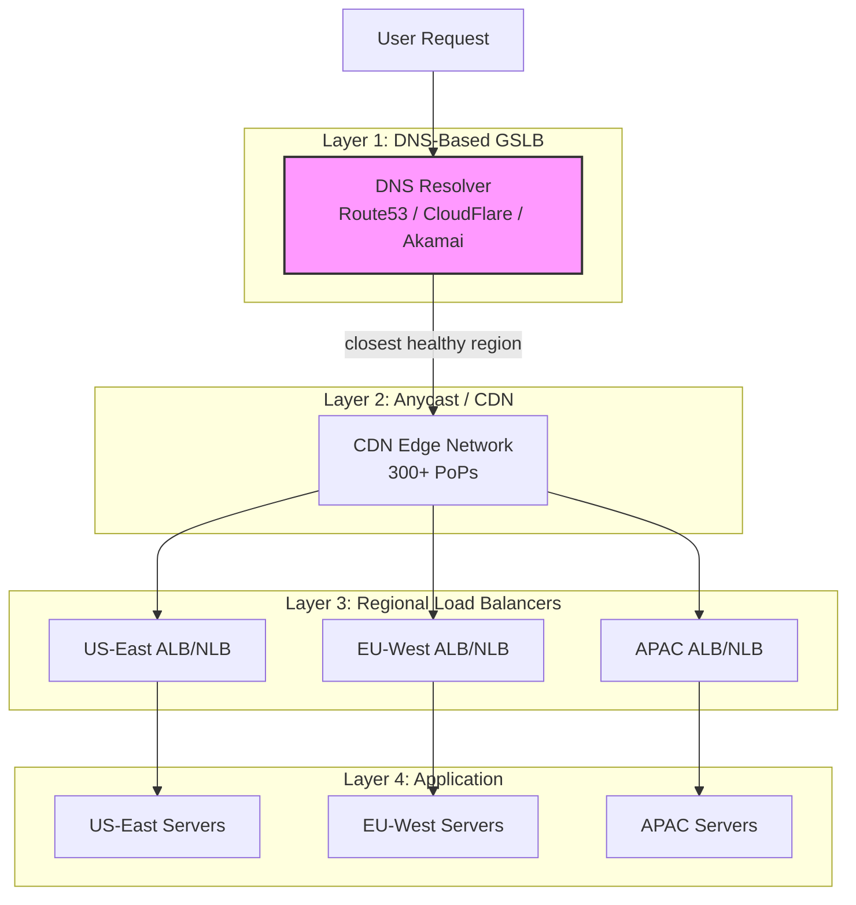
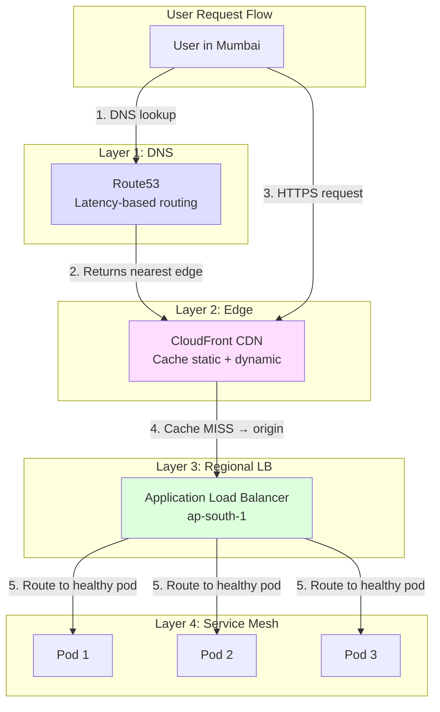
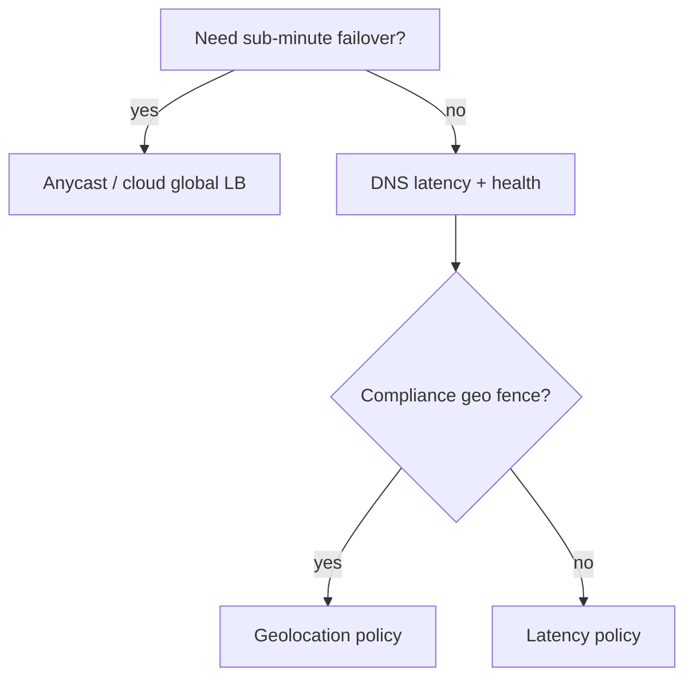

# Global Load Balancing

## What Is Global Load Balancing?

Regular load balancing distributes traffic across servers **within** a data center. **Global load balancing (GSLB)** distributes traffic across **multiple regions or data centers worldwide**.

> GSLB answers the question: "Which region should this user's request go to?"

---

## Why Do You Need It?

```
Without GSLB:                          With GSLB:
┌──────────┐                           ┌──────────┐
│ User in  │──── 200ms ────►│ US-East│  │ User in  │── 20ms ──►│ EU-West │
│ Berlin   │                │         │  │ Berlin   │            │ (local) │
└──────────┘                └─────────┘  └──────────┘            └─────────┘

All users go to one region             Each user goes to the nearest
regardless of location                 healthy region
```

---

## GSLB Architecture



---

## GSLB Methods

### Method 1: DNS-Based (Most Common)

The DNS resolver returns the IP address of the **nearest healthy region**.

```
User in Tokyo resolves api.example.com:

  User → DNS Resolver → "Which IP?"
  
  Route53 checks:
  ├── US-East: 52.1.2.3  (healthy ✅, latency: 180ms)
  ├── EU-West: 34.5.6.7  (healthy ✅, latency: 250ms)
  └── AP-Tokyo: 13.8.9.0 (healthy ✅, latency: 5ms)  ← WINNER
  
  DNS Response: 13.8.9.0 (TTL: 60s)
```

```python
# AWS Route53 — Latency-based routing
import boto3

route53 = boto3.client('route53')

# Create latency-based records for each region
regions = {
    "us-east-1": {"ip": "52.1.2.3",  "health_check": "hc-us"},
    "eu-west-1": {"ip": "34.5.6.7",  "health_check": "hc-eu"},
    "ap-northeast-1": {"ip": "13.8.9.0", "health_check": "hc-ap"},
}

for region, config in regions.items():
    route53.change_resource_record_sets(
        HostedZoneId='Z123456',
        ChangeBatch={'Changes': [{
            'Action': 'UPSERT',
            'ResourceRecordSet': {
                'Name': 'api.example.com',
                'Type': 'A',
                'SetIdentifier': region,
                'Region': region,        # Latency-based routing
                'TTL': 60,
                'ResourceRecords': [{'Value': config['ip']}],
                'HealthCheckId': config['health_check'],
            },
        }]},
    )
```

### DNS Routing Policies

```yaml
# Route53 routing policies

# 1. Latency-based: Route to lowest latency region
latency_based:
  - region: us-east-1
    endpoint: us-east-alb.example.com
    health_check: /health
  - region: eu-west-1
    endpoint: eu-west-alb.example.com
    health_check: /health
  # Route53 measures latency from DNS resolver to each region

# 2. Geolocation: Route based on user's country
geolocation:
  - location: "North America"
    endpoint: us-east-alb.example.com
  - location: "Europe"
    endpoint: eu-west-alb.example.com
  - location: "Asia"
    endpoint: ap-alb.example.com
  - location: "Default"        # Catch-all for unmapped locations
    endpoint: us-east-alb.example.com

# 3. Weighted: Distribute traffic by percentage
weighted:
  - endpoint: us-east-alb.example.com
    weight: 70      # 70% of traffic
  - endpoint: eu-west-alb.example.com
    weight: 20      # 20% of traffic
  - endpoint: ap-alb.example.com
    weight: 10      # 10% of traffic

# 4. Failover: Primary + secondary
failover:
  primary:
    endpoint: us-east-alb.example.com
    health_check: /health
  secondary:
    endpoint: eu-west-alb.example.com
    # Only used when primary fails health check
```

---

### Method 2: Anycast

Multiple servers in different locations **share the same IP address**. BGP routing sends traffic to the nearest one.

```
Anycast IP: 1.2.3.4 is announced from 3 data centers

User in Tokyo:
  Packet to 1.2.3.4 → BGP routes to Tokyo PoP (2ms) ✅

User in London:
  Packet to 1.2.3.4 → BGP routes to London PoP (5ms) ✅

User in New York:
  Packet to 1.2.3.4 → BGP routes to NYC PoP (3ms) ✅

All users connect to the SAME IP but reach DIFFERENT servers!
```

```
DNS-Based vs Anycast:

DNS-Based:
  ✅ Works with any protocol (HTTP, gRPC, WebSocket)
  ✅ Can make smart decisions (geolocation, latency, weighted)
  ❌ DNS caching means slow failover (TTL dependent)
  ❌ DNS resolvers may not be near the user

Anycast:
  ✅ Instant failover (BGP re-routes in seconds)
  ✅ No DNS propagation delay
  ✅ Simple — one IP for the whole world
  ❌ Mainly for UDP (DNS) and short-lived TCP
  ❌ Long-lived TCP connections can break on route changes
  ❌ Less control over routing decisions
```

---

### Method 3: Global Load Balancer (L7)

Cloud providers offer global L7 load balancers that operate above DNS.

```yaml
# Google Cloud Global Load Balancer
# Single anycast IP, smart routing across regions

resource "google_compute_global_forwarding_rule" "default" {
  name       = "global-rule"
  target     = google_compute_target_https_proxy.default.id
  port_range = "443"
  ip_address = google_compute_global_address.default.address
  # This is an anycast IP — works globally
}

resource "google_compute_backend_service" "default" {
  name = "api-backend"
  
  # Backends in multiple regions
  backend {
    group = google_compute_instance_group.us_east.id
    capacity_scaler = 1.0
  }
  backend {
    group = google_compute_instance_group.eu_west.id
    capacity_scaler = 1.0
  }
  backend {
    group = google_compute_instance_group.asia.id
    capacity_scaler = 1.0
  }

  # Health check
  health_checks = [google_compute_health_check.default.id]

  # Connection draining
  connection_draining_timeout_sec = 300
}
```

```
AWS Global Accelerator:
┌──────────────────────────────────────────────────────┐
│  User → Anycast IP → AWS Edge Location (nearest)    │
│       → AWS backbone → Regional endpoint (best)      │
│                                                      │
│  Benefits:                                           │
│  • Uses AWS backbone (not public internet)           │
│  • Instant failover (no DNS propagation)             │
│  • Static IP addresses (good for allowlisting)       │
│  • TCP/UDP support                                   │
└──────────────────────────────────────────────────────┘
```

---

## Health Checks: The Foundation

GSLB only works if unhealthy regions are detected quickly.

```python
# Multi-layer health checks

class HealthCheckEndpoint:
    """
    /health endpoint that checks all critical dependencies.
    GSLB uses this to determine if a region is healthy.
    """
    
    async def health_check(self):
        checks = {}
        overall_healthy = True
        
        # Check database
        try:
            await db.execute("SELECT 1")
            checks["database"] = {"status": "healthy", "latency_ms": 2}
        except Exception as e:
            checks["database"] = {"status": "unhealthy", "error": str(e)}
            overall_healthy = False
        
        # Check cache
        try:
            await redis.ping()
            checks["cache"] = {"status": "healthy"}
        except Exception:
            checks["cache"] = {"status": "degraded"}
            # Cache failure = degraded but not unhealthy
        
        # Check downstream services
        try:
            resp = await httpx.get("http://payment-svc/health", timeout=2)
            checks["payment_service"] = {
                "status": "healthy" if resp.status_code == 200 else "unhealthy"
            }
        except Exception:
            checks["payment_service"] = {"status": "unhealthy"}
            overall_healthy = False
        
        status_code = 200 if overall_healthy else 503
        return JSONResponse(
            status_code=status_code,
            content={
                "status": "healthy" if overall_healthy else "unhealthy",
                "region": os.environ["AWS_REGION"],
                "checks": checks,
                "timestamp": datetime.utcnow().isoformat(),
            },
        )

# Route53 health check configuration:
# - Check /health every 10 seconds
# - 3 consecutive failures = unhealthy
# - Remove from DNS within 30-60 seconds
```

---

## Putting It All Together: Multi-Layer GSLB



---

## GSLB Comparison

| Method | Failover Speed | Control | Protocol | Cost | Best For |
|---|---|---|---|---|---|
| **DNS (Route53)** | 30-120s (TTL) | High | Any | Low | Most applications |
| **Anycast** | 1-10s (BGP) | Low | UDP, short TCP | Medium | DNS, CDN |
| **GCP Global LB** | Instant | High | HTTP/S, TCP | Medium | GCP apps |
| **AWS Global Accelerator** | 1-10s | Medium | TCP, UDP | Medium | Low-latency apps |
| **CloudFlare** | Instant | High | HTTP/S | Varies | Web applications |

---

## Key Takeaways

- **DNS-based GSLB** is the most common approach — simple and works with any protocol
- **Anycast** provides the fastest failover but is limited in routing control
- **Cloud global LBs** (GCP, AWS Global Accelerator) combine benefits of both
- **Health checks are critical** — a GSLB that routes to a dead region is worse than no GSLB
- **Low DNS TTLs** (60s) are essential for fast DNS-based failover
- Layer your GSLB: DNS → CDN → Regional LB → Service mesh for defense in depth
- **Test failover regularly** — GSLB config errors are a common cause of multi-region outages

---

## Senior Pitfalls

| Mistake | Impact | Fix |
|---------|--------|-----|
| GeoDNS with TTL too high during failover | Users hit dead region for minutes | Low TTL on health-driven records; use anycast or managed GSLB |
| Routing on geographic IP only | Misrouted corporate VPN and mobile users | Latency-based or hybrid; validate with RUM geo |
| No capacity-aware routing | "Healthy" region overloaded after shift | Weight by CPU/latency/error rate; shed load gradually |
| Sticky sessions across regions | Failover breaks sessions | Stateless JWT or regional session store with replication |
| GSLB config never tested | Wrong health check path during real outage | Quarterly failover automation with synthetic validation |

---

## Production-grade Practice

1. **Build:** Configure health-checked GSLB for two regions; document primary/secondary weights and override runbook.
2. **Debug:** Blackhole one region in staging; verify traffic shifts within SLO and no thundering herd on survivor.
3. **Measure:** Track per-region request share vs capacity; alert on imbalance > 15%.
4. **Capacity plan:** Size each region to handle 100% of global traffic for N hours; cost the idle headroom vs partial redundancy.

---

## FAANG Interview Deep Dive

### Real-world examples

**Cloudflare anycast (300+ PoPs)**  
Cloudflare advertises the **same IP** from many PoPs via **BGP anycast**; a user in Berlin hits **Frankfurt (~10–20ms)** instead of **US-East (~150ms+)**. Failover is **BGP convergence** (often **seconds**), not DNS TTL. Trade-off: **limited L7 routing** at the edge unless you add Workers or split hostnames.

**Google Cloud Global HTTP(S) Load Balancer**  
GCP terminates TLS at the **edge PoP** closest to the user, then forwards over Google’s backbone to **nearest healthy backend region**. Health checks remove unhealthy backends in **~seconds**—faster than **60s DNS TTL** alone. Used when **HTTP/S** and **Google-centric** stack align.

**AWS Route 53 + Global Accelerator**  
Route 53 **latency-based routing** with **health checks** steers DNS; **Global Accelerator** uses **anycast IPs** with **TCP/UDP** and sticky **5-tuple** flows. Combined, Netflix-adjacent patterns achieve **sub-10s** regional drain when an AZ fails—if health probe design matches **real user paths** (not just `/healthz` on one pod).

| Layer | Failover speed | Sticky sessions |
|-------|----------------|-----------------|
| DNS (TTL 60s) | 30–120s | Client resolver dependent |
| Anycast / GA | 1–30s | Flow-based |
| CDN edge | Instant origin switch | Cookie / cache keys |

### Interview Q&A

### Q: DNS-based GSLB failed during an outage—why?
**A:** Common causes: **TTL too high**, **stale negative cache**, health checks hitting **wrong port/path**, **split-brain healthy** (LB up, app broken), and **geo DNS mapping errors**. Staff answer: **synthetic probes** from multiple vantage points + **RUM (real user monitoring)** to validate steering.

### Q: How do you steer users without breaking sessions?
**A:** **Stateless JWT** or **centralized session store** (Redis/DynamoDB). If sessions are regional, **sticky DNS** traps users in a failing region—use **short TTL + connection draining** or **global session replication**. Trade-off: replication lag vs logout on failover.

### Q: Latency-based vs geolocation routing?
**A:** **Latency** picks lowest RTT (good for APIs). **Geolocation** picks policy region (compliance, licensing). **Weighted** supports blue/green and **capacity-based** drain (shift 10% traffic/min). Interviewers want **weighted + health** for controlled failover.

### Q: When is anycast a bad fit?
**A:** Long-lived **TCP** with **stateful middleboxes**, **non-HTTP protocols** without GA support, or when you need **per-user L7 routing** at first packet. Also **asymmetric routing** can confuse some firewalls.

### Q: How do you test GSLB without taking production down?
**A:** **Synthetic DNS resolvers** in multiple regions, **shadow hostnames**, **weighted canary** to new region, and **chaos** on origin while measuring **steering time**. Document **expected resolver behavior** (some mobile carriers cache aggressively).

### Common mistakes candidates make

- **Health check = 200 OK** from localhost while DB is dead.
- **Single DNS provider**—no secondary authority or registrar lock risk.
- Ignoring **CDN cache** serving errors globally during origin failover.
- **Geo DNS** for GDPR but **replicating PII** to all regions anyway.
- Assuming **low TTL** alone gives instant failover (**propagation ≠ TTL**).

### Decision framework



**Capacity math:** Shifting **100% traffic** from region A to B in **T minutes** requires B’s autoscaler to add capacity at rate **≥ (traffic_A) / T**. If scale-up needs **10 min**, start drain at **T-10** or keep B at **≥50%** headroom.

### Health-check design

| Check type | Catches | Misses |
|------------|---------|--------|
| TCP to LB | Dead listener | App 500s |
| HTTP `/healthz` | Process up | DB down |
| Deep check (DB ping) | Data path | Slower, flappy |
| RUM / synthetics | User path | Expensive |

```json
// Route53-style: alarm if 3 of 4 regions unhealthy
{
  "minHealthyRegions": 2,
  "healthCheckPath": "/ready",
  "latencyRoutingPolicy": "use-healthy-only"
}
```

**Staff signal:** Discuss **DNS vs anycast vs L7 global LB** as a **stack**, not a winner-take-all—GitHub-style outages are often **control plane**, not origin CPU.
