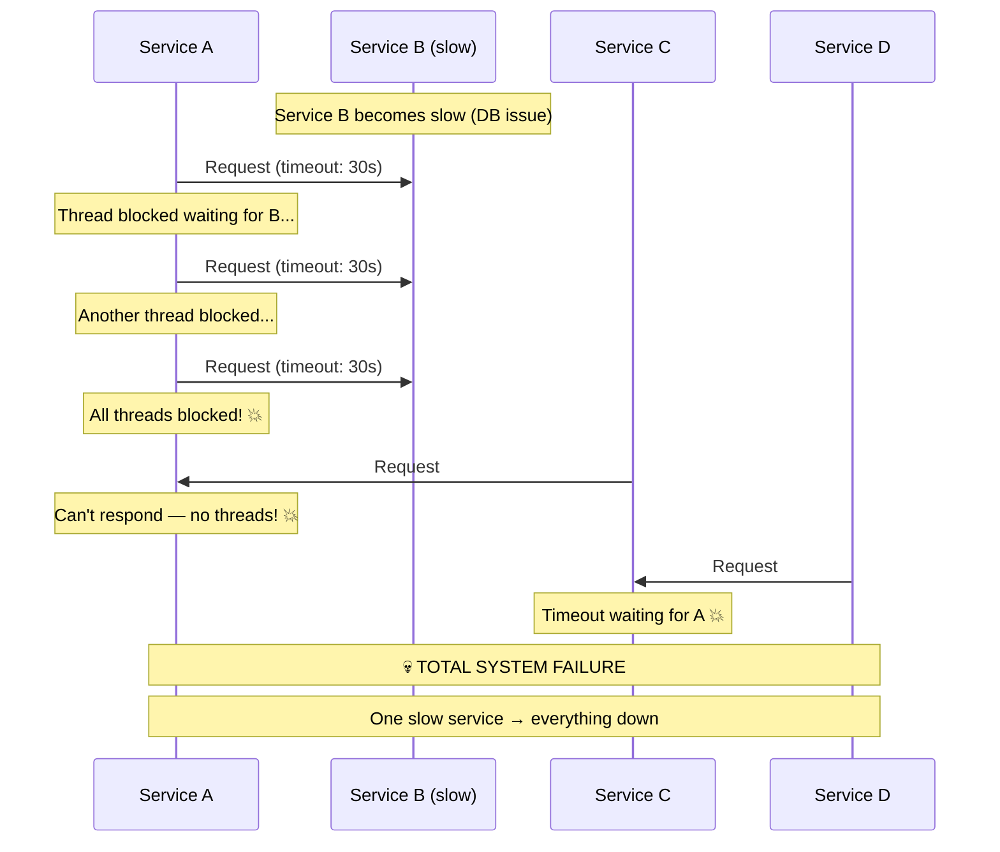
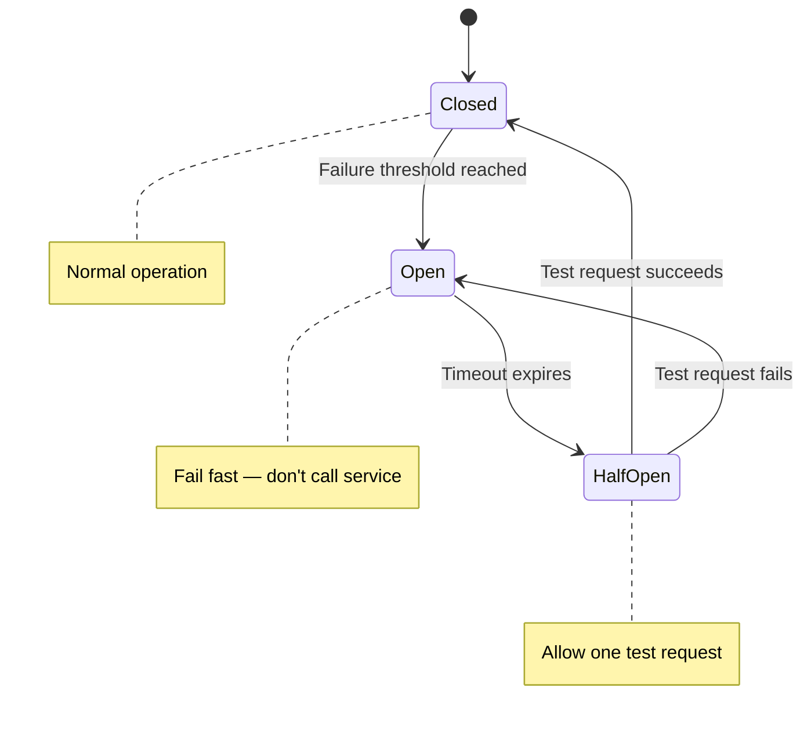
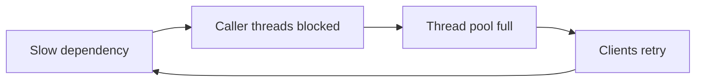
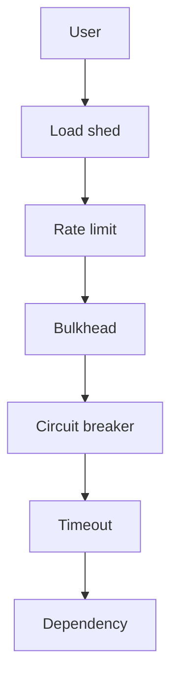

# Cascading Failure Prevention

## What Is a Cascading Failure?

A **cascading failure** is when the failure of one component triggers failures in dependent components, which trigger more failures, creating a domino effect that brings down the entire system.

> Think of it like a power grid blackout: one transformer overloads → its load shifts to neighboring transformers → they overload → the entire grid collapses.

---

## How Cascading Failures Happen



```
The Domino Effect:

Service B slows down (root cause)
    │
    ▼
Service A exhausts thread pool (waiting for B)
    │
    ▼
Services C, D, E can't reach A
    │
    ▼
Frontend shows errors to ALL users
    │
    ▼
☠️ Complete outage — from ONE slow service!
```

---

## Prevention Strategy 1: Circuit Breaker

The circuit breaker **stops calling a failing service** before it drags you down.



```python
import time
from enum import Enum

class CircuitState(Enum):
    CLOSED = "closed"       # Normal — requests flow through
    OPEN = "open"           # Tripped — fail fast, don't call service
    HALF_OPEN = "half_open" # Testing — allow one request through

class CircuitBreaker:
    def __init__(
        self,
        failure_threshold: int = 5,     # Open after 5 failures
        recovery_timeout: int = 30,     # Try again after 30 seconds
        success_threshold: int = 3,     # Close after 3 successes in half-open
    ):
        self.failure_threshold = failure_threshold
        self.recovery_timeout = recovery_timeout
        self.success_threshold = success_threshold
        
        self.state = CircuitState.CLOSED
        self.failure_count = 0
        self.success_count = 0
        self.last_failure_time = None
    
    async def call(self, func, *args, **kwargs):
        if self.state == CircuitState.OPEN:
            # Check if recovery timeout has passed
            if time.time() - self.last_failure_time > self.recovery_timeout:
                self.state = CircuitState.HALF_OPEN
                self.success_count = 0
                print("Circuit → HALF_OPEN (testing)")
            else:
                raise CircuitOpenError(
                    "Circuit is OPEN — failing fast to protect system"
                )
        
        try:
            result = await func(*args, **kwargs)
            self._on_success()
            return result
        except Exception as e:
            self._on_failure()
            raise
    
    def _on_success(self):
        if self.state == CircuitState.HALF_OPEN:
            self.success_count += 1
            if self.success_count >= self.success_threshold:
                self.state = CircuitState.CLOSED
                self.failure_count = 0
                print("Circuit → CLOSED (recovered!)")
        else:
            self.failure_count = 0  # Reset on success
    
    def _on_failure(self):
        self.failure_count += 1
        self.last_failure_time = time.time()
        
        if self.failure_count >= self.failure_threshold:
            self.state = CircuitState.OPEN
            print(f"Circuit → OPEN (after {self.failure_count} failures)")


# Usage
payment_breaker = CircuitBreaker(failure_threshold=5, recovery_timeout=30)

async def process_payment(order):
    try:
        result = await payment_breaker.call(
            payment_service.charge, order.amount
        )
        return result
    except CircuitOpenError:
        # Fallback: queue for later processing
        await payment_queue.enqueue(order)
        return {"status": "queued", "message": "Payment will be processed shortly"}
```

---

## Prevention Strategy 2: Timeouts and Deadlines

**Every** external call must have a timeout. No exceptions.

```python
import asyncio
import httpx

# ❌ BAD: No timeout — can block forever
response = await httpx.get("http://slow-service/api/data")

# ✅ GOOD: Explicit timeout
response = await httpx.get(
    "http://slow-service/api/data",
    timeout=httpx.Timeout(
        connect=2.0,    # 2 seconds to establish connection
        read=5.0,       # 5 seconds to read response
        write=5.0,      # 5 seconds to send request
        pool=3.0,       # 3 seconds to get connection from pool
    ),
)

# ✅ BETTER: Deadline propagation
# If the overall request has 10 seconds, and you've spent 4 seconds,
# downstream calls get at most 6 seconds

class DeadlinePropagator:
    def __init__(self, total_deadline_seconds: float):
        self.deadline = time.time() + total_deadline_seconds
    
    def remaining(self) -> float:
        return max(0, self.deadline - time.time())
    
    async def call_service(self, url: str):
        remaining = self.remaining()
        if remaining <= 0:
            raise DeadlineExceededError("No time remaining")
        
        return await httpx.get(url, timeout=remaining)

# Usage
deadline = DeadlinePropagator(total_deadline_seconds=10)

# First call takes 4 seconds
result_a = await deadline.call_service("http://service-a/data")  # timeout=10s

# Second call gets remaining time
result_b = await deadline.call_service("http://service-b/data")  # timeout=6s

# Third call gets even less
result_c = await deadline.call_service("http://service-c/data")  # timeout=1s
```

---

## Prevention Strategy 3: Bulkheads

Isolate resources so one failure can't consume all capacity (covered in detail in the Blast Radius doc).

```python
import asyncio

class BulkheadedHttpClient:
    """Separate connection pools per downstream service."""
    
    def __init__(self):
        # Each service gets its own connection pool
        self.clients = {
            "payment": httpx.AsyncClient(
                base_url="http://payment-svc",
                limits=httpx.Limits(
                    max_connections=20,        # Max 20 connections
                    max_keepalive_connections=10,
                ),
                timeout=httpx.Timeout(5.0),
            ),
            "inventory": httpx.AsyncClient(
                base_url="http://inventory-svc",
                limits=httpx.Limits(
                    max_connections=10,
                    max_keepalive_connections=5,
                ),
                timeout=httpx.Timeout(3.0),
            ),
            "notification": httpx.AsyncClient(
                base_url="http://notification-svc",
                limits=httpx.Limits(
                    max_connections=5,
                    max_keepalive_connections=3,
                ),
                timeout=httpx.Timeout(2.0),
            ),
        }
    
    async def call(self, service: str, path: str):
        client = self.clients.get(service)
        if not client:
            raise ValueError(f"Unknown service: {service}")
        return await client.get(path)

# Payment being slow won't exhaust inventory or notification connections!
```

---

## Prevention Strategy 4: Load Shedding

When the system is overloaded, **reject excess requests** gracefully instead of processing them slowly (which causes cascading failures).

```python
import time
from collections import deque

class LoadShedder:
    """
    Reject requests when the system is overloaded.
    Better to serve 80% of users well than 100% of users badly.
    """
    
    def __init__(
        self,
        max_concurrent: int = 100,
        max_queue_depth: int = 50,
        max_latency_ms: float = 500,
    ):
        self.max_concurrent = max_concurrent
        self.max_queue_depth = max_queue_depth
        self.max_latency_ms = max_latency_ms
        
        self.current_concurrent = 0
        self.recent_latencies = deque(maxlen=100)
    
    def should_shed(self) -> tuple[bool, str]:
        """Decide whether to reject this request."""
        
        # Check 1: Too many concurrent requests
        if self.current_concurrent >= self.max_concurrent:
            return True, "max_concurrent_exceeded"
        
        # Check 2: Latency is too high (system is struggling)
        if self.recent_latencies:
            avg_latency = sum(self.recent_latencies) / len(self.recent_latencies)
            if avg_latency > self.max_latency_ms:
                return True, "high_latency"
        
        return False, ""
    
    async def execute(self, request_handler):
        should_reject, reason = self.should_shed()
        
        if should_reject:
            # Return 503 immediately — don't even try to process
            return Response(
                status_code=503,
                headers={"Retry-After": "5"},
                content=json.dumps({
                    "error": "Service overloaded",
                    "reason": reason,
                    "retry_after_seconds": 5,
                }),
            )
        
        self.current_concurrent += 1
        start = time.time()
        
        try:
            result = await request_handler()
            return result
        finally:
            duration_ms = (time.time() - start) * 1000
            self.recent_latencies.append(duration_ms)
            self.current_concurrent -= 1


# Priority-based load shedding
class PriorityLoadShedder:
    """Shed low-priority requests first."""
    
    def get_priority(self, request) -> int:
        # Premium users get priority
        if request.headers.get("X-Customer-Tier") == "premium":
            return 3  # HIGH
        
        # Health checks are critical
        if request.path == "/health":
            return 3  # HIGH
        
        # Read requests are cheaper than writes
        if request.method == "GET":
            return 2  # MEDIUM
        
        return 1  # LOW
    
    def should_shed(self, request) -> bool:
        load = self.get_system_load()
        priority = self.get_priority(request)
        
        if load > 90 and priority == 1:
            return True  # Shed low-priority first
        if load > 95 and priority <= 2:
            return True  # Shed medium-priority too
        if load > 99:
            return True  # Shed everything (except health)
        
        return False
```

---

## Prevention Strategy 5: Retry with Backoff

Retries without backoff make cascading failures **worse** — they multiply load on an already struggling service.

```python
import random
import asyncio

async def retry_with_exponential_backoff(
    func,
    max_retries: int = 3,
    base_delay: float = 0.5,
    max_delay: float = 30.0,
    jitter: bool = True,
):
    """
    Retry with exponential backoff and jitter.
    
    ❌ BAD:  Retry immediately → 10,000 retries hit struggling service
    ✅ GOOD: Retry with backoff → spread load over time
    """
    for attempt in range(max_retries + 1):
        try:
            return await func()
        except RetryableError as e:
            if attempt == max_retries:
                raise  # Final attempt failed
            
            # Exponential backoff: 0.5s, 1s, 2s, 4s, 8s...
            delay = min(base_delay * (2 ** attempt), max_delay)
            
            if jitter:
                # Add randomness so retries don't all happen at the same time
                delay = delay * (0.5 + random.random())
            
            print(f"Retry {attempt + 1}/{max_retries} in {delay:.1f}s")
            await asyncio.sleep(delay)

# Even better: set a retry budget
class RetryBudget:
    """Limit total retries to prevent retry storms."""
    
    def __init__(self, ratio: float = 0.1):
        self.ratio = ratio  # Retries should be < 10% of total requests
        self.request_count = 0
        self.retry_count = 0
    
    def can_retry(self) -> bool:
        if self.request_count == 0:
            return True
        return (self.retry_count / self.request_count) < self.ratio
    
    def record_request(self):
        self.request_count += 1
    
    def record_retry(self):
        self.retry_count += 1
```

---

## Prevention Strategy 6: Graceful Degradation

When dependencies fail, **degrade gracefully** instead of failing completely.

```python
class OrderService:
    async def get_order_page(self, order_id: str):
        order = await self.db.get_order(order_id)  # Critical
        
        # Non-critical enrichments — fail gracefully
        try:
            recommendations = await asyncio.wait_for(
                self.recommendation_svc.get(order.user_id),
                timeout=2.0,
            )
        except (asyncio.TimeoutError, Exception):
            recommendations = []  # Degrade: show no recommendations
        
        try:
            reviews = await asyncio.wait_for(
                self.review_svc.get(order.product_ids),
                timeout=2.0,
            )
        except (asyncio.TimeoutError, Exception):
            reviews = None  # Degrade: hide reviews section
        
        try:
            loyalty_points = await asyncio.wait_for(
                self.loyalty_svc.get_points(order.user_id),
                timeout=1.0,
            )
        except (asyncio.TimeoutError, Exception):
            loyalty_points = None  # Degrade: hide loyalty widget
        
        return {
            "order": order,                     # Always shown
            "recommendations": recommendations, # May be empty
            "reviews": reviews,                 # May be hidden
            "loyalty_points": loyalty_points,   # May be hidden
        }
```

---

## The Complete Defense Stack

```mermaid
graph TB
    subgraph "Request Flow with All Protections"
        Req[Incoming Request]
        LS[Load Shedder<br/>"Reject if overloaded"]
        TO[Timeout<br/>"Don't wait forever"]
        CB[Circuit Breaker<br/>"Stop calling failed services"]
        BH[Bulkhead<br/>"Isolate resource pools"]
        RT[Retry with Backoff<br/>"Retry carefully"]
        GD[Graceful Degradation<br/>"Partial response > error"]
        Resp[Response]
    end

    Req --> LS
    LS -->|"allowed"| TO
    LS -->|"rejected"| Resp
    TO --> CB
    CB -->|"closed"| BH
    CB -->|"open"| GD
    BH --> RT
    RT -->|"success"| Resp
    RT -->|"all retries failed"| GD
    GD --> Resp

    style LS fill:#fdd
    style CB fill:#ffd
    style BH fill:#dfd
    style GD fill:#ddf
```

---

## Real-World Example: The 2017 Amazon S3 Outage

```
What happened:
1. An engineer ran a maintenance script with a typo
2. Script removed too many S3 servers
3. Remaining servers couldn't handle the load
4. S3 APIs became slow/unavailable
5. Hundreds of AWS services depend on S3
6. Cascading failure brought down much of AWS
7. The S3 dashboard couldn't even display the outage
   (because the dashboard depends on S3!)

Duration: ~4 hours
Impact: Estimated $150M+ in damages across the internet

Lessons:
• Rate-limit administrative operations
• Don't depend on the system you're monitoring TO monitor it
• Cascading failures can start from ANY component
```

---

## Key Takeaways

- Cascading failures are the **#1 cause** of large-scale outages
- **Timeouts on every call** — the simplest and most important defense
- **Circuit breakers** stop calling failed services → prevent thread exhaustion
- **Load shedding** rejects excess traffic → better to serve 80% well than 100% poorly
- **Bulkheads** isolate failure domains → one slow service doesn't affect others
- **Retry with backoff + jitter** — retries without backoff are an amplifier, not a solution
- **Graceful degradation** — show a partial page instead of an error page
- Test your defenses with **chaos engineering** — untested circuit breakers are untested
- Layer all these patterns together for **defense in depth**

---

## Senior Pitfalls

| Mistake | Impact | Fix |
|---------|--------|-----|
| Retries without jitter on 503 storms | Retry multiplication collapses dependency | Exponential backoff + jitter; cap max attempts |
| Circuit breaker thresholds never tuned | Opens too late or flaps on noise | Load-test trip points; align with dependency SLO |
| Timeouts longer than client timeouts | Thread pile-up and garbage work | End-to-end timeout budget per request chain |
| Shedding load only at the edge | Inner services still OOM | Admission control at each hop; prioritize critical tenants |
| Sync call chains ten deep | One slow leaf blocks entire tree | Async boundaries, caching, and parallel fan-out with deadlines |

---

## Production-grade Practice

1. **Build:** Add timeouts, retries (with jitter), and a circuit breaker on one hot dependency; define fallback behavior.
2. **Debug:** Use fault injection to slow a dependency 5×; observe retry rate, breaker state, and whether load shedding triggers.
3. **Measure:** Dashboard retry amplification factor and breaker open duration; SLO on dependency error propagation.
4. **Capacity plan:** Model worst-case retry load (clients × retries) against dependency max RPS; set global rate limits.

---

## FAANG Interview Deep Dive

### Real-world examples

**Amazon S3 outage (Feb 2017)**  
An operator typo in a **billing subsystem** command caused **cascading removal of S3 index servers**; remaining nodes could not serve metadata. **Hundreds of AWS services** depend on S3—dashboards failed because **status pages stored assets in S3**. Duration **~4 hours**; industry cost estimates **$150M+**. Root lesson: **admin operations need rate limits** and **monitoring must not depend solely on the failing tier**.

**Netflix Hystrix era**  
Netflix open-sourced **Hystrix** (circuit breakers, bulkheads, timeouts) after learning that **one slow dependency** could stall **all Tomcat threads**. At peak they served **tens of millions** of concurrent streams—thread exhaustion became **total API outage** faster than dependency recovery.

**Meta “retry storm” (pattern)**  
When a cache tier flickers, **clients + middle tiers** retry without jitter, multiplying load **10–100×**—the dependency dies completely. Mitigation: **retry budgets** (Google gRPC), **exponential backoff + full jitter**, and **hedging only on idempotent reads** with tight caps.



### Interview Q&A

### Q: Timeout, circuit breaker, or bulkhead—which do you add first?
**A:** **Timeouts everywhere** first—unbounded waits are the root amplifier. Then **bulkheads** (cap concurrency per dependency). Then **circuit breakers** to fail fast when error/latency thresholds trip. Order matters: breaker without timeout can **open too late**.

### Q: How do you set circuit breaker thresholds?
**A:** Base on **SLO**: if dependency p99 is 50ms, client timeout might be **200–500ms** (not 30s). Open circuit when **error rate > X%** or **slow call rate > Y%** over sliding window (e.g., 10s). **Half-open** probes with **1 request** prevent thundering herd on recovery.

### Q: Retries: when are they harmful?
**A:** On **non-idempotent writes**, **overloaded dependencies**, or **without jitter** during incidents. Rule: **max 2–3 retries**, backoff capped, **retry budget** per request chain. Staff cite **AWS SDK defaults** as often too aggressive without tuning.

### Q: Load shedding vs rate limiting?
**A:** **Rate limiting** protects your service from clients; **load shedding** drops **low-priority work** when **saturation** (CPU, queue depth) threatens SLO. Shed **background jobs** before **checkout**; return **503 + Retry-After** with **consistent hashing** so retries don’t all hit one node.

### Q: How does graceful degradation differ from failure?
**A:** Serve **stale cache**, **default recommendations**, or **read-only mode** with explicit UX. Netflix may show **“unable to personalize”** but still play video. Measure **degraded SLI** separately from **hard errors**.

### Common mistakes candidates make

- **30s default HTTP timeouts** on internal calls—guarantees thread pool death.
- Circuit breaker that **never opens** (thresholds too high) or **flaps** (no half-open cooldown).
- **Retry storms** from mesh + client + server each retrying independently.
- **No backpressure** on message queues—infinite buffer delays cascade until disk full.
- Testing breakers only in unit tests, not under **partial CPU throttle** chaos.

### Decision framework & capacity math

| Defense | Protects against | Cost |
|---------|------------------|------|
| Timeout | Thread/memory exhaustion | False timeouts |
| Bulkhead | One bad dependency | Lower peak throughput |
| Circuit breaker | Retry amplification | Stale fallbacks needed |
| Load shed | Overload collapse | Dropped requests |
| Queue + DLQ | Unbounded lag | Operational complexity |

**Thread pool math:** Pool size **P**, request rate **λ**, dependency latency **L** → need **P ≥ λ × L** (Little’s law). If dependency slows 2×, required threads double—**bulkhead cap** forces fail-fast instead of **P explosion**.

```python
# Full jitter backoff (AWS pattern)
delay = random.uniform(0, min(cap, base * 2 ** attempt))
```

### Defense layering (interview draw)



| Symptom in incident | First knob | Second knob |
|---------------------|------------|-------------|
| Thread pool 100% | Lower timeout | Open circuit |
| Error rate spike | Stop retries | Shed tier-2 |
| Queue depth ∞ | Pause consumers | DLQ + alert |

**Staff signal:** Reference **S3 2017** and articulate **feedback loops** (dashboard on S3)—meta-failures separate principal-level answers from generic “add circuit breakers.”
