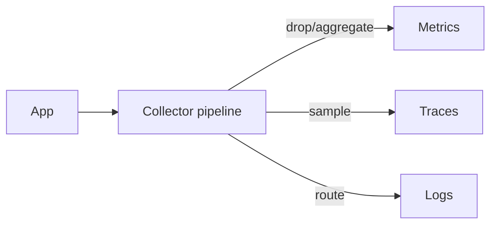
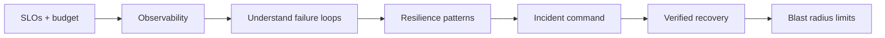
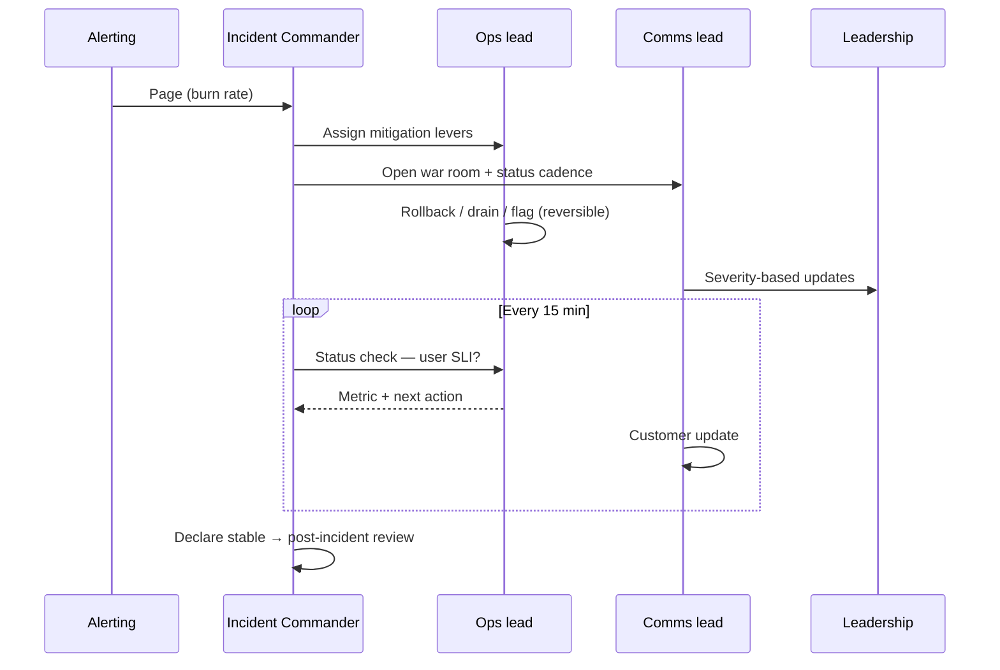
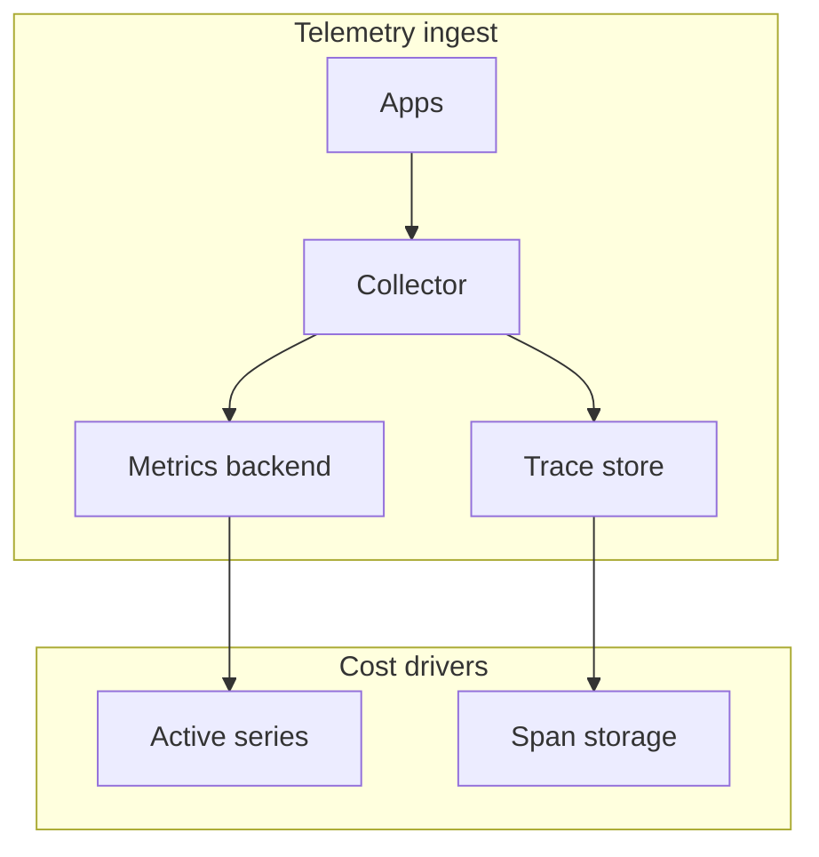

# SRE Operations: Observability, Incidents & Blast Radius

Operating reliable systems: measure user pain at a defensible cost, command incidents without debating root cause first, and **limit how far one bad change can reach**.

---

## 1. Observability architecture & economics

Telemetry is a **data platform with a bill**—cardinality is capacity.

### Signals

| Signal | Answers | Cost driver |
|--------|---------|-------------|
| **Metrics** | Aggregates, dashboards, alerts | **Active series** (labels) |
| **Logs** | Specific events | Volume, retention |
| **Traces** | Request path, latency | Spans stored |
| **Wide events** | Rich context per request | Per-event storage |

**Rule:** Low-cardinality always-on → metrics. Per-tenant / per-request detail → wide events or sampled traces.

### Cardinality explosion

Illustrative HTTP histogram:

```text
routes(40) × status(6) × region(300) × pod(12 buckets) ≈ 3.5M series
```

Swap `pod` for `customer_id` (50k tenants) → **hundreds of millions** of series.



**Enforce at collector:** drop labels, aggregate, redact PII **before** paid backend.

### Sampling

| Mode | Pros | Cons |
|------|------|------|
| **Head (1%)** | Cheap, stateless | Throws away most errors |
| **Tail (keep errors/slow)** | Keeps valuable traces | Stateful buffer tier; ~30s `decision_wait` |

Tail sampling sizing: `200k spans/s × 1KB × 30s ≈ 6GB` per tier—plan HA and restart behavior.

**Exemplars:** Link metric bucket to one trace.

### SLO tie-in (from track)

- Measure SLI where **user** experiences failure (not only server 200s).
- Serial dependencies multiply: five 99.9% hard deps → ~99.5% ceiling.
- Alert on **burn rate** with multi-window pairs—not static error %.

| Burn | Windows (example) | Budget consumed | Action |
|------|-------------------|-----------------|--------|
| 14.4× | 1h / 5m | 2% | Page |
| 6× | 6h / 30m | 5% | Page |
| 1× | 3d / 6h | 10% | Ticket |

Error budget policy must be **signed before** budget hits zero.

---

## 2. Incident command & learning

### Roles

| Role | Job |
|------|-----|
| **Incident Commander** | Coordinates; does **not** debug on keyboard |
| **Ops lead** | Executes changes |
| **Comms lead** | One channel, one cadence |

### Mitigate first—bounds

**Do** when reversible: rollback, drain, kill switch, feature flag.

**Pause** when state moves irreversibly:

- Forward-only schema migration rollback
- Failover with unreplicated writes (availability → consistency incident)

**Test:** “If wrong, undo in minutes with **no data harm**?”

```mermaid
gantt
  title Illustrative user impact
  dateFormat X
  axisFormat %M min
  section Diagnose first
  Debate root cause :0, 58
  Fix :58, 20
  section Mitigate first
  Rollback try :0, 5
  Recover :5, 15
```



### Severity

Treat as **routing**: who is paged, spend authorized, exec comms—not postmortem label.

### Post-incident

- **Contributing factors**, not single “root cause human.”
- Success = **repeat incident rate** + action item closure—not document count.

---

## 3. Blast radius: cells, shuffle sharding, safe change

> Assume the **next** deploy is broken—limit reach.

### Cell-based architecture

Full stack copy serves fraction of customers. Bad deploy/config poisons **one cell**.

Size cells by **largest acceptable failure** (customers, revenue %).

### Shuffle sharding

Each tenant assigned **k random workers** of N. Poison tenant kills its shard; overlap with another tenant probability ≈ `1/C(N,k)`.

```
8 workers, shard size 2 → C(8,2)=28 combinations
→ ~1/28 chance two tenants share exact pair
```

**Caveat:** Retries must not follow poison to second worker without isolation.

### Deploy waves

Align canary/prod waves to **cells**; bake time catches slow failures (memory leaks, metric drift).

### Static stability

Data plane serves from **last known good** config when control plane down—control planes fail during mass incidents.

**Audit:** Every data-plane → control-plane call is a dependency that can convert control incident into data outage.

### Historical shape

- **Knight Capital:** one server missed in deploy → runaway trading.
- **Cloudflare WAF:** one regex, whole fleet.

---

## 4. Operational economics checklist

| Question | Why |
|----------|-----|
| Series budget per service? | Prevents invoice incident |
| Top 3 dashboards—refresh cost? | Warehouse/OLAP bill |
| Trace sampling topology priced? | Extra LB + stateful collectors |
| Log retention vs debug need? | 90d hot, 1y cold tier |

---

## 5. Through-line (SRE track)



Reliability = feedback loops you **design** or that **design you**.

---

## Design review questions

1. Burn-rate alerts on user-facing SLI—with budget owner?
2. Which labels are unbounded—who enforces at ingest?
3. IC runbook: mitigate-first levers one command away?
4. Last measured **restore** time vs RTO?
5. Deploy: can one change hit all cells before health halts?
6. Shuffle sharding: retry behavior on partial shard failure?

*Source: Algoroq SRE — Observability Economics, Incident Command, Blast Radius, track overview.*

---

## 6. Real-world incident case studies

### GitHub (October 21, 2018)

**What happened:** A 43-second network partition between data centers triggered MySQL failover logic. Orchestration and proxy layers entered inconsistent states; a large fraction of API requests failed for **24+ hours** until manual intervention restored topology. The incident was not “database down” alone — **cascading placement and proxy config** sustained degradation.

**Root cause:** Control-plane and data-plane coupling during failover; insufficient guardrails on automation taking destructive actions under partition.

**Operations lessons:**

- Incident command must treat **“failover in progress”** as a distinct severity with comms and freeze on unrelated changes.
- Observability needs **dependency graphs** and failover state exposed as metrics — not only HTTP 500 rate.
- Game days must include **short partition** scenarios, not only full AZ loss.

### Facebook / Meta (October 4, 2021)

**What happened:** A maintenance mistake disconnected backbone connectivity; BGP announcements were withdrawn; DNS resolvers became unreachable externally. Internal tools also depended on the same paths — **operators struggled to reach systems** needed to fix the outage.

**Root cause:** **Blast radius of shared infrastructure** (DNS, auth, out-of-band access) and lack of **static stability** for emergency tooling.

**Lessons:**

- Out-of-band admin paths and break-glass credentials tested quarterly.
- Map every **“fix the incident”** tool’s dependency on the production network.
- Status comms channel must not depend solely on the failing property.

### Target (2013) — observability and detection angle

**What happened:** Retail POS systems were compromised via a vendor HVAC contractor’s network credentials. Lateral movement went undetected for weeks; card data exfiltration occurred during peak shopping season.

**Root cause (operations-relevant):** Insufficient **segmentation**, weak vendor access monitoring, and lack of **high-signal alerts** on anomalous east-west traffic — an observability and blast-radius story as much as security.

**Lessons:**

- **Cardinality and segmentation** limit how far one credential reaches (cells, network zones).
- Log volume without **detection objectives** does not improve MTTD — define SLIs for security-relevant signals with owners.

---

## 7. Incident response flow (sequence)



**Mitigate-first decision tree:**

| Situation | Action |
|-----------|--------|
| Bad deploy suspected | Rollback canary → full |
| Unknown cause, reversible lever exists | Rollback / disable feature |
| Schema migration forward-only | Pause migration; scale read path; no “rollback” without data plan |
| Failover may lose writes | IC + DBA explicit consent; document RPO tradeoff |

---

## 8. SLI / SLO / error budget — worked examples

### Availability SLI

**Definition:** proportion of successful `Checkouts` attempts where HTTP 2xx and duration < 3s.

Monthly window: **30 × 24 × 60 = 43,200 minutes**. SLO **99.95%**:

\[
\text{Budget} = 43{,}200 \times (1 - 0.9995) = 21.6 \text{ minutes/month}
\]

If an incident caused **9 minutes** of failing SLI:

\[
\frac{9}{21.6} \approx 41.7\% \text{ of monthly budget consumed}
\]

Policy example: >25% in one week → freeze non-critical deploys.

### Latency SLI (histogram)

10M requests/month; SLO: **95% < 200ms**. Allowed bad events: **500,000**. If a regression adds **50,000** slow events in a day, daily burn is **10%** of monthly latency budget — multi-window burn alert should page before day 10.

### Serial dependency ceiling

Five dependencies each **99.9%** available in the same window:

\[
0.999^5 \approx 0.9950 \quad (99.50\% \text{ ceiling})
\]

You cannot promise **99.95%** on the composite without **redundancy, fallbacks, or looser SLO** on the product path.

### Burn-rate alert math (Google SRE book style)

Target error rate for 99.9% monthly: **0.001**. Observed short-window error rate **0.0144** → burn multiplier **14.4×** → consumes **2%** of 30-day budget in **1 hour** if sustained — page-worthy.

| SLO | Monthly budget (min) | 2% budget (min) | At 14.4× burn, time to 2% |
|-----|----------------------|-----------------|---------------------------|
| 99.9% | 43.2 | 0.86 | ~1 h |
| 99.95% | 21.6 | 0.43 | ~1 h |
| 99.99% | 4.32 | 0.09 | ~1 h |

---

## 9. Latency budget allocation table

| Segment | Budget (ms) | Owner | Notes |
|---------|-------------|-------|-------|
| CDN / edge | 20 | Platform | TLS + cache miss |
| API gateway | 15 | Edge | Auth + rate limit |
| BFF fan-out (50 leaves) | 80 | Product API | Leaf p99 ≈ budget / 2 |
| Database | 40 | Data | Includes pool wait |
| Serialization | 10 | Service | Protobuf decode |
| **Total p99 target** | **200** | — | Non-additive; use simulation |

**Rule:** Allocate **deepest nines** to widest fan-out layers (see latency track).

---

## 10. Observability production checklist

| Item | Pass criteria |
|------|----------------|
| Label budget | No unbounded `user_id` on metrics |
| RED/USE | Rate, errors, duration per tier-0 service |
| Traces | Tail sampling keeps all errors + 1% happy |
| Logs | PII redacted at collector |
| Dashboards | Top 3 have owner + on-call link |
| Alerts | Page only on user SLI burn, not CPU |
| Runbooks | Link from alert to mitigate-first steps |
| Cardinality drill | Worst-case series count documented |

---

## 11. Blast radius & deploy checklist

| Control | Implementation |
|---------|----------------|
| Cells | Max customers per cell ≤ policy (e.g. 5%) |
| Shuffle shard | k≥2, retry does not hop shards blindly |
| Deploy waves | 1% → 10% → 50% → 100% with bake |
| Config | Same pipeline as binary; canary region first |
| Feature flags | Kill switch default-safe |
| Static stability | Data plane runs last-good config if CP down |
| Build verification | 100% instances on expected version post-deploy |

---

## 12. Deeper example: collector pipeline (drop labels)

```yaml
# Illustrative OpenTelemetry Collector processor
processors:
  attributes/drop:
    actions:
      - key: pod.name
        action: delete
  metricstransform/aggregate:
    transforms:
      - include: http.server.duration
        action: update
        operations:
          - action: aggregate_labels
            label_set: [route, status_code]
            aggregation_type: sum
```

**Economics:** Dropping `pod.name` on a 500-pod fleet removes **500×** series multiplication on that label alone.

---

## 13. Interview Q&A

### Q: Why alert on burn rate instead of a static error percentage?

**A:** A static “errors > 1%” page is either too noisy (low traffic) or too slow (high traffic). **Burn rate** compares short-window error ratio to the SLO target, answering “how fast are we consuming monthly budget?” Multi-window pairs (e.g. 1h and 5m) catch both fast and slow burns.

### Q: What is the Incident Commander’s main failure mode?

**A:** Debugging on the keyboard instead of coordinating. IC maintains timeline, assigns roles, enforces mitigate-first, and decides when to escalate — ops lead owns execution.

### Q: How do you prevent cardinality from taking down your metrics backend?

**A:** Enforce at **ingest**: allow-list labels, drop high-cardinality dimensions, aggregate before export, per-team **series budgets**, and CI lint on instrumentation PRs.

### Q: When should you NOT roll back immediately?

**A:** When rollback is **irreversible** for data (forward-only migrations) or increases consistency risk (failover with unreplicated writes). Pause, scale read capacity, enable degraded mode, and make explicit RPO/RTO tradeoffs with IC.

### Q: Explain shuffle sharding to a product engineer.

**A:** Instead of one tenant mapping to one server (noisy neighbor), assign each tenant **k random servers** from a pool. Failure affects only tenants on that server; overlap between two tenants’ sets is small — probability ≈ **1/C(N,k)** for uniform random choice.

### Q: What signals belong in metrics vs traces?

**A:** Metrics: aggregates for alerting and dashboards (low cardinality). Traces: per-request critical path with latency breakdown (sampled). Use **exemplars** to bridge. Never put unbounded IDs in metric labels.

### Q: How do you measure incident response quality?

**A:** **Repeat incident rate** for same contributing factors, time to mitigate user pain (not time to root cause), action item closure rate, and whether game days proved levers worked — not postmortem page count.

---

## Senior Pitfalls

| Mistake | Impact | Fix |
|---------|--------|-----|
| Alerting on every log error string | Alert fatigue; missed real incidents | SLO-based paging; symptom alerts; ticket queue for log noise |
| Postmortems without tracked action item owners | Same incident repeats quarterly | DRI per action; verify in next game day; close loop in incident review |
| High-cardinality labels on metrics (user_id, URL path unbounded) | Metrics backend cost explosion and query timeouts | Allow-list labels; exemplars for traces; aggregate at ingest |
| Error budget policy exists but deploys bypass during “crunch” | Chronic unreliability; team learns budgets are fake | Enforce freeze via CI/policy; leadership models compliance |
| Runbooks link to stale dashboards after refactor | Mitigation time doubles during outage | Runbook lint in CI; link checks; version runbooks with service |
| On-call rotation too thin for holiday peak | Burnout and slow MTTR when λ spikes | Seasonal secondary; reduce WIP before peak; staffing model from Little’s law |

---

## Production-grade Practice

1. **SLO burn alert design:** For one service, configure multi-window burn alerts on availability and latency; fire a test burn in staging; validate page routes to correct rotation.
2. **Incident timeline reconstruction:** From a past incident, rebuild timeline from traces, deploy events, and chat—identify earliest detectable signal; propose one earlier alert with false-positive estimate.
3. **Observability cost cap:** Sample top 10 metric series by cardinality; drop or aggregate one label; measure backend savings and dashboard impact over a week.
4. **On-call load model:** Use 4 weeks of ticket/interrupt data; compute λ and W; simulate adding a secondary on-call; present leadership with predicted wait-time improvement at peak.

---

## 14. Queueing model for on-call (M/M/k intuition)

**Illustrative:** Incident tickets arrive λ = 12/hour; mean handle time **W = 25 min** = 0.417h. Little’s law: **L = λW ≈ 5** open incidents on average. Adding one senior without reducing W moves **k** in M/M/k — utilization per agent drops, wait time drops **nonlinearly** near knee. Use this to justify **secondary on-call** before peak season.


