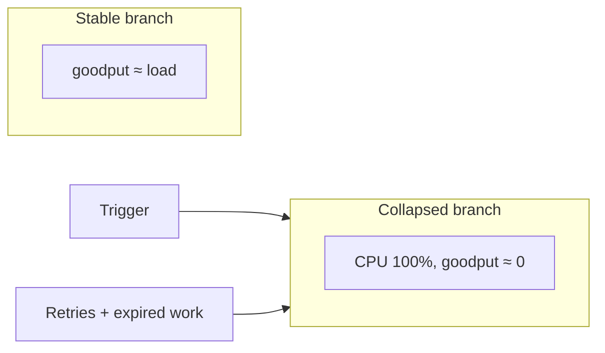
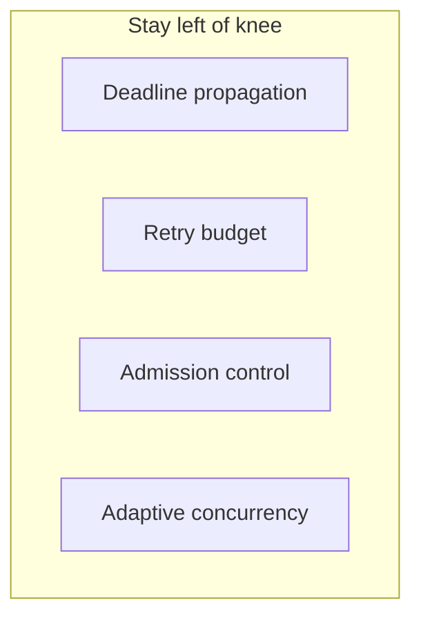
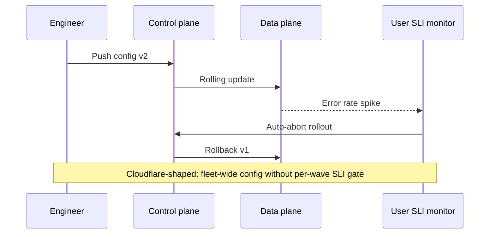
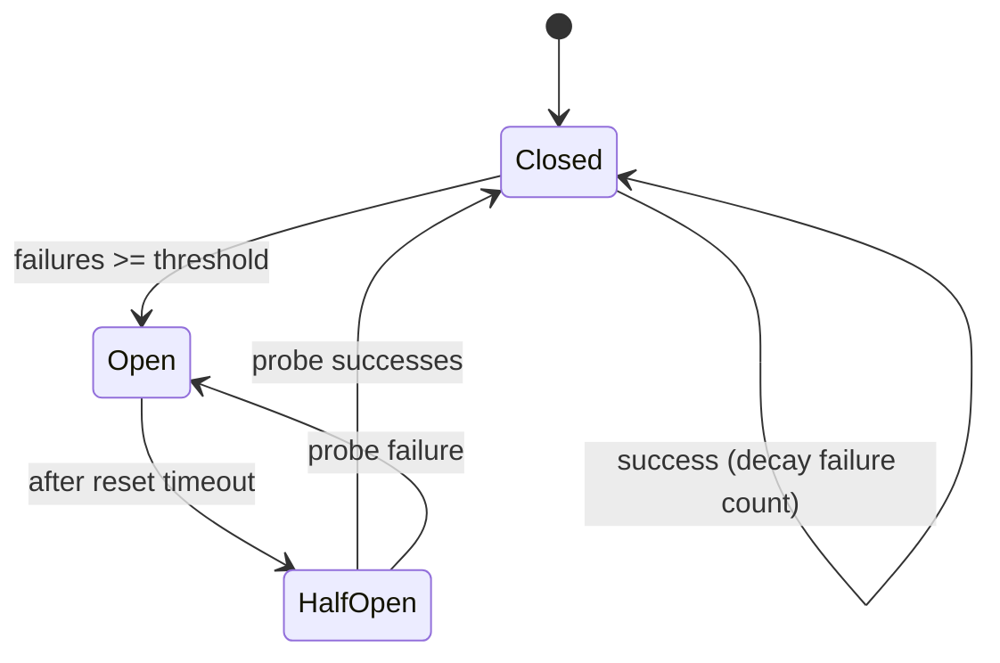
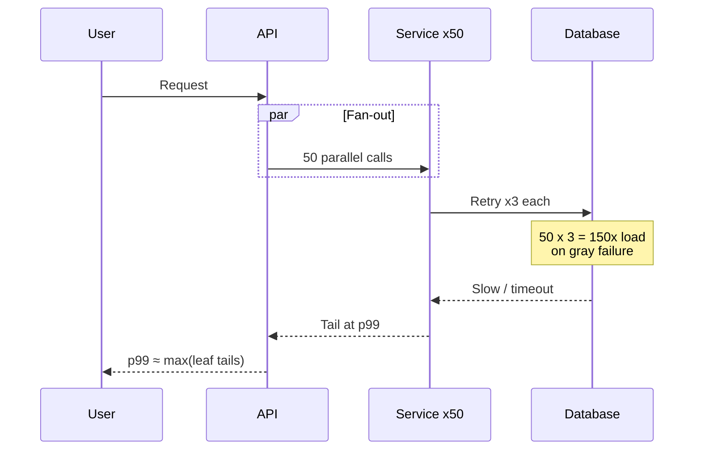

# SRE Resilience: How Systems Fail, Patterns & Chaos

Reliability is a fight against **feedback loops**—retries, cold caches, and control policies that turn a 30-second blip into a multi-hour outage.

> **Metastability:** After the trigger is gone, the system stays down because **its own behavior** keeps effective load above capacity. Fix the sustaining loop, not only the trigger.

---

## 1. How large systems actually fail

### Metastable failure (three parts)

| Phase | Example |
|-------|---------|
| **Trigger** | Deploy, GC pause, cache flush, failover |
| **Amplifier** | Retries, autoscale lag, thundering herd |
| **Sustaining effect** | Work for timed-out clients, cold DB after cache miss |



**Hysteresis:** Recovery needs offered load **< μ/r** (service capacity / attempts per request)—not “trigger removed.”

**Flip threshold (FIFO + timeout τ):** Short transients at high ρ flip easily—**timeout choice** matters as much as trigger size. At ρ=0.85, sub-second dips can flip.

**Queue discipline:** FIFO serves abandoned head; **LIFO** or deadline-aware drop can restore goodput while backlog exists.

### Classify before you fix

1. What **triggered**?
2. What **amplified**?
3. What **sustained** after trigger ended?

If the review stops at (1), it is incomplete.

---

## 2. Retry amplification

Independent `3 retries` × 4 layers = **81×** load on sick database.

| Layer | Policy |
|-------|--------|
| Mobile SDK | 3× |
| API gateway | 3× |
| Service mesh | 3× |
| App client | 3× |

**Rule:** Retry at **one** layer (closest to user that can enforce idempotency); others fail fast with **non-retryable** status.

Expected attempts per layer when bottom is persistently failing: approaches **r** per layer.

### Timeouts without cancellation

Client timeout ≠ server cancel unless **deadlines propagate**. Server still serves request; response discarded → wasted CPU.

**M/M/1:** At ρ=0.9, mean wait hits timeout; ~37% work serves nobody → more retries → higher ρ.

**Dashboard trap:** Server-side latency misses queue wait—measure **client SLI**.

---

## 3. Gray & common-mode failure

**Gray failure:** Passes health check, fails real traffic—LB evicts healthy nodes sharing slow dependency.

**Common mode:** Same cert expiry, same bad config push, same control plane—all replicas fail together.

> Redundancy only counts if replicas **don’t share** the failure you modeled.

**GitHub Oct 2018 (shape):** Short partition → failover → placement work → long degradation.

---

## 4. Resilience patterns (as control systems)

### Queueing knee

Residence time grows as **1/(1-ρ)**. Kingman: variability raises delay at same ρ—**bursty** services knee earlier (~60%) than pooled workers (~90%).



| Pattern | Purpose | Failure mode |
|---------|---------|--------------|
| **Circuit breaker** | Shed sick dependency | Fleet-wide open → synchronized half-open retry wave |
| **Bulkhead** | Isolate pools | Under-provisioned pool still dies |
| **Health check** | Routing | Deep check → all nodes unhealthy if dependency slow |
| **Failover** | HA | Doubles load on survivor sized for half |

**Retry budget:** Cap retries as fraction of **successful** traffic—not fixed count per request.

**Adaptive concurrency (e.g. Little’s law):** Increase concurrency while latency stable; decrease when latency rises.

### Deadline propagation (gRPC sketch)

```protobuf
// Parent sends remaining timeout to child
metadata: grpc-timeout: 150m
```

---

## 5. Chaos engineering & verification

> A failover you haven’t run in production this quarter is a **hypothesis**, not a capability.

### Experiment ladder

| Rung | Blast radius | Gate |
|------|--------------|------|
| 1 host | Staging → prod canary | Auto-abort on SLI |
| 1 AZ | Scheduled game day | Runbook owner |
| 1 region | After lower rungs proven | Exec sign-off |

**Hypothesis:** Steady-state SLI (error rate, p99) unchanged within ε during fault.

### Typical first-game-day findings (illustrative)

| Path | Promised | Measured |
|------|----------|----------|
| DB failover RTO | <60s | 4m (DNS + pool) |
| Backup RPO | 15m | OK, restore **9h** |
| AZ evac | Automatic | Control plane in that AZ |

**Metric:** Restored **time**, not backup job success.

### Chaos vs game days

- **Continuous injection:** Small faults, automation, regression detection.
- **Game days:** Cross-team, regional, human coordination.

Both need **abort** tied to user-facing SLI.

---

## 6. Where conventional advice is wrong

| Advice | Reality |
|--------|---------|
| “Add retries everywhere” | Multiplies at depth when sick |
| “Keep CPU <70%” | Wrong for smooth vs bursty services |
| “Restart fixed it” | State was in queues/caches—loop may return |
| “More replicas = safer” | Shared deploy defeats N |

---

## Design review questions

1. At peak ρ and timeout τ, how long a dip causes flip?
2. How many retry layers—product at bottom tier?
3. Do health checks distinguish **self** vs **dependency** sick?
4. Last quarter: restore/failover **measured** RTO/RPO?
5. Sustaining loop identified for top incident archetypes?

*Source: Algoroq SRE — How Large Systems Fail, Resilience Patterns, Chaos & Verification.*

---

## 7. Real-world incident case studies

### AWS S3 US-EAST-1 (February 28, 2017)

**What happened:** A planned maintenance command in the S3 subsystem was mistyped. Instead of removing a small set of servers from service, operators removed **many more** than intended. The removal cascaded: index metadata required quorum across subsystems; as capacity dropped, restart and rebalancing work piled up. S3 error rates spiked; dependent services (new EC2 launches, console, Lambda in some paths) failed because they assumed S3 was always available.

**Root cause:** Human error amplified by **tight coupling** between control-plane operations and data-plane availability, plus insufficient guardrails on destructive CLI parameters.

**Lessons for resilience design:**

| Lesson | Engineering action |
|--------|-------------------|
| Control-plane mistakes become data-plane outages | Rate-limit and confirm destructive ops; two-person rule for fleet-wide changes |
| Dependencies hide behind “always up” assumptions | Model S3 (or your blob store) as **hard dependency** with timeouts, caches, and degraded modes |
| Recovery took hours, not minutes | Measure **time-to-goodput**, not “servers back online” |
| Retry storms during outage | Enforce retry budgets at SDK and gateway during regional incidents |

### Cloudflare global outage (July 2, 2019)

**What happened:** A WAF rule using a regular expression was deployed fleet-wide. The regex exhibited catastrophic backtracking on certain HTTP requests. CPU on edge nodes spiked; health checks failed; traffic shifted; the bad rule spread with the fleet. A large fraction of HTTP traffic returned 502s globally until the rule was rolled back.

**Root cause:** **Common-mode configuration** — one logical change, all replicas, no canary at the edge rule layer.

**Lessons:**

- Treat **config pushes like code deploys**: staged rollout, automatic abort on SLI burn.
- CPU-based health checks during regex/WAF work are insufficient — add **synthetic canary requests** through the full HTTP stack.
- Circuit breakers on “execute user regex” paths need **per-rule CPU budgets** and kill switches.

### Knight Capital (August 1, 2012)

**What happened:** A deployment intended to retire legacy trading software left **one server** running old code that activated a dormant flag. That server executed runaway automated trades for ~45 minutes, accumulating ~$460M in losses before humans stopped it.

**Root cause:** **Incomplete deploy** + lack of **version consistency checks** across the fleet + no automatic trading halt on anomalous order rate.

**Lessons (blast radius & verification):**

- **Deploy verification:** post-deploy assertion that every instance reports the same build ID and feature flags.
- **Kill switches** must be tested in game days — not documented only.
- Financial and safety-critical loops need **rate limits and anomaly detection** independent of “happy path” health.



---

## 8. Circuit breaker: production-style implementation

State machine:



**Go sketch** (sliding window + jittered half-open):

```go
type Breaker struct {
	mu            sync.Mutex
	state         int // closed, open, halfOpen
	failures      int
	threshold     int
	resetTimeout  time.Duration
	nextTry       time.Time
	halfOpenMax   int
	halfOpenCount int
}

func (b *Breaker) Allow() bool {
	b.mu.Lock()
	defer b.mu.Unlock()
	now := time.Now()
	switch b.state {
	case open:
		if now.Before(b.nextTry) {
			return false
		}
		b.state = halfOpen
		b.halfOpenCount = 0
	case halfOpen:
		if b.halfOpenCount >= b.halfOpenMax {
			return false // one probe at a time per shard
		}
	}
	return true
}

func (b *Breaker) Record(ok bool) {
	b.mu.Lock()
	defer b.mu.Unlock()
	if ok {
		if b.state == halfOpen {
			b.halfOpenCount++
			if b.halfOpenCount >= b.halfOpenMax {
				b.state = closed
				b.failures = 0
			}
		} else {
			b.failures = max(0, b.failures-1) // decay
		}
		return
	}
	b.failures++
	if b.state == halfOpen || b.failures >= b.threshold {
		b.state = open
		jitter := time.Duration(rand.Int63n(int64(b.resetTimeout / 5)))
		b.nextTry = time.Now().Add(b.resetTimeout + jitter)
	}
}
```

**Fleet-wide open trap:** synchronize half-open with **per-client random jitter** and **shard-local breakers** (per dependency cell), not one global flag.

---

## 9. Exponential backoff with full jitter

AWS and Google recommend **full jitter**: `sleep = random(0, min(cap, base * 2^attempt))`.

```python
import random
import time

def backoff_sleep(attempt: int, base: float = 0.1, cap: float = 30.0) -> float:
    """Full jitter — spreads retry waves after incidents."""
    ceiling = min(cap, base * (2 ** attempt))
    delay = random.uniform(0, ceiling)
    time.sleep(delay)
    return delay

def retry_budget_allow(successes: int, retries_so_far: int, budget_ratio: float = 0.1) -> bool:
    """Cap retries at 10% of successful completions (example policy)."""
    max_retries = int(successes * budget_ratio)
    return retries_so_far < max_retries
```

**Numeric example:** 10k RPS, all clients retry 3× without jitter at T+0 after a 5s blip → **40k RPS** offered at recovery (4×), often re-flipping metastable state. Full jitter spreads attempts over `[0, cap]` → peak offered load closer to **RPS + (RPS × retry_fraction)**.

---

## 10. Chaos experiment design checklist

| Step | Check | Owner |
|------|-------|-------|
| Hypothesis | Steady-state SLI defined (availability, p99 checkout) | SRE |
| Abort | Auto-stop if burn rate > 14.4× for 5m | Automation |
| Blast radius | Single cell / AZ / % traffic documented | IC |
| Rollback | One-command revert tested this quarter | Service owner |
| Observability | Dashboards show **client** SLI, not only server | On-call |
| Comms | Status page + internal channel cadence | Comms lead |
| Post-run | Compare RTO/RPO **measured** vs doc | SRE |

**Experiment ladder (filled example):**

| Rung | Fault | Pass criteria |
|------|-------|---------------|
| 1 | Kill 1 pod in cell-A | p99 checkout < 400ms, errors < 0.1% for 30m |
| 2 | Block AZ-A egress in cell-A | Failover < 120s, no data loss on read path |
| 3 | Deny IAM to backup bucket | Restore drill completes < 4h with runbook only |

---

## 11. SRE resilience readiness checklist

| Area | Question | Target |
|------|----------|--------|
| Retries | How many layers retry? | ≤1 with idempotency keys |
| Timeouts | Do deadlines propagate end-to-end? | Yes, with cancellation |
| Breakers | Per-dependency thresholds documented? | Yes + half-open jitter |
| Load shedding | 503/429 under overload? | Admission control at edge |
| Dependencies | Health checks distinguish self vs dep? | Split liveness/readiness |
| Chaos | Last game day date? | <90 days for tier-0 |
| Metastability | Top 3 sustaining loops named? | In service README |

---

## 12. Quantitative examples

### Retry amplification product

Four layers, each retries until success with max 3 attempts on failure (simplified):

\[
\text{worst-case multiplier} \approx 3^4 = 81
\]

If baseline load is **2k RPS** to DB during incident, offered load can approach **162k RPS** — explaining “DB died first” postmortems where app CPU looked fine.

### Metastable recovery (ρ and retries)

Service capacity μ = 10k RPS. Clients retry **r = 2** on timeout. Stability needs offered load **λ < μ/r = 5k RPS**. After trigger ends, if retries keep effective λ at 6k RPS, the system **never** recovers without shedding retries or adding capacity.

### Error budget vs retry policy

30-day availability SLO 99.9% → budget **43.2 minutes** downtime/month. A 20-minute partial outage consuming **50%** of budget should trigger freeze on risky deploys — but **retry storms** can consume “error budget” in user-visible errors without a single deploy.

### Little's law at the dependency

λ = 5k RPS, mean time in dependency W = 40ms → average in-flight **L = 200**. If timeout cuts W to 0 for abandoned work but server still completes, **L** stays high while goodput drops — classic metastable queue.

---

## 13. Interview Q&A

### Q: What is a metastable failure, and how is it different from overload?

**A:** Overload is when offered load exceeds capacity. Metastable failure adds a **sustaining loop**: after the initial trigger (deploy, cache flush) is removed, retries, queue backlog, cold caches, or health-check eviction keep **effective load above capacity** or goodput near zero. Recovery requires breaking the loop (retry budgets, load shed, drain queues), not only fixing the trigger.

### Q: Why should retries be concentrated at one layer?

**A:** Retries multiply across layers. Independent retry policies at mobile, gateway, mesh, and app can produce **exponential** attempt counts on a failing leaf. One layer should own idempotency keys, backoff, and budget; others return fast errors (e.g. 503 with `Retry-After`) so the client or edge makes a single retry decision.

### Q: When does a circuit breaker make things worse?

**A:** When all breakers share one threshold and open together, then **half-open probes synchronize** after the same timeout, creating a **retry wave**. Mitigate with jitter, per-shard breakers, limited half-open concurrency, and SLI-driven probe rates.

### Q: How do you choose timeout τ for FIFO queues at high utilization?

**A:** Short τ abandons work at the head of the queue but server may still process it (wasted work). Long τ keeps clients waiting and reduces retry rate. At ρ=0.85+, small τ can flip metastable state. Model with **timeout-aware queueing** and measure client-side SLI; propagate deadlines so server can cancel work.

### Q: What is the difference between chaos engineering and a game day?

**A:** Chaos engineering is **continuous, automated** fault injection with tight abort hooks on SLI — good for regression detection. Game days are **scheduled, cross-team** exercises for regional failures, comms, and runbooks — good for organizational readiness. Both need hypotheses and measured steady-state metrics.

### Q: Explain gray failure and why load balancers struggle.

**A:** A node passes shallow health checks but fails real traffic (slow disk, partial dependency timeout). The LB may **drain healthy nodes** that share the slow dependency, or keep sending traffic to “healthy” bad nodes. Fix with **deep canaries**, latency-aware routing, and dependency-aware health.

### Q: How do you verify failover is real?

**A:** Measure **restored user SLI** during a controlled fault, not config success. Record RTO/RPO from fault injection timestamp to steady-state recovery. Include DNS/TLS/pool warmup — docs claiming 60s RTO often measure only database promotion.

---

## Senior Pitfalls

| Mistake | Impact | Fix |
|---------|--------|-----|
| Aggressive client retries on 503 without jitter | Retry storm collapses recovering dependency | Full jitter backoff, retry budgets, cap max attempts |
| Circuit breaker thresholds tuned only on mean latency | Opens too late; gray failures propagate | Use consecutive failures + latency SLI; half-open probe limits |
| Bulkhead thread pools sized equal to max concurrency | One slow dependency blocks entire pool | Separate pools per dependency; bounded queues with shed load |
| Chaos experiments without automated abort on SLO burn | Game day becomes real outage | Steady-state metrics, one-click rollback, executive stop criteria |
| Timeouts longer than upstream LB idle timeout | Hung requests pile up; connection leaks | Align timeouts end-to-end; client < gateway < server budget |
| “Fail open” authz on dependency timeout | Security incident masked as availability win | Fail closed on auth; degrade non-critical features only |

---

## Production-grade Practice

1. **Retry budget math:** Given dependency error rate and fan-out N, compute expected load multiplier with 3 retries; set max retries and concurrency so ρ stays below 0.7 under worst case.
2. **Circuit breaker tuning:** Implement breaker on a staging dependency; inject 30% latency; plot open/half-open cycles vs user error rate; document threshold choices.
3. **Chaos hypothesis:** Write one experiment (“kill 1 pod in cell B should not raise checkout p99 > 10%”); run in prod with guardrails; record pass/fail and action items.
4. **Dependency map for blast radius:** Diagram sync calls 2 hops deep from checkout; mark which lack timeouts/breakers; fix the highest-traffic gap first and verify in trace samples.

---

## 14. Tail latency amplification (retry + fan-out)



**Takeaway:** Resilience patterns must be designed together — fan-out width, per-leaf timeouts, single-layer retry, and breaker on the shared DB.
