# Booking & Marketplace Design

Four product shapes that share **transactions**, **inventory**, and **geo-distributed state**: matching supply and demand (ride-sharing), selling finite seats (tickets), splitting money fairly (expenses), and syncing files across devices (storage). Each stresses different consistency and fan-out patterns.

---

## Design a Ride-Sharing Service

### What problem does it solve?

Match **riders** to **drivers** in real time: live map, quote, dispatch, trip lifecycle, dynamic pricing, payment.

> **Location writes outnumber trips ~4,000:1.** The GPS firehose must not share durability or failure domain with dispatch.

### Requirements

| Functional | Non-functional |
|------------|----------------|
| Stream driver location; quote & request; accept/decline; trip state machine; surge pricing | Dispatch p99 few seconds; **exactly-one driver per trip**; trip survives region failover |

**Scale:** 5M drivers online; ~1.25M location updates/s; ~290 trips/s avg.

### High-level architecture

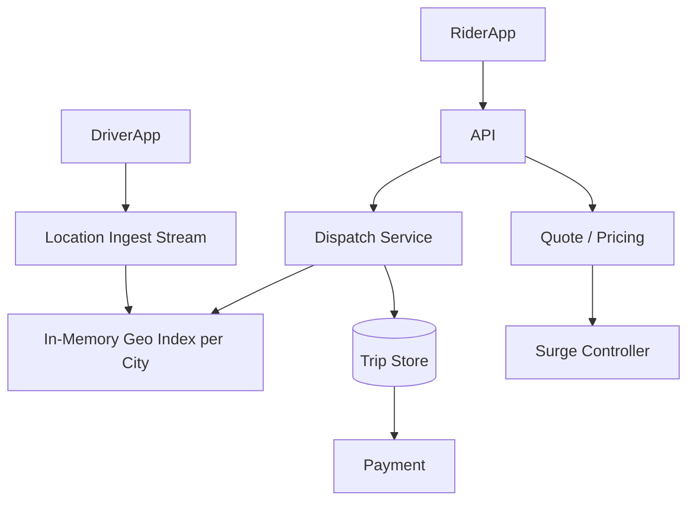

### API design

```http
# Driver — streaming location
STREAM driver.location { batch: [{lat, lng, heading, ts}] }
← offer { offer_id, trip_id, pickup, fare, expires_at }

POST /offers/{offer_id}/accept { driver_id, idempotency_key }

# Rider
POST /quotes  { pickup, dropoff, product } → { quote_id, fare, surge, sig, expiry }
POST /trips   { quote_id, sig, idempotency_key } → { trip_id, state }
GET  /trips/{id}/stream
POST /trips/{id}/cancel
```

**Signed quote token:** Trip creation verifies signature—price locked without recomputing under load.

### Data model

| Entity | Key fields |
|--------|------------|
| `Driver` | status (online/offline/on_trip), current_cell |
| `Trip` | rider, driver, state, quote_snapshot, version |
| `Offer` | trip_id, driver_id, expires_at, status |
| `SurgeZone` | h3_cell, multiplier, updated_at |

### Key components

1. **Geo index:** H3 hex grid; **road-network ETA** for matching (not haversine).
2. **Dispatch:** Batched assignment beats greedy at density; timeout → next driver batch.
3. **Surge:** Control loop—multiplier affects supply; watch oscillation.
4. **Per-city isolation:** Shard by city; no cross-city matching.

### Scaling considerations

- Latest-ping index (not durable log of every GPS point).
- Hot cells (airport): cap concurrent offers; shard dispatch writers.
- Regional failover: trip state replicated; reconcile in-flight trips.

```python
def assign_trip(trip_id: str, candidates: list[str]) -> str | None:
    for driver_id in rank_by_eta(candidates):
        if redis.set(f"driver_lock:{driver_id}", trip_id, nx=True, ex=30):
            return driver_id
    return None
```

### Back-of-envelope estimation

| Dimension | Assumption | Math | Result |
|-----------|------------|------|--------|
| **Location QPS** | 5M drivers online, ping every 4 s | 5,000,000 ÷ 4 | **~1.25M updates/s** |
| **Trip QPS** | 25M trips/day | 25×10⁶ ÷ 86,400 | **~290 trips/s** avg; **~1.2k/s** peak (4×) |
| **Quote QPS** | 3 quotes per completed trip | 290 × 3 | **~870/s** avg |
| **Geo index memory** | 5M drivers × 64 B/cell + metadata | 5×10⁶ × 128 B | **~640 MB** per city shard (order of magnitude) |
| **Trip storage** | 25M trips/day × 2 KB/trip × 365 days | 25×10⁶ × 2×10³ × 365 | **~18 TB/year** trip metadata |
| **WebSocket connections** | 5M drivers + 2M active riders | 7×10⁶ conns × 4 KB buffers | **~28 GB** gateway RAM (rough) |
| **Bandwidth (location)** | 1.25M/s × 80 B/update | | **~100 MB/s** ingest |

### Deep dive: Geospatial matching algorithm

Matching is not “nearest haversine point”—it is **constrained optimization** under SLA:

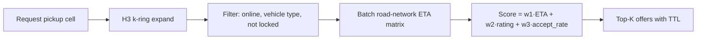

| Step | Detail |
|------|--------|
| **Index** | H3 resolution ~9–10 (~174 m); driver position → cell; inverted index `cell → [driver_ids]` |
| **Candidate pool** | Start at rider cell; expand rings until ≥N candidates or max radius |
| **ETA** | Precomputed graph / live routing API; cache `(origin_cell, dest_cell)` for quotes |
| **Batch dispatch** | Send offers to K drivers; first accept wins; others get cancel push |
| **Fairness** | Rotate rank with idle-time boost so same drivers are not always top |

```python
import h3

def candidates_near(pickup_lat: float, pickup_lng: float, ring: int = 2) -> list[str]:
    center = h3.latlng_to_cell(pickup_lat, pickup_lng, 9)
    cells = h3.grid_disk(center, ring)
    driver_ids: list[str] = []
    for cell in cells:
        driver_ids.extend(geo_index.get(cell, ()))
    return [d for d in driver_ids if driver_status[d] == "online" and not driver_locked(d)]

def score_driver(driver_id: str, eta_sec: float) -> float:
    return -eta_sec + 30 * driver_rating[driver_id] + 10 * accept_rate_7d(driver_id)
```

### Deep dive: Surge pricing

Surge is a **control loop**, not a static multiplier:

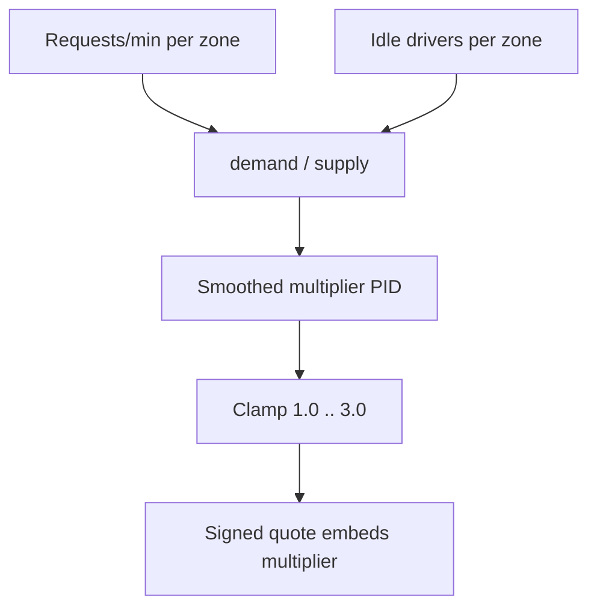

| Signal | Source | Why |
|--------|--------|-----|
| Demand | Trip requests in last 5 min per H3 cell | Captures spikes |
| Supply | Online drivers with no active trip in cell | Avoid divide-by-zero with ε |
| Smoothing | EMA on multiplier | Prevents 1.0↔2.5 oscillation every minute |
| Geo-fence | Airport/stadium overrides | Manual caps during events |

**Interview nuance:** Riders see multiplier on quote; drivers may get **boost** (not always 1:1 pass-through) to protect margin.

### Deep dive: ETA calculation

| Layer | Method | Latency |
|-------|--------|---------|
| **Fast path** | Historical median speed by `(cell, hour, dow)` | &lt;5 ms |
| **Refine** | Live traffic graph (OSRM / proprietary) | 20–80 ms |
| **Pickup ETA** | Driver position → pickup edge | Used for dispatch ranking |
| **Trip ETA** | Pickup → dropoff at request time | Shown on quote; not recomputed on trip create |

Cache key: `(origin_h3, dest_h3, time_bucket)` with 5–15 min TTL. Invalidate buckets on major incident feed.

### Failure modes and edge cases

| Failure | Symptom | Mitigation |
|---------|---------|------------|
| Split brain on driver lock | Two trips assigned to one driver | Redis lock + DB trip state; reconcile on accept |
| Stale GPS | Driver 2 km away shown “1 min away” | Max age on ping; drop from index if &gt;30 s stale |
| Offer thundering herd | 50 drivers accept same trip | First `POST /accept` wins; others 409 + release lock |
| Surge flash crash | Multiplier drops mid-request | Quote signed with `expiry`; trip uses snapshot |
| Region failover | In-flight trips orphaned | Replicate trip state; replay dispatch from last state |
| Airport hot cell | Dispatch queue latency | Sub-shard cell; cap concurrent offers per driver |

### Interview Q&A

### Q: Why not write every GPS point to the database?
**A:** At ~1.25M/s, durable writes would dominate cost and add lag. The geo index only needs **latest position per driver** in memory (with TTL). Trip history stores sampled route polyline post-trip for disputes, not the full firehose.

### Q: How do you guarantee exactly one driver per trip?
**A:** Layered locks: optimistic trip state machine (`requested → matched → active`), `SETNX driver_lock:{id}` with TTL during offer, and idempotent accept with `idempotency_key`. Accept handler runs in a transaction: lock driver row, verify trip still `requested`, assign driver, release other pending offers.

### Q: How does batch dispatch compare to greedy nearest-driver?
**A:** Greedy minimizes first-offer ETA but increases **empty miles** and driver churn. Batching top-K by score and parallel offers improves acceptance probability in dense markets; tradeoff is slightly higher rider wait for first ping.

### Q: What happens when the rider cancels during surge?
**A:** Policy engine applies cancellation fee from quote snapshot; surge portion may or may not be refundable per product rules. Payment idempotency key ties charge to `trip_id` + `cancel_event_id`.

### Q: How do you shard the system?
**A:** **City/region** is the natural boundary: geo index, dispatch queues, and surge zones are per city. Cross-city trips are rare and handled as two regional graphs with handoff metadata—not one global index.

### Code examples: H3 geo index + surge loop

```python
from dataclasses import dataclass
from typing import Dict, Set
import math
import time

@dataclass
class SurgeZone:
    cell: str
    multiplier: float
    updated_at: float

class GeoIndex:
    """In-memory inverted index: H3 cell -> set of driver_ids."""
    def __init__(self) -> None:
        self._cell_to_drivers: Dict[str, Set[str]] = {}
        self._driver_cell: Dict[str, str] = {}

    def upsert(self, driver_id: str, cell: str) -> None:
        old = self._driver_cell.get(driver_id)
        if old and old != cell:
            self._cell_to_drivers.get(old, set()).discard(driver_id)
        self._driver_cell[driver_id] = cell
        self._cell_to_drivers.setdefault(cell, set()).add(driver_id)

    def drivers_in_cells(self, cells: list[str]) -> Set[str]:
        out: Set[str] = set()
        for c in cells:
            out |= self._cell_to_drivers.get(c, set())
        return out


def update_surge(cell: str, requests_5m: int, idle_drivers: int,
                 zones: Dict[str, SurgeZone], alpha: float = 0.3) -> float:
    supply = max(idle_drivers, 1)
    ratio = requests_5m / supply
    target = min(3.0, max(1.0, 1.0 + 0.5 * math.log1p(ratio)))
    prev = zones.get(cell, SurgeZone(cell, 1.0, 0.0)).multiplier
    smoothed = alpha * target + (1 - alpha) * prev
    zones[cell] = SurgeZone(cell, smoothed, time.time())
    return smoothed
```

---

## Design a Ticket Booking System

### What problem does it solve?

Sell **finite inventory** (seats, slots) without overselling—high contention at on-sale time, payment, and fraud.

> **The hard part is inventory correctness under concurrency**, not drawing a seat map UI.

### Requirements

| Functional | Non-functional |
|------------|----------------|
| Browse events; select seats; hold; pay; confirm ticket; waitlist | No double-book; hold TTL ~10 min; on-sale spikes |

### High-level architecture

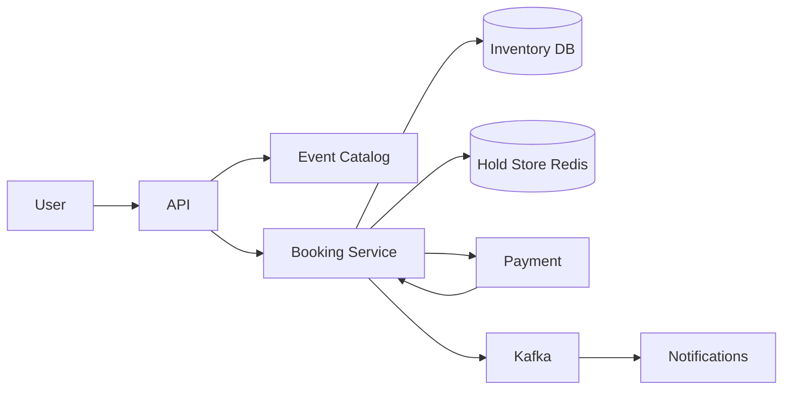

### API design

```http
GET  /events/{id}/availability
POST /events/{id}/hold     { "seatIds": ["A-12", "A-13"] } → { holdId, expiresAt }
POST /bookings             { holdId, paymentMethod } → { bookingId, tickets }
DELETE /holds/{holdId}
```

### Data model

| Table | Notes |
|-------|-------|
| `events` | metadata |
| `seats` | event_id, seat_id, status (available/held/sold) |
| `holds` | hold_id, seats, user_id, expires_at |
| `bookings` | immutable after confirm |

### Inventory patterns

| Approach | When |
|----------|------|
| **Pessimistic lock** | Low contention |
| **Optimistic versioning** | `UPDATE ... WHERE version = v` |
| **Redis hold + DB confirm** | High on-sale QPS |

```sql
-- Confirm only if seats still held by this user
UPDATE seats SET status = 'sold', version = version + 1
WHERE event_id = ? AND seat_id IN (?) AND status = 'held' AND hold_id = ?;
```

### Scaling considerations

- Queue users at on-sale (virtual waiting room).
- Shard inventory by `event_id`.
- Idempotent payment + booking with `idempotency_key`.
- Async PDF/barcode generation post-confirm.

### Back-of-envelope estimation

| Dimension | Assumption | Math | Result |
|-----------|------------|------|--------|
| **Browse QPS** | 50M MAU, 10% active on-sale day | modest | **~5k–20k/s** catalog reads |
| **On-sale spike** | 100k seats, 500k users in 10 min | 500k holds attempt / 600 s | **~800 holds/s** sustained peak |
| **Seat rows** | 50k events × 5k seats | 2.5×10⁸ rows | **~50–100 GB** seat inventory (indexed) |
| **Hold store** | 200k concurrent holds × 500 B | | **~100 MB** Redis |
| **Payment** | 30% conversion on hold | 800 × 0.3 | **~240 payments/s** peak |
| **Bandwidth** | Seat map JSON 200 KB × 1k/s | | **~200 MB/s** at peak browse |

### Deep dive: Seat locking & double-booking prevention

Three-layer model prevents oversell:

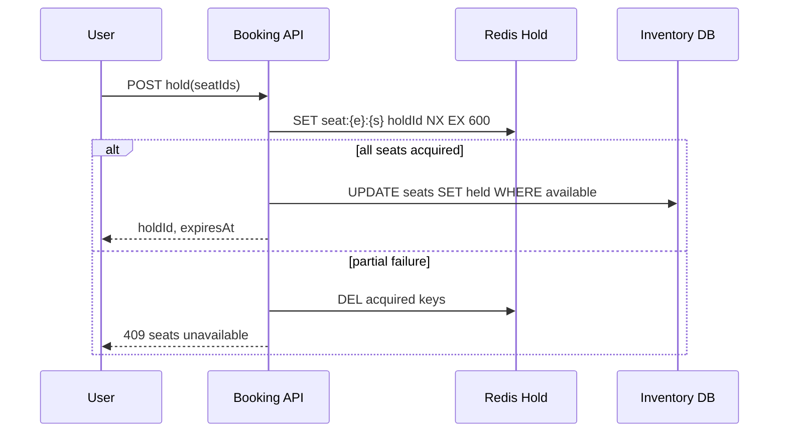

| Layer | Role |
|-------|------|
| **Redis NX + TTL** | Fast mutual exclusion; auto-release on abandon |
| **DB status** | Source of truth: `available → held → sold` |
| **Confirm transaction** | Single TX: verify hold owner, flip to `sold`, insert booking |

```sql
-- Serializable isolation or SELECT FOR UPDATE on seat rows for confirm path
BEGIN;
SELECT status, hold_id FROM seats WHERE event_id = $1 AND seat_id = ANY($2) FOR UPDATE;
-- abort if any row not held by this hold_id
UPDATE seats SET status = 'sold', hold_id = NULL WHERE ...;
INSERT INTO bookings (...) VALUES (...);
COMMIT;
```

**Double-booking scenarios:** Redis expires but DB still `held` → sweeper job releases DB after TTL; payment webhook retries → `idempotency_key` on booking; two tabs same user → same hold id or second hold fails NX.

### Deep dive: Payment flow

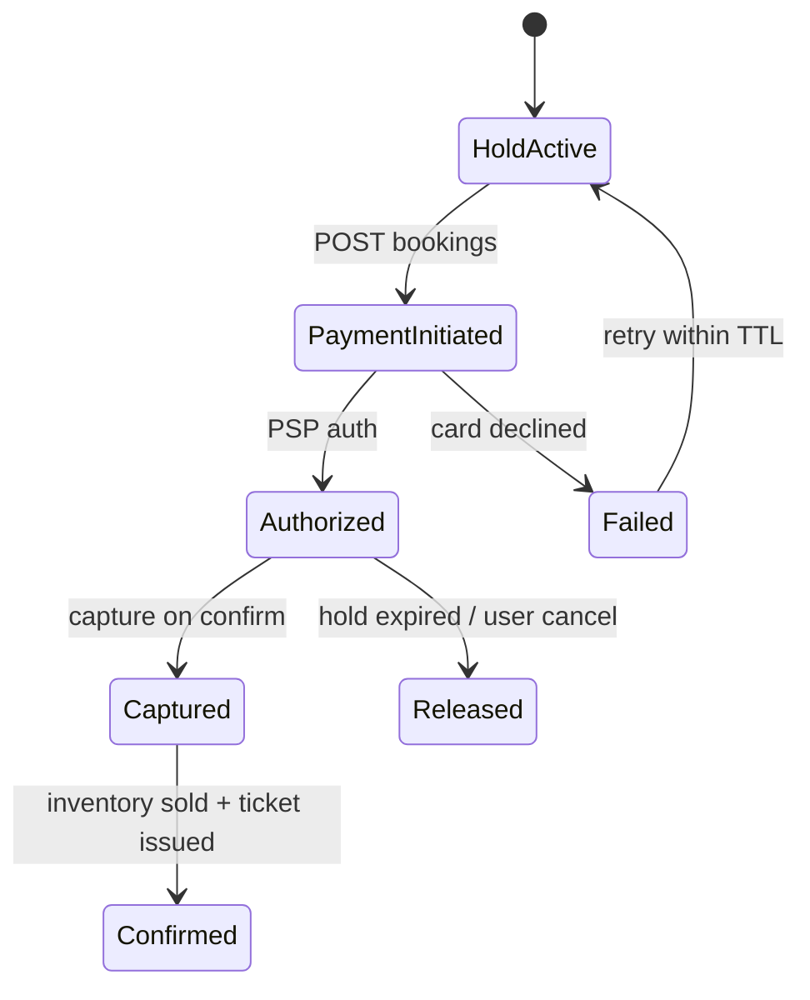

| Step | Guarantee |
|------|-----------|
| Auth | Reserve funds; do not capture until seats confirmed |
| Capture | After DB confirm succeeds—never before |
| Webhook | `payment_intent_id` + `idempotency_key`; out-of-order handled by state machine |
| Compensate | Capture succeeded but DB failed → auto-refund + alert |

### Deep dive: Inventory management

| Pattern | Use case |
|---------|----------|
| **Shard by `event_id`** | All seat updates for one concert hit one partition |
| **Virtual waiting room** | Token bucket admits users to purchase API at sustainable QPS |
| **Seat categories** | GA vs reserved: GA uses **counter** inventory; reserved uses per-seat rows |
| **Waitlist** | On sold-out hold failure, enqueue; backfill on hold expiry via Kafka consumer |

```python
def try_hold(event_id: str, seat_ids: list[str], user_id: str, ttl_sec: int = 600) -> str | None:
    hold_id = new_hold_id()
    pipe = redis.pipeline()
    keys = [f"seat:{event_id}:{s}" for s in seat_ids]
    for k in keys:
        pipe.set(k, hold_id, nx=True, ex=ttl_sec)
    results = pipe.execute()
    if not all(results):
        redis.delete(*[k for k, ok in zip(keys, results) if ok])
        return None
    if not db.mark_seats_held(event_id, seat_ids, hold_id, user_id):
        redis.delete(*keys)
        return None
    return hold_id
```

### Failure modes and edge cases

| Edge case | Handling |
|-----------|----------|
| Hold expires during 3DS step | Extend hold on payment start; hard cap 15 min |
| Partial seat map load | Server-side availability only; never trust client seat state |
| Bot scalping | Device fingerprint, rate limits, waiting room, purchase limits per account |
| DB slower than Redis | Confirm path always re-validates DB; Redis is optimization not truth |
| Event cancel | Bulk refund job; mark seats `void`; notify via async pipeline |

### Interview Q&A

### Q: Why Redis if PostgreSQL can row-lock seats?
**A:** At on-sale peak, **tens of thousands of failed attempts per second** on hot rows would pin DB connections. Redis NX absorbs contention cheaply; DB confirms only successful holds at human-scale QPS (~hundreds/s).

### Q: Optimistic vs pessimistic locking for seats?
**A:** Pessimistic (`SELECT FOR UPDATE`) is simpler for low contention. High contention favors **optimistic versioning** or Redis-first holds with short TTL so abandoned carts free inventory automatically.

### Q: How do you handle payment success but booking insert failure?
**A:** Treat as **critical incident path**: idempotent booking worker keyed by `payment_id` retries confirm; if seats gone, refund + customer support queue. Never leave “paid but no ticket” without automated detection.

### Q: Can two users hold the same seat?
**A:** Not if layers are correct: only one Redis NX winner; DB update uses `WHERE status = 'available'`. Second user gets 409 on hold or confirm.

### Q: How would you design a “best available” flow?
**A:** Server picks seats from a **preference-ordered query** (section, price tier) inside one partition transaction; return assigned seat ids in hold response—client does not choose atomic set.

### Code examples: Confirm booking with idempotency

```python
from enum import Enum

class BookingError(Exception):
    pass

def confirm_booking(hold_id: str, payment_id: str, idempotency_key: str) -> dict:
    existing = db.get_booking_by_idempotency(idempotency_key)
    if existing:
        return existing

    hold = db.get_hold(hold_id)
    if hold is None or hold.expired():
        raise BookingError("hold_expired")

    with db.transaction():
        rows = db.confirm_seats_sold(hold.event_id, hold.seat_ids, hold_id)
        if rows != len(hold.seat_ids):
            raise BookingError("inventory_conflict")
        booking = db.insert_booking(hold, payment_id, idempotency_key)
    kafka.publish("ticket.issued", booking.id)
    return booking.to_dict()
```

---

## Design an Expense-Sharing App

### What problem does it solve?

Groups track **shared expenses** and compute **who owes whom** (Splitwise-style): add expense, split rules, simplify debts, settle up.

### Requirements

| Functional | Non-functional |
|------------|----------------|
| Groups; expenses; split (equal, %, shares); balances; settle; multi-currency optional | Correct balances; audit trail; offline-friendly mobile |

### High-level architecture

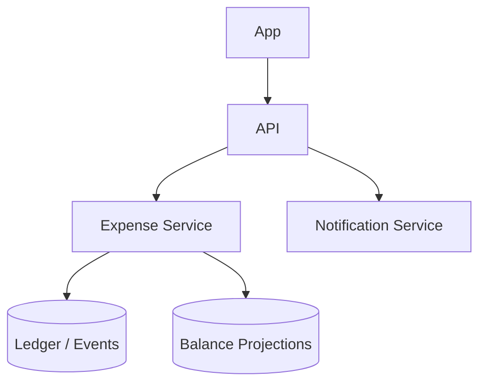

### API design

```http
POST /groups
POST /groups/{id}/expenses
{
  "payerId": "u1",
  "amount": 120.00,
  "currency": "USD",
  "split": { "type": "equal", "memberIds": ["u1","u2","u3"] },
  "description": "Dinner"
}
GET  /groups/{id}/balances
POST /groups/{id}/settlements  { "from": "u2", "to": "u1", "amount": 40 }
```

### Data model

**Event-sourced ledger (recommended):**

| Event | Effect |
|-------|--------|
| `ExpenseCreated` | Splits among members |
| `SettlementRecorded` | Reduces pairwise debt |
| `ExpenseDeleted` | Compensating entries |

**Balance projection:** Materialized `net_balance[group][user]` updated from events.

```python
def apply_equal_split(payer: str, members: list[str], amount: Decimal):
    share = amount / len(members)
    entries = []
    for m in members:
        if m != payer:
            entries.append((m, payer, share))  # m owes payer
    return entries
```

**Debt simplification:** Optional graph min-cash-flow—not required on every read; run on demand.

### Scaling considerations

- Strong consistency per `group_id` partition.
- Immutable expenses; edits = new compensating events.
- Notifications async on new expense.

### Back-of-envelope estimation

| Dimension | Assumption | Math | Result |
|-----------|------------|------|--------|
| **Write QPS** | 80M users, 2 expenses/user/week | 80×10⁶ × 2 / (7×86400) | **~265 expenses/s** avg |
| **Read QPS** | 10× writes for balance views | | **~2.6k reads/s** |
| **Storage** | 500 bytes/event × 4 events/group/month × 20M groups | | **~40 GB/month** events (compress 3×) |
| **Projection store** | 20M groups × 10 members × 16 B balance | | **~3.2 GB** hot balances |
| **Notifications** | 1 push per expense × 8 members avg | 265 × 8 | **~2.1k notify/s** |

### Deep dive: Debt simplification algorithm

Raw pairwise debts from expenses form a **directed weighted graph**. Simplification minimizes **number of settlement payments** (not always minimizing total dollars moved—that is already fixed by net balances).

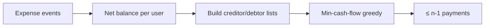

**Algorithm (greedy min-cash-flow):**

1. Compute net balance per user: positive = owed money, negative = owes money.
2. Split into creditors and debtors (multisets).
3. Repeatedly match max creditor with max debtor; push `min(credit, debt)` payment; reduce both; remove zeros.

```python
from decimal import Decimal
from heapq import heappop, heappush

def simplify_balances(net: dict[str, Decimal]) -> list[tuple[str, str, Decimal]]:
    """Return list of (from, to, amount) payments."""
    creditors: list[tuple[Decimal, str]] = []
    debtors: list[tuple[Decimal, str]] = []
    for user, bal in net.items():
        if bal > 0:
            heappush(creditors, (-bal, user))  # max-heap via negation
        elif bal < 0:
            heappush(debtors, (-(-bal), user))

    payments: list[tuple[str, str, Decimal]] = []
    while creditors and debtors:
        credit, creditor = heappop(creditors)
        debt, debtor = heappop(debtors)
        credit, debt = -credit, -debt
        pay = min(credit, debt)
        payments.append((debtor, creditor, pay))
        credit -= pay
        debt -= pay
        if credit > 0:
            heappush(creditors, (-credit, creditor))
        if debt > 0:
            heappush(debtors, (-debt, debtor))
    return payments
```

Complexity: **O(n log n)** for n members; run on demand or nightly—not on every `GET /balances`.

### Deep dive: Settlement flow

| Stage | Behavior |
|-------|----------|
| **Record settlement** | `SettlementRecorded` event reduces pairwise balance; does not delete history |
| **External pay** | Optional PSP link (Venmo/PayPal deep link)—app records honor system or webhook confirm |
| **Partial settle** | Allowed; remaining balance stays on ledger |
| **Multi-currency** | Store expense in original currency; display converted at daily FX snapshot |

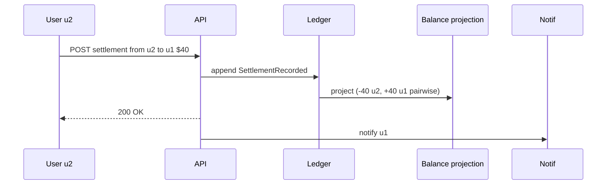

### Failure modes and edge cases

| Case | Mitigation |
|------|------------|
| Concurrent expenses in same group | Serialize per `group_id` partition (Kafka key = group_id) |
| Edit/delete expense | Compensating events; never mutate old rows |
| Rounding on equal split | Allocate remainder cents to payer or first member deterministically |
| Offline mobile add | Client UUID `expense_id`; server dedups |
| Simplify then new expense | Re-run simplify; show “suggested payments” not legal IOU |

### Interview Q&A

### Q: Event sourcing vs updating a balances table directly?
**A:** Event sourcing gives **audit trail** and easy replay for bugs; projection table gives fast reads. Updates-only is simpler but painful when you need “why is this balance X?” in support.

### Q: Is debt simplification unique?
**A:** No—many payment sets satisfy the same net balances. Greedy min-cash-flow is standard, fast, and good enough; optimal min edges is NP-hard in general graphs but nets are near-tree sized per group.

### Q: How do you split by percentage with rounding?
**A:** Use **largest remainder method**: floor each share, distribute leftover cents to largest fractional parts.

### Q: Strong consistency across groups?
**A:** Not required—only **per-group** linearizability. Cross-group transfers do not exist.

### Q: How would you add recurring bills?
**A:** Scheduled job emits `ExpenseCreated` with template id; same ledger path; idempotency on `(group_id, period, template_id)`.

### Code examples: Equal split with remainder cents

```python
def equal_split_cents(total_cents: int, n: int) -> list[int]:
    base, rem = divmod(total_cents, n)
    shares = [base] * n
    for i in range(rem):
        shares[i] += 1
    return shares

def apply_expense(payer: str, members: list[str], amount_cents: int) -> list[tuple[str, str, int]]:
    shares = equal_split_cents(amount_cents, len(members))
    owed: list[tuple[str, str, int]] = []
    for m, share in zip(members, shares):
        if m != payer and share > 0:
            owed.append((m, payer, share))
    return owed
```

---

## Design a File Storage & Sync Service

### What problem does it solve?

Keep folder trees **consistent** across devices: chunking, dedup, sync protocol, sharing, conflicts—Dropbox/Google Drive class.

> **Chunk size sets dedup index size:** 64 KB chunks → ~1.4 PB index vs 4 MB → ~22 TB. Chunk size is a **cost decision**.

### Requirements

| Functional | Non-functional |
|------------|----------------|
| Bidirectional sync; shared folders; versions; trash; block-level upload | 11+ nines durability; no silent conflict loss; p99 sync &lt;30 s |

**Scale:** ~1 EB logical; ~225B chunks at 4 MB avg.

### High-level architecture

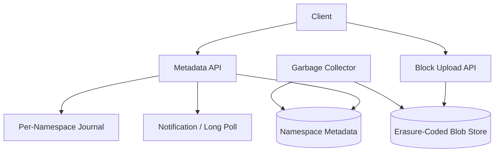

### API (three planes)

```http
# Metadata
GET  /ns/{id}/cursor          # sync from cursor
POST /ns/{id}/commit          { baseRev, ops: [...] }
GET  /ns/{id}/snapshot

# Blocks (content-addressed)
PUT  /blocks/{hash}           # if not exists
HEAD /blocks/{hash}

# Wake signal only
GET  /ns/{id}/watch
```

### Data model

| Entity | Notes |
|--------|-------|
| `namespace` | user's root or shared folder |
| `file_version` | path, rev, chunk_hashes[], size |
| `chunk` | hash → blob location, ref_count |
| `journal` | ordered commits per namespace |

### Sync protocol

1. Client has local rev cursor.
2. `GET cursor` → delta ops since cursor.
3. Upload missing chunks (hash list from server).
4. `POST commit` with optimistic `baseRev`.
5. On conflict → download both; **keep both files** (`file (conflict).txt`).

### Scaling considerations

- **Content-defined chunking** for shift resistance; fixed 4 MB for index math.
- **RS(10,4) erasure coding** vs 3× replication—huge cost delta.
- GC only after ref_count zero + grace period (safest component).
- Per-namespace journal shard; cap max files per namespace.
- Shared folder = **namespace** unit (not per-file ACL explosion).

```python
def commit(ns_id: str, base_rev: int, ops: list) -> int:
    with db.transaction():
        head = db.get_head(ns_id)
        if head != base_rev:
            raise ConflictError(head)
        new_rev = head + 1
        db.append_journal(ns_id, new_rev, ops)
        return new_rev
```

### Back-of-envelope estimation

| Dimension | Assumption | Math | Result |
|-----------|------------|------|--------|
| **Users** | 500M accounts, 20% active/day | | **100M DAU** |
| **Sync ops** | 50 file ops/user/day | 100×10⁶ × 50 / 86400 | **~58k commits/s** avg |
| **Chunk uploads** | 10% ops touch 4 MB new data | 5.8k × 4 MB | **~23 GB/s** peak blob (dedup cuts heavily) |
| **Metadata** | 10k files/user × 200 B | 500×10⁶ × 2×10⁶ B | **~1 PB** namespace metadata (upper bound; sparse in practice) |
| **Chunk index** | 225B chunks × 64 B pointer | | **~14 PB** index at 4 MB fixed chunks (why chunk size matters) |
| **Connections** | 30M devices long-poll/watch | | Similar to messaging gateway sizing |

### Deep dive: Chunking & deduplication

| Strategy | Dedup on edit | Index size |
|----------|---------------|------------|
| **Fixed 4 MB** | Poor for 1-byte append | Predictable |
| **Content-defined (Rabin)** | Shifts don’t rechunk whole file | Variable chunk sizes |
| **Whole-file hash** | Only identical files | Cheapest for full duplicates |

```python
import hashlib

def fixed_chunks(data: bytes, size: int = 4 * 1024 * 1024) -> list[tuple[str, bytes]]:
    out: list[tuple[str, bytes]] = []
    for i in range(0, len(data), size):
        block = data[i : i + size]
        h = hashlib.sha256(block).hexdigest()
        out.append((h, block))
    return out

def put_block_if_absent(store, hash_hex: str, data: bytes) -> None:
    if store.exists(hash_hex):
        store.inc_ref(hash_hex)
        return
    store.write_blob(hash_hex, data)
    store.inc_ref(hash_hex)
```

**Cross-user dedup:** Same hash → same blob; ref_count per hash; privacy option: **per-user encryption keys** so ciphertext differs (disables global dedup for E2EE tiers).

### Deep dive: Sync conflict resolution

Conflicts arise when two devices commit from the same `baseRev` without seeing each other:

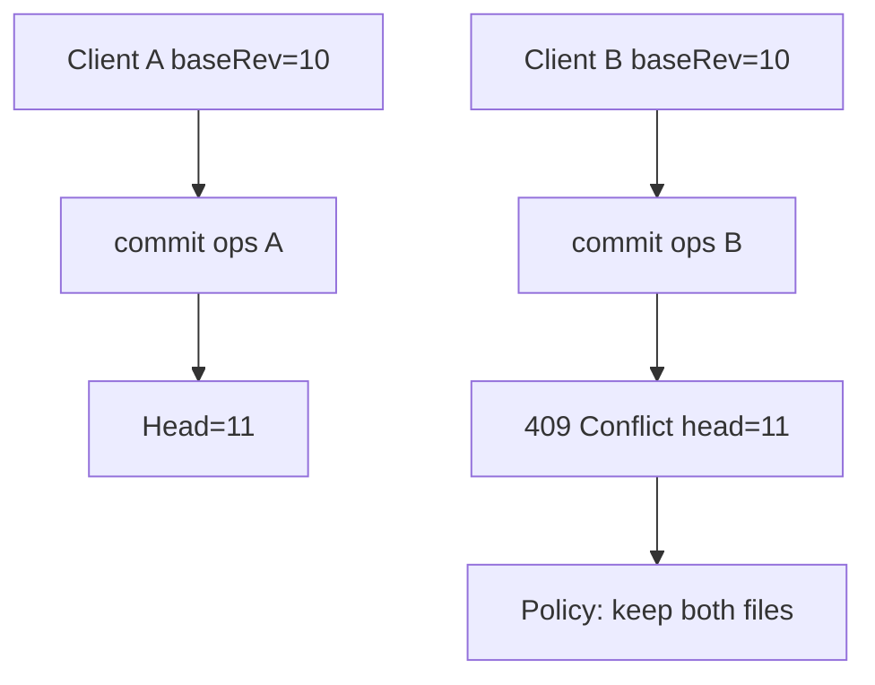

| Policy | When |
|--------|------|
| **Last-writer-wins** | Low risk metadata only |
| **Keep both** | User-facing docs (`file (conflict).txt`) |
| **Branch namespace** | Power users / git-like |
| **Lock file** | Exclusive edit lease for Office-class |

Server never silently merges binary without client merge tool.

### Deep dive: Delta sync protocol

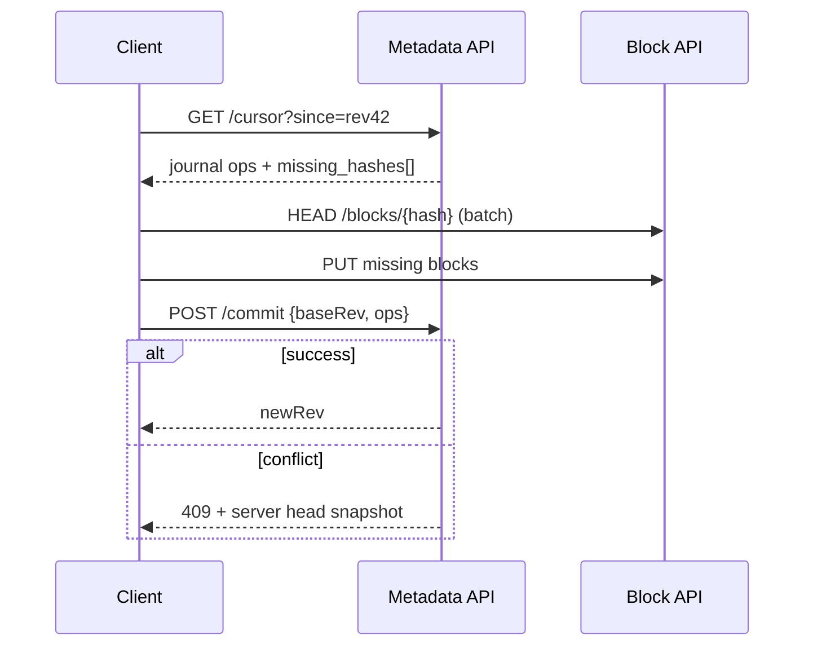

**Delta efficiency:** Journal carries **path + content hash list** per file version; client downloads only unknown hashes. **Rolling hash** on client detects local changes without full file scan.

### Failure modes and edge cases

| Failure | Mitigation |
|---------|------------|
| Upload block, die before commit | Orphan blob; GC after grace if ref_count=0 |
| Commit succeeds, client crashes | Client replays cursor; idempotent commit token |
| Shared folder ACL change | Namespace-level permission snapshot on commit |
| Mass delete | Trash + tombstone in journal; GC async |
| Hot namespace | Shard journal; rate limit commits per user |

### Interview Q&A

### Q: Why separate metadata and blob planes?
**A:** Metadata is small, transactional, and revision-ordered; blobs are large and content-addressed. Mixing them bloats DB and blocks replication.

### Q: How does dedup interact with encryption?
**A:** Client-side encryption means server sees random bytes—**no cross-user dedup**. Convergent encryption (hash as key) enables dedup but leaks equality; rarely used consumer-side.

### Q: What consistency model for sync?
**A:** **Per-namespace linearizable commits** with optimistic concurrency (`baseRev`). Across namespaces, no guarantee.

### Q: RS(10,4) vs 3× replication?
**A:** Erasure coding ~1.4× storage vs 3×; tradeoff is repair CPU and tail latency on degraded reads.

### Q: How do you handle a 10 GB file change?
**A:** Chunking means only changed chunks upload; metadata commit lists new hash chain; old chunks dec ref_count after new version visible.

### Code examples: Content-defined chunking (Rabin rolling hash)

```python
MASK = (1 << 20) - 1  # average ~1 MB chunks when boundary on hash & MASK == 0
BASE = 257

def cdc_chunks(data: bytes, min_size: int = 256 * 1024, avg_target: int = 1 << 20) -> list[bytes]:
    chunks: list[bytes] = []
    start = 0
    hash_val = 0
    power = 1
    for i, byte in enumerate(data):
        hash_val = (hash_val * BASE + byte) & 0xFFFFFFFF
        power = (power * BASE) & 0xFFFFFFFF
        if i - start + 1 >= min_size and (hash_val & MASK) == 0:
            chunks.append(data[start : i + 1])
            start = i + 1
            hash_val = 0
    if start < len(data):
        chunks.append(data[start:])
    return chunks
```

---

## Comparison Table

| Dimension | Ride-Sharing | Ticket Booking | Expense Sharing | File Sync |
|-----------|--------------|----------------|-----------------|-----------|
| **Core resource** | Driver time | Seat inventory | Money balances | Bytes + metadata |
| **Consistency** | Trip assignment strict | No oversell | Per-group ledger | Per-namespace rev |
| **Hot spot** | Geo cell / airport | On-sale event | Large group | One huge folder |
| **Real-time** | WebSocket location | Short hold TTL | Mostly REST | Long-poll + delta |
| **Payment** | Trip completion | Booking confirm | Settlement record | Subscription |
| **Idempotency** | offer/trip keys | hold + payment | expense id | commit + block hash |
| **Primary store** | Trip + ephemeral geo | SQL + Redis hold | Event log | Blob + metadata DB |
| **Fan-out** | Low per trip | Low | Group notify | Multi-device sync |

> **Pattern:** Separate **hot contended state** (inventory, dispatch lock, namespace head) from **durable audit trails** (trips, bookings, ledger events, chunk refs)—and use **timeouts** (holds, offers) to return resources automatically.

---

## Senior Pitfalls

| Mistake | Impact | Fix |
|---------|--------|-----|
| Inventory check without atomic hold | Overselling seats/rooms | DB row lock, Redis hold with TTL, or reservation service |
| Payment before inventory confirm | Refunds and chargebacks | Saga: hold → pay → confirm; compensating transactions |
| Dispatch without offer expiry | Drivers stuck, bad UX | TTL on offers, automatic re-queue, metrics on accept rate |
| Split-brain trip state across cells | Double assignment | Single writer per trip ID, fencing tokens, idempotent state transitions |
| Marketplace reviews without fraud signals | Fake listings erode trust | Device graph, velocity limits, manual review for high-risk |
| Expense split without idempotent settlement | Duplicate charges in groups | Idempotency keys per expense, ledger event log, reconciliation job |

---

## Production-grade Practice

1. Model **inventory holds** in SQL + Redis: implement hold TTL sweeper and prove no double-book under concurrent load test.
2. Design **trip/ride state machine** with explicit transitions; add integration tests for every illegal transition rejection.
3. Document **payment saga** for booking: timeouts, retry policy, and customer-visible states during partial failure.
4. Capacity-plan **on-sale event**: 50k seats, 200k RPS on hold endpoint—sketch shard keys, queue depth, and DB connection budget.
