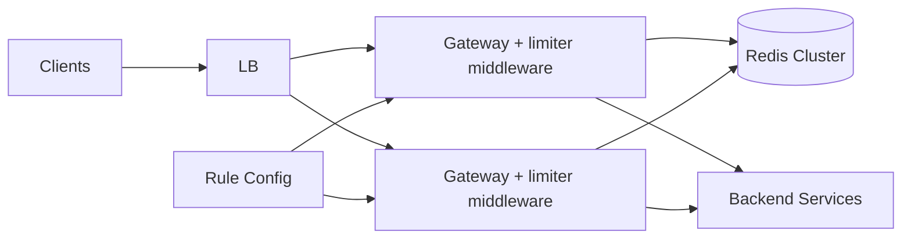
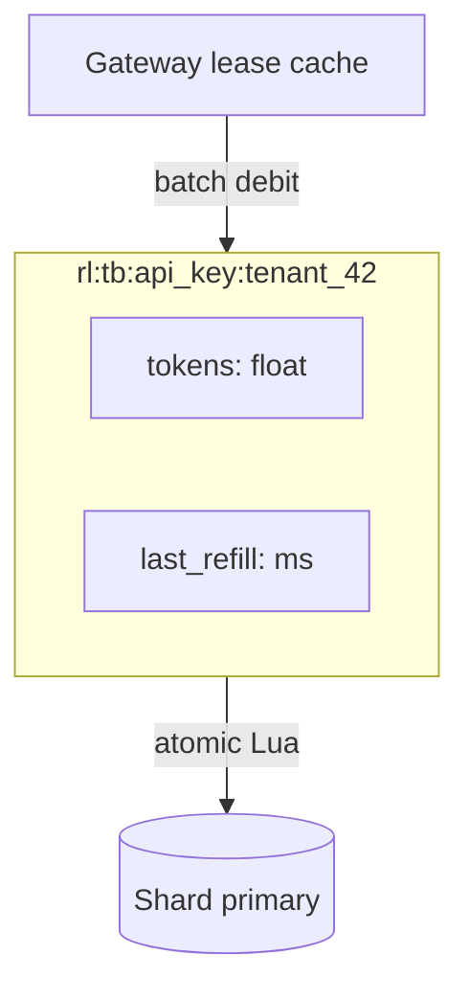
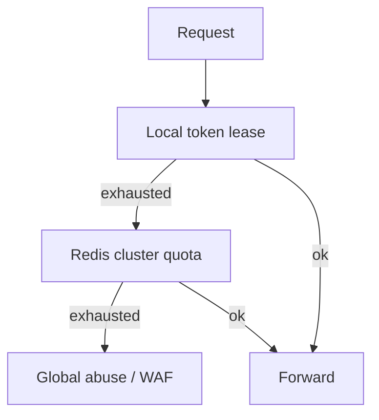
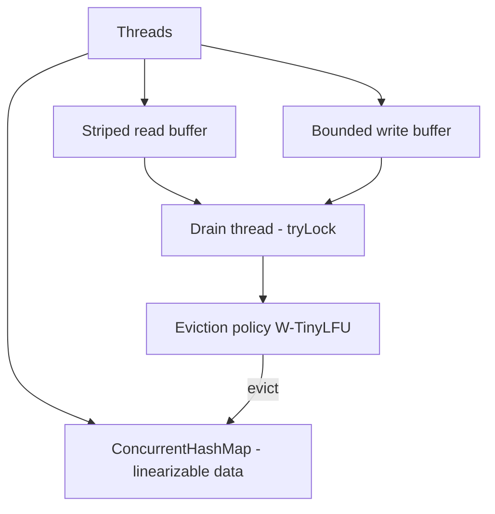
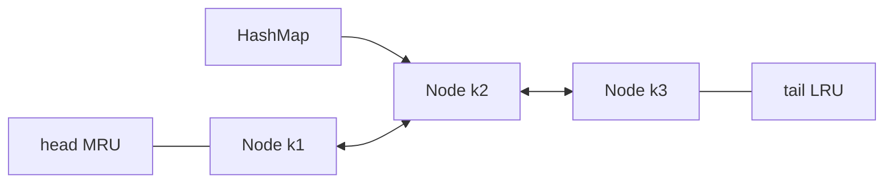
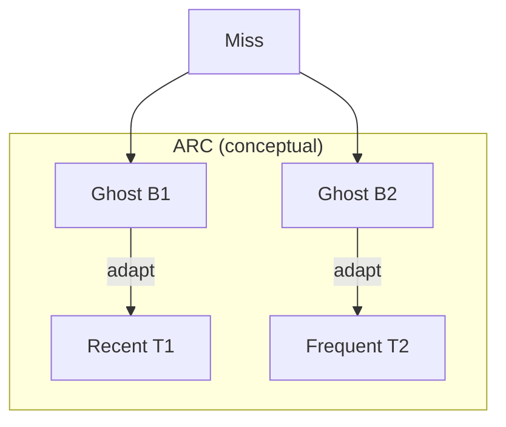
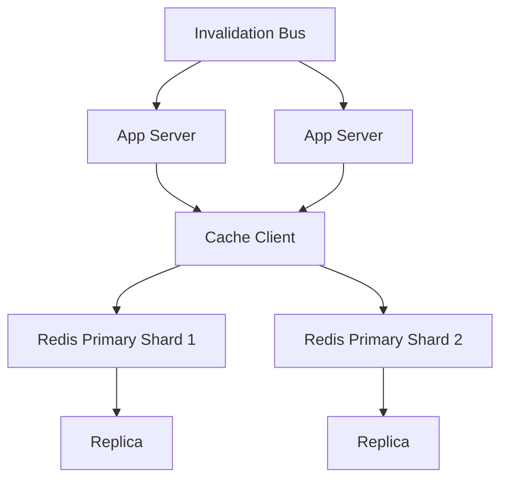
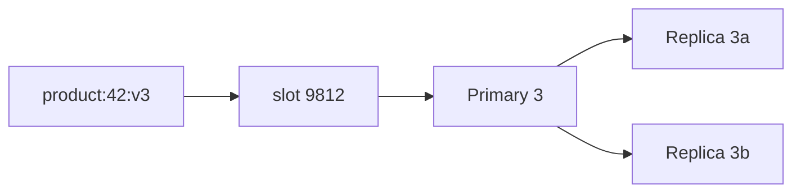
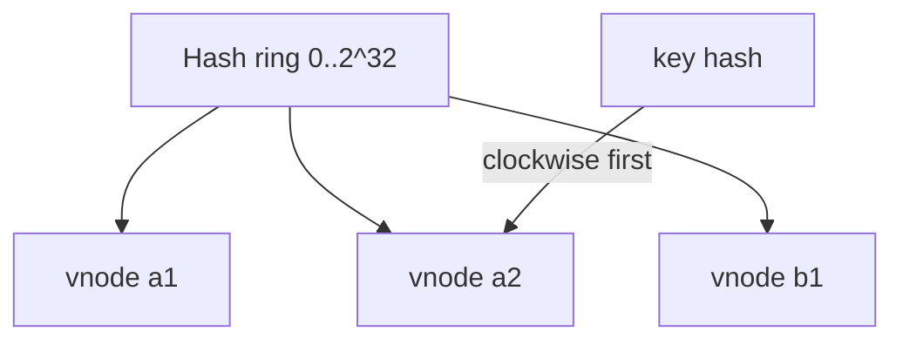
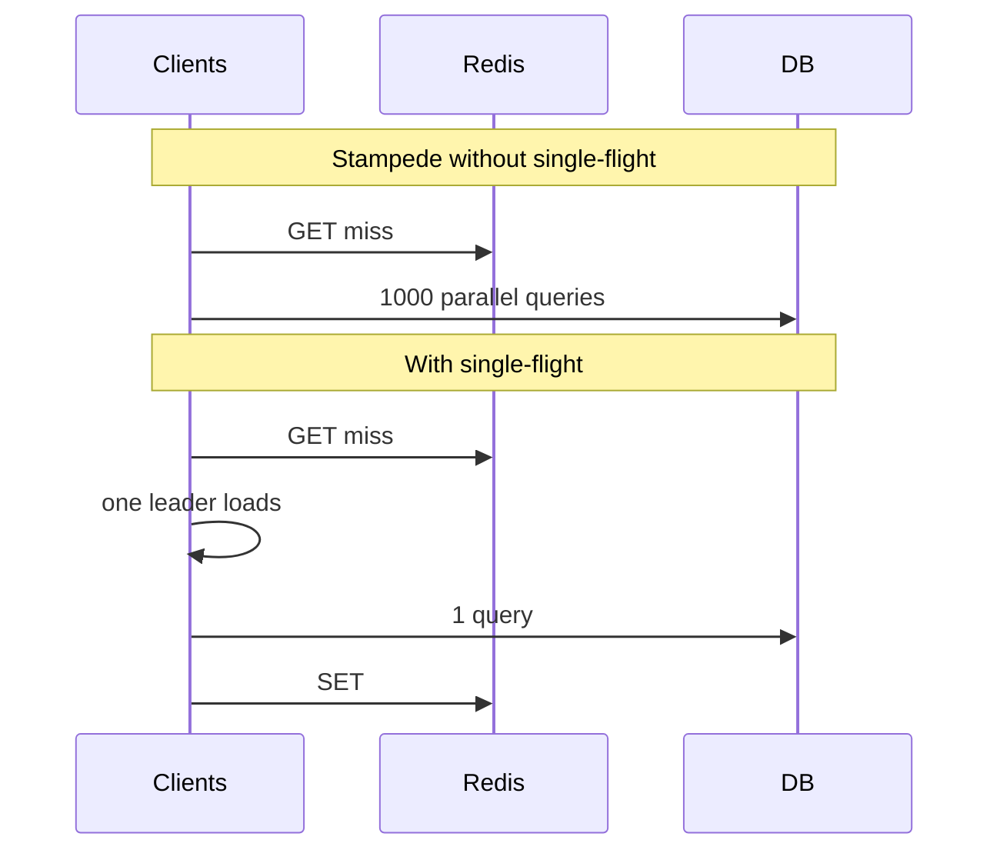

# Caching & Rate Limiting: Rate Limiter, LRU Cache & Distributed Cache

Three related problems about **bounding work**: throttle requests (rate limiter), bound memory with eviction (LRU cache), and share hot data across machines (distributed cache). All hinge on **shared state**, **atomic updates**, and **what to do when the store is down**.

---

## Design a Rate Limiter

### What problem does it solve?

Cap how many requests a client may make in a window (e.g. 100/min per API key). With many gateway nodes, **one global counter per key** must be accurate under concurrency and fast (&lt;5 ms p99).

> **A single hot key cannot scale past one Redis shard.** Tenants above ~5–10% of shard capacity need **local token leases**.

### Requirements

| Functional | Non-functional |
|------------|----------------|
| Configurable rules per path/tier; 429 + standard headers; scopes: user, IP, API key | &lt;5 ms p99; accurate under concurrency; fail-open vs fail-closed explicit |

**Scale:** ~1M checks/s; ~10M active keys/min; ~20 GB Redis with realistic per-key overhead.

### High-level architecture



### API / response contract

Every request gets headers:

```http
X-RateLimit-Limit: 100
X-RateLimit-Remaining: 42
X-RateLimit-Reset: 1699999999
Retry-After: 30          # on 429
```

**Rules (YAML, hot-reloaded):**

```yaml
rules:
  - match: { path: "/api/v1/login", scope: ip }
    limit: 5
    window: 15m
  - match: { path: "/api/*", scope: api_key, tier: free }
    limit: 1000
    window: 1h
```

### Algorithms

| Algorithm | Burst | Accuracy | Cost |
|-----------|-------|----------|------|
| **Token bucket** | Yes (up to cap) | Good | O(1) lazy refill |
| Leaky bucket | Smooth output | Good | Queue complexity |
| Fixed window | 2× at boundary | Poor | O(1) |
| Sliding window log | Exact | High memory | O(n) |
| **Sliding window counter** | ~Exact | Good | O(1) |

### Token bucket (lazy refill)

```python
def allow(key: str, capacity: int, refill_per_sec: float) -> bool:
    now = time.time()
    tokens, last = redis.hmget(key, "tokens", "last")
    tokens = float(tokens or capacity)
    last = float(last or now)
    tokens = min(capacity, tokens + (now - last) * refill_per_sec)
    if tokens < 1:
        redis.hset(key, mapping={"tokens": tokens, "last": now})
        redis.expire(key, int(capacity / refill_per_sec) + 1)
        return False
    redis.hset(key, mapping={"tokens": tokens - 1, "last": now})
    return True
```

**Production:** Use one **Lua script** in Redis for atomicity.

### Data model

| Key | Fields |
|-----|--------|
| `rl:{scope}:{id}` | tokens, last_refill_ts (or window counters) |
| TTL | `cap/rate` so idle keys evaporate |

### Scaling considerations

- **Sharding:** Hash key across Redis primaries—different keys spread; one key = one shard ceiling.
- **Local lease:** Gateway holds a batch of tokens for hot keys; refresh from Redis periodically.
- **Fail-open:** API stays up if Redis down (billing fairness suffers).
- **Fail-closed:** Login/abuse paths—reject when limiter unavailable.

### Back-of-envelope estimation

Assume **1M limit checks/s** cluster-wide, **10M active keys/min** (keys with ≥1 check in the window), average **2 Redis round-trips amortized to 1** with pipelining + local lease for top 1% keys.

| Quantity | Assumption | Math |
|----------|------------|------|
| **QPS per gateway** | 20 gateways | `1e6 / 20 = 50k checks/s` per node |
| **Redis ops/s** | 1 atomic `EVAL` per check (no lease) | `1e6 EVAL/s` → ~3–5 Redis primaries at ~200–300k ops/s each (with pipelining) |
| **Bytes per key** | Hash: 2× float + key overhead | `~80 B key + 32 B value ≈ 120 B` → 10M keys ≈ **1.2 GB** raw; with Redis overhead **~3–5 GB** |
| **Sliding-window log (avoid)** | 100 req/min, 8 B timestamp each | `100 × 8 = 800 B/key` → 10M keys ≈ **8 GB** timestamps alone |
| **Network** | 1 KB req/resp incl. TLS overhead @ 1M/s | `1e6 × 1 KB = 1 GB/s` app→Redis **if** every check is remote; local lease cuts hot keys by **90%+** |
| **p99 budget** | Gateway 2 ms + Redis 1 ms + script 0.5 ms | Target **&lt;5 ms** leaves ~1.5 ms for serialization + jitter |

**Rule of thumb:** one Redis primary comfortably holds **~50–100M** token-bucket keys if values are tiny; **hot key** at 100k checks/s on one key needs **local lease** (e.g. prefetch 500 tokens every 50 ms) or you saturate a single shard CPU.

### Database / storage schema deep dive

Redis is the canonical backing store; the schema must support **atomic read-modify-write** and **TTL for idle keys**.

| Pattern | Redis type | Fields / members | Eviction / TTL |
|---------|------------|------------------|----------------|
| Token bucket | `HASH` `rl:tb:{scope}:{id}` | `tokens` (float string), `last` (unix ms) | `EXPIRE = ceil(capacity/rate) + slack` |
| Fixed window | `STRING` counter | `INCR` + `EXPIRE` at window start | TTL = window length |
| Sliding window counter | `HASH` or 2× `STRING` | `prev_count`, `curr_count`, `window_start` | TTL = 2× window |
| Sliding window log | `ZSET` | score = timestamp ms, member = unique request id | `ZREMRANGEBYSCORE` + `EXPIRE` |

**Memory layout (token bucket HASH):**

```text
Key:   rl:tb:api_key:sk_live_abc     (~40–80 bytes)
Value: tokens="42.5"  last="1699999123456"   (~30 bytes + dict overhead)
TTL:   idle keys auto-delete → no unbounded growth for ephemeral IPs
```

**Sharding:** `slot = CRC16(key) mod 16384` (Redis Cluster); all checks for one tenant hit **one primary**—design leases accordingly.



### Component deep dive: algorithm internals

#### Token bucket vs sliding window vs leaky bucket

| Aspect | Token bucket | Leaky bucket | Sliding window counter |
|--------|--------------|--------------|------------------------|
| **State** | tokens + last_ts | queue depth or virtual clock | curr + prev window counts |
| **Burst** | Allows up to `capacity` | Output rate fixed | Smooth at boundary |
| **Update** | Lazy refill on access | Drain at constant rate | Weighted blend of two windows |
| **Best for** | API quotas with burst | Traffic shaping egress | “N per minute” fairness |

**Leaky bucket (virtual clock, O(1)):**

```python
def leaky_allow(state: dict, capacity: int, leak_per_sec: float, now: float) -> bool:
    """state: {level, last_leak} — level in [0, capacity]."""
    level = state.get("level", 0.0)
    last = state.get("last", now)
    level = max(0.0, level - (now - last) * leak_per_sec)
    if level + 1 > capacity:
        state["level"], state["last"] = level, now
        return False
    state["level"], state["last"] = level + 1, now
    return True
```

**Sliding window counter (Redis-friendly, O(1)):**

```python
def sliding_counter_allow(
    prev_count: int, curr_count: int, window_start: float,
    limit: int, window_sec: float, now: float
) -> tuple[bool, int, int, float]:
    elapsed = now - window_start
    if elapsed >= window_sec:
        # roll window
        prev_count, curr_count = curr_count, 0
        window_start = now
        elapsed = 0.0
    weight_prev = max(0.0, 1.0 - elapsed / window_sec)
    estimate = prev_count * weight_prev + curr_count
    if estimate >= limit:
        return False, prev_count, curr_count, window_start
    return True, prev_count, curr_count + 1, window_start
```

#### Distributed rate limiting with Redis Lua

Non-atomic `HMGET` + `HSET` admits **double spend** under concurrency; production uses **one script, one round trip**.

```lua
-- KEYS[1] = rl:tb:api_key:id
-- ARGV[1] = capacity, ARGV[2] = refill_per_sec, ARGV[3] = now_ms, ARGV[4] = ttl_sec
local capacity = tonumber(ARGV[1])
local refill = tonumber(ARGV[2])
local now = tonumber(ARGV[3]) / 1000.0
local ttl = tonumber(ARGV[4])

local tokens = tonumber(redis.call('HGET', KEYS[1], 'tokens'))
local last = tonumber(redis.call('HGET', KEYS[1], 'last'))
if tokens == nil then tokens = capacity end
if last == nil then last = now end

tokens = math.min(capacity, tokens + (now - last) * refill)
if tokens < 1 then
  redis.call('HSET', KEYS[1], 'tokens', tokens, 'last', now)
  redis.call('EXPIRE', KEYS[1], ttl)
  return 0
end
redis.call('HSET', KEYS[1], 'tokens', tokens - 1, 'last', now)
redis.call('EXPIRE', KEYS[1], ttl)
return 1
```

**Idempotency:** pass `request_id` only if you need dedup; otherwise one `EVAL` per HTTP request.

#### Multi-tier rate limiting



| Tier | Scope | Latency | Purpose |
|------|-------|---------|---------|
| **L1** | Process memory | ~μs | Absorb hot keys; coarse cap |
| **L2** | Redis per API key | ~1–3 ms | Authoritative tenant quota |
| **L3** | Edge / CDN / WAF | ~0 ms at edge | DDoS, geographic rules |

**Local lease sketch:** gateway holds `lease_remaining`; when `lease_remaining &lt; threshold`, `EVAL` script debits `batch_size` from Redis atomically; on Redis failure, **fail-open** for L2 but L1 still protects the process.

### Failure modes

| Failure | Symptom | Mitigation |
|---------|---------|------------|
| **Redis slow** | p99 spikes, queues build | Circuit breaker; shorten timeout; L1 lease; shed load |
| **Redis partition** | Split counters per side | Prefer **fail-closed** on auth; accept under-limit on fail-open paths |
| **Hot key** | Single shard CPU 100% | Local lease; replicate counter with lossy merge (rare); dedicated shard |
| **Clock skew** | Refill too fast/slow | Use Redis `TIME` or server-side `now` in Lua only |
| **Thundering refresh** | All gateways refresh lease same ms | Jitter `batch_refresh`; random backoff on 429 |
| **Over-admission** | Race without Lua | Never use GET/SET; always Lua/`INCR` with bounds |

### Interview Q&A

### Q: Why token bucket over fixed window for public APIs?

**A:** Fixed window allows **2× burst** at the boundary (99 requests at 0:59 and 100 at 1:00). Token bucket exposes a controlled burst up to `capacity` while preserving long-run rate `refill_per_sec`. Sliding window counter is a good middle ground when you need “requests per minute” without storing every timestamp.

### Q: How do you return accurate `X-RateLimit-Remaining`?

**A:** Compute remaining from the same atomic state the allow/deny decision uses—e.g. `floor(tokens)` for token bucket or `limit - estimate` for sliding counter. Never compute headers in a second non-atomic read; return values from the Lua script via `redis.call` return tuple or a follow-up `HGET` in the **same** script.

### Q: Fail-open vs fail-closed—how do you choose?

**A:** **Fail-open** when availability dominates (B2B API, revenue). **Fail-closed** when abuse cost dominates (login, coupon, SMS). Document the policy per route in rule config; metric `rate_limiter_bypass_reason` for audits.

### Q: How would you rate limit by IP behind a carrier NAT?

**A:** IP scope is coarse: combine **API key + IP**, use **proof-of-work** or **captcha** on abuse, and cap **/24** separately. Prefer authenticated scopes for real quotas.

### Q: Can you shard one tenant across Redis nodes?

**A:** Not for a **single counter** without losing accuracy. Options: (1) local leases with periodic sync (small over-admission), (2) split limits per gateway with global cap = sum (complex), (3) dedicate a shard to mega-tenants.

### Q: How do sliding window logs scale?

**A:** They do not at 10M keys—they are O(window arrivals) memory. Use **sliding counter** or **Redis Cell–style** modules; logs are for debugging or tiny limits only.

### Q: What headers should clients rely on?

**A:** `Retry-After` on 429 (seconds), `X-RateLimit-Reset` as absolute unix time, and remaining/limit for UX. Use **standardized** names (draft RFC 9110 style) consistently across services.

### Full reference: in-process token bucket + Redis limiter

```python
import time
from dataclasses import dataclass
from typing import Optional

@dataclass
class TokenBucket:
    capacity: float
    refill_per_sec: float
    tokens: float
    last: float

    def allow(self, now: Optional[float] = None) -> bool:
        now = now or time.time()
        self.tokens = min(self.capacity, self.tokens + (now - self.last) * self.refill_per_sec)
        self.last = now
        if self.tokens < 1:
            return False
        self.tokens -= 1
        return True


TOKEN_BUCKET_LUA = """
local capacity = tonumber(ARGV[1])
local refill = tonumber(ARGV[2])
local now = tonumber(ARGV[3])
local ttl = tonumber(ARGV[4])
local tokens = tonumber(redis.call('HGET', KEYS[1], 'tokens'))
local last = tonumber(redis.call('HGET', KEYS[1], 'last'))
if tokens == nil then tokens = capacity end
if last == nil then last = now end
tokens = math.min(capacity, tokens + (now - last) * refill)
if tokens < 1 then
  redis.call('HSET', KEYS[1], 'tokens', tokens, 'last', now)
  redis.call('EXPIRE', KEYS[1], ttl)
  return {0, math.floor(tokens)}
end
tokens = tokens - 1
redis.call('HSET', KEYS[1], 'tokens', tokens, 'last', now)
redis.call('EXPIRE', KEYS[1], ttl)
return {1, math.floor(tokens)}
"""


class RedisRateLimiter:
    def __init__(self, redis_client, script_sha: str):
        self.r = redis_client
        self.sha = script_sha

    def allow(self, key: str, capacity: int, refill_per_sec: float) -> tuple[bool, int]:
        now = time.time()
        ttl = int(capacity / refill_per_sec) + 60
        ok, remaining = self.r.evalsha(
            self.sha, 1, key, capacity, refill_per_sec, now, ttl
        )
        return bool(ok), int(remaining)
```

---

## Design an LRU Cache

### What problem does it solve?

A **bounded in-process cache**: `get`/`put` in O(1) with **least-recently-used eviction**. The interview twist: under **many cores**, strict LRU fails because **every read updates recency** (read = write).

> **Strict LRU is often the wrong policy.** Production caches (e.g. Caffeine) decouple **concurrent hash table** from **async eviction policy** and use **W-TinyLFU** for admission.

### Requirements

| Functional | Non-functional |
|------------|----------------|
| get, put, delete; max capacity (count or weight); optional TTL | High multi-core read throughput; no thundering herd on load |

### Textbook structure (single-threaded)


- `get(k)`: move node to head.
- `put(k,v)`: insert/move head; evict tail if over capacity.

```python
class LRUCache:
    def __init__(self, capacity: int):
        self.cap = capacity
        self.map: dict = {}
        self.order: list = []

    def get(self, key):
        if key not in self.map:
            return None
        self.order.remove(key)
        self.order.append(key)
        return self.map[key]

    def put(self, key, value):
        if key in self.map:
            self.order.remove(key)
        elif len(self.map) >= self.cap:
            evict = self.order.pop(0)
            del self.map[evict]
        self.map[key] = value
        self.order.append(key)
```

*(Production uses `OrderedDict` or linked nodes—not `list.remove`.)*

### Concurrent design (Caffeine-style)



1. **Reads** hit CHM only; record access in **lossy read buffer**.
2. **Writes** go to CHM + write buffer.
3. **Drain thread** batches policy updates—no per-read lock on LRU list.

### W-TinyLFU (admission)

- **Window LRU** for recent items.
- **TinyLFU** filter: reject one-hit wonders that would evict hot set.
- Fixes **scan** workloads that destroy strict LRU.

### Extra production features

| Feature | Why |
|---------|-----|
| **Single-flight loading** | One loader per missing key |
| **Timer wheel expiry** | O(1) amortized TTL |
| **Weighted entries** | Evict by bytes not count |
| **Linearizability tests** | Jepsen-style stress |

```java
// Caffeine-style usage (illustrative)
Cache<String, User> cache = Caffeine.newBuilder()
    .maximumSize(10_000)
    .expireAfterWrite(Duration.ofMinutes(10))
    .build(key -> userDb.load(key));  // single-flight load
```

### Scaling considerations

- **Not distributed**—this problem is in-process; cluster = many independent caches + sticky routing or acceptance of low hit rate.
- Size for **working set**, not total data.
- Measure **hit rate** under real traffic (including batch scans).

### Back-of-envelope estimation

Example: **Java service**, **10k unique keys** in working set, **50k reads/s**, **2k writes/s**, average value **2 KB**, **32 cores**.

| Quantity | Assumption | Math |
|----------|------------|------|
| **Memory (count cap)** | 10k entries × 2 KB | `10^4 × 2 KB = 20 MB` values + ~30% pointer overhead ≈ **26 MB** |
| **Memory (weighted)** | 512 MB heap budget for cache | `512 MB / 2 KB ≈ 262k` entries max by weight |
| **Read QPS per core** | CHM + lossy buffer | Target **100k+** logical reads/s per process if reads do not touch LRU list |
| **Strict LRU list** | 1 lock per get | Often **&lt;500k** ops/s total—why async policy matters |
| **Miss storm** | 1% miss × 50k = 500 DB/s | Without single-flight: **500 concurrent** loaders; with single-flight: **1 per key** |
| **Eviction rate** | Steady state: inserts = evictions | `2k evictions/s` → drain thread batching 64–256 ops keeps CPU &lt;5% |

**Sizing:** `cache_size ≈ hot_working_set × 1.2` (headroom for churn). If working set is 100k keys at 1 KB, plan **~120 MB** + index overhead.

### Database / storage schema deep dive

In-process LRU is not a database, but the **logical schema** is a graph plus index:

| Structure | Role | Typical layout |
|-----------|------|----------------|
| **Hash map** | `key → Node*` O(1) lookup | Open addressing or chained buckets; key hash + pointer |
| **Node** | `key`, `value`, `prev`, `next`, optional `weight`, `expire_at` | 32–48 bytes overhead per node excluding value |
| **DLL sentinel** | `head` (MRU), `tail` (LRU) | Dummy nodes avoid null checks |
| **Eviction metadata** | Policy-specific: frequency sketch, generation | W-TinyLFU: **Count-Min Sketch** ~few KB |



**Per-entry metadata (production):**

```text
Entry {
  key: K
  value: V | AtomicReference<V>
  weight: int          // for byte-weighted eviction
  writeTime: long      // expireAfterWrite
  accessTime: long     // optional; often avoided on hot read path
  frequency: int       // LFU / TinyLFU counter
}
```

### Component deep dive: doubly-linked list + hashmap

**Invariant:** map size = list size; every map value appears exactly once in the DLL.

```python
from __future__ import annotations
from dataclasses import dataclass
from typing import Generic, Optional, TypeVar

K = TypeVar("K")
V = TypeVar("V")


@dataclass
class _Node(Generic[K, V]):
    key: K
    value: V
    prev: Optional["_Node[K, V]"] = None
    next: Optional["_Node[K, V]"] = None


class LRUCacheO1(Generic[K, V]):
    def __init__(self, capacity: int):
        if capacity <= 0:
            raise ValueError("capacity must be positive")
        self.capacity = capacity
        self.map: dict[K, _Node[K, V]] = {}
        self.head = _Node[K, V](key=None, value=None)  # type: ignore[arg-type]
        self.tail = _Node[K, V](key=None, value=None)  # type: ignore[arg-type]
        self.head.next = self.tail
        self.tail.prev = self.head

    def _remove(self, node: _Node[K, V]) -> None:
        assert node.prev and node.next
        node.prev.next = node.next
        node.next.prev = node.prev

    def _insert_mru(self, node: _Node[K, V]) -> None:
        node.next = self.head.next
        node.prev = self.head
        assert self.head.next
        self.head.next.prev = node
        self.head.next = node

    def get(self, key: K) -> Optional[V]:
        node = self.map.get(key)
        if node is None:
            return None
        self._remove(node)
        self._insert_mru(node)
        return node.value

    def put(self, key: K, value: V) -> None:
        if key in self.map:
            node = self.map[key]
            node.value = value
            self._remove(node)
            self._insert_mru(node)
            return
        if len(self.map) >= self.capacity:
            lru = self.tail.prev
            assert lru and lru is not self.head
            self._remove(lru)
            del self.map[lru.key]
        node = _Node(key=key, value=value)
        self.map[key] = node
        self._insert_mru(node)
```

**Complexity:** `get`/`put` = **O(1)** time, **O(capacity)** space.

#### Thread-safe implementation

| Approach | Reads | Writes | Notes |
|----------|-------|--------|-------|
| **Big lock** | Serialized | Serialized | Simple; poor multi-core |
| **Striped locks** | Lock per bucket | Lock bucket + order | Better; deadlock care on promote |
| **CHM + async policy** | Lock-free read | Per-entry or buffer | Caffeine model |
| **RCU / immutable snapshot** | No lock | Copy-on-write | Rare in JVM caches |

```python
import threading
from collections import OrderedDict

class ThreadSafeLRU:
    """Coarse lock; fine for moderate contention interviews."""

    def __init__(self, capacity: int):
        self._cap = capacity
        self._od: OrderedDict = OrderedDict()
        self._lock = threading.RLock()

    def get(self, key):
        with self._lock:
            if key not in self._od:
                return None
            self._od.move_to_end(key)
            return self._od[key]

    def put(self, key, value):
        with self._lock:
            if key in self._od:
                self._od.move_to_end(key)
            self._od[key] = value
            if len(self._od) > self._cap:
                self._od.popitem(last=False)
```

**Read-mostly optimization:** use `ConcurrentHashMap` for values; record access in a **ring buffer**; a background thread promotes to MRU in batches—reads avoid the LRU list lock.

#### LRU vs LFU vs ARC

| Policy | Tracks | Wins on | Loses on |
|--------|--------|---------|----------|
| **LRU** | Recency | Temporal locality | One-hit scans, periodic batch jobs |
| **LFU** | Frequency | Hot stable set | New items starve (needs aging) |
| **ARC** | LRU + LFU ghost lists | Mixed workloads | More metadata; tuning |
| **W-TinyLFU** | Window + sketch admission | General production | Implementation complexity |



**ARC intuition:** maintain two real lists (recent + frequent) and two **ghost** lists recording evicted keys without values—on miss in ghost, adapt partition size between T1 and T2.

### Failure modes

| Mode | Cause | Effect | Mitigation |
|------|-------|--------|------------|
| **Thundering herd** | Many threads miss same key | DB overload | `load(key)` single-flight / `sync.Map` in Go |
| **Cache stampede (TTL)** | Many entries expire together | Latency cliff | Jittered TTL; proactive refresh |
| **Memory pressure** | Heap larger than `-Xmx` allows | GC thrash | Weighted eviction; off-heap (OHC) |
| **False LRU under load** | Lossy access buffer | Suboptimal evictions | Tune buffer; increase drain frequency |
| **Unbounded loader** | `get` triggers unbounded recursion | Stack overflow | Separate loader pool; timeouts |
| **Linearizability bugs** | Check-then-act without lock | Duplicate loads | Test with stress + Jepsen-style harness |

### Interview Q&A

### Q: Why is `list.remove` wrong for LRU in production?

**A:** Python `list.remove` is **O(n)**; at capacity 10k and 50k ops/s, eviction dominates. Doubly-linked list + hash map gives **O(1)** per operation. `OrderedDict` is acceptable in Python services at moderate scale.

### Q: Does `get` need to update LRU under high read contention?

**A:** For strict LRU, yes—which is the bottleneck. Production systems use **approximate LRU** (sampled eviction), **lossy recency buffers**, or policies like **W-TinyLFU** that do not move a node on every read.

### Q: How do you implement TTL with LRU?

**A:** Options: (1) **lazy expiry** on `get`, (2) **timer wheel** / hierarchical timer for O(1) expiry, (3) `expireAfterAccess` ties TTL to policy—eviction may remove before TTL. Combine **maximumSize** with **expireAfterWrite**—whichever triggers first wins.

### Q: LRU vs LFU for a news feed?

**A:** Feeds have **scan** traffic (many one-off article IDs)—LRU fills with cold items. Prefer **TinyLFU admission** or a small **window** plus frequency filter so one-time IDs do not evict user profile blobs.

### Q: How would you test a concurrent cache?

**A:** Property tests: size never exceeds cap; key present iff in map. Stress: N threads random `get`/`put`; compare sequential reference model. Optional **linearizability** checker for strict semantics.

### Q: Can LRU be distributed?

**A:** Not as one strict structure—network makes global recency order expensive. Use **per-node LRU**, **sticky sessions**, or a **distributed cache** with TTL; do not try to replicate LRU list order across machines.

### Q: What is weighted eviction?

**A:** Each entry has `weight` (e.g. byte size). Evict until `sum(weights) ≤ maxWeight`. Implementation: same DLL but compare `total_weight` on insert; may evict multiple tail nodes in one `put`.

### Full reference: LRU with optional LFU-style frequency hook

```python
class LRUKCache:
    """LRU with simple frequency bump for interview extensions."""

    def __init__(self, capacity: int):
        self.inner = LRUCacheO1(capacity)
        self.freq: dict = {}

    def get(self, key):
        val = self.inner.get(key)
        if val is not None:
            self.freq[key] = self.freq.get(key, 0) + 1
        return val

    def put(self, key, value):
        self.freq[key] = self.freq.get(key, 0) + 1
        self.inner.put(key, value)
```

---

## Design a Distributed Cache

### What problem does it solve?

Many app servers share a **low-latency, replicated cache** (Redis/Memcached) so databases are not hit on every read. Challenges: **partitioning**, **consistency**, **hot keys**, **cache stampede**, and **failure modes**.

> **Cache-aside is the default.** Write-through and write-behind trade complexity for consistency and write latency.

### Requirements

| Functional | Non-functional |
|------------|----------------|
| get/put/delete; TTL; optional pub/sub invalidation | p99 &lt;1 ms in-AZ; high availability; horizontal scale |

### High-level architecture



### Patterns

| Pattern | Read | Write | Consistency |
|---------|------|-------|-------------|
| **Cache-aside** | App reads cache; on miss load DB + set | App writes DB; invalidate cache | Eventual |
| Read-through | Cache loads on miss | App writes DB + invalidate | Eventual |
| Write-through | Cache always fresh | Write cache + DB together | Stronger |
| Write-behind | Fast write to cache | Async flush to DB | Risk of loss |

### Cache-aside (typical)

```python
def get_user(user_id: str) -> User:
    key = f"user:{user_id}"
    cached = redis.get(key)
    if cached:
        return User.from_json(cached)
    user = db.query(user_id)
    if user:
        redis.setex(key, 3600, user.to_json())
    return user

def update_user(user: User):
    db.update(user)
    redis.delete(f"user:{user.id}")  # invalidate, not update-in-place
```

### Data model & sharding

- **Shard by key hash:** `slot = crc32(key) % num_shards`
- **Consistent hashing** when adding nodes (minimal remapping)
- **Replica reads:** OK for idempotent reads; use primary for read-your-writes if needed

### Hot key mitigation

| Technique | Effect |
|-----------|--------|
| Local L1 per app | Absorbs viral key |
| **Single-flight** | One DB fetch per key per wave |
| Key replication | `key#1`, `key#2` random read |
| CDN / edge | For cacheable HTTP responses |

### Scaling considerations

- **Cluster sizing:** Memory for working set × replication factor; CPU for scripted ops.
- **Eviction:** `allkeys-lru` vs `volatile-ttl`—know your TTL strategy.
- **Thundering herd:** Probabilistic early expiration + single-flight.
- **Multi-region:** Active-active cache = hard; often **cache per region** + async replication of source data.

```lua
-- Redis SET if not exists with TTL (distributed lock / claim pattern)
if redis.call('SETNX', KEYS[1], ARGV[1]) == 1 then
  redis.call('EXPIRE', KEYS[1], ARGV[2])
  return 1
end
return 0
```

### Back-of-envelope estimation

Example: **e-commerce product catalog**, **500 GB** working set, **200k cache reads/s**, **5k writes/s**, **2× replication**, average value **4 KB**, **p99 &lt;1 ms** in-AZ.

| Quantity | Assumption | Math |
|----------|------------|------|
| **Raw memory** | Working set in cache | `500 GB × 2 replicas = 1 TB` RAM (+ ~25% Redis overhead) → **~1.25 TB** |
| **QPS per shard** | 32 shards | `200k / 32 ≈ 6.25k reads/s/shard` — modest for Redis |
| **Hot key** | 1 key @ 80k/s | One shard sees **80k/s** → need **local L1** or **key replication** (8 copies → 10k/s each) |
| **Miss penalty** | 1% miss, DB 20 ms | `0.01 × 200k = 2k DB/s` — DB must sustain; single-flight caps per-key |
| **Bandwidth** | 4 KB value × 200k/s | `200k × 4 KB = 800 MB/s` cluster egress from Redis; **compression** (Snappy) → ~400 MB/s |
| **Invalidation fan-out** | 10k keys/s × 100 app nodes | Pub/sub **1M messages/s** — prefer **versioned keys** or scoped channels |

**Shard count:** `shards ≥ total_RAM_needed / RAM_per_node`; leave **30% headroom** for fragmentation and copy-on-write during snapshots.

### Database / storage schema deep dive

Redis cluster **hash slot** model:

| Concept | Detail |
|---------|--------|
| **Key** | `user:{uuid}`, `product:{id}:v{ver}` |
| **Value** | String (JSON), Hash (fielded object), or compressed blob |
| **TTL** | `SETEX` / `EXPIRE`; volatile vs allkeys eviction policy |
| **Slot** | `CRC16(key) mod 16384` → shard mapping |
| **Metadata** | Optional sidecar Hash: `created_at`, `schema_ver`, `source_region` |

**Eviction metadata (Redis server):**

| `maxmemory-policy` | Behavior |
|--------------------|----------|
| `allkeys-lru` | Approx LRU across all keys |
| `volatile-lru` | LRU among keys with TTL only |
| `allkeys-lfu` | Frequency-based; good for hot skew |
| `noeviction` | Returns errors on write—know ops impact |

**Memory per key (rule of thumb):**

```text
overhead ≈ 50–90 bytes + len(key) + len(value)
Hash with N fields ≈ 90 + N × (field_overhead + value)
```



### Component deep dive: consistent hashing ring

**Goal:** when adding/removing a node, only **K/n** keys move (K = total keys, n = nodes).

```python
import bisect
import hashlib
from typing import Dict, List, Tuple

def _hash(s: str) -> int:
    return int(hashlib.md5(s.encode()).hexdigest(), 16)


class ConsistentHashRing:
    def __init__(self, replicas: int = 150):
        self.replicas = replicas
        self.ring: List[int] = []
        self.nodes: Dict[int, str] = {}

    def add_node(self, node: str) -> None:
        for i in range(self.replicas):
            h = _hash(f"{node}:{i}")
            self.ring.append(h)
            self.nodes[h] = node
        self.ring.sort()

    def remove_node(self, node: str) -> None:
        for i in range(self.replicas):
            h = _hash(f"{node}:{i}")
            self.ring.remove(h)
            del self.nodes[h]

    def get_node(self, key: str) -> str:
        if not self.ring:
            raise RuntimeError("empty ring")
        h = _hash(key)
        idx = bisect.bisect(self.ring, h) % len(self.ring)
        return self.nodes[self.ring[idx]]
```

**Virtual nodes:** `replicas=150–200` per physical host flattens load skew.



#### Cache coherence protocols

Distributed caches are usually **eventually consistent** with explicit invalidation—not true MESI across nodes.

| Protocol | Mechanism | Consistency | Cost |
|----------|-----------|-------------|------|
| **Invalidate on write** | `DEL` / pub/sub channel | Eventual; race window | Low |
| **Versioned keys** | `user:1:v42` | Read never sees torn value | Slightly more memory |
| **Lease / lock** | `SET NX PX` | Stronger for single key | Latency + deadlock care |
| **Read-your-writes** | Sticky to primary or local session cache | Per-user strong | Routing complexity |
| **CRDT / merge** | Rare in cache layer | Application-specific | — |

**Invalidation race (cache-aside):**

```text
T1: Writer updates DB
T2: Reader miss → loads stale row → SET cache
T3: Writer DEL cache
→ cache empty (OK) OR if T2 after T3, stale until TTL
```

**Fix:** **delete before** DB commit (still races) → prefer **version in key**, **short TTL**, or **write-through** for strong needs.

#### Write-through vs write-back vs write-around

| Pattern | Write path | Read after write | Risk |
|---------|------------|------------------|------|
| **Write-through** | Update cache + DB synchronously | Fresh | Higher write latency |
| **Write-back** | Update cache; async flush DB | Fast | Loss on crash; ordering |
| **Write-around** | Write DB only; cache miss on read | Stale until miss | Good for write-heavy cold data |

```python
class WriteThroughCache:
    def __init__(self, cache, db):
        self.cache = cache
        self.db = db

    def put(self, key: str, value: bytes) -> None:
        self.db.save(key, value)
        self.cache.set(key, value, ttl=3600)

    def get(self, key: str) -> bytes | None:
        hit = self.cache.get(key)
        if hit is not None:
            return hit
        val = self.db.load(key)
        if val is not None:
            self.cache.set(key, val, ttl=3600)
        return val


class WriteBackCache:
    def __init__(self, cache, db, flush_interval_sec: float = 1.0):
        self.cache = cache
        self.db = db
        self.dirty: set[str] = set()

    def put(self, key: str, value: bytes) -> None:
        self.cache.set(key, value)
        self.dirty.add(key)

    def flush(self) -> None:
        for key in list(self.dirty):
            self.db.save(key, self.cache.get(key))
            self.dirty.discard(key)
```

**Write-around** (skip cache on write):

```python
def update_user_write_around(cache, db, user):
    db.update(user)
    cache.delete(f"user:{user.id}")
```

### Failure modes

| Failure | Symptom | Mitigation |
|---------|---------|------------|
| **Cache stampede** | Miss storm on expiry | Single-flight; lock per key; early probabilistic refresh |
| **Hot key** | One shard CPU/network maxed | Local L1; random sub-keys; read replicas (stale OK) |
| **Split brain** | Two primaries after partition | Redis Cluster quorum; `min-replicas-to-write` |
| **Memory pressure** | Evictions spike; latency | Raise memory; LFU; separate hot/cold clusters |
| **Network partition** | Apps split from Redis | Circuit breaker; degrade to DB with rate limit |
| **Replica lag** | Stale reads after write | Read primary for RYW; or invalidate + short TTL |
| **Big value** | Slow GET; blocking | Chunk keys; compression; don't cache &gt;1 MB blobs |
| **Thundering herd on cold start** | Empty cache at deploy | Warmup job; staged rollout |



### Interview Q&A

### Q: Why invalidate instead of update cache on write?

**A:** **Update-in-place** races with concurrent readers (torn reads) and duplicates logic if multiple writers format values differently. **Delete** forces next read to load canonical shape from DB; cost is one extra miss—acceptable for most entities.

### Q: When is write-through worth it?

**A:** When **read-after-write consistency** matters (inventory, permissions) and write rate is moderate. Pays **2× write latency** (cache + DB) for simpler mental model than invalidation races.

### Q: How does Redis Cluster handle resharding?

**A:** Slots migrate with `MIGRATE`; clients follow `MOVED`/`ASK` redirects. Plan **gradual** adds; double capacity during migration; monitor **hot slots**.

### Q: Memcached vs Redis for pure cache?

**A:** Memcached: multithreaded, simple GET/SET, no persistence. Redis: richer types, persistence optional, single-threaded primary (per shard) but **cluster** scales—choose Redis when you need TTL structures, Lua, or pub/sub invalidation.

### Q: How do you cache a list query?

**A:** Cache **denormalized result** keyed by `query_hash` + **version** of underlying tables; on any row change, invalidate all list keys for that table (hard) or use **short TTL** + **single-flight** (pragmatic).

### Q: What is probabilistic early expiration?

**A:** Before TTL expires, recompute with probability `p` so refreshes spread over time: `p ∝ (now - (ttl - beta))` — reduces synchronized expiry.

### Q: Active-active multi-region cache?

**A:** Hard—writes in two regions without coordination → divergence. Common pattern: **cache per region**, **source-of-truth DB** with replication, accept **regional staleness** or route writes to one region.

### Full reference: cache-aside with single-flight

```python
import threading
from typing import Callable, Dict, Optional, Tuple

class SingleFlight:
    def __init__(self):
        self._inflight: Dict[str, threading.Event] = {}
        self._results: Dict[str, Tuple[object, Optional[Exception]]] = {}
        self._lock = threading.Lock()

    def do(self, key: str, fn: Callable[[], object]):
        with self._lock:
            if key in self._inflight:
                ev = self._inflight[key]
                leader = False
            else:
                ev = threading.Event()
                self._inflight[key] = ev
                leader = True
        if not leader:
            ev.wait()
            val, err = self._results[key]
            if err:
                raise err
            return val
        try:
            result = fn()
            with self._lock:
                self._results[key] = (result, None)
        except Exception as e:
            with self._lock:
                self._results[key] = (None, e)
            raise
        finally:
            with self._lock:
                self._inflight.pop(key, None)
                self._results.pop(key, None)
            ev.set()
        return result


def get_with_cache_aside(
    redis_client,
    db,
    key: str,
    ttl: int,
    sf: SingleFlight,
):
    raw = redis_client.get(key)
    if raw:
        return raw

    def loader():
        again = redis_client.get(key)
        if again:
            return again
        row = db.load(key)
        if row:
            redis_client.setex(key, ttl, row)
        return row

    return sf.do(key, loader)
```

---

## Comparison: Rate Limiter vs LRU Cache vs Distributed Cache

| Dimension | Rate Limiter | LRU Cache | Distributed Cache |
|-----------|--------------|-----------|-------------------|
| **Scope** | Cluster-wide quota | Single process | Cluster-wide data |
| **Shared store** | Redis (required) | In-memory only | Redis/Memcached |
| **Hot path op** | Read-modify-write | get/put | get (+ optional set) |
| **Correctness focus** | No over-admission | Eviction fairness / hit rate | Staleness vs DB |
| **Classic algorithm** | Token bucket | LRU / W-TinyLFU | Cache-aside |
| **Hot key problem** | Local token lease | N/A (local) | L1 + single-flight |
| **On backend failure** | Fail-open/closed policy | N/A | Degrade to DB |
| **TTL** | Window expiry | Per-entry optional | Central to design |

> **Shared theme:** Separate **fast data plane** (counter, cache entry) from **policy** (rules, eviction, invalidation), and always ask what happens when the shared component is slow or down.

---

## Senior Pitfalls

| Mistake | Impact | Fix |
|---------|--------|-----|
| Cache-aside without invalidation strategy | Stale prices, auth bugs | TTL + event-driven invalidation, version stamps |
| Redis rate limit without clock skew handling | Burst over-admission | Lua atomic scripts, sliding window, synchronized time |
| Fail-open rate limiter during Redis outage | Abuse and overload | Explicit policy doc; local token lease with conservative cap |
| Hot key on single cache entry | Redis CPU spike, uneven shards | Local L1, replication, key splitting |
| LRU cache ignoring memory overhead | OOM kills process | Account for object size, max entries, sampled eviction metrics |
| Negative caching forever | Stale “not found” after create | Short TTL on misses, explicit bust on write |

---

## Production-grade Practice

1. Implement **token bucket** in Redis with integration tests for parallel clients; compare accuracy vs in-memory baseline.
2. Build **cache-aside** for a read-heavy API; inject DB latency and measure hit rate, stampede behavior, and p99 with/without singleflight.
3. Run **Redis failure drill**: slow commands vs full outage; verify app behavior matches documented fail-open/closed policy.
4. Produce **capacity sheet**: QPS, bytes per key, eviction rate, and cluster memory for 95% hit ratio target.
