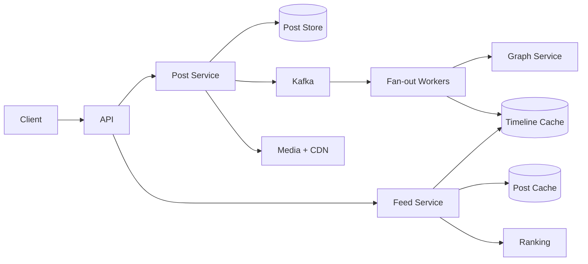
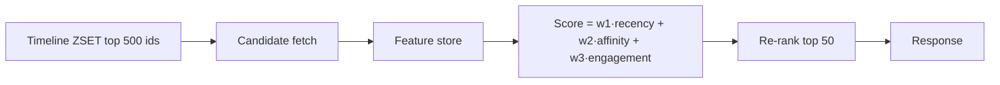
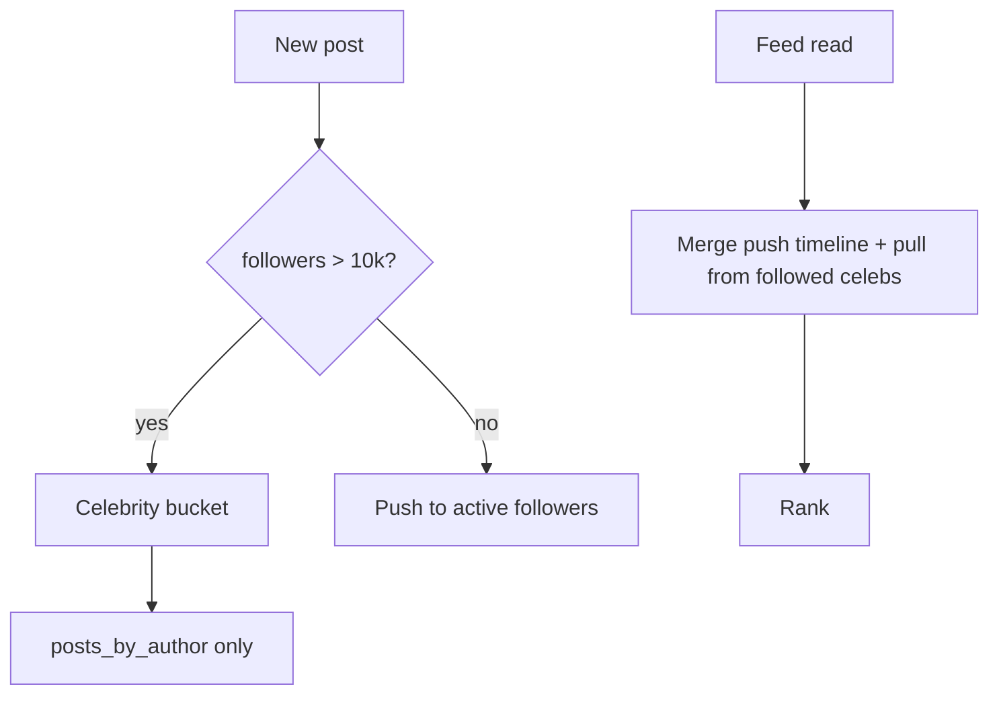
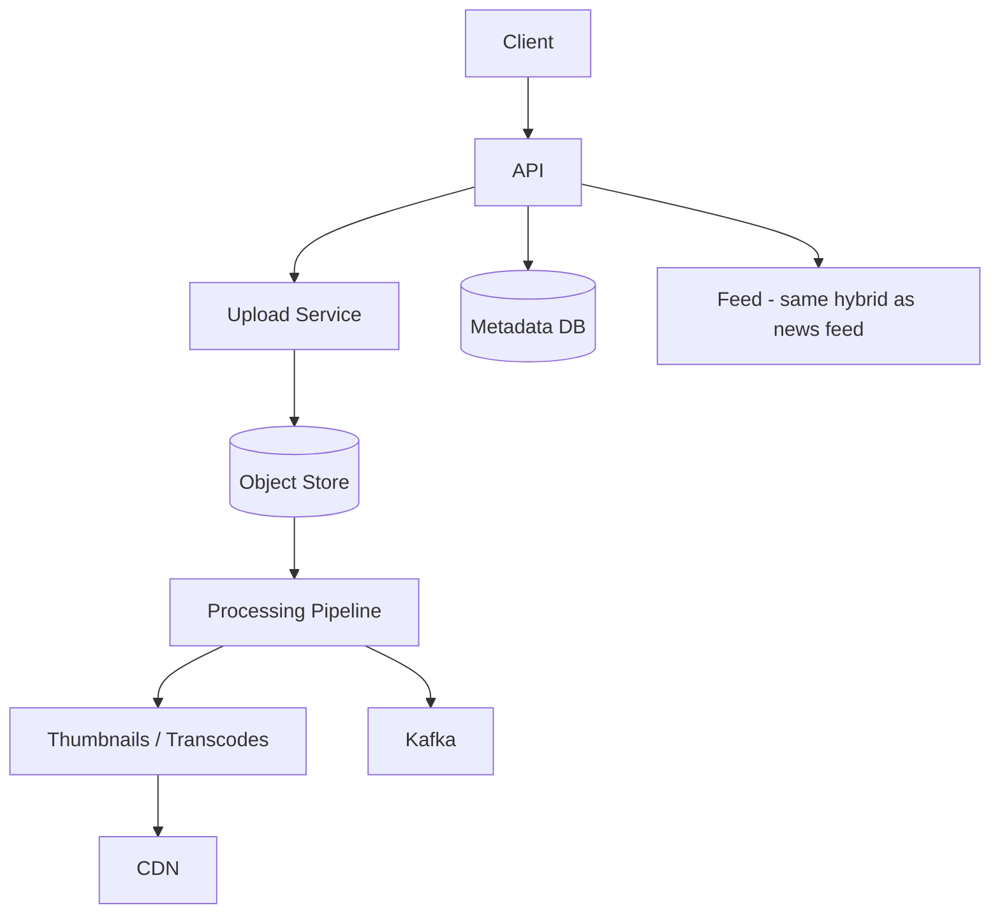
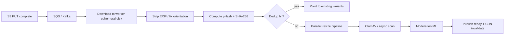
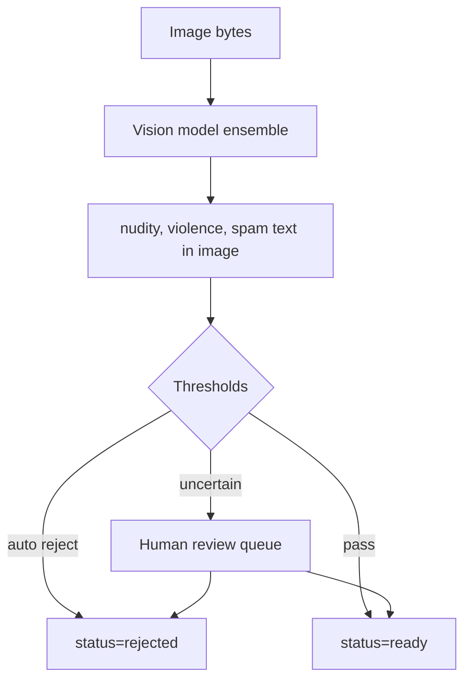
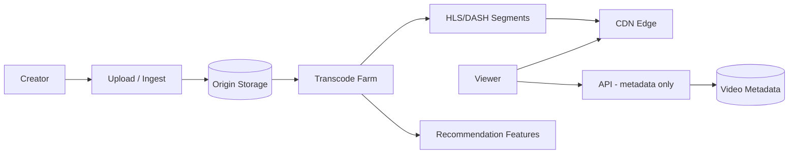
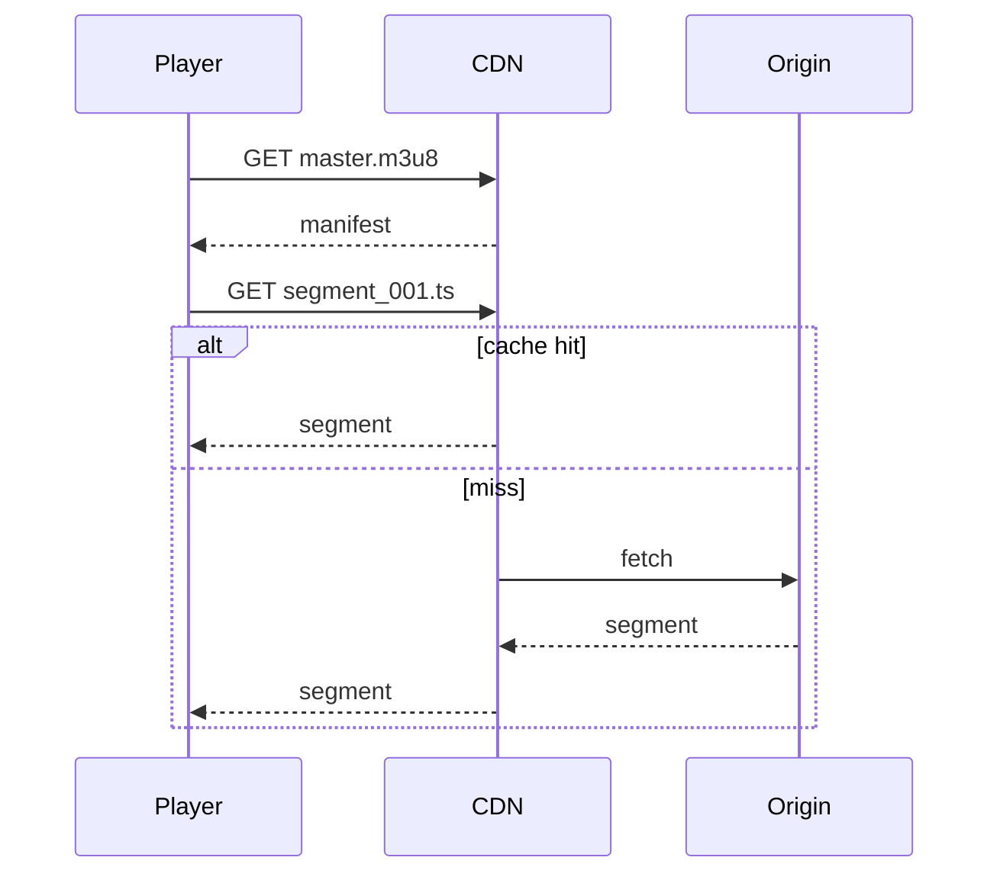
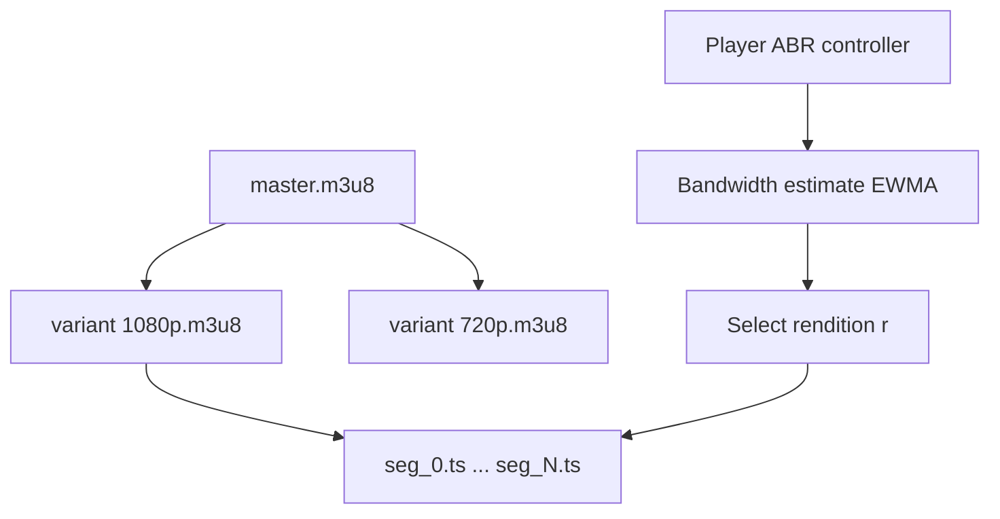
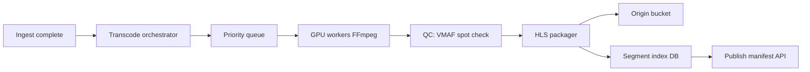

# Content Platform Design: News Feed, Photo Sharing & Video Streaming

Three faces of **user-generated content**: timeline assembly (feed), media-heavy uploads (photos), and bandwidth-heavy playback (video). All wrestle with **fan-out**, **CDN**, and **read vs write** trade-offs.

---

## Design a News Feed

### What problem does it solve?

Show each user a **personalized, scrollable list** of posts from people they follow—fast (&lt;200 ms p99), eventually consistent (few seconds lag OK).

> **Naive fan-out: 7k posts/s × 200 followers ≈ 1.4M timeline writes/s.** The celebrity tail breaks push-only designs.

### Requirements

| Functional | Non-functional |
|------------|----------------|
| Publish post; follow/unfollow; fetch ranked feed | p99 &lt;200 ms read; eventual consistency; read-optimized |

**Scale:** 300M DAU, ~200 follows, 2 posts/day, 10 feed opens/day.

### High-level architecture



**Key decision:** Timeline stores **post IDs only**—hydrate bodies from shared Post Cache at read time.

### API design

```http
POST /api/v1/posts        { "body": "...", "mediaIds": [] } → 201
POST /api/v1/follow       { "userId": "..." } → 204
GET  /api/v1/feed?cursor=…&limit=20 → { posts, nextCursor }
```

Use **cursor pagination** (not offset)—stable on infinite feeds.

### Data model

| Store | Content |
|-------|---------|
| `posts` | post_id, author_id, body, media_ids, created_at |
| `follows` | follower_id → followee_id (graph) |
| `timeline:{userId}` | Ordered list of post_ids (+ optional score hints) |

### Fan-out strategies

| Strategy | Pros | Cons |
|----------|------|------|
| **Push (write)** | O(1) feed read | Write amplification; celebrity spikes |
| **Pull (read)** | Cheap writes | Slow read—merge many authors |
| **Hybrid** | Best of both | More logic |

**Hybrid (typical):**

- **Push** for normal users (&lt;10k followers).
- **Pull** for celebrities—merge celebrity posts at read time from their post list.
- Fan-out only to **recently active** followers to cut waste.

```python
FOLLOWER_THRESHOLD = 10_000

def on_post_created(post):
    followers = graph.followers(post.author_id)
    if len(followers) > FOLLOWER_THRESHOLD:
        kafka.publish("celebrity_post", post)
        return
    active = filter_active_last_30d(followers)
    for batch in chunks(active, 500):
        kafka.publish("fanout_batch", {"post_id": post.id, "followers": batch})
```

### Scaling considerations

- Idempotent fan-out: `ZADD` with score = snowflake id.
- Rank on read (or precompute score hints in timeline).
- ~10–20 TB RAM for realistic timeline entry size (not naive 2 TB).

### Back-of-envelope estimation

**Assumptions (from requirements):** 300M DAU, 200 avg follows, 2 posts/day per posting user, 10 feed opens/day, 30% of DAU post (90M posters).

| Metric | Calculation | Result |
|--------|-------------|--------|
| Daily feed reads | 300M × 10 | **3B reads/day** |
| Avg read QPS | 3B ÷ 86,400 | **~35k QPS** |
| Peak read QPS (3× daily, 2× hour spike) | 35k × 3 × 2 | **~210k QPS** |
| Daily posts | 90M × 2 | **180M posts/day** |
| Avg write QPS (posts only) | 180M ÷ 86,400 | **~2.1k QPS** |
| Peak post QPS | 2.1k × 5 | **~10k QPS** |

**Fan-out write amplification (push path):**

```
Normal user: median 500 followers, 95% pushed (active in 30d)
Fan-out writes/post ≈ 0.95 × 500 = 475 timeline ZADDs
At peak 10k posts/s (worst case all normal): 10k × 475 ≈ 4.75M timeline writes/s
Hybrid caps this: celebrities (~0.1% users, 1M+ followers) use pull-only → ~0 writes fan-out
Effective median fan-out ≈ 200 active followers → 10k × 200 = 2M Redis ops/s (sharded)
```

**Storage (posts metadata, 1 year):**

```
Post row ≈ 500 B (id, author, body snippet, media refs, timestamps)
180M/day × 365 × 500 B ≈ 32.8 TB/year (posts table + indexes ~1.4×) → ~46 TB
Timeline entry ≈ 16 B (post_id + score) × 500 entries/user × 300M users = 2.4 TB (upper bound if full push)
Realistic: avg 200 entries in Redis per active user × 100M active × 16 B ≈ 320 GB hot timeline RAM
```

**Bandwidth (feed API response):**

```
20 posts/page × 2 KB hydrated JSON ≈ 40 KB/response
35k QPS × 40 KB ≈ 1.4 GB/s egress (~11 Tbps peak if uncached—must cache post bodies)
Post cache hit 95% → origin DB reads ~1.75k QPS for hydrate misses
```

**Cache sizing (post body cache):**

```
Unique posts seen in 1h window ≈ 180M/24 × 2 ≈ 15M posts
15M × 2 KB ≈ 30 GB per region for post body cache (LRU)
Timeline Redis: 320 GB + 30% overhead ≈ 420 GB per shard set (partition by user_id)
```

### Database schema deep dive

**Posts (Cassandra / wide-column)** — partition by `author_id`, cluster by `created_at DESC` for profile and celebrity pull.

```sql
CREATE TABLE posts_by_author (
  author_id     BIGINT,
  created_at    TIMESTAMP,
  post_id       BIGINT,
  body          TEXT,
  media_ids     LIST<BIGINT>,
  visibility    TINYINT,  -- public, followers, private
  PRIMARY KEY ((author_id), created_at, post_id)
) WITH CLUSTERING ORDER BY (created_at DESC);

-- Secondary index avoided; celebrity reads use partition key = author_id only.
```

**Follows (graph edge store)** — two directions for fan-out vs “who do I follow”.

```sql
-- Fan-out: followers of author
CREATE TABLE followers (
  followee_id   BIGINT,
  follower_id   BIGINT,
  created_at    TIMESTAMP,
  PRIMARY KEY ((followee_id), follower_id)
);

-- Feed ranking: following list
CREATE TABLE following (
  follower_id   BIGINT,
  followee_id   BIGINT,
  created_at    TIMESTAMP,
  PRIMARY KEY ((follower_id), followee_id)
);
```

**Why these keys:** `followers` partition on `followee_id` supports `SELECT follower_id FROM followers WHERE followee_id = ?` in O(partition size) for fan-out batches. `following` supports read-time merge for pull path.

**Timeline (Redis / Valkey)**

```
Key: timeline:{user_id}
Type: ZSET
Score: -post_id (snowflake, newer = higher rank in reverse chron) OR composite score for ranking
Member: post_id (8 bytes)
TTL: none; trim with ZREMRANGEBYRANK to keep top 1000
```

**Index on relational shadow (optional analytics):**

```sql
CREATE INDEX idx_posts_created ON posts (created_at DESC) WHERE deleted_at IS NULL;
-- Access pattern: moderation queue, trending—not user feed.
```

### Component deep dives

#### Ranking algorithm details

Feed ranking blends **recency**, **affinity**, and **engagement velocity** without blocking read path:



| Signal | Source | Notes |
|--------|--------|-------|
| Recency | `post_id` snowflake time | Decay: `exp(-λ · hours_old)` |
| Affinity | last 30d likes/replies with author | Precomputed per (viewer, author) |
| Engagement | likes/comments in first hour | Updated async from Kafka |

Scores can be **precomputed hints** written at fan-out (`ZADD score composite`) or computed on read for top-N only (500 → 50) to bound CPU.

#### Timeline cache invalidation

| Event | Action |
|-------|--------|
| Post deleted | `ZREM timeline:{uid} post_id` for all fan-out copies + tombstone in post cache |
| User blocked | Remove blocked author’s posts from timeline (lazy on read or async sweep) |
| Unfollow | Stop future fan-out; optional `ZREM` range by author (expensive—often lazy filter on read) |
| Account suspend | Invalidate `timeline:{userId}` key; rebuild empty on next read |

**Invalidation fan-out:** Deletion publishes `post_deleted` with `post_id`; workers batch `ZREM` across shard-owned timelines using inverted index `post_id → [user_ids]` (Bloom + small set for recent fan-outs only).

#### Celebrity fan-out hybrid



At read time, for each followed celebrity in the user’s `following` set (usually &lt;20 celebs), fetch last K posts from `posts_by_author` and merge with pushed timeline in a **k-way merge** by score (O(K log K), K small).

### Failure modes and edge cases

| Scenario | What breaks | Mitigation |
|----------|-------------|------------|
| **10× read load** | Post cache miss storm, ranking CPU | Autoscale feed tier; widen candidate pool cap; serve stale ranked page with `Cache-Control` |
| **10× post rate** | Fan-out Kafka lag, Redis hot shards | Dynamic celebrity threshold; shed fan-out to pull-only temporarily; partition fan-out by author hash |
| **Cache stampede** | Single hot post (viral) hydrates DB | Request coalescing (singleflight); post body cache with jittered TTL; circuit breaker on DB |
| **Duplicate fan-out** | At-least-once Kafka → duplicate ZADD | Idempotent `ZADD` same score; post_id unique |
| **Split brain timeline** | Redis partial write | Per-user timeline is single-shard; use Redis transaction or accept rare dup + dedupe on read |
| **Network partition** | User posts while graph stale | Post succeeds; fan-out retried from outbox; follower may see post late (eventual) |
| **Clock skew** | Ordering in merge | Snowflake IDs from central allocator—not wall clock |

**Consistency edge case:** User A unfollows B, then B’s in-flight fan-out still delivers one post—acceptable if read path filters `following` set on hydrate (stronger) or TTL expires (weaker).

### Interview follow-up Q&A

### Q: Why store only post IDs in the timeline instead of full post objects?

**A:** Timelines are **high churn and high cardinality** (one copy per follower per post). Storing IDs keeps each entry ~16 bytes and lets a single post body serve millions of readers from a shared post cache. Hydrating 20 posts adds one batched cache/DB round-trip—cheaper than duplicating bodies on every fan-out write.

### Q: How do you rank without making every feed read O(all follows)?

**A:** Push path pre-materializes a **bounded candidate set** (top 500–1000 IDs). Ranking runs only on that set. Pull path merges only **celebrity partitions** (small K posts each), not entire graph. Heavy ML features are pre-aggregated async.

### Q: What happens when a celebrity with 50M followers posts?

**A:** No fan-out writes. Post lands in `posts_by_author`. Each follower’s read merges at most one partition read per followed celeb (cached celeb “latest 20” in Redis with 30s TTL). Spike moves from write path to read path but is bounded by celeb count per user, not follower count.

### Q: How would you support “close friends” only posts?

**A:** Add `visibility` and `close_friends_list` on post. Fan-out worker filters recipients against list (or separate timeline key `timeline:close:{userId}`). Read path checks visibility before hydrate.

### Q: Feed vs notification: same pipeline?

**A:** Related but separate. Notifications need **delivery guarantees** and device tokens; feed is **best-effort materialized view**. Both can consume `post_created` from Kafka; notification service dedupes and rate-limits per user.

### Q: How do you paginate with ranking?

**A:** Cursor encodes `(last_score, last_post_id)` from **ranked** output, not raw timeline offset—because re-ranking can reshuffle. Stable tie-break on `post_id`.

### Q: Sharding strategy for 300M users?

**A:** `user_id % N` for timeline Redis; posts by `author_id`; graph edges co-located with followee for fan-out. Cross-shard fan-out batch job groups followers by shard to pipeline `ZADD`.

### More code examples

**K-way merge: pushed timeline + celebrity pulls**

```python
import heapq
from dataclasses import dataclass

@dataclass(order=True)
class Item:
    sort_key: tuple  # (-score, -post_id)
    post_id: int
    source: str

def merge_feed(pushed: list[tuple[int, int]], celeb_lists: list[list[tuple[int, int]]], limit: int):
    """Each input is (score, post_id) newest first."""
    heap = []
    for score, pid in pushed:
        heapq.heappush(heap, Item((-score, -pid), pid, "push"))
    for clist in celeb_lists:
        for score, pid in clist[:20]:
            heapq.heappush(heap, Item((-score, -pid), pid, "celeb"))
    seen = set()
    out = []
    while heap and len(out) < limit:
        it = heapq.heappop(heap)
        if it.post_id in seen:
            continue
        seen.add(it.post_id)
        out.append(it.post_id)
    return out
```

**Ranking on read (top-N)**

```python
import math

def rank_posts(post_ids: list[int], viewer_id: int, features: dict) -> list[int]:
    scored = []
    now_ms = snowflake_now_ms()
    for pid in post_ids:
        f = features.get(pid, {})
        hours = (now_ms - snowflake_time_ms(pid)) / 3_600_000
        recency = math.exp(-0.1 * hours)
        affinity = f.get("affinity", 0.0)  # 0..1
        engagement = min(f.get("likes_per_hour", 0) / 100.0, 1.0)
        score = 0.5 * recency + 0.3 * affinity + 0.2 * engagement
        scored.append((score, pid))
    scored.sort(key=lambda x: (-x[0], -x[1]))
    return [pid for _, pid in scored[:50]]
```

**Singleflight post hydrate (cache stampede guard)**

```go
var hydrateGroup singleflight.Group

func HydratePosts(ctx context.Context, ids []int64) (map[int64]Post, error) {
    key := cacheKeyBatch(ids)
    v, err, _ := hydrateGroup.Do(key, func() (interface{}, error) {
        return db.FetchPosts(ctx, ids)
    })
    return v.(map[int64]Post), err
}
```

---

## Design a Photo Sharing Service

### What problem does it solve?

Users upload **photos/videos**, apply metadata, share to followers, and browse **visual feeds** and profiles. Dominated by **blob storage**, **async processing**, and **CDN delivery**.

### Requirements

| Functional | Non-functional |
|------------|----------------|
| Upload; follow; like/comment; profile grid; explore/discovery | Durable media; fast thumbnail feed; global CDN |

### High-level architecture



### API design

```http
POST /api/v1/media/upload-url → { uploadUrl, mediaId }
PUT  {uploadUrl}              # direct to object store
POST /api/v1/posts            { mediaId, caption, location? }
GET  /api/v1/users/{id}/photos?cursor=
GET  /api/v1/feed?cursor=
```

### Data model

| Entity | Notes |
|--------|-------|
| `Media` | media_id, owner, original_key, variants[], status (processing/ready) |
| `Post` | links media_ids, caption, timestamps |
| `Like`, `Comment` | sharded by post_id |

### Key components

1. **Direct upload** to object storage (presigned URL)—API never proxies bytes.
2. **Async pipeline:** EXIF strip, resize (1080, 640, thumb), virus scan, ML moderation.
3. **Feed:** Reuse news-feed hybrid; **image-heavy** → CDN URLs in response.
4. **Explore:** Separate ranking service (engagement, graph, ML)—not on critical upload path.

### Scaling considerations

- Store **content hash** for dedup within user uploads.
- Hot users: same celebrity problem as feed.
- Processing workers scale on queue depth; SLO on "time to ready."

```python
def on_upload_complete(media_id: str):
    queue.enqueue("transcode", {"media_id": media_id, "sizes": [256, 1080]})
    db.media.update(media_id, status="processing")
```

### Back-of-envelope estimation

**Assumptions:** 500M registered, 200M DAU, 50M uploads/day (photos), avg original 3 MB JPEG, 3 variants per photo (256 thumb, 1080 feed, optional WebP), 15 feed scrolls/day with 30% image tiles.

| Metric | Calculation | Result |
|--------|-------------|--------|
| Upload write QPS | 50M ÷ 86,400 | **~580 QPS** |
| Peak upload QPS | ×8 | **~4.6k QPS** |
| Ingress bandwidth (peak) | 4.6k × 3 MB | **~14 GB/s** to object store (multipart) |
| Object storage growth/day | 50M × (3 MB + 0.3 MB variants) | **~165 PB-day raw** → **~165 TB/day** |
| Storage/year (with 0.7 dedup factor) | 165 TB × 365 × 0.7 | **~42 PB/year** |
| CDN image GETs/day | 200M × 15 × 10 images | **30B GETs/day** |
| Avg image CDN QPS | 30B ÷ 86,400 | **~347k QPS** |
| CDN egress (avg tile 80 KB) | 347k × 80 KB | **~28 GB/s** (~224 Gbps) |

**Processing queue:**

```
50M jobs/day × ~2s CPU resize/moderate per image ≈ 100M CPU-seconds/day
= ~1,160 vCPU always-on; peak ×3 → ~3.5k vCPU transcode/moderation fleet
```

**Metadata DB:**

```
50M posts/day × 400 B row × 365 ≈ 7.3 TB/year posts + media index
Likes: 5B/day × 50 B ≈ 250 TB/year (heavy—counter aggregates + async rollups)
```

**Cache (metadata hot path):**

```
Feed page: 20 post_ids × 200 B + CDN URLs → 8 KB API JSON
347k QPS API (subset of CDN) ~ 50k feed QPS × 8 KB ≈ 400 MB/s API tier
Media status cache: 10M in-flight × 200 B ≈ 2 GB Redis
```

### Database schema deep dive

**Media (PostgreSQL or DynamoDB)**

```sql
CREATE TABLE media (
  media_id        BIGINT PRIMARY KEY,
  owner_id        BIGINT NOT NULL,
  content_hash    BYTEA NOT NULL,          -- SHA-256 perceptual or exact
  status          VARCHAR(16) NOT NULL,    -- uploading|processing|ready|rejected
  original_key    TEXT NOT NULL,
  width           INT,
  height          INT,
  created_at      TIMESTAMPTZ NOT NULL DEFAULT now()
);

CREATE INDEX idx_media_owner_created ON media (owner_id, created_at DESC);
CREATE INDEX idx_media_hash_owner ON media (owner_id, content_hash);
-- Dedup: same user re-uploading same hash → skip processing
```

**Media variants (1:N)**

```sql
CREATE TABLE media_variants (
  media_id     BIGINT NOT NULL,
  variant      VARCHAR(32) NOT NULL,  -- thumb_256, feed_1080, webp_1080
  object_key   TEXT NOT NULL,
  bytes        BIGINT,
  PRIMARY KEY (media_id, variant)
);
```

**Posts + engagement (sharded by post_id)**

```sql
CREATE TABLE posts (
  post_id      BIGINT PRIMARY KEY,
  author_id    BIGINT NOT NULL,
  caption      TEXT,
  location_id  BIGINT,
  created_at   TIMESTAMPTZ NOT NULL
);

CREATE TABLE post_media (
  post_id   BIGINT NOT NULL,
  ord       SMALLINT NOT NULL,
  media_id  BIGINT NOT NULL,
  PRIMARY KEY (post_id, ord)
);

-- Likes: partition key post_id for colocation
CREATE TABLE likes (
  post_id    BIGINT NOT NULL,
  user_id    BIGINT NOT NULL,
  created_at TIMESTAMPTZ NOT NULL,
  PRIMARY KEY (post_id, user_id)
);
CREATE INDEX idx_likes_user ON likes (user_id, created_at DESC);
```

**DynamoDB alternative (likes at scale)**

```
PK: POST#<post_id>  SK: LIKE#<user_id>
GSI1: USER#<user_id> / CREATED#<ts>  — “photos I liked”
```

### Component deep dives

#### Image processing pipeline details



| Stage | Tooling | SLA |
|-------|---------|-----|
| Resize | libvips / sharp, Lanczos3 | p95 &lt;800 ms per image |
| Format | JPEG quality 85, WebP for clients that accept | |
| Virus | ClamAV sidecar | Async; block public URL until pass |

Workers use **idempotent object keys**: `variants/{media_id}/1080.jpg`—safe to retry.

#### Content moderation ML pipeline



- **Online path:** Lightweight model on worker (MobileNet head) for obvious violations.
- **Async path:** Heavier ensemble + OCR for meme spam; can flip `ready` → `rejected` and CDN purge.
- **Features stored:** `moderation_scores` JSON on `media` row for appeals and model retraining.

#### Deduplication

| Layer | Mechanism |
|-------|-----------|
| Exact | SHA-256 of normalized bytes (after EXIF strip) |
| Near-dup | Perceptual hash (pHash); Hamming distance &lt; 5 → same asset |
| Scope | Per-user dedup (re-share) vs global illegal content (block hash list) |

Global CSAM/illegal hash DB checked **before** variants are published (PhotoDNA-style API).

### Failure modes and edge cases

| Scenario | Impact | Response |
|----------|--------|----------|
| **10× upload spike** | S3 fine; processing backlog | Scale workers on queue depth; degrade to single variant first |
| **Processing poison pill** | Bad image crashes worker | DLQ + max retries; mark `failed` with reason |
| **CDN stale after reject** | Moderation rejects after CDN warm | Short TTL on thumb URLs; purge API by `media_id` prefix |
| **Cache stampede on viral post** | Same `post_id` metadata | Singleflight; edge cache `Cache-Tag: post-{id}` |
| **Partial upload** | Client aborts multipart | Lifecycle rule abort incomplete MPU after 7d |
| **Consistency** | Post created before `ready` | API returns post with `processing` placeholder URL; client polls or SSE |
| **Partition** | Upload OK in region A, metadata in B | Strong consistency in home region; cross-region replicate metadata async |

**Edge case:** User deletes photo while processing—worker checks `status=cancelled` before writing variants.

### Interview follow-up Q&A

### Q: Why presigned URL upload instead of through the API?

**A:** API servers are CPU and connection limited; direct-to-S3 upload scales horizontally with **multipart** and avoids double billing egress. API only mints policy-bound URLs and records `media_id`.

### Q: How do you show a post in feed before processing finishes?

**A:** Return post with `media.status=processing` and a **blurred hash placeholder** (LQIP) or generic gray tile; swap URL when Kafka `media_ready` event updates cache.

### Q: Explore vs following feed architecture?

**A:** Following uses hybrid fan-out (same as news feed). Explore is **offline + online ranking** (candidate generation from engagement graph, ML)—separate read pool, higher latency budget (500 ms).

### Q: How handle RAW / HEIC from phones?

**A:** Accept in upload; worker normalizes to sRGB JPEG/WebP. Reject unsupported with clear error; optional server-side HEIC decode (libheif).

### Q: Storage cost optimization?

**A:** Lifecycle: original → Glacier after 90d if variants exist; Intelligent-Tiering for cold accounts; dedup within user.

### Q: Rate limiting abusers?

**A:** Per-user upload tokens (leaky bucket); content hash rate limit stops spam networks reusing same image.

### Q: Multi-photo carousel post?

**A:** `post_media` ordering; feed hydrates N URLs; CDN requests are independent—carousel does not block on slowest variant if per-tile status tracked.

### More code examples

**Perceptual hash dedup check**

```python
import imagehash
from PIL import Image

def near_duplicate(path: str, owner_id: int, redis) -> int | None:
    ph = str(imagehash.phash(Image.open(path)))
    bucket = ph[:4]  # coarse bucket
    for existing in redis.smembers(f"phash:{owner_id}:{bucket}"):
        if imagehash.hex_to_hash(ph) - imagehash.hex_to_hash(existing) < 5:
            return int(redis.get(f"phash_owner:{owner_id}:{existing}"))
    redis.sadd(f"phash:{owner_id}:{bucket}", ph)
    return None
```

**Resize worker (libvips-style pseudocode)**

```python
VARIANTS = [("thumb_256", 256), ("feed_1080", 1080)]

def process(media_id: str, src_path: str):
    img = load_image(src_path)
    img = auto_orient(strip_exif(img))
    for name, max_edge in VARIANTS:
        out = resize_cover(img, max_edge)
        key = f"variants/{media_id}/{name}.jpg"
        s3.put(key, encode_jpeg(out, quality=85))
    db.set_status(media_id, "ready")
    bus.publish("media_ready", {"media_id": media_id})
```

**Moderation gate before CDN publish**

```python
def moderation_gate(media_id: str, scores: dict) -> str:
    if scores["csam_match"]:
        raise SecurityBlock(media_id)
    if scores["nudity"] > 0.95:
        return "rejected"
    if scores["nudity"] > 0.6 or scores["violence"] > 0.7:
        queue_hitl(media_id)
        return "pending_review"
    return "ready"
```

---

## Design a Video Streaming Service

### What problem does it solve?

**Upload** (or ingest) long-form video, **transcode** to adaptive bitrates, **distribute** via CDN, and **play** with minimal buffering (YouTube/Netflix-style).

> **Video is read-heavy and bandwidth-heavy.** Origin egress is the cost line—CDN cache hit ratio is the product.

### Requirements

| Functional | Non-functional |
|------------|----------------|
| Upload; transcode ABR; play with seek; recommendations | Startup &lt;2 s; rebuffer minimal; 99.9% playback availability |

### High-level architecture



### API design

```http
POST /api/v1/videos/upload → { videoId, uploadUrl }
POST /api/v1/videos/{id}/publish
GET  /api/v1/videos/{id}/playback → {
  "manifestUrl": "https://cdn/.../master.m3u8",
  "thumbnails": [...],
  "duration": 3600
}
GET  /api/v1/feed/recommended?cursor=
```

### Data model

| Entity | Fields |
|--------|--------|
| `Video` | id, owner, title, status, duration |
| `TranscodeJob` | video_id, renditions (360p…4K), segment_paths |
| `ViewEvent` | analytics stream (not on playback path) |

### Playback path

1. Client requests **master manifest** (HLS/DASH).
2. Player picks rendition by bandwidth.
3. Segments (~2–6 s) served from **CDN**; origin only on cache miss.
4. **Signed URLs** or token auth for private video.



### Scaling considerations

- **Transcode:** GPU fleet; priority queue; copy-if-already-encoded codec profile.
- **Popular video:** Single title = hot CDN keys—pre-warm edges.
- **Live streaming:** Separate path (RTMP ingest → low-latency HLS).
- **Storage:** Erasure-coded cold storage for originals; CDN for hot segments.

### Back-of-envelope estimation

**Assumptions:** 200M DAU viewers, 2M new uploads/day, avg watch 45 min/day, ABR avg bitrate 3 Mbps, 6s segments, 5 renditions per title.

| Metric | Calculation | Result |
|--------|-------------|--------|
| Upload ingest QPS | 2M ÷ 86,400 | **~23 QPS** |
| Peak ingest | ×10 (events) | **~230 QPS** |
| Avg concurrent viewers | 200M × 45/1440 min | **~6.25M** |
| Aggregate playback bandwidth | 6.25M × 3 Mbps | **~18.75 Tbps** (CDN) |
| Segment requests/s | 6.25M / 6s | **~1.04M seg/s** |
| Transcode CPU per 10 min 1080p | ~5–15 min GPU time (5 renditions) | **~2M GPU-hours/day** for 2M×10min |
| Origin storage (segments) | 2M × 10 min × 5 rend × ~1 MB/seg-min | **~100 PB/day raw** → heavily deduped by codec profile; realistic **~2–5 PB/day** with ladder sharing |

**Metadata QPS:**

```
Playback manifest: 200M sessions/day × 1 manifest ≈ 2.3k QPS (low)
Segment traffic dominates; API tier is not the bottleneck
```

**CDN cache working set:**

```
Top 1% titles = 80% views (Pareto)
Hot set ~20k titles × 5 rend × 600 seg × 500 KB ≈ 30 TB per POP (theoretical upper)
Real hit ratio target: 95%+ → origin egress &lt;5% of CDN
```

### Database schema deep dive

**Videos (metadata)**

```sql
CREATE TABLE videos (
  video_id       BIGINT PRIMARY KEY,
  owner_id       BIGINT NOT NULL,
  title          VARCHAR(512),
  status         VARCHAR(32) NOT NULL,  -- uploading|transcoding|published|blocked
  duration_sec   INT,
  published_at   TIMESTAMPTZ,
  created_at     TIMESTAMPTZ NOT NULL DEFAULT now()
);

CREATE INDEX idx_videos_owner ON videos (owner_id, created_at DESC);
CREATE INDEX idx_videos_published ON videos (published_at DESC) WHERE status = 'published';
```

**Transcode jobs**

```sql
CREATE TABLE transcode_jobs (
  job_id         UUID PRIMARY KEY,
  video_id       BIGINT NOT NULL REFERENCES videos(video_id),
  state          VARCHAR(16) NOT NULL,
  ladder_profile VARCHAR(64) NOT NULL,  -- vod_abr_v3
  started_at     TIMESTAMPTZ,
  finished_at    TIMESTAMPTZ,
  error          TEXT
);

CREATE INDEX idx_transcode_video ON transcode_jobs (video_id, started_at DESC);
```

**Renditions + segments (object store index)**

```sql
CREATE TABLE video_renditions (
  video_id      BIGINT NOT NULL,
  rendition     VARCHAR(16) NOT NULL,  -- 360p, 720p, 1080p
  codec         VARCHAR(16) NOT NULL,
  bandwidth_bps INT NOT NULL,
  width         INT,
  height        INT,
  manifest_path TEXT NOT NULL,
  PRIMARY KEY (video_id, rendition)
);

CREATE TABLE segments (
  video_id     BIGINT NOT NULL,
  rendition    VARCHAR(16) NOT NULL,
  seq          INT NOT NULL,
  object_key   TEXT NOT NULL,
  duration_ms  INT NOT NULL,
  byte_size    INT,
  PRIMARY KEY (video_id, rendition, seq)
);
-- Access pattern: manifest generation lists seq 0..N; player GET by key from CDN URL in manifest
```

**View events (analytics, Cassandra)**

```sql
CREATE TABLE view_events (
  viewer_id    BIGINT,
  video_id     BIGINT,
  event_time   TIMESTAMP,
  event_type   TEXT,
  position_sec INT,
  PRIMARY KEY ((video_id), event_time, viewer_id)
) WITH TTL = 7776000;  -- 90 days
```

### Component deep dives

#### Adaptive bitrate streaming internals



| Mechanism | Detail |
|-----------|--------|
| **HLS** | `#EXT-X-STREAM-INF:BANDWIDTH=...` in master; 2–6s segments |
| **DASH** | MPD with `SegmentTemplate`; same CDN objects, dual packaging optional |
| **ABR algo** | Throughput-based + buffer-based (BOLA/ MPC lite); switch up cautiously, down fast |
| **Seek** | Byte-range or independent segment index; keyframe-aligned GOP (~2s) |

**Startup:** Client often starts at **mid ladder** (720p) then ramps; `EXT-X-INDEPENDENT-SEGMENTS` required for clean switches.

#### Transcoding pipeline architecture



- **Ladder:** 360p @ 800k, 480p @ 1.2M, 720p @ 2.5M, 1080p @ 5M, 4K optional.
- **Copy optimization:** If source already H.264 1080p baseline, **stream copy** lower renditions only transcode.
- **Priority:** Live &gt; new creator &gt; backfill; SLA p95 time-to-publish &lt;15 min for 10 min video.

#### CDN cache warming

| Strategy | When |
|----------|------|
| **Publish hook** | On `published`, prefetch master + first 3 segments per rendition to top POPs |
| **Trending job** | Hourly top-N titles push to regional edges |
| **Viewer-led** | First viewer pays miss; subsequent hit—warm for product launches use synthetic prefetch |
| **Cache key** | `/{video_id}/{rend}/{seq}.ts`—immutable; `max-age=31536000` |

Signed URLs embed **short TTL** (1–4h) while objects remain immutable—revocation via playlist generation, not segment delete.

### Failure modes and edge cases

| Scenario | What breaks | Mitigation |
|----------|-------------|------------|
| **10× view spike (viral)** | Origin egress, single-POP hot keys | Pre-warm; split across CDN providers; stake multiple POPs |
| **10× upload** | Transcode queue hours long | Burst GPU fleet; temporary cap on 4K; notify creator ETA |
| **Cache stampede on premiere** | Manifest OK but all segments miss | Staggered prefetch; origin shield layer |
| **Partial transcode** | Worker dies mid-ladder | Job checkpoint per rendition; resume from last `seq` |
| **Consistency** | `published` before all segments exist | Gate publish on manifest completeness check |
| **Network partition** | Client switches CDN POP | Same URL path globally; sticky less important for VOD |
| **DRM / geo** | License server down | Fail closed for premium; free tier clear-key fallback policy |

**Edge case:** User seeks past end—player clamps; segment 404 triggers manifest refresh (re-publish rare).

### Interview follow-up Q&A

### Q: Why HLS/DASH segments instead of one MP4 file?

**A:** **Byte-range MP4** works for small VOD but poor for ABR switching and CDN caching at scale. Fixed segments cache independently, parallelize downloads, and align with GOP for clean rendition switches.

### Q: How minimize transcode cost?

**A:** Per-title ladder analysis (skip unused renditions), hardware encoders (NVENC), **duplicate detection** (same upload hash), and tiered SLA (1080p first, 4K later).

### Q: Live vs VOD—what changes?

**A:** Live: short segments (1–2s), sliding window playlist, ingest RTMP/SRT, no full-file transcode—**packager** only. VOD: full ladder, long TTL cache, batch transcode.

### Q: How handle seek in long 4h video?

**A:** Segment index in DB or sidecar `#EXT-X-BYTERANGE`; player maps `t` → `seq = floor(t/6)`; CDN serves single segment (~500 KB–2 MB).

### Q: Recommendations without blocking playback?

**A:** Playback path returns only `manifestUrl`; rec service async loads watch history from feature store—separate SLO.

### Q: Multi-CDN strategy?

**A:** DNS/geo routing; consistent object paths; dual manifest URLs as failover; measure POP health.

### Q: View count accuracy?

**A:** Sampled `view_events` stream; aggregate in Flink; **at-least-once** with dedupe on `(viewer, video, session, quartile)`—not synchronous on play.

### More code examples

**ABR bandwidth estimate (EWMA)**

```javascript
class ABRController {
  constructor() {
    this.throughput = 0;
    this.alpha = 0.8;
  }
  onSegmentDownload(bytes, downloadMs) {
    const inst = (bytes * 8) / (downloadMs / 1000); // bps
    this.throughput = this.alpha * this.throughput + (1 - this.alpha) * inst;
  }
  pickRendition(ladder) {
    const safe = this.throughput * 0.85;
    return ladder.filter((r) => r.bandwidth <= safe).pop() || ladder[0];
  }
}
```

**Transcode orchestrator state machine**

```python
from enum import Enum

class JobState(Enum):
    QUEUED = "queued"
    PROBING = "probing"
    TRANSCODING = "transcoding"
    PACKAGING = "packaging"
    PUBLISHED = "published"
    FAILED = "failed"

def advance(job):
    if job.state == JobState.QUEUED:
        job.probe = ffprobe(job.source_key)
        job.state = JobState.PROBING
    elif job.state == JobState.PROBING:
        for rend in ladder_for(job.probe):
            transcode_rendition(job, rend)  # idempotent per (video_id, rend)
        job.state = JobState.PACKAGING
    elif job.state == JobState.PACKAGING:
        if segment_count_matches_manifest(job):
            publish_manifest(job)
            job.state = JobState.PUBLISHED
```

**CDN warm prefetch**

```python
def warm_video_edges(video_id: str, renditions: list[str], pop_list: list[str]):
    for pop in pop_list:
        for rend in renditions:
            cdn.prefetch(pop, manifest_path(video_id, rend))
            for seq in range(0, 3):
                cdn.prefetch(pop, segment_path(video_id, rend, seq))
```

**HLS master manifest generation**

```python
def build_master(renditions: list[dict]) -> str:
    lines = ["#EXTM3U", "#EXT-X-VERSION:6"]
    for r in sorted(renditions, key=lambda x: -x["bandwidth"]):
        lines.append(
            f'#EXT-X-STREAM-INF:BANDWIDTH={r["bandwidth"]},RESOLUTION={r["width"]}x{r["height"]}'
        )
        lines.append(r["playlist_url"])
    return "\n".join(lines) + "\n"
```

---

## Comparison: News Feed vs Photo Sharing vs Video Streaming

| Dimension | News Feed | Photo Sharing | Video Streaming |
|-----------|-----------|---------------|-----------------|
| **Primary bottleneck** | Timeline fan-out | Image processing + storage | Bandwidth + transcode |
| **Feed mechanism** | Hybrid push/pull | Same + visual grid | Recommendations + subs |
| **Media handling** | CDN for attachments | Multi-res thumbnails | ABR segments (HLS/DASH) |
| **Write amplification** | Celebrity fan-out | Moderate (per post) | High (transcode jobs) |
| **Read pattern** | Short JSON + hydrate | Image URLs from CDN | Long-lived streaming |
| **Async work** | Fan-out workers | Resize/moderation | Transcode pipeline |
| **Storage tiering** | Post cache + cold archive | Object store + CDN | Origin + CDN + cold |
| **Consistency** | Eventual (seconds) | Eventual (processing) | Strong metadata; stream buffered |

> **Unified pattern:** **Metadata in DB, bytes in object store, hot delivery via CDN**, and **never block the user on heavy async work** (fan-out, transcode, moderation).

---

## Senior Pitfalls

| Mistake | Impact | Fix |
|---------|--------|-----|
| Celebrity post fan-out on write | DB and queue meltdown | Hybrid fan-out: push for normal, pull for celebrities |
| Serving unmoderated uploads | Legal and safety incidents | Async moderation queue, quarantine bucket, block public URL until pass |
| Transcode on upload request path | Timeouts and failed uploads | Accept upload → job queue → notify when ready |
| CDN cache of private media | Leaked photos/videos | Signed URLs, short TTL, origin auth, separate public/private buckets |
| Feed without cursor pagination | Broken timelines under load | Keyset on `(user_id, created_at, id)` |
| Video ABR without origin shield | Origin bandwidth cost explosion | CDN tiering, mid-cache shield, per-title popularity routing |

---

## Production-grade Practice

1. Prototype **fan-out on write** vs **pull feed** for a synthetic social graph; plot write amplification vs read latency at 1M followers.
2. Design **media pipeline**: upload → virus scan → transcode → CDN publish; define SLAs per stage and DLQ handling.
3. Implement **signed URL** flow for private images; attempt unauthorized access and verify 403 at edge and origin.
4. Capacity-plan **video peak**: concurrent viewers, egress Tbps, transcode worker pool, and cold-storage cost for 30-day retention.
