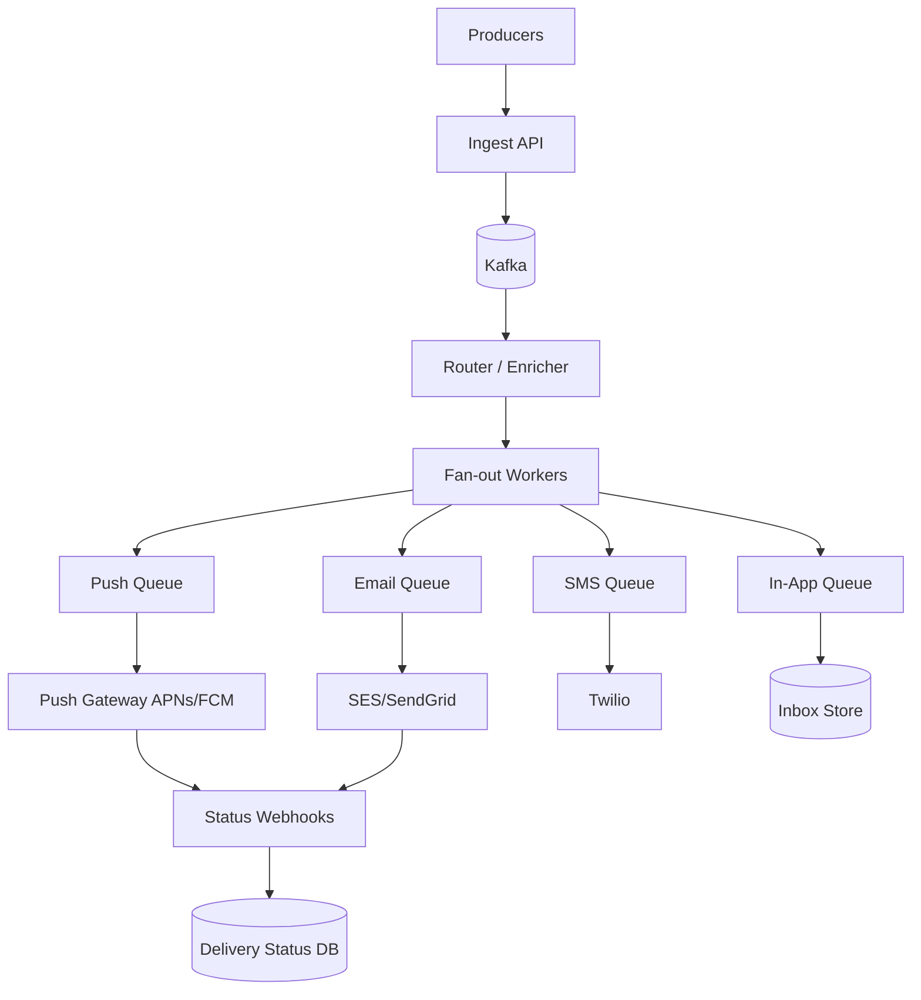
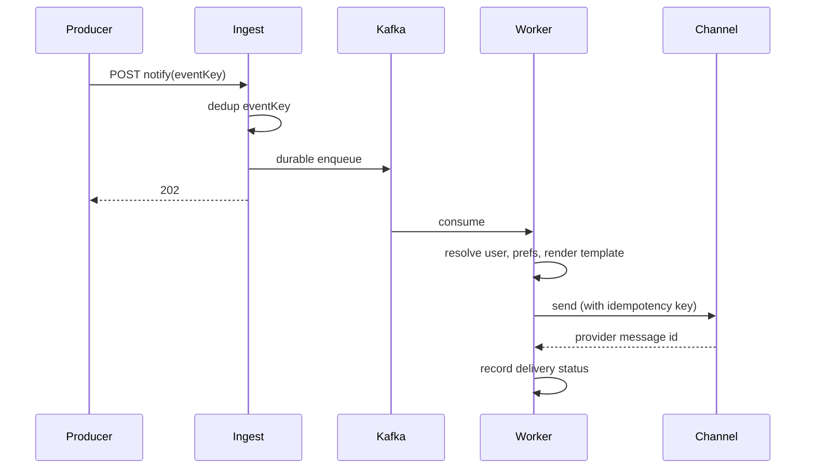
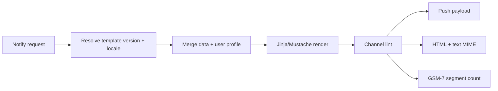
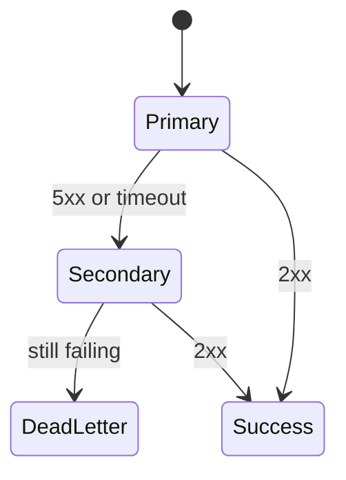
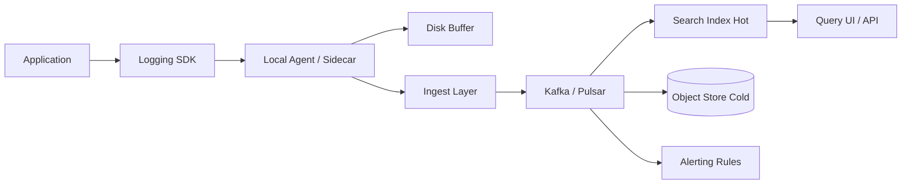
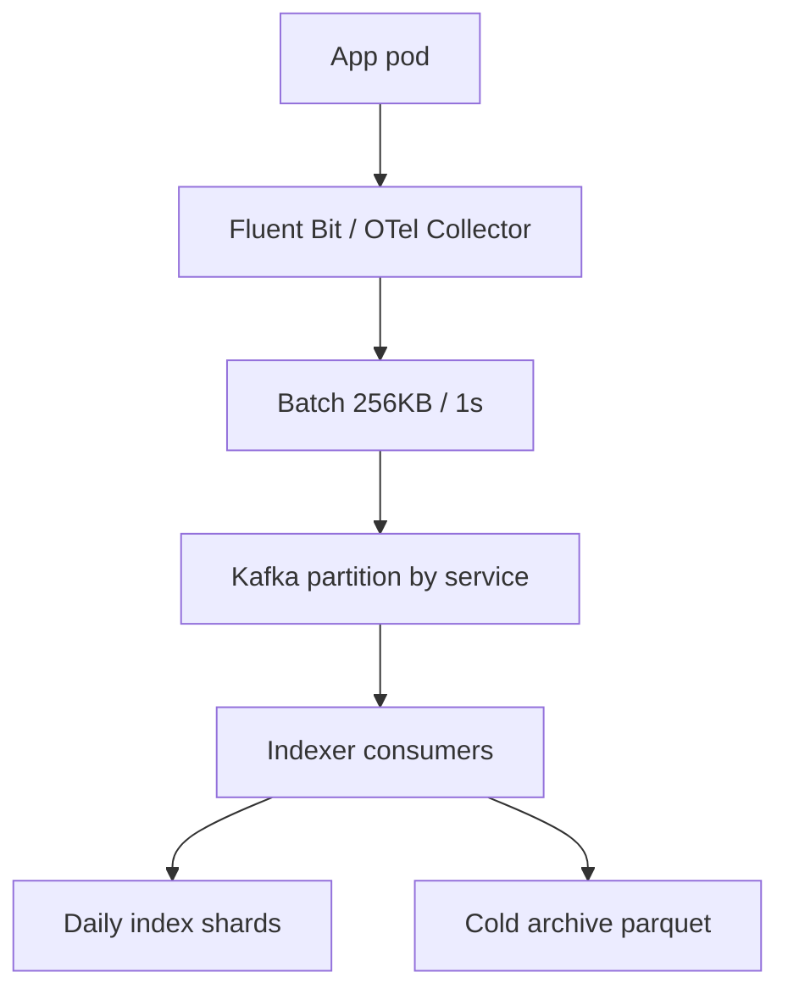
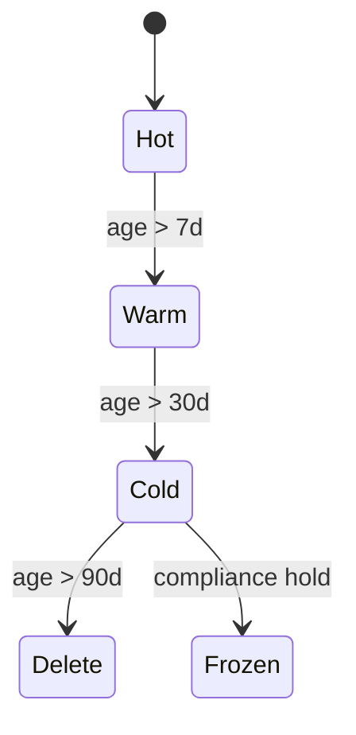

# Notification & Logging Design

Two **cross-cutting platforms**: one delivers events to humans across channels (push, email, SMS, in-app); the other captures **structured logs** from every service for search, metrics, and compliance. Both are **async pipelines** where durability, idempotency, and volume dominate.

---

## Design a Notification System

### What problem does it solve?

Turn product events (`order_shipped`, `payment_failed`, `live_started`) into messages on the **right channel** for each user—honoring preferences, quiet hours, provider limits, and **without duplicate sends**.

> **Channels guarantee at-most-once or at-least-once—not exactly-once.** Design for **idempotency** and rare duplicates, not impossible perfection.

### Requirements

| Functional | Non-functional |
|------------|----------------|
| Multi-channel delivery; templates; preferences; in-app inbox; delivery tracking | Durable ingest; prioritized queues; isolated channel failures; campaign fan-out |

**Scale:** 100M DAU × 10 notifications/day → ~1B/day (~120k/s peak); campaign burst 20M targets in minutes.

### High-level architecture



**Never fan-out inline on the HTTP request**—same lesson as news feed.

### API design

```http
POST /api/v1/notify
{
  "eventKey": "order_1234_shipped",
  "template": "order_shipped",
  "recipients": ["user_42"],
  "data": { "orderId": 1234 },
  "priority": "transactional",
  "channels": ["push", "email"]
}
→ 202 Accepted { "notificationId": "ntf_abc" }

GET  /api/v1/inbox?cursor=&limit=20
POST /api/v1/inbox/{id}/read
GET  /api/v1/preferences
PUT  /api/v1/preferences
```

- Producers send **events + template name**, not rendered text.
- **`eventKey`** = idempotency handle for producer retries.

### Data model

| Table | Purpose |
|-------|---------|
| `notifications` | notification_id, event_key UNIQUE, template, status |
| `delivery_attempts` | channel, provider_id, status, timestamps |
| `user_preferences` | per-channel, per-category, quiet hours |
| `inbox_items` | user_id, payload, read_at |
| `dedup_keys` | short-TTL Redis + DB unique constraint |

### Pipeline stages



### Key components

1. **Priority classes:** Separate topics/queues—transactional never blocked by marketing.
2. **Fan-out workers:** Expand segment → per-user jobs.
3. **Template service:** Versioned, localized; lint SMS segment count (GSM-7 vs UCS-2).
4. **Dedup:** Redis TTL (minutes) + `event_key` unique in DB (days).
5. **Rate limits:** Per-user cap + per-producer SMS budget circuit breaker.

### Scaling considerations

- **SMS cost** dominates—push-first for 2FA; hard daily SMS caps.
- **Provider quotas** bound email campaigns—show drain ETA to marketers.
- **Status webhooks** = 2–4× send rate—size write path accordingly.
- Channel isolation: SMS down does not block push workers.

```python
def handle_notify(req: NotifyRequest):
    if dedup_store.seen(req.event_key):
        return existing_id(req.event_key)
    dedup_store.put(req.event_key, ttl=3600)
    kafka.produce(priority_topic(req.priority), req)
    return new_notification_id()
```

### Back-of-envelope estimation

| Dimension | Assumption | Math | Result |
|-----------|------------|------|--------|
| **Daily volume** | 100M DAU × 10 notifications | | **~1B/day** |
| **Average QPS** | 1×10⁹ / 86400 | | **~11.6k/s** |
| **Peak QPS** | 3× avg + campaign bursts | | **~35k/s** steady; **~200k/s** short burst |
| **Campaign fan-out** | 20M users in 10 min | 20×10⁶ / 600 | **~33k jobs/s** expand stage |
| **Storage** | 500 B/notification × 1B | | **~500 GB/day** metadata + attempts |
| **Webhook writes** | 2× delivery events | | **~70k/s** status updates peak |
| **Kafka** | 1 KB/msg × 35k/s | | **~35 MB/s** ingest (replicated 3×) |

### Deep dive: Template rendering pipeline



| Stage | Detail |
|-------|--------|
| **Versioning** | `template_id@3`; roll forward only; A/B attaches variant id |
| **Locale** | `user.locale` → `order_shipped.en_US`; fallback chain |
| **Safety** | Auto-escape HTML; SMS URL shortener allowlist |
| **Preview** | Sandboxed render for marketers with fixture JSON |

```python
from jinja2 import Environment, BaseLoader, select_autoescape

env = Environment(loader=BaseLoader(), autoescape=select_autoescape(["html", "xml"]))

def render_channel(template_body: str, data: dict, channel: str) -> str:
    text = env.from_string(template_body).render(**data)
    if channel == "sms" and len(text) > 160:
        segments = (len(text) + 152) // 153  # UCS-2 rough
        if segments > 3:
            raise ValueError("SMS too long; use push instead")
    return text
```

### Deep dive: Channel failover

| Strategy | Example |
|----------|---------|
| **Priority waterfall** | Push → email if no device token ack in 60 s |
| **Provider failover** | SES primary, SendGrid secondary on 5xx |
| **Circuit breaker** | Open after error rate &gt; 20% for 1 min |
| **Isolation** | Separate worker pools per channel—SMS stall ≠ push stall |



Transactional traffic uses **separate API keys and queues** so marketing circuit breakers never block 2FA.

### Deep dive: Campaign throttling

| Knob | Purpose |
|------|---------|
| **Token bucket per provider** | Respect SES 14 emails/sec/account (example) |
| **Per-user cap** | Max 3 marketing/day |
| **Shard workers** | `campaign_id` partition for ordered drain |
| **ETA dashboard** | `remaining / rate` for operators |

```python
import time

class TokenBucket:
    def __init__(self, rate: float, capacity: float) -> None:
        self.rate = rate
        self.capacity = capacity
        self.tokens = capacity
        self.last = time.monotonic()

    def consume(self, n: float = 1.0) -> bool:
        now = time.monotonic()
        self.tokens = min(self.capacity, self.tokens + (now - self.last) * self.rate)
        self.last = now
        if self.tokens >= n:
            self.tokens -= n
            return True
        return False
```

### Failure modes and edge cases

| Failure | Mitigation |
|---------|------------|
| Duplicate `eventKey` retry | Dedup store returns existing `notificationId` |
| Provider accepts then bounces | Webhook updates status; suppress bad emails |
| Quiet hours | Queue until window; except `priority=transactional` |
| Template bug ships | Kill switch per template version; rollback pointer |
| Inbox fan-out hot user | Shard inbox by `user_id`; cursor pagination |

### Interview Q&A

### Q: How do you achieve exactly-once delivery?
**A:** You don’t across external channels. Design **at-least-once** with `eventKey` + provider idempotency keys; accept rare duplicate push; make downstream actions idempotent.

### Q: Why Kafka between ingest and workers?
**A:** Decouples producer spikes from channel rate limits; enables **replay** after bad deploy; priority topics isolate transactional traffic.

### Q: How do user preferences interact with legal messages?
**A:** Categories: `transactional` bypasses marketing opt-out; `marketing` requires explicit opt-in; audit log of preference changes.

### Q: How to send 20M push in 5 minutes without melting FCM?
**A:** Pre-expand segment to jobs; **token bucket** to FCM; batch multicast where API allows; monitor 429 and backoff globally.

### Q: What goes in the inbox vs push only?
**A:** Inbox stores durable copy for in-app history; push is ephemeral wake. High-value notifications write both; low-value may be inbox-only.

### Code examples: Router with channel failover

```python
from dataclasses import dataclass
from typing import Callable

@dataclass
class DeliveryJob:
    notification_id: str
    user_id: str
    channel: str
    payload: dict
    idempotency_key: str

def deliver(job: DeliveryJob, providers: list[Callable]) -> str:
    last_err: Exception | None = None
    for send in providers:
        try:
            return send(job)
        except Exception as e:
            last_err = e
            continue
    raise RuntimeError(f"all providers failed: {last_err}")
```

---

## Design a Logging Framework

### What problem does it solve?

Every service emits **structured logs** (and often metrics/traces) to a central system for **search**, alerting, and audit—without drowning in cost or losing logs during outages.

> **Logs are an async, buffered pipeline—not synchronous RPC to a database.** Backpressure and local spill files prevent app death when the collector is slow.

### Requirements

| Functional | Non-functional |
|------------|----------------|
| Levels (DEBUG–ERROR); structured fields; correlation IDs; sampling; retention tiers | High ingest; query latency seconds–minutes; tamper-evident audit where required |

**Scale:** 10k services × 1k logs/s each = 10M events/s peak; PB/month retention at full fidelity.

### High-level architecture



### API / SDK design

**Application-facing (library):**

```python
import logging
log = logging.getLogger("checkout")
log.info("payment captured", extra={
    "order_id": "o_123",
    "amount_cents": 4999,
    "trace_id": ctx.trace_id,
})
```

**Contract decisions:**

| Field | Purpose |
|-------|---------|
| `timestamp` | UTC, ISO-8601 |
| `level` | ERROR, WARN, INFO, DEBUG |
| `service`, `env`, `host` | Filter dimensions |
| `trace_id`, `span_id` | Link to traces |
| `message` | Human text |
| Structured JSON | Machine query |

### Data model (log event)

```json
{
  "@timestamp": "2026-10-24T10:15:00.123Z",
  "level": "ERROR",
  "service": "payment",
  "env": "prod",
  "trace_id": "abc123",
  "message": "card declined",
  "order_id": "o_456",
  "error_code": "insufficient_funds"
}
```

**Storage:**

| Tier | Retention | Store |
|------|-----------|-------|
| Hot | 7–30 days | Elasticsearch / ClickHouse |
| Warm | 90 days | Compressed columnar |
| Cold / audit | Years | S3 + Glacier, WORM for compliance |

### Key components

1. **SDK:** Async append-only buffer; never block business thread on network.
2. **Agent:** Batch, compress (gzip/zstd), retry with disk spill.
3. **Ingest:** Partition by `service` or `tenant`; rate limit abusive sources.
4. **Indexing:** Time-based indices; roll daily; ILM (index lifecycle management).
5. **Sampling:** 100% ERROR; 1% DEBUG; head-based + tail-based for traces.
6. **PII scrubbing:** Redact at agent (emails, PAN) before wire.

### Query API

```http
POST /api/v1/logs/search
{
  "query": "service:payment AND level:ERROR",
  "from": "2026-10-24T00:00:00Z",
  "to": "2026-10-24T23:59:59Z",
  "limit": 100
}
```

### Scaling considerations

- **Cardinality explosion:** Avoid high-cardinality labels in metrics; in logs, index only queryable fields.
- **Cost:** Ingest GB/day × retention—sampling and dynamic log levels save 10×.
- **Backpressure:** Drop DEBUG before ERROR; local queue cap.
- **Correlation:** Same `trace_id` across logs, metrics, traces (OpenTelemetry).

```go
// Non-blocking async appender (sketch)
func (a *AsyncAppender) Log(e Entry) {
    select {
    case a.ch <- e:
    default:
        a.dropped.Add(1) // metric + rate-limited WARN
    }
}
```

### Back-of-envelope estimation

| Dimension | Assumption | Math | Result |
|-----------|------------|------|--------|
| **Ingest rate** | 10k services × 1k logs/s | | **10M events/s** peak |
| **Payload size** | 500 B avg JSON | 10×10⁶ × 500 B | **~5 GB/s** raw |
| **Compression** | zstd 5× | | **~1 GB/s** on wire |
| **Hot retention** | 7 days × 5 GB/s × 86400 | | **~3 PB** hot (before sampling) |
| **With sampling** | 10% effective DEBUG drop | | **~300–500 TB** hot realistic |
| **Index cardinality** | 50 fields indexed | | Control mapping explosion |

### Deep dive: Log aggregation internals



| Component | Role |
|-----------|------|
| **Agent** | Backpressure, disk spill, PII scrub |
| **Kafka** | Buffer; replay; multi-subscriber (index + SIEM) |
| **Indexer** | Parse JSON; extract `@timestamp`; bulk API |
| **Shard routing** | `logs-prod-payment-2026.10.24` time-based |

Bulk insert batch size ~5–15 MB; refresh interval 30s for near-real-time search.

### Deep dive: Dynamic sampling

| Policy | Rule |
|--------|------|
| **Level-based** | ERROR 100%, INFO 100%, DEBUG 1% |
| **Tail sampling** | Keep all logs for traces with error flag |
| **Adaptive** | If ingest &gt; quota, raise DEBUG threshold |
| **Head sampling** | Hash `trace_id` mod N for consistent keep/drop |

```python
import random

def should_sample(level: str, trace_id: str | None, error: bool) -> bool:
    if error or level in ("ERROR", "FATAL"):
        return True
    if level == "DEBUG":
        return random.random() < 0.01
    if trace_id and (hash(trace_id) % 100) == 0:  # 1% debug trace capture
        return True
    return level != "DEBUG"
```

**Never sample away** audit/compliance streams—separate WORM pipeline with 100% capture.

### Deep dive: Index lifecycle (ILM)



| Phase | Action |
|-------|--------|
| **Hot** | SSD, full replicas, fast queries |
| **Warm** | Shrink replicas; forcemerge segments |
| **Cold** | Mount searchable snapshots or query S3 via Athena |
| **Delete** | Drop index after retention |

Rollover alias `logs-write` → new daily index at UTC midnight; prevents giant shards.

### Failure modes and edge cases

| Failure | Mitigation |
|---------|------------|
| Collector down | Agent disk buffer (cap 1 GB); drop DEBUG first |
| Mapping explosion | Dynamic mapping off for `user_id`; use keyword sparingly |
| Clock skew | Server-side ingest timestamp + client `timestamp` field |
| Log injection | Escape at query UI; strict JSON parse |
| Burst after deploy | Rate limit per service; auto-scale consumers |

### Interview Q&A

### Q: Logs vs metrics vs traces?
**A:** Metrics aggregate cheaply; traces show request path; logs carry arbitrary context. **Same `trace_id`** links them (OpenTelemetry).

### Q: Why not log directly to Elasticsearch?
**A:** ES backpressure blocks apps without a buffer. Agent + Kafka absorbs spikes and allows **multiple consumers** (index, security, ML).

### Q: How do you query PB of logs?
**A:** Time range mandatory; index by day/service; cold tier to S3 Parquet + **columnar** engines; never full-scan cluster.

### Q: PII in logs?
**A:** Redact at agent (regex PAN/email); restrict field indexing; retention shorter for DEBUG.

### Q: How to alert on log patterns?
**A:** Stream processor (Flink) or ES watcher on rolling window; prefer **metric derived from logs** for SLO burn alerts.

### Code examples: Python async logging handler

```python
import logging
import queue
import threading
from typing import Any

class AsyncQueueHandler(logging.Handler):
    def __init__(self, outbound, maxsize: int = 10000) -> None:
        super().__init__()
        self._q: queue.Queue[dict[str, Any]] = queue.Queue(maxsize=maxsize)
        self._outbound = outbound
        self._t = threading.Thread(target=self._worker, daemon=True)
        self._t.start()

    def emit(self, record: logging.LogRecord) -> None:
        payload = {
            "level": record.levelname,
            "message": record.getMessage(),
            **getattr(record, "extra_fields", {}),
        }
        try:
            self._q.put_nowait(payload)
        except queue.Full:
            pass  # increment dropped_logs metric

    def _worker(self) -> None:
        batch: list[dict[str, Any]] = []
        while True:
            item = self._q.get()
            batch.append(item)
            if len(batch) >= 256:
                self._outbound.send_batch(batch)
                batch = []
```

---

## Comparison: Notification System vs Logging Framework

| Dimension | Notification System | Logging Framework |
|-----------|----------------------|-------------------|
| **Direction** | Outbound to users | Inbound from services |
| **Delivery guarantee** | At-least-once + dedup | At-least-once; gaps on crash |
| **Idempotency key** | `eventKey` / msg_id | Sequence + batch id |
| **Priority** | Transactional vs marketing | ERROR over DEBUG |
| **Fan-out** | 1 event → millions users | 1 service → central index |
| **Cost driver** | SMS, email volume | Storage × retention |
| **External deps** | APNs, FCM, SES, Twilio | Search cluster, object store |
| **User-facing failure** | Missed 2FA = incident | Missing logs = blind incident |
| **Compliance** | CAN-SPAM, TCPA, GDPR opt-out | Audit immutability, PII redaction |

> **Both are pipelines:** accept fast (202 / buffered append), process async, isolate failure domains, and make **duplicate handling** explicit in the design—not an afterthought.

---

## Senior Pitfalls

| Mistake | Impact | Fix |
|---------|--------|-----|
| No channel-specific rate limits | User unsubscribes, carrier blocks | Per-user/day caps, priority queues (2FA &gt; marketing) |
| Push without dedupe on retries | Duplicate OTPs, alert fatigue | Stable `event_id`, idempotent send log, exponential backoff |
| Logging PII to centralized index | GDPR violations, breach scope | Redaction pipeline, field allowlists, tokenization |
| Single shared queue for all priorities | Marketing delays password reset | Priority topics/queues, separate workers, SLO per class |
| Unbounded log retention | Runaway cost, slow queries | Tiered storage, sampling for DEBUG, retention by compliance class |
| Missing delivery observability | Silent failures until users complain | Per-channel dashboards, provider webhooks, dead-letter replay UI |

---

## Production-grade Practice

1. Build a **notification router** with template rendering, channel adapters (email/push/SMS), and dedupe store; chaos-test provider 503 storms.
2. Implement **user preferences** (opt-out, quiet hours, locale); verify transactional messages still deliver when marketing is blocked.
3. Design **structured logging** SDK with trace correlation; ingest to search cluster with index lifecycle (hot/warm/cold).
4. Run **cost model** for 10M notifications/day and 500 TB/month logs: provider fees, storage, and query concurrency limits.
