# OOP & Low-Level Design

Six classic **object-oriented design** problems: games and simulations (chess), physical systems (parking, vending, elevator), domain CRUD (library), and real-time rankings (leaderboard). Focus on **clear class boundaries**, **state machines**, and **extensibility**—not distributed scale.

---

## Design a Chess Game

### What problem does it solve?

Model a two-player chess game: legal moves, turn order, check/checkmate, castling, en passant, promotion.

### Requirements

| Functional | Non-functional |
|------------|----------------|
| Start game; move pieces; validate rules; detect checkmate/stalemate/draw | Clear API for UI; immutable or logged moves for replay |

### Class diagram (conceptual)

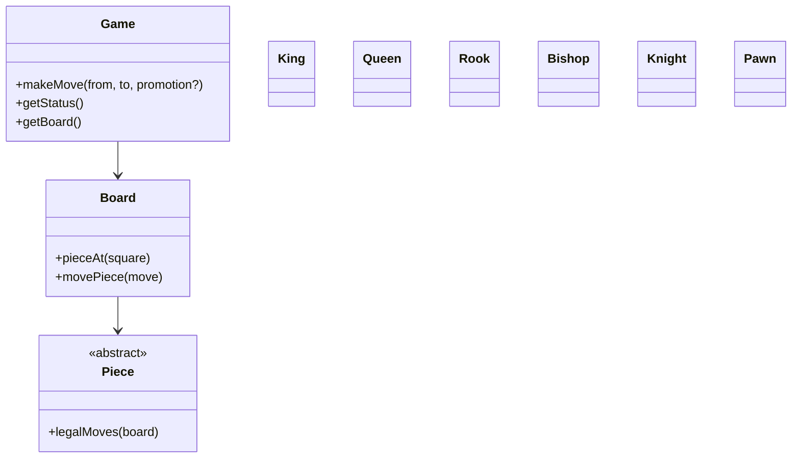

### API design

```python
game = ChessGame()
game.move(Move("e2", "e4"))
game.move(Move("e7", "e5"))
assert game.status() == GameStatus.IN_PROGRESS
assert game.in_check(Color.BLACK) is False
```

### Data model

| Object | Responsibility |
|--------|----------------|
| `Game` | Turn, status, move history |
| `Board` | 8×8 grid, piece placement |
| `Move` | from, to, promotion piece |
| `Piece` subclasses | Movement rules |

### Key design points

- **Strategy per piece** for `legalMoves(board)`.
- **Move validation** in `Game.makeMove`: correct turn, legal piece move, no moving into check.
- **Special rules** as small helpers (castling rights in game state).

```python
class ChessGame:
    def make_move(self, move: Move) -> None:
        if self._status != GameStatus.IN_PROGRESS:
            raise IllegalStateError("game over")
        piece = self.board.at(move.from_sq)
        if piece is None or piece.color != self.turn:
            raise IllegalMoveError("wrong turn or empty")
        candidates = piece.legal_moves(self.board, self.context)
        if move not in candidates:
            raise IllegalMoveError("illegal")
        self.board.apply(move)
        self.context.update(move)  # en passant, castling rights
        self.turn = self.turn.opposite()
        self._status = self._evaluate_end_state()
```

### Scaling considerations

- Single-process; persistence = optional `Move` log replay.
- AI player = plug-in search on `legal_moves`.

### Back-of-envelope estimation

| Dimension | Scope | Notes |
|-----------|-------|-------|
| **Memory** | 8×8 board + 32 pieces | &lt;1 KB game state |
| **Ops/s** | 2 humans | Negligible; AI search dominates CPU |
| **Move generation** | ~30 legal moves/position avg | Depth-4 search ≈ 30⁴ ≈ 810k nodes (pruned by alpha-beta) |
| **Persistence** | ~80 moves × 10 B/move | &lt;1 KB per game log |

### Deep dive: Class diagram & patterns

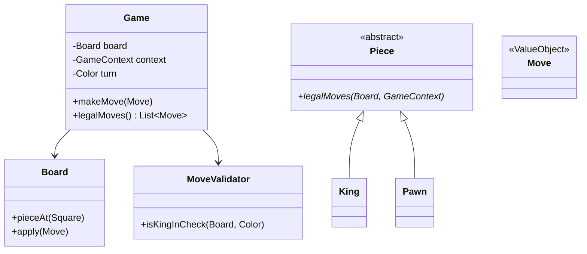

| Pattern | Usage |
|---------|--------|
| **Strategy** | Each `Piece` subclass implements movement rules |
| **State** | `GameStatus` (IN_PROGRESS, CHECKMATE, STALEMATE) |
| **Command** | `Move` as immutable command; history stack for undo/replay |
| **Observer** | Optional `GameListener` for UI updates |

### Deep dive: Game state machine

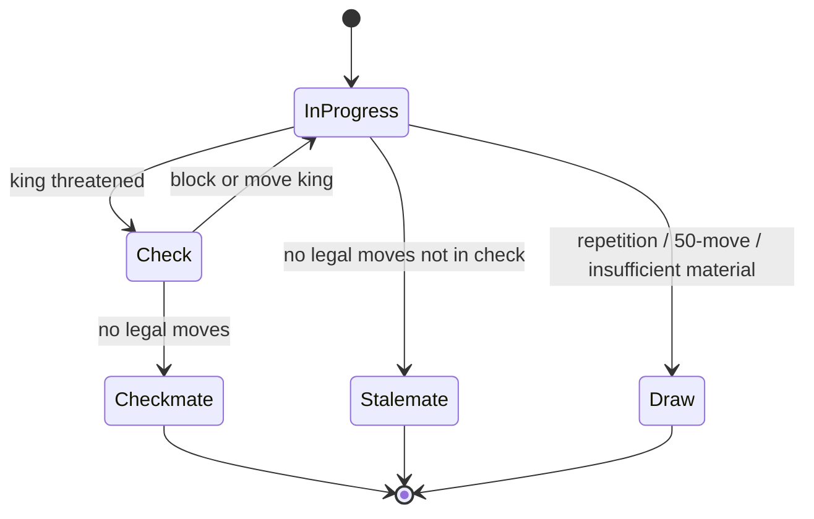

### Failure modes and edge cases

| Edge case | Handling |
|-----------|----------|
| Illegal castling through check | Validator simulates move; reject |
| En passant window | `GameContext.en_passant_target` single move TTL |
| Promotion default | Require explicit piece choice; no silent queen |
| Concurrent `makeMove` | Single-threaded game instance or lock per `game_id` |

### Interview Q&A

### Q: Where does check validation live?
**A:** After generating pseudo-legal moves, filter moves that leave own king in check—`MoveValidator` simulates on copy or undo-move technique.

### Q: Immutable board vs mutable?
**A:** Mutable + undo is faster for search; immutable snapshots simplify threading. Interview: mutable `Board` with `apply`/`revert` for AI.

### Q: How to detect stalemate vs checkmate?
**A:** If no legal moves: `in_check` → checkmate else stalemate.

### Q: How would you add clock?
**A:** **Observer** on each move flips active side timer; state in `GameContext`.

### Q: Serialize for replay?
**A:** PGN-style move list or FEN per ply; `Command` history replays via `makeMove`.

### Code examples: Strategy pattern for pieces

```python
from abc import ABC, abstractmethod
from dataclasses import dataclass

@dataclass(frozen=True)
class Square:
    file: int
    rank: int

class Piece(ABC):
    @abstractmethod
    def legal_moves(self, board: "Board", ctx: "GameContext") -> list["Move"]:
        ...

class Knight(Piece):
    def legal_moves(self, board: "Board", ctx: "GameContext") -> list["Move"]:
        deltas = [(1, 2), (2, 1), (-1, 2), (-2, 1), (1, -2), (2, -1), (-1, -2), (-2, -1)]
        moves = []
        for df, dr in deltas:
            sq = Square(self.square.file + df, self.square.rank + dr)
            if board.in_bounds(sq) and board.color_at(sq) != self.color:
                moves.append(Move(self.square, sq))
        return moves
```

---

## Design a Parking Lot

### What problem does it solve?

Allocate **bays** to vehicles, issue **tickets**, compute **fees**, open **barriers**—with concurrency and crash safety at real lanes.

> **Bay has no `isFree()` method.** Occupancy is a relation in `BayInventory`, not a mutable field on `Bay`.

### Requirements

| Functional | Non-functional |
|------------|----------------|
| Entry/exit; assigned or unassigned bays; pay on exit; permits; EV charging; reservations | p99 gate &lt;300 ms; durable tickets; offline-capable lots |

### State machine (ticket)

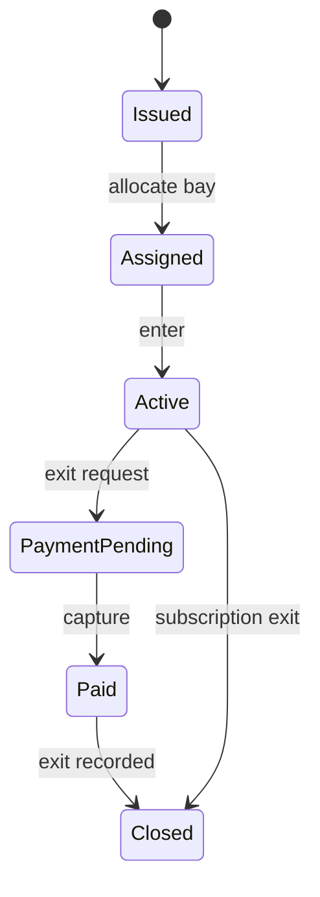

### Core components

| Component | Role |
|-----------|------|
| `Bay` | Immutable reference (level, class, id) |
| `BayInventory` | Only mutator of free/held/assigned counts |
| `Ticket` | Aggregate root for customer lifecycle |
| `TariffEngine` | Versioned rules; fee = f(timeline, tariffVersion) |
| `Ledger` | Append-only events for audit |

### API design

```http
POST /lanes/{laneId}/entry   { credential: plate|qr|reservation }
→ { ticketId, bayHint?, barrierOpen: true }

POST /tickets/{id}/pay       { method, idempotencyKey }
POST /lanes/{laneId}/exit    { ticketId }
```

### Invariants (examples)

| ID | Rule |
|----|------|
| I1 | At most one active allocation per bay |
| I2 | free + held + assigned + oos = capacity per partition |
| I7 | Sensor events → discrepancies, not direct bay mutation |

### Code sketch (allocation)

```python
class BayInventory:
    def claim(self, partition: Partition, ticket_id: str) -> BayId:
        with self._lock(partition):
            bay = self._pick_free(partition)
            if bay is None:
                raise LotFullError()
            self._ledger.append(AllocationHeld(ticket_id, bay))
            return bay
```

### Scaling considerations

- **Event sourcing** for replay and fee audit.
- **Edge controller** per lot when WAN down.
- Lock per `(level, class)` partition—not whole lot.

### Back-of-envelope estimation

| Dimension | Assumption | Math | Result |
|-----------|------------|------|--------|
| **Lot size** | 2,000 bays | | |
| **Entry rate** | 500 cars/hour peak | | **~0.14 cars/s** per lot |
| **Lane API latency** | p99 &lt;300 ms | | DB + barrier GPIO |
| **Ledger events** | 4 events/ticket | 500 × 4 / 3600 | **~0.55 events/s** |
| **Memory** | 2k bay states × 64 B | | **~128 KB** inventory |

### Deep dive: Class diagram & patterns

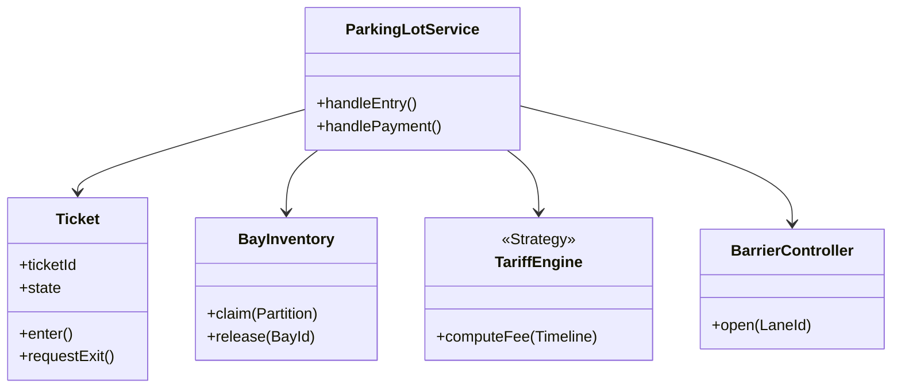

| Pattern | Usage |
|---------|--------|
| **State** | `Ticket` lifecycle (Issued → Active → Paid) |
| **Strategy** | `TariffEngine` versions (weekend, event pricing) |
| **Observer** | Sensors publish `OccupancyDiscrepancy` events |
| **Command** | `AllocationHeld`, `PaymentCaptured` ledger commands |

### Deep dive: Ticket state machine (extended)

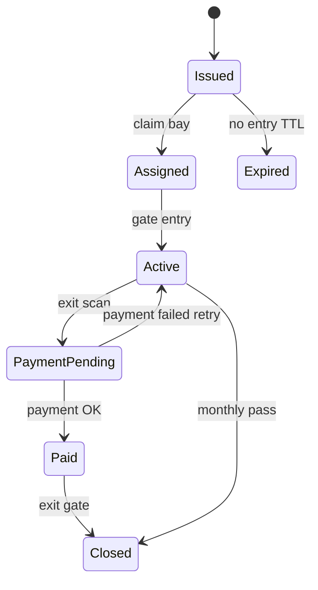

### Failure modes and edge cases

| Case | Mitigation |
|------|------------|
| Double entry same plate | Idempotent `credential` lookup returns active ticket |
| Bay sensor false positive | Discrepancy workflow; never auto-free without policy |
| Payment webhook duplicate | `idempotencyKey` on pay endpoint |
| WAN down | Edge mode: queue events; barrier rules cached |
| Lost ticket | Manual override + plate OCR |

### Interview Q&A

### Q: Why is `Bay` immutable?
**A:** Occupancy is a **relation** managed by `BayInventory`; mutable `bay.isFree` invites race bugs.

### Q: Assigned vs unassigned parking?
**A:** Unassigned: ticket Active without bay until full; assigned: `claim` before entry with bay hint on display.

### Q: How to compute fee on exit?
**A:** `TariffEngine.compute` from `entry_at`, `exit_at`, `tariff_version` at entry—immutable snapshot on ticket.

### Q: Concurrency at lane?
**A:** Lock per partition when claiming; lane controller serializes barrier commands.

### Q: Event sourcing benefits?
**A:** Audit for disputes; replay to rebuild inventory after crash.

### Code examples: State pattern on ticket

```python
from enum import Enum, auto

class TicketState(Enum):
    ISSUED = auto()
    ACTIVE = auto()
    PAYMENT_PENDING = auto()
    PAID = auto()
    CLOSED = auto()

class Ticket:
    def __init__(self, ticket_id: str) -> None:
        self.ticket_id = ticket_id
        self.state = TicketState.ISSUED

    def request_exit(self) -> None:
        if self.state != TicketState.ACTIVE:
            raise ValueError("invalid transition")
        self.state = TicketState.PAYMENT_PENDING

    def mark_paid(self) -> None:
        if self.state != TicketState.PAYMENT_PENDING:
            raise ValueError("invalid transition")
        self.state = TicketState.PAID
```

---

## Design a Vending Machine

### What problem does it solve?

Sell items: select product, insert coins/cash/card, dispense, track inventory and change.

### Requirements

| Functional | Non-functional |
|------------|----------------|
| Select item; pay (cash/card); dispense; refund; admin restock | Thread-safe state; clear state machine |

### State machine

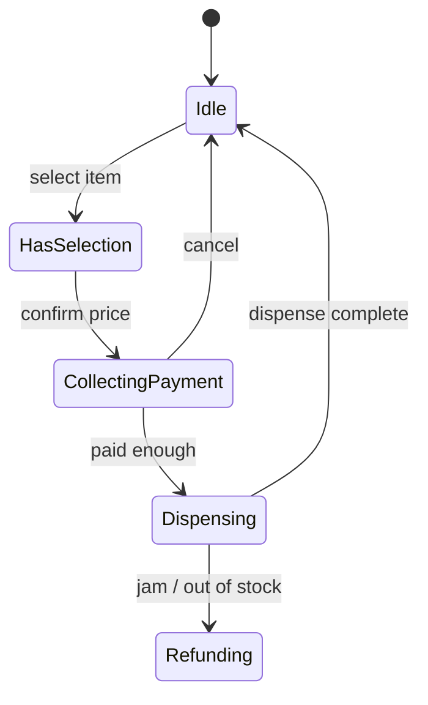

### Class design

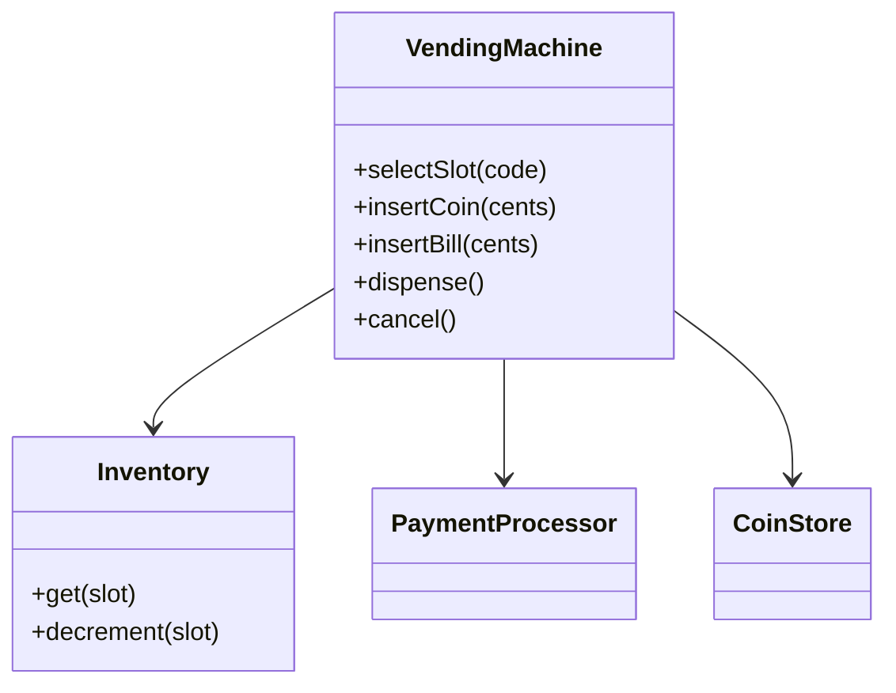

### API (internal)

```python
vm.select("A1")           # HasSelection, price=150
vm.insert_coin(100)       # CollectingPayment, paid=100
vm.insert_coin(50)        # triggers dispense
vm.dispense()             # returns Product("Soda")
```

### Data model

| Field | Notes |
|-------|-------|
| `slots` | code → Product, quantity, price |
| `cash_box` | coins/bills collected |
| `change_bank` | available change denominations |
| `state` | enum FSM state |
| `paid_amount` | current transaction |

### Scaling considerations

- Single machine scope; card payments = delegate to `PaymentProcessor` interface.
- **Concurrent access:** one `Lock` per machine or synchronized methods.

### Back-of-envelope estimation

| Dimension | Value |
|-----------|-------|
| **Slots** | 30–60 SKUs |
| **Transactions/hour** | 20–60 (public location) |
| **Coin capacity** | Fixed denominations; change bank &lt; $50 equivalent |
| **Response time** | Human-scale (&lt;100 ms UI feedback) |

### Deep dive: State machine & class diagram

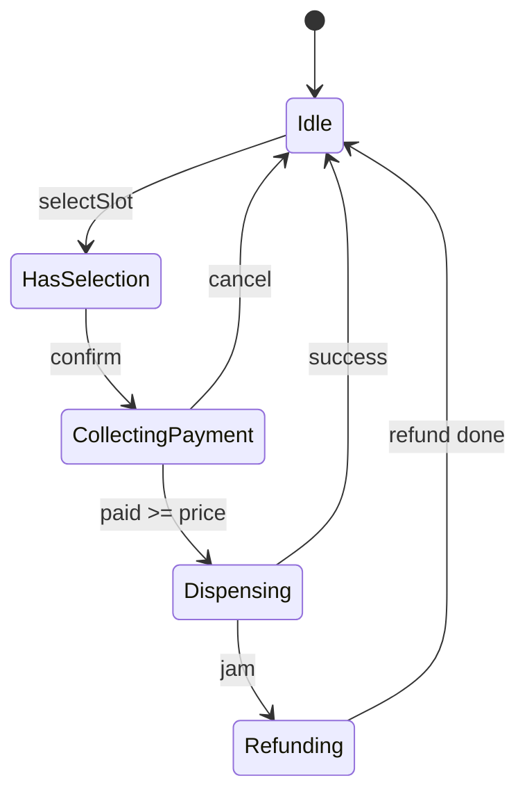

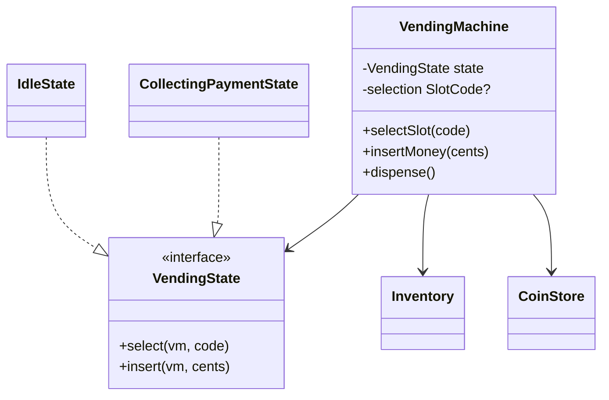

| Pattern | Usage |
|---------|--------|
| **State** | `IdleState` vs `CollectingPaymentState` handle input differently |
| **Strategy** | `PaymentProcessor` for cash vs card |
| **Command** | `DispenseCommand` logged for audit |
| **Singleton** | One machine controller process |

### Failure modes and edge cases

| Case | Handling |
|------|----------|
| Insufficient change | Block vend or offer credit code |
| Product jam | Refund path; decrement only after sensor confirm |
| Power loss mid-vend | Recover state from NV storage or safe idle |
| Price change during transaction | Lock price at selection confirm |
| Concurrent button press | `threading.Lock` on machine |

### Interview Q&A

### Q: State pattern vs single enum switch?
**A:** State pattern scales when transitions carry behavior; enum `match` is fine for interview if transitions are few.

### Q: When to decrement inventory?
**A:** After successful physical dispense (sensor), not at payment—avoids loss on jam.

### Q: Card payment flow?
**A:** Delegate to `PaymentProcessor`; on auth success treat as `insertMoney(price)` internally.

### Q: Admin restock?
**A:** Separate `AdminMode` state; PIN required; **Command** log of slot counts.

### Q: Testability?
**A:** Inject `Inventory` and `Dispenser` interfaces; simulate jam in unit tests.

### Code examples: State pattern handlers

```python
class CollectingPaymentState:
    def insert(self, vm: "VendingMachine", cents: int) -> None:
        vm.paid += cents
        if vm.paid >= vm.selected_price:
            vm.transition(DispensingState())
            vm.dispense()

class IdleState:
    def select(self, vm: "VendingMachine", code: str) -> None:
        product = vm.inventory.get(code)
        if product is None or product.qty == 0:
            raise SoldOutError(code)
        vm.selection = code
        vm.selected_price = product.price
        vm.transition(CollectingPaymentState())
```

---

## Design an Elevator System

### What problem does it solve?

Multiple elevators serve floors in a building: requests, scheduling, direction, door cycles.

### Requirements

| Functional | Non-functional |
|------------|----------------|
| Hall call (up/down); car call (floor); open/close doors; weight limit | Reasonable wait time; thread-safe simulation |

### Class diagram

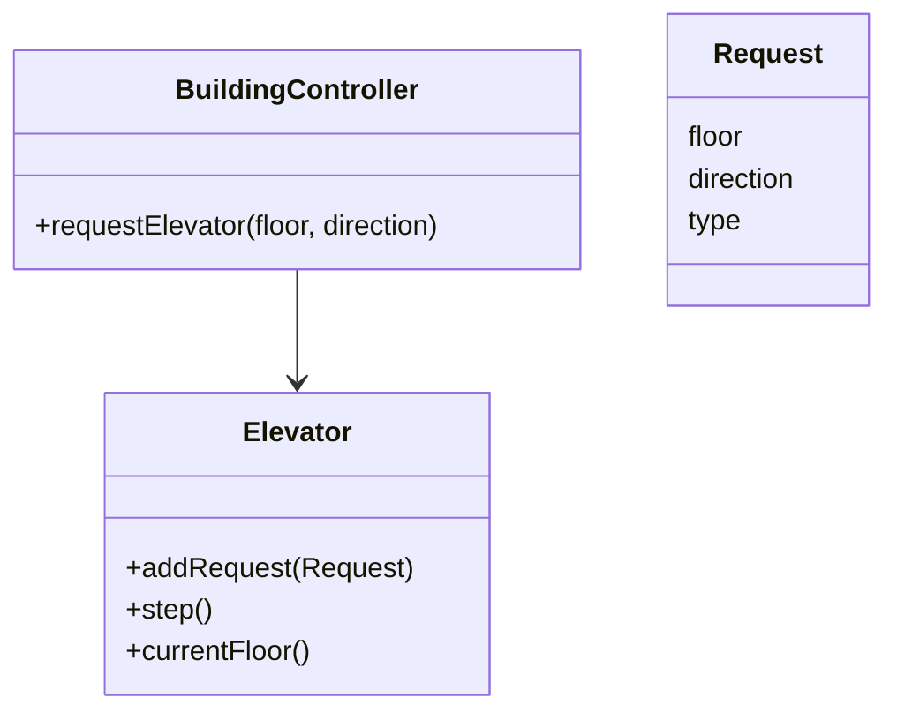

### Scheduling strategies

| Algorithm | Behavior |
|-----------|----------|
| **SCAN (elevator algorithm)** | Move in one direction, serve all stops, reverse |
| Nearest car | Assign request to closest idle car |
| LOOK | SCAN but don't stop if no requests ahead |

### API design

```python
building = BuildingController(num_floors=20, num_elevators=4)
building.hall_call(floor=3, direction=UP)
building.car_call(elevator_id=1, floor=10)
building.tick()  # advance simulation one time step
```

### Data model

| Entity | State |
|--------|-------|
| `Elevator` | current_floor, direction, door_open, load_kg, stop_queue |
| `Request` | source floor, dest floor, priority |

```python
class Elevator:
    def step(self):
        if self.door_open:
            self._close_door_if_done()
            return
        next_stop = self.scheduler.next_stop(self)
        if next_stop is None:
            self.state = IDLE
            return
        self._move_one_floor_toward(next_stop)
```

### Scaling considerations

- Simulation tick-based for tests; real building = PLC integration via controller interface.
- Optional energy optimization (off-peak parking floors).

### Back-of-envelope estimation

| Dimension | Example building |
|-----------|------------------|
| **Floors** | 20 |
| **Elevators** | 4 |
| **Requests/hour** | 500–2,000 peak |
| **Tick rate** | 1 s simulation = 20 floor moves/min max per car |
| **Stop queue size** | O(requests) bounded by dedup same floor |

### Deep dive: Class diagram & scheduling

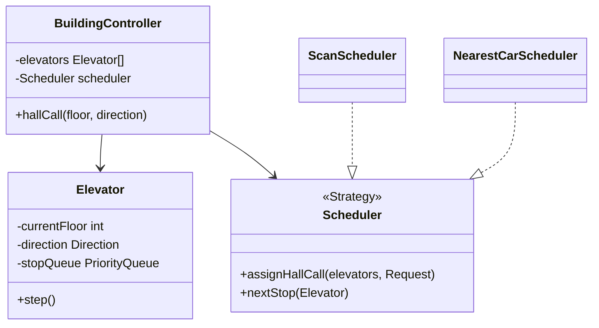

| Pattern | Usage |
|---------|--------|
| **Strategy** | Pluggable `Scheduler` (SCAN vs nearest-car) |
| **State** | Elevator: `IDLE`, `MOVING`, `DOORS_OPEN` |
| **Observer** | Floor display listens to `Elevator` position |
| **Command** | `HallCall` / `CarCall` queued requests |

### Deep dive: Elevator state machine

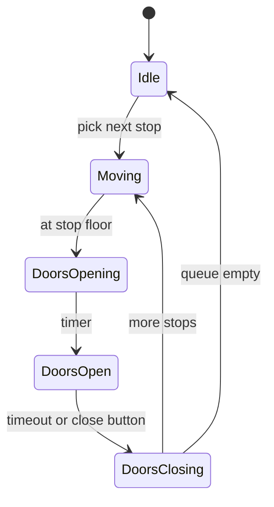

### Failure modes and edge cases

| Case | Handling |
|------|----------|
| Emergency stop | Clear queue except fire service floor |
| Overweight | Do not close doors; alarm |
| Same floor hall up+down | Coalesce requests |
| Starvation on top floor | SCAN ensures reverse sweep |
| One elevator down | `NearestCar` skips offline cars |

### Interview Q&A

### Q: SCAN vs LOOK?
**A:** SCAN serves all requests in current direction then reverses; LOOK skips empty sweeps—better energy, slightly worse worst-case wait.

### Q: Who picks which elevator for hall call?
**A:** `BuildingController` uses `Scheduler.assignHallCall`—nearest idle or predicted ETA.

### Q: Thread safety?
**A:** Single controller thread `tick()` mutates all cars; or lock per elevator for simulation.

### Q: How model door dwell time?
**A:** State `DOORS_OPEN` with `ticks_remaining`; passengers board in simulation.

### Q: Express elevator?
**A:** Separate `Elevator` class with filtered stop queue (only subset floors).

### Code examples: SCAN next stop

```python
from enum import Enum

class Direction(Enum):
    UP = 1
    DOWN = -1

def scan_next_stop(floor: int, direction: Direction, stops: set[int]) -> int | None:
    if not stops:
        return None
    ahead = [s for s in stops if (s - floor) * direction.value > 0]
    if ahead:
        return min(ahead) if direction == Direction.UP else max(ahead)
    direction = Direction.DOWN if direction == Direction.UP else Direction.UP
    return scan_next_stop(floor, direction, stops)
```

---

## Design a Library Management System

### What problem does it solve?

Catalog **books**, manage **members**, **checkout/return**, reservations, fines.

### Requirements

| Functional | Non-functional |
|------------|----------------|
| Search catalog; borrow/return; hold queue; fines; librarian admin | Audit trail; due dates |

### Class diagram

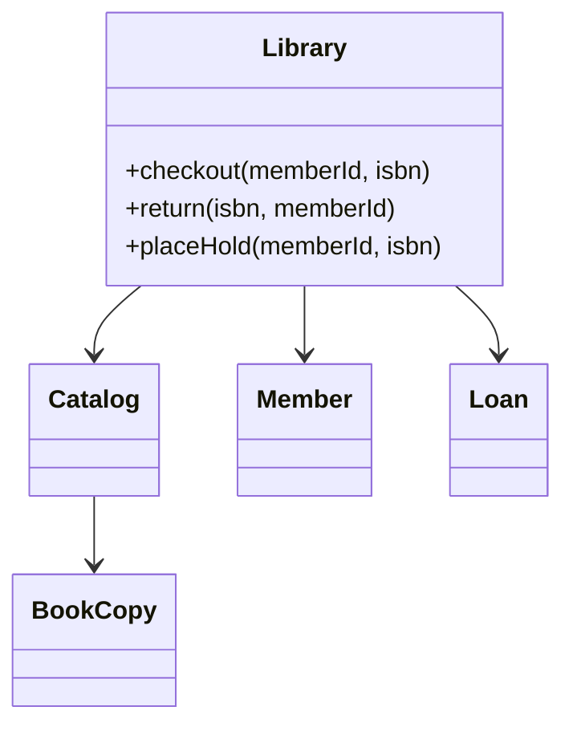

### API design

```http
GET  /books?q=title
POST /members/{id}/loans     { "isbn": "978..." }
POST /loans/{loanId}/return
POST /members/{id}/holds     { "isbn": "978..." }
GET  /members/{id}/fines
```

### Data model

| Table | Fields |
|-------|--------|
| `book_title` | isbn, title, author |
| `book_copy` | copy_id, isbn, status (available/on_loan) |
| `member` | id, name, balance |
| `loan` | copy_id, member_id, due_at, returned_at |
| `hold` | member_id, isbn, queue_position |

```python
def checkout(member_id: str, isbn: str) -> Loan:
    if member.fines_over_limit():
        raise BlockedError("pay fines first")
    copy = catalog.find_available_copy(isbn)
    if copy is None:
        holds.enqueue(member_id, isbn)
        raise NotAvailableError("placed on hold queue")
    copy.status = ON_LOAN
    return Loan.create(copy, member_id, due_days=14)
```

### Scaling considerations

- Typical OLTP; index ISBN and member_id.
- Notifications for due dates via async jobs.

### Back-of-envelope estimation

| Dimension | Small city library |
|-----------|-------------------|
| **Titles** | 50k ISBNs |
| **Copies** | 200k physical copies |
| **Members** | 30k |
| **Loans/day** | 500–2,000 |
| **Hold queue** | avg 2 per popular title |

### Deep dive: Class diagram & patterns

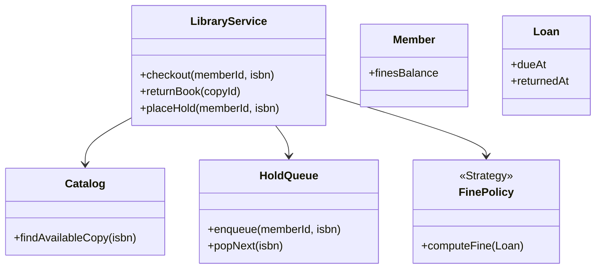

| Pattern | Usage |
|---------|--------|
| **Strategy** | `FinePolicy` (daily rate, grace days) |
| **Observer** | Notify member when hold available |
| **Factory** | `Loan.create(copy, member)` sets due date |
| **Repository** | `Catalog` abstracts DB access |

### Deep dive: Copy availability state machine

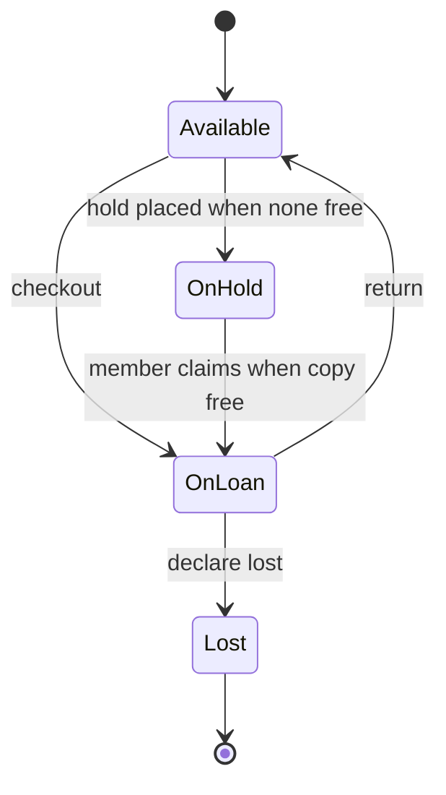

### Failure modes and edge cases

| Case | Handling |
|------|----------|
| Member blocked for fines | Reject checkout with clear error |
| Two members want last copy | DB transaction + row lock on copy |
| Return wrong copy | Barcode match `copy_id` |
| Hold expires | Auto-release to next in queue |
| Renew loan | Extend `due_at` if no holds |

### Interview Q&A

### Q: ISBN vs copy_id?
**A:** ISBN identifies title; **copy_id** is unique physical item—checkout always binds to copy.

### Q: Hold queue fairness?
**A:** FIFO per ISBN; optional priority for faculty in `HoldQueue` subclass.

### Q: Fine calculation?
**A:** Strategy on overdue days; cap max fine per policy.

### Q: Concurrent checkout last copy?
**A:** `UPDATE book_copy SET status='on_loan' WHERE copy_id=? AND status='available'`; one row affected.

### Q: Search catalog?
**A:** Read-only `Catalog` with index on title/author; separate from loan writes.

### Code examples: Transactional checkout

```python
def checkout(conn, member_id: str, isbn: str) -> Loan:
    with conn.transaction():
        member = get_member(conn, member_id)
        if member.fines_balance > member.fine_limit:
            raise BlockedError("pay fines")
        copy = conn.execute(
            """
            UPDATE book_copy SET status = 'on_loan'
            WHERE copy_id = (
              SELECT copy_id FROM book_copy
              WHERE isbn = %s AND status = 'available'
              LIMIT 1 FOR UPDATE SKIP LOCKED
            )
            RETURNING copy_id
            """,
            (isbn,),
        ).fetchone()
        if copy is None:
            hold_queue.enqueue(conn, member_id, isbn)
            raise NotAvailableError("queued")
        return create_loan(conn, copy["copy_id"], member_id, due_days=14)
```

---

## Design a Leaderboard

### What problem does it solve?

Maintain **ranked scores** for players: submit score, get top-K, get rank around user—games and contests.

### Requirements

| Functional | Non-functional |
|------------|----------------|
| Update score; global top 100; rank of user; friend board optional | Low latency reads; high write rate |

### Approaches

| Backend | Top-K | User rank | Notes |
|---------|-------|-----------|-------|
| **Sorted set (Redis)** | ZREVRANGE | ZREVRANK | Simple; memory bound |
| Relational + index | LIMIT query | COUNT where score &gt; x | OK moderate scale |
| **Skip list / tree** | In-memory | O(log n) | Custom service |

### High-level design

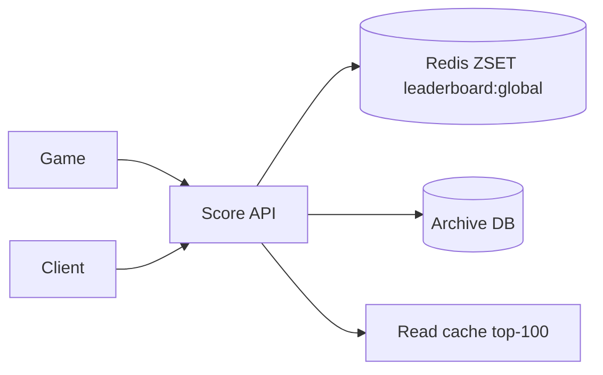

### API design

```http
POST /scores  { "playerId": "p1", "score": 12500, "gameId": "xyz" }
GET  /leaderboard/global?limit=100
GET  /leaderboard/players/{id}/rank
GET  /leaderboard/friends/{id}?limit=50
```

### Data model

```
Key: leaderboard:{gameId}
Type: ZSET
Member: playerId
Score: best_score (or latest per rules)
```

### Code (Redis)

```python
def submit_score(game_id: str, player_id: str, score: int):
    key = f"lb:{game_id}"
    current = redis.zscore(key, player_id)
    if current is None or score > current:
        redis.zadd(key, {player_id: score})

def top_n(game_id: str, n: int) -> list[tuple[str, float]]:
    return redis.zrevrange(f"lb:{game_id}", 0, n - 1, withscores=True)

def rank(game_id: str, player_id: str) -> int | None:
    r = redis.zrevrank(f"lb:{game_id}", player_id)
    return None if r is None else r + 1
```

### Scaling considerations

- **Sharding** by `gameId`.
- **Tie-breaking:** composite score `score << 32 | (MAX_TS - ts)` for same score.
- **Periodic snapshot** to DB for analytics; Redis for hot path.
- Massive boards: approximate rank (percentile buckets).

### Back-of-envelope estimation

| Dimension | Assumption | Math | Result |
|-----------|------------|------|--------|
| **Players** | 10M per game | | |
| **Score updates** | 1 update/player/min peak | 10×10⁶ / 60 | **~167k writes/s** global peak |
| **Redis memory** | 10M × (16 B member + 8 B score) | | **~240 MB** per ZSET |
| **Top-100 read** | 100k QPS cached | | CDN/app cache 1 s TTL |
| **Rank query** | O(log N) | log₂(10M) ≈ 23 | Sub-ms in Redis |

### Deep dive: Class diagram & patterns

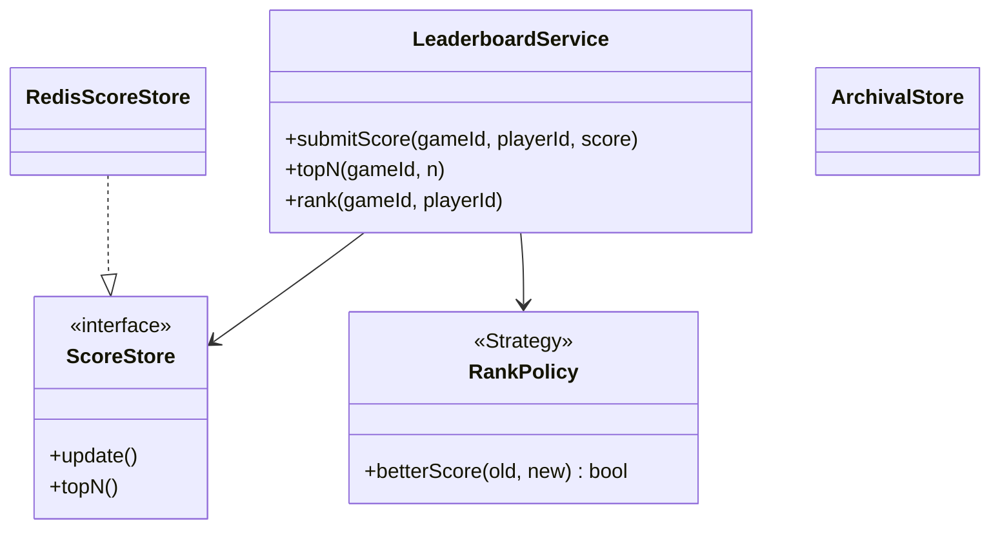

| Pattern | Usage |
|---------|--------|
| **Strategy** | `RankPolicy`: high-score vs latest-score vs sum |
| **Repository** | `ScoreStore` hides Redis vs SQL |
| **Observer** | Optional push when friend overtakes |
| **Decorator** | Cache wrapper on `topN` |

### Deep dive: Update & rank flow

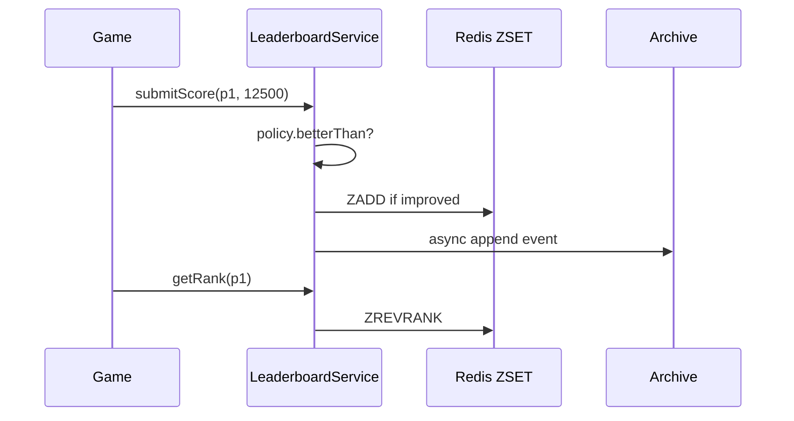

### Failure modes and edge cases

| Case | Handling |
|------|------------|
| Tie scores | Composite score with inverted timestamp |
| Cheating spike | Rate limit; anomaly detection |
| Redis loss | Rebuild from archive event log |
| Friend board | Intersect ZSET with friend set (Redis `ZINTERSTORE`) |
| Season rollover | New `gameId` key; snapshot old season |

### Interview Q&A

### Q: Redis vs DB for leaderboard?
**A:** Redis ZSET for O(log N) updates/rank; SQL for durability and analytics archive.

### Q: How to shard?
**A:** Key per `gameId`; massive single game → shard ZSET by `playerId hash` with merge for top-K only.

### Q: Approximate rank at billion scale?
**A:** **Percentile buckets** or HyperLogLog-style sketches; exact rank only near player via local ZSET shard.

### Q: Write same score twice?
**A:** Policy: ignore if not strictly better; idempotent `submit` with event id.

### Q: Global vs weekly board?
**A:** Separate keys `lb:game:weekly:2026-W43`; TTL or explicit rollover job.

### Code examples: Tie-break composite score

```python
import time

MAX_TS = 2**31 - 1

def encode_score(points: int) -> float:
    # Higher points win; for equal points, earlier achieve ranks higher
    return points + (MAX_TS - int(time.time())) / MAX_TS

def submit_improved(redis, game_id: str, player_id: str, points: int) -> bool:
    key = f"lb:{game_id}"
    new = encode_score(points)
    current = redis.zscore(key, player_id)
    if current is not None and new <= current:
        return False
    redis.zadd(key, {player_id: new})
    return True
```

---

## Comparison: All Six Designs

| Problem | Central abstraction | State machine? | Concurrency focus | Persistence |
|---------|---------------------|----------------|-------------------|-------------|
| **Chess** | Game + Piece rules | Game status | Low (2 players) | Move log |
| **Parking lot** | Ticket + Inventory | Ticket lifecycle | Lane allocation | Event ledger |
| **Vending machine** | FSM + Inventory | Payment flow | Single machine lock | Admin restock |
| **Elevator** | Scheduler + Car | Door/move cycles | Multi-elevator | Optional telemetry |
| **Library** | Loan + Catalog | Copy availability | DB transactions | OLTP |
| **Leaderboard** | Ordered scores | N/A | Redis atomic ZADD | Snapshot archive |

> **Interview tip:** State the **invariants** first (chess: no illegal king; parking: one bay per ticket; vending: no dispense without payment). Classes should make violating those invariants structurally awkward—not just documented in comments.

---

## Senior Pitfalls

| Mistake | Impact | Fix |
|---------|--------|-----|
| God classes holding all domain logic | Untestable, merge conflicts | Extract services by aggregate (Game, Ticket, Loan) |
| Anemic domain model | Rules scattered in controllers | Rich entities with enforced invariants |
| Leaking persistence into UI layer | Cannot swap storage or test rules | Repository interfaces, DTOs at boundaries |
| Concurrency added as afterthought | Race on inventory/tickets | Locks per aggregate, optimistic versioning |
| Strategy pattern everywhere | Over-abstracted 200-line “framework” | YAGNI until second real variant exists |
| No explicit state machine for payments | Illegal transitions in production | Enum states + table-driven transitions |

---

## Production-grade Practice

1. Implement **parking lot** or **vending machine** with full unit tests for every state transition and one concurrency test (two threads, one slot).
2. Refactor a 500-line class into **aggregates + repositories**; measure test coverage on business rules before/after.
3. Add **serialization boundary** (JSON/API) without exposing internal types; document validation errors for clients.
4. Write **sequence diagrams** for elevator dispatch under peak load; implement one scheduling algorithm and benchmark wait time distribution.
