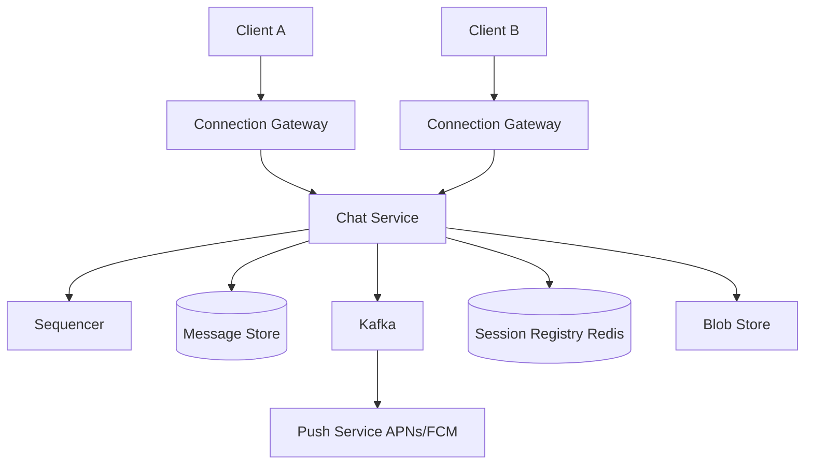
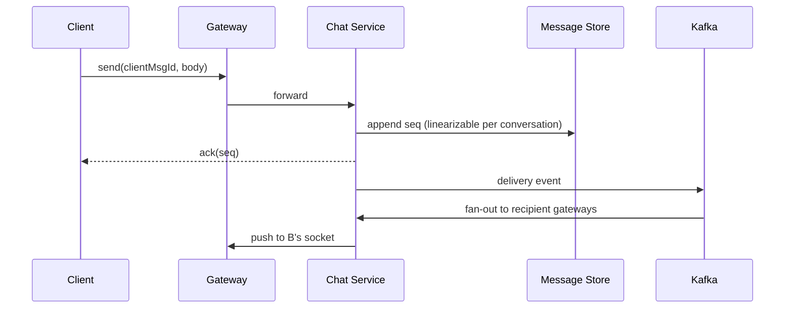
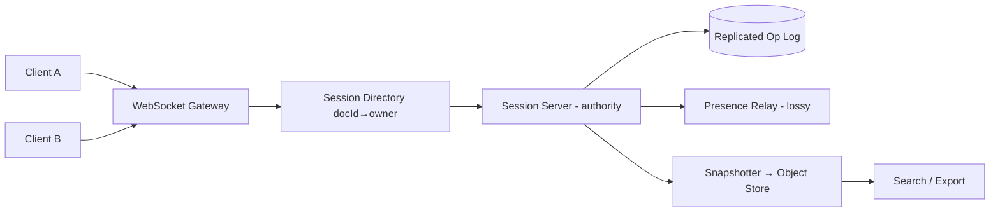

# Real-Time Collaboration: Chat & Collaborative Editor

Two systems that push you past REST: **messaging** (durable, ordered delivery to millions of sockets) and **collaborative editing** (concurrent ops, presence, and conflict-free merge). Both rely on long-lived connections and careful separation of hot paths.

---

## Design a Chat & Messaging System

### What problem does it solve?

Users send **1:1 and group messages** with real-time delivery, receipts, presence, and offline support. The core shift: the server must **push** to idle clients—REST alone is not enough.

> **Hidden load is 3–10× headline message rate:** receipts, group fan-out, and heartbeats dominate sizing if you forget them.

### Requirements

| Type | Details |
|------|---------|
| **Functional** | Send/receive; sent/delivered/read; presence & typing; media via blob store; history across devices |
| **Non-functional** | &lt;500 ms e2e when online; **zero message loss** after "sent"; per-conversation ordering; ~200M concurrent connections |

**Scale sketch:** 500M DAU × 40 msgs/day → ~230k msgs/s (~700k peak); ~2 PB/yr message storage.

### Protocol choice

| Approach | Push? | Verdict |
|----------|-------|---------|
| Short polling | Fake | Too wasteful |
| Long polling | Partial | OK fallback |
| **WebSocket** | Full duplex | Primary |
| SSE | Server→client only | Partial |

**Message envelope:**

```json
{
  "clientMsgId": "uuid",
  "conversationId": "c_123",
  "senderId": "u_9",
  "seq": 4412,
  "type": "text",
  "body": "on my way",
  "sentAt": 1699999999
}
```

### High-level architecture



- **Gateways:** Stateful (~100k sockets each); dumb frame shuttle.
- **Chat service:** Stateless; validate, assign `seq`, persist, route to recipient gateway.
- **Session registry:** `user_id + device_id → gateway_id`.

### API design

```http
WS /v1/connect?token=…
  ← server pushes: message, receipt, presence
  → client sends: message, ack, typing

GET /v1/conversations/{id}/messages?after_seq=…&limit=50
POST /v1/conversations/{id}/messages   # optional REST fallback
POST /v1/media/upload → { mediaId, url }
```

### Data model

| Entity | Fields | Storage |
|--------|--------|---------|
| `Conversation` | id, type (1:1/group), members | SQL/Cassandra |
| `Message` | conversation_id, seq, sender, body, client_msg_id | Wide-column, partition by conversation |
| `UserDevice` | push tokens | SQL |
| `Receipt` | read_up_to_seq per user | Often folded into conversation state |

**Idempotency:** Unique `(conversation_id, client_msg_id)` prevents duplicate sends on retry.

### Send path (durability)



**Ordering:** Single sequencer (or partition) per `conversation_id`.

**Receipts:** Batch as "read up to seq N"—not one event per message.

### Scaling considerations

- **Group fan-out:** Small groups inline; large communities → fan-out workers + per-user inbox shards.
- **Heartbeats:** Terminate at gateway—do not write every ping to presence store.
- **Reconnect storms:** Exponential backoff; spare gateway capacity for TLS handshakes.
- **Hot path:** Registry lookups ~3M/s—local route cache on chat nodes.

```go
// Idempotent append (conceptual)
func (s *Store) Append(ctx context.Context, msg Message) (int64, error) {
    if inserted := s.tryInsertDedup(msg.ConversationID, msg.ClientMsgID); !inserted {
        return s.seqForClientMsg(msg.ConversationID, msg.ClientMsgID)
    }
    return s.allocateSeqAndWrite(msg)
}
```

### Back-of-envelope estimation

| Dimension | Assumption | Math | Result |
|-----------|------------|------|--------|
| **Message rate** | 500M DAU × 40 msgs/day | 2×10¹⁰ / 86400 | **~231k msgs/s** avg |
| **Peak msgs** | 3× avg | | **~700k/s** (doc already says ~700k peak) |
| **Receipt/presence multiplier** | 5× user-visible msgs | 700k × 5 | **~3.5M events/s** internal |
| **Connections** | 200M concurrent | 200×10⁶ × 4 KB | **~800 GB** gateway RAM (order of magnitude) |
| **Storage** | 500M users × 80 msgs/day × 200 B | | **~2 PB/year** message bodies + metadata |
| **Group fan-out** | 50-member group, 1 msg | 50 deliveries | Size workers for **fan-out QPS**, not send QPS |

### Deep dive: Message ordering guarantees

| Scope | Guarantee | Mechanism |
|-------|-----------|-----------|
| **Per conversation** | Total order on `seq` | Single partition sequencer or DB row lock per `conversation_id` |
| **Cross-conversation** | None | Independent streams |
| **Per user inbox** | Causal-ish | Merge by `(conversation_id, seq)` on client |
| **Multi-device** | Same user sees same order | Sync via `after_seq` cursor per device |

```mermaid
sequenceDiagram
  participant S as Sequencer
  participant DB as Store
  participant K as Kafka

  S->>DB: BEGIN; SELECT max_seq FOR UPDATE
  S->>DB: INSERT seq=N+1
  S->>DB: COMMIT
  S->>K: publish(N+1, msg)
```

**Gap handling:** Client buffers out-of-order arrivals until `seq` contiguous; timeout triggers `GET /messages?after_seq=`.

### Deep dive: End-to-end encryption (E2EE)

| Layer | 1:1 Signal-style | Group |
|-------|------------------|-------|
| **Key agreement** | X3DH + Double Ratchet | Sender Keys or MLS tree |
| **Server sees** | Ciphertext + metadata | Ciphertext; member list |
| **Search** | Client-side index only | Limited |
| **Multi-device** | Pre-key bundle per device | Per-device chain |

Server stores `ciphertext`, `clientMsgId`, `seq`—cannot moderate content without client keys. **Metadata** (who talked to whom) still visible unless sealed sender.

```python
# Conceptual: encrypt before upload; server never sees plaintext
def send_e2ee(conversation_id: str, plaintext: bytes, session: "RatchetSession") -> dict:
    ciphertext, header = session.encrypt(plaintext)
    return {
        "conversationId": conversation_id,
        "type": "ciphertext",
        "body": ciphertext.hex(),
        "header": header.hex(),
    }
```

### Deep dive: Group scalability

| Group size | Strategy |
|------------|----------|
| **&lt; 100** | Inline fan-out in chat service |
| **100–10k** | Fan-out workers; per-member inbox shard |
| **Community / channel** | **Pull model**: members read timeline partition; no per-msg push to all |

Large groups use **@mentions** and **reaction counts** as partial push to limit fan-out.

```go
func Fanout(msg Message, memberIDs []string) {
    if len(memberIDs) <= 100 {
        for _, uid := range memberIDs {
            deliverToUser(uid, msg)
        }
        return
    }
    kafka.Produce("fanout.large", FanoutJob{Msg: msg, Members: memberIDs})
}
```

### Failure modes and edge cases

| Case | Mitigation |
|------|------------|
| Duplicate `clientMsgId` | Unique index; return original `seq` |
| Sequencer partition crash | Failover with fencing token; no dual-writer |
| Offline recipient | Persist + push notification; sync on reconnect |
| Media upload without message | Orphan GC; message references `mediaId` after upload |
| Reconnect storm | Jittered backoff; gateway autoscale |

### Interview Q&A

### Q: How is ordering different from WhatsApp vs IRC?
**A:** WhatsApp uses per-chat server ordering (like `seq`). IRC is per-channel but often **no strong durability**; modern apps add DB + seq for offline sync.

### Q: Can you use CRDTs for chat messages?
**A:** Possible for eventual merge, but users expect **strict timeline** in a DM—server-assigned `seq` is simpler than CRDT message DAG for interview scope.

### Q: How do read receipts scale?
**A:** Store `read_up_to_seq` per (user, conversation)—one row update per read session, not N receipt rows.

### Q: WebSocket vs MQTT?
**A:** WebSocket for browser; MQTT for IoT/low bandwidth. Both need **session registry** for routing between gateways.

### Q: How to delete a message for everyone?
**A:** Tombstone event at `seq` or `delete_up_to` marker; clients render "message deleted"; E2EE requires **revocation** or rotate keys—harder.

### Code examples: Per-conversation sequencer (PostgreSQL)

```sql
-- One row per conversation holds monotonic seq
UPDATE conversation_seq SET next_seq = next_seq + 1
WHERE conversation_id = $1
RETURNING next_seq - 1 AS assigned_seq;

INSERT INTO messages (conversation_id, seq, client_msg_id, body)
VALUES ($1, $assigned_seq, $2, $3)
ON CONFLICT (conversation_id, client_msg_id) DO NOTHING
RETURNING seq;
```

---

## Design a Collaborative Editor

### What problem does it solve?

Multiple users edit the **same document** with live cursors, offline merge, and durable history. Production pain is less "OT vs CRDT" and more **who orders ops**, **presence fan-out**, and **op-log cost**.

> **Presence traffic can exceed document traffic 3–5×.** Never put cursor updates on the reliable op channel.

### Requirements

| Type | Details |
|------|---------|
| **Functional** | Rich text; local echo; presence; offline merge within horizon; named versions; comments on stable anchors |
| **Non-functional** | p99 &lt;300 ms remote keystroke; durable ack; tail doc isolation (400 editors on one doc) |

**Scale sketch:** ~900k op batches/s peak; ~4.5M presence msgs/s; ~700 TB/yr if every keystroke kept forever.

### OT vs CRDT (decision frame)

| Factor | Prefer server sequencer + OT | Prefer CRDT |
|--------|------------------------------|-------------|
| Server always in loop | Yes | P2P / E2EE |
| Rich tree schema | Central validation | Harder to validate |
| Offline months | Bounded horizon + GC | Natural merge |

**Production pattern:** Even with CRDT payloads, use **one session owner per document** for canonical version numbers and downstream consumers (search, exports).

### High-level architecture



### Wire protocol (two channels)

**Reliable op channel:**

```text
C→S submit {docId, clientId, clientSeq, baseVersion, ops[]}
S→C ack     {clientSeq, version, durable: false}   # sequenced + broadcast
S→C durable {upToVersion}                          # persisted quorum
S→C remote  {version, clientId, ops[]}
C→S resync  {docId, lastVersion, pendingOps[]}
```

**Lossy presence channel:**

```text
C→S presence {docId, anchor, head, meta}   # throttled
S→C presence {docId, peers: [...]}         # snapshots, not deltas
```

> **Two acks:** `ack` = sequenced (fast broadcast); `durable` = in replicated log. Client keeps ops until `durable` catches up.

### API (REST, non-live)

```http
GET  /docs/{id}/snapshot?version=v
GET  /docs/{id}/history?from=v1&to=v2
POST /docs/{id}/versions  { "name": "Q3 draft" }
```

### Data model

| Artifact | Purpose |
|----------|---------|
| `OpLog` | Append-only `(version, clientId, clientSeq, ops)` |
| `Snapshot` | Periodic materialized doc at version V |
| `SessionLease` | `docId → host, epoch` for failover fencing |
| `Anchor` | Stable position (CRDT id), not integer index |

### Scaling considerations

- **Presence:** Separate relay; coalesce to 10 Hz; snapshot broadcasts; avoid O(n²) in large sessions.
- **History:** Tiered compaction—keystroke log → revisions → named versions.
- **Failover:** Fence op log with epoch; new owner rejects stale appends.
- **Deploys:** Migrate sessions with state transfer or brief read-only window.

```typescript
// Client holds pending until durable watermark
class EditorClient {
  private pending: Op[] = [];
  onAck(v: number) { this.broadcastVersion = v; }
  onDurable(upTo: number) {
    this.pending = this.pending.filter(op => op.targetVersion > upTo);
  }
}
```

### Back-of-envelope estimation

| Dimension | Assumption | Math | Result |
|-----------|------------|------|--------|
| **Active editors** | 10M concurrent | | **10M WebSockets** |
| **Keystroke batches** | 5 ops/s/user | 10×10⁶ × 5 | **~50M op batches/s** theoretical; **~900k/s** after coalescing (doc) |
| **Presence** | 5 updates/s/user coalesced to 10 Hz | | **~4.5M/s** presence (doc) |
| **Op log storage** | 900k/s × 200 B × 86400 | | **~15 TB/day** if retained raw |
| **Snapshots** | Every 1000 versions × 50 KB | | Amortizes replay cost |

### Deep dive: OT transform functions

Operational Transformation: when concurrent ops **O1** (client A) and **O2** (client B) happen on same base, server computes `transform(O1, O2)` so both apply in consistent order.

```text
Client A: insert("x", pos=5)   baseVersion=10
Client B: insert("y", pos=5)   baseVersion=10
Server order: A then B → B's pos becomes 6 after transform
```

| Op type | Transform rule (sketch) |
|---------|-------------------------|
| **Insert vs Insert** | If same pos, tie-break by `clientId` |
| **Insert vs Delete** | Adjust index if delete before insert |
| **Delete vs Delete** | Merge ranges; avoid double-delete |

```typescript
type Op = { kind: "ins"; pos: number; text: string } | { kind: "del"; pos: number; len: number };

function transform(a: Op, b: Op): Op {
  if (a.kind === "ins" && b.kind === "ins") {
    if (a.pos < b.pos) return b;
    if (a.pos > b.pos) return { ...b, pos: b.pos + a.text.length };
    // same pos: deterministic tie-break handled server-side
    return { ...b, pos: b.pos + a.text.length };
  }
  // ... delete/insert cases adjust indices
  return b;
}
```

Server is **authoritative sequencer**; clients transform local pending ops against each remote op.

### Deep dive: CRDT implementation

**RGA / LSEQ / Yjs-style** use unique op ids `(clientId, clock)` so inserts commute:

```mermaid
flowchart LR
  Op1[Insert after id=A] --> Merge[Merge without transform]
  Op2[Insert after id=A] --> Merge
  Merge --> Order[Tie-break by (clientId, clock)]
```

| CRDT type | Pros | Cons |
|-----------|------|------|
| **Text (Yjs)** | Offline-friendly | Larger op payload |
| **JSON map** | Good for forms | Hard rich-text |
| **Register** | Simple | Last-writer-wins only |

```python
from dataclasses import dataclass

@dataclass(order=True)
class Id:
    clock: int
    client: str

@dataclass
class InsertOp:
    after: Id | None
    value: str
    id: Id

# Tombstone delete: mark id deleted; merge keeps tombstones until GC horizon
```

**GC horizon:** Compact tombstones after all clients ack `version > T`.

### Deep dive: Undo/redo across users

| Model | Behavior |
|-------|----------|
| **Local undo stack** | Undo only your ops (Google Docs style) |
| **Global undo** | Rare; needs inverse ops on shared stack |
| **Command pattern** | Each op stores `do` + `undo` |

Cross-user undo: when user A undoes, emit **inverse op** on reliable channel; server sequences like any edit; OT/CRDT transforms inverse against concurrent edits.

```typescript
class UndoManager {
  private stack: Op[] = [];
  push(op: Op, inverse: Op) { this.stack.push({ op, inverse }); }
  undo(): Op | null {
    const entry = this.stack.pop();
    return entry ? entry.inverse : null;
  }
}
```

Server rejects undo of another user's op unless collaborative undo feature enabled.

### Failure modes and edge cases

| Failure | Mitigation |
|---------|------------|
| Session owner dies | Fence with `epoch`; new owner snapshots + replays log |
| Client pending ops lost | Keep until `durable` watermark |
| 400 editors on one doc | Tail isolation; rate limit ops/user |
| Snapshot stale | Replay from nearest snapshot + log |
| Presence flood | Lossy channel; 10 Hz cap |

### Interview Q&A

### Q: OT vs CRDT—which would you pick?
**A:** Server-centralized rich text with bounded offline → **OT + sequencer**. Long offline or peer-to-peer → **CRDT**. Many products use CRDT library (Yjs) with server ordering for persistence.

### Q: Why two acks (sequenced vs durable)?
**A:** Users see low-latency cursors on `ack`; durability for "saved" indicator and crash recovery requires replicated log `durable`.

### Q: How do comments anchor to text that moves?
**A:** **Stable anchors** (CRDT ids or Yjs relative positions), not integer offsets.

### Q: How to export to PDF without executing 1M ops?
**A:** Periodic **snapshot** materialization; export reads snapshot at version V.

### Q: Conflict when two users edit same word?
**A:** OT/CRDT merges; UI may show both characters; optional **lock paragraph** for legal docs.

### Code examples: Minimal server-side OT insert transform

```python
def transform_insert_insert(pos_a: int, text_a: str, pos_b: int, text_b: str) -> int:
    """Return adjusted pos_b if op A applied before op B."""
    if pos_a <= pos_b:
        return pos_b + len(text_a)
    return pos_b

def apply_insert(doc: list[str], pos: int, text: str) -> None:
    s = "".join(doc)
    s = s[:pos] + text + s[pos:]
    doc.clear()
    doc.extend(list(s))  # teaching only; production uses rope/PIECE table
```

---

## Comparison: Chat vs Collaborative Editor

| Dimension | Chat & Messaging | Collaborative Editor |
|-----------|------------------|----------------------|
| **Unit of ordering** | Conversation | Document |
| **Connection** | WebSocket + push fallback | WebSocket (dual channel) |
| **Durability model** | Append-only message log | Op log + snapshots |
| **Conflict handling** | Single writer per message | Merge ops (OT/CRDT) |
| **Fan-out** | Per recipient / group | Per peer in session (+ presence) |
| **Dominant cost** | Storage + connections | Op log retention + presence |
| **Idempotency key** | `clientMsgId` | `(clientId, clientSeq)` |
| **Offline** | Inbox sync on reconnect | Resync + pending op replay |
| **Consistency** | Strong per conversation seq | Sequenced + eventually merged view |

> **Shared lesson:** Split **stateful connection layer** from **stateless (or single-owner) business logic** so you can scale sockets and processing independently.

---

## Senior Pitfalls

| Mistake | Impact | Fix |
|---------|--------|-----|
| OT/CRDT chosen without offline story | Broken merges after reconnect | Client seq + server ack, snapshot + op log replay |
| Unbounded op log growth | Storage cost, slow catch-up | Periodic compaction snapshots, retain N hours of ops |
| Presence as source of truth for authZ | Ghost editors, leaked docs | Server validates membership on every op |
| Broadcasting ops to all users globally | CPU waste on large docs | Room/channel isolation, interest filtering |
| No idempotency on client messages | Duplicate chars/messages | `(clientId, clientSeq)` dedupe at server |
| Single Redis for both pub/sub and persistence | Data loss on restart | Durable log (Kafka/DB) + ephemeral pub/sub |

---

## Production-grade Practice

1. Build a **minimal collaborative doc**: WebSocket room, server-sequenced ops, in-memory doc; measure lag under 50 concurrent typists.
2. Implement **snapshot every N ops** and reconnect flow; verify client catches up from snapshot + tail in &lt; 2s for 10k op history.
3. Compare **OT vs CRDT** for one editing pattern (concurrent insert at same index); document merge behavior and test cases.
4. Load-test **chat fan-out** to 10k members in a channel; identify bottleneck (connection, pub/sub, storage) and mitigation plan.
