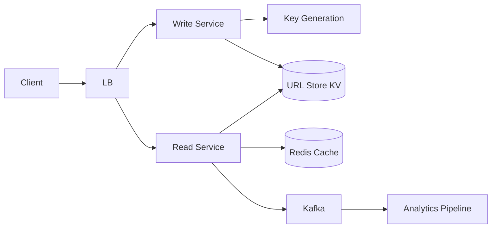
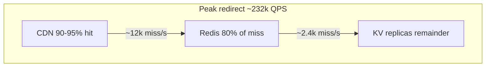
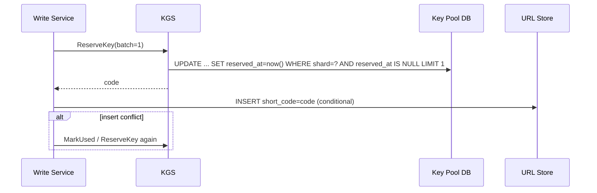
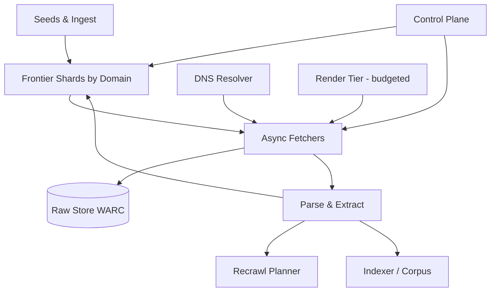
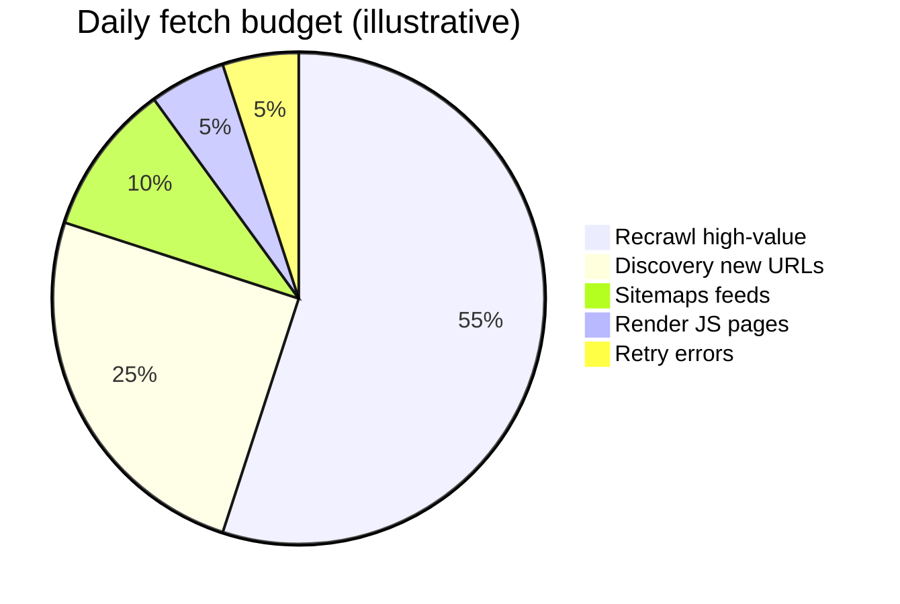
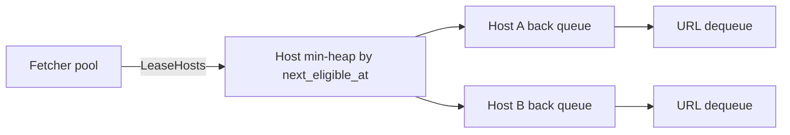
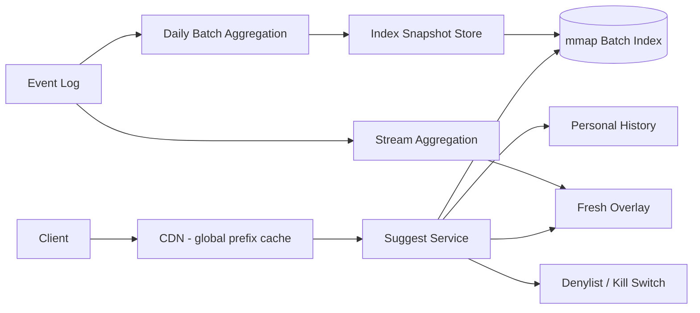
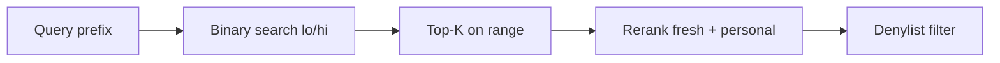
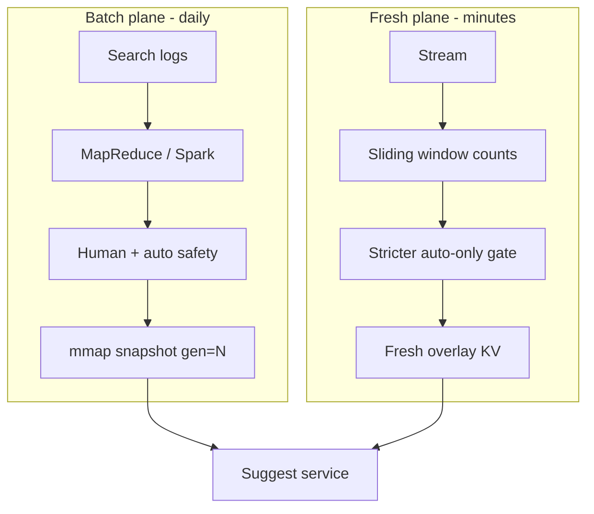

# Web Systems Design: URL Shortener, Web Crawler & Search Autocomplete

Three classic problems that sit at the edge of the web: **redirecting links**, **discovering pages**, and **suggesting queries as users type**. Together they teach read-heavy caching, politeness under scale, and sub-50ms latency budgets.

---

## Design a URL Shortener

### What problem does it solve?

A URL shortener maps a long URL to a short code (e.g. `algo.rq/xR7pQ2`) and **redirects** visitors to the original. It is deceptively small: you must choose **key generation**, optimize the **read-heavy redirect path**, and decide **301 vs 302** for analytics and safety.

> **The redirect path is ~100× hotter than creation.** Cache-first design and tiered caching are not optional—they are the product.

### Requirements

| Type | Details |
|------|---------|
| **Functional** | Shorten URL; redirect; optional custom alias; optional TTL; optional click analytics |
| **Non-functional** | Redirect p99 &lt; 100 ms; 99.99% availability; unpredictable codes; **never reuse** a code after expiry |

**Illustrative scale:** 100M new URLs/day, **100:1 read:write** → ~116k reads/s avg, ~230k peak; ~182B URLs over 5 years → **7-char base62** (~3.5T combinations).

### High-level architecture



- **Write path:** Authenticated, rate-limited; assign unique code; persist mapping.
- **Read path:** Cache-aside lookup → **302** redirect; click events to Kafka **async** (never block redirect).

### API design

```http
POST /api/v1/urls
{ "longUrl": "https://…", "customAlias": "my-brand"?, "ttlDays": 365? }
→ 200 { "shortUrl": "https://algo.rq/xR7pQ2", "code": "xR7pQ2" }
→ 409 if alias taken

GET /{code}
→ 302 Location: https://original…
→ 404 / 410 if missing or expired

GET /api/v1/urls/{code}/stats   (auth)
DELETE /api/v1/urls/{code}      (auth)
```

### Data model

| Table / entity | Key fields | Notes |
|----------------|------------|-------|
| `URL_MAPPING` | `short_code` PK, `long_url`, `user_id`, `created_at`, `expires_at` | Point lookup; shard by `short_code` |
| `KEY_POOL` | `key`, `is_used` | Only if using KGS |
| `USER` | account metadata | Separate from hot redirect path |

**Invariant:** Codes are **never reissued** after expiry—use tombstones (410 Gone), not reuse.

### Key generation strategies

| Strategy | Pros | Cons |
|----------|------|------|
| Hash URL → 7 base62 chars | Simple | Collisions at scale; same URL → same code (privacy/analytics) |
| Counter + base62 | No collisions | Enumerable; needs distributed counter |
| **KGS / random + conditional insert** | Unpredictable, O(1) handout | Pool ops; multi-region needs strong consistency |

```python
ALPHABET = "0123456789abcdefghijklmnopqrstuvwxyzABCDEFGHIJKLMNOPQRSTUVWXYZ"

def encode_base62(n: int) -> str:
    if n == 0:
        return "0"
    s = []
    while n:
        n, r = divmod(n, 62)
        s.append(ALPHABET[r])
    return "".join(reversed(s))
```

**301 vs 302:** Use **302** (or 307) when you need **per-click analytics** and ability to disable phishing links. Use **301** only for pure forwarding with bounded `Cache-Control`.

### Scaling considerations

- **Tiered cache:** CDN/edge → in-process LRU + single-flight → Redis → KV replicas.
- **Hot keys:** One viral code can melt a Redis shard—edge + local cache absorbs it.
- **Cold cache:** Plan for cache flush (shed load vs over-provision DB).
- **Abuse:** Rate-limit 404s; Bloom filters per shard for existence checks.

### Redirect path (code sketch)

```python
async def redirect(code: str) -> str:
    url = l1_cache.get(code) or await redis.get(f"url:{code}")
    if url:
        asyncio.create_task(publish_click(code))  # fire-and-forget
        return url
    row = await db.get_mapping(code)
    if not row or row.expired:
        raise NotFound()
    await redis.setex(f"url:{code}", 3600, row.long_url)
    asyncio.create_task(publish_click(code))
    return row.long_url
```

### Back-of-envelope estimation

**Assumptions (from requirements):** 100M creates/day, 100:1 read:write, 5-year retention, avg long URL 500 bytes, short code 7 chars, analytics on every redirect.

| Step | Calculation | Result |
|------|-------------|--------|
| Write QPS (avg) | 100M / 86,400 | **~1,157 writes/s** |
| Write QPS (peak ×2) | 1,157 × 2 | **~2.3k writes/s** |
| Read QPS (avg) | 1,157 × 100 | **~116k reads/s** |
| Read QPS (peak ×2) | 116k × 2 | **~232k reads/s** |
| New mappings/year | 100M × 365 | **36.5B rows/year** (if never expire) |
| 5-year row count | 100M × 365 × 5 | **~182B mappings** |
| Storage / mapping (row) | 7 + 500 + 16 (user_id) + 32 (timestamps/metadata) + indexes overhead ~30% | **~700 bytes/row** |
| Raw KV storage (5y) | 182B × 700 B | **~127 TB** (before compression; URL text compresses ~2×) |
| Analytics events/day | 100M creates × 100 reads (avg) | **10B click events/day** |
| Analytics ingest (avg) | 10B / 86,400 | **~116k events/s** (same order as redirect QPS) |
| Kafka retention (7d, 200 B/event compressed) | 10B × 7 × 200 B | **~14 TB** (rolling) |
| Redis hot set (1% of daily reads touch 20% codes — Pareto) | ~20M codes × (7 + 500 + overhead) | **~10 GB** working set; plan **50–100 GB** per region with headroom |
| CDN edge | 232k peak × 500 B response headers only | **~116 MB/s** origin miss traffic if 95% edge hit → **~5.8k origin RPS** |

**Cache sizing rule of thumb:** Size L1+L2 for **top 1–5% of codes by traffic** (often &lt;1% of keys). For 182B total keys, **~2B “ever hot” keys/year** is rare; daily viral set is usually **10⁵–10⁷** keys—fit in regional Redis with aggressive TTL on long tail.



### Database schema deep dive

**Access patterns:** (1) `GET /{code}` — single-point read by `short_code`, p99 &lt; 5 ms at DB layer; (2) create — insert + uniqueness on `custom_alias`; (3) stats — range scans on `user_id` + `created_at` (cold path).

**Primary store (Cassandra / DynamoDB style — shard by `short_code`):**

```sql
-- Logical schema; Cassandra: PRIMARY KEY (short_code)
CREATE TABLE url_mapping (
  short_code        VARCHAR(16)  NOT NULL,  -- PK, partition key
  long_url          TEXT         NOT NULL,
  long_url_hash     BIGINT       NOT NULL, -- optional dedup hint, not for redirect
  user_id           UUID,
  custom_alias      VARCHAR(32),           -- NULL if auto-generated
  status            SMALLINT     NOT NULL DEFAULT 1, -- 1=active, 2=deleted, 3=expired_tombstone
  created_at        TIMESTAMPTZ  NOT NULL,
  expires_at        TIMESTAMPTZ,           -- NULL = no expiry
  redirect_type     SMALLINT     NOT NULL DEFAULT 302,
  metadata_json     JSONB,                 -- UTM, campaign tags (write path only)
  PRIMARY KEY (short_code)
);

-- Secondary index ONLY for console APIs, not redirect path:
CREATE INDEX idx_url_mapping_user_created
  ON url_mapping (user_id, created_at DESC)
  WHERE status = 1;
```

| Index / key | Justification |
|-------------|---------------|
| PK `short_code` | 100% of redirect traffic; even hash distribution if codes are random |
| No index on `long_url` | Optional async dedup job; redirect never needs it |
| `user_id, created_at` | Paginated “my links” dashboard; tolerate seconds of lag |

**KGS pool table (if not using pure random insert):**

```sql
CREATE TABLE key_pool (
  shard_id          SMALLINT     NOT NULL,  -- 0..N-1 for parallel refill
  key_value         VARCHAR(16)  NOT NULL,
  reserved_at       TIMESTAMPTZ,
  reserved_by       UUID,                   -- writer instance lease
  PRIMARY KEY (shard_id, key_value)
);
CREATE INDEX idx_key_pool_available ON key_pool (shard_id) WHERE reserved_at IS NULL;
```

**Analytics (ClickHouse / BigQuery friendly):**

```sql
CREATE TABLE click_events (
  event_time        DateTime64(3) NOT NULL,
  short_code        LowCardinality(String),
  user_agent_hash   UInt64,
  country           LowCardinality(String),
  referrer_host     LowCardinality(String),
  is_bot            UInt8
) ENGINE = MergeTree()
PARTITION BY toYYYYMM(event_time)
ORDER BY (short_code, event_time);
```

Partition by month for TTL drops; `ORDER BY (short_code, event_time)` matches per-link stats queries.

### Component deep dives

#### Key Generation Service (KGS) internals

**Goals:** Unpredictable codes, no collisions, **never reuse**, low latency on create (~10–30 ms p99), survive region loss without issuing duplicates.



**Refill workers** pre-generate random 7-char strings into `key_pool` per shard (e.g. 256 shards). Target pool depth: **≥ 10× peak write QPS × 60s** → at 2.3k/s writes, hold **~140k keys/shard fleet-wide** (split across shards). Use **crypto RNG** (`secrets` / `getrandom`), not `Math.random`.

```python
import secrets
from string import ascii_letters, digits

ALPHABET = (digits + ascii_letters) * 1  # 62 chars

def generate_code(length: int = 7) -> str:
    return "".join(secrets.choice(ALPHABET) for _ in range(length))

async def reserve_key(pool: KeyPool, shard: int) -> str:
    for _ in range(5):
        key = await pool.claim_unused(shard)
        if key:
            return key
    raise PoolExhausted(f"shard {shard}")
```

**Multi-region:** Each region pulls from **region-scoped pool shards** OR uses **central KGS with Spanner/strong consistency**. Never run independent random insert without DB `IF NOT EXISTS`—collision probability is low but **birthday bound** at 10⁹ codes matters for 7-char base62 (~3.5×10¹² space, safe until ~10⁶ codes with negligible risk; at 10¹¹ issued, use 8+ chars).

#### Analytics pipeline

**Principle:** Redirect returns in **&lt;2 ms** app time; clicks are **at-least-once** to Kafka.

| Stage | Tech | SLA |
|-------|------|-----|
| Edge / Read svc | protobuf event → local agent buffer | drop-safe under overload |
| Kafka | 50–200 partitions by `hash(short_code)` | 7d retention |
| Flink / Spark streaming | 1-min rollups per code | lag &lt; 2 min for “live” dashboard |
| OLAP | ClickHouse daily aggregates | authoritative billing stats |

```python
# Idempotent consumer: dedupe by (short_code, event_id)
def reduce_clicks(events: list[ClickEvent]) -> dict[str, int]:
    from collections import Counter
    return dict(Counter(e.short_code for e in events))
```

**Bot filtering:** Classify on `User-Agent` + ASN + rate per IP before counting “human” clicks—store raw and filtered columns.

#### Rate limiting and abuse prevention

| Layer | Mechanism | Limit example |
|-------|-----------|---------------|
| Create API | Token bucket per `user_id` + per IP | 100 creates/hour free tier |
| Redirect | No hard limit (product); edge cache | — |
| 404 scanning | Per-IP bucket on miss path | 60 404s/min → CAPTCHA or block |
| Phishing | URL reputation API + manual review queue | block redirect → 451 |
| Enumeration | Unpredictable keys + optional CAPTCHA on create | — |

```python
class TokenBucket:
    def __init__(self, rate: float, capacity: float):
        self.rate, self.capacity = rate, capacity
        self.tokens = capacity
        self.updated = time.monotonic()

    def allow(self, cost: float = 1.0) -> bool:
        now = time.monotonic()
        self.tokens = min(self.capacity, self.tokens + (now - self.updated) * self.rate)
        self.updated = now
        if self.tokens >= cost:
            self.tokens -= cost
            return True
        return False
```

**Bloom filter per shard** for “code might exist” before DB on miss—reduces DB storms from scanners; tune **false positive rate ~0.1%** so almost all junk 404s never touch disk.

### Failure modes and edge cases

| Scenario | Symptom at 10× | Mitigation |
|----------|----------------|------------|
| Viral short link | Single Redis shard hot; origin 10× | CDN cache `Cache-Control: public, max-age=60`; local LRU per pod; **subdomain sharding** `/{code}` consistent hash less helpful than edge |
| Cache stampede on expiry | Many pods miss together | **Single-flight** (mutex per code); jittered TTL; early async refresh |
| KGS pool drain | Create 503 | Auto-scale refill workers; alert at 20% pool; fallback longer codes |
| Kafka lag | Stats delayed hours | Scale consumers; sample clicks 1:10 under stress (document in SLA) |
| Multi-region write | Duplicate codes | Conditional put; global UUID prefix in code space per region |
| Expired link | User expects reuse | **410 Gone** + tombstone row; marketing “never reuse” invariant |
| DB partition loss | Redirect 404 for valid codes | Multi-AZ replicas; rehearse restore; CDN stale-while-revalidate |
| Custom alias squatting | 409 storms | Reserve alias in transaction with user billing |

**Consistency:** Redirect path is **eventually consistent** with analytics (acceptable). Mapping read after write: **read-your-writes** for API console via primary; redirect replicas may lag **&lt;100 ms**—use sync replicate for custom alias create if product requires.

### Interview follow-up Q&A

### Q: Why 302 instead of 301 for most shorteners?

**A:** **301 Moved Permanently** is cached aggressively by browsers and CDNs—you lose per-click telemetry and cannot swap the destination for malware takedowns without cache purge nightmares. **302/307** keeps the short URL the stable identifier while the **Location** target remains authoritative on each request (modulo CDN TTL you explicitly set). Use 301 only for branded stable links with bounded `Cache-Control` and no analytics requirement.

### Q: How do you generate IDs without a central bottleneck?

**A:** Three production patterns: (1) **KGS** with pre-allocated pools and shard-local claim; (2) **random + conditional insert** with retry (simple, works to ~10k creates/s per region with good DB); (3) **Snowflake-style** IDs encoded base62—watch enumerability. Avoid plain global counter exposed in URL unless obfuscated with encryption.

### Q: How would you support custom domains (white-label)?

**A:** Separate **host** dimension in routing: `Host` header → tenant config → same `code` namespace per tenant or global. TLS via ACME automation; CDN tenant isolation; rate limits per tenant. Data model adds `tenant_id` to PK or uses **composite PK (tenant_id, short_code)**.

### Q: Estimate cost of storing 5 years of URLs.

**A:** ~182B rows × ~700 B ≈ **127 TB** raw. With 2× compression on URLs → **~65 TB**. At $0.02/GB-month (object-tier KV) ≈ **$1.3M/month** storage alone—real systems use **TTL**, tiering cold rows to object storage, and **archival** for expired tombstones.

### Q: What happens if two users shorten the same long URL?

**A:** Product choice: **dedup** (same code, privacy leak—others see you used that URL) vs **unique code per create** (more rows). If deduping, key on `hash(long_url)` in async job only; redirect still PK on `short_code`.

### Q: How do you delete a phishing link in under 60 seconds?

**A:** **Kill switch row** in fast cache (`blocked:code` → true) checked before redirect; propagate via Redis pub/sub to all regions; CDN **purge** or short TTL; async DB tombstone. Legal: return **451** with explanation page optional.

### Q: Design multi-tenant analytics without PII leaks.

**A:** Aggregate in stream processor; store **hashed IP / truncated**; k-anonymity for geo breakdown; per-tenant OLAP namespace; raw logs 30-day TTL with access audit.

### Additional code: single-flight cache fill

```python
import asyncio
from typing import Dict

_inflight: Dict[str, asyncio.Future] = {}

async def get_long_url(code: str) -> str:
    hit = await redis.get(f"url:{code}")
    if hit:
        return hit

    if code not in _inflight:
        _inflight[code] = asyncio.create_task(_load_and_cache(code))
    try:
        return await _inflight[code]
    finally:
        _inflight.pop(code, None)

async def _load_and_cache(code: str) -> str:
    row = await db.get_mapping(code)
    if not row:
        raise NotFound()
    await redis.setex(f"url:{code}", 3600 + random.randint(0, 300), row.long_url)
    return row.long_url
```

---

## Design a Web Crawler

### What problem does it solve?

A crawler **fetches and indexes** the public web under **politeness** constraints. At billions of pages it becomes a **budget allocator**: fixed daily fetches, host diversity as the throughput ceiling, dedup at millions of checks/sec, and **SSRF-safe** fetching.

> **Throughput scales with distinct hosts, not machine count.** One host ≈ one polite fetch every ~2 seconds.

### Requirements

| Type | Details |
|------|---------|
| **Functional** | Discover URLs (sitemaps, links); fetch & store (WARC); dedup; recrawl; robots.txt; operator controls |
| **Non-functional** | ~4B fetches/day (~46k/s); politeness; bounded trap/spam waste; graceful degradation; **no internal network access** |

### High-level architecture



**Critical API idea:** Fetchers **lease hosts**, not individual URLs—politeness lives in one place per host.

```text
LeaseHosts(fetcher_id, capacity) -> [HostLease{host, urls[], min_delay_ms, lease_until}]
Complete(lease_id, url, outcome) -> ack
EmergencyStop(domain | ip_range | asn)  # push to scheduler + in-flight fetchers + render tier
```

### Data model (conceptual)

| Store | Contents |
|-------|----------|
| **Seen URL set** | ~64-bit URL fingerprint + host prefix (~1.2 TB fleet RAM at 100B URLs) |
| **Per-URL crawl state** | LSM on SSD (~10 TB)—last fetch, change signals, next recrawl time |
| **Host policy** | Rate limits, block/allow, budgets |
| **Raw store** | Compressed bodies; skip storing unchanged 304 bodies |

### Key components

1. **Frontier:** Mercator-style front queues (priority) + per-host back queues; heap of hosts by `next_eligible_at`.
2. **Politeness:** Nested token buckets (host, registrable domain, IP)—disable IP bucket on CDNs.
3. **Dedup:** Batch seen-checks; host-local where possible.
4. **Recrawl:** Value-weighted refresh—most budget goes to **re-fetch**, not discovery.
5. **Traps:** Domain reputation shrinks budget for infinite calendars / session IDs.

### Scaling considerations

- Shard frontier by **registrable domain (eTLD+1)**.
- Fetchers use **dedicated egress IPs** (cost + abuse verification).
- Render only a **budgeted fraction** of URLs—render % dominates CPU cost.
- **EmergencyStop** must fence in-flight sockets by **resolved IP**, not hostname.

### Back-of-envelope estimation

**Assumptions:** 4B fetches/day, avg HTML 50 KB (compressed store ~15 KB), 100B unique URLs in seen-set over fleet lifetime, recrawl metadata 200 B/URL, 50M distinct hosts.

| Step | Calculation | Result |
|------|-------------|--------|
| Fetch QPS (avg) | 4B / 86,400 | **~46.3k fetches/s** |
| Fetch QPS (peak ×1.5) | 46.3k × 1.5 | **~70k/s** |
| Politeness ceiling | 1 fetch / 2s per host | **~0.5 QPS per host** |
| Hosts needed at ceiling | 46.3k / 0.5 | **~93k active hosts** concurrently in rotation |
| Egress bandwidth (avg) | 46.3k × 50 KB | **~2.3 GB/s** (~18 Tbps aggregate—use compression + 304) |
| WARC storage/day | 4B × 15 KB | **~60 PB/day** raw—**only store deltas**; with 30% change rate → **~18 PB/day** |
| Seen URL RAM (64-bit fingerprint) | 100B × 8 B | **800 GB** minimum; with overhead **~1.2 TB** fleet RAM |
| Crawl state SSD | 100B × 200 B | **~20 TB** LSM |
| DNS QPS | ~1 lookup per fetch (cached) | **~46k/s**—resolver farm + negative cache |
| Parser throughput | 46k pages/s × 200 KB/s CPU | **~9k cores** if 1 page/core/s naive—async I/O cuts 5–10× |

**Budget allocator:** If render tier is 5% of URLs at 2s/page, render alone ≈ **2.3k pages/s** → dedicated **~500–1k** headless browsers with queueing.



### Database schema deep dive

**Access patterns:** (1) frontier — pop next URL for host; (2) seen-check — batch `EXISTS` for 1k–10k fingerprints; (3) crawl state — read/update last fetch, next recrawl; (4) host policy — read on lease grant.

**Crawl state (LSM — RocksDB / Cassandra):**

```sql
CREATE TABLE crawl_state (
  url_fingerprint   BIGINT       NOT NULL,  -- PK: murmur128 truncated to 64
  url_canonical   TEXT         NOT NULL,  -- stored once; optional columnar offload
  host_etld1      VARCHAR(253) NOT NULL,
  first_seen_at   TIMESTAMPTZ  NOT NULL,
  last_fetch_at   TIMESTAMPTZ,
  last_status     SMALLINT,
  content_hash    BIGINT,                 -- SimHash or SHA256 truncated
  next_recrawl_at TIMESTAMPTZ  NOT NULL,
  fetch_priority  REAL         NOT NULL DEFAULT 0.5,
  PRIMARY KEY (url_fingerprint)
);

CREATE TABLE crawl_state_by_host (
  host_etld1        VARCHAR(253) NOT NULL,
  next_recrawl_at   TIMESTAMPTZ  NOT NULL,
  url_fingerprint   BIGINT       NOT NULL,
  fetch_priority    REAL         NOT NULL,
  PRIMARY KEY ((host_etld1), next_recrawl_at, url_fingerprint)
) WITH CLUSTERING ORDER BY (next_recrawl_at ASC, url_fingerprint ASC);
```

| Table | Partition key | Why |
|-------|---------------|-----|
| `crawl_state` | `url_fingerprint` | O(1) update after fetch |
| `crawl_state_by_host` | `host_etld1` | Recrawl planner scans due URLs per host without full table scan |
| `host_policy` | `host_etld1` | Co-locate rate limits with frontier shard |

```sql
CREATE TABLE host_policy (
  host_etld1          VARCHAR(253) PRIMARY KEY,
  min_delay_ms        INT NOT NULL DEFAULT 2000,
  max_concurrency     SMALLINT NOT NULL DEFAULT 1,
  robots_txt_etag     VARCHAR(64),
  robots_fetched_at   TIMESTAMPTZ,
  budget_tokens_per_day REAL,
  reputation_score    REAL DEFAULT 1.0,
  emergency_stop      BOOLEAN DEFAULT FALSE
);
```

**Raw store (object):** `s3://crawl/warc/{yyyy}/{mm}/{dd}/{host_etld1}/{url_fp}.warc.gz` — partition by date + host for lifecycle policies.

### Component deep dives

#### URL frontier scheduling algorithm

**Mercator model:** Global **priority queue** of hosts ordered by `next_eligible_at`; each host has a **back queue** of URLs; optional **front queue** for high-priority discovery (sitemaps, news).



**Scheduling loop (per frontier shard):**

1. Pop host `h` where `now >= h.next_eligible_at`.
2. Dequeue up to `k` URLs from `h` (usually `k=1` for strict politeness).
3. Set `h.next_eligible_at = now + h.min_delay_ms`.
4. Push `h` back on heap.

**Priority score** for URL within host back queue:

\[
\text{score} = w_p \cdot \text{PageRankProxy} + w_r \cdot e^{-\lambda \cdot \text{age}} + w_d \cdot \mathbb{1}_\text{discovery}
\]

```python
import heapq
import time
from dataclasses import dataclass, field

@dataclass(order=True)
class HostSchedule:
    next_eligible: float
    host: str = field(compare=False)
    urls: list = field(default_factory=list, compare=False)
    min_delay_ms: int = 2000

class Frontier:
    def __init__(self):
        self.heap: list[HostSchedule] = []

    def push_url(self, host: str, url: str, min_delay_ms: int = 2000):
        # find or create host entry — production uses map host -> HostSchedule
        ...

    def lease(self, max_hosts: int) -> list[tuple[str, str]]:
        now = time.monotonic()
        out = []
        while len(out) < max_hosts and self.heap:
            hs = heapq.heappop(self.heap)
            if hs.next_eligible > now:
                heapq.heappush(self.heap, hs)
                break
            if not hs.urls:
                continue
            url = hs.urls.pop(0)
            out.append((hs.host, url))
            hs.next_eligible = now + hs.min_delay_ms / 1000.0
            heapq.heappush(self.heap, hs)
        return out
```

**Sharding:** `hash(eTLD+1) % num_shards` — all state for `bbc.co.uk` on one shard to preserve ordering without distributed locks.

#### Politeness engine

**Nested token buckets:** host → registrable domain → /24 IP (disable IP bucket when `Host` is a known CDN).

| Signal | Action |
|--------|--------|
| `robots.txt` Disallow | Never enqueue |
| `Crawl-delay: 10` | `min_delay_ms = 10000` |
| HTTP 429 + `Retry-After` | Pause host until header time |
| 5xx burst | Exponential backoff per host |
| CDN detected | Concurrency 2–8 on host bucket, **no** IP bucket |

```python
def effective_delay(host_policy: HostPolicy, robots: RobotsRules, path: str) -> int | None:
    if not robots.allowed(path):
        return None  # do not fetch
    delay = host_policy.min_delay_ms
    if robots.crawl_delay_ms:
        delay = max(delay, robots.crawl_delay_ms)
    if host_policy.reputation_score < 0.3:
        delay = int(delay * 4)  # trap/spam throttle
    return delay
```

**Lease contract:** Fetcher must **Complete** lease within `lease_until`; otherwise frontier reclaims URLs (at-least-once fetch—dedup handles duplicates).

#### Deduplication with SimHash / MinHash

**Layers:**

1. **Exact URL fingerprint** — canonicalize (lowercase host, strip fragment, sort query params policy) → MurmurHash3-128 → 64-bit key in **sharded Bloom + RocksDB**.
2. **Near-duplicate (optional)** — SimHash on extracted text (64-bit); Hamming distance ≤ 3 → skip fetch or merge index.

```python
def simhash64(tokens: list[str], bits: int = 64) -> int:
    v = [0] * bits
    for t in tokens:
        h = murmur64(t)
        for i in range(bits):
            v[i] += 1 if (h >> i) & 1 else -1
    out = 0
    for i in range(bits):
        if v[i] > 0:
            out |= 1 << i
    return out

def near_dup(a: int, b: int, max_dist: int = 3) -> bool:
    return (a ^ b).bit_count() <= max_dist
```

**MinHash** for Jaccard similarity across shingles (k=5 chars): store **128 sketches** per doc; LSH bands for candidate pairs—use in **indexer**, not on every crawl URL, to save CPU.

**Batch seen check:**

```python
async def filter_unseen(fps: list[int], shard: int) -> list[int]:
    # 1) local Bloom (per fetcher)
    candidates = [fp for fp in fps if not local_bloom.might_contain(fp)]
    # 2) RPC to seen-set service partition
    missing = await seen_service.check_batch(shard, candidates)
    return missing
```

### Failure modes and edge cases

| Scenario | At 10× scale | Mitigation |
|----------|--------------|------------|
| Crawler trap (infinite calendar) | Single host consumes shard | Domain reputation; max URLs/host/day; pattern detect `?page=` |
| DNS NXDOMAIN storm | Resolver overload | Cache negatives 1h; cap concurrent lookups |
| SSRF to `169.254.169.254` | Cloud metadata leak | **Block private IP ranges** after resolve; fetch by IP with Host header audit |
| Duplicate fetches | 2× bandwidth | Idempotent `url_fingerprint` commit; lease ack |
| Frontier imbalance | Hot shard | Reshard by host hash; virtual shards |
| SimHash false merge | Wrong doc dropped | Only skip **fetch**, still enqueue if URL novel; merge in index |
| robots.txt 24h stale | Legal risk | Refresh on 403/401 spikes; store etag |
| WARC loss | Re-crawl cost | Erasure-coded object store; cross-region replicate metadata only |

**10× fetch rate (400k/s):** Politeness means you need **~200k diverse hosts** unless you negotiate **bulk feeds**—machine count does not linearly increase throughput.

### Interview follow-up Q&A

### Q: Why lease hosts instead of individual URLs to fetchers?

**A:** Politeness is a **host-level constraint** (robots, rate, concurrency). Centralizing `next_eligible_at` per host in the frontier shard avoids distributed timers on every URL and prevents two fetchers from hammering the same host. URLs are still **at-least-once**; dedup makes correctness.

### Q: How do you handle JavaScript-heavy sites?

**A:** **Tiered render:** default cheap GET; classifier (low text ratio, empty shell) routes **budgeted** fraction to headless Chrome. Cap render QPS globally; never render entire web. Store rendered DOM hash for change detection.

### Q: How fresh is recrawl vs discovery?

**A:** Mature crawlers spend **50–70%** of budget on **recrawl** ranked by PageRank proxy, click logs, and change rate. Discovery is capped to avoid infinite URL generators eating the fleet.

### Q: Compare Bloom filter vs exact seen-set.

**A:** Bloom: **~10 bits/URL** for 1% FPR → 100B URLs ≈ **125 GB** but false positives skip rare URLs (acceptable with secondary check). Exact set at 100B needs **terabytes**—use **SSD-backed** RocksDB with hot Bloom in front.

### Q: What is EmergencyStop and when do you use it?

**A:** Operator or automated abuse signal blocks **domain, IP range, or ASN** immediately: frontier stops dequeuing, fetchers **close in-flight sockets** to resolved IPs, render tier gets same fence. Hostname-only block is insufficient (CDNs, multi-tenant).

### Q: How do you canonicalize URLs for dedup?

**A:** Policy table: lowercase scheme/host, remove default port, normalize path `.`/`..`, **strip fragment**, sort query params (whitelist tracking params to drop), punycode IDN, optional `www` strip. Document exceptions (session IDs in query → trap rules).

### Q: Design crawl for a single-tenant enterprise (intranet).

**A:** Same architecture but **SSRF allowlist** instead of blocklist; Kerberos auth fetcher; no robots; higher per-host concurrency; smaller seen-set.

### Additional code: Murmur-style fingerprint + canonical URL

```python
import hashlib
from urllib.parse import urlparse, urlunparse, parse_qsl, urlencode

TRACKING_PARAMS = {"utm_source", "utm_medium", "utm_campaign", "fbclid"}

def canonicalize(url: str) -> str:
    p = urlparse(url.lower())
    q = [(k, v) for k, v in parse_qsl(p.query, keep_blank_values=True) if k not in TRACKING_PARAMS]
    q.sort()
    path = p.path or "/"
    return urlunparse((p.scheme, p.netloc, path, "", urlencode(q), ""))

def url_fingerprint(url: str) -> int:
    c = canonicalize(url)
    h = hashlib.blake2b(c.encode(), digest_size=8).digest()
    return int.from_bytes(h, "big")
```

---

## Design Search Autocomplete

### What problem does it solve?

Given a **prefix**, return top **k** suggestions in **&lt;50 ms** perceived latency. Hard parts: **feedback loop** (suggestions affect queries), **fresh vs batch** data planes, **personalization vs cacheability**, and **safety** (fail closed on fresh path).

> **Replicate before shard.** The eligible corpus after k-anonymity often fits in a few GB per market—full replicas per region beat a distributed trie.

### Requirements

| Type | Details |
|------|---------|
| **Functional** | Top-k completions; locale; trending overlay; personal history; denylist; takedown |
| **Non-functional** | ~50 ms keystroke-to-paint; fail-open on outage, **fail-closed** on unsafe fresh content; batch index ≤24h stale; trending 5–15 min |

**Illustrative:** 500M searches/day × ~6 suggest calls/search → ~100k peak QPS; ~100M eligible queries after distinct-user threshold.

### High-level architecture



### API design

```http
GET /v1/suggest?q=how+to+ma&loc=en-US&seq=17&gen=2026-09-24T03:00Z#a91f

200 {
  "seq": 17,
  "gen": "...",
  "suggestions": [
    {"text": "how to make pancakes", "src": "global"},
    {"text": "how to manage a team", "src": "personal", "removable": true}
  ],
  "complete": false,
  "ttl": 300
}
```

- **`seq`:** Drop stale out-of-order responses.
- **`complete: true`:** Client may narrow locally without new requests.
- **Split global vs personal** for edge caching.

### Index layout (not a pointer trie)

**Sorted array + range-max (RMQ):** Lexicographically sorted queries; prefix = contiguous range `[lo, hi)` via binary search; top-k via best-first expansion on range maxima.

| Layout | Memory | Top-K | When to use |
|--------|--------|-------|-------------|
| Sorted array + RMQ | Few GB | Any K at query time | Default custom serving |
| FST | Lowest | Best-first search | Lucene-style stacks |
| Prefix → list KV | High | Fixed k | Generic KV only |

### Pipeline

1. **Batch plane:** Daily snapshot, safety-reviewed, immutable `gen`.
2. **Fresh plane:** Last-hour trends through **stricter safety gate**—droppable.
3. **Rerank:** Retrieve top-K static (~100–200), merge fresh/personal candidates, rerank in &lt;1 ms.

### Scaling considerations

- **Client protocol** (debounce, one-in-flight, local narrowing) cuts QPS more than server tuning.
- **Personalization** breaks CDN—fetch personal slice separately.
- **Privacy:** k-anonymity threshold before promoting query to global index.

### Minimal top-k over a prefix range (Python sketch)

```python
def top_k_in_range(queries, scores, lo, hi, k):
    """queries sorted; scores aligned; RMQ via segment tree omitted."""
    import heapq
    heap = [(-scores[lo], lo, hi)]
    out = []
    while heap and len(out) < k:
        neg_sc, a, b = heapq.heappop(heap)
        mid = (a + b) // 2
        out.append(queries[mid])
        if a < mid:
            heapq.heappush(heap, (-max(scores[a:mid]), a, mid - 1))
        if mid < b:
            heapq.heappush(heap, (-max(scores[mid + 1:b + 1]), mid + 1, b))
    return out
```

### Back-of-envelope estimation

**Assumptions:** 500M searches/day, 6 suggest requests per search (keystrokes), 100M eligible queries after filtering, avg query 25 chars, top-k = 8, batch index rebuilt daily.

| Step | Calculation | Result |
|------|-------------|--------|
| Search QPS (avg) | 500M / 86,400 | **~5.8k/s** |
| Suggest QPS (avg) | 5.8k × 6 | **~35k/s** |
| Suggest QPS (peak ×3) | 35k × 3 | **~105k/s** (matches ~100k in requirements) |
| Index size (sorted array) | 100M × (25 B text + 4 B score + 4 B offset) | **~3.3 GB** raw + RMQ ~2× → **~7 GB** mmap per market |
| Fresh overlay | Top 50k trending × 50 B | **~2.5 MB** (in memory) |
| Personal history / user | 100 recent × 30 B × 500M users | **not** in global index—**~1.5 KB/user** in separate store → **750 TB** fleet (tiered; only active users hot) |
| Event log ingest | 105k × 200 B | **~21 MB/s** peak |
| CDN hit rate (global prefix) | 70% for `q` length ≥ 3 | origin **~31k QPS** |
| Rerank CPU | 105k × 200 candidates × 1 µs | **~21 cores** (negligible vs I/O) |

**Latency budget (p99 50 ms):**

| Segment | ms |
|---------|-----|
| Client debounce + RTT | 15–25 |
| CDN / edge | 5–10 |
| Suggest svc + mmap lookup | 3–8 |
| Personal + fresh merge | 5–10 |
| Serialization | 2–3 |



### Database schema deep dive

**Global batch index** is a **versioned blob** (`gen`), not OLTP rows at query time. Metadata catalog:

```sql
CREATE TABLE suggest_index_snapshot (
  market            VARCHAR(16)  NOT NULL,   -- e.g. en-US
  gen               TIMESTAMPTZ  NOT NULL,   -- immutable version
  blob_uri          TEXT         NOT NULL,
  blob_sha256       CHAR(64)     NOT NULL,
  query_count       BIGINT       NOT NULL,
  built_at          TIMESTAMPTZ  NOT NULL,
  status            VARCHAR(16)  NOT NULL,   -- staging | active | retired
  PRIMARY KEY (market, gen)
);
CREATE INDEX idx_snapshot_active ON suggest_index_snapshot (market, status) WHERE status = 'active';
```

**Query frequency source (batch aggregation):**

```sql
CREATE TABLE query_stats_daily (
  market            VARCHAR(16)  NOT NULL,
  day               DATE         NOT NULL,
  query_norm        VARCHAR(512) NOT NULL,
  distinct_users    BIGINT       NOT NULL,
  search_count      BIGINT       NOT NULL,
  PRIMARY KEY (market, day, query_norm)
);
```

Promotion rule: `distinct_users >= K` (e.g. 100) and safety pass → eligible for global index.

**Personal history (per user, separate from CDN cache):**

```sql
CREATE TABLE user_query_history (
  user_id           UUID         NOT NULL,
  query_norm        VARCHAR(512) NOT NULL,
  last_used_at      TIMESTAMPTZ  NOT NULL,
  use_count         INT          NOT NULL,
  PRIMARY KEY (user_id, last_used_at, query_norm)
) WITH CLUSTERING ORDER BY (last_used_at DESC);
```

Access: last 20–50 queries by `user_id` only—**never** shipped in edge-cached global response.

**Denylist / takedown:**

```sql
CREATE TABLE suggest_blocklist (
  pattern           VARCHAR(512) NOT NULL,  -- prefix or exact
  match_type        SMALLINT     NOT NULL,  -- 1=exact 2=prefix 3=regex_id
  reason_code       VARCHAR(32),
  effective_until   TIMESTAMPTZ,
  PRIMARY KEY (pattern, match_type)
);
```

Loaded into **mmap trie or Aho-Corasick** in each suggest pod on change stream.

### Component deep dives

#### Trie vs sorted array internals

| Structure | Build | Query prefix | Top-K | Memory |
|-----------|-------|--------------|-------|--------|
| **Sorted array + RMQ** | Sort O(n log n); build segtree O(n) | O(log n) binary search | O(k log n) heap on ranges | ~8–12 B/query |
| **Trie (radix)** | O(total chars) | O(prefix len) | DFS with heap at node | 2–5× array (pointers) |
| **FST (finite state)** | Heavy offline | O(prefix len) | Best-first on automaton | Smallest |

**Sorted array layout (serving):**

```text
queries[]     : contiguous UTF-8 blob + offsets (sorted lexicographic UTF-8)
scores[]      : float32 or int32 log-frequency
rmq_max[]     : segment tree over scores for range max queries
```

```python
import bisect

def prefix_range(queries: list[str], prefix: str) -> tuple[int, int]:
    lo = bisect.bisect_left(queries, prefix)
    hi = bisect.bisect_left(queries, prefix + "\uffff")
    return lo, hi
```

**When trie wins:** Very short prefixes (`a`, `ab`) on **huge** corpora where binary search is fine but **shared prefix compression** matters for memory in embedded clients. When array wins: **cache-friendly**, single mmap fault per query, simple versioning.

#### Ranking model (frequency + recency + personalization)

**Static score (batch):**

\[
S_\text{static}(q) = \alpha \log_{10}(1 + \text{search\_count}) + \beta \cdot \text{quality\_boost}(q)
\]

**Fresh overlay (streaming):**

\[
S_\text{fresh}(q) = \gamma \cdot e^{-\text{age\_hours}/\tau} \cdot \text{velocity}(q)
\]

**Personal:**

\[
S_\text{pers}(q) = \delta \cdot \log(1 + \text{user\_use\_count}) + \epsilon \cdot e^{-\text{days\_since\_last}/7}
\]

**Final (rerank top-200 candidates):**

```python
def final_score(q, static, fresh, personal, weights) -> float:
    return (
        weights.a * static.get(q, 0)
        + weights.b * fresh.get(q, 0)
        + weights.c * personal.get(q, 0)
    )
```

| Signal | Source | Cacheable globally? |
|--------|--------|---------------------|
| Static | Daily snapshot | Yes |
| Fresh | Flink 5-min window | Yes (separate cache key) |
| Personal | User DB | No — parallel fetch |

**ML in production:** Start with **linear weights** tuned offline; optional **GBDT** on `{prefix length, locale, hour}` features only in reranker (&lt;1 ms)—not full corpus ML per keystroke.

#### Fresh vs batch pipeline



| Plane | Staleness | Safety | On failure |
|-------|-----------|--------|------------|
| Batch | ≤24 h | Full review + denylist | Serve previous `gen` |
| Fresh | 5–15 min | Auto toxicity + blocklist | **Drop fresh** (fail-closed) |
| Personal | Real-time | User-owned data | Omit personal slice |

**Atomic rollout:** Suggest pods load `gen` via double-buffer: mmap `gen=N+1` in background → flip pointer on success → keep `gen=N` for rollback.

```python
class IndexHolder:
    def __init__(self):
        self._current: MmapIndex | None = None

    def swap(self, path: str) -> None:
        new_idx = MmapIndex.open(path)
        self._current = new_idx  # atomic ref swap in production
```

### Failure modes and edge cases

| Scenario | Symptom | Mitigation |
|----------|---------|------------|
| 10× QPS (1M/s) | mmap still OK; personal DB hot | Replicate suggest pods; **disable personal** under load; longer client debounce |
| Bad batch snapshot | Offensive suggestions globally | Kill switch `gen`; instant rollback to `gen-1`; blocklist push |
| Fresh pipeline poisoned | Trending spam | Fail-closed drop fresh; higher k-anonymity for promotion |
| Cache stampede on new `gen` | All pods reload 7 GB | Stagger rollout; **copy-on-write** mmap from shared NFS/对象; warmup top prefixes |
| Prefix ` ` empty | Return popular head | Special-case top 10 static |
| Unicode normalization | Duplicate ranges | NFC normalize at ingest; same binary search on UTF-8 |
| Stale client `seq` | UI flicker | Drop response if `seq < latest`; client one-in-flight |
| Hot prefix `"how "` | Same range every user | Edge cache; precomputed top-8 at build time for top 10k prefixes |

**Consistency:** Global suggestions are **immutable per `gen`**—strong consistency within a version. Fresh overlay is **eventual** (minutes). Personal is **read-your-writes** with TTL.

### Interview follow-up Q&A

### Q: Why not put everything in Elasticsearch?

**A:** ES shines for full-text **ranking over inverted indexes**; autocomplete at 100k QPS needs **predictable sub-5 ms** local lookups. A mmap sorted array or FST avoids network hops and GC pauses. ES can still build the **offline** artifact.

### Q: How do you prevent suggestion manipulation (SEO spam)?

**A:** k-anonymity before global promotion; rate limits on rare queries; anomaly detection on velocity; **no** fresh path to global without batch safety; honeypot queries in denylist.

### Q: Client-side vs server-side for each keystroke?

**A:** Send requests from length ≥2–3 with **150–250 ms debounce**; if server returns `complete: true` with top-k for prefix `P`, client can filter locally for `P+x` without call until k exhausted. Cuts QPS 2–4×.

### Q: How do you personalize without breaking CDN cache?

**A:** Edge caches `GET /suggest?q=...&global=1` only; client fetches **`/suggest/personal`** in parallel and merges—two small JSONs. Never embed user id in cacheable URL.

### Q: Trie vs sorted array for 100M queries?

**A:** Array: **~7 GB** and one binary search. Trie: faster for very long shared prefixes but **pointer chasing** and larger footprint. At 100M rows, **array + RMQ** is the default engineering choice unless using off-the-shelf FST (Lucene).

### Q: What is `complete: true` in the API?

**A:** Signals that the returned k suggestions are exactly the top-k for that prefix in the index—client may narrow locally. If false, longer prefix might surface new strings not in the parent set (because k was truncated in UI).

### Q: How do you handle multiple locales?

**A:** Separate **market** indices (`en-US`, `de-DE`); detect via `Accept-Language` + geo; no cross-locale merge at query time; duplicate storage cost linear in markets.

### Additional code: segment-tree RMQ for range max

```python
class SegTreeMax:
    def __init__(self, arr: list[float]):
        n = len(arr)
        self.n = 1
        while self.n < n:
            self.n <<= 1
        self.tree = [float("-inf")] * (2 * self.n)
        for i, v in enumerate(arr):
            self.tree[self.n + i] = v
        for i in range(self.n - 1, 0, -1):
            self.tree[i] = max(self.tree[2 * i], self.tree[2 * i + 1])

    def range_max(self, l: int, r: int) -> float:
        l += self.n
        r += self.n
        ans = float("-inf")
        while l <= r:
            if l & 1:
                ans = max(ans, self.tree[l])
                l += 1
            if not (r & 1):
                ans = max(ans, self.tree[r])
                r -= 1
            l >>= 1
            r >>= 1
        return ans


def top_k_prefix(queries, scores, st: SegTreeMax, lo: int, hi: int, k: int) -> list[str]:
    import heapq
    if lo >= hi:
        return []
    heap = [(-st.range_max(lo, hi - 1), lo, hi - 1)]
    out = []
    while heap and len(out) < k:
        neg, a, b = heapq.heappop(heap)
        if a > b:
            continue
        mid = (a + b) // 2
        out.append(queries[mid])
        if a < mid:
            heapq.heappush(heap, (-st.range_max(a, mid - 1), a, mid - 1))
        if mid < b:
            heapq.heappush(heap, (-st.range_max(mid + 1, b), mid + 1, b))
    return out
```

### Additional code: Aho-Corasick denylist scan

```python
from collections import deque

def build_aho(patterns: list[str]):
    goto = [{}]
    fail = [0]
    out = [[]]
    for p in patterns:
        state = 0
        for ch in p:
            state = goto[state].setdefault(ch, len(goto))
            if len(goto) == state:
                goto.append({})
                fail.append(0)
                out.append([])
        out[state].append(p)
    q = deque()
    for ch, s in goto[0].items():
        q.append(s)
        fail[s] = 0
    while q:
        r = q.popleft()
        for ch, s in goto[r].items():
            q.append(s)
            f = fail[r]
            while f and ch not in goto[f]:
                f = fail[f]
            fail[s] = goto[f].get(ch, 0)
            out[s].extend(out[fail[s]])
    return goto, fail, out

def any_blocked(text: str, goto, fail, out) -> bool:
    state = 0
    for ch in text:
        while state and ch not in goto[state]:
            state = fail[state]
        state = goto[state].get(ch, 0)
        if out[state]:
            return True
    return False
```

---

## Comparison: URL Shortener vs Web Crawler vs Autocomplete

| Dimension | URL Shortener | Web Crawler | Search Autocomplete |
|-----------|---------------|-------------|---------------------|
| **Dominant path** | Read (redirect) | Write (fetch) + scheduling | Read (suggest) |
| **Hardest constraint** | Hot keys & cache cold start | Politeness & host diversity | Latency budget & safety |
| **Primary store** | KV by short code | LSM + object store | mmap index + logs |
| **Consistency** | Availability &gt; consistency | Eventual crawl state | Batch immutable + fresh overlay |
| **Abuse surface** | Enumeration, phishing | SSRF, accidental DDoS | Suggestion poisoning |
| **Caching** | Multi-tier mandatory | Negative cache / Bloom | Edge cache global only |
| **Key algorithm** | ID generation | Frontier scheduling | Range top-k / rerank |
| **Async pipeline** | Click analytics | Recrawl & indexing | Log aggregation |

> **Pattern:** All three separate **hot serving** from **heavy async work** (analytics, indexing, batch builds)—never block the user-visible path on the slow pipeline.

---

## Senior Pitfalls

| Mistake | Impact | Fix |
|---------|--------|-----|
| Sequential IDs exposed as short codes | Enumeration, scraping, phishing | Opaque IDs, rate limits, abuse detection on create |
| Crawler without per-host politeness | IP bans, legal exposure | Token bucket per host, robots.txt, global concurrency caps |
| Autocomplete without safety layer | Offensive or PII suggestions | Denylist (Aho-Corasick), blocklists, human review queue |
| Redirect service on cold cache | DB overload on viral link | Multi-tier cache, pre-warm, singleflight on miss |
| Crawler SSRF to internal URLs | Data breach via metadata URLs | Egress allowlists, block private IP ranges, URL validators |
| Search suggest trained only on volume | Popular junk dominates tail | Personalization caps, freshness decay, editorial overrides |

---

## Production-grade Practice

1. Implement a **URL shortener** with cache-aside, 302 vs 301 policy doc, and load test a 100:1 read/write ratio with one hot code.
2. Build a **crawler frontier** with Redis priority queues per host; measure fetch rate when one domain is slow vs fast.
3. Ship **autocomplete** with mmap or edge-cached prefix index + denylist scan; benchmark p99 &lt; 50ms at 10k QPS.
4. Write an **abuse runbook**: phishing report intake, link takedown, audit log retention, and legal hold process.
