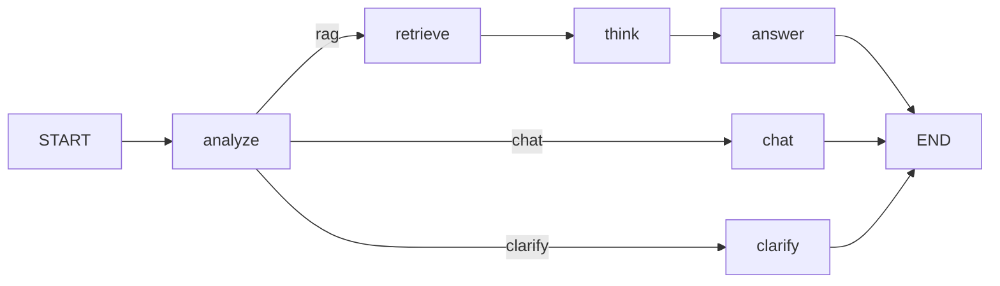

# Multi-Step RAG Chatbot (LangChain + LangGraph)

Production-style **sample project** for learning:

- **RAG** over `sample_docs/` (fictional Acme Cloud policies, FAQ, runbook)
- **Multi-step LangGraph** flow: analyze → retrieve → think → answer
- **Conditional routing** (skip retrieval for greetings)
- **Thread memory** via LangGraph checkpoints
- **FastAPI** + interactive **CLI**
- Heavy **inline comments** in `src/rag_chatbot/`

Works **without** an OpenAI key (local embeddings + mock LLM). Add `OPENAI_API_KEY` for full answers.

## Quick start

```bash
cd multi-step-rag-chatbot
python3 -m venv .venv
source .venv/bin/activate
pip install -e ".[dev]"
cp .env.example .env
# optional: add OPENAI_API_KEY to .env

rag-ingest          # index sample_docs → Chroma
rag-bot             # terminal chat (/debug, /ingest, /quit)
```

## HTTP API

```bash
uvicorn rag_chatbot.api.main:app --reload --app-dir src
curl -s http://127.0.0.1:8000/health
curl -s http://127.0.0.1:8000/chat -H 'Content-Type: application/json' \
  -d '{"message":"What is the refund policy under $200?","thread_id":"demo-1"}'
```

## Architecture



## Project layout

```text
multi-step-rag-chatbot/
  sample_docs/           # Your knowledge base (markdown)
  src/rag_chatbot/
    ingestion/           # chunk + Chroma index
    retrieval/           # similarity search
    graph/               # LangGraph nodes + state
    api/                 # FastAPI
    cli.py               # Interactive demo
  docs/LEARNING_GUIDE.md # Study path + experiments
  tests/
```

## Configuration

See `.env.example`. Important flags:

| Variable | Purpose |
|----------|---------|
| `OPENAI_API_KEY` | Enables real chat model |
| `EMBEDDING_PROVIDER` | `local` (default) or `openai` |
| `CHROMA_PERSIST_DIR` | On-disk vector index |
| `LOG_LEVEL` | `DEBUG` shows retrieval details |

## Tests

```bash
pytest
```

## Next steps for you

Read `docs/LEARNING_GUIDE.md`, then trace one question end-to-end with `LOG_LEVEL=DEBUG` and CLI `/debug` enabled.
