# Distributed Consensus — The Crux (Paxos, Raft, ZooKeeper)

> One-line mental model: **The log is the truth, the leader is the coordinator, and quorum intersection is the geometric backbone of safety.**

---

## 📖 Prerequisites — Terms You'll See Everywhere

If you're new to distributed systems, scan this once. Each term is explained in detail in the sections that follow, but it helps to have the one-liners handy.

### Core system vocabulary

| Term | What it means (plain English) |
|---|---|
| **Node / Replica** | One machine in the cluster (physical server, VM, container). "Replica" emphasizes it holds a copy of the data. |
| **Cluster** | The group of nodes working together. |
| **Leader / Primary** | The node currently in charge of accepting writes. |
| **Follower / Secondary / Replica** | A node that follows the leader and holds a copy. |
| **Quorum / Majority** | A minimum number of nodes required to agree (usually > half, e.g., 3 of 5). |
| **Log** | An ordered list of commands that the system has agreed to apply, in order. |
| **State Machine / FSM** | Your application's state (database, config, counter). Receives commands from the log and updates its state. |
| **RSM (Replicated State Machine)** | The pattern of: same log → same commands → same order → same state on every replica. |
| **Partition** | A network failure that splits the cluster into groups that can't talk to each other. |
| **Split-brain** | When two parts of a cluster both believe they're in charge — the worst-case failure mode. |

### Operations vocabulary

| Term | What it means |
|---|---|
| **Commit** | A write is "committed" when it's durable enough that it will survive future failures. |
| **ACK (acknowledgment)** | "I received/stored this" — but what level of durability it implies varies (see §20). |
| **Heartbeat** | A periodic "I'm alive" message from the leader to followers. |
| **Election** | The process of picking a new leader when the current one is unreachable. |
| **Term / Epoch** | A monotonically increasing number identifying "which leadership period are we in?" (See Raft §6.) |
| **Fencing** | Preventing an old leader from acting after it's been replaced. |
| **Replication Lag** | How far behind a follower is from the leader, measured in log entries or time. |

### Durability vocabulary

| Term | What it means |
|---|---|
| **WAL (Write-Ahead Log)** | A file where every change is appended before being applied — crash recovery reads from here. |
| **fsync** | A system call that forces the OS to write to the physical disk. Without it, "writes" might only be in RAM. |
| **Durable** | Will survive a crash or power outage (because it's been fsync'd to disk). |
| **MVCC (Multi-Version Concurrency Control)** | Keeping multiple versions of data so you can read a consistent snapshot while writes happen. |
| **Snapshot** | A point-in-time copy of the state machine, used for recovery and faster catch-up. |

### Consistency vocabulary

| Term | What it means |
|---|---|
| **Consistency** | All replicas agree about data. (Many flavors — see §9.1 and consistency models.) |
| **Linearizable** | The strongest everyday consistency: every operation appears to happen instantly, in real-time order. "It behaves like one server." |
| **Eventual consistency** | Replicas will converge *eventually*, but may be stale for a while. |
| **CAP theorem** | Under a network partition, you must choose between **C**onsistency and **A**vailability. Can't have both. |
| **CP system** | Chooses Consistency; refuses writes on the minority side of a partition. (Paxos/Raft/ZooKeeper live here.) |
| **AP system** | Chooses Availability; accepts writes on both sides and reconciles later. (Dynamo/Cassandra live here.) |
| **FLP impossibility** | A 1985 proof: in a fully async network, you can't guarantee both correctness and progress with even one crashed node. Protocols work around it by assuming the network eventually behaves. |

### Fault-model vocabulary

| Term | What it means |
|---|---|
| **CFT (Crash-Fault Tolerant)** | Tolerates nodes that crash or stall. Assumes if a node speaks, it tells the truth. (Paxos/Raft/ZAB are CFT.) |
| **BFT (Byzantine-Fault Tolerant)** | Tolerates nodes that lie / behave maliciously. More expensive. (PBFT, HotStuff, blockchains.) |
| **PBFT** | Practical Byzantine Fault Tolerance — a classic BFT consensus protocol (Castro & Liskov, 1999). Tolerates up to ⌊(N-1)/3⌋ malicious nodes. |
| **HotStuff** | A modern BFT consensus protocol used by Libra/Diem and some blockchains. Faster than PBFT under good conditions. |
| **Byzantine failure** | A node sends conflicting / dishonest messages. |
| **GC pause** | A long "stop the world" pause caused by garbage collection in languages like Java/Go — can look like a crash to other nodes. |
| **Clock skew** | Different nodes' clocks disagree about what time it is. Common and dangerous. |
| **Jepsen** | A testing framework (by Kyle Kingsbury) that injects partitions, clock skew, and other faults into databases to find consistency bugs. "Jepsen-tested" is a credibility badge. |

### Replication / sync vocabulary

| Term | What it means |
|---|---|
| **N / R / W** | Replication factor (N replicas per key), Read quorum (R), Write quorum (W). (Part B.) |
| **Dynamo** | Amazon's 2007 paper describing a leaderless, AP-style key-value store. The parent of Cassandra, Riak, DynamoDB-style systems. "Dynamo-style" = leaderless + consistent hashing + eventual consistency. |
| **Consistent hashing ring** | A way to map keys to nodes so that adding/removing nodes only shuffles a small slice of keys. Keys and nodes are placed on an imaginary ring; each key is owned by the next N nodes clockwise. |
| **Token range / vnode** | A slice of the consistent-hashing ring that one node owns. A node typically owns many small slices ("virtual nodes") rather than one big one — makes rebalancing smoother. |
| **Sloppy quorum** | Writing to fallback nodes when the "right" ones are down. (§16.) |
| **Hinted handoff** | A fallback node temporarily holds data for a down node, delivers later. (§17.) |
| **Anti-entropy** | Background process that compares and repairs replicas. (§18, Part D.) |
| **Read repair** | Fixing stale replicas as a side effect of client reads. |
| **Merkle tree** | A hash tree that lets two replicas find their differences cheaply. (Part D.) |
| **ReadIndex** | A Raft optimization for linearizable reads: leader confirms it's still leader (via a heartbeat round), then serves the read from its own state. (§9.1.) |
| **ABD register** | A leaderless protocol (Attiya-Bar-Noy-Dolev, 1995) for linearizable reads/writes via R+W>N plus a read-time "write-back" step. The academic parent of Dynamo's quorum model. |
| **EACH_QUORUM / LOCAL_QUORUM** | Cassandra consistency levels. `EACH_QUORUM` = majority in *every* datacenter (slow, strong). `LOCAL_QUORUM` = majority within *this* datacenter only (fast, eventual across DCs). (§22.) |
| **Vector clock** | A per-node counter that lets us tell if two writes happened concurrently or one caused the other. (§19.) |
| **LWW (Last-Write-Wins)** | Simplest conflict resolution: whichever update has the latest timestamp wins. Dangerous with clock skew. (§19.) |
| **HLC (Hybrid Logical Clock)** | A clock that combines physical time with a logical counter — safer than wall-clock LWW. (§19.) |
| **CRDT** | Conflict-free Replicated Data Type: a data structure designed so concurrent updates merge safely without coordination. (§19.) |
| **G-Counter** | Grow-only counter CRDT. Each node has a slot; total = sum. Can only go up. |
| **PN-Counter** | Positive-Negative counter CRDT. Two G-Counters (one for increments, one for decrements). Total = P − N. Good for likes, inventory. |
| **OR-Set** | Observed-Remove Set CRDT. Each add gets a unique tag; remove targets specific tags. Good for shopping carts. |
| **LWW-Register** | A single-value register that resolves conflicts by timestamp. Simplest CRDT. |
| **Siblings** | What a Dynamo-style store returns when it can't pick a winner: *all* concurrent versions of a value. The application has to merge them. |
| **Idempotency key / write_id** | A UUID attached to a write so replicas can deduplicate retries. Without it, a timeout-triggered retry can apply the write twice. |

### Storage engine vocabulary

| Term | What it means |
|---|---|
| **memtable** | An in-memory write buffer (usually a sorted tree) in LSM-tree databases. Writes land here first, then get flushed to disk. |
| **SSTable (Sorted String Table)** | An immutable sorted file on disk. LSM-tree databases store data as a stack of SSTables. |
| **LSM-tree (Log-Structured Merge Tree)** | A storage engine design that batches writes in memory (memtable), flushes to immutable SSTables, and merges them in the background. Used by Cassandra, RocksDB, HBase, LevelDB. |
| **MVCC** | Multi-Version Concurrency Control. Keeping multiple versions of data so you can read a consistent snapshot while writes happen. |
| **B-tree page** | A fixed-size unit (usually 4KB-16KB) of a B-tree index. The chunking used by MySQL/Postgres-style databases. |

### Gossip vocabulary

| Term | What it means |
|---|---|
| **Gossip protocol** | A technique where each node periodically exchanges info with a few random peers. Information spreads like a rumor. (Part C.) |
| **SWIM** | A gossip-based failure-detection protocol: Scalable Weakly-consistent Infection-style Membership. (§31.) |
| **Incarnation number** | A monotonic counter per node that increments on restart; prevents stale "node X is dead" rumors from overriding fresh "X is alive". (§32.) |
| **phi-accrual failure detector** | An *adaptive* failure detector: instead of a fixed timeout, it adjusts its suspicion threshold based on the observed response-time distribution. Handles jittery networks better. |
| **Ephemeral znode** | A ZooKeeper node that auto-deletes when the client session ends. The magic trick behind many coordination recipes. (§7.) |

### Consensus-protocol vocabulary (Paxos/Raft/ZAB specifics)

| Term | What it means |
|---|---|
| **ZAB** | ZooKeeper Atomic Broadcast — the consensus protocol ZooKeeper uses internally. Similar guarantees to Multi-Paxos / Raft. (§7.) |
| **Multi-Paxos** | Paxos extended to decide a *log* of values instead of just one. A stable "distinguished proposer" (leader) does Phase 1 once, then just Phase 2 per log entry. (§5.) |
| **Ballot number / proposal number** | Paxos's version of Raft's term — a monotonic counter that uniquely identifies a proposer's attempt. Higher ballot wins. |
| **Joint consensus** | Raft's safe way to change the cluster membership: a transitional state where decisions need majorities in *both* the old and new configurations simultaneously. Prevents split-brain during membership change. (§6.) |
| **Pre-vote** | A Raft optimization: before incrementing the term and starting a real election, a candidate asks "would you vote for me?" If no, it doesn't disturb the term. Prevents term churn when a node is briefly disconnected. |
| **Log compaction** | Deleting old log entries after their effects are captured in a snapshot. Keeps the log from growing forever. (§9.2.) |
| **Lease** | A time-bounded "I am the leader until T" claim. Lets the leader serve reads from local state without a heartbeat round-trip. Requires bounded clock drift. |
| **Fencing token** | A monotonically increasing number issued at leadership acquisition. Downstream systems reject writes with a lower fencing token than one they've already seen → prevents an old leader from acting after being replaced. |

### Cryptographic / integrity vocabulary

| Term | What it means |
|---|---|
| **SHA-256** | A 256-bit cryptographic hash function. Used for integrity checks and Merkle trees. Collision-resistant. |
| **BLAKE3** | A newer, much faster cryptographic hash. Same safety properties as SHA-256 but ~10× faster. |
| **HMAC** | Keyed-Hash Message Authentication Code. A hash where only someone with the secret key can produce a valid result. Prevents adversaries from forging matching data. |
| **UUID** | Universally Unique Identifier. 128 random bits; collision probability is astronomically low. The standard way to generate unique IDs without coordination. |

### Infrastructure vocabulary

| Term | What it means |
|---|---|
| **AZ (Availability Zone)** | A failure-isolated section of a cloud region (separate power, network). |
| **ToR (Top of Rack)** | The switch at the top of a server rack — a common failure boundary. |
| **WAN** | Wide Area Network — the links between datacenters. Latency ~10-200ms. |
| **RTT (Round-Trip Time)** | Time for a message to go there and back. The fundamental latency unit in distributed systems. |
| **mTLS** | Mutual TLS — both client and server authenticate each other with certificates. |
| **STONITH** | "Shoot The Other Node In The Head" — forcibly power-off a stuck/isolated node to prevent split-brain. |
| **Backpressure** | A system intentionally slowing down accepting new work when it's falling behind — so queues don't grow unbounded. |
| **Jitter** | Random delay added to timers (retries, elections) to prevent synchronized storms. Without jitter, N clients retrying at the same moment hammer the server simultaneously. |
| **Idempotent** | An operation you can safely retry — doing it twice has the same effect as doing it once. |

> 💡 **If you don't know a term in a section, come back here.** Each term has a dedicated section later for the full story.

---

## 📑 Table of Contents

### Part A — Distributed Consensus (Paxos, Raft, ZooKeeper)
- §1. [What Consensus Actually Is](#1-what-consensus-actually-is) — Replicated State Machines, the three ingredients
- §2. [The Contract: Safety > Liveness](#2-the-contract-safety--liveness) — CAP, FLP, why unavailability is a feature
- §3. [Quorums — The Geometric Backbone](#3-quorums--the-geometric-backbone) — majority intersection, the pigeonhole proof
- §4. [Failure Model (CFT, not Byzantine)](#4-failure-model-cft-not-byzantine) — what consensus does and doesn't tolerate
- §5. [Paxos — The Minimal Core](#5-paxos--the-minimal-core) — the 5-roommates pizza story, Phase 1 / Phase 2
- §6. [Raft — Consensus Designed for Humans](#6-raft--consensus-designed-for-humans) — terms, log matching, joint consensus
- §7. [ZooKeeper — Consensus as a Service](#7-zookeeper--consensus-as-a-service) — znodes, watches, ephemeral + sequential tricks
- §8. [Side-by-Side](#8-side-by-side) — Paxos vs Raft vs ZooKeeper
- §9. [The Hard Parts Engineers Trip Over](#9-the-hard-parts-engineers-trip-over) — linearizable reads, snapshots, timeouts, determinism
- §10. [The One Picture That Explains Partitions](#10-the-one-picture-that-explains-partitions)
- §11. [Production Gotchas Checklist](#11-production-gotchas-checklist)
- §12. [Decision Flowchart — Do I Need Consensus?](#12-decision-flowchart--do-i-need-consensus)
- §13. [Three Insights to Carry Forever](#13-three-insights-to-carry-forever)

### Part B — Quorum & Sloppy Quorum (Dynamo-style)
- §14. [The R + W > N Rule](#14-the-r--w--n-rule-and-the-lies-it-tells) — set intersection, and what it doesn't give you
- §15. [The Full Leaderless Request Path](#15-the-full-leaderless-request-path) — coordinator, fan-out, repair
- §16. [Sloppy Quorum — Availability Over Membership](#16-sloppy-quorum--availability-over-membership) — the fallback trick
- §17. [Hinted Handoff — The Delivery Receipt](#17-hinted-handoff--the-delivery-receipt)
- §18. [Anti-Entropy with Merkle Trees](#18-anti-entropy-with-merkle-trees) — the backstop sweep (preview of Part D)
- §19. [Versioning — The Other Half of Correctness](#19-versioning--the-other-half-of-correctness) — **LWW, HLC, vector clocks, CRDTs explained in full**
- §20. [What "W Acks" Actually Means](#20-what-w-acks-actually-means) — the durability ladder, memtable, SSTable
- §21. [Classic vs Sloppy — Side by Side](#21-classic-vs-sloppy--side-by-side)
- §22. [Scope Matters: Local vs Global Quorum](#22-scope-matters-local-vs-global-quorum) — EACH_QUORUM vs LOCAL_QUORUM
- §23. [Failure Scenarios](#23-failure-scenarios--what-quorum-does-and-does-not-protect)
- §24. [Design Checklist](#24-design-checklist--saying-we-use-quorum-isnt-enough)
- §25. [Decision Flow — Classic, Sloppy, or Consensus?](#25-decision-flow--classic-sloppy-or-consensus)
- §26. [Worked Example — N=5 Loyalty Points Store](#26-worked-example--n5-loyalty-points-store)
- §27. [Two Insights to Pair With the Consensus Ones](#27-two-insights-to-pair-with-the-consensus-ones)

### Part C — Gossip Protocols
- §28. [Why Gossip Exists — The Scaling Property](#28-why-gossip-exists--the-scaling-property)
- §29. [Three Modes — Push, Pull, Push-Pull](#29-three-modes--push-pull-push-pull)
- §30. [What Gets Gossiped — State vs Delta vs Digest](#30-what-gets-gossiped--state-vs-delta-vs-digest)
- §31. [SWIM — The Canonical Failure Detector](#31-swim--the-canonical-failure-detector)
- §32. [The Versioning Problem — Resurrection & Flapping](#32-the-versioning-problem--resurrection--flapping) — incarnation numbers
- §33. [Rumor Mongering vs Anti-Entropy — You Need Both](#33-rumor-mongering-vs-anti-entropy--you-need-both)
- §34. [Partitions — The Thing Gossip Does Not Solve](#34-partitions--the-thing-gossip-does-not-solve)
- §35. [Mental Model — Gossip Is Reconciliation, Not Delivery](#35-mental-model--gossip-is-reconciliation-not-delivery)
- §36. [Convergence Math (Just Enough)](#36-convergence-math-just-enough)
- §37. [Tuning Knobs — Failure Detection Is a Control System](#37-tuning-knobs--failure-detection-is-a-control-system)
- §38. [The Digest / Delta Exchange](#38-the-digest--delta-exchange--minimal-correct-loop)
- §39. [Hybrid Designs — Gossip + Something Stronger](#39-hybrid-designs--gossip--something-stronger)
- §40. [Security Model](#40-security-model)
- §41. [Observability](#41-observability--what-to-actually-monitor)
- §42. [Common Misconceptions](#42-common-misconceptions)
- §43. [Decision Flow — Do I Need Gossip?](#43-decision-flow--do-i-need-gossip)
- §44. [Worked Design — 3-Region, 2k-Per-Region Membership](#44-worked-design--3-region-2k-per-region-membership)
- §45. [Gossip Protocol Checklist](#45-gossip-protocol-checklist)
- §46. [Three Insights to Pair With the Previous Five](#46-three-insights-to-pair-with-the-previous-five)

### Part D — Merkle Trees for Data Synchronization
- §47. [Why Merkle Trees Exist — The 10-Million-Key Problem](#47-why-merkle-trees-exist--the-10-million-key-problem)
- §48. [What They Are NOT — The Big Misconception](#48-what-they-are-not--the-big-misconception)
- §49. [The Tree Structure — "A Tree of Receipts"](#49-the-tree-structure--a-tree-of-receipts)
- §50. [Determinism — The Thing That Breaks First](#50-determinism--the-thing-that-breaks-first)
- §51. [Tree Shape — Arity and Leaf Granularity](#51-tree-shape--arity-and-leaf-granularity)
- §52. [The Anti-Entropy Protocol — Guided Search](#52-the-anti-entropy-protocol--guided-search)
- §53. [The Moving Target Problem — Snapshots & Versioning](#53-the-moving-target-problem--snapshots--versioning)
- §54. [Failure Modes — Version Mismatch is the Dangerous One](#54-failure-modes--version-mismatch-is-the-dangerous-one)
- §55. [Token Ranges — The Dynamo Pattern](#55-token-ranges--the-dynamo-pattern)
- §56. [Leaf Exchange — Versions, Not Values](#56-leaf-exchange--versions-not-values)
- §57. [Worked Example — Finding 3 Bad Grains in 1 Million](#57-worked-example--finding-3-bad-grains-in-1-million)
- §58. [When Merkle Fails — Massive Divergence](#58-when-merkle-fails--massive-divergence)
- §59. [Incremental Maintenance & Tombstones](#59-incremental-maintenance--tombstones)
- §60. [Merkle + Quorum + Read Repair — Who Does What](#60-merkle--quorum--read-repair--who-does-what)
- §61. [Security, Multi-Tenancy, and Operational Gotchas](#61-security-multi-tenancy-and-operational-gotchas)
- §62. [Design Checklist & Synthesis](#62-design-checklist--synthesis)
- §63. [Four Insights to Pair With the Previous Eight](#63-four-insights-to-pair-with-the-previous-eight)

### Reading tips
- **Linear path for juniors:** read Parts A → B → C → D in order. Each part has preview sections that forward-link to the deep ones.
- **Quick reference:** every term in the Glossary above has a `(§X)` pointer to its full-story section.
- **Already know consensus?** Skip to §14 for leaderless replication, §28 for gossip, §47 for Merkle trees.

---

## 1. What Consensus Actually Is

### The problem it solves

You're running a payment service on 5 machines (because one machine would be a single point of failure). But now you have a new problem: **which machine is the source of truth about a user's balance?**
- If a transfer debits Alice on machine 1 but another transfer reads Alice from machine 2, you might double-spend.
- If two machines each think they're in charge during a brief network blip, each might approve conflicting withdrawals.

You want 5 machines that behave like **one single reliable machine**. That's the whole point of consensus.

### What exactly needs to be "agreed on"?

Not "who is alive," not "which node is fastest." The thing that needs agreement is **the order of commands** — specifically, an ordered log:

```
index 1: debit Alice $10
index 2: credit Bob $10
index 3: debit Alice $5
...
```

If every replica agrees on this log and applies the commands in the same order, they'll end up in the same state. Nothing else needs to be synchronized.

### The architecture: Replicated State Machine (RSM)

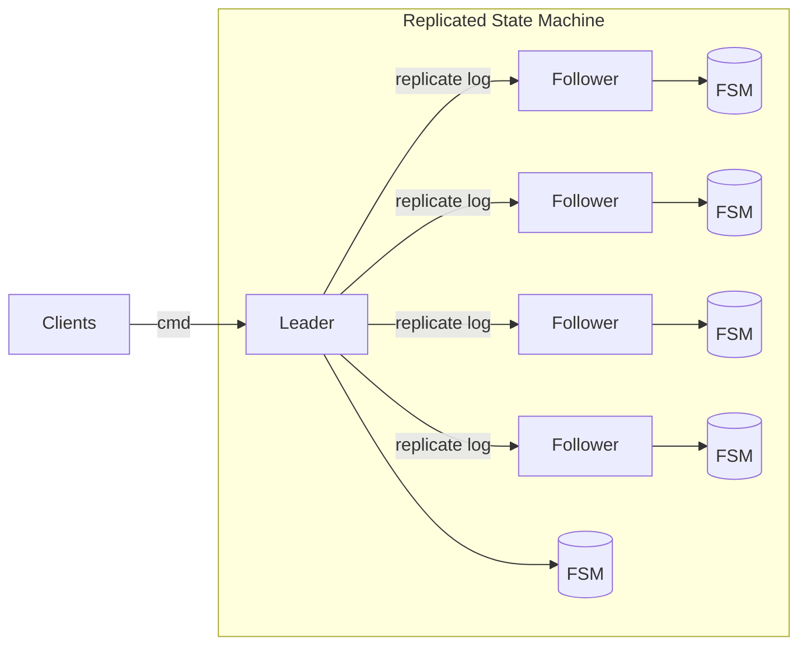

A client sends a command. Consensus puts it at some position in the log. Every replica reads the log in order and feeds commands to its local state machine (FSM). All FSMs produce identical state.

### What RSM correctness actually requires

Three things must be true. **Consensus only gives you the first two:**

1. ✅ **Same commands** — consensus guarantees it
2. ✅ **Same order** — consensus guarantees it ← *this is the hard part consensus solves*
3. ❌ **Deterministic application** — **your job, not consensus's**

### Why the third one matters — a real production bug

**Scenario:** You run a payments company. Three Raft replicas back your invoice service. A client calls `POST /invoice` for customer #42.

Your invoice handler looks like this:

```python
def handle_create_invoice(customer_id):
    invoice = {
        "id": uuid.uuid4(),           # fresh random UUID
        "customer_id": customer_id,
        "created_at": time.time(),    # wall-clock timestamp
        "amount": 100,
    }
    db.insert(invoice)
    return invoice["id"]
```

Raft does its job perfectly:
- All 3 replicas receive the exact same command: `CREATE_INVOICE(customer_id=42)`.
- All 3 apply it at the same log index.

But the handler calls `uuid.uuid4()` and `time.time()` on **each replica separately**:

| Replica | Generated UUID | Timestamp |
|---|---|---|
| Leader | `b7e3-...-111` | `1697299200.001` |
| Follower 1 | `3f2a-...-222` | `1697299200.023` |
| Follower 2 | `8c1d-...-333` | `1697299200.045` |

**Three replicas, three different invoice records for the same command.** Now:
- A GET from the leader returns `id=b7e3-...`
- A failover happens → Follower 1 becomes leader → the "same" invoice reads as `id=3f2a-...`
- Billing team joins invoices with payments by UUID. Half the payments orphan. Reconciliation fails at 3am.

**Your consensus layer was flawless. Your business is broken.** The log was perfectly replicated, but the handler was non-deterministic, so each replica built a different reality on top of the same log.

### The fix — leader generates, replicates the result

The nondeterministic values must be **generated once by the leader**, then **replicated as part of the command**.

**First, understand the request flow in Raft** — this is the part people miss:

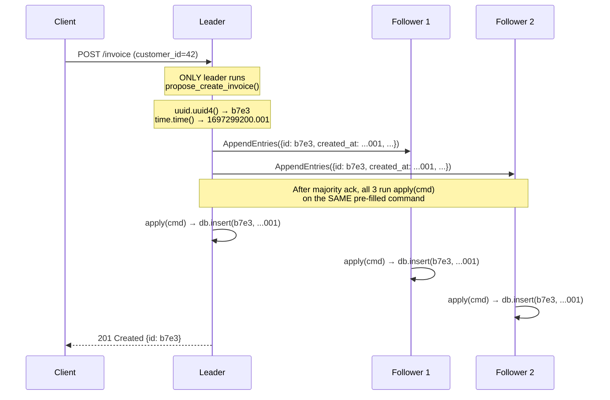

**The key: followers never run `propose_create_invoice`. They only receive the already-filled-in command via Raft's internal replication, and then run `apply(cmd)`.**

```python
# ── CLIENT-FACING API (runs on whichever node the client connected to) ──
@app.route("/invoice", methods=["POST"])
def create_invoice_endpoint():
    if not raft.is_leader():
        # Not the leader → tell client who is, don't do anything else.
        return redirect(raft.current_leader_url), 307
    # ✓ We ARE the leader. Only now do we generate UUID and timestamp.
    return propose_create_invoice(request.json["customer_id"])


# ── LEADER-ONLY: builds the command and replicates it ──
def propose_create_invoice(customer_id):
    # These two lines ONLY execute on the leader, because the function is
    # only called from the HTTP handler above after the is_leader() check.
    cmd = {
        "op": "CREATE_INVOICE",
        "id": uuid.uuid4(),           # ← generated ONCE here, by whoever is leader
        "customer_id": customer_id,
        "created_at": time.time(),    # ← stamped ONCE here
        "amount": 100,
    }
    # raft.append() is where replication happens. Internally:
    #   1. Leader writes cmd to its own log
    #   2. Leader sends AppendEntries RPC to all followers
    #   3. Followers write cmd (the EXACT bytes the leader sent) to their logs
    #   4. Once a majority has ack'd, leader marks it committed
    raft.append(cmd)
    return {"id": cmd["id"]}


# ── RUNS ON EVERY REPLICA (leader + followers), when Raft tells them
#     "command at log index N is now committed, go apply it" ──
def apply(cmd):
    # cmd is the SAME dict on every replica — leader built it once,
    # Raft replicated the bytes. No uuid.uuid4() or time.time() here.
    db.insert(cmd)                     # purely deterministic now
```

**Two things make this work:**

1. **The `is_leader()` gate.** Followers that receive the HTTP request bounce it to the leader instead of calling `propose_create_invoice` themselves. So only one node ever runs the UUID generation.
2. **The split between `propose_*` and `apply`.** The nondeterministic stuff (UUID, time) lives in `propose_*` — leader-only. The deterministic stuff (`db.insert`) lives in `apply` — every replica. The log entry is the data-only snapshot that bridges them.

Now every replica sees `id=b7e3-...` and `created_at=1697299200.001` **as data in the log**, not as a function call. All three FSMs converge.

> **The mental model to lock in:** the Raft log carries **fully-resolved commands**, not instructions to compute something. Think "here is the invoice I already created, please remember it" — not "please create an invoice."

### Real-world instances of this bug

| Operation | What silently diverges | Industry example |
|---|---|---|
| `time.now()` in handler | Timestamps on orders/invoices/events | Stripe/Square-style payment ledgers; audit logs that must match across replicas |
| `random()` / UUIDs | Primary keys, idempotency tokens, trace IDs | Any system where the generated ID is returned to the client and later used as a foreign key |
| Hash-map iteration order (Go, Python) | Order of applied operations when a batch is a dict | Config service applying a batch of flag updates where some flags depend on others |
| Floating-point ops across CPUs | Last-decimal differences compound | Ad-tech bid pricing, risk calculations in trading |
| External HTTP calls inside the FSM | Response varies per replica — or worse, side-effect fires N times | Any FSM that "enriches" state from an external API — one replica gets the API response, others get 503s |
| `os.getenv()` or local file reads | Config read differs on replicas with different deploy state | Multi-tenant platforms where tenant config lives per-node |

### Why consensus **cannot** save you from this

Consensus's contract is: *"Every replica will see the same sequence of commands."* That's **input**. The output of a handler on that input is your responsibility.

If the handler itself consults a non-replicated source of randomness (clock, RNG, filesystem, network, env vars, map iteration order), you've broken the pure-function contract that RSM depends on. **No consensus protocol in existence can fix this** — it's architecturally outside their scope.

### The rule to internalize

> **The FSM must be a pure function of (snapshot, applied log).** If you can't take two fresh replicas, feed them the same log, and get bit-identical state — you have a determinism bug that will eventually fire in production.

### Key takeaway

Consensus is **not** replication. Replication = "copy data." Consensus = **"copy data in the same order even when nodes fail."** That ordering is what prevents split-brain.

---

## 2. The Contract: Safety > Liveness

### Two very different kinds of "wrong"

A consensus system can fail in two ways:

1. **It decides something wrong.** E.g., commits conflicting values at the same log index. Users see impossible outcomes (two "winners" of the same auction, same seat sold twice, money appears/disappears). You can't recover from this; the damage is already in the data.

2. **It can't decide right now.** The cluster is stuck. Writes time out. Users get errors. Painful, but when it unsticks (partition heals, nodes come back), the system is still correct.

**These are not equivalent.** The industry gives them names:

| Property | Meaning | What breaks if violated |
|---|---|---|
| **Safety** | "Nothing bad ever happens" — never two conflicting decisions | Data corruption, split-brain, financial loss |
| **Liveness** | "Something good eventually happens" — progress is made | Downtime, user-facing errors |

### The non-negotiable choice

> Consensus systems **always** sacrifice liveness before safety.

If the network is partitioned and we can't talk to a majority, we **stop** rather than guess. "Can't commit right now" is recoverable. "I committed the wrong value" is not.

### Why you can't have both — FLP impossibility (in plain English)

In 1985, three researchers (Fischer, Lynch, Paterson) proved something uncomfortable: **if the network is truly asynchronous — meaning messages can be delayed by any amount — then no protocol can guarantee that a distributed system both stays correct AND always makes progress, if even one node crashes.**

**Why does this matter in practice?** Imagine a node stops replying. You can't tell *why*:
- Did it crash? (should fail over)
- Is it just slow? (should wait)
- Is the network dropping packets? (should retry)

In a truly async network, these are **indistinguishable**. If you guess wrong (declare a slow node dead and elect a new leader), you can create split-brain. If you wait forever, your system hangs.

**How real protocols get around FLP:** Paxos / Raft / ZAB assume **"eventual synchrony"** — the network might be slow for a while, but eventually (after a partition heals, after a GC pause ends) messages do start getting through within reasonable time. Under *that* assumption, progress eventually resumes. Safety is preserved even during the "bad" periods.

> **TL;DR:** FLP says perfect correctness + perfect progress is impossible in a truly async world. Real systems get "correctness always + progress most of the time."

### The CAP connection — the famous three-letter theorem

**CAP theorem**, in one line: *during a network partition, you must choose between **Consistency** and **Availability**.*

Imagine your 5-node cluster splits into a group of 2 and a group of 3 (network cut between them). A write comes in on the 2-node side. You have two choices:

- **Choose Consistency (CP):** refuse the write. The 2-node side can't reach a majority, so it can't be sure of correctness. Users on that side see errors until the partition heals. ← **Paxos, Raft, ZooKeeper, etcd live here.**
- **Choose Availability (AP):** accept the write on both sides. Reconcile the two divergent histories later (hopefully). Users never see errors, but data can conflict. ← **Dynamo, Cassandra, Riak live here (see Part B).**

> **"Partition tolerance" is not optional** — networks will partition whether you plan for it or not. So in practice, CAP is really: *when a partition happens, do you prefer errors (CP) or divergence (AP)?*

### Key takeaway

> If someone says "our consensus system never goes unavailable," they're either confused or lying. Being unavailable under partition is **how** it stays correct.

---

## 3. Quorums — The Geometric Backbone

### The problem we need to rule out

You have 5 nodes. A client sends `set X=1` to some of them. Through retries, timeouts, or two clients racing, another request `set X=2` reaches some of them too. Later, the cluster must agree on **one** committed value for X.

**The catastrophe:** two different nodes think two different values were committed.
- Node A says "X=1 is final"
- Node B says "X=2 is final"

That's split-brain. We need a rule that makes it **mathematically impossible**, not just unlikely.

### The rule — majority quorum

> **Only commit a value if a majority of nodes (⌊N/2⌋ + 1) have accepted it.**

For N=5 → need 3. For N=3 → need 2. For N=7 → need 4.

### Why this works — the pigeonhole trick

**Any two majorities must share at least one node.**

Proof by counting: suppose two different values were both committed in a cluster of 5.
- Value V1 was accepted by a set S1 of ≥ 3 nodes.
- Value V2 was accepted by a set S2 of ≥ 3 nodes.
- If S1 and S2 had **no overlap**, together they'd contain ≥ 6 distinct nodes.
- But we only have 5 nodes. **Impossible.**

So S1 ∩ S2 contains at least one node — call it **W, the witness**. W would have had to accept **both V1 and V2**. The protocol forbids a node from accepting two conflicting values. Contradiction.

**∴ At most one value can ever be committed. Split-brain is ruled out by arithmetic, not by luck.**

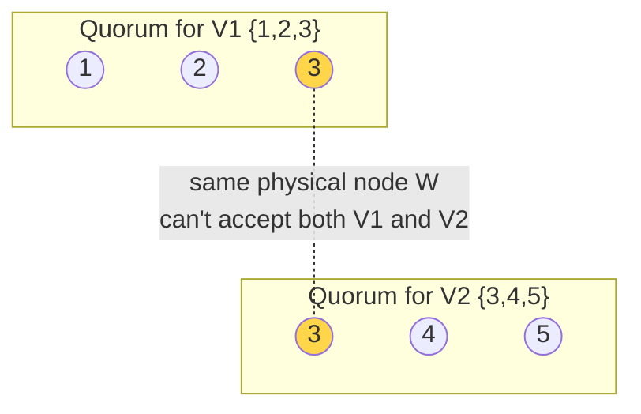

The yellow node is the witness. **That one shared node is the entire reason consensus is safe.**

### Numbers to internalize

| N | Quorum needed | Failures tolerated |
|---|---|---|
| 3 | 2 | 1 |
| 5 | 3 | 2 |
| 7 | 4 | 3 |

Formula: with majority quorum you tolerate `⌊(N−1)/2⌋` failures.

### Why odd N

With N=6, quorum is still 4 (majority of 6). You pay for an extra server but still tolerate only 2 failures — identical to N=5. **Odd N gives the same fault tolerance for one fewer machine's worth of hardware and one fewer ack per write.**

### Key takeaway

Everything in Part A (Paxos accept rule, Raft commit rule, ZAB broadcast) is just **different wrappers around this same overlap property**. If you can see the witness, you can see why the protocol is safe.

---

## 4. Failure Model (CFT, not Byzantine)

### Why this matters before any protocol

Every consensus protocol is only "correct" against a specific list of what can go wrong. If reality produces a failure outside that list, the protocol has no obligation to behave sanely. So before you choose Paxos vs Raft vs anything else, **you have to know what failures they're built to survive.**

### The failure menu

Imagine the ways a node or network could misbehave. Here's the full menu, from mildest to most adversarial:

| Failure mode | Example | Covered by Paxos/Raft/ZAB? |
|---|---|---|
| Node crashes | Process killed, OOM, kernel panic | ✅ Yes |
| Node stalls | 10-second GC pause, swapping | ✅ Yes (looks like crash) |
| Node restarts | Reboot, container restart | ✅ Yes (if stable storage preserved) |
| Message dropped | Packet loss | ✅ Yes |
| Message reordered | UDP, out-of-order TCP retransmit | ✅ Yes |
| Message duplicated | Retries, middlebox weirdness | ✅ Yes |
| Message delayed arbitrarily | Overloaded network, cross-region hop | ✅ Yes (safety); liveness needs eventual synchrony |
| Network partition | AZ unreachable, cross-region link down | ✅ Yes (minority side blocks) |
| Node **lies** / sends conflicting messages intentionally | Compromised node | ❌ Needs a Byzantine-tolerant protocol like **PBFT** (Practical Byzantine Fault Tolerance) or **HotStuff** — used in blockchains |
| Silent disk corruption | Bit flip returns stale data unnoticed | ❌ Needs checksums above |
| Clock jumps | NTP steps the clock backwards | ❌ Safe for correctness; can break lease-based optimizations |

> **CFT (Crash-Fault Tolerant):** nodes can fail by crashing or going silent — but if they speak, they tell the truth. This is Paxos/Raft/ZAB.
>
> **BFT (Byzantine-Fault Tolerant):** nodes can lie. This is PBFT, HotStuff — used in blockchains and some military systems. Costs ~2–3× the messages for the same safety.

### Why the distinction matters in practice

- Your 5-node Raft cluster in one datacenter → CFT is enough. Nodes don't lie.
- Blockchain validator network across untrusting companies → you need BFT because a validator might cheat for profit.
- Satellite constellation, nuclear command → BFT because a radiation bit-flip or hostile actor could cause one unit to send contradictory messages.

### The stable storage requirement (easily missed)

A node might crash and restart. When it comes back, it must remember enough to not accidentally violate safety. **These items must be fsync'd to disk before acknowledging anything that depends on them:**

| Protocol | What must be durable |
|---|---|
| Paxos | Highest promised ballot, last accepted `(ballot, value)` |
| Raft | `currentTerm`, `votedFor`, log entries |
| ZAB | `currentEpoch`, `acceptedEpoch`, log entries |

**Why?** Suppose Raft didn't persist `votedFor`. A node votes for candidate A in term 5, then crashes before the ACK is seen. It restarts and votes for candidate B in term 5 — now there are **two leaders in the same term**. Safety violated.

### Key takeaway

> Consensus protocols are a **contract**: "If you give me a failure from this list, I'll stay safe. Anything else, you're on your own." Know your list.

---

## 5. Paxos — The Minimal Core

### The problem Paxos solves (and ONLY this problem)

> **Given a cluster of N nodes, how do we agree on exactly ONE value for ONE slot — even with crashes, delays, and competing proposals?**

Yes, really — just **one value**, not a log. Paxos (classic / single-decree) solves consensus for a single decision. Chaining it into a log is a layer on top called **Multi-Paxos**. Keeping these separate is the key to not getting confused by Paxos.

### The three roles (one node often plays multiple)

| Role | What it does | Analogy |
|---|---|---|
| **Proposer** | Suggests a value, tagged with a monotonic ballot number | A committee member tabling a motion |
| **Acceptor** | Votes on proposals; enforces the safety rules; **persists state** | The voters |
| **Learner** | Finds out which value won | Audience / observers |

**Safety lives entirely in the acceptors.** Proposers can be buggy, slow, duplicated — as long as acceptors follow the rules, safety holds.

### Why do we need TWO phases? (The scenario that forces it)

**Naïve one-phase attempt:** "Proposer sends `Accept(value)` to all acceptors. If a majority accepts, done."

This breaks instantly:
1. Proposer P1 sends `Accept(V1)` to acceptors A1, A2.
2. Proposer P2 (didn't know about P1) sends `Accept(V2)` to A4, A5.
3. A3 crashes before anyone talks to it.
4. **No majority agrees on anything.** But worse: if A3 comes back and gets `Accept(V2)`, suddenly V2 has a majority — but A1, A2 still think V1 was accepted. **Two values both think they're chosen.**

We need a way for a proposer to **first find out if there's already a value in flight** before committing to its own. That's Phase 1.

### Ballot numbers = ordering for proposals (not for time)

**The problem ballots solve.** Two proposers (Priya and Quinn) both decide to organize dinner at the same moment. We need to agree: whose attempt is "newer" so everyone follows that one? The obvious answer — *"use the wall-clock timestamp on their phone"* — turns out to be unsafe.

#### Why wall-clock time fails

Imagine their phones' clocks:

| Proposer | Phone's clock reading | True wall-clock time |
|---|---|---|
| Priya | 7:00:03 PM | 7:00:00 PM (her phone is 3s fast) |
| Quinn | 7:00:01 PM | 7:00:04 PM (his phone is 3s slow) |

**Who actually proposed later?** Quinn — he physically opened the group chat 4 seconds after Priya. But if we order by phone timestamp, **Priya wins** (7:00:03 > 7:00:01). The system silently picks the "wrong" winner, which can cascade into violating Paxos's safety guarantee.

And this isn't exotic — real clock skew between servers routinely reaches **tens of milliseconds, sometimes seconds**:
- NTP drift between syncs
- VM freezes / live migration
- Container clock virtualization
- A sysadmin running `date -s` to fix a clock they thought was wrong

**Rule:** never trust wall-clock time to order events that must be deterministically ordered across machines.

#### The ballot structure

A ballot number is a pair: `(counter, nodeId)`.

```python
# Every acceptor and proposer keeps track of the highest ballot it's seen.
# A ballot is compared lexicographically: counter first, nodeId as tiebreak.

Ballot = tuple[int, str]   # (counter, nodeId)

def ballot_greater(a: Ballot, b: Ballot) -> bool:
    """Returns True iff ballot a > ballot b."""
    return a > b   # Python tuples compare left-to-right. counter wins; nodeId breaks ties.

# Examples:
assert ballot_greater((5, "priya"), (4, "zebra"))   # counter 5 > counter 4, nodeId irrelevant
assert ballot_greater((7, "quinn"), (7, "priya"))   # same counter → "quinn" > "priya" alphabetically
assert not ballot_greater((7, "priya"), (7, "priya"))  # equal, not greater
```

**Why the tuple?** Because without the tiebreak, two proposers could independently generate the same counter and both think they're "the" ballot `n`. The nodeId guarantees **uniqueness and total order** — no two ballots ever tie.

#### How a proposer picks a new ballot

The crucial rule: a new ballot must be **strictly greater than every ballot the proposer has ever seen** — including ones from other proposers.

```python
class Proposer:
    def __init__(self, node_id: str):
        self.node_id = node_id
        # Persisted to disk so crashes don't reset it. (Stable storage requirement.)
        self.highest_seen_counter = 0

    def new_ballot(self) -> Ballot:
        # Bump the counter past anything we've seen locally,
        # then tag with our nodeId for global uniqueness.
        self.highest_seen_counter += 1
        return (self.highest_seen_counter, self.node_id)

    def observe_ballot(self, b: Ballot):
        """Called whenever we see a ballot from any peer — Promise, Accept, rejection."""
        # Learn from peers: if someone's using a higher counter, catch up.
        self.highest_seen_counter = max(self.highest_seen_counter, b[0])
```

**Walkthrough of why this works** — exactly the Priya/Quinn scenario:

```python
priya = Proposer("priya")
quinn = Proposer("quinn")

# ── Round 1: Priya goes first ──
b1 = priya.new_ballot()     # (1, "priya")
# Priya sends Prepare(b1) to acceptors.
# One acceptor replies with the ballot it last promised: (1, "priya")

# ── Quinn walks in, tries to propose ──
# When Quinn sends Prepare, each acceptor replies with their highestPromised.
# Quinn learns about (1, "priya") in those replies.
quinn.observe_ballot((1, "priya"))   # Quinn's internal counter is now 1
b2 = quinn.new_ballot()               # (2, "quinn")  ← guaranteed > (1, "priya")

# ── Even if their phones' clocks were totally inverted, the ordering is correct ──
# Priya's wall-clock said 7:00:03, Quinn's said 7:00:01, but Quinn's ballot (2, "quinn")
# is DEFINITIVELY greater than Priya's (1, "priya"). No ambiguity, no clock drift matters.
assert ballot_greater(b2, b1)
```

Notice three important properties:
1. **No timestamps anywhere.** The counter advances by observation, not by a clock.
2. **No coordinator issuing ballots.** Each proposer picks its own, trusting the "learn from peers" step to stay above the previous high.
3. **Monotonic even across crashes** — because `highest_seen_counter` is **persisted to disk** before any Promise/Accept message is sent. (This is one of Paxos's stable-storage requirements.)

#### Wall-clock time vs ballot number — side by side

| Property | Wall-clock timestamp | Ballot number `(counter, nodeId)` |
|---|---|---|
| Monotonic across a single machine | ❌ `date -s`, NTP step can go backwards | ✅ Persisted + always incremented |
| Monotonic across different machines | ❌ Clock skew can be seconds | ✅ Learn-from-peers keeps everyone ahead |
| Unique (no ties possible) | ❌ Two servers can produce the same microsecond | ✅ `nodeId` tiebreak guarantees uniqueness |
| Interpretable as "real time" | ✅ Yes — but that's useless to Paxos | ❌ Carries no time meaning — and that's a *feature* |
| Safe for ordering consensus proposals | ❌ **No** — correctness bomb | ✅ **Yes** — the only safe choice |

#### The one-sentence takeaway

> **Ballot numbers are a logical clock for Paxos proposals.** They don't tell you *when* something happened — they tell you *which attempt supersedes which*, with no clocks, no coordinator, and no ambiguity.

### The two-phase handshake

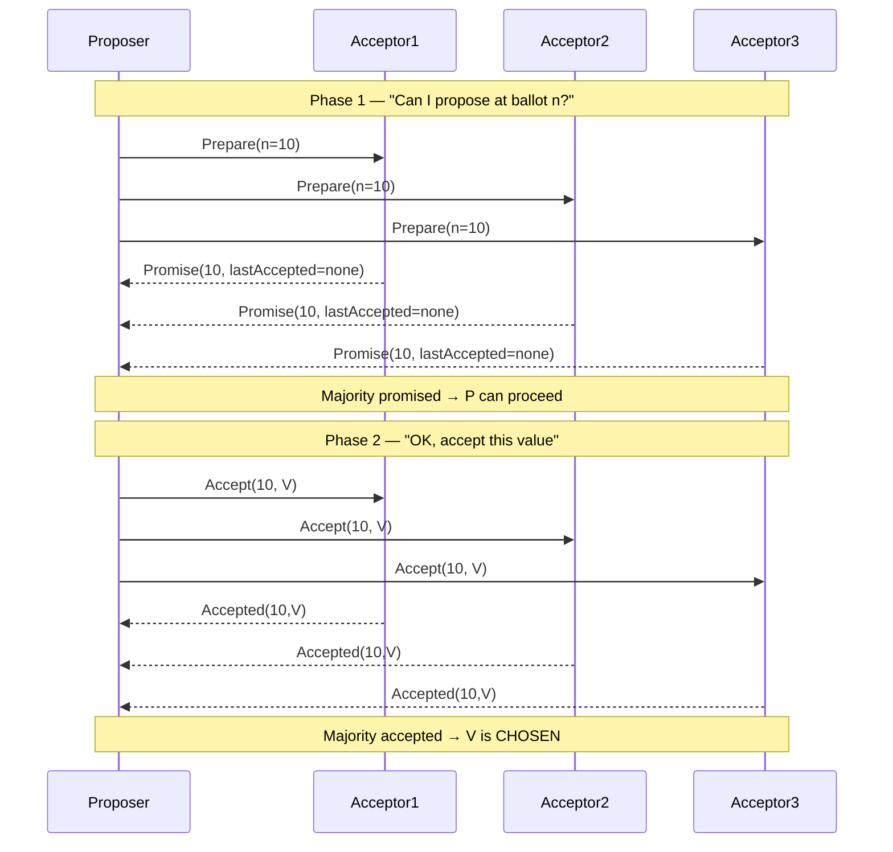

**What each phase actually does — in plain English:**

Picture 5 roommates in a flaky WhatsApp group chat trying to agree on **one** dinner order. Any roommate can try to be "the organizer." Multiple people might try at once — phones die, messages drop, someone's in the shower. Our job: no matter who organizes, no matter who crashes mid-way, **everyone must eat the same meal**. (The full worked example with named characters comes right after this.)

Every attempt to organize is tagged with a **round number** that only ever goes up: round 1, round 2, round 3… The number is the *only* way to tell whose attempt is "newer" when messages arrive out of order.

The two phases are the organizer's two steps:

#### Phase 1 — "Prepare → Promise" = *"Before I propose anything, tell me what's already going on."*

The organizer broadcasts: *"I'd like to organize round N. Please reply."*

Every roommate who hears this does **two** things:

1. **Promises to ignore all older rounds from this moment on.** Internally they note: *"OK — from now on, any message with round number lower than N gets silently dropped on the floor."* This is what prevents a stale, slow-arriving older organizer from accidentally slipping a dinner choice through later.
2. **Confesses what they've already agreed to, if anything.** If they previously said *"yes"* to some dinner in an earlier round, they must report it now. *"FYI: I already told some earlier organizer 'yes, pizza' back in round 1."* This tells the new organizer: a dinner choice might already be in motion — don't ignore it.

If a majority (3 of 5) send back Promise replies, the organizer may proceed to Phase 2.

#### Phase 2 — "Accept → Accepted" = *"OK, lock in the order."*

The organizer broadcasts: *"Round N — the dinner is PIZZA."*

Each roommate accepts **only if** since their Phase-1 promise they haven't heard from a *newer* round. If, while the organizer was waiting between Phase 1 and Phase 2, somebody else came along saying *"I'm organizing round N+1,"* then the first organizer's Phase-2 message is stale and gets refused.

If a majority accept, the dinner is **chosen**. No future round can override it.

> **Mental model:** Phase 1 is *"survey the room — is anything already in motion I need to respect?"* Phase 2 is *"OK, lock it in."* Phase 1 exists purely so a new organizer, who might not have been in the chat earlier, doesn't accidentally start a *competing* dinner order while an older one is still in flight.

### The one rule that keeps Paxos safe

> **If any Phase 1 reply says *"I already accepted some value in an older round,"* the new organizer MUST re-propose that same value in Phase 2.** They only get to propose their own preference if **no roommate** reported any prior accepted value.

**Why is this rule the whole game?**

Because that previously-accepted value **might already be chosen** on a majority of roommates — including some the new organizer never actually spoke to.

Concretely: suppose 2 roommates reply to the new organizer with *"yeah, I accepted pizza in round 1."* The new organizer talked to only 3 roommates total. **It has no way to know** whether the pizza value also reached the 2 roommates it didn't talk to — if it did, pizza is already chosen (3 of 5), and the dinner is locked in.

If the new organizer now proposes **burgers** instead, burgers could *also* reach a majority → **two different dinners each with a majority = split-brain = Paxos has lied to you.** Users would see one answer here and a different answer there. Unrecoverable.

The safe move: the new organizer re-proposes pizza. Two outcomes, both correct:
- If pizza was already chosen → the new proposal reinforces it. ✅
- If pizza wasn't chosen yet → the new proposal completes its journey and makes pizza official. ✅

**Either way, exactly one dinner is ever chosen.** The new organizer's personal preference for burgers is irrelevant — their actual job is to *finish* what the previous organizer may have started, not compete with it.

This re-propose rule is the entire magic of Paxos. Everything else is bookkeeping around it.

### Worked example — 5 roommates ordering dinner on a flaky group chat

Forget "acceptor A1" and "ballot 7" for a minute. Here's Paxos as a story you can picture.

#### The setup

You and 4 friends share a flat: **Rohan, Sana, Tara, Uma, Vikram**. Tonight you'll order **one meal** for everyone. You've agreed on three house rules:

1. **One dinner, period.** No "half of us eat pizza, half eat burgers." If an order is placed, every roommate eats the same thing.
2. **The group chat is flaky.** Phones die, messages get dropped, people are in the shower.
3. **Everything goes in numbered rounds** (round 1, round 2, …) so when late messages arrive, people can tell which attempt is newer.

**Majority rule:** 3 out of 5 must say "yes" before the order is placed.

#### Round 1 — Priya tries to organize

**Priya** (she's taking charge first) posts in the group chat:

> **"Round 1 — I'm about to propose a dinner. Everyone please promise you won't accept anything from a lower-numbered round."** *(This is Phase 1: Prepare)*

Three roommates see it fast:

| Roommate | Replies |
|---|---|
| Rohan | *"Promised Round 1. Nothing's been ordered yet."* |
| Sana | *"Promised Round 1. Nothing's been ordered yet."* |
| Tara | *"Promised Round 1. Nothing's been ordered yet."* |
| Uma | (phone dead, didn't see it) |
| Vikram | (in the shower) |

Priya has 3 promises → majority. She proposes:

> **"Round 1 — I propose PIZZA."** *(This is Phase 2: Accept)*

Rohan replies: *"Accepted: PIZZA under round 1."* ✓
Sana replies: *"Accepted: PIZZA under round 1."* ✓
Tara replies: *"Accepted: PIZZA under round 1."* ✓
Then **Priya's phone dies** before Priya can tell anyone about Tara's acceptance.

Here's the exact state of the universe right now:

| Roommate | Promised round | Last accepted |
|---|---|---|
| Rohan | 1 | **PIZZA (r1)** |
| Sana | 1 | **PIZZA (r1)** |
| Tara | 1 | **PIZZA (r1)** |
| Uma | — | — |
| Vikram | — | — |

**Is PIZZA "chosen"?** YES — **3 of 5 roommates have accepted it, which is a majority.** In Paxos terms, PIZZA is now **irreversibly the chosen dinner** at round 1 — the universe has decided.

But here's the key twist: **nobody in the room knows this fact.** Priya's phone died before she could count the accepts and announce *"we have a majority — the dinner has been chosen."* No roommate has talked to enough others to realize it either.

#### Round 2 — Quinn walks in and takes over

Quinn comes home, hungry, sees Priya's dead phone, says: *"Fine, I'll organize."*

> **"Round 2 — about to propose dinner. Promise me nothing older."**

Quinn only waits long enough to get a majority (3 responses) before moving on:

| Roommate | Replies |
|---|---|
| Rohan | *"Promised Round 2. **FYI, I already accepted PIZZA in round 1.**"* |
| Sana | *"Promised Round 2. **FYI, I already accepted PIZZA in round 1.**"* |
| Uma | *"Promised Round 2. Nothing accepted on my end."* |
| Tara | (slow — Quinn moves on before her reply arrives) |
| Vikram | (still in shower) |

Quinn has 3 promises → majority.

**Pause here. Two very different pictures of reality exist right now:**

| View | What they see |
|---|---|
| **The true state of the system** (hidden from Quinn) | 3 of 5 roommates accepted PIZZA → PIZZA was **already chosen** at round 1 |
| **Quinn's partial view** (based on his 3 responders) | 2 of his 3 responders mentioned PIZZA; the other 2 roommates (Tara, Vikram) are silent — he has **no idea** if they also accepted PIZZA |

**Quinn's problem:** he can't tell the difference between *"only 2 roommates ever accepted PIZZA (so it wasn't chosen)"* and *"PIZZA was accepted by a majority, I just didn't hear from the right people."* **Both look identical from his seat.**

This is the whole reason Paxos has the re-propose rule: *"If even one responder mentions a prior accepted value, assume the worst — assume it might already be chosen — and propose that value, not your own."*

#### Future A — Quinn ignores the re-propose rule (DISASTER)

Quinn reasons like a human:

> *"Only 2 of my 3 responders mentioned PIZZA. That's just 2 out of 5 roommates overall. 2 is not a majority. PIZZA wasn't chosen. Screw it — burgers it is."*

**His reasoning is wrong**, and here's why: he's confusing *"how many of my responders mentioned PIZZA"* with *"how many roommates in total accepted PIZZA."* Those aren't the same number. Tara accepted PIZZA; Quinn just didn't hear from her. The actual count is 3 of 5, and PIZZA was chosen — Quinn simply doesn't know it.

Blissfully unaware, Quinn posts:

> **"Round 2 — I propose BURGERS."** (This is Phase 2 of round 2.)

What do the acceptors do when they receive Quinn's `Accept(round=2, value=BURGERS)` message? Each one applies the Paxos acceptance rule:

> *An acceptor accepts `(round n, value v)` if and only if `n` is **≥** the highest round it has promised.*

Round numbers are **≥**, not **>**. Promising round 2 means *"I'll ignore anything LOWER than round 2"* — round 2 itself is fine.

| Roommate | Last promised | Receives `Accept(2, BURGERS)` | Action |
|---|---|---|---|
| Rohan | 2 (just now) | 2 ≥ 2 ✓ | **Accepts BURGERS.** Overwrites his last-accepted from (1, PIZZA) to (2, BURGERS). |
| Sana | 2 (just now) | 2 ≥ 2 ✓ | **Accepts BURGERS.** Overwrites. |
| Uma | 2 (just now) | 2 ≥ 2 ✓ | **Accepts BURGERS.** |
| Tara | 1 (never saw Quinn's Phase 1) | 2 ≥ 1 ✓ | **Accepts BURGERS.** Her last-accepted overwrites from (1, PIZZA) to (2, BURGERS). |
| Vikram | — | still in shower | — |

**Final tally:** 4 of 5 roommates have `(2, BURGERS)` as their last-accepted. BURGERS is now chosen at round 2.

**But remember what happened before:** 3 of 5 roommates (Rohan, Sana, Tara) had **already accepted** `(1, PIZZA)`. That made PIZZA **chosen at round 1**. Once a value is chosen in Paxos, that fact is **permanent** — even if acceptors later overwrite their state with a newer value, the historical truth that PIZZA was chosen at round 1 cannot be erased.

So we end up with:

- **PIZZA was chosen at round 1** ✓ (3 of 5 accepted it, immutable fact)
- **BURGERS was chosen at round 2** ✓ (4 of 5 accepted it)

**Two different values, both chosen for the same decision slot. Paxos's safety guarantee — "exactly one value is ever chosen" — is now violated.**

What does this look like in practice? Different observers reading the system at different moments get different answers:

- Someone who asks the roommates **right after round 1 but before round 2's Accept phase** → sees PIZZA (3 of 5 last-accepted = PIZZA).
- Someone who asks **after round 2's Accept phase** → sees BURGERS (4 of 5 last-accepted = BURGERS).

Half the flat orders pizza based on their reading; the other half orders burgers. **Split-brain.** Nobody did anything "wrong" individually — they all followed the acceptance rule — but the system has decided two different dinners for the one dinner slot.

#### Future B — Quinn follows the re-propose rule (SAFE)

**The rule:** *if any Promise reply reported an already-accepted value, the proposer MUST re-propose that value — not their own.*

Rohan and Sana reported `(round 1, PIZZA)`. So Quinn's hand is forced:

> **"Round 2 — I propose PIZZA."** *(Not burgers, even though he wanted burgers.)*

Everyone accepts. Final state:

| Roommate | Final accepted |
|---|---|
| Rohan | PIZZA (r1, then r2) |
| Sana | PIZZA |
| Tara | PIZZA |
| Uma | PIZZA |
| Vikram | PIZZA (eventually, once he's out of the shower) |

**Everyone converges on pizza.** Quinn's personal preference was irrelevant — his real job was to **finish the order Priya started**, because he couldn't know whether Priya's pizza had already crossed the "chosen" threshold on acceptors he hadn't talked to.

#### What each phase actually did, in plain English

| Phase | Role in the story |
|---|---|
| **Phase 1 (Prepare → Promise)** | Quinn asked *"has anyone already started ordering?"* and Rohan and Sana truthfully reported *"yes, round 1 pizza is already partially agreed."* Without this phase, Quinn would have been **flying blind** — he'd have no way to discover an in-flight order from a crashed organizer. |
| **The re-propose rule** | *"If someone might have already won, you must help them finish — not compete with them."* This is the single sentence that makes split-brain mathematically impossible. |
| **Phase 2 (Accept → Accepted)** | Quinn placed the actual order. Acceptors double-check that nobody has promised an even higher round number since Phase 1 (in which case Quinn is stale and gets rejected). |

#### Why the ballot/round number matters

Without round numbers, Quinn and Priya can't tell whose message is "newer." With round numbers:
- Rohan can safely say *"I promised round 2, so I ignore any round-1 messages from this moment on."*
- A late message from a crashed proposer **can't resurrect itself** — its round number is stale.

Round numbers are the only ordering that survives network delays, crashes, and clock skew. **They're the one thing in Paxos you can always trust.**

#### The one-sentence takeaway

> **Phase 1 lets Quinn discover Priya's half-done pizza. The re-propose rule forces him to finish it rather than compete with it. Together, no matter how many people try to "organize dinner," everyone eats the same meal.**

That's Paxos. Nothing else.

### Multi-Paxos — turning Paxos into a log

Running the full two-phase handshake for every single log entry is wasteful. **Multi-Paxos** keeps a stable "distinguished proposer" (de facto leader):

1. Leader does **Phase 1 once** to establish leadership at a high ballot.
2. For every subsequent log entry, just do **Phase 2**. Each entry is cheap.
3. If the leader dies, a new proposer does Phase 1 again and takes over.

> Multi-Paxos ≈ Paxos + long-lived distinguished proposer. Raft is essentially a cleaned-up, formally specified Multi-Paxos.

### Key takeaway

> Phase 1 asks "has anyone already started?" so Phase 2 never clobbers a value that might already be chosen. **Prepare/Promise is the mechanism that makes concurrent proposers safe.**

---

## 6. Raft — Consensus Designed for Humans

### Why Raft exists at all

Paxos is correct, minimal, and famously hard to implement. Multiple serious bugs were found in production Paxos systems *decades* after the paper. The Raft paper's thesis: **understandability is a feature.** If engineers can't reason about your protocol, they'll ship bugs.

Raft provides the same guarantees as Multi-Paxos but **decomposes** the problem into three cleanly separated pieces:

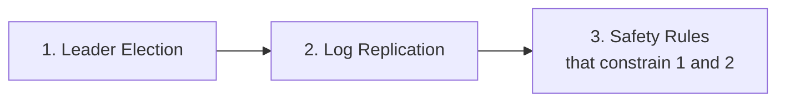

You can learn, implement, and debug each independently.

### Every Raft node is in exactly one of three states

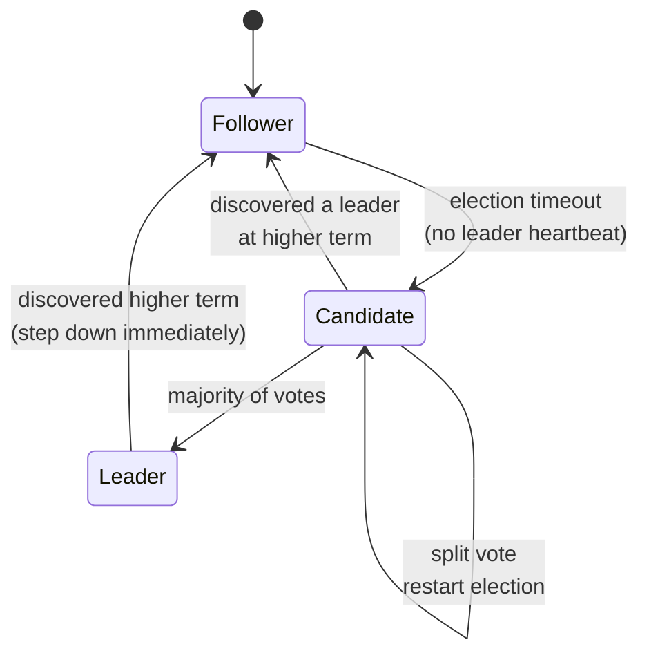

- **Follower:** passive. Listens for heartbeats from the leader. If none arrive, becomes a candidate.
- **Candidate:** actively asking for votes. Either wins (becomes leader), loses (sees a higher-term leader → becomes follower), or splits (times out → tries again).
- **Leader:** sends heartbeats, accepts client requests, replicates log entries.

### Terms — the versioning for leadership

A **term** is a monotonically increasing integer. Think of it as the "edition" or "epoch" of leadership.

**Rules:**
- At most **one leader per term** (enforced by the voting rule — see below).
- Every message carries its sender's term.
- Any node that sees a message with a **higher** term than its own immediately steps down to Follower and updates its term.

Why? Because terms let any node detect "I'm stale" without a central authority. If you receive a message from term 10 and you're in term 7, you know for a fact a newer leader exists somewhere — stop acting like the old one.

### The election-safety rule (and the bug it prevents)

**The bug we need to prevent:** suppose follower X missed the last 50 log entries (slow disk, GC pause). It wakes up, times out, becomes a candidate, and wins the election. **It's now the leader, but it's missing 50 committed entries that other nodes have.** Those entries would get overwritten → committed data lost.

**The fix — Raft's voting rule:**

> A voter grants a vote to a candidate **only if** the candidate's log is **at least as up-to-date** as the voter's own log.
>
> "Up-to-date" means: compare `(lastLogTerm, lastLogIndex)` lexicographically. Candidate wins the comparison → vote granted.

**Why this is correct:**
- An entry is committed only when a majority of nodes have it.
- To win an election, a candidate needs votes from a majority.
- Those two majorities must overlap (§3's pigeonhole trick!) in at least one node W.
- W has the committed entry and will only vote for candidates whose log is ≥ W's log.
- ∴ **The winning candidate must have every committed entry.**

The committed entry can **never** be lost because it's a prerequisite for winning the election that would try to overwrite it. Beautiful.

### The Log Matching Property — and why `prevLogTerm` exists

> If two logs contain an entry with the same `(index, term)`, then all entries **before** that index are also identical.

This sounds like magic. Raft enforces it with one small trick in the `AppendEntries` RPC: every new entry carries not just itself, but also `prevLogIndex` and `prevLogTerm` — the identity of the entry *just before* it. The follower only accepts the new entry if its own log has an entry at `prevLogIndex` with matching `prevLogTerm`. If not, it rejects, and the leader walks back and tries an earlier `prevLogIndex`.

**Why `prevLogTerm` and not just `prevLogIndex`?**

Suppose follower F has entry `(index=4, term=4)` and the leader has `(index=4, term=3)`. Same index, different leaders filled it. If we only checked `prevLogIndex`, we'd falsely think the logs matched up to index 4 and corrupt everything after. The **term distinguishes "same slot" from "same actual entry."**

### Walkthrough — leader forces follower to converge

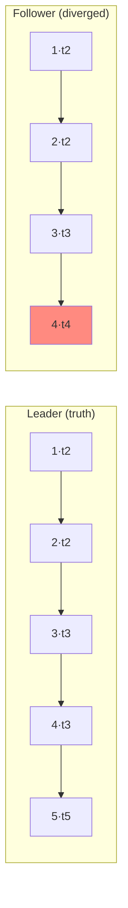

**Scenario:** Follower has `(4, t4)` but the leader has `(4, t3)` — follower was briefly a leader in term 4 before being demoted.

**What happens:**
1. Leader sends `AppendEntries(prevLogIndex=4, prevLogTerm=t3, newEntry=(5,t5))`.
2. Follower checks: "My entry at index 4 is term=4, not t3. **Reject.**"
3. Leader decrements `nextIndex` for this follower, retries with `prevLogIndex=3, prevLogTerm=t3`.
4. Follower checks: "My entry at index 3 is term=t3. ✅ Match."
5. Follower **truncates everything from index 4 onwards** and copies the leader's entries.

> Divergence is repaired by rewinding to the last agreement point and overwriting the follower's tail. Only **uncommitted** entries ever get truncated — committed entries are protected by the election-safety rule.

#### 🚨 Common confusion — "does this truncate affect only one primary key, or everything?"

**Everything.** This is the single most misunderstood part of Raft's log model.

**The Raft log is ONE global, totally-ordered sequence of commands for the entire replicated state machine — NOT a per-key log.** It doesn't matter if the state machine is a key-value store, a SQL table, a config service, or a counter: there is exactly **one log** per Raft group, and every write — regardless of which key, row, or object it touches — gets its own slot in that log.

Picture the leader's log concretely:

| Index | Term | Command |
|---|---|---|
| 1 | 2 | `SET user:42.points = 100` |
| 2 | 2 | `SET order:7.status = "paid"` |
| 3 | 3 | `DELETE session:abc` |
| 4 | 3 | `SET user:42.points = 110` |
| 5 | 5 | `SET inventory:sku-9 = 42` |

Notice **three different keys** show up (`user:42`, `order:7`, `inventory:sku-9`, `session:abc`) all interleaved in one global ordering. Index numbers refer to **positions in this single log**, not to anything per-key.

So when the follower in the diverged scenario had `(index=4, term=4)` and gets told to truncate from index 4 onwards:
- It throws away **log entry at index 4** regardless of what key that entry touched.
- It also throws away index 5, 6, 7, … (everything after).
- All those dropped entries may touch **many different keys**.

#### Concrete example of what "truncate from index 4" throws away

Suppose during the follower's brief time as leader in term 4, it accepted these writes locally:

| Index | Term | Command (on diverged follower) |
|---|---|---|
| 4 | **4** | `SET user:42.points = 999` ← diverged from leader's `110` |
| 5 | **4** | `SET order:99.status = "refunded"` |
| 6 | **4** | `DELETE user:42` |

When the follower rewinds and copies the real leader's entries starting from index 4, **all three of those entries vanish**. The state machine must be **rebuilt** from the restored log:

- `user:42.points` → was 999 (locally), now goes back to 110 (from leader's index 4)
- `order:99.status` → was "refunded" (locally), now **doesn't exist at all** — the follower never saw that order
- `user:42` → was deleted (locally), now **exists again** with the leader's data

**Any key that was touched by a truncated entry gets rolled back to whatever the leader's log says.** The follower is essentially saying: *"my view of the entire state machine from index 4 onwards was wrong — replace it with the leader's view."*

#### Why this is safe

Only **uncommitted** entries ever get truncated. Committed entries have already propagated to a majority, and the election-safety rule guarantees any future leader has them — so they can **never** be the ones getting thrown away. The entries that are lost on the follower are entries no client was ever told succeeded in the first place.

#### If you need "per-key" semantics

Many engineers initially want "one log per key" because it feels like it would reduce coordination. **Don't do this with a single Raft group** — the whole point of Raft is to serialize a totally-ordered history. If you actually need per-key independence at scale, you shard: run **multiple Raft groups**, one per shard, where each group has its own log and its own leader. (Spanner, TiKV, CockroachDB all do this.) Within a shard, it's still one global log.

> **Mental model:** The Raft log is like a bank's **general ledger** — every transaction across every account goes into one chronological ledger, numbered in a single sequence. Truncating "everything from entry 4 onwards" rolls back every account that was touched by those entries, regardless of which account each one belonged to.

**Performance note:** naïve one-step-at-a-time rewind is O(log length). Production Raft uses "conflict hints" where the follower reports back `conflictTerm` and `conflictIndex` so the leader can jump directly to the right place in a single round trip.

### Commit rule — the subtle one (and the bug it prevents)

**The naïve rule** you'd first write: "A log entry is committed when a majority of nodes have stored it."

That rule is **almost right**, but it has a devastating hole. Here's the scenario (Raft's "Figure 8" bug):

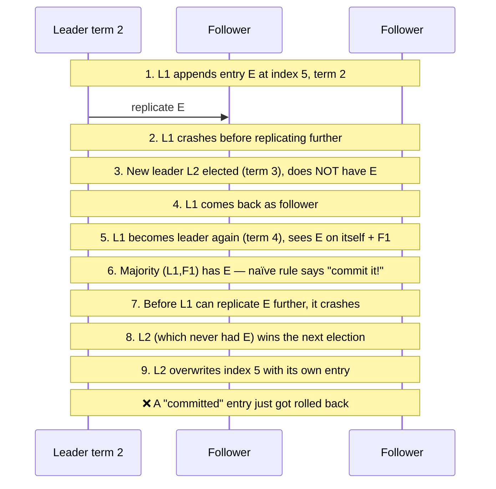

An entry that satisfied "majority stores it" got overwritten. **Committed must mean "will survive any future leader" — the naïve rule doesn't guarantee that.**

**The fix (Raft's actual rule):**

> A leader may advance `commitIndex` **only for entries from its own current term**, by counting replicas.
> Entries from **earlier terms** become committed **indirectly** — only when a later entry **from the current term** on top of them gets committed.

**Why this closes the bug:** when a current-term entry commits, Raft's leader-election rules guarantee any future leader must have that current-term entry (log-up-to-date voting rule). That future leader then also has every earlier entry below it. So the earlier-term entry is safe only once a current-term entry anchors it.

### Numbers in the scenario above

- Step 6 fails the fix: E has term 2, current term is 4. L1 is **not allowed** to count replicas for E alone.
- L1 would have to append a new entry E' in term 4 and get **E'** replicated to a majority. Only then does E (below E') become committed-by-anchoring.
- If L1 crashes before that, E simply stays uncommitted — and L2 safely overwriting it is correct behavior.

### Key takeaway

> **"Committed" = quorum-backed promise that the entry will survive any future leader.**
> Counting replicas is necessary but not sufficient; the entry must be anchored by the current leader's own term.

### Config changes — the "two majorities" bug and joint consensus

**The scenario:** You run a 3-node cluster `{A, B, C}` and want to grow to 5: `{A, B, C, D, E}`.

**Naïve approach:** everyone just switches to the new config at once. What could go wrong?

Suppose nodes switch at slightly different times (which is inevitable in a distributed system):
- A, B are still on the old config `{A,B,C}` → their majority = any 2 of 3.
- C, D, E switched early to the new config `{A,B,C,D,E}` → their majority = any 3 of 5.
- Partition A,B from C,D,E.
- **A,B** can elect a leader among themselves (majority of old config).
- **C,D,E** can elect a different leader among themselves (majority of new config).
- **Two leaders in the same term — split-brain.**

The two majorities don't overlap because they're measuring majority of **different sets**.

**The fix — joint consensus:** go through an intermediate stage where decisions require **both** an old-config majority **AND** a new-config majority at the same time. Then and only then can quorum intersection be preserved across the transition.

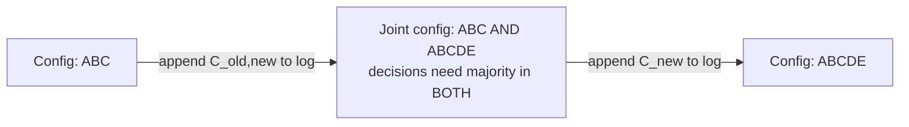

During the joint stage, a leader election or commit requires:
- At least 2 votes from `{A, B, C}` (old majority), AND
- At least 3 votes from `{A, B, C, D, E}` (new majority).

Any two "winners" in this joint stage must overlap in both the old and new majority — split-brain impossible.

**Operational note:** the joint config is itself written as a committed log entry. If a leader crashes mid-transition, the next leader reads the log, sees "we're in joint consensus," and continues the transition correctly.

> **Key takeaway:** membership changes must preserve quorum intersection across time. Joint consensus is the trick that makes it work.

---

## 7. ZooKeeper — Consensus as a Service

### The problem it solves — the "every team reinvents consensus" tax

Imagine you're the SRE lead of a company with 50 microservices. Each team needs:
- Leader election (who runs the nightly billing job?)
- Config distribution (feature flags, DB connection strings)
- Distributed locks (don't run two migrations at once)
- Service discovery (where's the payment service right now?)

Every team could implement their own Raft and get it wrong. Or they could all share one tiny, strongly-consistent service that offers these primitives as a library.

> **ZooKeeper is that shared service.** It's a small, consistent "brain" that other systems rent coordination from.

### What ZooKeeper actually is

- A **replicated**, **in-memory**, **log-backed** tree (CP under CAP).
- Clients see a filesystem-like hierarchy of nodes called **znodes**.
- All mutations are totally ordered by an internal consensus protocol: **ZAB (ZooKeeper Atomic Broadcast)** — close relative of Multi-Paxos and Raft.

> **ZooKeeper is NOT a general database.** It's optimized for **metadata**, not bulk data. Rule of thumb: < ~1MB per znode, < millions of znodes total. Store the pointer in ZooKeeper, store the data in S3/your DB.

### The four znode flavors (where ZooKeeper's power actually comes from)

| Flavor | Lifetime | Why it's useful |
|---|---|---|
| **Persistent** | Explicit delete | Config, static metadata |
| **Ephemeral** | Dies when the client's session dies | **Liveness signal:** znode exists ⇔ client is alive |
| **Sequential** | ZooKeeper appends `_00000001`, `_00000002`, ... | Deterministic ordering + fencing tokens |
| **Watch** (not a znode, but a flag on a read) | One-shot callback when the znode changes | Event-driven reactions without polling |

### Why ephemeral + sequential + watch is a leader-election powerhouse

**The recipe:**
1. Each candidate creates `/election/c_` as an **ephemeral sequential** znode. ZooKeeper names them `c_00000001`, `c_00000002`, ...
2. Each candidate lists `/election/` and finds its own znode's position.
3. **The candidate with the smallest sequence number is the leader.**
4. Everyone else **watches the znode just below them**.

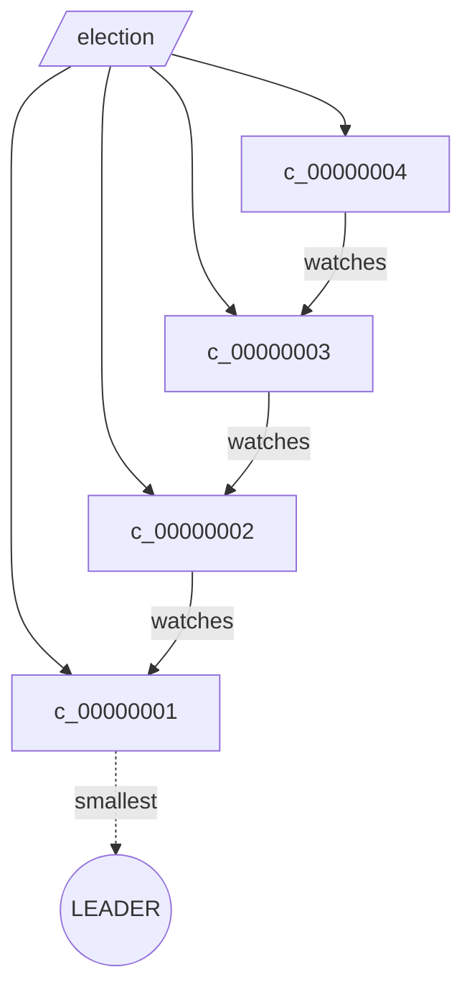

**Why "watch predecessor, not leader"?** This is the subtle insight.

If all 10,000 candidates watched the **leader** znode directly, when the leader died, **all 10,000 would get notified simultaneously**. They'd all stampede ZooKeeper trying to figure out who's next. This is called the **thundering herd / herd effect**.

Instead, when candidate `c_00000005` fails:
- Only `c_00000006` is notified (because only it was watching `c_00000005`).
- It checks: am I now the smallest? If yes → leader. If no → start watching the new predecessor.
- **One notification per failure, not N.** O(1) wake-ups, perfectly serialized.

### Why ephemeral znodes are the magic liveness signal

An ephemeral znode exists **if and only if** the client's session is alive. The client sends heartbeats; if ZooKeeper stops hearing them for `sessionTimeout`, the session expires and **ZooKeeper itself atomically deletes all of that client's ephemeral znodes**.

You get **distributed liveness detection for free** — without implementing failure detectors in every service.

### Consistency guarantees — read these carefully, they're subtle

| Guarantee | Status |
|---|---|
| Writes are totally ordered (linearizable) | ✅ Yes |
| Per-client FIFO (your writes appear in the order you sent them) | ✅ Yes |
| **Reads are linearizable** | ❌ **No!** Any follower can serve the read with potentially stale data |
| Fresh read guarantee available | ✅ Call `sync()` before the read — this forces the follower to catch up to the leader |

**Why this matters:** many bugs in ZooKeeper usage come from assuming reads are fresh. If you read "who is the leader?" from a lagging follower, you might get an old leader. For correctness-critical reads, always `sync()` first.

**Watches:** also subtle.
- **One-shot:** once a watch fires, it's gone. You must re-register it.
- **Can be missed** across session expiration or disconnection.
- **Rule:** after any watch fires, **re-read the state** rather than trusting the event alone to carry the info.

### Session semantics — the trap engineers fall into

- **Disconnect ≠ session expiration.** Your TCP connection to one ZK server can drop; the client transparently reconnects to another. Session is still alive, ephemeral znodes still exist, you're **still the leader**.
- **Session expiration IS session loss.** Happens if you can't reach *any* ZK server for `sessionTimeout`. Your ephemeral znodes vanish; **you've lost leadership** and must re-elect.

> The classic bug: a service pauses for GC, disconnects briefly, assumes it lost leadership, releases its state — but the session was fine the whole time, and the service that thought it was the "new leader" was actually the second one. Two leaders, chaos. **Only act on explicit session-expiration events, never on disconnect events.**

### Key takeaway

> ZooKeeper is a **tiny strongly-consistent primitive store** that trades richness for correctness. Its real power is the composition of ephemeral + sequential + watch — simple pieces that together give you leader election, locks, service discovery, and more, without reinventing consensus in every team.

---

## 8. Side-by-Side

| Dimension | Paxos / Multi-Paxos | Raft | ZooKeeper (ZAB) |
|---|---|---|---|
| Primary goal | Minimal consensus core | Understandable consensus + log | Coordination service |
| Leader | Optional (optimization) | Central | Central |
| API | Internal (library) | Internal (library) | External (znodes + watches) |
| Deployment | Embedded in DBs | Embedded (etcd, Consul) | Dedicated ensemble |
| Strength | Proven minimal core | Clarity → fewer bugs | Rich coordination primitives |
| Weakness | Hard to reason about | Config change / compaction subtlety | Misuse → herd effects; not for bulk data |
| Partition behavior | CP (needs majority) | CP (needs majority) | CP (needs majority) |

**Rule of thumb:**
- Need a replicated system of your own? → **Raft** (or Multi-Paxos).
- Many services need shared coordination? → **ZooKeeper / etcd** (accept the shared blast radius).
- Hybrid often wins: shared CP store for cross-service coordination + embedded Raft only where you truly need independent replication.

---

## 9. The Hard Parts Engineers Trip Over

These are the subtleties that get consensus implementations into incidents. Each one deserves its own scenario.

### 9.1 Linearizability — why "I just wrote it" doesn't mean "I'll read it"

**The scenario:** Your client writes `balance = $100` to the leader. The write commits (majority of nodes have it). Instantly after, the same client reads `balance` from a follower. **What might it see?**

You'd hope: `$100`. But a follower might reply with `$90` — the pre-write value.

**Why?** The follower might not have applied the new entry to its state machine yet, even though it's been accepted into the log. The log is replicated; the application of commands lags behind.

**"My write committed" ≠ "every replica is ready to serve the new value right now."**

**The three fixes for linearizable reads (pick one):**

| Mechanism | How it works | Downside |
|---|---|---|
| **Leader read + ReadIndex** (Raft term) | Before serving a read, leader fires one heartbeat to a majority to confirm *"I'm still leader right now"* — then reads from its own state. Guarantees freshness. | Extra heartbeat round-trip; leader is the bottleneck |
| **Leader lease** | Leader proves *"I was leader at wall-clock time T, and no new leader can exist until T+lease"* → read from leader's state directly, no round-trip | Requires bounded clock drift; GC pause can break the lease silently |
| **sync() + follower read** | Client forces follower to catch up to leader before reading | Still a round-trip to leader; less common |

**The default without one of these:** stale reads are possible even in a "strongly consistent" system. That's not a bug — it's a design choice between throughput and strict linearizability.

> **Takeaway:** Consensus orders writes. Linearizable **reads** need an explicit mechanism on top. Don't assume "we use Raft" ⇒ "all reads are fresh."

---

### 9.2 Snapshots & log compaction — the "disk fills forever" problem

**The scenario:** your Raft cluster has been running for a year. The log has 500 million entries. Every time a new follower joins, it has to replay all 500M entries → **hours of catch-up time**. Disk is 90% full. You need to delete old entries, but how safely?

**You can't just truncate** — if entry 50M was lost but a new follower never got it, the follower would be forever broken.

**The fix: snapshot the state machine, then safely drop the log prefix.**

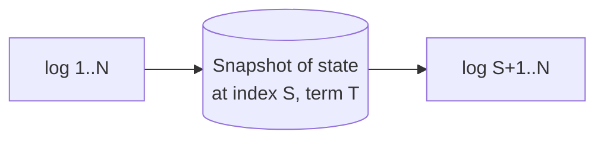

**The snapshot is a serialized copy of the FSM state after applying commands 1..S.** Followers can install the snapshot and resume log replay from `S+1`.

**Correctness rules (each prevents a specific bug):**

| Rule | Bug it prevents |
|---|---|
| `lastIncludedIndex` must be a **committed** prefix | Snapshotting uncommitted entries → impossible to roll back |
| Follower installs snapshot only if `newer than` its current snapshot | Older snapshot overwriting newer FSM state → data loss |
| `commitIndex := max(commitIndex, lastIncludedIndex)` — **never decrease** | A follower appears to "forget" committed entries after snapshot install |
| **Atomic file rename + fsync** when installing | Partial snapshot on disk + crash → corrupted FSM on restart |
| Chunk + checksum for large snapshots | Network corruption on a 10GB snapshot wastes hours |

> **Takeaway:** snapshots are a correctness mechanism dressed up as a storage optimization. Get the rules wrong and you'll corrupt the FSM.

---

### 9.3 The client problem — "did my write succeed? I have no idea."

**The scenario:** your client sends `transfer $100 from A to B` to a Raft cluster. The TCP connection times out at 5 seconds. **What state is the world in?**

Three possibilities, all equally plausible:
1. The leader never got the request. Nothing happened.
2. The leader committed it, replicated to a majority, applied it — then the ACK packet got lost on the way back.
3. The leader got it, replicated to 1 follower (not a majority), then crashed. **Nobody knows yet** whether the next leader will include it or truncate it.

> **Timeout ≠ failure. Timeout = "unknown outcome."**

**The required discipline:**

| Problem | Fix |
|---|---|
| Client doesn't know which node is the leader | Server returns `NotLeader` + leader-hint; client caches hint and retries there |
| Client doesn't know if the write succeeded | **Idempotency keys / write IDs.** Server dedupes retries. Retrying becomes safe. |
| Many clients retry at once after a leader failover | **Exponential backoff + jitter.** Without jitter, retries synchronize and hammer the new leader. |

**Why idempotency keys are not optional:** without them, every "safe retry on timeout" risks double-executing the operation. `transfer $100` applied twice = angry user.

> **Takeaway:** the hardest part of consensus is often not the protocol — it's the client contract. Design for "timeout = unknown" from day one.

---

### 9.4 Timeouts — tuning is a control-system problem

**The scenario:** Your Raft cluster suddenly has a storm of leader elections. Term numbers are churning (23 → 24 → 25 → 26 in 10 seconds). Writes are failing. **Why?**

**Diagnosis:** your election timeout is too low. The current leader takes a 1.5s GC pause occasionally. Followers interpret missing heartbeats as "leader is dead" and start elections. The leader comes back, has lower term than what the candidates are now campaigning for, steps down. New leader elected. Previous "dead" leader comes back fine. Rinse and repeat.

**The tradeoff:**

| Timeout too low | Timeout too high |
|---|---|
| Transient delays (GC, slow disk, hot path) trigger elections → **term churn**, write stalls, p99 latency spikes | Real failures take forever to detect → long periods with no leader → user-facing outage |

**Mitigations:**
- **Keep GC pauses ≪ election timeout.** If your GC can pause 500ms, don't set election timeout at 300ms. Rule of thumb: election timeout ≥ 5× worst-case pause.
- **Randomize/jitter** election timeouts (Raft uses 150–300ms random). Without jitter, two followers time out simultaneously, split the vote, time out again...
- **Separate IO and GC-heavy worker threads.** Don't let a long IO flush block heartbeat generation.
- **Pre-vote optimization:** before actually incrementing the term, do a "would you vote for me?" straw poll. Avoids term churn when a node is just briefly disconnected.

> **Takeaway:** failure detection is a feedback control loop. Aggressive tuning creates its own failures.

---

### 9.5 Deterministic application — the FSM must be reproducible

**The scenario:** Your Raft cluster has three replicas. Each applies command `generateInvoice(order_id=42)` from the committed log. Replica A assigns invoice number 1001, replica B assigns 1002, replica C assigns 1003. **Three different states.** Reads start returning inconsistent results.

**The root cause:** your invoice-number generator called `UUID.random()` inside the state machine. Random = nondeterministic = divergent FSMs.

**Consensus guarantees same commands in same order. It cannot save you from nondeterministic command application.**

**Common nondeterminism bugs:**

| Pitfall | Fix |
|---|---|
| `time.Now()` inside the command handler | **Leader embeds `now` in the command**, replicated as data |
| Local RNG | Leader samples the random value, puts it in the command |
| Map/dict iteration order (Go, Python, Rust) | Sort keys before iterating |
| Floating-point ops with non-associative rounding across CPUs | Use fixed-point or avoid cross-replica float comparison |
| External HTTP calls / database reads | Never do these in the FSM; precompute and replicate |

> **Takeaway:** consensus is only half the problem. Your state machine must be a pure function of (snapshot, applied log). Any nondeterminism = silent divergence = data corruption discovered weeks later.

---

## 10. The One Picture That Explains Partitions

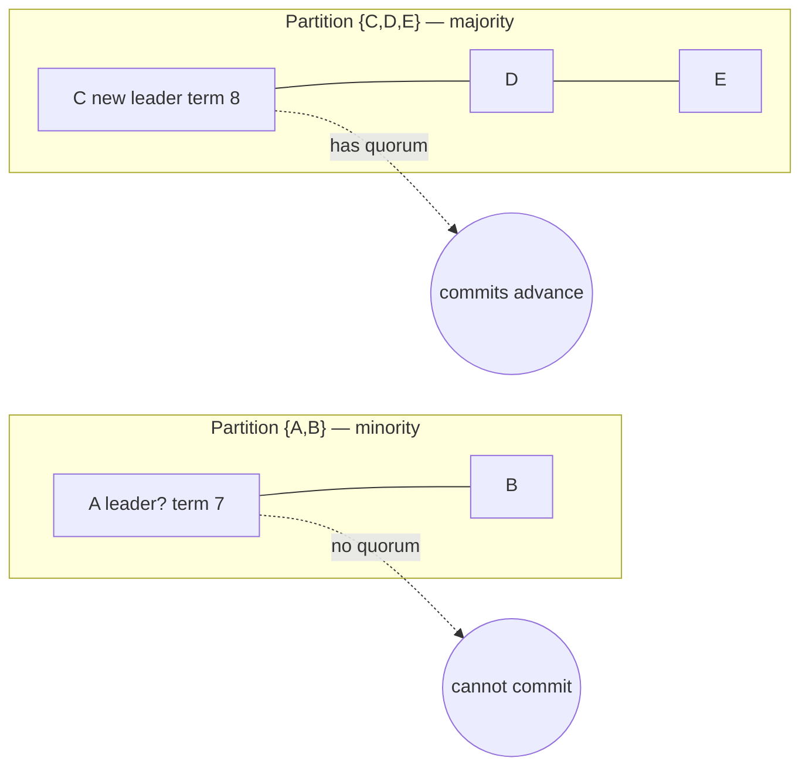

What's true:
1. A may **append locally** but **cannot commit** (no quorum).
2. `{C,D,E}` elects a new leader at a **higher term** and keeps committing.
3. On heal, A sees term 8 → steps down → its **uncommitted tail is truncated**.
4. **Committed entries never roll back. Uncommitted entries can.**

---

## 11. Production Gotchas Checklist

- [ ] Majority quorum required for commit (CP under partition)
- [ ] fsync `currentTerm`, `votedFor`, and accepted entries before ACK
- [ ] GC pause budget < election timeout
- [ ] Jittered retries & backoff; idempotency keys on client
- [ ] Know your read semantics: leader read vs follower read vs sync()
- [ ] Plan snapshots & log compaction (atomic install, no commitIndex regress)
- [ ] Config changes via joint consensus — never swap sets instantly
- [ ] Test **partitions**, not just crashes (jepsen-style)
- [ ] Monitor: election rate, leader tenure, commit p99, fsync p99, follower lag, term churn
- [ ] For ZooKeeper: watch **predecessor**, not leader; re-read state after any watch fires; distinguish disconnect vs session expiration

---

## 12. Decision Flowchart — Do I Need Consensus?

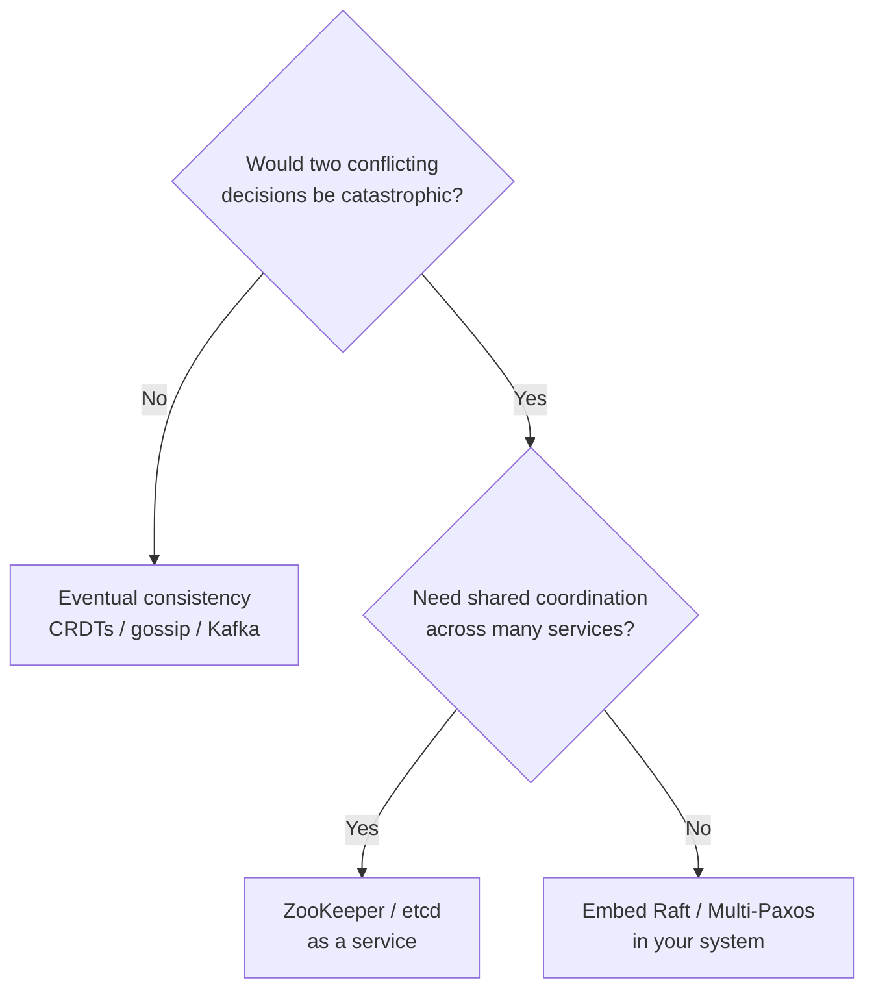

Use consensus when: **leader election, distributed locks, config/metadata, mutual exclusion, sequencers.**
Don't use it for: **bulk data, metrics, caches that are OK being stale.**

---

## 13. Three Insights to Carry Forever

1. **Quorum intersection is the geometric backbone of safety.** Any two majorities share a witness; that witness is why split-brain is impossible.
2. **Committed = quorum-backed promise that survives any future leader.** Everything else can be truncated.
3. **The best consensus design is the one whose failure modes you can explain at 3am.** Prefer clarity (Raft) over cleverness (hand-rolled Paxos).

---

# Part B — Quorum & Sloppy Quorum (Leaderless Replication)

> Everything above is **leader-based** quorums (Paxos/Raft/ZAB). This part is the **leaderless** cousin (Dynamo/Cassandra/Riak): same geometric idea, very different operational contract.

### Reading map for Part B

The 14 sections of Part B teach **four big ideas** in this order:

| Idea | Sections | What you'll learn |
|---|---|---|
| **Quorum intersection** | §14, §15 | Why R + W > N gives you overlap, and how a coordinator fans out a request |
| **Availability tricks** | §16, §17, §18 | Sloppy quorum, hinted handoff, Merkle anti-entropy — how Dynamo-style systems stay available during outages |
| **The two correctness details** | §19, §20 | **Versioning** (how we pick a winner when replicas disagree) and **durability** (what "W acks" really means on disk) |
| **Synthesis** | §21-§27 | Side-by-sides, multi-DC scope, failure scenarios, worked design, decision flow |

> **Heads-up:** §14-§17 mention terms like `LWW`, `HLC`, `vector clock`, `WAL fsync`, `write_id`. These are all in the Glossary and get their full-story section at §19 and §20. If a term feels fuzzy, don't stop — the one-liner in the glossary is enough to keep going.

## 14. The R + W > N Rule (and the lies it tells)

### The setup

Leaderless replication (Dynamo, Cassandra, Riak): no central leader deciding order. Instead, every key is stored on **N replicas**, and clients tune two numbers per request:
- **W** = how many replicas must ACK a write before we call it "successful"
- **R** = how many replicas we read from and compare

So a write to a 5-replica key with W=3 means "send to all 5, respond when any 3 confirm."

### The problem we want to prevent

Imagine W=1 and R=1 on 5 replicas:
- Client writes v2 → one replica acks → we say "success."
- Client immediately reads → coordinator picks a different replica (still has v1) → **returns stale data**.

How do we guarantee a read **always sees the latest successful write**?

### The rule

> **If R + W > N, every read set must overlap with every write set.**

Same pigeonhole trick as §3: if a write touched W replicas and a read touches R replicas in a universe of N, and R + W > N, then **R + W > N ⇒ they share at least one replica** (because disjoint sets would need ≥ R + W > N distinct nodes, but we only have N).

That shared replica is the **witness**: it acknowledged the write, so when the read queries it, it has the latest value.

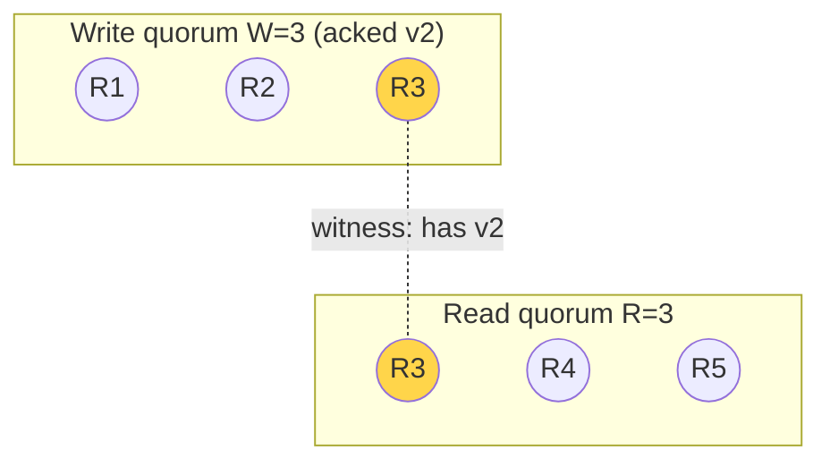

### A concrete example

N=5, W=3, R=3. Write v2 goes to {R1, R2, R3}. Read later hits {R3, R4, R5}.
- R3 is in both sets → it has v2.
- R4 and R5 might still have v1.
- Coordinator sees `{v2@ts2, v1@ts1, v1@ts1}` → picks the highest version → returns v2.

### The classic choices for N=5

| R | W | R+W | Overlap? | Property |
|---|---|---|---|---|
| 1 | 1 | 2 | ❌ | Fast + highly available, **stale reads common** |
| 1 | 3 | 4 | ❌ | Still no overlap |
| 1 | 5 | 6 | ✅ | Read-optimized (slow writes) |
| **3** | **3** | **6** | ✅ | **Balanced default** |
| 5 | 1 | 6 | ✅ | Write-optimized (slow reads) |

### The lies R + W > N tells you

> **Myth:** `R + W > N` ⇒ linearizability.
> **Reality:** It gives **intersection**, not a single global order.

Why it isn't enough on its own:
- **Ack semantics matter.** If "ack" means "received in memory, not durable," a crash loses the write regardless of W.
- **Concurrent writes** can produce two valid timestamps; which "wins" depends on your versioning scheme.
- **Partial writes** — a client receives timeout; some replicas have the value, some don't. Quorum math says nothing about this.
- **Clock skew + LWW** → lost updates even with full overlap. (LWW = *Last-Write-Wins*: whichever write has the latest timestamp overwrites the others. If a client's clock is 5 seconds fast, its write can clobber someone else's later-but-lower-timestamp write. Full story in §19.)

> Leaderless quorums give you **eventual consistency with bounded staleness**. Linearizability needs leader-based consensus (Paxos/Raft) or an **ABD-style register protocol** — a leaderless technique (Attiya-Bar-Noy-Dolev, 1995) where every read collects R versions, picks the winner, then **writes it back to the lagging replicas** before returning. The write-back is what prevents reading older values after a newer one has been returned.

---

## 15. The Full Leaderless Request Path

### The setup

Unlike Raft (one leader, all writes serialize through it), leaderless replication has a **coordinator** that can be *any node* — often the one the client happened to connect to. The coordinator fans out the write to the key's N replicas, waits for **W** acks, replies to the client, and lets the rest trickle in asynchronously.

**Reads work symmetrically:** coordinator asks N replicas, waits for R responses, picks the newest version, repairs the stragglers.

### The full write-then-read trace

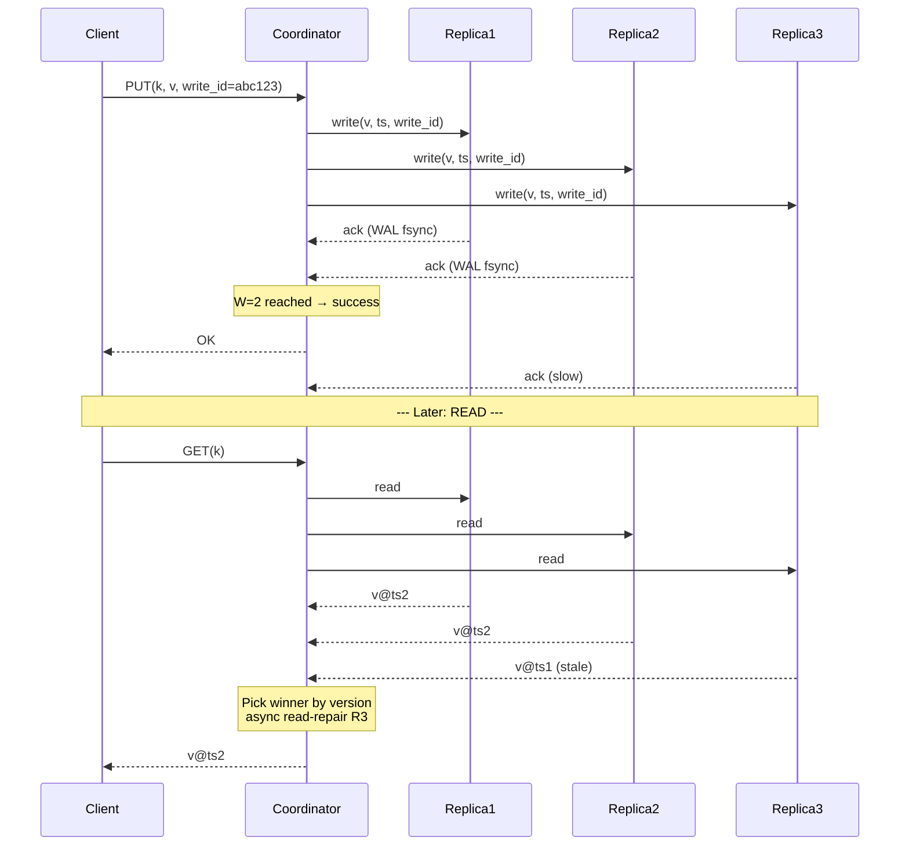

### What each step does and why

| Step | What's happening | Why it matters |
|---|---|---|
| **Fan out, wait for W/R** | Coordinator sends to all N but only waits for W (or R) replies | Caps tail latency: the slowest replica doesn't block you |
| **Pick the winner version** | Compare versions across replies; return the newest | Replicas can disagree — you need a merge rule (§19) |
| **Async read-repair** | Push the winner to stragglers in the background | Converges silently without extra client cost |
| **`write_id` idempotency** | Each request has a UUID; replicas dedupe by it | Safe retries on timeout — won't double-apply |

### The four invariants the coordinator must enforce

If any one of these is missing, the system becomes subtly broken:

1. **Never wait for all N.** W responses, then reply. Otherwise you've turned W=2 into W=N (defeats the whole point).
2. **Pick winner by version**, not by "whichever responded first." Order of arrival ≠ order of events.
3. **Repair stragglers.** Without this, R3 stays at ts1 forever until anti-entropy sweeps it.
4. **Deduplicate by `write_id`.** Timeouts cause retries; retries without dedup cause ghost double-writes.

> **Takeaway:** leaderless replication is less about the quorum math and more about the coordinator being a careful traffic cop — fan out, timeout, pick, repair, dedupe.

---

## 16. Sloppy Quorum — Availability Over Membership

### The scenario that breaks classic quorum

You run a Dynamo-style store with `N=3, W=2`. Key `K` is assigned to replicas `{A, B, C}` by the **consistent-hashing ring** — a technique where keys and nodes are placed on an imaginary circle, and each key is owned by the next N nodes clockwise. Adding or removing nodes only shuffles a small slice of keys, instead of rehashing everything. Then this happens:
- **B goes down** (deploy, failure, whatever).
- **C goes down** (its disk died in a correlated way, or it's in the same rack as B).

A client sends a write for `K`. Classic quorum rule: need 2 acks from `{A, B, C}`. Only A is reachable. **Classic quorum: write fails.**

Your service is now returning 503s even though **you have hundreds of other healthy nodes in the cluster** — they just happen not to be the "right" ones for key K.

### The core idea of sloppy quorum

> **If the home replicas for a key can't give you W acks, write to the next available nodes on the ring instead** — and attach a **hint** telling them: "this really belongs to B/C; please deliver it when they come back."

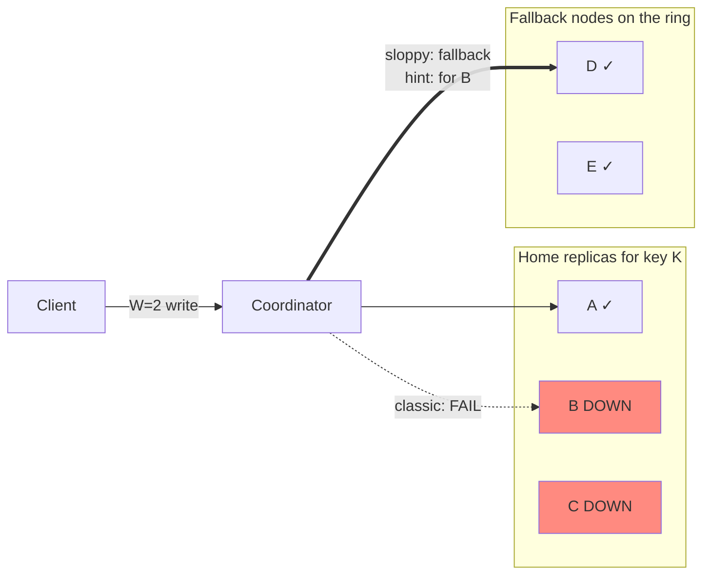

Now the write succeeds (A + D = 2 acks). When B comes back, D forwards the stored value to it — that's **hinted handoff** (§17).

### Classic vs sloppy at a glance

| Decision | Classic quorum | Sloppy quorum |
|---|---|---|
| Write targets | **Only** the key's home replicas | Prefer home replicas; fall back to ring neighbors |
| Behavior when W unreachable | **Fail the write** | **Succeed** using fallbacks + hints |
| Priority | Correctness over availability | Availability over correctness |

### The deal you're making — what you gain, what you give up

**Gained:**
- **Availability** even when (N − W + 1) or more home replicas are down.
- **Low latency** — never wait for a dead replica to recover.

**Lost (and this is the critical bit):**
- **Read/write set intersection is no longer guaranteed.** A later read of `{A, B, C}` might **miss the write** that went to `{A, D}`. Our beautiful `R+W>N` math (§14) is now based on a lie — the write didn't go to the right set.
- **Divergence surface area grows.** More nodes now temporarily hold the key than you intended.
- **Durability depends on hint storage.** If D crashes before handing off to B, the hint is lost unless you've made hints durable (WAL) or you have anti-entropy as a backstop.

### Why it's not chaos — the "controlled degradation" part

Sloppy quorum sounds reckless, but it's structured:

1. **Fallback nodes are chosen deterministically** — walk the consistent-hashing ring from the key's position; take the next healthy nodes.
2. **Fallbacks are bounded.** Cap how far you walk (e.g., don't go across regions). Cap how many hints a node will hold. Cap hint age.
3. **Every fallback is temporary** — the hint tracks whose data this really is, and asynchronous repair restores the intended placement.

> **Rule:** sloppy quorum is availability on credit. Hinted handoff + anti-entropy are the repayment. If the credit grows unbounded (hints accumulate forever), you'll have a cascading failure when the home replica finally comes back and gets flooded.

---

## 17. Hinted Handoff — The Delivery Receipt

### A real-world story first

Imagine you run a courier company. A package is addressed to **Priya at Apt 3B**. But when the driver gets there, Priya isn't home. The company has a policy:

> *"If the addressee isn't home, drop the package with a trusted neighbor and stick a note on their door: 'Package for 3B held by 2A — deliver when 3B is back.' The neighbor will walk it over when they see Priya."*

That's hinted handoff. In our terms:
- **Priya at 3B** = the home replica (down)
- **The neighbor at 2A** = the fallback replica
- **The sticky note** = the hint — metadata saying "this really belongs to 3B"
- **Walking it over later** = the handoff step, after the home replica comes back

Without this policy, the courier would either refuse to deliver (your users see errors) or dump the package in the street (data loss). The sticky note is what makes "temporary neighbor delivery" safe.

### Where it fits in the system

Sloppy quorum (§16) tells you *how* to **accept** writes when home replicas are down. Hinted handoff is the mechanism that eventually gets that data **back to where it was supposed to go**.

| Mechanism | Role | Timing |
|---|---|---|
| Sloppy quorum (§16) | Lets the write succeed by routing to a fallback | At write time |
| **Hinted handoff (§17)** | Delivers the fallback's data to the real home replica | Minutes to hours after the home comes back |
| Anti-entropy (§18, Part D) | Backstop that catches anything handoff missed | Hours to days — background sweep |

### The mechanic — walked through

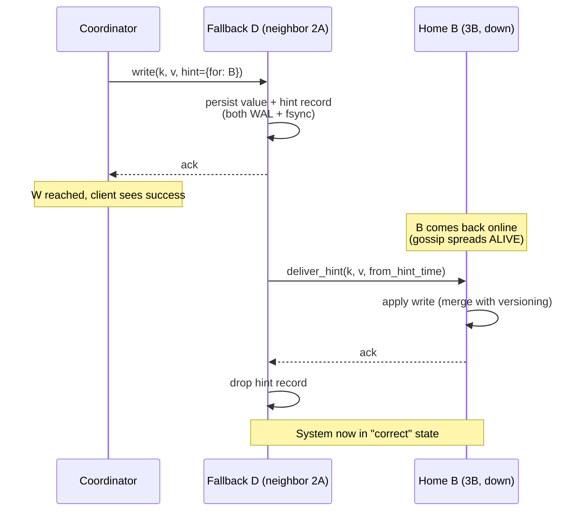

Step by step:
1. Coordinator fans out the write. B is unreachable → it picks the next node on the ring, D.
2. Coordinator writes `(key, value, hint={for: B})` to D.
3. D persists **both** the data and the hint — on the same WAL with `fsync` — before ack-ing.
4. D keeps gossip-watching for B. When B is marked `ALIVE`, D's handoff worker picks up hints targeted at B.
5. D sends `(k, v)` to B with the correct versioning metadata so B merges it like any other write.
6. B acks → D drops the hint record. Done.

### What a hint actually looks like on disk

The hint is a small record stored alongside the data:

```python
# What D persists when it accepts a write on behalf of B:
hint_record = {
    "target_node_id": "B",            # who this is really for
    "key": "user:42:points",
    "value": 110,
    "version": {"vclock": {"coord-7": 5}, "hlc": 1697299200.001},
    "accepted_at": 1697299200.001,    # when D took it (NOT when B must apply it)
    "coordinator_id": "coord-7",      # who routed this to D
    "ttl_expires_at": 1697385600.0,   # D should give up and purge after this
}

# D's handoff worker, running every ~10s:
def deliver_pending_hints():
    for hint in load_hints_for_alive_nodes():
        try:
            send_to(hint["target_node_id"],
                    key=hint["key"], value=hint["value"], version=hint["version"])
            drop_hint(hint)                            # success → remove record
        except (Timeout, Unreachable):
            continue                                   # try again next round
        except TTLExpired:
            move_to_dead_letter_queue(hint)            # anti-entropy must repair this later
```

Three details that *look* like minor engineering choices but are correctness-critical:

1. **The hint is written in the same WAL fsync as the data.** If D crashes between "accepted the value" and "wrote the hint," we have the value but no idea it belongs to B — the value is now effectively invisible from B's perspective and will only be found by anti-entropy. See the first rule below.
2. **The version** (vclock / HLC) travels with the hint. When B eventually applies it, it must merge using the same rules as a normal write — otherwise a newer-but-already-applied write on B could get clobbered by this older hint. (See §19 Versioning.)
3. **The TTL** means D isn't on the hook forever. If B stays down for a week, we don't want D's disk silently filling up with increasingly-stale hints.

### Operational rules — each prevents a specific real failure

| Rule | Why — the failure it prevents |
|---|---|
| **Hints must be durable (WAL + fsync)** | D restarts → in-memory hint lost → **the write is on D's disk but B will never learn about it**. The data silently never reaches its real home. The Dynamo paper mentions real incidents from skipping this. |
| **Hint and data in the SAME fsync** | Crash between "write accepted" and "hint recorded" → "orphan data" (value exists but no delivery pointer). Not corruption, but invisible until anti-entropy sweeps. |
| **TTL + size caps on hints** | B is down for a week; hints pile up on D until D's disk fills → cluster-wide disk pressure → the fallback itself fails. |
| **Backpressure when hint queue grows** | Hints arrive faster than D can deliver → unbounded queue → coordinator must stop routing new hints to D (and ideally return 503 instead of hoarding). |
| **Hot-key awareness** | A single hot key (e.g., popular product) with its home down → *all* traffic for that key piles up on one fallback → fallback becomes a hot spot and may itself fall over. |
| **Idempotent delivery** | D retries delivery after a timeout but B actually received the first attempt → without idempotency, B applies the same write twice. Fix: hints carry a `write_id` and B dedupes by it. |
| **Encryption + ACLs on hints** | Data stored on D is still user data. If D isn't normally in that key's replica set, you've now spread the data to a node your access controls didn't anticipate. Treat hinted data like regular replicated data — not a "temporary buffer." |

### Worked example — a 10-minute outage, with numbers

**Setup:** `N=3, W=2, R=2`. Key `K` lives on `{A, B, C}`. Traffic: 1,000 writes/sec on this key.

**Timeline:**

| Time | Event | What happens |
|------|-------|--------------|
| 00:00 | B dies (bad disk) | Coordinator still gets W=2 from `{A, C}` — writes succeed, zero user-visible impact |
| 00:00:01 | Gossip spreads `SUSPECT(B)` | Coordinator starts routing B's share to fallback D with hints |
| 00:00–00:10 | 10 minutes of writes | **600,000 writes** have been persisted on D with hints pointing at B |
| 00:10 | B replaced with fresh disk, rejoins | Gossip spreads `ALIVE(B)` |
| 00:10:05 | D's handoff worker wakes | Starts streaming hints to B |
| 00:12 | Handoff complete | B now has every write it missed; D drops all hints |

**Rule-of-thumb numbers for sizing:**
- Per hint on disk: ~200 bytes of metadata + value size
- Handoff throughput: often 10–100× ingest rate (fewer locks, batched)
- Hint TTL in Cassandra default: 3 hours (configurable)

**What breaks the numbers:**
- If D itself dies during the outage → every unhandled hint is a potential lost write unless the WAL fsynced before the ack
- If B stays dead past the TTL → remaining hints get purged → **those keys will diverge until anti-entropy (§18 / Part D) catches them**

### The industry footprint

| System | How it handles hinted handoff |
|---|---|
| **Cassandra** | Classic implementation — hints stored in a dedicated `hints` directory, delivered via a background executor. The `max_hint_window_in_ms` (default 3h) is the TTL. |
| **DynamoDB** | Internally uses a managed version of the pattern — but customers never see hints as a knob. AWS handles the entire lifecycle. |
| **Riak** | Called "fallback vnodes" + hinted handoff. Similar semantics to Cassandra. |
| **Scylla** | Cassandra-compatible, same pattern, faster delivery due to shard-per-core architecture. |

### What hinted handoff cannot do (and why anti-entropy exists)

Hinted handoff is **outage-scoped**. It covers writes that happened *during a specific window* when a specific home replica was down. It does **nothing** about:

- **Cold keys** that haven't been written in months. If a replica silently diverged (bit rot, past bug, botched migration), hints never covered it and never will.
- **Lost hints.** The fallback crashed before persisting; the fallback crashed during delivery; the hint TTL expired before the home came back.
- **Correlated failures** that outlast hint TTLs. Multi-day outages where hints time out before the home replica is restored.
- **Divergence from a stale replica rejoining.** B comes back after a 2-week absence; its data is weeks stale; handoff only delivers writes that *happened during the outage window*, not fills the gap for anything before.

That's why Dynamo-style systems always pair hinted handoff with **Merkle-tree anti-entropy** (§18 and Part D) that systematically compares full replica state. The two mechanisms cover each other's gaps:

| Mechanism | Scope | Latency | Catches |
|---|---|---|---|
| **Hinted handoff** | Writes during a known outage | Minutes | ~99% of normal transient failures |
| **Anti-entropy (Merkle)** | Everything, regardless of history | Hours / nightly | The remaining 1%: lost hints, cold-key drift, bit rot |

### Common Pitfalls Checklist

- [ ] **Ack before fsync.** Coordinator thinks the hint is durable because D said "OK," but D only buffered it in RAM. Power loss on D → silent data loss.
- [ ] **No `write_id` in hints.** Retries during delivery cause double-apply. Loyalty points doubled; invoices duplicated.
- [ ] **Hint delivery doesn't respect versioning.** D sends a stale value to B, which happens to have a newer value already → stale clobbers fresh.
- [ ] **No metric for hint queue depth.** You find out hints are backing up only when disks fill. Alert on `hint_queue_depth > threshold` and `oldest_hint_age > TTL/2`.
- [ ] **Hints across security boundaries.** D holds data for keys it normally doesn't own → data may now be visible to roles/tenants that shouldn't see it. Audit this.

### Key takeaway

> **Hinted handoff is a loan with a receipt.** It's cheap during normal operation but worthless without durable hint storage, idempotent delivery, and strict TTLs. And it's **not a substitute for anti-entropy** — only its first line of defense.

---

## 18. Anti-Entropy with Merkle Trees

### The problem that makes naïve repair impossible

Two replicas hold 100 million keys each. Over time they've drifted — maybe 0.01% of keys differ (10,000 keys). You want to find and reconcile the differences.

**Naïve approach:** stream all 100M keys from each replica and compare. That's **200M keys over the network every repair cycle** — probably hundreds of GB. For 0.01% actual difference. Catastrophic waste.

**The question:** can you detect and locate the 10,000 differences without transferring everything?

### The answer: Merkle trees

A **Merkle tree** is a binary tree where:
- Each leaf is the hash of one key-range's data.
- Each internal node is the hash of its children's hashes.
- The **root hash is a cryptographic summary of the entire dataset**.

**Property:** if any single key changes, its leaf changes, which changes every ancestor hash all the way up to the root. If two Merkle trees have the **same root hash**, their data is identical (with cryptographic probability).

### How repair works

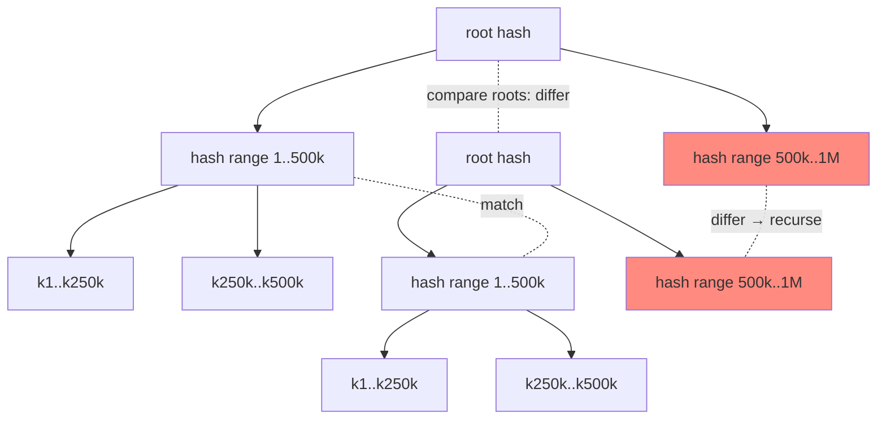

**The algorithm:**
1. Each replica computes its Merkle tree (cheap, incremental).
2. Exchange **just the root hashes**. If they match → done. One hash exchanged, 100M keys verified.
3. If they differ → exchange the next level. Match the ones that match, recurse into the ones that don't.
4. Keep descending **only into mismatching subtrees** until you reach the actual differing keys.
5. Transfer only those keys.

### The scale win

| Approach | Bandwidth |
|---|---|
| Stream all keys | **O(total keys)** = 100M |
| Merkle tree exchange | **O(differing keys × log(total))** ≈ 10K × 27 ≈ 270K hashes compared |

For 0.01% divergence you've just reduced bandwidth by **~400×**. More importantly: the cost scales with how **wrong** the system is, not how **big** it is.

### Hinted handoff vs anti-entropy — complementary, not redundant

| | Hinted Handoff | Anti-Entropy |
|---|---|---|
| **Trigger** | Write-time, when a home replica is down | Periodic sweep |
| **Scope** | Only writes during the outage | All data, including cold keys |
| **Latency** | Fast (next time B comes up) | Slow (minutes to hours) |
| **Catches** | Known temporary misplacement | Lost hints, silent bit rot, past bugs |

**Read-repair** is a third mechanism that fires on reads when the coordinator sees stale replicas. It's **opportunistic** — only touches keys someone reads.

> **The three-layer defense:** read-repair (on access), hinted handoff (on write-time failures), Merkle anti-entropy (systematic sweep). Each one covers gaps the others leave. Dynamo-style systems need **all three** to converge.

---

## 19. Versioning — The Other Half of Correctness

### Why quorum alone isn't enough

Quorum math (R+W>N) guarantees the read set **intersects** with the latest successful write set. So one of the R replicas you read **has the latest value**. But the coordinator gets replies like this:

```
R1: value="$100", version=???
R2: value="$95",  version=???
R3: value="$90",  version=???
```

**Which one is actually the latest?** The coordinator has to compare "versions" somehow. If your versioning scheme is broken, your correctness is broken — even with perfect quorums.

### The LWW trap — a scenario where correctness silently breaks

Scenario: **Last-Write-Wins** (LWW) with wall-clock timestamps. User's loyalty points.

1. User earns 10 points. Client A writes `points=110, ts=1000ms` to replicas.
2. User redeems 15 points. Client B writes `points=95, ts=1050ms` to replicas.
3. Both writes happen; the second (ts=1050) wins everywhere.

Looks fine. But now:
1. User earns 10 points. Client A has a clock **5 seconds ahead** of true time. Writes `points=110, ts=6000ms`.
2. User redeems 15 points. Client B has a correct clock. Writes `points=95, ts=1050ms`.
3. **The "earlier" write (A) has a bigger timestamp.** It wins, overwriting the redemption.
4. **The redemption is silently lost.** The user has 110 points *and* the thing they redeemed.

This happens in real production systems. Clock skew is normal (NTP, VMs, GC pauses). LWW with wall-clocks is a correctness bomb for anything you care about.

### The versioning schemes, ranked by safety

| Scheme | How winner is chosen | Fails when... |
|---|---|---|
| **LWW (wall-clock)** | Highest timestamp wins | Clocks drift (always, in practice) → silent lost updates |
| **LWW (HLC)** | Hybrid logical clock = (physical, logical counter) | Physical skew > HLC bound (rare, bounded, catchable) |
| **Server-assigned timestamps** | Coordinator stamps on arrival | Coordinator failures create duplicate stamps; still vulnerable to coordinator clock skew |
| **Vector clocks** | Per-node counters; causally orders events | Can grow unbounded with # writers; compaction can lose causality |
| **CRDT (G-Counter, PN-Counter, OR-Set, LWW-Register, ...)** | Deterministic merge for the specific data type | Only works for data that fits a CRDT shape; uses more space |
| **Siblings** | Return all concurrent versions; app merges | Pushes complexity to callers; most apps get it wrong |

### Picking the right scheme for your data

Decision rule of thumb:

| Data | Correct choice | Why |
|---|---|---|
| Counters (likes, points, inventory) | **CRDT (PN-Counter)** | Addition is commutative; LWW silently loses updates |
| User profile (name, email) | HLC or server-assigned LWW | Trailing updates are usually safe; occasional loss acceptable |
| Shopping cart (set of items) | **CRDT (OR-Set)** or siblings | Set union never loses an "add" |
| Account balance / money | **Don't use leaderless** → use consensus | Compare-and-set required; LWW is unsafe at any speed |
| Session data | LWW with HLC | Trailing updates usually fine |

> **The hard rule:** for anything where "lost update" means legal/financial/compliance pain, don't use leaderless replication with LWW. Either use CRDTs or move it to a consensus-backed store.

### Vector clocks — the gold standard for causal detection

A vector clock is a map `{nodeId → counter}`. Each node increments its own counter on every operation. When comparing two vector clocks:

- `a > b` ⇒ a happened **after** b (a dominates b).
- `a < b` ⇒ a happened **before** b.
- `a == b` ⇒ same event.
- **Neither** ⇒ **concurrent** — these are *siblings* that need application-level merge.

The last case is the whole point: vector clocks can **detect concurrency** rather than silently pick a winner.

```python
def compare(a: dict, b: dict) -> str:
    """Returns 'gt', 'lt', 'eq', or 'concurrent'."""
    nodes = set(a) | set(b)
    a_ge = b_ge = True
    a_gt = b_gt = False
    for n in nodes:
        av, bv = a.get(n, 0), b.get(n, 0)
        a_ge &= av >= bv
        b_ge &= bv >= av
        a_gt |= av > bv
        b_gt |= bv > av
    if a_ge and b_ge: return 'eq'
    if a_ge and a_gt: return 'gt'
    if b_ge and b_gt: return 'lt'
    return 'concurrent'   # ← siblings; app must merge
```

> **Takeaway:** quorums give you *evidence* that replicas disagree. Versioning gives you a *rule* for picking a winner or signaling a conflict. Both are required; neither is sufficient alone.

---

## 20. What "W Acks" Actually Means

### The hidden question in every quorum design

You configured `W=3`. Three replicas acknowledged. **Great — but what did they actually do before saying "ack"?**

| Possibility | What's durable |
|---|---|
| "Ack" means "received the bytes" | Nothing — in a RAM buffer |
| "Ack" means "wrote to in-memory structure" | Nothing — still in RAM |
| "Ack" means "appended to WAL (no fsync)" | OS page cache. Survives process crash. Does not survive power loss. |
| "Ack" means "appended to WAL + fsync" | **Fully durable** |
| "Ack" means "applied to memtable (post-WAL)" | Durable (if WAL fsynced) + queryable |

### Why this matters — a concrete catastrophe

Scenario: your database acks after WAL append **without fsync**. Three replicas ack a write. You tell the client "success." Then a power outage hits the data center. **All three replicas lose the write** because none of them had actually synced to disk — it was all in page cache.

Your `W=3` was mathematically correct but operationally meaningless. **Three copies of nothing is still nothing.**

### The durability ladder

| Rung | Where the data lives | Survives process crash? | Survives power loss? |
|---|---|---|---|
| 1. In-memory accept | RAM buffer | ❌ | ❌ |
| 2. WAL append (no fsync) | OS page cache | ✅ partial (if OS flushes before dying) | ❌ |
| 3. **WAL fsync** | On-disk WAL | ✅ | ✅ |
| 4. Applied to memtable | On-disk WAL + in-memory index | ✅ (reload from WAL) | ✅ |
| 5. Flushed to SSTable | On-disk SSTable (final form) | ✅ | ✅ |

**For W to mean anything about durability, acks must come at rung 3 or higher.**

### The real-world knob — Cassandra as an example

Cassandra's `commitlog_sync` setting:

| Mode | Ack after... | Risk |
|---|---|---|
| `batch` | Group commit + fsync | Zero loss on crash; small latency hit (~ms) |
| `periodic` (default) | WAL append (no fsync); background fsync every N ms | **Up to N ms of writes lost on crash** |

> **This is the single most important setting in a leaderless store.** The default (`periodic`) prioritizes throughput over durability. Many "we had quorum, how did we lose data?" postmortems trace to this exact knob.

### Takeaway

> **Quorum math is meaningless without naming the durability rung.** `W=3 after RAM buffer` ≠ `W=3 after fsync`. Always define exactly what "ack" means in your system — then enforce it in reviews.

---

## 21. Classic vs Sloppy — Side by Side

| Property | Classic Quorum | Sloppy Quorum |
|---|---|---|
| Write targets | Fixed replica set for the key | Prefer fixed set; fall back on ring |
| Availability under outage | Lower (blocks) | Higher (keeps going) |
| R/W intersection | ✅ Set-based guarantee | ⚠️ Only within intended set — fallbacks may not intersect |
| Repair mechanisms | Helpful | **Essential** (hints + anti-entropy) |
| Partition behavior | Minority side blocks | Minority side may keep writing to fallbacks |
| Divergence surface | Small | Larger — more nodes may hold the key temporarily |
| Typical systems | Strict quorum stores, some sharded DBs | Dynamo, Riak, Cassandra |

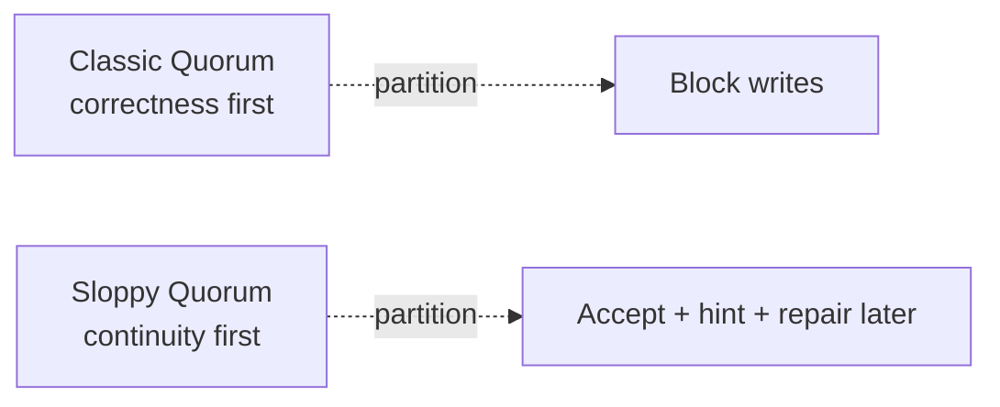

---

## 22. Scope Matters: Local vs Global Quorum

### The scenario that changes everything

So far we've been assuming all N replicas are nearby — maybe the same rack, maybe the same datacenter. Then every ack is ~1ms away and quorum math feels clean.

**Now your N=6 replicas are split across two datacenters:** 3 in DC1 (us-east), 3 in DC2 (us-west). Round-trip time across those WANs is **~70ms**. **Every write that requires acks from both DCs now costs at least 70ms of WAN latency.** Reads too.

And when the inter-DC link flaps (and WAN links flap constantly), **writes across DCs stall or fail**. Users in DC1 can't write because DC2 is unreachable, even though DC1 is perfectly healthy.

### The question — what does "quorum" even mean in multi-DC?

You have two reasonable but very different interpretations:

**GLOBAL quorum (Cassandra calls this `EACH_QUORUM`):** Need a majority across *all* replicas, in both DCs. Every write pays WAN latency. Partitions between DCs stall everything.

**LOCAL quorum (Cassandra calls this `LOCAL_QUORUM`):** Need a majority within *this DC's* replicas. Other DCs replicate async. Writes stay fast; eventual consistency across DCs.

### Side-by-side

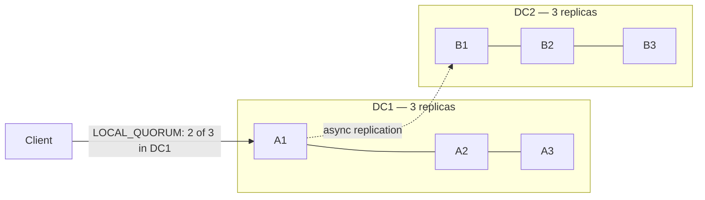

| Choice | Latency per write | Behavior under inter-DC partition | Consistency guarantee |
|---|---|---|---|
| **GLOBAL / EACH_QUORUM** | WAN RTT (~70ms+) | **Stalls** — can't reach the other DC | Strong across all DCs |
| **LOCAL_QUORUM** | Local RTT (~1ms) | Each DC keeps serving locally | Strong within DC; eventual across DCs |

### The pragmatic multi-region default

Most production systems default to **LOCAL_QUORUM** because WAN partitions are frequent and user-facing writes can't afford 70ms of best-case latency.

The tradeoff you're accepting: **cross-DC updates are eventual.** A user who writes in DC1 and then reads from DC2 immediately might see stale data for a few hundred milliseconds (whatever the async replication lag is). For most workloads, that's acceptable. For strict ones (financial ordering, inventory), it's not — and you push those to a consensus-backed store (§25) rather than fight physics with leaderless quorums.

> **Takeaway:** "Quorum" alone is underspecified in multi-region systems. **Always say WHICH set of replicas the quorum spans.** LOCAL vs GLOBAL is often the single biggest decision in a multi-region design.

---

## 23. Failure Scenarios — What Quorum Does and Does Not Protect

| Failure | What breaks | What saves you |
|---|---|---|
| Replica crashes after ack but before WAL fsync | Durability | Define ack = after fsync |
| Coordinator dies mid-write | Partial state across replicas | `write_id` dedupe + retry on client |
| Partition isolates minority side | Writes can't reach W from home replicas | Sloppy quorum + hinted handoff |
| Clock skew + LWW | Silent lost update | HLC / server-assigned ts / CRDT |
| Concurrent writes to different coordinators | Two "winners" | Vector clocks → siblings or CRDT merge |
| Fallback crashes before handoff | Hint lost | Durable hint WAL + anti-entropy backstop |
| Long outage of a home replica | Unbounded hint growth | TTL, cap size, backpressure |
| Hot key on down primary | Load concentrates on fallbacks | Rate-limit fallbacks, shed load |

---

## 24. Design Checklist — Saying "We Use Quorum" Isn't Enough

When you spec a quorum design, pin down **all of these**:

- [ ] Model: **leader-based** (Raft/Paxos) or **leaderless** (Dynamo-style)
- [ ] N / R / W values and whether they're per-request tunable
- [ ] Quorum **scope**: single DC, multi-DC, LOCAL vs GLOBAL
- [ ] **Ack semantics**: memory / WAL / fsync / applied
- [ ] **Sloppy quorum** enabled? bound on ring walk? max hint age?
- [ ] **Hint durability**: WAL-backed? TTL? size cap? backpressure trigger?
- [ ] **Versioning**: LWW (wall) / LWW (HLC) / vector clocks / CRDT / siblings
- [ ] **Conflict handling**: auto-merge / return siblings / reject
- [ ] **Repair**: read-repair + anti-entropy schedule + Merkle tree chunk size
- [ ] **Idempotency**: `write_id` propagation, replica-side dedupe window
- [ ] **Timeouts**: client timeout vs coordinator timeout vs replica timeout
- [ ] **Observability**: hint queue depth, read-repair rate, divergence detected, coordinator timeouts

---

## 25. Decision Flow — Classic, Sloppy, or Consensus?

```mermaid
flowchart TD
  Q1{Need linearizability<br/>or single global order?}
  Q1 -- Yes --> CON[Leader-based consensus<br/>Raft / Paxos / ZAB]
  Q1 -- No --> Q2{Can tolerate temporary<br/>divergence + merge?}
  Q2 -- No --> CON
  Q2 -- Yes --> Q3{Must stay writable during<br/>home-replica outages?}
  Q3 -- No --> CLQ[Classic Quorum<br/>R+W>N, versioning]
  Q3 -- Yes --> SLQ[Sloppy Quorum<br/>+ Hinted Handoff<br/>+ Anti-entropy]
```

---

## 26. Worked Example — N=5 Loyalty Points Store

**Goals:** 99.99% write availability, usually-fresh reads, partitions happen, no customer-visible rollbacks.

| Choice | Value | Why |
|---|---|---|
| N | 5 | Tolerate 2 failures |
| W | 3 | Durable propagation, overlap with R=3 |
| R | 1 (hot path) / 3 (statement/balance) | Latency on hot path, freshness when it matters |
| Sloppy quorum | **ON** for writes | Preserve availability under partition |
| Durability | WAL fsync before ack | Loyalty points → no silent loss |
| Versioning | **PN-Counter CRDT** | Points are additive; LWW would lose updates |
| Timestamps | HLC | Cross-node ordering sanity |
| Repair | Hinted handoff + Merkle anti-entropy nightly | Both opportunistic and systematic |
| Idempotency | `write_id` per request, 24h dedupe window | Retry safety |
| Scope | LOCAL_QUORUM per region | Avoid WAN cost; async replicate across regions |

**Partition case:** 2 nodes isolated with 60% of clients.
- Classic quorum (W=3) would **block** the minority side.
- Sloppy quorum → write to 2 reachable + 1 fallback with a hint.
- On heal, PN-Counter merge is **associative + commutative** → correct balance recomputed deterministically. No lost points.

> **The lesson:** LWW on this exact design would silently lose points under concurrent redemptions. The CRDT is doing the real work; the quorum is just getting the data to enough places to merge.

---

## 27. Two Insights to Pair With the Consensus Ones

4. **Quorums give evidence, not truth.** `R + W > N` is set intersection — the merge rule, versioning, and ack semantics are what turn evidence into correctness.
5. **Sloppy quorum is availability on credit.** Hinted handoff + anti-entropy are the repayment. If you don't pay the debt, divergence compounds silently.

---

# Part C — Gossip Protocols (Epidemic Dissemination)

> **One-line mental model:** Gossip = **periodic pairwise exchanges** that approximate broadcast with **bounded per-node work** and **eventual convergence**. It's a *reconciliation* mechanism, not a *consensus* one.

## 28. Why Gossip Exists — The Scaling Property

### The problem at scale

Your cluster has 10,000 nodes. You need to:
- Know which nodes are alive right now.
- Propagate feature flag changes.
- Spread "node X is removed from service" quickly.

Try the obvious approaches:

**Option 1: Central registry.** Every node reports its state to one authoritative server; everyone queries that server. Problem: that server is a **single point of failure**, and at 10,000 QPS of health updates it melts. If it's partitioned, nobody knows anything.

**Option 2: All-to-all pings.** Every node pings every other node. Problem: that's **O(n²) = 100 million** ping flows for 10K nodes. Your network dies around 1,000 nodes.

**Option 3: Hierarchical trees.** Elegant, but every internal node becomes a bottleneck/SPOF, and failures of middle nodes are painful.

**The question:** can we spread information at scale **without any centralized coordinator** and **without quadratic traffic**?

### The gossip answer

Each node periodically picks a small, fixed number `k` of random peers (typically 1–5) and exchanges information with them. That's it. **Each node does constant work per round, regardless of cluster size.**

| Approach | Traffic per node | Total cluster traffic | Failure mode |
|---|---|---|---|
| Central registry | O(1) | O(n) | **SPOF**; registry melts under load |
| All-to-all | O(n) | **O(n²)** | Dies ~1k nodes |
| **Gossip** | **O(k) constant** | **O(n)** linear | **Degrades gracefully**; no SPOF |

> That constant `k` is the whole game. 10 nodes or 10,000 nodes — each node does the same amount of work. The system's capacity grows with the cluster.

### How information actually spreads

An update starts at one node. Each round, that node tells `k` others. Then those `k+1` nodes each tell `k` more. Then those tell `k` more. The number of informed nodes **doubles roughly every round** (until saturation).

```mermaid
flowchart LR
  subgraph Round1["Round 1: 1 informed"]
    A1((A)) -->|rumor| B1((B))
  end
  subgraph Round2["Round 2: 2 informed → 4"]
    A2((A)) -->|rumor| C2((C))
    B2((B)) -->|rumor| D2((D))
  end
  subgraph Round3["Round 3: 4 → 8"]
    E3[...]
  end
  subgraph RoundN["Round log₂ n: everyone"]
    Many[all 10,000 nodes]
  end
  Round1 --> Round2 --> Round3 --> RoundN
```

### The convergence intuition — why O(log n) rounds

If each informed node tells 1 new node per round, the informed set **doubles each round**:

- Round 0: 1 informed
- Round 1: 2
- Round 2: 4
- Round 3: 8
- ...
- Round `k`: `2^k`

To reach everyone in a cluster of n nodes, you need `k = log₂(n)` rounds. For n=10,000, that's ≈ **13 rounds**. If a round is 500ms, full convergence takes ~6.5 seconds. **A rumor can reach 10,000 machines in less time than a page load.**

### The catch: the tail is slow

The exponential growth is only true until the cluster is **mostly** informed. Once ~half the nodes know, every push has a 50% chance of hitting someone who already knows — wasted. The last 1% of uninformed nodes can take **as many rounds** to inform as the first 99% did.

This is why real systems don't just use push gossip. They combine:
- **Push** for the fast exponential early phase.
- **Pull** or **push-pull** for the slow tail (uninformed nodes actively ask).
- **Anti-entropy** as a periodic safety net that catches any node that fell through the cracks.

> **Takeaway:** gossip trades a small amount of per-node work for the ability to scale indefinitely. The "exponential spread" headline is real for the body of the distribution; the tail is what engineering actually optimizes.

---

## 29. Three Modes — Push, Pull, Push-Pull

### The design choice

When two nodes talk, who tells whom what? Three natural answers, each with a very different performance profile:

- **Push:** "I'll tell you what I know. You listen."
- **Pull:** "Tell me what you know. I'm asking."
- **Push-Pull:** "Let's swap. Here's mine; what's yours?"

Why does the choice matter? Because the **efficiency of each mode depends on how far along the gossip is.**

### The intuition — which mode wins when

Think about an update that's spreading through a cluster of 1000 nodes:

**Early phase (just 5 nodes know):** When an informed node pushes to a random peer, there's a 995/1000 ≈ 99.5% chance the peer doesn't know yet. **Push works great** — almost every message is useful.

**Late phase (995 nodes know, 5 don't):** When an informed node pushes to a random peer, there's a 995/1000 ≈ 99.5% chance the peer **already knows**. **Push wastes almost every message.**

Pull is the mirror image. Early (nobody knows), pulling from a random peer gives you nothing. Late (almost everyone knows), pulling from a random peer almost certainly fills your gap.

### What this looks like in protocol form

```mermaid
sequenceDiagram
  participant I as Informed node
  participant U as Uninformed node
  Note over I,U: PUSH — good EARLY
  I->>U: here is the update
  Note over I,U: PULL — good LATE
  U->>I: tell me what I'm missing
  I->>U: here are the updates you lack
  Note over I,U: PUSH-PULL — good EVERYWHERE
  I->>U: my digest + my new updates
  U->>I: my digest + my new updates
```

### Side-by-side

| Mode | Shines when | Falls apart when |
|---|---|---|
| **Push** | Few know (early) | Many know (late) — wasted messages |
| **Pull** | Many know (late) | Few know (early) — nothing to pull |
| **Push-Pull** | Every phase | Bigger payloads per round |

### The production answer

For almost anything you care about — membership, config, feature flags — the information will go through both phases. You don't want to be fast at one and slow at the other. **Default to push-pull.** It's slightly more expensive per exchange, but the exchange count to full convergence is dramatically lower than either push alone or pull alone, especially for the tail (last 1%).

> Rule of thumb: push alone for "fire-and-forget approximate metrics," pull alone for "I periodically ask for the latest," push-pull for anything with a convergence SLO that includes the tail.

---

## 30. What Gets Gossiped — State vs Delta vs Digest

### The question that determines your bandwidth budget

Two nodes meet to gossip. What exactly do they put in the payload?

- Node A has 1,000 known facts about the cluster. Node B has mostly the same facts, with maybe 5 that are newer than A's.
- A straightforward implementation would just dump "all 1,000 facts" into every message. That's bandwidth suicide at scale.

**You need to design your payload strategy carefully.** Three main choices:

### The three strategies

#### 1. State-based ("I'll just tell you everything I know")

The sender dumps its full state (or a large subset) into every message. B compares against its own and keeps whichever is newer per entry.

- ✅ **Dead simple.** Hard to get wrong.
- ✅ **Self-healing.** Lost messages don't permanently diverge — the next round re-sends everything.
- ❌ **Bandwidth explodes** at scale: 10K nodes × 1KB per entry × every round = megabytes per gossip exchange.

**Fits:** small clusters, small state (e.g., <1,000 nodes).

#### 2. Delta-based ("Here's just what changed since we last talked")

Sender keeps track of "what did I tell B last time?" and sends only new/changed entries.

- ✅ **Tiny messages.** Almost no bandwidth in steady state.
- ❌ **Fragile:** if the delta message is lost — and gossip runs over UDP where losses are routine — **that update is now permanently missing between A and B** unless something else fixes it later.
- ❌ **Bookkeeping cost:** sender has to track per-peer "last ack'd version." Hard at scale.

**Fits:** paired with anti-entropy as a safety net. Alone, it silently diverges.

#### 3. Digest + fetch ("Here's a tiny summary; ask for what you need")

A compact digest: for each entity, just `(id, version)`. Not the full data — just enough to see "do we agree?" The receiver spots entries where its own version is older and **fetches** only those.

- ✅ **Bounded message size** regardless of state size.
- ✅ **Only transfers what's actually needed.**
- ❌ Extra RTT (compare digests, then fetch).
- ❌ Chunking complexity if digest itself gets too big.

**Fits:** large clusters, large state. This is the production default for membership (e.g., Cassandra, Consul).

### Side-by-side

| Strategy | Payload size | Loss tolerance | Complexity | Best for |
|---|---|---|---|---|
| **State-based** | Big | High (next round re-sends) | Low | Small clusters |
| **Delta-based** | Tiny | **Low — lost delta = permanent gap** | Medium (per-peer tracking) | Hot updates + anti-entropy backup |
| **Digest + fetch** | Small (bounded) | Medium | High (chunking) | Large production clusters |

### The production answer — don't pick one, use both

Real systems combine **rumor mongering** (fast delta spread for hot, recent updates) with **anti-entropy** (periodic digest-based reconciliation of all state). The two cover each other's weaknesses:

| | Rumor mongering (deltas) | Anti-entropy (digests) |
|---|---|---|
| Speed | Fast (hot path) | Slow (background) |
| What it catches | New updates | Everything, including old missed updates |
| What it misses | **Lost deltas, cold entries** | Nothing eventually |

> **Takeaway:** delta-only designs silently diverge. State-based designs don't scale. The production answer is almost always "digests + fetch for backbone, deltas for hot path, anti-entropy as the catch-all." Three layers, each covering different gaps.

---

## 31. SWIM — The Canonical Failure Detector

### The problem — detecting failures accurately in a huge cluster

You have 10,000 nodes. You need to know when a node has died — fast enough to stop routing traffic to it, but **slow enough that you don't incorrectly mark healthy nodes dead** every time a packet drops.

**Why not just "A pings B every second; if B misses 3 pings, B is dead"?**

Because a missed ping can mean many things:
- B is actually dead ✅
- B is GC-paused for 2 seconds
- The network path **from A to B** is lossy (but other paths to B are fine)
- A's own socket is backlogged
- A random UDP packet got dropped

If you declare "DEAD" on every missed ping, you'll flip the entire cluster into chaos every time a switch has a bad second.

### The SWIM answer — three ideas that work together

**SWIM** = **S**calable **W**eakly-consistent **I**nfection-style **M**embership. Three insights:

**1. Direct probe.** Every T seconds, each node picks **one random peer** and pings it. Not every peer — just one. This keeps per-node work constant regardless of cluster size.

**2. Indirect probe (the trick that saves everything).** If the direct ping fails, don't give up — ask **k helper nodes** to also ping the suspect from their perspective. If any helper gets an ACK, the suspect is clearly alive and the problem is just the path from A.

**3. Suspicion → confirmation.** Even after indirect probes fail, don't jump straight to DEAD. Mark SUSPECT, **gossip the suspicion**, and give the suspect time to refute it (by broadcasting a fresh ALIVE at a higher incarnation — see §32). Only after a timeout with no refutation → DEAD.

### The probe sequence in action

```mermaid
sequenceDiagram
  participant A
  participant B
  participant H1 as Helper1
  participant H2 as Helper2
  A->>B: PING
  Note over A,B: timeout — no ACK
  Note over A: Don't declare dead yet!<br/>Try indirect.
  A->>H1: PING-REQ(B)
  A->>H2: PING-REQ(B)
  H1->>B: PING
  B-->>H1: ACK (B was fine)
  H1-->>A: ACK — B is alive
  Note over A: False positive avoided.<br/>Problem was A↔B path.
```

### Why each piece matters

| Mechanism | Prevents | Example of what it saves you from |
|---|---|---|
| Random single probe (not all-to-all) | Quadratic traffic | Cluster of 10K working on 100M pings/round |
| **Indirect probe (ping-req)** | **False DEAD from transient path issues** | GC pause, packet loss on one link |
| Suspicion before confirmation | Flapping (ALIVE/DEAD/ALIVE loops) | Brief partitions oscillating membership |
| Gossip-piggybacked updates | Membership propagation delay | Needing a separate dissemination channel |

### Why suspicion timeout scales with cluster size

In SWIM, suspicion period ≈ `k · log(N) · T` where N is cluster size.

**Why `log(N)`?** Because the suspicion itself has to propagate via gossip to reach the suspect (so it can refute) and to reach a majority of nodes (so a global decision is made). Gossip propagation is `O(log N)` rounds. If you don't give suspicion enough time to spread, you'll confirm DEAD before the real liveness information has had a chance to come back.

**Concrete numbers:** N=10,000, T=1s, k=3 → suspicion period ≈ 40 seconds. Feels slow, but prevents the worst of the false-positive storms.

> **Takeaway:** SWIM's elegance is that failure detection is a **social process**, not a point-to-point one. "I think B is dead" is a hypothesis you ask the cluster to confirm or refute, not a conclusion you reach alone.

---

## 32. The Versioning Problem — Resurrection & Flapping

### The bug we need to prevent (the "zombie" scenario)

Timeline:
1. Node X is healthy. The cluster has gossiped `ALIVE(X)` everywhere.
2. X crashes. After a few rounds, the cluster gossips `DEAD(X)`.
3. X reboots and rejoins. It starts broadcasting `ALIVE(X)`.
4. **Meanwhile**, somewhere in the network, a stale `DEAD(X)` rumor from step 2 is still bouncing between nodes.
5. That stale `DEAD(X)` message arrives at a node that just learned `ALIVE(X)` in step 3.

**Which message wins?**

If you treat gossip messages as unordered (which they are — UDP, async, out-of-order), you can't tell. A naïve implementation might apply "DEAD" on top of "ALIVE" simply because it arrived later. **X is now a zombie: alive and serving traffic, but marked DEAD everywhere.** Load balancers stop routing to it. Users see errors.

Even worse — "flapping": the alive and dead rumors keep overwriting each other as they bounce around.

### The fix — monotonic incarnation numbers

> Each node has a counter it owns. Every time it (re)starts, it increments the counter. This counter rides along in every message about that node.

So in the scenario above:
- Before crash: X's incarnation = 5. Rumors say `(X, inc=5, DEAD)`.
- After reboot: X bumps its incarnation to 6. New rumors say `(X, inc=6, ALIVE)`.
- A stale `(X, inc=5, DEAD)` arriving at a node that already has `inc=6` is simply **discarded**: lower incarnation loses.

Resurrection bug fixed by arithmetic — just like majority quorum, no clocks, no luck.

### The conflict resolution rule (two-tier)

1. **Higher incarnation wins.** Always.
2. **If incarnations are equal:** use status precedence `DEAD > SUSPECT > ALIVE`.

Why tier 2? Because during a single incarnation (one lifetime), the state progression is monotonic: a node is first ALIVE, then maybe SUSPECT, then possibly DEAD. You never want a stale `ALIVE` to overwrite a confirmed `DEAD` at the same incarnation.

```python
STATUS_RANK = {"ALIVE": 0, "SUSPECT": 1, "DEAD": 2}

def should_accept(local, incoming):
    if local is None:
        return True
    if incoming["inc"] != local["inc"]:
        return incoming["inc"] > local["inc"]      # tier 1
    return STATUS_RANK[incoming["st"]] > STATUS_RANK[local["st"]]  # tier 2
```

### Why not wall-clock timestamps?

**You might ask:** "Why not just stamp every message with `time.now()` and let the latest one win?"

Because clocks lie. Two nodes can disagree by seconds. NTP can step a clock **backwards**. A node restarting after a clock skew event could issue messages with timestamps *earlier* than its own previous messages, and lose to its own stale state.

Incarnation numbers are **node-local**, **monotonic**, and **persisted across restarts** → the only safe primitive.

### The "node refutes its own death" pattern (elegant consequence)

If node X is healthy but sees a `SUSPECT(X, inc=5)` rumor about itself:
- X knows it's alive. It increments its incarnation to **6** and broadcasts `ALIVE(X, inc=6)`.
- By tier-1 rule, this new message **immediately overrides** every stale SUSPECT/DEAD rumor at `inc=5` across the whole cluster.
- No voting, no coordinator — just arithmetic.

### Key takeaway

> **Incarnation numbers are to gossip what terms are to Raft:** monotonic per-node epochs that make eventual-consistency conflict resolution deterministic and skew-proof.

---

## 33. Rumor Mongering vs Anti-Entropy — You Need Both

### Two strategies, two different goals

When you have an update to spread, two different approaches are in tension:

**Rumor mongering:** "This is a hot rumor. Everyone pass it around aggressively for the next T seconds." Nodes push the update to random peers, flagging it as new. After some rounds (or when "most people already know"), the rumor cools down and stops being spread.

**Anti-entropy:** "Forget hot/cold. Periodically compare notes with a random peer and sync up everything that differs." Not driven by individual updates — driven by a periodic schedule.

### The scenarios where each one fails alone

**Scenario A — rumor mongering alone fails silently:**
1. Node leader generates a new config update at time T₀.
2. The update is spread aggressively for 10 rounds.
3. Due to packet loss, nodes B and C never receive it during those 10 rounds.
4. The rumor "cools down" and stops being spread.
5. **B and C now permanently diverge** from the rest of the cluster. Nobody notices until something breaks downstream.

**Scenario B — anti-entropy alone is painfully slow:**
1. Node leader generates an urgent config update (feature-flag off).
2. Anti-entropy runs every 60 seconds and reaches each peer in O(log n) rounds.
3. **The update takes minutes to fully propagate.** Users keep hitting the bad feature during that window.

### The combo covers both weaknesses

```mermaid
flowchart LR
  subgraph Rumor["Rumor mongering (hot path, fast)"]
    R1[New update] --> R2[Push aggressively<br/>for T rounds] --> R3[Cool down]
  end
  subgraph Anti["Anti-entropy (background, complete)"]
    A1[Periodic] --> A2[Exchange digests<br/>with random peer] --> A3[Repair any gaps] --> A1
  end
  Rumor -. missed nodes .-> Anti
```

| Property | Rumor Mongering | Anti-Entropy |
|---|---|---|
| Triggered by | New update event | Periodic timer |
| Speed | Fast (seconds) | Slow (minutes) |
| Catches | Fresh updates | Everything, forever |
| Risk alone | **Silent divergence** on missed packets | Too slow for urgent updates |
| Payload | Small (just the hot delta) | Larger (digests + repair data) |

### Analogy — the two kinds of news

- **Rumor mongering** = Twitter breaking news. Spreads fast, dies fast. Not everyone sees it.
- **Anti-entropy** = the quarterly newsletter. Slow, but *everyone* eventually reads it. If you missed the tweet, the newsletter catches you up.

A healthy information ecosystem has both. So does a healthy gossip system.

### Takeaway

> Rumor mongering alone = fast + silent divergence. Anti-entropy alone = correct + slow. **Together** = fast correctness, with the slow process as a safety net for anything the fast process missed.

---

## 34. Partitions — The Thing Gossip Does Not Solve

### The limit of gossip's power

Gossip is beautifully resilient to lots of failures: random packet loss, slow nodes, GC pauses, individual crashes. But there's one failure mode gossip **cannot** overcome: a **network partition** that fully disconnects two groups of nodes.

If no messages can cross between the groups, no amount of random pairwise exchange will reconcile them. Information literally cannot flow.

### What actually happens during a partition

```mermaid
flowchart LR
  subgraph P1["Partition 1 — DC-east (healthy)"]
    A --- B --- C
    A -. gossip .- B
    B -. gossip .- C
  end
  subgraph P2["Partition 2 — DC-west (healthy)"]
    D --- E --- F
    D -. gossip .- E
    E -. gossip .- F
  end
  A -. no path .- D
  Note1[Each side converges to its OWN view.<br/>Both sides think the other is DEAD.<br/>Reconciliation only happens AFTER heal.]
```

- **Partition 1** gossips among `{A, B, C}` and converges to the belief: "D, E, F are DEAD."
- **Partition 2** gossips among `{D, E, F}` and converges to: "A, B, C are DEAD."
- **Both views are internally consistent.** Both are wrong about the other side.
- Neither side can tell the difference between "the other side is dead" and "we can't reach the other side right now." **From inside a partition, these look identical.**

### Independent loss vs correlated loss

Not all failures are equal:

| Failure type | Example | What gossip does |
|---|---|---|
| **Independent random loss** | 1% of UDP packets drop randomly | Slows down slightly; still converges fine |
| **Correlated loss / partition** | Whole AZ unreachable; ToR switch down; cross-region link cut | **Breaks into disconnected components.** Convergence impossible until heal. |

The first case is what gossip's probabilistic design handles effortlessly. The second case is what breaks the model entirely.

### What this means philosophically

> In a gossip-based membership system, **"dead" is unknowable.** It's always really "unreachable from where I'm standing, right now."

That's why gossip systems are **AP under CAP**: during partition, each side stays available but gives up on global consistency. Nobody blocks waiting for the other side. Nobody has the "true" membership — everyone just has their best local view.

### The easily-missed topology trap

Here's a bug lurking in many real systems: your gossip picks peers "at random" from the membership list, so you assume cross-AZ information spreads evenly. **It doesn't.**

Same-rack / same-AZ peers reply faster (lower latency), so they tend to be selected more often by any mechanism that includes response time. Over time, your "random" sampling drifts into "mostly local" sampling. The result:
- Information inside an AZ converges fast.
- Cross-AZ convergence slows dramatically.
- **During a cross-AZ incident, each AZ ends up with a stale/biased view of the other.**

**The fix:** topology-aware weighted sampling. Guarantee a minimum share of peers in **other** racks/AZs/regions, even if they're slower. "At least 1 out of every K peers must be from a different AZ."

> **Takeaway:** gossip handles the normal small failures elegantly. It does nothing for partitions — those require anti-entropy *after* the network heals. And make sure your peer selection isn't accidentally local-biased, or you'll have cross-AZ divergence you didn't ask for.

---

## 35. Mental Model — Gossip Is Reconciliation, Not Delivery

| You wanted | What gossip gives |
|---|---|
| Reliable broadcast | Probabilistic high-coverage spread |
| Totally ordered log | Nothing — use consensus |
| Linearizable config | Nothing — use a CP store |
| Approximate metrics / "who's alive" | ✅ Perfect fit |
| Hint of "cache X was invalidated" | ✅ (if correctness tolerates miss) |
| Must-deliver security revocation | ❌ Needs ack + authoritative store |

> **Treat gossip output as a hint, not a fact.** Correctness lives in the layer that consumes the hint.

---

## 36. Convergence Math (Just Enough)

### Why bother with the math at all?

Because without it, you'll set SLOs wrong. Product asks: "Can we guarantee a feature flag reaches all 10,000 nodes within 5 seconds?" and you'll either underestimate (SLO breached in production) or overestimate (over-engineer).

The math gives you a feel for **what gossip can and cannot promise**.

### The two phases of a gossip spread

Imagine an update starts at **1 node** in a cluster of **n = 10,000**. Each round, every informed node pushes to 1 random peer.

**Phase 1 — exponential growth (the body)**
- Round 0: 1 informed.
- Round 1: ~2.
- Round 2: ~4.
- Round k: ~2^k.
- At round log₂(n) ≈ **13**, we hit ~half the cluster.

In this phase, almost every push lands on an uninformed node. Each round roughly doubles the informed count. **Fast, predictable, satisfying.**

**Phase 2 — the long tail (the pain)**
Once ~half the cluster is informed, every push has a ~50% chance of hitting someone who **already knows** → wasted effort. The informed count keeps growing but more slowly.

Mathematically, the probability a specific node is **still uninformed** after round `r` with `I` informed nodes decays like:

```
P(still uninformed) ≈ (1 − 1/n)^(I · r)
```

For a specific node to drop to <1% probability of ignorance, you need many more rounds than log₂(n). **The last 1% of nodes can take as many rounds as the first 99%.**

```mermaid
flowchart LR
  R0[Round 0: 1] --> R1[2] --> R2[4] --> R3[8] --> Rk[~5000 half] --> Tail[Rounds log n to 2 log n:<br/>tail mop-up]
  style Tail fill:#ff8a80
```

### Why this matters for production SLOs

Imagine round time = 500ms. For n=10,000:
- **p50 convergence:** reached in ~13 rounds ≈ 6.5 seconds. Looks great in a demo.
- **p99 convergence:** can be 20–30 rounds ≈ 10–15 seconds. This is the number product cares about.
- **p99.9 convergence (last few nodes):** can be 40+ rounds. These are the "why doesn't this node have the feature flag?" tickets.

> If you promise "update reaches everyone in X seconds," you have to promise based on p99 (or worse), not p50.

### The levers you have

| Lever | Effect |
|---|---|
| **Increase fanout `k`** (push to more peers per round) | Shortens body ×≈ 1/log(k+1); shortens tail more dramatically |
| **Switch to push-pull** | Dramatically shortens the tail (uninformed nodes actively ask) |
| **Add anti-entropy** | Guarantees eventual convergence of absolute stragglers |

Doubling `k` from 1 to 2 roughly halves convergence time but doubles bandwidth. The tradeoff is linear in bandwidth, logarithmic in time.

### Takeaway

> **Gossip's p50 convergence is "wow, that's fast." Gossip's p99 is "oh, that's where production bugs come from."** Build for the tail — push-pull as the default, anti-entropy as the safety net, and SLOs that acknowledge the long distribution.

---

## 37. Tuning Knobs — Failure Detection Is a Control System

| Knob | Effect of ↓ (lower) | Effect of ↑ (higher) |
|---|---|---|
| Probe interval T | Faster detection, more load, more false positives | Slower detection, less load |
| Fanout k | Narrower spread, slower convergence | Faster spread, more bandwidth |
| Direct probe timeout | More false SUSPECTs under latency | Slower detection |
| Suspicion timeout | Faster DEAD, more flapping | Slower DEAD, safer under GC |
| Max payload bytes | More rounds, more RTTs | Fragmentation risk, bursty load |

### The feedback loop to avoid
```mermaid
flowchart LR
  Load[High load] --> Lat[High latency] --> FP[False SUSPECT]
  FP --> Gos[Gossip storm about SUSPECT]
  Gos --> Load
  style Gos fill:#ff8a80
```

**Mitigations:**
- **Adaptive timeouts** based on observed RTT p99 (**phi-accrual-style**: instead of a fixed "declare dead after X ms," you compute a continuously-updated *suspicion level* from the recent response-time distribution — so a transiently slow network raises suspicion gradually, not catastrophically).
- **Rate-limit** suspicion dissemination.
- Separate traffic classes: **probes** should not share a queue with **anti-entropy bulk sync**.
- Keep **GC pause ≪ suspicion timeout**.

---

## 38. The Digest / Delta Exchange — Minimal Correct Loop

```mermaid
sequenceDiagram
  participant A
  participant B
  A->>A: build digest {nodeId -> (inc, status)}
  A->>B: PUSH-PULL REQ(id, digest_A)
  B->>B: compute delta where my ent > A's version
  B->>B: compute what A has newer (ask for it)
  B-->>A: RESP(id, delta_B_newer, ask_list)
  A->>A: apply delta_B_newer (respecting incarnation + rank)
  A-->>B: delta_A_for_ask_list
  B->>B: apply (same rules)
```

**Correctness essentials this loop must honor:**
- **Correlate** request/response (UDP reorders) with an `id`.
- **Bound payload** (`< MTU` or chunk).
- **Conflict resolution** = incarnation first, status rank second.
- **Idempotent apply** — duplicate messages must be safe.

---

## 39. Hybrid Designs — Gossip + Something Stronger

### Why pure gossip isn't enough for everything

Gossip is a great **distribution** mechanism, but it has no notion of "truth." If three nodes disagree, gossip doesn't vote — it eventually converges to whatever version-resolution rule you picked, which may or may not be the "right" answer.

For **some data**, that's fine. For other data, it's a disaster.

### The classification that matters

Not all information in your cluster has the same correctness requirements. Separate it into **tiers**:

**Tier 1 — Soft state (approximate is fine).**
Load averages, queue depths, cache sizes, approximate metrics. If one node has slightly stale data, your system still works correctly.

- Where it lives: nowhere canonical.
- How it spreads: **gossip only.**
- Example of "wrong": one load balancer thinks node B is 30% utilized when it's actually 35%. Doesn't matter.

**Tier 2 — Membership (gossip-native, best-effort truth).**
Who's alive, who's reachable, who holds which shard. There's some truth here, but no single oracle — each node has its own view by definition.

- Where it lives: distributed gossip view (SWIM).
- How it spreads: **gossip + SWIM failure detection.**
- Example of "wrong": LB sends a request to a node that just died. Painful but recoverable via retry.

**Tier 3 — Hard state (correctness-critical, has a single source of truth).**
Feature flags, auth tokens, security revocations, config, pricing rules.

- Where it lives: **CP store** (Raft/etcd/ZooKeeper).
- How it spreads: pub/sub for push; gossip as *supplementary* fast-hint; **anti-entropy against the authority** for repair.
- Example of "wrong": a revoked session token still accepted somewhere. **This is a security incident.**

### The hybrid architecture

```mermaid
flowchart LR
  CP[(CP Store<br/>Raft/ZooKeeper/etcd<br/>SOURCE OF TRUTH)] -->|push authoritative updates| Pub[Pub/Sub stream]
  Pub --> Edge1[Edge node]
  Pub --> Edge2[Edge node]
  Pub --> Edge3[Edge node]
  CP -. edges periodically reconcile .-> Edge1
  Edge1 <-->|gossip hints<br/>for soft state only| Edge2
  Edge2 <-->|gossip hints| Edge3
  style CP fill:#ffd54a
```

**The flow:**
1. Hard state is written to the CP store (consensus-backed, single source of truth).
2. Updates are pushed to edges via a pub/sub stream (fast).
3. **Edges periodically reconcile their cached state against the CP store** (anti-entropy — but against the authority, not against each other).
4. Edges also gossip among themselves for soft state (loads, hints).

### The rule you must enforce

> **Gossip can be the DISTRIBUTION layer, but NEVER the DECISION layer, for anything correctness-critical.**

If a node's cached config disagrees with the CP store, the CP store wins. **Always.** No "majority of my peers also think the token is valid, so I'll serve it" — that's exactly how security revocations fail.

### The hardest decision — fail-open or fail-closed?

When an edge node can't reach the CP authority (partition, DNS outage, whatever), what should it do?

| Policy | Behavior | Risk |
|---|---|---|
| **Fail-open** | Keep serving with the last cached config | High availability. **Revoked credentials may still work.** |
| **Fail-closed** | Deny the request | Safe. **Outage amplifies** — every service dependency breaks. |

**There is no universally right answer. Pick explicitly per data class:**

| Data | Correct policy | Why |
|---|---|---|
| **Auth tokens / session revocations** | Fail-closed | A revoked token being accepted = security incident |
| **Feature flags** | Fail-open | A feature briefly stuck "on" is annoying, not dangerous |
| **Pricing rules** | Depends — if briefly stale pricing could be exploited, fail-closed |
| **Rate limits** | Fail-open at reasonable default | Users complaining is better than full outage |

> **Takeaway:** the hybrid pattern isn't a workaround — it's the correct architecture. Gossip gets you scale and resilience for approximate data. CP gets you correctness for the small set of things that must be right. Separate them cleanly, and make the fail-mode an explicit decision per data class.

---

## 40. Security Model

Default gossip assumes **crash faults, not Byzantine**. In adversarial / multi-tenant settings, add:

- **mTLS + authN** on every message. Unauthenticated gossip = any node can falsely declare any other DEAD.
- **AuthZ** on what a node can claim (nodes should only mutate their own entry at a higher incarnation).
- **Rate-limiting** per source — one compromised node shouldn't flood.
- **Message signatures with monotonic nonces** if you need non-repudiation / replay protection.
- **Sybil resistance** is hard — generally handled at the admission layer (certs, service accounts), not gossip.

> If you sign messages, remember you've added a new failure domain: key rotation, clock-based nonce bugs, and sign/verify CPU cost.

---

## 41. Observability — What To Actually Monitor

| Metric | Why it matters |
|---|---|
| **Convergence p50 / p99** (seconds to reach X% of nodes) | SLO truth |
| **Membership divergence** (pairwise view diff on sentinels) | Direct cause of routing errors |
| **SUSPECT rate** | Early signal of instability |
| **False-positive rate** (SUSPECT → ALIVE flips) | Timeout is too tight |
| **Gossip bytes/sec per node** | Capacity planning + runaway detection |
| **Anti-entropy repair volume** | Rumor-mongering health |
| **Incarnation churn** per node | Reboot loops / network flaps |

### Sampling divergence without O(n²)
- Pick a few **sentinel nodes** (e.g., load balancers) and compare their membership maps.
- Hash the sorted membership map → compare hashes across the fleet.
- Alert when hash classes exceed a threshold.

---

## 42. Common Misconceptions

| Myth | Reality |
|---|---|
| "Gossip is eventually consistent, so it's safe for anything" | Unsafe for invariants requiring coordination (uniqueness, mutex, revocation) |
| "Higher fanout = reliable broadcast" | More probable, not deterministic. No ACKs, no ordering. |
| "Gossip is random, so unpredictable" | It's **probabilistic and tunable** — model it, don't hand-wave |
| "Gossip handles partitions" | It handles **churn**. Partitions require anti-entropy after heal. |
| "Rumor mongering alone is enough" | Lost rumors silently diverge. Pair with anti-entropy. |

---

## 43. Decision Flow — Do I Need Gossip?

```mermaid
flowchart TD
  Q1{Is eventual + approximate OK?}
  Q1 -- No --> C[Use consensus / pub-sub]
  Q1 -- Yes --> Q2{Does cluster size scale beyond central registry?}
  Q2 -- No --> R[Simple registry is fine]
  Q2 -- Yes --> Q3{Can tolerate O log n propagation delay?}
  Q3 -- No --> P[Pub-sub with ack]
  Q3 -- Yes --> G[Gossip + anti-entropy<br/>+ incarnation versioning]
```

**Perfect gossip use-cases:** membership, failure detection, approximate load/queue depth, cache peer discovery, aggregate counters/sketches.
**Terrible gossip use-cases:** security revocations, totally ordered events, exactly-once operations, mutex.

---

## 44. Worked Design — 3-Region, 2k-Per-Region Membership

| Decision | Choice | Why |
|---|---|---|
| Mode | **Push-pull** | Good across phases, strong tail |
| Versioning | **Per-node incarnation** + status rank | Deterministic, skew-proof |
| Failure detection | **SWIM with indirect probe** | Avoids false DEAD from GC/network blips |
| Suspicion timeout | **~ k · log(N) · T** | Scales with cluster |
| Peer selection | **Topology-aware weighted random** | Guarantees cross-AZ paths |
| Payload | **Digest + fetch**, cap < MTU | Bounded bandwidth |
| Repair | **Rumor mongering** (hot) + **anti-entropy** every ~30s | Both speed and correctness |
| Bootstrap | **Seed list** (DNS/directory) + join snapshot + rate limit | New nodes don't melt seeds |
| Security | **mTLS**, only self-mutate at higher incarnation | Prevents impersonation |
| Observability | Convergence p99, divergence hash on sentinels, SUSPECT/false-positive ratio | Catch regressions |

**Partition of region C for 5 min:**
- A and B converge locally; C converges locally.
- On heal: anti-entropy exchanges digests → incarnation + status-rank rules reconcile deterministically.
- Nodes that restarted during partition bumped incarnation → their newer state wins without conflict.

---

## 45. Gossip Protocol Checklist

- [ ] Define exactly what's gossiped (state / delta / digest)
- [ ] **Incarnation numbers** per node + status precedence rule
- [ ] Bounded fanout `k`, bounded payload, MTU-aware
- [ ] Push-pull (not push-only) for anything with a long tail
- [ ] **Rumor mongering + anti-entropy** — never just one
- [ ] Indirect probes for failure detection (SWIM-style)
- [ ] Adaptive / phi-accrual timeouts; GC pause ≪ suspicion
- [ ] Topology-aware peer selection (cross-AZ guarantees)
- [ ] Separate QoS: probes vs anti-entropy vs app traffic
- [ ] mTLS + per-node self-mutation authZ in untrusted envs
- [ ] Metrics: convergence p99, divergence hash, SUSPECT rate, FP rate, byte/s per node
- [ ] Bootstrap (seed list + join snapshot + seed rate limit)
- [ ] For hard state: back gossip with an **authoritative CP store**, pick fail-open vs fail-closed per data class

---

## 46. Three Insights to Pair With the Previous Five

6. **Gossip is reconciliation, not delivery.** It approximates broadcast; it doesn't guarantee it. Treat its output as a **hint**.
7. **Incarnation numbers are to gossip what terms are to Raft.** Monotonic per-node epochs are what make eventual conflict resolution deterministic.
8. **Correctness-critical state never lives in gossip.** Gossip is the **distribution** of truth, never the **source** of it. Pair with a CP store whenever "wrong" is unacceptable.

---

# Part D — Merkle Trees for Data Synchronization

> **One-line mental model:** A Merkle tree is a **hierarchy of receipts** that lets two replicas answer *"do we match?"* with one hash, and *"where do we differ?"* with O(log n) more hashes. It's §18 blown up into its full teaching form.

## 47. Why Merkle Trees Exist — The 10-Million-Key Problem

### The scenario

You run a user-profile service with replicas in us-east and us-west. 10 million keys per region. A network partition hits — each side accepts different writes for 20 minutes. When it heals, you need to **find which keys differ and reconcile them**.

The constraints are brutal:
- Shipping all 10M keys over the WAN is ~100 GB. Not acceptable.
- You can't trust clocks (skew). So no "latest timestamp wins everywhere."
- You need to run this **continuously** as part of ongoing anti-entropy, not just after partitions.

### The naïve options and why they fail

| Approach | Why it dies |
|---|---|
| Ship all key-value pairs | ~100 GB per sync cycle |
| Ship all `(key, hash(value))` | ~200 MB per sync cycle — still bad at continuous cadence |
| Ship all keys in sorted order | Still proportional to **dataset size**, not **divergence size** |

The real question: **can we send bandwidth proportional to how different we are, not how big we are?**

### The Merkle idea in one sentence

> Hash the data **hierarchically**. Exchange the top hash first. If roots match → identical, zero further transfer. If roots differ → recurse only into children that differ, until you reach the actual differing keys.

For 10M keys with 100 differences, you exchange maybe 1,000 hashes total instead of 10M. **Bandwidth is proportional to divergence × log(dataset), not dataset size itself.**

### Where Merkle trees show up (so you recognize the pattern)

- **Cassandra / Dynamo-style stores:** anti-entropy repair uses Merkle trees per token range.
- **Git:** every object (blobs, trees, commits) is content-addressed by hash → the whole repo is a Merkle DAG. That's why `git fetch` can transfer only what you don't have.
- **Blockchains (Bitcoin, Ethereum):** Merkle roots commit to transaction sets; SPV clients verify inclusion without downloading full blocks.
- **ZFS, IPFS:** chunk trees for verifying and syncing filesystems/content.

### Key takeaway

> **Merkle trees reduce diff-discovery bandwidth from O(dataset) to O(divergence · log(dataset)).** The CPU/IO cost of building and maintaining the tree is often the real bottleneck — Merkle trees shift the problem from network to compute.

---

## 48. What They Are NOT — The Big Misconception

Someone in a design review says: *"We'll use Merkle trees to make our replicas consistent."* **This is wrong.**

### The scenario that exposes it

Replica A has `{balance: 100}`. Replica B has `{balance: 90}`. Merkle sync tells you with high confidence: **"these differ."** Beautifully, with 10 bytes of exchanged hashes instead of streaming values.

Now what? The tree says nothing about:
- **Which value is correct.** Is 100 the right one, or 90?
- **How to merge.** Do you overwrite? Add them? Keep both?
- **How to prevent the next divergence** — Merkle finds, it doesn't prevent.

### Merkle trees give you only two things

| Does | Doesn't |
|---|---|
| **Detect** divergence (yes/no) | Decide which side wins |
| **Localize** divergence (where) | Merge values |
| | Impose any ordering/causality |
| | Prevent future divergence |

### What you must pair them with

The actual "which value wins" layer uses one of:
- **Vector clocks / dotted version vectors** → detects concurrency, hands off to app merge
- **CRDTs** → deterministic merge for specific data types (counters, sets)
- **LWW with HLC** → simple, bounded-safety by timestamp (NOT wall-clock)
- **Application-level reconciliation** → return siblings, let the app pick

Which pairing you use is decided in §19 (Versioning). Merkle trees are agnostic — they just hand you a bag of divergent keys.

### Decision game — only one is true

- A) Merkle trees guarantee linearizability.
- B) Merkle trees help identify which partitions of data differ between replicas.
- C) Merkle trees prevent split-brain.

**Answer: B.** They're a detector, not a decider.

### Key takeaway

> **Merkle trees = efficient diff discovery. Period.** They sit *below* your versioning/conflict-resolution layer. Mixing those two responsibilities is the source of most Merkle-related bugs in production.

---

## 49. The Tree Structure — "A Tree of Receipts"

### The warehouse analogy

You're a delivery manager verifying inventory. You could compare every box individually (slow) or build a hierarchy of receipts:

- `hash(box)` for every physical box.
- `hash(shelf) = hash(hash(box1) || hash(box2) || …)` for the collection of boxes on each shelf.
- `hash(aisle) = hash(hash(shelf1) || …)` for the collection of shelves.
- `hash(warehouse) = hash(hash(aisle1) || …)` — the root.

Compare the warehouse hash first. If equal → entire inventory matches. If not → recurse down into mismatching aisles → mismatching shelves → mismatching boxes.

### What that looks like as a diagram

```mermaid
flowchart TB
  Root["Root hash<br/>H all data"] --> N1["H(ranges 1..500k)"]
  Root --> N2["H(ranges 500k..1M)"]
  N1 --> L1["H(keys 1..250k)"]
  N1 --> L2["H(keys 250k..500k)"]
  N2 --> L3["H(keys 500k..750k)"]
  N2 --> L4["H(keys 750k..1M)"]
  L1 -. covers actual keys .-> K1["k1,k2,...,k250k<br/>values"]
```

### The vocabulary

| Term | Meaning |
|---|---|
| **Leaf** | Hash summarizing one chunk of data (a key range, a page, or sometimes one key) |
| **Internal node** | Hash of its children's hashes — summarizes a subset of the tree |
| **Root** | Single hash summarizing the entire dataset |
| **Arity** | How many children per internal node (binary = 2, 16-way, etc.) |
| **Depth** | log_arity(number of leaves). Determines number of round trips in sync. |

### The one property that makes it work

> **If any single key changes, its leaf hash changes, which changes every ancestor hash up to the root.**

That property is what guarantees "roots equal ⇒ datasets equal" (with cryptographic probability). And "roots differ ⇒ there is a path from root to leaf where every node differs" — that's the path your sync protocol walks to find the divergence.

### Key takeaway

> A Merkle tree is a **progressive refinement index** over divergence. One hash compares two datasets. Each level you descend halves (or 1/16ths) the search space.

---

## 50. Determinism — The Thing That Breaks First

### The scenario

Replica A and B have **identical data**. You run Merkle sync. **Roots differ anyway.** Why?

Almost always: **non-deterministic tree construction.** The two replicas computed hashes over the same data but got different results because something about how they walked/encoded/ordered the data was inconsistent.

### The determinism checklist

For replica A and B to compute the same root over the same logical data, **all of these must match**:

| Thing | Why it matters |
|---|---|
| **Hash function** | SHA-256 ≠ BLAKE3; both sides must agree |
| **Key ordering** | `[a, b, c]` ≠ `[b, a, c]` for concatenation-based hashing |
| **Partition boundaries** | If A puts keys 1-500 in leaf 0 and B puts keys 1-512 in leaf 0, every hash differs |
| **Value canonicalization** | `{"a":1,"b":2}` ≠ `{"b":2,"a":1}` as bytes — JSON needs sorted keys |
| **Encoding** | UTF-8 vs UTF-16; same string, different bytes, different hashes |
| **Tombstone inclusion** | If one side includes delete markers and the other doesn't, leaves differ |

### The canonical leaf-hashing recipe

```python
def leaf_hash(items: dict) -> bytes:
    digest = hashlib.sha256()
    for k in sorted(items.keys()):                       # 1. deterministic order
        v_bytes = json.dumps(items[k],
                             sort_keys=True,              # 2. canonical JSON
                             separators=(",", ":")).encode("utf-8")
        entry = k.encode("utf-8") + b"\x00" + hashlib.sha256(v_bytes).digest()
        digest.update(entry)                              # 3. hash per entry, not raw concat
    return digest.digest()
```

### What about hash collisions?

A common worry: "What if two different subtrees hash to the same value? We'd miss a difference!" **In practice, this is not the problem.** SHA-256 has a collision probability of 2^-128 — you'd need to hash more objects than there are atoms in the galaxy before expecting one.

The real failures are:
- **Inconsistent canonicalization** between replicas
- **Different partition boundaries**
- **Bugs in incremental maintenance** (§59)
- **Non-cryptographic hashes** (xxHash, CRC) with adversarial multi-tenant inputs

If your system takes untrusted input, you need SHA-256/BLAKE3 or an **HMAC** keyed with a cluster secret — not xxHash. Not for collision safety, but to prevent adversaries from crafting values that make different data hash identically (§63).

### Key takeaway

> **Merkle trees need deterministic structure, or they'll detect "differences" that aren't real.** The hash function is almost never the thing that breaks — it's canonicalization, ordering, and partition boundaries that catch teams out.

---

## 51. Tree Shape — Arity and Leaf Granularity

### The two decisions you have to make

**1. Arity.** Binary tree? 16-way? 256-way?
**2. Leaf granularity.** One key per leaf? 4,000 keys per leaf? One entire SSTable per leaf?

Both tradeoffs are between **network round trips, maintenance cost, and diff precision**.

### Arity — depth vs per-node payload

```mermaid
flowchart LR
  subgraph Binary["Binary tree (arity 2)"]
    direction TB
    B1[Root] --> B2[.] --> B3[.] --> B4[.] --> B5[leaf]
  end
  subgraph Wide["16-way tree"]
    direction TB
    W1[Root] --> W2[.] --> W3[leaf]
  end
```

| Arity | Depth for 1M leaves | Hashes per comparison step | Shines when |
|---|---|---|---|
| **Binary (2)** | ~20 levels → 20 RTTs | 2 child hashes per step | Low RTT (same DC) |
| **16-way** | ~5 levels → 5 RTTs | 16 child hashes per step | Cross-region (high RTT) |
| **256-way** | ~3 levels → 3 RTTs | 256 hashes per step → ~8KB payload | Very large, cross-region |

**Rule of thumb:** cross-region (RTT ~70ms) → higher arity (fewer round trips). Same datacenter (RTT ~1ms) → binary is fine (lower per-message cost).

### Leaf granularity — precision vs tree size

| Leaf granularity | Tree size | Diff precision | Leaf-exchange cost |
|---|---|---|---|
| 1 key per leaf | **Huge** (1 leaf per key) | Perfect: exact mismatching key | Tiny per leaf |
| 4K keys per leaf | Reasonable | Fetch 4K keys of metadata per mismatch | Medium |
| Entire SSTable per leaf | Small | Fetch whole SSTable metadata per mismatch | Large |

**The tradeoff visualized:** when 3 keys differ out of 1M:
- 1-key leaves: tree has 1M leaves (massive maintenance), but only 3 leaves get flagged
- 4K-key leaves: tree has 250 leaves (easy), but you exchange metadata for 12K keys to find the 3 real diffs

**Production default:** align leaves with your storage engine's natural chunking (SSTable, B-tree page, token range). Size them 4K–64K keys. This minimizes random I/O during leaf rebuild.

### Decision game — only one is true

- A) "More leaves always means faster synchronization."
- B) "Higher arity reduces tree depth but increases per-node fanout comparison cost."
- C) "Merkle trees eliminate the need for read repair."

**Answer: B.** More leaves ≠ faster; it means more maintenance. Merkle complements read-repair, doesn't replace it (§62).

### Key takeaway

> **Merkle trees are a tunable index.** You trade build/maintenance cost for diff precision, and tree depth for per-RTT bandwidth. Pick arity and leaf size based on *where the sync happens* (RTT) and *what your storage engine naturally chunks*.

---

## 52. The Anti-Entropy Protocol — Guided Search

### The scenario

Replica A wants to sync with replica B. They have no shared state yet. Walk through what actually goes on the wire.

### The protocol in six steps

```mermaid
sequenceDiagram
  participant A
  participant B
  A->>B: Hello (tree_id, snapshot_id, root_hash)
  Note over B: compare with my root
  alt roots match
    B-->>A: done, no diff
  else roots differ
    B-->>A: send children of root
    A-->>B: here are my 16 children hashes
    Note over B: find mismatching children, recurse
    B->>A: send children of node N
    A-->>B: 16 hashes for node N
    Note over A,B: descend only into mismatching paths
    B->>A: send leaf metadata for mismatching leaf L
    A-->>B: (key, version, value_hash) list
    Note over B: diff per-key, request only missing values
    B->>A: fetch keys {k1, k2, k3}
    A-->>B: values + versions
  end
```

Essentially: **compare root → compare children → descend only into mismatching subtrees → reach leaves → exchange metadata → fetch only truly different values.**

### Why this is "guided search," not scanning

At each level you prune ~half (or more) of the tree. If one leaf differs out of 1M:
- Binary tree: 20 steps to localize, 20 hash comparisons.
- 16-way: 5 steps, 5·16 = 80 hash comparisons.

Compared to streaming 1M keys. **Many orders of magnitude cheaper for small divergence.**

### What must be in every message

Not shown in most tutorials, but critical in production:

| Field | Prevents |
|---|---|
| `tree_id` | Confusing trees for different data sets (e.g., different token ranges) |
| `snapshot_id` | Comparing hashes computed over different versions of data (§53) |
| `node_path` | Ambiguity when multiple sync sessions interleave |
| `request_id` | Request/response correlation under reorderable transport |

**Without `snapshot_id`, the whole thing silently breaks** when writes happen during sync. See §53 and §54.

### Key takeaway

> Merkle sync is a **guided descent**: each level cuts the search space by the arity. The hashes don't carry data; they carry *directions* to the data that matters.

---

## 53. The Moving Target Problem — Snapshots & Versioning

### The scenario

A builds its Merkle tree at 10:00 (dataset = S_A). B builds its tree at 10:03 (dataset = S_B). In those 3 minutes, 50,000 writes landed on both. Now they compare:
- A's root reflects state S_A.
- B's root reflects state S_B.
- They differ — but **the difference is just "we built our trees at different times,"** not "we're actually inconsistent."

Worse: by the time you descend into leaves to "repair" the differences, both sides have changed again. **You chase your tail and never converge.**

### Three ways to deal with it

**1. Snapshot-based (preferred for correctness)**

Build the tree over a consistent MVCC snapshot of the data:
- A takes snapshot `S@10:00`, builds tree, tags all messages with `snapshot_id = S@10:00`.
- B takes snapshot `S@10:00` (or close enough using an equivalent LSN/version), builds tree.
- Both compare hashes **over the same frozen state**.
- Writes during sync don't disturb the comparison.

Downside: snapshots consume storage, extend compaction, and if the snapshot API doesn't exist, you can't do this at all.

**2. Incremental tree maintenance**

The tree is a live data structure updated on every write. Each write marks the affected leaf dirty; a background job rehashes the leaf and propagates the hash up to the root.

- Pros: no snapshot cost; tree always reflects current state.
- Cons: complex concurrency; subtle correctness bugs; hashes change under you mid-sync (needs locking or epoch IDs).

**3. Fuzzy continuous sync (accept the churn)**

Just run anti-entropy continuously and tolerate false positives. Eventually, under steady state, convergence happens.
- Simple.
- Burns bandwidth. Convergence slow under heavy write load.
- Still needs **bounded retries** (per-range cap) or hot ranges can starve the sync loop.

### Side-by-side

| Approach | Correctness | Cost | Complexity |
|---|---|---|---|
| **Snapshot-based** | Deterministic convergence | Storage + compaction overhead | Low (if engine supports snapshots) |
| **Incremental** | Correct if locking is right | Low maintenance cost | High (easy to introduce bugs) |
| **Fuzzy continuous** | Eventually correct | High bandwidth under write pressure | Trivial |

### Key takeaway

> **Hashes are only meaningful relative to the dataset version they summarize.** If you don't version your sync, you'll compare apples to oranges and "repair" them to apples with chunks of orange. Snapshot IDs on every message are the correct answer; fuzzy sync with bounded retries is the practical fallback.

---

## 54. Failure Modes — Version Mismatch is the Dangerous One

### Decision game — which is the most dangerous unhandled failure?

- A) A child-hashes message is **duplicated**.
- B) A child-hashes message is **lost**.
- C) A node sends child hashes computed from a **different tree version** than the root hash it previously advertised.

**Answer: C.**

### Why C is catastrophic

- **Duplication (A)** → with idempotent handling (and `request_id`), the receiver just drops the dupe. Harmless.
- **Loss (B)** → timeout → retry → fine.
- **Version mismatch (C)** → **you descend into the wrong subtree.** The child hashes you get are from state T_1, but the root they're supposedly children of was from state T_0. You end up fetching keys that don't actually differ in T_0 or missing keys that do. **You might repair data to the wrong version, corrupting replicas.** This is the subtle, silent failure mode.

### The protection — tie hashes to a snapshot ID everywhere

Every message carries:

```
(tree_id, snapshot_id, node_path, hashes[], request_id)
```

If the receiver sees `snapshot_id` doesn't match what it expected (e.g., sender rebuilt its tree mid-sync, or sender crashed and restarted at a different version):
1. **Abort this sync session.**
2. Restart from the root with the new `snapshot_id`.
3. **Never partially apply** repairs from an inconsistent descent.

### The protocol struct that gets this right

```python
@dataclass(frozen=True)
class MerkleChildrenResponse:
    snapshot_id: str      # must match the Hello's snapshot_id
    tree_id: str
    node_path: str        # e.g. "0/3/15" for arity-16 trees
    child_hashes_hex: list[str]
    request_id: str
    error: str | None = None
```

**No `snapshot_id` field = no safety.** This is the field most tutorials omit and most production bugs trace to.

### Key takeaway

> **The subtle Merkle failure mode isn't collisions or network errors — it's using hashes from one snapshot to interpret the structure of another.** Version everything end-to-end; restart on mismatch.

---

## 55. Token Ranges — The Dynamo Pattern

### The scenario

You run a Dynamo/Cassandra-style store with consistent hashing. Each node owns many **token ranges** (vnodes). Different replica sets cover different ranges. You want anti-entropy, but running one giant Merkle tree over the whole dataset makes no sense:
- Different ranges have different replica sets → different sync peers.
- A single tree over 10B keys has absurd depth and build cost.
- You want ranges to repair in **parallel** across nodes.

### The pattern

> **Build one Merkle tree per token range** (per vnode). Anti-entropy sync happens *per range*, between the nodes that actually own that range.

```mermaid
flowchart TB
  subgraph Ring["Consistent hash ring"]
    T1[Range 0-99] --> M1[(Merkle tree 1)]
    T2[Range 100-199] --> M2[(Merkle tree 2)]
    T3[Range 200-299] --> M3[(Merkle tree 3)]
    T4[Range 300-...] --> M4[(Merkle tree 4)]
  end
  M1 -. sync .- Replicas1[Replicas of range 0-99]
  M2 -. sync .- Replicas2[Replicas of range 100-199]
```

### Why this alignment matters

| Problem | Range-aligned Merkle solves it by |
|---|---|
| Different ranges have different replica sets | Each tree only compared between its range's replicas |
| Massive dataset makes tree too deep | Each tree covers a bounded chunk (maybe millions of keys, not billions) |
| Rebalancing moves ranges between nodes | Discard tree on move, rebuild on new owner — scoped blast radius |
| Parallelize repair | Multiple ranges repair concurrently to different peer sets |

### What happens during rebalancing

When a token range moves to a new owner (new node joins, old node leaves):
1. **Pause any in-flight repair for that range.** Don't compare across ownership epochs.
2. **Discard the old owner's Merkle tree** for the range.
3. **New owner rebuilds** its Merkle tree from its freshly-received data.
4. **Resume repair** against the new replica set.

Mixing ownership epochs would cause the same silent-corruption class as version mismatches in §54.

### Key takeaway

> **In Dynamo-style systems, Merkle trees are scoped to the natural unit of replication — the token range.** This aligns the sync protocol with the ownership topology and enables parallel, bounded, resumable repair.

---

## 56. Leaf Exchange — Versions, Not Values

### The scenario

Your descent has reached a mismatching leaf covering 4,000 keys. You know **something** in there differs. What goes on the wire next?

**Naïve option:** ship all 4,000 full values. Wasteful — probably only a handful actually differ.

**Smart option:** exchange a compact per-key fingerprint, diff those, then fetch only the truly different values.

### The leaf-level diff round

```mermaid
sequenceDiagram
  participant A
  participant B
  Note over A,B: Mismatching leaf = key range [k_i, k_j]
  A->>B: send per-key fingerprints<br/>list of (key, version, value_hash)
  B->>B: diff against local fingerprints
  B->>A: fetch keys {k_42, k_87, k_301}
  A->>B: values + versions for those 3 keys
```

### What to put in each fingerprint

Three pieces matter:

| Field | Purpose |
|---|---|
| `key` | Identifies which record |
| `version` (vector clock / dot / HLC) | Lets you distinguish concurrent updates from one-side-is-ahead |
| `value_hash` | Cheap confirmation that values are byte-identical (catches silent corruption) |
| `tombstone_flag` | Distinguishes "key doesn't exist" from "key was deleted at version V" |

**Why `version` separately from `value_hash`?** Two reasons:
1. Two replicas with the same value_hash and different versions = benign (same payload, different causal context).
2. Different versions = genuine divergence that needs application-level merge, not just "pick newer."

### The three outcomes per key

| Case | A has | B has | Action |
|---|---|---|---|
| Only on A | key@v | — | B fetches from A |
| Only on B | — | key@v | A fetches from B |
| Versions comparable (`a.version > b.version`) | key@v2 | key@v1 | B takes A's value |
| Versions concurrent | key@v_a | key@v_b | **Fetch both** → upstream merge (CRDT or siblings) |

The last case is why Merkle alone isn't enough — see §48. Merkle hands you the bag of divergent (key, version_a, version_b) tuples; something above you decides what to do.

### Why this is bandwidth-efficient

A per-key fingerprint is maybe 40–60 bytes (key + version vector + hash). For 4,000 keys that's ~240 KB. Then you fetch *only* the 3 actually-different values. Compare to shipping 4,000 full values (several MB).

### Key takeaway

> **Merkle narrows the search to a leaf. Per-key fingerprints narrow the leaf to actual mismatches. Full value transfer happens only for genuinely different keys.** Each stage trades a bit of CPU for a lot of bandwidth.

---

## 57. Worked Example — Finding 3 Bad Grains in 1 Million

### The setup

- 1,000,000 keys per replica.
- 16-way Merkle tree.
- Leaves cover 4,096 keys each → ~244 leaves → tree depth 3 (16 × 16 × 16 ≈ 4096 internal paths over 244 leaves).
- Replica A and B differ on **exactly 3 keys**, spread across 2 different leaves.

### The sync, step by step

**Step 1: compare roots.**
- 1 hash exchanged. Roots differ. Continue.

**Step 2: compare 16 children of root.**
- 16 hashes exchanged. 2 of 16 differ. Prune 14 subtrees.

**Step 3: compare children of the 2 mismatching nodes.**
- 2 × 16 = 32 hashes exchanged. Say 2 total leaves flagged across those 32.

**Step 4: at each mismatching leaf, exchange per-key fingerprints.**
- 2 leaves × 4,096 keys × ~50 bytes = ~400 KB of fingerprints.
- Compare client-side; find exactly 3 keys that differ.

**Step 5: fetch 3 values.**
- Few hundred bytes to few KB total.

### Totals

| Stage | Hashes/bytes exchanged |
|---|---|
| Root compare | 1 hash (32B) |
| Level 1 compare | 16 hashes (512B) |
| Level 2 compare | 32 hashes (1KB) |
| Leaf fingerprints | ~400 KB |
| Actual value transfer | ~3 KB |
| **Total** | **~400 KB** |

Compare to the naïve "ship all values" approach: ~500 MB for 1M keys at 500B each. **Merkle saved 3 orders of magnitude.**

### The crucial observation

Almost all the bandwidth (~400 KB of ~405 KB) was spent on the leaf-level fingerprint exchange, not the tree descent itself. **Leaf granularity drives bandwidth more than arity does** — this is why the §51 leaf-size tradeoff matters so much.

### Key takeaway

> **Merkle bandwidth is proportional to divergence × leaf-size, plus log terms for the descent.** For small divergence, the tree descent is almost free; the per-leaf exchange is the real cost — and that's directly controlled by your leaf granularity choice.

---

## 58. When Merkle Fails — Massive Divergence

### The scenario

A replica was offline for 3 weeks. It missed 50 million updates out of your 100 million total keys. You run Merkle sync.

- Root differs.
- Every child of root differs.
- Every grandchild differs.
- **Every leaf differs.**
- You now have to exchange fingerprints for all 100M keys and fetch ~50M values.

**You've paid the full cost of Merkle traversal and gained nothing.** You might as well have streamed the whole dataset.

### The breaking point

Merkle only wins when divergence is **sparse**. As divergence approaches 50% of leaves, every pruning opportunity disappears, and you're left with the overhead of tree walks on top of the data transfer anyway. Rough rule of thumb:

- Divergence < 1% of leaves → Merkle shines (10×–1000× bandwidth savings).
- Divergence 1–10% of leaves → Merkle still useful.
- Divergence > ~20–30% of leaves → consider alternatives.

### The alternatives for massive divergence

| Alternative | How it works | Best when |
|---|---|---|
| **Log-based catch-up (WAL/CDC)** | Replay missed operations from a durable log | You have ordered history and the replica knows its position |
| **Snapshot transfer** | Stream a compact snapshot of the full dataset, then resume incremental | New node bootstrap, or replica is beyond log retention |
| **Hybrid** | Snapshot/log for bulk catch-up; Merkle for subsequent anti-entropy | Node reconnecting after extended outage |

### How systems like Cassandra handle it

- **Hinted handoff** (§17) covers short outages (hours).
- **Merkle anti-entropy repair** covers routine small divergence.
- **Bootstrap/full repair** for very large gaps or new node joins.
- **Streaming** (sstableload / CDC) for log-based catch-up.

Multiple mechanisms, each for a different regime. **No single tool wins everywhere.**

### Key takeaway

> **Merkle trees are a sparse-divergence tool.** When replicas have drifted enough that most of the tree differs, the smart move is to **not** use Merkle — fall back to log replay or snapshot transfer. Know your tool's operating regime.

---

## 59. Incremental Maintenance & Tombstones

### The problem with rebuilding from scratch

Each anti-entropy cycle, you need current hashes. The naïve approach: scan all data, rebuild the tree, done. For 1M keys at 500B each, that's 500MB of reads per cycle. **Repair becomes an IO storm.**

### The two incremental approaches

**1. Dirty-range marking.**
On every write, mark the affected leaf range as "dirty." A background job scans only dirty ranges and recomputes their leaf hashes, then propagates up the tree.

```python
# Sketch
class MerkleRangeState:
    def mark_dirty(self, leaf_range):
        self.dirty.add(leaf_range)

    def recompute_dirty_in_background(self):
        for r in self.dirty:
            self.leaf_hashes[r] = hash_scan(r)
            self.propagate_up(r)
            self.dirty.remove(r)
```

- ✅ Only touches modified ranges.
- ⚠️ Requires careful locking: don't read a dirty range mid-recomputation.

**2. SSTable-aligned leaves.**
Each SSTable is a leaf. Compute hash once at SSTable flush. Rebuild only on compaction (new SSTables).

- ✅ Zero amortized cost at write time.
- ⚠️ Tree shape changes on every compaction → fine as long as both replicas use the same tree-shape (unlikely in general) OR use *logical* ranges above the SSTable layer.

### The common pitfall — "rolling hash"

A tempting bug: maintain the leaf hash as `h_new = H(h_old || new_entry)` on every write. **This is wrong** because:
- It's order-dependent (same keys written in different orders → different hashes).
- You can't recompute it without replaying every write.
- Writes to the same key multiple times accumulate "noise."

**The right pattern:** leaf hashes come from a **deterministic iteration** of the leaf's current entries, computed from scratch when the leaf is marked dirty. Not from write-time running state.

### Tombstones — the "phantom equality" trap

**Scenario:** Replica A deleted key `x` at version 5. It stores a **tombstone**: `(x, deleted@v5)`. Replica B has never seen `x`.

- A's leaf hash **includes the tombstone**.
- B's leaf hash **does not include `x` at all** (key is absent).
- **The hashes differ** — correctly, because they *are* in different states.

Now imagine the opposite: both replicas hash tombstoned-and-absent keys the same way (both treat `x` as "not there"). The leaves match. **A later repair from an old replica that still has `x@v3` would resurrect the deleted key!** This is the dreaded **deletion resurrection** bug.

### The rule

> **Tombstones must participate in the hash until it is proven safe to garbage-collect them.** "Safe" means every replica that could potentially serve or repair that key has already observed the tombstone.

In Cassandra, this is `gc_grace_seconds` — the duration during which tombstones are kept and included in Merkle hashing. Set it too short and you resurrect deleted data; set it too long and you accumulate dead rows.

### Key takeaway

> **Keep incremental maintenance aligned with your storage engine's stable chunking, never compute hashes with order-dependent rolling state, and always include tombstones in the hashed state until GC-safe.** All three of these rules exist because they prevent a specific class of silent corruption.

---

## 60. Merkle + Quorum + Read Repair — Who Does What

### The scenario

Your system has `N=3, R=2, W=2`. Someone asks: *"Why do we need Merkle anti-entropy on top of quorum reads/writes?"*

Because the three mechanisms protect **different divergence paths**.

### What each one does and misses

| Mechanism | Trigger | What it covers | What it misses |
|---|---|---|---|
| **Quorum (R+W>N)** | Every read/write | Catches disagreement on reads via version comparison | Doesn't fix cold keys; doesn't fix replicas that fell behind |
| **Read repair** | Opportunistic, on client reads | Fixes divergence for *keys that are actually read* | **Cold keys never get touched** — permanent silent divergence |
| **Hinted handoff** | Write-time, when a replica is down | Catches up writes that happened during the outage | Doesn't help with silent corruption, lost hints, pre-outage divergence |
| **Merkle anti-entropy** | Background, scheduled | **Full coverage, including cold keys** | Expensive if divergence is massive (§58) |

### Decision game — only one is true

- A) "With R+W>N, Merkle trees are unnecessary."
- B) "Merkle trees and read repair both fix divergence, but on different triggers."
- C) "Read repair guarantees full convergence without anti-entropy."

**Answer: B.** Read repair only touches hot keys; Merkle is the "night shift audit" that catches cold-key drift.

### The analogy

- **Quorum** = "I have 3 witnesses to the transaction; majority agrees."
- **Read repair** = "A customer complained; I fixed the one receipt they noticed."
- **Hinted handoff** = "You were out sick; here are the receipts you missed."
- **Merkle anti-entropy** = "Nightly inventory audit; everything on the shelves matches the books."

Each catches a different class of error. Pulling one out leaves a hole.

### Key takeaway

> **Merkle isn't a replacement for quorum or read-repair — it's the third layer that catches what the others miss.** Any eventually-consistent store that skips background anti-entropy will accumulate silent divergence on cold keys over time.

---

## 61. Security, Multi-Tenancy, and Operational Gotchas

### Security: hashes can leak

**Scenario:** You run a multi-tenant store. Nodes in different trust domains participate in anti-entropy. One peer is slightly curious.

Hashes feel safe — they're one-way, right? But a Merkle protocol leaks more than you think:
- **Presence/absence patterns** of keys at known positions.
- With small leaves and guessable keys, hashes can be **brute-forced** (precompute `H(known_key)` and look for matches).
- With non-cryptographic hashes, an adversary can craft **colliding values** to hide differences or trigger pathological descents.

**Mitigations:**
- **HMAC** instead of plain SHA-256, keyed with a cluster secret. Hashes become meaningless to anyone without the key.
- **Transport encryption (mTLS)**.
- **Larger leaves** → less per-position information leaked.
- For strict threat models: privacy-preserving set reconciliation protocols (significantly more complex).

### Operational gotchas — what breaks in production

**Hot partitions.** Ranges with heavy writes churn during sync — snapshot comparisons go stale, dirty-range marks never stabilize, repair never completes for that range. **Fix:** skip highly-volatile ranges and revisit them later; or ship logs instead for hot ranges.

**Compaction storms.** Rebuilding Merkle trees reads data at the same time compaction is writing it. Disk IO saturates, p99 latency spikes, repair starves out client traffic. **Fix:** rate-limit repair IO; schedule off-peak; use separate IO queues for repair vs client traffic.

**Repair amplification.** Too-small leaves → tiny tree-descent savings, but massive per-leaf fingerprint exchange. **Fix:** tune leaf granularity (§51); 4K–64K keys per leaf is a reasonable starting point.

**Topology changes mid-repair.** Range ownership moves to a different node → in-flight repair compares across different ownership epochs → silently wrong (§55). **Fix:** pause/restart repair on topology events.

**Snapshot creation cost.** If snapshots are expensive (locking, extra IO), consistent snapshots can themselves cause latency regressions.

**Observability gaps.** You can't tell if repair is helping or hurting. Must monitor: per-range last-repaired time, bytes compared vs transferred, mismatch rates, p99 client latency during repair, dirty-leaf backlog.

### Decision game — slow vs fast but starving?

Which is more dangerous: repair that takes forever to complete, or repair that runs fast but starves client traffic?

**Answer: fast-but-starving.** Slow repair means divergence lingers longer, but the system still serves users. Starving repair triggers client timeouts → retries → more load → cascading failovers → more divergence. The feedback loop makes it worse than slow repair.

### Key takeaway

> **Merkle sync is a background protocol — resource governance matters as much as correctness.** HMAC your hashes for untrusted environments, rate-limit everything in production, make topology/compaction-aware pauses explicit, and monitor repair as a first-class subsystem.

---

## 62. Design Checklist & Synthesis

### Checklist — a Merkle anti-entropy spec must pin down

- [ ] **Hash function:** SHA-256 or BLAKE3 (not CRC/xxHash for anything untrusted)
- [ ] **HMAC keyed hashing** if multi-tenant or exposed to untrusted peers
- [ ] **Determinism:** sorted keys, canonical JSON, same partition boundaries, same encoding across replicas
- [ ] **Arity** (binary vs 16-way vs 256-way) — based on RTT
- [ ] **Leaf granularity** — aligned with storage engine chunking (SSTable/B-tree page/token range)
- [ ] **Tree shape:** per token range, not one giant global tree
- [ ] **Snapshot ID in every message** — restart on mismatch
- [ ] **`request_id` + idempotency** for retries
- [ ] **Tombstone inclusion** until GC-safe
- [ ] **Incremental maintenance strategy:** dirty-range marking vs full rebuild — never order-dependent rolling hash
- [ ] **Leaf exchange payload:** `(key, version, value_hash, tombstone_flag)`
- [ ] **Pair with versioning** — vector clocks / HLC / CRDTs; Merkle only detects
- [ ] **Rate limits** on repair bandwidth, concurrency, and IO
- [ ] **Topology-change handling** — pause/restart on range reassignment
- [ ] **Fallback for massive divergence** — log replay or snapshot transfer
- [ ] **Observability:** per-range last-repaired, mismatch rates, bytes compared vs transferred, client p99 during repair

### Synthesis — the mental model that predicts behavior

**Merkle trees are:**
- A **hierarchy of receipts** — one hash summarizes the whole; descending reveals specific divergent ranges.
- A **tool for anti-entropy** — background reconciliation, not real-time consistency.
- A **detector**, not a decider — pairs with versioning (vector clocks / CRDTs) for merge semantics.
- A **sparse-divergence specialist** — amazing for 0.01% drift, useless for 50% drift.

They connect to:
- **Replication topology** → trees scoped to token ranges / vnodes.
- **Versioning semantics** → leaf exchange carries `(version, value_hash)` for conflict detection.
- **Storage engine constraints** → leaves aligned with SSTables/pages for cheap maintenance.
- **Operational realities** → rate limits, topology-aware scheduling, snapshot IDs.

### Final decision game — geo-replicated KV store

You're designing a 12-node, 3-region store with sloppy quorums and partition-time writes. Pick the right combination:

- A) LWW timestamps + no anti-entropy
- B) Vector clocks + read repair only
- C) **Vector clocks (or CRDTs) + Merkle anti-entropy + rate-limited repair**

**Answer: C.** Only this covers cold keys (anti-entropy), handles concurrent writes correctly (vector clocks / CRDTs), and stays operationally safe (rate limits).

---

## 63. Four Insights to Pair With the Previous Eight

9. **Merkle trees reduce diff-discovery bandwidth from O(dataset) to O(divergence · log(dataset)).** They shift the cost from network to CPU/IO — know which bottleneck you have.
10. **Merkle is a detector, not a decider.** It tells you *where* replicas disagree, never *who's right*. Pair it with versioning (vector clocks, HLC, CRDTs).
11. **Hashes are meaningful only relative to the snapshot they summarize.** Version everything end-to-end; restart on mismatch. This single discipline prevents the subtle silent-corruption failure modes.
12. **Merkle breaks down under massive divergence.** It's a sparse-drift tool. For cold-start, extended outage, or bulk resync, use log replay or snapshot transfer instead — know your operating regime.
