# Flash Sale — Strategic Study Guide

**Scale anchor:** 10k identical units · millions in first 30–60s · **99.8% attempts fail** · ≤10k successful reserves.

**Study path (≈15 min):** [§0](#0-cheat-sheet-5-min) → [§1 HLD + stack](#hld--component-architecture-draw-this-on-the-whiteboard) → [§1.5–1.6](#15-redis-keys-admission--principal-qa) → [§10](#10-principal-stress-test--how-to-answer)

### End-to-end flow (summary)

1. **View item** — User loads sale page from **CDN** (static: images, copy, sale time). Optional **GET /products/:id** for price/details and **approximate** `soldOut` / “~X left” (short cache; not authoritative). **No** waiting room required to browse.

2. **Join & admit** — To buy, user joins **waiting room** (Redis queue) and **polls** status. A background **admission worker** admits **R** users/sec and returns an **admit JWT** in the poll response. The worker **does not** call Sale Service.

3. **Reserve (grant)** — Client sends **POST /reservations** with JWT. Gateway verifies token → **sold_out** check → **concurrency cap K** → **Postgres** one transaction: **SKIP LOCKED** a unit row + insert **reservation** (`ACTIVE`, `unit_id`). Response **201** or **409**. Redis does **not** decide the grant.

4. **Pay** — **POST /reservations/:id/purchases**: first DB write **ACTIVE → PAYMENT_PENDING** (same `unit_id`), **then** Stripe. Webhook **conditionally** marks **CONSUMED**; client **polls** purchase status. Expiry reclaims only **ACTIVE** holds.

5. **After commit** — **Outbox → Kafka** for email/analytics only. **Reconcile job** refreshes Redis `sold_out` / approx count from Postgres counts.

---

## 0. Cheat sheet (5 min)

### Requirements

| F | NFR (money path = **CP**: reject > oversell) |
|---|-----------------------------------------------|
| View · **Reserve 10m** · Pay · Outcome | No oversell · burst in **seconds** · fairness · sold out > crash |

### Entities & APIs

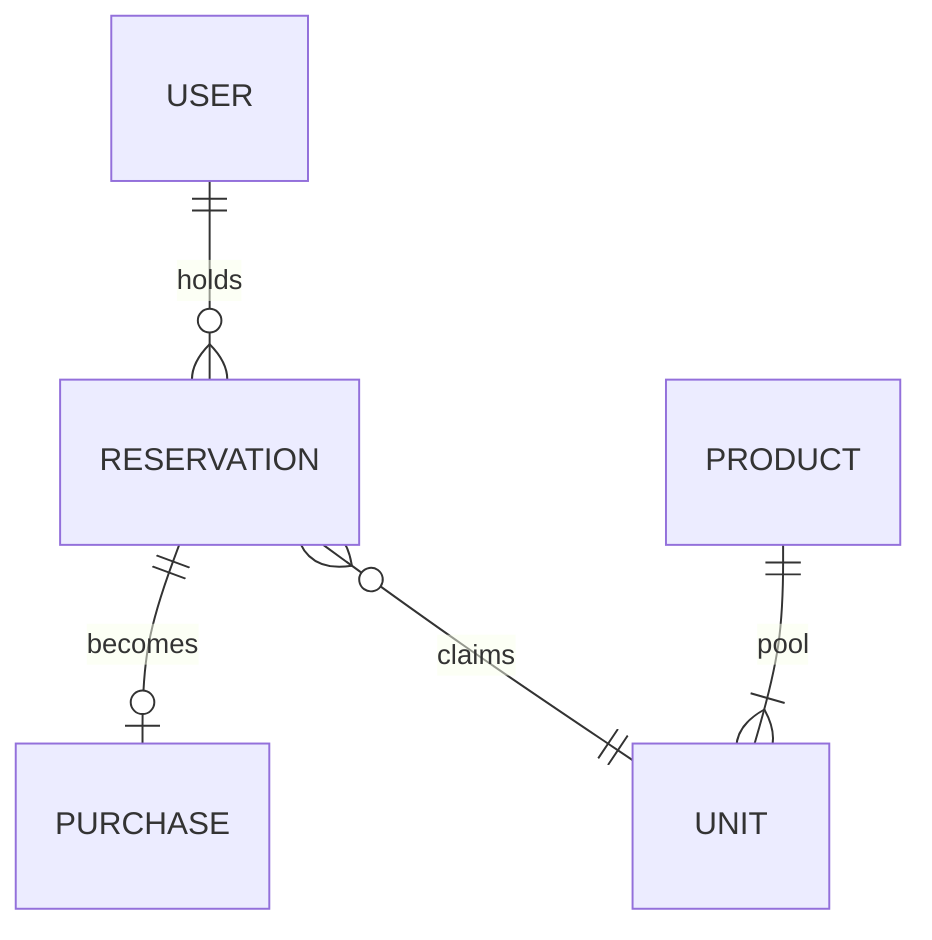

| Entity | One line |
|--------|----------|
| **Reservation** | Temporary hold (`ACTIVE` → …) |
| **Purchase/Order** | Paid outcome only |
| **ReservationUnit** | One row/slot per fungible unit (pool) |

```
GET  /products/:id
POST /products/:id/reservations  → { reservationId, expiresAt, unitId }
POST /reservations/:id/purchases   (+ Idempotency-Key)
GET  /purchases/:id                (poll; webhook lags)
```

### States

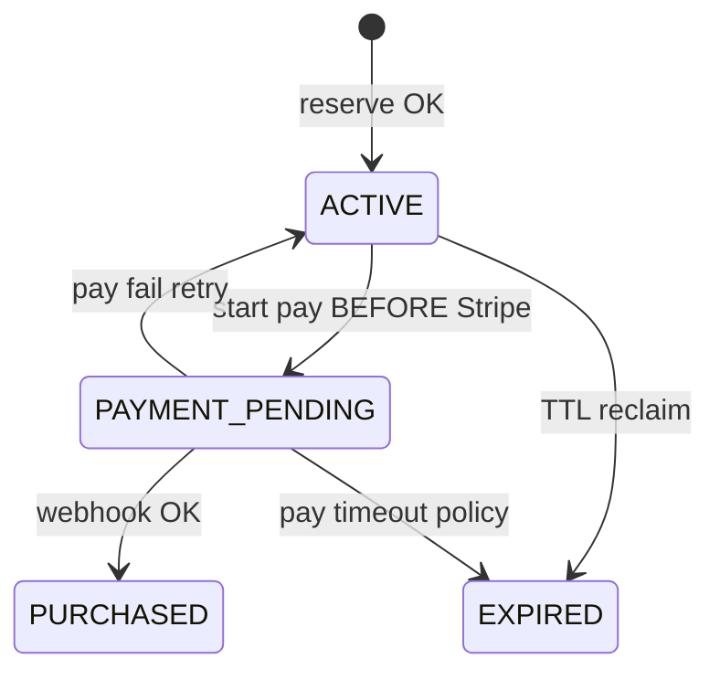

### Who owns what? (plain English)

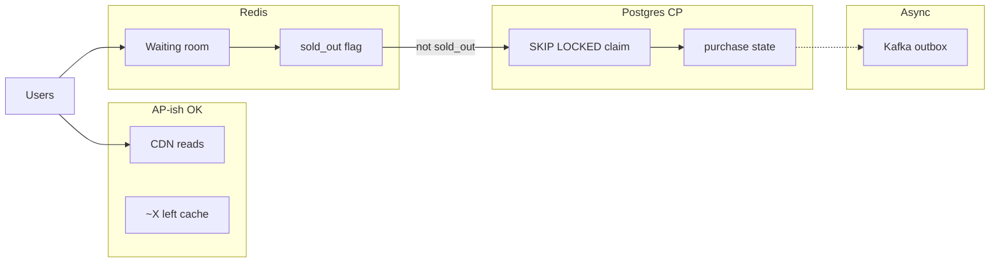

| Store | Job | Not its job |
|-------|-----|-------------|
| **Postgres** | Grant unit + reservation + payment truth | Queue position |
| **Redis** | Wait line + fast **sold out** | Final “you own unit #4823” |
| **Kafka** | Email / analytics **after** commit | Reserve button |

| **Admission worker (R)** | Background loop: admit **R** users/sec from wait queue → JWT — [§1](#admission-worker-r--what-is-it) |
| **View item** | CDN static; **live count optional/approx** — truth on reserve — [§1 view + admit](#how-admission-reaches-sale-service--push-or-poll) |

### 60s opener

View → reserve 10m → pay **that** reservation. NFR: no oversell, burst, fairness. **CDN** reads. **Redis** waiting room + sold_out. **Postgres** one TX **SKIP LOCKED** + reservation. **PAYMENT_PENDING** before Stripe. **Kafka** events only.

### Don’t

| ✗ | ✓ |
|---|---|
| Kafka on reserve path | Sync claim |
| Pay with `itemId` again | Pay `reservationId` |
| Expire during `PAYMENT_PENDING` | Reclaim `ACTIVE` only |
| Two inventory authorities | One grant writer |
| Redis DECR then PG fails (dual-write) | **PG commit first**; Redis hints after |
| Trust Redis after crash | **PG** reconciles; Redis wait line **discardable** |

---

## 1. Chosen design (default answer)

### Stack

| Layer | Pick |
|-------|------|
| Reads | CDN + stale count |
| Admission | Redis ZSET waiting room + **JWT** |
| Protect | **Concurrency cap** on in-flight reserves (bouncer **and** bar line) |
| **Grant** | **Postgres** `reservation_unit` + **`SKIP LOCKED`** + `reservation` same TX |
| Redis also | `sold_out`, wait room — **not** second stock counter |
| Expiry | On-demand reclaim when pool empty; `ACTIVE` only |
| Pay | `ACTIVE→PAYMENT_PENDING` → Stripe → conditional webhook |
| Async | Outbox → Kafka |

**Pivot to Redis Lua `SPOP`** only if interviewer forces **massive QPS on claim layer** after admission → [Appendix A](#appendix-a-lua-spop--skip-locked).

### HLD — component architecture (draw this on the whiteboard)

Logical **microservices + data plane** (not request sequence). Solid lines = sync HTTP/gRPC; dashed = async.

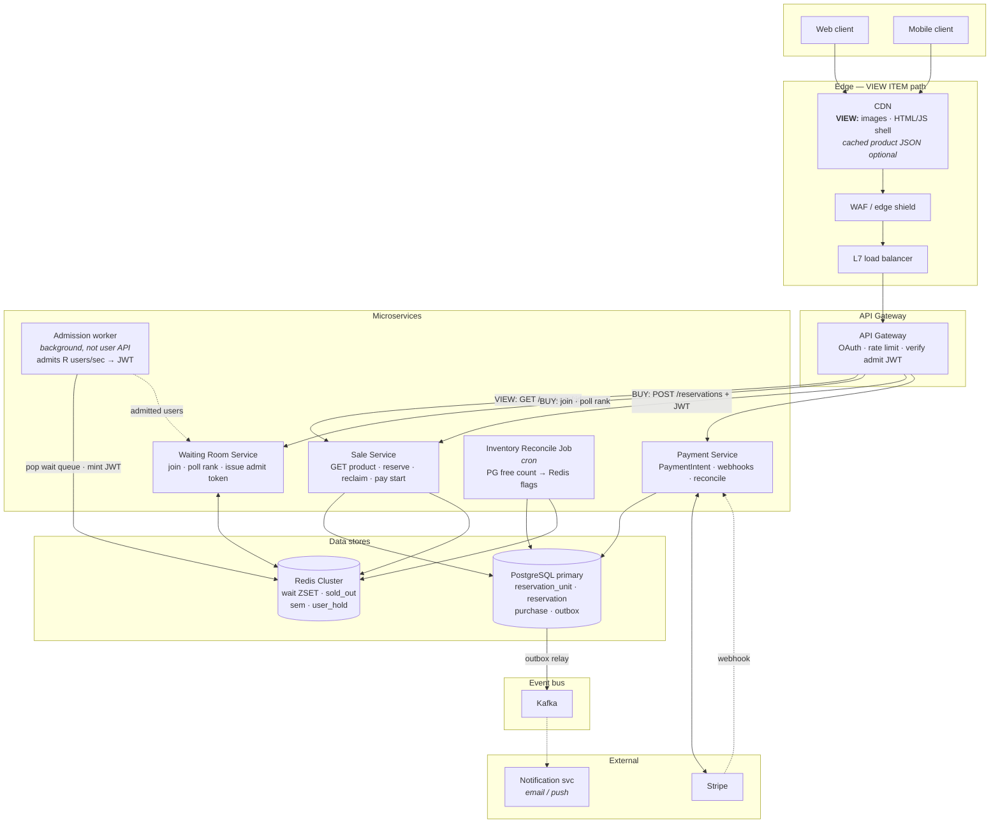

| Component | Responsibility | Stores touched |
|-----------|----------------|----------------|
| **CDN** | **View item (mostly):** images, HTML/JS shell, cached product JSON; optional `remaining_approx` short TTL | Edge cache |
| **API Gateway** | Auth, abuse rate limit, **validate admit JWT** on `POST /reservations` | — |
| **Sale Service** | **`GET /products/:id`** (details, sale window, ~stock from cache/PG); reserve/reclaim/pay | PG read; Redis approx / `sold_out` |
| **Waiting Room Service** | `ZADD`/`ZRANK`, poll API, scales with joiners | Redis `wait:*` |
| **Admission worker (R)** | Background: dequeue **R**/sec from `wait:*` → sign admit JWT; user learns via **poll** | Redis |
| **Payment Service** | Stripe client, webhook handler, conditional status updates, SQS reconcile | Postgres |
| **PostgreSQL** | **Source of truth** for units, holds, orders, transactional outbox | — |
| **Redis** | Ephemeral: queue, `sold_out`, semaphore, optional approx count | Not grant authority |
| **Outbox → Kafka** | `reservation.created`, `order.completed` after commit | Postgres → Kafka |
| **Reconcile job** | `COUNT` free units → refresh `sold_out` / approx | PG read, Redis write |
| **Notification svc** | Consumer; no inventory logic | Kafka |

#### Admission worker (R) — what is it?

**Not a microservice users call.** It is a **background loop** (separate process, K8s CronJob, or thread inside Waiting Room Service).

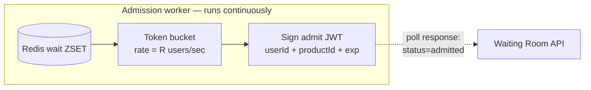

| | |
|--|--|
| **What** | Background job — **no** `POST /admission` from client |
| **Does** | Each tick: take next **R** users from `wait:{productId}` → write admit state / return JWT on **poll** |
| **R** | **Admit rate** (users/sec), e.g. 8k/s when Postgres safely does ~10k reserve TX/s |
| **≠ semaphore K** | **R** = how fast people **enter** reserve path; **K** = max **parallel** PG claims ([§1.5](#15-redis-keys-admission--principal-qa)) |
| **Why separate from WRS** | Millions **poll**; steady dequeue is cheaper to scale alone (Hello Interview) |

User flow: `POST join` wait room → `GET poll` until `{ admitted: true, token: "…" }` → `POST /reservations` with token.

#### How admission reaches Sale Service — push or poll?

**The admission worker does not call Sale Service.** Sale Service is **passive** until the **client** sends `POST /reservations`.

| Step | Who | What |
|------|-----|------|
| 1 | **Client** | `POST /wait-room/join` → Waiting Room Service writes Redis ZSET |
| 2 | **Client** | **`GET /wait-room/status` poll** (every 1–3s, backoff) — millions of these |
| 3 | **Admission worker** | Background: dequeue **R**/sec from Redis → set `admitted:{userId}` and/or precompute **JWT** |
| 4 | **Waiting Room API** | On poll: if admitted → response body `{ status: "admitted", admissionToken: "<JWT>" }` |
| 5 | **Client** | `POST /products/:id/reservations` with header `Authorization: Bearer <admissionToken>` |
| 6 | **API Gateway** | **Validates JWT** (signature, exp, productId) → forwards to **Sale Service** |
| 7 | **Sale Service** | Normal reserve logic (sold_out check, sem, PG SKIP LOCKED) — **no** direct link to admission worker |

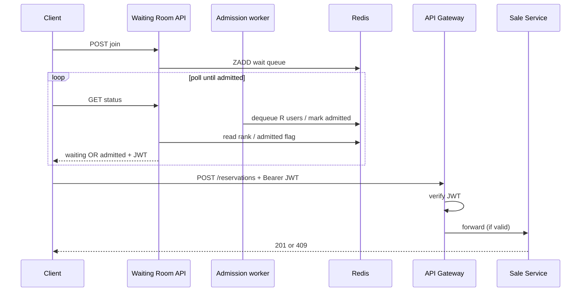

**Why poll, not server-push to Sale?** Sale doesn’t need a list of admitted users—only **one request per buyer** with a **proof-of-admit** token. Push (SSE/WebSocket) is optional for UX (“you’re in!”) but **reserve** still uses the same JWT on `POST`.

**Sale Service never talks to admission worker** — only Gateway (or Sale) validates the token.

---

#### View item — CDN, live count, and what the UI should show

**You’re right:** a **CDN-cached HTML/JSON page does not have an accurate live “items left”** unless you deliberately add a **short-TTL or dynamic** path. Full page on CDN = static product story (name, price, images, sale start time).

| UI choice | How | Tradeoff |
|-----------|-----|----------|
| **A — Skip exact count (common in flash sales)** | CDN/static: “Limited quantity · sale at 12:00” + **Buy**; truth on `POST /reserve` → 201 or **409 Sold out**; optional banner from `GET /products` returning only `soldOut: true` (no number) | Simplest; no false “3 left” |
| **B — Approx count (AlgoMaster-style)** | CDN for shell; **JS calls** `GET /products/:id` (origin, **500ms–2s cache**) for `remainingApprox` + label **“~2,847 left”** | Engaging; **stale** is OK if reserve is CP in PG |
| **C — Poll while waiting** | In wait room, poll **light** endpoint: `soldOut` or rough count from Redis `remaining_approx` | Updates without hammering PG |
| **D — Count in CDN** | Only with **very short CDN TTL** (1–2s) or **edge compute** — still approximate | Cost/complexity; rarely exact |

**Interview recommendation:** **A or B.** Say aloud: *“Catalog reads are AP-ish; we don’t put authoritative stock in long-lived CDN. Either omit the number or show an **approximate** count from Redis/API with short TTL; **oversell is prevented only on reserve.**”*

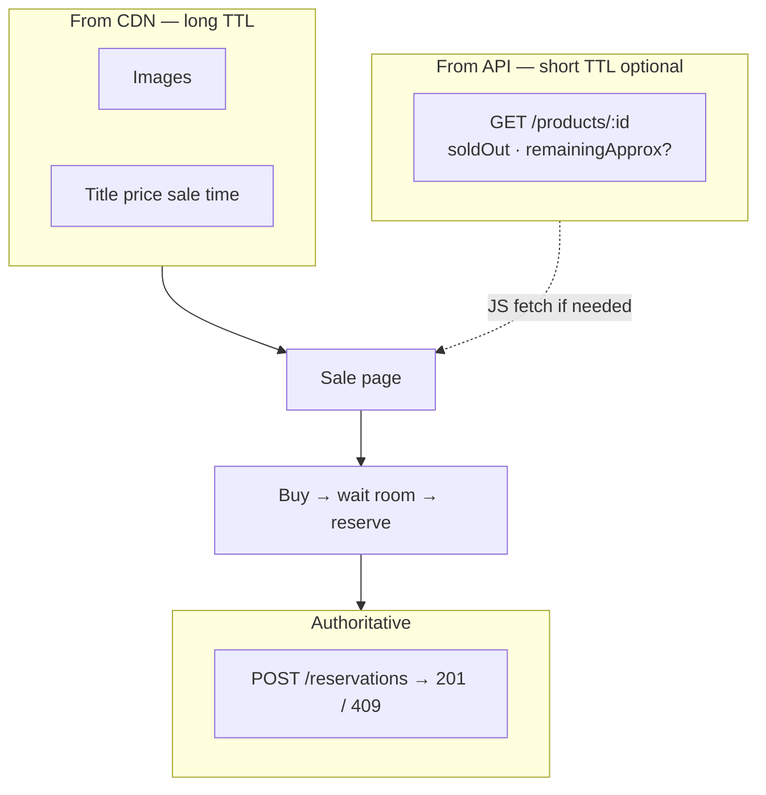

| Path | Flow |
|------|------|
| **View (static)** | Client → **CDN** → HTML/JS/images — **no** live count in cache |
| **View (dynamic, optional)** | Client JS → Gateway → **Sale** `GET /products/:id` → Redis `sold_out` / `remaining_approx` (+ product metadata from PG) |
| **Buy** | Wait room poll → JWT → **Sale** `POST /reservations` — **this** is when user learns if they got a unit |

**Functional requirement “view item”** is still satisfied with **CDN + product API** (details + optional approximate stock). **Exact** count is **not** required for a correct system.

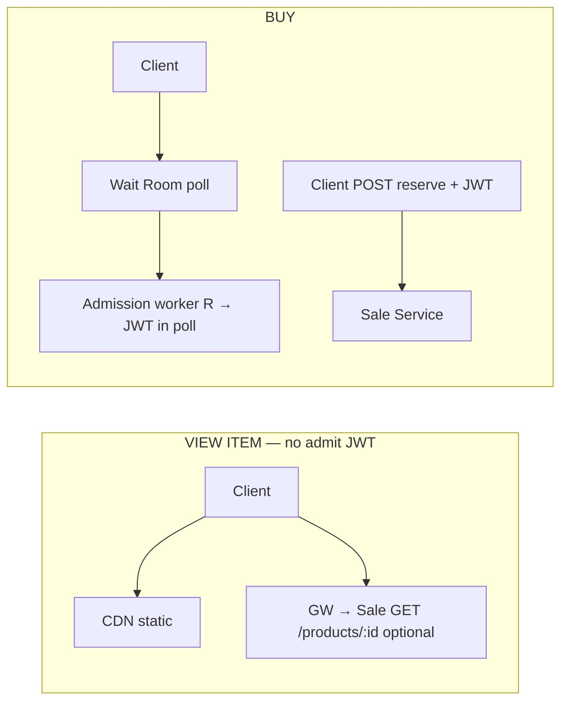

```text
  VIEW:  Client ──► CDN (static)     Client ──► GW ──► Sale Svc GET /products/:id
  BUY:   Client ──► GW ──► Wait Room ──► (admit worker R) ──► JWT ──► Sale POST reserve

┌─────────────┐     ┌──────────────────────────────────────────────────────────┐
│   Clients   │────►│ CDN (view) → WAF → LB → API Gateway                       │
└─────────────┘     └───┬────────────────────────────┬──────────────────────┘
                        │ GET product                  │ wait / reserve / pay
                        ▼                              ▼
                 ┌──────────────┐            ┌─────────────────┐   ┌──────────┐
                 │ Sale Service │            │ Waiting Room    │   │ Payment  │
                 │  (read+write)│            │ + Admission (R) │   │ Service  │
                 └──────┬───────┘            └────────┬────────┘   └────┬─────┘
                                 │                        │                │
                         ┌───────▼───────┐        ┌───────▼───────┐        │
                         │ Redis Cluster │        │  PostgreSQL   │◄───────┘
                         │ wait·sold_out │        │  (CP grant)   │
                         └───────────────┘        └───────┬───────┘
                                                          │ outbox
                                                    ┌─────▼─────┐     ┌────────┐
                                                    │   Kafka   │────►│ Notify │
                                                    └───────────┘     └────────┘
                                                          ▲
                                                    ┌─────┴─────────────┐
                                                    │ Reconcile cron    │
                                                    └───────────────────┘
```

**Whiteboard tip:** Draw **Postgres** in the center of the write path; **Redis** beside it (smaller) for “lobby + signs”; **Stripe** off to the side; **Kafka** behind PG, not in front of reserve.

### User journey — steps in words

1. **View** — CDN (+ optional API) for product page; stock number if shown is **hint only**.
2. **Wait** — Join queue; **poll** until admitted; receive **JWT** (admission worker runs in background).
3. **Reserve** — `POST /reservations` + JWT; PG **SKIP LOCKED**; get `reservationId` + `unitId` or sold out.
4. **Pay** — `PAYMENT_PENDING` in DB, then Stripe; webhook + poll → purchased or retry.
5. **Done** — Events to Kafka; user sees confirmation; inventory truth stays in Postgres.

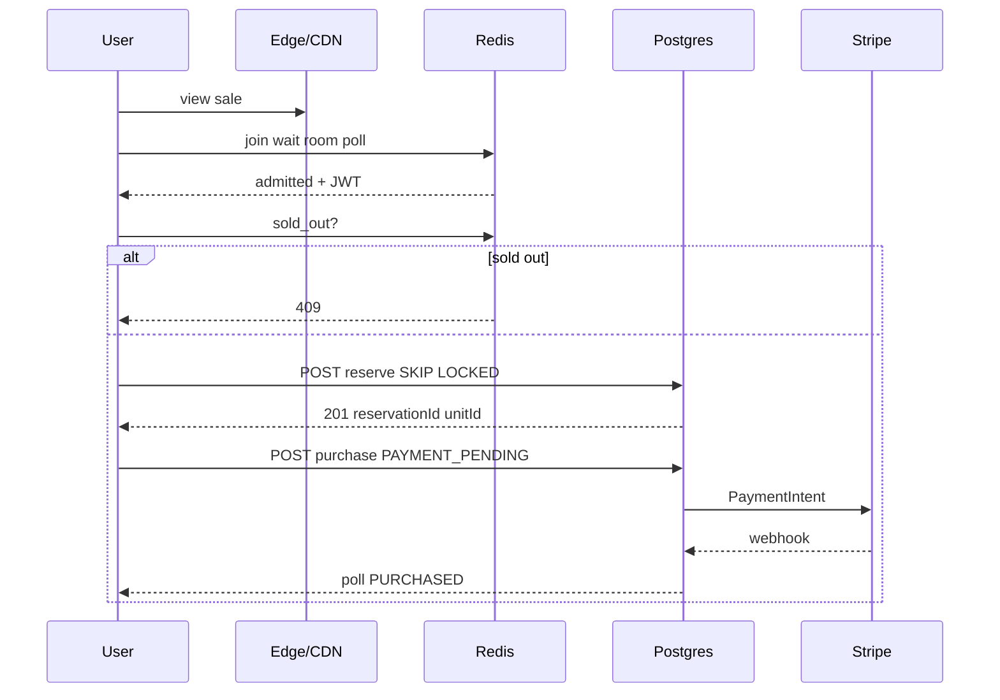

### Two admission layers (marc palaci)

1. **Waiting room + admit rate R** — Millions can **wait**; only **R** users/sec get a JWT to **try** reserve (fairness + protect backend).
2. **Semaphore K** — Of those admitted, at most **K** **parallel** reserve requests hit Postgres (many can hold JWT but not all claim at once).
3. **Postgres** — Only successful **COMMIT** creates a hold; at most **10k** wins per SKU.

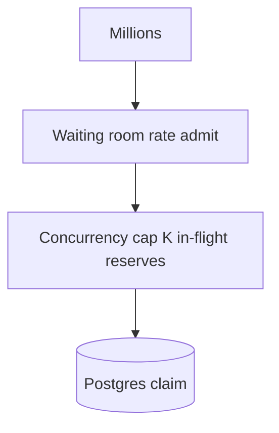

---

## 1.5 Redis keys, admission & principal Q&A

**Rule:** Redis does **not** grant units in the default design. Postgres **SKIP LOCKED** does. Redis = **line + hints**.

### Keys (what we store)

| Key | Type | Purpose | Stock authority? |
|-----|------|---------|------------------|
| `wait:{productId}` | ZSET `score=timestamp, member=userId` | Queue position / join order | No |
| `sold_out:{productId}` | String `1` / EXISTS | Cheap 409 before PG | **Hint only** |
| `remaining_approx:{productId}` | String int (optional) | UI “~X left”, stale OK | **No** |
| `user_hold:{userId}:{productId}` | String `reservationId` | One active hold per user×SKU | No |
| `sem:reserve:{productId}` | counter / token bucket | Max **K** concurrent claim TXs | No |

Grant authority = **Postgres** `reservation_unit` rows (or Redis **only** in Lua pivot design — don’t mix without saying which is SOT).

### `sold_out` — set, read, wrong?

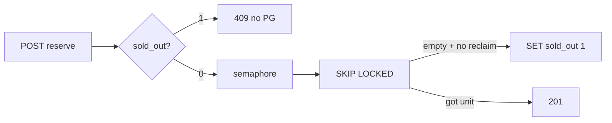

| Event | Action |
|-------|--------|
| **Read / pre-reserve** | `GET sold_out` → `1` ⇒ return **409** (skip DB) |
| **Set to 1** | PG pool empty after claim **and** on-demand reclaim found nothing |
| **Clear to 0** | Reconcile: PG has free units again (rare mid-sale); new event resets keys |
| **Wrong flag = 1, stock in PG** | Bad UX; fix reconcile — **never** oversell if claim stays in PG |
| **Wrong flag = 0, empty PG** | Claim fails → 409; optional then SET `sold_out` |

**Principal:** “Do we ever sell from the flag?” → **No.** Flag skips work; **TX grants**.

### `remaining_approx` (optional)

- Update **after** successful PG commit (`DECR` or async from outbox) — **not** on page view.
- UI TTL 500ms–2s; can lag; **reserve** still atomic in PG.
- Default design can omit counter and use only `sold_out` + PG.

### Not sold out ⇒ allow everyone?

**No.** `sold_out=0` means **maybe stock**, not open floodgates.

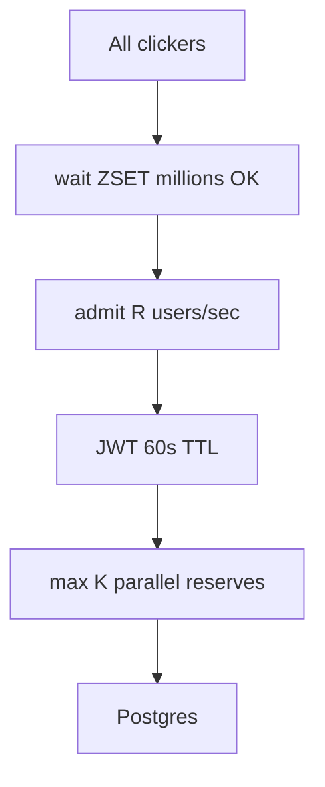

| Limit | What it caps | Example tune |
|-------|--------------|--------------|
| **Joiners** | Size of `wait:*` ZSET | Millions (light) |
| **Admit rate R** | JWTs issued / sec | ~8k/s if PG ~10k TX/s tested |
| **Concurrent K** | In-flight `POST /reservations` | ~1–3k semaphore |

**Wait room ops:**

```text
ZADD wait:{pid} <ts_ms> <userId>     # join
ZRANK wait:{pid} <userId>            # poll position

# admission worker (token bucket R/sec):
#   pop next users → sign JWT(userId, pid, exp)
```

### One reserve attempt (order)

1. Valid **JWT** (admitted).  
2. `sold_out`? → 409.  
3. **Acquire semaphore** (else 429 + Retry-After).  
4. **PG SKIP LOCKED** → 201 or 409.  
5. On PG empty → try reclaim → still empty → `SET sold_out 1`.  
6. Optional `DECR remaining_approx`.  
7. **Release semaphore**.

### Principal counter-questions

| Q | A |
|---|---|
| Redis source of truth? | **No** for grants; **yes** for wait line + sold_out hint |
| Why JWT not Redis lookup on reserve? | Gateway verifies admit without per-request ZSET read on Sale service |
| Stale “0 left” on UI? | OK; oversell prevented at **claim** |
| Redis down? | Fail **closed** on reserve; don’t grant from cache |
| Kafka for wait room? | Poor for `ZRANK`; Redis ZSET |
| Two writers on stock? | **One** grant path (PG default) |
| Lua OK, DB insert failed? | **Orphan / oversell risk** — why PG-first or sync PG in same request before 201 |
| Redis lost / failover? | **Ephemeral** state gone; **PG** still truth; pause sale / fail closed until reconcile |

**Close:** Redis holds the **line** and **probably gone**; Postgres holds **who got unit #N**.

---

## 1.6 Failure modes (why not Redis as stock authority)

Hello / Evan argument: Redis-as-primary inventory **splits truth** across two stores—you must keep Redis and DB in sync; **transactions can’t span both**, so failures create **inconsistency** and ops burden.

### Dual-write failure (the classic anti-pattern)

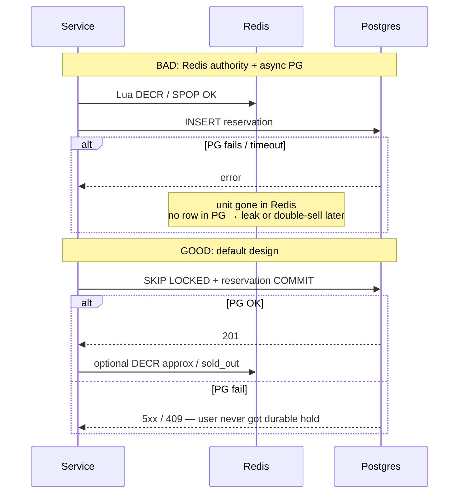

| Failure | **Redis owns stock** | **PG owns stock (default)** |
|---------|----------------------|-----------------------------|
| Redis OK, **PG write fails** | User “won” in cache, **no durable reservation** — unit leaked or needs manual fix | **No 201** until COMMIT; unit still in pool |
| **PG OK**, Redis flag update fails | — | Grant **valid**; `sold_out` / approx stale → reconcile |
| **Redis crash / flush** | Holds + counters **gone**; stock unknown vs PG | Wait line / flags lost; **reservations in PG stand**; re-admit users |
| **Redis failover** (partial data) | Wrong avail count, ghost holds | Same; **never** grant from Redis alone after recovery |
| Two apps write both | **Split brain** oversell | Single writer: **PG claim** only |

**Interview line:** “Redis state is **discardable**. Money and units are **Postgres**. If Redis dies mid-sale, we **fail closed** on new grants, reconcile `sold_out` from PG, and don’t resurrect holds from cache.”

### What we deliberately throw away vs keep

| Data | On Redis loss | Recovery |
|------|---------------|----------|
| `wait:*` ZSET | Lost | Users re-join; fairness policy decides |
| `sold_out`, `remaining_approx` | Lost | **Recompute from PG** free-unit count |
| `sem:*`, `user_hold` | Lost | Reset caps; PG dedupe still enforces holds |
| **reservation / purchase rows** | N/A (in PG) | Source of truth |

### Reconcile job (PG → Redis)

Lightweight loop during/after sale:

```text
free = COUNT(reservation_unit WHERE product_id = ?)
IF free == 0 → SET sold_out 1
ELSE          → DEL sold_out (or SET remaining_approx free)
```

Runs every few seconds or on admin trigger — fixes stale hints **without** granting from Redis.

### Pivot design (Redis Lua) — if forced

| Rule | Why |
|------|-----|
| **Sync PG insert in same request** before returning 201 | Avoid “Redis yes, PG no” |
| Or **outbox in PG** + worker; user polls reservation status | Async but durable path defined |
| **Never** return success to client on Lua alone | Principal will reject |
| Failover: **stop grants** until inventory reloaded from PG | No guess DECR |

See [Appendix A](#appendix-a-lua-spop--skip-locked) only with these guardrails.

### Other gaps principals ask (short)

| Topic | Answer |
|-------|--------|
| **Idempotency** | `Idempotency-Key` on purchase; reserve: return existing hold if `user_hold` / PG unique (user, product, ACTIVE) |
| **Outbox** | Same PG TX as reservation → event to Kafka; no dual-write to queue |
| **Double-click reserve** | Dedupe → same `reservationId`, not two units |
| **JWT replay** | Short `exp`, bind `userId+productId`, nonce optional |
| **Paid but webhook lost** | Stripe retry + SQS `GET PaymentIntent` reconcile |
| **Oversell math** | `free_units + active_reserves + payment_pending ≤ total` |

---

## 2. Request funnel diagram

**Funnel in points:**

1. **CDN / edge** — Absorb browse traffic; static view item.
2. **Rate limit** — Block abuse; not fairness queue.
3. **`sold_out` (Redis)** — Cheap **409** for most users after stock gone; hint only.
4. **Waiting room** — Queue + poll; admission worker issues **JWT** at rate **R**.
5. **Semaphore K** — Cap parallel claims hitting Postgres.
6. **SKIP LOCKED** — At most one durable hold per free unit row; ≤10k successes.

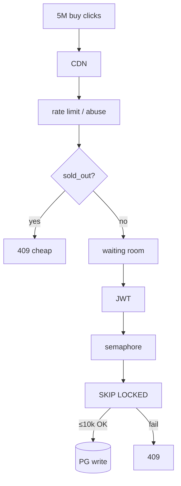

---

## 3. Contention: pick one grant path

| | **Postgres SKIP LOCKED** (default) | **Redis Lua SPOP** (pivot) |
|--|-----------------------------------|----------------------------|
| **When** | 10k units, senior loop | Extreme claim QPS after funnel |
| **Mechanism** | Any free row in one TX | Any free id from SET atomically |
| **Sold-out cost** | DB unless `sold_out` gate | Sub-ms, no PG |
| **Risk** | DB overload without admission | Hot key; **Lua OK + PG fail** = inconsistency |
| **Payment** | `unit_id` on row | SPOP + **sync PG** before 201 |
| **Failure policy** | N/A (single TX) | Redis hints **after** commit; see [§1.6](#16-failure-modes-why-not-redis-as-stock-authority) |

| Ticketmaster seat | Flash pool |
|-------------------|------------|
| Client picks `seatId` → `lock:seat` | No unitId → **SKIP LOCKED** or **SPOP** |

```sql
-- claim (inside TX)
SELECT unit_id FROM reservation_unit
WHERE product_id = $1 LIMIT 1
FOR UPDATE SKIP LOCKED;
-- insert reservation; delete/mark unit; COMMIT;
```

---

## 4. Expiry & payment boundary

**Payment flow in points:**

1. **Reserve** — User owns **reservation row** + fixed **`unit_id`** for ~10 minutes (`ACTIVE`).
2. **Start pay** — **Before Stripe:** conditional `UPDATE` to **`PAYMENT_PENDING`** so expiry cannot give **unit** to someone else while charging.
3. **Stripe** — Charge with metadata `reservationId`, `userId`, `unitId`; client may **poll** purchase API.
4. **Webhook** — Conditional `UPDATE` to **CONSUMED** only if same row + unit; **0 rows** → refund.
5. **Expire** — Reclaim units only from **`ACTIVE`** expired rows; return unit to pool (on-demand or job).

### Expiry options

| | On-demand reclaim | SQS delay | Cron |
|--|-------------------|-----------|------|
| **Use** | Default w/ PG pool | 10k timers OK | MVP only |
| **Reclaim** | `status=ACTIVE` ∧ `expires_at≤now` | same | laggy |

### Payment @ expiration (interview Q) — full answer

#### Verbatim question

> **Q:** How would you structure the **payment-side write** so that a payment arriving right around the **expiration boundary** only succeeds if **that buyer** still owns the **same reservation row**?

#### Your scenario (must address explicitly)

> Alice reserved **unit #42**. **`expires_at` in 1 second.** She clicks Pay. Stripe takes **5–30 seconds**. Meanwhile: can expiry **free unit #42** so **Bob** reserves it and pays—and then **both** succeed?

**Short answer:** **No**, if you implement pay-start correctly. The unit stays tied to **Alice’s reservation row** in `PAYMENT_PENDING`; Bob can only ever get **other** units (or sold out)—never #42 while Alice’s row is `PAYMENT_PENDING` or `CONSUMED`.

---

#### Wrong design (what goes wrong)

```text
reserve row: ACTIVE, unit_id=42, expires_at=T
T+0.5s  Alice: POST pay → call Stripe (no DB state change)
T+1s    expiry job: ACTIVE expired → unit 42 back to pool
T+2s    Bob: SKIP LOCKED → gets unit 42, new reservation
T+10s   Stripe webhook: Alice paid → ??? double sale / wrong unit
```

Problem: **payment started without claiming the row** in DB; expiry treats hold as still `ACTIVE`.

---

#### Correct design (structure of payment-side writes)

**Rule:** Payment is always **`POST /reservations/:reservationId/purchases`** — never a fresh `POST /order` with `itemId` that allocates stock again.

| # | Write | When | Purpose |
|---|--------|------|---------|
| **1** | Conditional `ACTIVE → PAYMENT_PENDING` | **Before** `PaymentIntent` / Stripe | Row + **unit #42** locked to Alice; expiry **cannot** reclaim |
| **2** | Optional `expires_at = GREATEST(expires_at, now()+90s)` | Same TX as #1 | Grace while gateway runs (bounded) |
| **3** | Call Stripe with metadata `{reservationId, userId, unitId}` | After #1 succeeds | Webhook knows **which row**, not “any shoe” |
| **4** | Webhook: conditional `→ CONSUMED` + `purchase_id` | After charge | Only if **same** `reservation_id`, `user_id`, **`unit_id`** |
| **5** | Expire / reclaim | Background or on-demand | **`WHERE status = 'ACTIVE'` only** — skip `PAYMENT_PENDING` |

**Alice 1 second left — timeline (correct):**

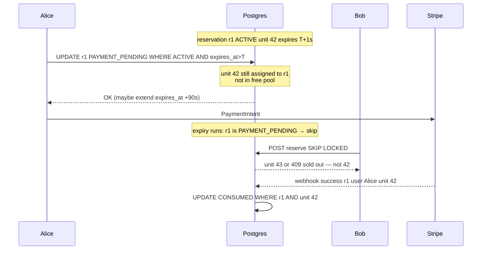

| Time | Alice (r1, unit 42) | Bob | Unit 42 |
|------|---------------------|-----|---------|
| T−10m | Reserve → `ACTIVE` | — | Held by r1 |
| T−1s | Clicks pay | — | Still r1 |
| T0 | **`PAYMENT_PENDING`** in DB **before** Stripe | — | Still r1; **not** in pool |
| T+1s | Stripe still processing | Tries reserve | **Not available** to Bob |
| T+5s | Webhook | — | `CONSUMED` on r1 only |

**If Alice’s pay start is too late** (`expires_at` already passed):

- Step #1 updates **0 rows** → **410 Gone** / hold expired → **no** Stripe call → Bob may get **42** only after r1 is `EXPIRED` and unit returned.

---

#### Can Bob “lock and attempt to pay” on the same unit?

| Bob’s action | While Alice `PAYMENT_PENDING` on unit 42 |
|--------------|------------------------------------------|
| `POST /reservations` (new hold) | Gets **another** free unit or **409** — not 42 |
| `POST` pay without holding 42 | Invalid — pay is on **`reservationId`**, not SKU |

Two users paying is fine **only** on **two reservation rows / two units**. One physical unit → at most one non-expired claim chain per row.

---

#### Webhook late after boundary

If Alice never reached `PAYMENT_PENDING` (only called Stripe from client):

- Expiry may free unit 42; Bob reserves 42; Alice’s webhook arrives later → step #4 updates **0 rows** → **refund Alice**; Bob’s row wins.

If Alice **did** reach `PAYMENT_PENDING` before expiry:

- Unit stays hers; webhook succeeds on **r1 + unit 42**; Bob never had 42.

---

#### Four sentences for the interview

1. Pay is scoped to **`reservationId`**; **`unit_id`** is set at reserve and checked on webhook.  
2. **First** payment write: `ACTIVE → PAYMENT_PENDING` with `user_id` + `expires_at > now()` — **then** Stripe.  
3. Reclaim/expiry only touches **`ACTIVE`** — not checkout in flight.  
4. Webhook is a conditional **`UPDATE`**; no row updated → **refund**, never assign a different unit.

SQL → [Appendix B](#appendix-b--full-sql-payment-writes-reference). Redis grant path → [Appendix A](#appendix-a-lua-spop--skip-locked) (`start_payment` before gateway).

| Step | SQL idea |
|------|----------|
| Start pay | `… WHERE status='ACTIVE' AND expires_at>now()` → `PAYMENT_PENDING` |
| Webhook | `… WHERE reservation_id,user_id,unit_id AND status IN (ACTIVE,PAYMENT_PENDING)` |
| Expire | `… WHERE status='ACTIVE' ONLY` → return unit to pool |

---

## 5. Kafka / queues

| Use | Don't use |
|-----|-----------|
| Outbox events post-commit | Reserve path |
| SQS reconcile payment | Fairness ordering |
| Redis ZSET wait room | Kafka for “queue position” |

---

## 6. Quick tradeoffs

| A vs B | Prefer flash sale |
|--------|-------------------|
| Waiting room vs 429 only | Waiting room |
| Admit rate vs semaphore | **Both** |
| PG claim vs Redis claim | **PG** (10k); Redis if pushed |
| Sync vs 202 reserve | **Sync** |
| FIFO at T=0 vs random cohort | Random if fairness NFR |
| Fail open vs closed on partition | **Closed** for grant |

---

## 7. Scale pivots

| Ask | Answer |
|-----|--------|
| Millions of unit rows | **Bounded pool** (Shopify) |
| Millions of SKUs | Few hot SKUs per event; CDN catalog |
| No waiting room | Unrealistic; shard + unfair (Evan) |
| Disney FCFS | FCFS among **admitted** + atomic claim |

---

## 8. Community → one line

| Q | A |
|---|---|
| Same as Ticketmaster? | Pool vs **named seat** |
| Distributed lock? | **seatId** yes; fungible → SKIP LOCKED/SPOP |
| Kafka wait room? | Bad for poll position; use Redis |
| Late webhook | **PAYMENT_PENDING** before Stripe |
| Admitted still stampede | **Semaphore** on reserve |
| Webhook loss | Stripe retry + SQS reconcile |

---

## 9. Interview drill card

| Drill | Lead |
|-------|------|
| Oversell | One atomic grant; one authority |
| Fairness | Wait room + dedupe user×SKU |
| marc gap | Semaphore after JWT |
| Pay boundary | PAYMENT_PENDING + conditional UPDATE |
| Kafka | After commit only |
| Redis / sold_out | Hint only; PG grants; [§1.5](#15-redis-keys-admission--principal-qa) |
| Redis vs PG stock | Dual-write fails → PG-first; [§1.6](#16-failure-modes-why-not-redis-as-stock-authority) · [C.2](#c2-redis--postgres-both-decrement-stock) |
| Oversell under load | [C.1](#c1-oversell-under-extreme-load) |
| Idempotency / outbox | Dedupe reserve; outbox same TX as reservation |
| Whiteboard HLD | [§1 component diagram](#hld--component-architecture-draw-this-on-the-whiteboard) |

---

## 10. Principal stress-test — how to answer

**Frame (every hard question):** (1) **Which invariant?** (2) **What breaks first?** (3) **Which knob?** — don’t redesign from scratch.

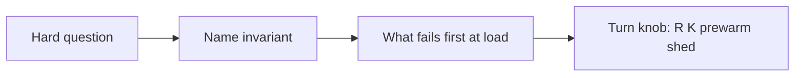

| Knob | Effect |
|------|--------|
| **Admit rate R** ↓ | Less PG load; longer wait |
| **Semaphore K** ↓ | Shorter DB queue; more 429 |
| **`sold_out` earlier** | Cheaper rejects; may lie until reconcile |
| **Pre-warm** PG/Redis/pools | Headroom before T0 |
| **Shed** | 503 wait room; never fake 201 |

### Load & capacity

| They ask | You answer |
|----------|------------|
| **10× traffic at T0** | Funnel unchanged; **lower R and K**, more wait-room capacity (Redis shards), CDN already absorbs reads; **never** remove PG atomic claim |
| **500k QPS hits Postgres** | That means funnel failed — fix **sold_out + wait room + sem** first; only then Redis SPOP pivot |
| **Connection pool exhausted** | Bound concurrent TX with **K**; PgBouncer; shorten TX (no work in TX except claim+insert); don’t raise pool unbounded |
| **Poll storm on wait API** | Backoff + **ETag** (see glossary below); edge cache position buckets; separate **Waiting Room** service scale |

**Glossary — ETag:** HTTP response header = version fingerprint of a resource (often a hash of body). Client sends `If-None-Match: <etag>` on poll; server returns **304 Not Modified** (empty body) if nothing changed → less bandwidth/CPU when wait position unchanged.
| **Hot Redis key** | Shard `wait` / `avail` pools; not one counter for 10M DECR |
| **Only 10k writes — why care?** | **Attempts** are millions; cost is **rejected** work, not successful writes |

### Failures & degradation

| They ask | You answer |
|----------|------------|
| **Postgres slow / down** | **Fail closed** on new reserves; don’t grant from Redis; queue waits; already-admitted JWTs expire |
| **Redis down** | Pause admit or degrade to **PG-only** reserve (no sold_out shortcut); wait line lost → users re-join; [§1.6](#16-failure-modes-why-not-redis-as-stock-authority) |
| **Stripe down** | Holds stay **PAYMENT_PENDING** or ACTIVE per policy; no new grants of freed units until state clear |
| **Region failover** | PG replication lag → **no promote** for grant if stale; run sale single-primary or pause |
| **Deploy mid-sale** | Rolling Sale service OK; **schema** frozen; feature flags off |

### Correctness (they will push)

| They ask | You answer |
|----------|------------|
| **Oversell under load?** (full) | [Appendix C.1](#c1-oversell-under-extreme-load) |
| **Redis + PG both decrement?** (full) | [Appendix C.2](#c2-redis--postgres-both-decrement-stock) |
| **sold_out wrong** | UX bug; **claim** still authoritative; reconcile PG→Redis |
| **At-least-once webhook** | Idempotent handler on `payment_intent_id`; same purchase row |
| **Two tabs pay same reservation** | Idempotency-Key; one `PAYMENT_PENDING` transition wins |
| **Reclaim vs pay race** | Expire **ACTIVE** only; pay starts with **PAYMENT_PENDING** [§4](#4-expiry--payment-boundary) |

### Security & abuse

| They ask | You answer |
|----------|------------|
| **Bots** | Auth + wait room + per-user rate limit + dedupe; fairness ≠ crypto proof |
| **Forge JWT** | Signed (HMAC/RS256), short `exp`, `productId` bound; gateway verify |
| **Hold 10k accounts** | One **ACTIVE** hold per user×SKU; payment still capped by inventory |
| **DDoS on reserve** | CDN/WAF; wait room absorbs; **sem** protects PG |

### Product / “what if”

| They ask | You answer |
|----------|------------|
| **No waiting room — principal insists** | Call unrealistic at 10M; offer **shard + unfairness** or **synthetic load test #**; still sem + PG |
| **Must show exact count** | Strong read path expensive — **approx** + CP on reserve; or accept COUNT on cold path only |
| **Refund after webhook** | Ops flow; inventory already CONSUMED; don’t return unit to flash pool mid-event unless product says |
| **Extend hold 30 min** | Product change `expires_at`; doesn’t change architecture |
| **Multi-SKU cart** | Out of scope; flash = single SKU flow |

### “Why not X?”

| They ask | You answer |
|----------|------------|
| **Kafka reserve** | User needs **sync** outcome; async = wrong UX + harder CP |
| **Saga / 2PC Redis+PG** | Overkill; **one DB TX** simpler |
| **CRDT inventory** | Money path needs linearizable grant, not merge |
| **Blockchain audit** | PG + outbox enough for single merchant |
| **Autoscale at T0** | **Pre-warm**; scale-out lags burst |

### If they keep increasing load (meta-answer)

> “I’d **measure** admit R vs PG p99, sem queue depth, pool exhaustion rate. I **shed** at the wait room and **429** at the sem before I weaken correctness. I only move grant to Redis with **sync PG** if PG is proven the bottleneck **after** the funnel.”

**Sources:** [Hello Interview](https://www.hellointerview.com/learn/system-design/problem-breakdowns/flash-sale) · [AlgoMaster](https://algomaster.io/learn/system-design-interviews/design-flash-sale)

---

## Appendix A — Lua SPOP = SKIP LOCKED

Fungible: client sends no `unitId`. Preload `avail:{productId}:{pool}` SET; **`SPOP`** in Lua = grab any free unit.

```lua
-- KEYS[1]=avail SET  ARGV: resvId, userId, productId, ttl, poolId
local u = redis.call('SPOP', KEYS[1])
if not u then return {'SOLD_OUT'} end
redis.call('HSET', 'resv:'..ARGV[1],
  'userId',ARGV[2],'unitId',u,'state','ACTIVE')
redis.call('EXPIRE', 'resv:'..ARGV[1], tonumber(ARGV[4]))
return {'OK', u}
```

| Script | Purpose |
|--------|---------|
| `start_payment` | `state ACTIVE→PAYMENT_PENDING` |
| `expire_reclaim` | only if `ACTIVE` → `SADD` unit back |
| `complete` | match `userId`+`unitId` → `CONSUMED` |

Sharded pools: pass multiple KEYS; loop `SPOP`.

**Warning:** Do not return `201` on Lua alone — **persist to PG first** (or poll until durable). Otherwise Redis crash = lost hold + inventory drift ([§1.6](#16-failure-modes-why-not-redis-as-stock-authority)).

---

## Appendix B — Full SQL payment writes (reference)

```sql
-- 1 start pay
UPDATE reservation SET status='PAYMENT_PENDING',
  expires_at=GREATEST(expires_at, NOW()+INTERVAL '90 seconds')
WHERE reservation_id=$1 AND user_id=$2 AND status='ACTIVE'
  AND expires_at>NOW() AND purchase_id IS NULL;

-- 2 webhook
UPDATE reservation SET status='CONSUMED', purchase_id=$p
WHERE reservation_id=$1 AND user_id=$2 AND unit_id=$3
  AND status IN ('ACTIVE','PAYMENT_PENDING') AND purchase_id IS NULL;

-- 3 expire
UPDATE reservation SET status='EXPIRED'
WHERE status='ACTIVE' AND expires_at<=NOW() AND purchase_id IS NULL;
```

---

## Appendix C — Deep dive: oversell & dual-write (principal)

Short tables in [§10](#10-principal-stress-test--how-to-answer) point here. Read this when you need **full question wording + reasoning**.

---

### C.1 Oversell under extreme load

#### How they ask (complete questions)

- “You have **10,000** units and **5 million** concurrent reserve attempts. Walk me through why you still **cannot** sell 10,001. What if Postgres is at **100% CPU**—do you relax correctness?”
- “Two Sale service instances both see `inventoryCount = 1` and both return **201**. How is that impossible in **your** design?”
- “You added a **waiting room** and **sold_out**. Could those layers cause oversell if they’re wrong?”
- “Isn’t **SKIP LOCKED** only best-effort under chaos? **Oversell anyway?**”

#### What “oversell” means (define first)

**Oversell** = committed obligations exceed physical stock:

- More **ACTIVE + PAYMENT_PENDING + CONSUMED** reservations than units ever existed, **or**
- Two buyers both have a **durable** claim on the **same** `unit_id`, **or**
- Payment captured with **no** valid claim on a specific unit.

It is **not**: showing “3 left” on UI when 0 remain (stale read). That’s UX; fix with reconcile.

#### Why load does **not** change the invariant

Principals test whether you confuse **throughput** with **correctness**.

| Mistake candidates make | Correct mental model |
|-------------------------|----------------------|
| “At high load we might double-sell to keep latency low” | **Never** — you shed load (429, wait), not inventory rules |
| “We’ll fix oversell with refunds” | Refunds are remediation; **invariant is no oversell at grant** |
| “Eventually consistent stock is fine” | **Grant** must be linearizable; reads can lag |

More attempts only means more **failed** claims, not more **successful** grants than rows in the pool.

#### Single grant writer (what it means)

**One logical authority** decides “this `unit_id` is yours”:

- **Default:** only Postgres transaction that **deletes/claims** a `reservation_unit` row and inserts `reservation`.
- Not: Redis DECR **and** PG UPDATE as two independent “yes” decisions.

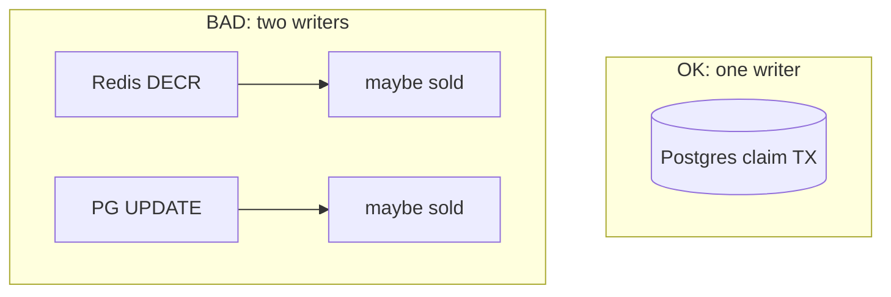

#### Mechanisms that prevent oversell (default PG pool)

**1) Finite pool (10k rows = 10k grants max)**

```sql
-- At most one reservation per unit row ever claimed in this design
SELECT unit_id FROM reservation_unit
WHERE product_id = $1
LIMIT 1
FOR UPDATE SKIP LOCKED;
-- 0 rows => sold out (after reclaim)
-- 1 row => only this TX can use it until COMMIT/ROLLBACK
```

**2) Same transaction couples unit + reservation**

Inside **one** `BEGIN … COMMIT`:

- Claim unit (delete row or mark `claimed`).
- `INSERT INTO reservation (unit_id, user_id, status='ACTIVE', …)`.

If `COMMIT` fails → unit change rolls back → no ghost hold.

**3) Conditional updates on lifecycle (payment / expire)**

Stock is already tied to `unit_id`. Later steps **don’t create new units**—they only change status:

```sql
UPDATE reservation SET status = 'PAYMENT_PENDING'
WHERE reservation_id = $1 AND user_id = $2
  AND status = 'ACTIVE' AND expires_at > NOW();
-- row_count 0 => no payment start; no second buyer gets this unit via this row
```

**4) Admission does not grant**

Waiting room, `sold_out`, semaphore: they only control **who reaches** the grant TX. Wrong hint → extra **409**, not extra **201**.

#### Race story (principal classic)

**1 unit left, 1000 concurrent requests:**

| Bad design (single counter) | Good design (SKIP LOCKED) |
|----------------------------|---------------------------|
| 1000 read `count=1` | 1000 try claim rows |
| Many DECR without atomicity → count negative | 1 TX locks row; others SKIP to other rows or get 0 rows |
| | At most **#free rows** successes |

#### “Postgres at 100% CPU — oversell anyway?”

**Answer:** No. You get **timeouts / 503 / queue**, not extra inventory.

| Symptom | User sees | Stock |
|---------|-----------|-------|
| TX can’t complete in time | 503 / retry | Unchanged until COMMIT |
| Pool empty | 409 sold out | 0 |
| You “skip PG to save time” | — | **That** would violate design — don’t |

**Knobs:** lower admit **R**, lower **K**, extend wait — not weaken atomic claim.

#### Quick checklist (say in interview)

1. Grants capped by **physical unit rows** (or one atomic counter **if** single authority).  
2. **One COMMIT** binds unit ↔ reservation.  
3. Hints (Redis) **never** return 201 alone.  
4. Under load: **shed**, don’t **double-allocate**.

---

### C.2 Redis + Postgres both decrement stock

#### How they ask (complete questions)

- “AlgoMaster uses **Redis DECR** for speed and **Postgres** for orders. Your app does **DECR** then **INSERT reservation**. Isn’t that standard?”
- “If Redis says 5 left but Postgres says 0, **who wins**? What do you show the user?”
- “Lua succeeded, DB **timed out** — do you give the user the shoe?”
- “On success you update **both** Redis and PG. Why is that a problem at scale?”

#### What they’re testing

- Do you understand **dual-write** without distributed transactions?  
- Do you know **which store is source of truth**?  
- Do you return **201** only when **durable** obligation exists?

#### Pattern: both decrement (anti-pattern)

```text
1. Redis: DECR avail OR SPOP unit     ← stock -1 in memory
2. App returns 201 to client??      ← DANGER if step 3 not done
3. Postgres: INSERT reservation     ← fails / slow / crash
```

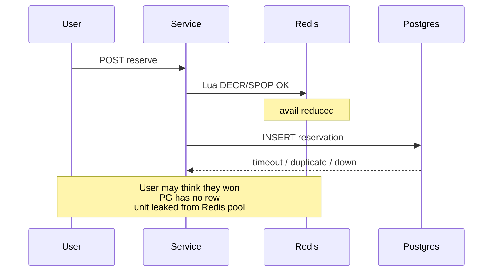

**Failure modes:**

| Order | What breaks |
|-------|-------------|
| Redis OK, PG fail | **Leak:** fewer units in Redis than reality; or user told success without row |
| PG OK, Redis fail | **Usually OK** if PG is authority; Redis hint stale |
| Retry after Redis OK, PG fail | Second retry may DECR again → **extra leak** |
| Two instances | Both DECR → oversell in Redis; PG might still save you **if** only PG grants — unless you trust Redis 201 |

**Split brain:** Redis thinks 100 sold, PG has 97 reservations → reconcile nightmare; finance trusts PG, ops trusts Redis.

#### Correct patterns (pick one authority)

**Pattern A — Postgres only (recommended in this guide)**

```text
POST reserve → PG SKIP LOCKED TX → COMMIT → 201
              → optional: SET sold_out / DECR remaining_approx in Redis
```

Redis failure after COMMIT: user **has** reservation; cache wrong until reconcile.

**Pattern B — Redis grant only with sync durable write**

```text
POST reserve → Lua SPOP → PG INSERT (same request, blocking) → both OK → 201
              → if PG fails → Lua COMPENSATE (SADD unit back) or mark resv invalid
```

Compensation must be **idempotent** and tested — principals prefer Pattern A for interviews.

**Pattern C — Async PG (risky)**

```text
Lua OK → 202 accepted → worker writes PG
```

Needs **status poll**; user doesn’t have durable hold until PG confirms — **not** simple flash-sale UX unless explicitly designed.

#### “Who wins if Redis 5 and PG 0?”

| Authority | Answer |
|-----------|--------|
| **PG** | **PG wins.** Redis is wrong. Reconcile: `SET sold_out`, reload SET from PG, or DEL counter. **Grants** only via PG until fixed. |
| **Redis** (if you chose it) | Redis wins for **new** grants; PG must catch up — you own all [§1.6](#16-failure-modes-why-not-redis-as-stock-authority) problems |

Default answer: **never grant on Redis count alone** when PG pool is empty.

#### Interview script (30 sec)

> “We don’t decrement in two places. **Postgres claim transaction** is the only grant. Redis might get a **sold_out** flag **after** commit for fast rejects. If Lua were in the path, I wouldn’t return **201** until **Postgres insert commits**; on PG failure I’d **roll back** the Redis op. Dual-write without 2PC is how you leak units or oversell under load.”

#### Relation to other sections

| Topic | Section |
|-------|---------|
| Failure / discard Redis | [§1.6](#16-failure-modes-why-not-redis-as-stock-authority) |
| Lua SPOP | [Appendix A](#appendix-a-lua-spop--skip-locked) |
| Payment same `unit_id` | [Appendix B](#appendix-b--full-sql-payment-writes-reference) |

---

*Version: diagram-first · merged Hello + AlgoMaster + community*
