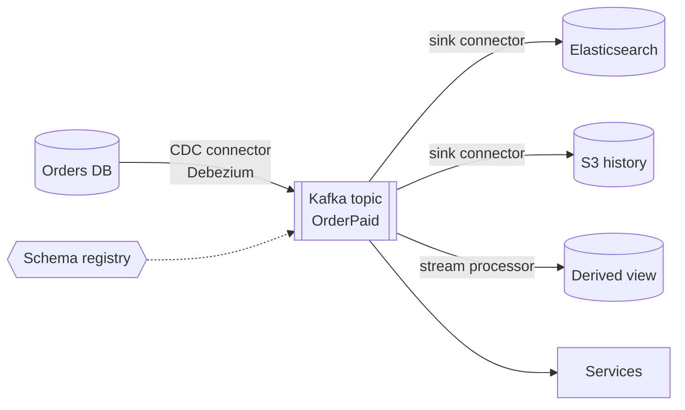
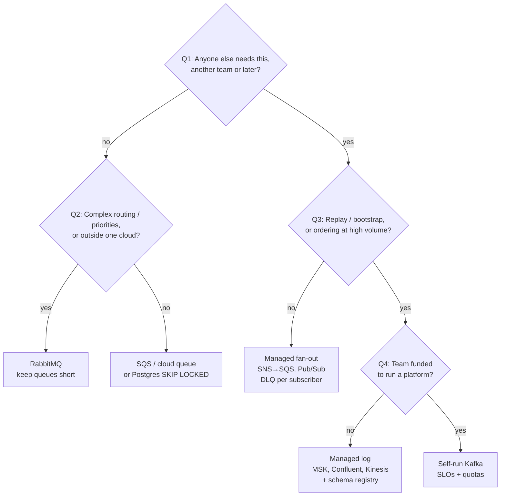
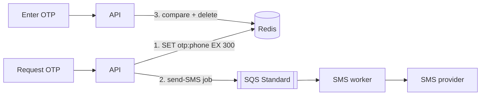

# Messaging Broker Selection — Study Guide

**One line:** pick the broker by the **shape of the stream** (how many readers, is history needed, how strict is ordering), not by features or throughput.

**Why it matters:** a wrong choice looks fine at launch and breaks 12–24 months later — a 2nd consumer, a replay request, a hot key, or a backlog.

**Progress:** §1 Models ✅ · §2 Fan-out & history ✅ · §3 Ordering ✅ · §4 Delivery ✅ · §5 Ops & cost ✅ · §6 Failure patterns ✅ · §7 Framework ✅ · §8 Review questions ✅

---

## 0. Cheat sheet

| Question | Answer → |
|----------|----------|
| One reader, no history? | **Queue** (SQS, RabbitMQ) |
| Many readers, future messages only? | **Managed fan-out** (SNS→SQS, Pub/Sub) |
| Many readers + replay / bootstrap? | **Log** (Kafka, Kinesis) |
| Need the **current value** for a key (e.g. OTP)? | **Not a broker** → Redis / DB |

- **Command** ("make PDF") → 1 reader forever → queue.
- **Fact** ("order paid") → gains readers over time → log.
- Most companies need **both**. Don't force everything onto one broker.

---

## 1. Ask "which model?", not "which product?"

Every product now ticks every box (SQS FIFO, RabbitMQ streams, Kafka share groups, Pub/Sub replay). But a borrowed feature is **limited by the product's core design**.

| Borrowed feature | Hidden limit |
|------------------|--------------|
| SQS FIFO ordering | One message at a time per group → speed = number of groups |
| RabbitMQ streams replay | Replay works, but no connectors / schema registry / stream processors |
| Pub/Sub seek | Only as far back as retention you pay for |

**Rule:** pick the product whose **core** matches your main need. Use edge features only for minor needs.

### The three models (analogies)

| Model | Analogy | Who tracks progress |
|-------|---------|---------------------|
| **Queue** | Restaurant order slips — one cook takes it, slip thrown away | Broker, **per message** |
| **Log** | Newspaper archive — nothing removed, each reader has a bookmark | Consumer decides **one number per partition** |
| **Managed fan-out** | Magazine subscription — each subscriber gets a copy | Broker, **per message × per subscriber** |

### Comparison table

| | Queue | Log | Managed fan-out |
|---|---|---|---|
| **Add consumer N+1** | Must copy messages; old ones gone | Free; start at any kept offset | New subscription; old only via seek |
| **Replay** | None once acked | Any kept offset; compaction for bootstrap | Seek to time, within retention |
| **Poison message** | Isolated → DLQ after N tries | **Blocks whole partition** | Isolated; blocks one key if ordering on |
| **Scale by** | Add workers freely | Partitions (only grow; growing reshuffles keys) | Add workers; ordering key = serial |
| **20M backlog** | SQS: silently deleted after retention (4d default, 14d max) · RabbitMQ: memory alarm **blocks producers** | Just lag, until retention expires it | Fine until retention expires it |

Every row follows from row 1: **who tracks progress**.

### Ack (queue) vs commit (Kafka)

Both confirm — the difference is *what*.

| | Queue | Kafka |
|---|---|---|
| Confirms | **Each message** ("A done", "C done") | **"Done up to offset 500"** |
| Order of confirms | Any | Cumulative |
| After confirm | Message **deleted** | Message **stays** until retention |
| Go back? | No | Yes — reset offset |

Kafka *stores* the offset (in `__consumer_offsets`), but the **consumer decides** it.

### Poison message in a log: "just retry and skip?"

Works, but four costs:

1. **Partition waits during retries** — every other key in it is stuck too.
2. **Skipping breaks ordering** — skip "paid", process "shipped" → shipped without payment.
3. **No built-in DLQ** — you build the `-dlq` topic and replay tooling.
4. **Outage ≠ bad message** — if the DB is down, everything fails; don't dump all into DLQ. Pause instead.

### Ecosystem: why Kafka's replay is useful



- **Connector** — config-only plug-in to move data in (DB → Kafka) or out (Kafka → ES / S3).
- **Schema registry** — read old event formats after the format changed.
- **Stream processor** — rebuild views by resetting to offset 0.

New search service = add a sink connector at offset 0 → backfilled, then live. On RabbitMQ streams you'd code all of this yourself.

---

## 2. Fan-out & history

### Q1: How many readers in **two years**?

Today it's always one. Commands stay at one; facts grow.

### Q2: Which kind of replay?

| Need | Example | Lives in |
|------|---------|----------|
| **Reprocess** | Bug for 2 days → rerun | Log, days of retention |
| **Bootstrap** | New service needs all current customers | Compacted topic / snapshot + new events |
| **Audit** | What did we know 2 years ago? | S3 / data lake — **not** the broker |

### The four boxes

| | 1 reader | Many readers |
|---|---|---|
| **History needed** | Queue + durable record (settlement + audit) | **Log** (OrderPaid, profile changes) |
| **No history** | **Work queue** (PDF jobs, webhooks) | **Managed fan-out** ("user signed up" → 3 services) |

### Two traps that shrink replay's value

1. **Side effects repeat.** Replaying "send email" / "charge card" does it again. Fix: a **replay guard** — remember "handled up to N", skip side effects for ≤ N.
2. **Thin events replay today's data.**
   - Thin: `{"customer_id": 7, "changed": true}` → consumer fetches DB → gets today's value.
   - Fat: `{"customer_id": 7, "address": "Delhi", "version": 5}` → exact past state.
   - Cost: format changes matter → need a schema registry.

### Pitfall: building a log by accident

1. SQS for one consumer → 2. SNS fan-out for a 2nd → 3. copy to S3 for analytics → 4. backfill script for a new service.

Result: 4 systems, no single order, backfill races the live feed. **If it's a fact and a 3rd reader is likely, start with a log.**

---

## 3. Ordering

### Most "ordering" is really staleness

Ask: *what breaks if out of order?* Usually "old update overwrites new" → fix at the sink with a **version check**, not with ordered transport.

```sql
UPDATE account SET address = 'Delhi', version = 5
WHERE id = 7 AND version < 5;   -- v6 already stored → skipped
```

- Version must come from the **source of truth** (row version, LSN, sequence in the same transaction).
- **Never wall-clock time** — clock skew between servers silently drops updates.
- Result: transport can be unordered → unlimited parallelism, bad message isolated.

### True ordering (rare)

Only when **order changes the result**: ledger (debit depends on prior credit), state machines with side effects, order-book matching.

### Cost 1: per-key speed cap = 1 / handler time

| Handler | Max per key |
|---|---|
| 5 ms | 200/s |
| 40 ms | 25/s |

More consumers don't help. Key by tenant + one tenant = 30% traffic → 30% of business capped at 25/s. **Use the narrowest key** (account not customer, order not tenant).

### Cost 2: Kafka orders by partition, not key

One stuck message blocks every key in its partition.

| Setup | Keys stuck behind 1 bad message |
|---|---|
| SQS Standard | ≈0% |
| SQS FIFO / Pub/Sub key | 1 key |
| Kafka 48 partitions | 2.1% |
| Kafka 12 partitions | 8.3% |
| Kafka 3 partitions | 33% |
| RabbitMQ single active consumer | 100% |

### Partition count = day-one decision

Adding partitions **reshuffles keys** → old events for order 42 in partition 3, new in partition 7 → two consumers process order 42 at once → ordering broken. Over-provision up front, or migrate to a new topic.

### Size partitions with Little's law, not broker speed

**Slots needed = rate × handler time.** One partition = one slot (serial).

Broker can store 100k+/s — irrelevant. The bottleneck is **your consumer code**.

| Situation | Math | Slots |
|---|---|---|
| Normal | 3000 × 0.04 | 120 |
| Slow dependency | 3000 × 0.12 | 360 |
| Catch up at 2× | 6000 × 0.04 | 240 |
| Catch up 2× while slow | 6000 × 0.12 | **720** |

48 partitions "for headroom" = 48 × 25 = 1,200/s < 3,000/s → **lagging on day one**.

Size for the **worst case** (slow + catching up) — you can't safely add partitions mid-incident.

### Alternative: parallel consumer (key-level concurrency)

Plain Kafka doesn't do this; use a library (Confluent Parallel Consumer) or custom code.

1. One consumer still owns the partition.
2. Pulls a batch, splits into **one line per key** (A1→A2, B1→B2, C1).
3. Thread pool runs lines in parallel; each line stays in order.
4. Commits every few seconds **up to the lowest unfinished offset**.

```
Offset:  100  101  102  103  104
Status:  slow done done done done   → can only commit up to 99
```

| | Many partitions | Parallel consumer |
|---|---|---|
| Good | Simple consumer | Scales with active keys; bad message blocks only its key |
| Bad | Fixed up front; big blast radius | Complex commits; more duplicates on crash → handlers must be idempotent |

Rule: fast, steady handler → enough partitions. Slow/variable handler → parallel consumer.

**Not the same as share groups (KIP-932):** per-message acks like a queue, but **no per-key order**.

---

## 4. Delivery: everything is at-least-once

### What fires the duplicate: a redelivery timer

Worker doesn't confirm before the timer → broker gives the message to another worker **while the first is still running**.

| Broker | Timer (default) | When slow | Built-in dedup covers |
|---|---|---|---|
| SQS | visibility timeout (30 s) | 2nd worker runs it concurrently | FIFO: producer retries, 5 min |
| Kafka | `max.poll.interval.ms` (5 min) | evicted → rebalance → whole uncommitted batch rerun | Kafka→Kafka only |
| RabbitMQ | consumer timeout (30 min) | unacked prefetch requeued | none |
| Pub/Sub | ack deadline (10 s) | redelivered to another client | acks, not side effects |

### Vicious cycle

```
DB slows → handler > timer → redelivery → 2× load on slow DB → DB slows more
```

Kafka version = **rebalance storm**. The broker turns slowness into load, mid-incident.

### Fixes

- Timeout on **every** outside call; **sum of timeouts + work < redelivery timer** → fail and release, don't duplicate.
- **Kafka batch trap:** timer covers the whole poll. 500 records / 5 min = **600 ms per record**. Slow 2 s × 500 = way over → evicted. Set `max.poll.records` from the **slow** latency.
- Long jobs: extend the lease (SQS `ChangeMessageVisibility`, Pub/Sub lease) or don't use a broker.

### Real exactly-once = idempotency at the sink

```sql
BEGIN;
INSERT INTO processed_events(event_id) VALUES ('evt-42');  -- fails if duplicate
UPDATE balance SET amount = amount - 500 WHERE id = 7;
COMMIT;
```

External APIs (Stripe): pass an **idempotency key**.

### Pitfall: loss happens at the producer (dual write)

- `save DB → send broker` → crash between = **message lost**.
- `send broker → save DB` → crash = **event for a rolled-back change**.
- Fix: **transactional outbox** — business row + outbox row in one transaction; a relay publishes. Works with any broker.

---

## 5. Ops & cost

### Self-run Kafka is a job

- **Quotas** and **schema registry rules** are ongoing governance, not setup.
- **3 a.m. test:** can you name 2 people who can safely reassign partitions under pressure? If not, you're hosting it until the first bad day.

### Quotas — why one team's replay hurts another

Separate consumer groups = separate bookmarks (logically independent). But they share the **same broker hardware**.

1. Live reads (Team A) come from **RAM** (page cache) → fast.
2. Backfill (Team B) reads 6-month-old data from **disk**.
3. Old data **evicts** recent data from RAM.
4. Team A now reads from disk too → slow.
5. Disk + network saturated → Team A waits in line.

**Quota** = speed limit per client (e.g. Team B ≤ 50 MB/s). Backfill slower, live path stays fast. Like a speed limit on trucks so ambulances get through.

### Hidden cost: cross-AZ traffic

- RF=3 across 3 AZs → every byte crosses AZs **twice** for replication.
- 100 MB/s ≈ **$10k/month** before any consumer reads.
- Producers: ~⅔ of writes also cross an AZ to reach the leader.
- **MSK doesn't bill internal replication** → managed can be cheaper than self-run at high volume.

### RabbitMQ's hidden risk

Built for **near-empty queues**. Big backlog → memory/disk alarm → **blocks every producer** → background worker outage becomes a user-facing API outage.

### Cost curves

| Msg/s | Cheaper |
|---|---|
| < 500 | SQS unbatched |
| < 7.5k | SQS batched beats managed Kafka |
| < 70k | SQS batched beats self-run Kafka (with 0.5 engineer) |

**Pick Kafka for capability** (many readers, replay, bootstrap, ordering at volume) — not speed or cost.

### Recovery time = backlog ÷ spare capacity

2,000/s × 4 h outage = **28.8M backlog**.

| Capacity | Spare | Catch-up |
|---|---|---|
| 2,500/s (1.25×) | 500/s | **16 h** |
| 3,000/s (1.5×) | 1,000/s | 8 h |
| 4,000/s (2×) | 2,000/s | 4 h |

25% headroom → 4 h outage = **20 h stale data**.

Limits on catching up:
1. **Retention** — Kafka 24 h deletes data before you reach it.
2. **Parallelism** — unordered queue: add workers; ordered log: capped by partitions.
3. **Downstream** — the recovered system now takes 2× load; often it's the cap.

### Managed ≠ can't fail

Nov 2020: Kinesis us-east-1 broke → CloudWatch, Cognito broke too (internal dependency). Know which services share a dependency.

### Team size

| Engineers | Choice |
|---|---|
| < 15 | Managed everything |
| 15–100 | Managed Kafka once 3+ teams read the same facts |
| 100+ with platform team | Self-run Kafka as an internal product with SLOs |

---

## 6. How wrong choices fail

No dramatic outage — just **compensating machinery** piling up over 24 months.

| Pattern | How it decays | Terminal symptom |
|---|---|---|
| **Queue where a log was needed** | SQS → SNS fan-out (old history lost) → Firehose copy (2nd truth) → DB backfill races live feed | Derived view shows refund **before** payment; no single source to replay |
| **Log where a queue was needed** | Kafka for PDF/email jobs → long jobs exceed poll limit → rebalances → hand-built `-retry` / `-dlq` topics → poison job stalls 1/12 of tenants | 2 engineers run Kafka for one use case |
| **Broker used as a buffer** | RabbitMQ API → workers, normally empty → downstream outage → 30M backlog → alarm blocks publishers → API threads exhaust | User-facing 5xx; fix = decide where backlog may live |
| **Log as a database** | Compacted topics become the system of record | Can't run ad hoc queries, fix one key, or erase a person everywhere |

### Warning signs (review quarterly)

- Queue with a **3rd subscription**, or a **backfill script** reading the DB → a log is being built by hand.
- Kafka topics with **`-retry` / `-dlq` suffixes**, or rebalance rate tracking downstream latency → job work on a log.
- Queue depth with **non-zero p99 in normal times** → an unsized buffer.

### Exits are asymmetric

- **Log → queue: cheap.** Bridge topic to SQS with a connector, move workers, delete retry topics. One team.
- **Queue → log: expensive.** History was never kept. Put the log behind the source of truth (outbox / CDC), seed compacted topics from a DB snapshot, re-feed existing queues from the log, migrate consumers one at a time. **Multi-quarter.**

---

## 7. The framework

### Decision tree (ask in this order)



**Why this order:** Q1 (queue vs log) is the expensive, hard-to-undo choice. Q2 (which queue) is cheap — swap in a sprint. Q3–Q4 pick the flavour of a model already chosen.

**Modifiers:** < 15 engineers → managed · PII + erasure → short retention · facts → one-way door · < 1k msg/s + Postgres → just a table.

### Context shifts

- **Seed (one Postgres):** jobs table with `SELECT … FOR UPDATE SKIP LOCKED` (each worker grabs an unlocked row = queue) + outbox for facts. Managed log only when a real 3rd reader appears.
- **Regulation (erasure):** retention is a liability. Use **IDs not PII** in events, short retention, or **crypto-shredding** (per-person key; delete key = erased everywhere) — designed before the first event.
- **Residency:** per-region topics.
- **Many teams:** schema + retention become a **contract** between teams.

### Default table (read down a column)

| | Commands / jobs | Facts · 1–2 readers | Facts · 3+ or bootstrap |
|---|---|---|---|
| **Seed (< 15)** | jobs table, SKIP LOCKED | outbox table | outbox → managed log at 3rd real reader |
| **Growth (15–100)** | SQS / Pub/Sub | SNS→SQS / Pub/Sub | managed Kafka + schema registry |
| **Platform (100+)** | cloud queue | managed fan-out | Kafka as internal product |
| **Regulated** | queue (short retention helps) | IDs, not PII | per-region topics + crypto-shredding |

The commands column barely changes with scale — **spend your thinking on facts**.

### Worked example: "move everything to Kafka"

60-engineer marketplace, 11 streams:
- **7 commands** (resize, email, webhooks, reindex): 1 reader, < 300/s, 200 ms–90 s jobs.
- **4 facts** (OrderPlaced, OrderPaid, ListingChanged, UserProfileChanged): 3–7 readers, analytics wants 12 months.

Pain lived only in facts (2 backfills, a subscriber missed 6 weeks).

**Decision = split, not migrate:**
- Commands **stay on SQS** (90 s jobs on Kafka = rebalances).
- Facts → **managed Kafka** via outbox, keyed by order/listing, fat events, schema registry.
- Old history → **S3** via sink connector.
- ~1,500 events/s → four-figure monthly bill. Hard part: consumer migration over 2 quarters.

### Where common advice is wrong

| Advice | Better |
|---|---|
| "One broker for everything" | **One of each model** — queue for commands, log for facts |
| "Kafka is for throughput" | Kafka is for **readers, replay, bootstrap**. < 1k/s with those → still a log; > 50k/s without → still a queue |
| "Start with few partitions" | Too few is the expensive error (growing breaks order); too many costs little |

### Reversibility

- **Commands = two-way door** — one team owns both ends; swapping is easy.
- **Facts = one-way door** — schema, ordering, offsets leak into every consumer.

### Key numbers

| | |
|---|---|
| **2** | stream kinds: commands vs facts |
| **3** | replay horizons: reprocess, bootstrap, audit |
| **1 / latency** | per-key ceiling when ordered |
| **timer > p99.9** | handler budget vs redelivery |

---

## 8. Design review questions

| # | Question | Good answer | § |
|---|---|---|---|
| 1 | Command or fact? Readers in 2 years? | Command → queue; fact with 3+ likely → log | 2 |
| 2 | Which replay? Where does bootstrap/audit history live? | Reprocess → log; bootstrap → compacted/snapshot; audit → S3 | 2 |
| 3 | What breaks if out of order? | Usually staleness → version check at sink | 3 |
| 4 | Ordering key? Biggest key's share? Cap when slow? | Narrowest key; cap = 1 / slow latency | 3 |
| 5 | How were partitions sized? | Rate × slow latency × drain factor, not broker speed | 3 |
| 6 | Timer vs p99.9 vs sum of timeouts? | **Timer > timeouts + work** | 4 |
| 7 | Where's dedup? How is it published? | Unique event ID in same txn; outbox / CDC, never dual write | 4 |
| 8 | 4 h outage: backlog, catch-up, retention? | Backlog = rate × 4 h; catch-up = backlog ÷ spare; retention outlasts both | 5 |
| 9 | What does a poison message stall? Who skips it at 3 a.m.? | Queue → DLQ; log → skip without a deploy | 1, 3 |
| 10 | Who's on call? PII outlive erasure? | Named owner; IDs not PII / short retention / crypto-shredding | 5, 7 |

**Order in a review:** 1–2 pick the model · 3–5 ordering & sizing · 6–8 failures · 9–10 ops.

**Next chapter link:** SQS → Lambda hits the same redelivery-timer trap — function timeout must be < visibility timeout.

---

## Worked example: OTP

**Need:** latest OTP per phone number.



- **Value → Redis with TTL.** New request overwrites old; auto-expires in 5 min.
- **Sending SMS → queue.** It's a command, one reader.
- **Use SQS Standard, not FIFO.** Standard = parallel, old message never delays new one. FIFO grouped by phone would block the new OTP behind a stuck old one.
- **Worker staleness check:** skip if `msg.otp != redis.get(otp:phone)` → only latest code sent. (Staleness check, not ordering.)
- **Drop expired jobs:** message older than TTL → don't send.
- Store a **hash** of the OTP; limit failed attempts.

**Rule:** current value for a key → **DB / cache**. "Something happened" → **broker**.

---

## Quick facts

- **SQS Standard** (default): no order guarantee, duplicates possible, near-unlimited scale.
- **SQS FIFO**: order per message group, 5-min producer dedup, lower limits, name ends `.fifo`.
- **SQS FIFO with many group IDs = good** (more parallelism). Problem is **few or one hot group**.
- You **can't choose or peek** a group in SQS; one receive returns up to 10 messages, group locked while held.
- **Strict ordering cap per key = 1 / handler time** (40 ms → 25 msg/s). More consumers don't help. Use the narrowest key (order, not customer).
- Ordering cost by product: SQS FIFO → per group · Kafka → per partition (many keys share) · RabbitMQ single active consumer → whole queue.
