# Web Crawler (billions of pages) — Easy Master Guide

> **What we build:** the crawler behind a general web search index. It discovers URLs (sitemaps, feeds, IndexNow, links), fetches pages, stores raw responses, extracts links, removes duplicates, and decides **when every known page should be fetched again**. Scale: **~100B known URLs, ~10B in the active index, a budget of ~4B fetches/day (~46k fetches/s), ~2.3M URL observations/s.**

> **The one-line thesis:** at billions of pages a crawler is **not a graph traversal. It is a budget allocator running inside hard, externally imposed rate limits.** Throughput is capped by **how many distinct hosts you can politely hit in parallel**, not by machines. The frontier exists to keep enough hosts eligible. Dedup stops you spending fetches on content you already have. The recrawl policy spends what's left where freshness buys value. Trap defence makes sure no domain can capture the budget. And failover, deploys and multi-region must **never add up to hitting one server harder than you intended.**

**Study path (~36 min):** [Glossary](#glossary-read-once) → [§1 Clarify](#1-clarify-the-problem) → [§3 Numbers](#3-capacity--the-numbers-that-decide-everything) → [§4 API + kill switch](#4-api-design--fetchers-lease-hosts-not-urls) → [§5 HLD](#5-high-level-design) → [§5.5 Tables, DBs, caches](#55-data-model--tables-database-choices-and-caches) → [§6 Frontier + politeness](#6-deep-dive-1--the-url-frontier-and-politeness) → [§7 URL dedup](#7-deep-dive-2--url-dedup-at-millions-of-checks-per-second) → [§8 DNS + SSRF](#8-deep-dive-3--dns-a-dependency-and-a-security-boundary) → [§9 Content dedup](#9-deep-dive-4--content-dedup-exact-and-near) → [§10 Recrawl](#10-deep-dive-5--recrawl-policy-where-most-of-the-budget-goes) → [§12 Traps](#12-deep-dive-7--crawler-traps-and-adversarial-content) → [§13 Ownership + multi-region](#13-deep-dive-8--distributed-scheduling-ownership-and-multi-region) → [§18 FAANG insights](#18-faang--staff-level-insights)

### ⚡ How to read this guide (low-attention mode)

- **Only 10 minutes?** Read the two pictures below (the architecture, then the life of one URL), then just the **⚡ 30-second version** boxes at the top of each long section.
- **Want depth?** Keep reading under the box.
- **Stuck on a part?** Look for the **"beginner version"** subsections. They explain slowly, with small numeric examples.

### ⚡ Architecture at a glance (HLD)

Every box, store and cache in the design, with the technology we'd use. **Top = discovery and control**, **middle = the frontier (the brain)**, **bottom = fetch, parse and the feedback loops**. Numbers are steady state.

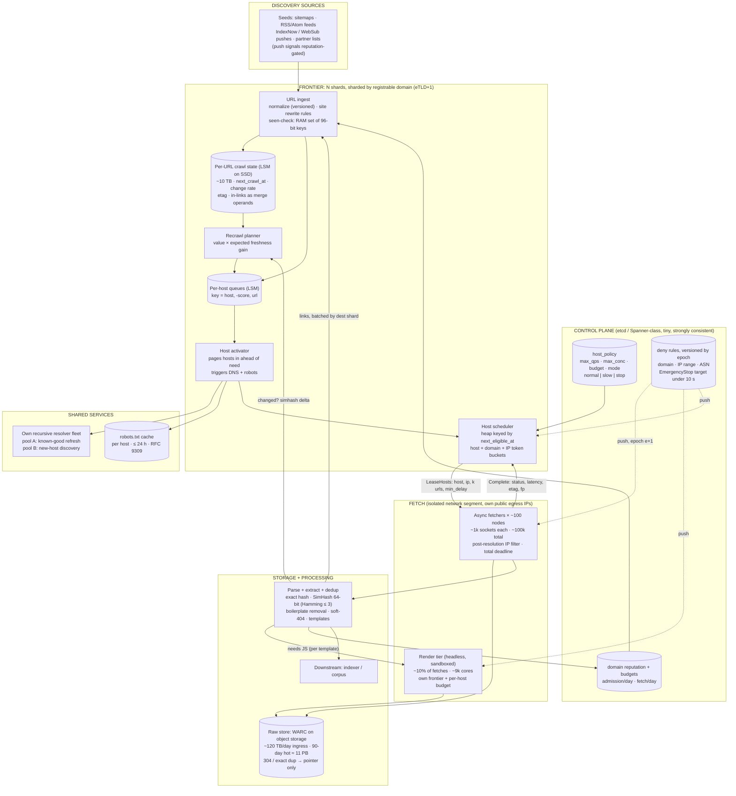

**How each URL's next step is decided** (the decision the frontier makes over and over):

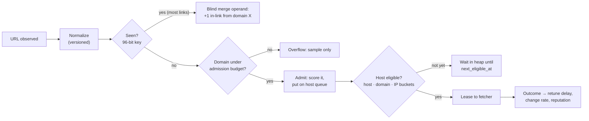

**Background jobs** (off the hot path):

| Job | Does | When |
|---|---|---|
| Host activator | pages cold hosts in from SSD, resolves DNS, fetches robots.txt | continuous, ahead of need |
| Recrawl planner | recomputes `next_crawl_at` from change-rate estimates × value | continuous, on every outcome |
| Soft-404 prober | fetches a random nonexistent path per host, stores its SimHash | once per host per period |
| Template learner | clusters URLs by path shape, tracks near-dup rate and yield, demotes bad templates | hourly batch |
| Mirror detector | per host-pair dup ratio → declare mirror, collapse non-canonical host | daily batch |
| Render sampler | renders a sample per template, decides render/no-render | periodic per template |
| Freshness auditor | re-fetches a random indexed sample **outside the scheduler**, measures true staleness | continuous, small budget |
| Coverage auditor | checks a held-out URL set is still admitted and fetched (catches silent loss) | daily |
| Kill-switch drill | fires an EmergencyStop against a test ASN, measures slowest ack | regularly |

**Revision cheat strip:**

| Remember | Why |
|---|---|
| **Fetchers lease hosts, not URLs** | politeness for a host lives in exactly one place; no distributed rate limiter on the hot path |
| Shard everything by **registrable domain (eTLD+1)** | politeness state is single-owner; most links are internal, so most seen-checks are local |
| Throughput needs **≥ ~90k eligible hosts** at every instant | the crawler scales with **host diversity**, not hardware |
| Politeness = **three nested buckets**: host, domain, IP (IP off for CDNs) | subdomain farms and shared hosting both break per-hostname limits |
| robots.txt **5xx / 429 / unreachable = disallow all** | that is exactly when the server is struggling |
| **Exact 96-bit fingerprints**, not a Bloom filter | 1% FP = ~1B new URLs silently never crawled |
| Host-prefixed keys need the **full 64-bit hash after the prefix** | a 24-bit prefix drops ~450k URLs on a 1B-URL site |
| In-link updates are **blind merge operands** | read-modify-write would be ~40× the fetch rate |
| **Resolve at activation**, connect to the **validated IP** | DNS off the critical path; no DNS-rebinding SSRF |
| **Under-visit the fastest-changing low-value pages** | their freshness is lost anyway; weekly pages gain far more |
| **Budget per domain scaled by reputation** | traps you can't detect still can't absorb unbounded budget |
| **Slow-mode start on every state reload** | failover and deploys must never become synchronised bursts |
| Time-to-stop = **slowest ack** | an average hides the straggler still hitting the site |

<details>
<summary><b>Expanded: "lease hosts, not URLs" and "≥ ~90k eligible hosts"</b></summary>

Both rows come from one fact: **each website may only be hit slowly**. The first is *how* you enforce that cheaply; the second is *what it costs* in throughput.

#### 1. Fetchers lease hosts, not URLs

**The rule being protected.** Politeness: `smallblog.org` may be fetched at most **once every 2 s**. Break it and you overload their server and get blocked or reported.

**Option A: shared URL queue (the obvious design, and it fails).** Any fetcher pops the next URL. `smallblog.org` has 6 URLs ready:

```
fetcher-1 pops smallblog.org/a  ─┐
fetcher-2 pops smallblog.org/b   ├─ all fire in the same millisecond
fetcher-3 pops smallblog.org/c  ─┘    → 3 hits at once, politeness broken
```

No fetcher knows what the others are doing. The only fix is a central **distributed rate limiter** asked before every fetch ("may I hit smallblog.org now?"):

- **On the hot path:** every one of ~46k fetches/s pays an extra network round trip first.
- **Hot spot:** big hosts flood the limiter with permission requests; the limiter becomes the bottleneck.
- **Easy to get wrong:** races (two fetchers both told "yes"), stale state after crashes.

**Option B: lease the whole host (this design).** The scheduler gives one fetcher **exclusive ownership of the host for a while**:

```
fetcher-4 gets lease{ host: smallblog.org, ip: 203.0.113.9,
                      urls: [a,b,c,d,e,f], min_delay: 2s, until: +60s }

fetcher-4: fetch a … sleep 2s … fetch b … sleep 2s … fetch c …
```

Only fetcher-4 may touch `smallblog.org`, so obeying "once every 2 s" is **a local sleep**: nobody to ask, no coordination. Politeness lives in exactly one place.

> **Analogy:** one bathroom key. Whoever holds the key has the room; nobody needs a guard checking "is it free?".

**Extra benefits:**

| Benefit | Why |
|---|---|
| **One TLS handshake per lease** | the holder reuses one connection for all `k` URLs, not one handshake per URL |
| **Per-host state in one place** | robots rules, backoff after 429/503 and the validated IP travel with the lease |
| **Self-healing on crash** | fetcher dies → lease expires at `lease_until` → unfetched URLs return to the queue; a few duplicate fetches are harmless (GET is idempotent) |

#### 2. Throughput needs ≥ ~90k eligible hosts at every instant

**The arithmetic.**

- Target: **~46,000 fetches/s** (4B/day ÷ 86,400 s).
- Politeness: **1 fetch per host per ~2 s = 0.5 fetches/s per host**.

$$
\frac{46{,}000 \text{ fetches/s}}{0.5 \text{ fetches/s per host}} \approx 92{,}000 \text{ hosts}
$$

Each host contributes at most half a fetch per second, so ~90k **different** websites must have URLs ready and be taking turns all the time. (Read "eligible at every instant" as **~90k hosts in active rotation with work queued**; at any given millisecond many are in their 2 s cooldown.)

**Why "host diversity, not hardware".**

> **Analogy:** a toll plaza where each car may pass only once every 2 s. More booth staff (hardware) doesn't help if only 10 cars are in line. Throughput depends on **how many different cars** are waiting.

| Scenario | Hosts in rotation | Max fetches/s | Add 1,000 machines? |
|---|---|---|---|
| Crawl spread over many sites | 92,000 | 46,000 | not needed |
| Crawl concentrated on a few big sites | 1,000 | **500** | **useless**: each site still caps at 0.5/s; machines sit idle |

Hardware is the easy part (100k sockets ≈ ~100 async nodes). **The real ceiling is distinct hosts with ready work.** Consequences:

- The frontier keeps **several hundred thousand hosts warm** (DNS + robots resolved), because some are always cooling, backing off or resolving; you need slack above 90k.
- **Eligible-host count is a first-class dashboard metric.** Below ~90k, throughput drops, and adding fetchers does nothing (§14 failure chain).

#### How the two connect

Each host is capped at 0.5 fetches/s, so **the host, not the URL, is the real unit of work**:

1. The scheduler hands out **hosts**, which puts politeness in one place (row 1).
2. The scheduler's main job is **keeping ~90k+ hosts in rotation** (row 2).

> **One line:** every website is a slow tap. Lease each tap to one fetcher, and keep ~90k taps open at once to fill the bucket fast enough.

</details>

**Why two different feedback edges matter.** The loop is ingest → state → schedule → fetch → parse → ingest. Two edges turn it into a **control system**: parse → recrawl planner carries "did this page change?" observations that retune fetch intervals, and parse → reputation carries dup, spam and trap signals that shrink per-domain budgets. If either edge is wrong, the crawler confidently spends budget in the wrong place, and nothing errors.

Why each technology was chosen: §5.5 (database choices and caches).

### ⚡ The life of one URL in one picture

```mermaid
flowchart LR
  A["1. Link seen on a page<br/>shop.example.com/p/123?ref=x"] --> B["2. Normalize + site rule<br/>strip learned 'ref' param"]
  B --> C["3. Local seen-check<br/>(same domain shard)"]
  C --> D["4. New → admit within<br/>domain budget, score it"]
  D --> E["5. Host queue, ordered<br/>by value score"]
  E --> F["6. Host already active:<br/>IP + robots cached"]
  F --> G["7. Host eligible → lease<br/>to a fetcher with k URLs"]
  G --> H["8. GET via validated IP<br/>conditional headers"]
  H --> I["9. Raw → WARC store<br/>parse, exact + SimHash dedup"]
  I --> J["10. Links back to step 1<br/>change signal → planner"]
  J --> K["11. next_crawl_at set from<br/>value × freshness gain"]
```

---

## Glossary (read once)

**One picture for the whole guide:** think of a **food critic with a fixed number of restaurant visits per year**, reviewing every restaurant in the world. Each restaurant (a **host**) only lets one critic in every few minutes, or the kitchen gets overwhelmed (**politeness**). The critic's assistant keeps a **diary of every dish already tasted** (the **seen set**) and a **list of restaurants that are open and ready to receive a visit right now** (the **eligible-host heap**). Some restaurants are chains serving the identical menu under different names (**mirrors / duplicates**). Some menus change daily, some yearly, and the critic must decide **when to go back** (the **recrawl policy**). A few "restaurants" are fake, with an infinite menu designed to waste visits (**traps**). The visits are the budget, and the game is spending them where readers care.

| Term | Plain meaning |
|------|---------------|
| **Frontier** | The crawler's scheduler: every known URL, its state, and the queues deciding what is fetched next |
| **Host** | A hostname, e.g. `blog.example.com` |
| **Registrable domain (eTLD+1)** | The "owner" part of a hostname, e.g. `example.com` or `example.co.uk`. Computed with the **Public Suffix List** |
| **Public Suffix List (PSL)** | The list of suffixes under which anyone can register (`.com`, `.co.uk`, `github.io`) |
| **Politeness** | Never fetching from a server faster than it can comfortably handle. A **hard constraint**, not a tuning knob |
| **Host lease** | A fetcher's temporary exclusive right to fetch from one host: IP, up to `k` URLs, a min delay, an expiry |
| **Token bucket** | A rate limiter: tokens refill at a fixed rate; each fetch spends one |
| **next_eligible_at** | The earliest time the host may be fetched again |
| **Host heap** | A priority queue of active hosts ordered by `next_eligible_at` |
| **Activator** | Background worker that pages cold hosts into memory and pre-resolves DNS and robots.txt |
| **Mercator** | A classic crawler design: priority "front queues" feeding per-host "back queues" |
| **robots.txt** | The file a site uses to say which paths crawlers may fetch. Standardised as **RFC 9309** |
| **Crawl-delay** | A non-standard robots.txt directive asking for a minimum gap between requests |
| **AIMD** | Additive increase, multiplicative decrease: on trouble halve the rate, on success add a little. TCP uses it |
| **Retry-After** | HTTP header on 429/503 saying how long to wait |
| **URL normalization** | Rewriting a URL into one canonical form so equal URLs get one key |
| **Fingerprint** | A fixed-size hash standing in for a URL or a page body |
| **Seen set** | The set of all URL fingerprints ever admitted |
| **Bloom filter** | A compact set that can say "maybe present" when it isn't (false positive), never the reverse |
| **Birthday bound** | Expected hash collisions among `n` items with `b` bits ≈ `n² / 2^(b+1)` |
| **DRUM** | IRLbot's disk structure: buffer checks, sort, merge against the sorted on-disk set in one sequential pass |
| **LSM tree** | Log-structured merge tree (RocksDB, Cassandra, Bigtable): fast writes, sorted keys, compaction in background |
| **Merge operand** | A blind "add this" record the LSM folds in at compaction time, so you never read before writing |
| **Compaction debt** | Work the LSM still owes in background; when it grows, reads and ingest slow down |
| **Hot partition** | One shard getting far more load than others |
| **TTL clamping** | Forcing DNS TTLs into a band: floor tiny ones, cap huge ones |
| **NXDOMAIN / SERVFAIL** | DNS "name doesn't exist" (permanent) / "resolver failed" (transient) |
| **SSRF** | Server-side request forgery: tricking a server into fetching an internal address |
| **DNS rebinding** | A name that resolves to a public IP the first time and a private IP the second |
| **WARC** | Web ARChive file format: request + response headers + body, the standard raw crawl record |
| **Conditional GET** | `If-None-Match` / `If-Modified-Since`; server replies **304 Not Modified** if nothing changed |
| **Exact dup** | Same body hash after stripping volatile tokens |
| **Near-dup** | Almost the same content, detected by **SimHash** |
| **SimHash** | A 64-bit fingerprint where similar documents have fingerprints differing in few bits |
| **Hamming distance** | Number of bit positions where two fingerprints differ |
| **Shingle** | A short overlapping word sequence (e.g. 4 words) used as a content feature |
| **Boilerplate** | Template, nav, footer, ads: the parts repeated across a site's pages |
| **Mirror** | A whole host duplicating another host |
| **rel=canonical** | A page's claim "the real version of me is at URL X". A hint, not truth |
| **Soft-404** | A "not found" page served with status 200 |
| **Freshness** | Fraction of time your stored copy matches the live page |
| **Age** | How long your stored copy has been out of date |
| **Poisson change process** | Model where a page changes at random times with an average rate λ |
| **Change-rate estimator** | Guessing λ from "changed / not changed" at your own visit times |
| **Discovery share** | The part of a host's politeness allowance reserved for never-fetched URLs |
| **Render tier** | Headless browsers that execute JavaScript to get client-rendered content |
| **URL template** | The structural shape of a URL, e.g. `/product/{id}?color={c}` |
| **Crawler trap** | Anything where URL count → infinity while marginal value → 0 |
| **Tarpit** | A server that trickles bytes to hold your sockets forever |
| **Decompression bomb** | A few MB of gzip that expands to many GB |
| **Fencing token** | A number that increases with each ownership grant; stale holders get rejected |
| **Slow mode** | Restarting a host at half rate (or less) and ramping up additively |
| **Home region** | The one region that owns all fetching and politeness for a domain |
| **Little's law** | Items in flight = arrival rate × time in system |
| **Time-to-stop** | Time from "stop crawling X" to the **last** fetcher acknowledging it |

### Data model primer: URL, host, domain, IP, shard

> **⚡ 30-second version**
> - **URL:** the unit of **value**. It has a score, a change-rate estimate and a `next_crawl_at`.
> - **Host:** the unit of **scheduling**. It has a queue, a delay, a backoff state and robots rules. Fetchers lease **hosts**.
> - **Registrable domain:** the unit of **ownership and budget**. Shards are keyed by it, reputation and admission budgets attach to it, and its token bucket caps subdomain farms.
> - **IP (or /24):** the unit of **physical load**. Its bucket protects shared hosting. Disabled for CDN / anycast ranges.
> - **Shard:** a set of domains owned by one frontier node under a lease, with a fencing token.

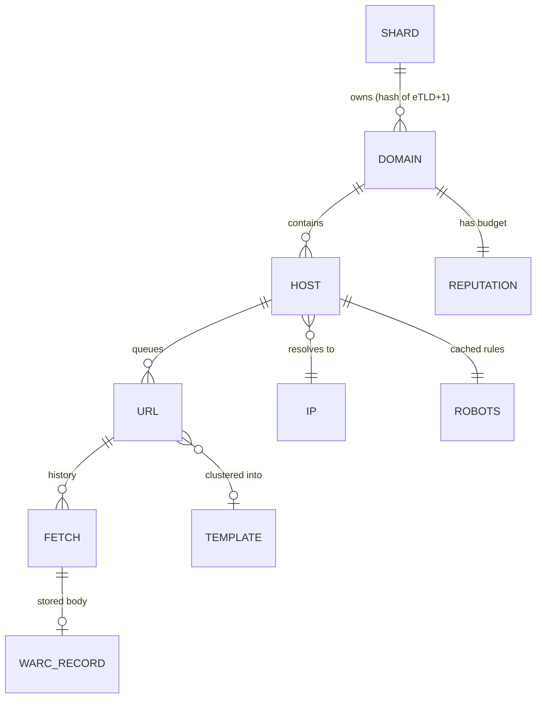

**One running example** used throughout:

| Name | What it is |
|---|---|
| `news.example.com` | a high-value news site; front page changes every ~10 min |
| `shop.example.com` | an e-commerce site with faceted navigation (colour, size, price, brand…) |
| `*.spamfarm.net` | wildcard DNS: every subdomain resolves to the same 3 servers |
| `smallblog.org` | a tiny blog on a single cheap VPS |
| `cdn-edge` | one anycast IP serving 2 million unrelated sites |

---

## 1. Clarify the problem

> **⚡ 30-second version**
> 1. **What's the corpus for?** Search index (freshness × demand), archive (completeness), ML corpus (dedup + quality). We design for the **search index**, the hardest mix.
> 2. **Discovery or refresh?** In a mature crawler, **refresh is most of the budget**. Size only for discovery and you built a first crawl, not a crawler.
> 3. **JavaScript?** Yes, but for a **fraction**, as a separate budgeted tier.
> 4. **Compliance?** RFC 9309 robots, Crawl-delay, identifiable UA, published IP ranges + reverse DNS, **per-domain kill switch**.
> 5. **Scale:** ~100B known URLs, ~10B active, ~4B fetches/day.

The answers change the architecture, so pin them down first:

| Question | Why it changes the design |
|---|---|
| **What is the corpus for?** | An index cares about freshness weighted by query demand. An archive cares about completeness and fidelity (every version, every subresource). A training corpus cares about dedup and quality and barely about freshness. |
| **Discovery or refresh?** | Most of a mature crawler's fetches re-fetch known pages. New-URL discovery gets a minority share. |
| **JavaScript rendering?** | Rendering everything multiplies cost by an order of magnitude or more. Render a fraction, decided per template (§11). |
| **Compliance posture?** | Full robots.txt (RFC 9309), honour Crawl-delay, identifiable user agent, published IP ranges with reverse-DNS verification, and a **human-operated kill switch per domain**. |
| **Scale?** | ~100B known URLs, ~10B worth keeping in the active index, ~4B fetches/day. |

### §1 explained in detail, with examples (beginner version)

**"What is the corpus for?" changes everything downstream.** Same crawler, three customers:

| Customer | Wants | What changes in the crawler |
|---|---|---|
| **Search index** | the pages people search for, fresh | recrawl weighted by query demand; near-dup collapse; render where content is missing |
| **Web archive** | every version of every page and every image/CSS/JS | keep every fetch, even unchanged; fetch all subresources; dedup only to save storage, never to skip |
| **ML training corpus** | lots of unique, high-quality text | aggressive near-dup removal, quality filters; recrawl rarely; freshness barely matters |

An archive that "dedups away" a near-identical page **loses history**. A training corpus that keeps a million near-identical product pages **teaches the model boilerplate**. Asking this in minute one stops you designing the wrong dedup policy.

**"Discovery or refresh?" — the trap most people walk into.** A first crawl of a new web is all discovery: every fetch finds new URLs. A year later the crawler knows ~10B valuable pages, and those pages keep changing. Example split for a mature crawler (illustrative):

```text
4B fetches/day
├── ~2.7B refresh   (re-fetch known pages to stay fresh)   ~2/3
└── ~1.3B discovery (never-fetched URLs)                   ~1/3
```

If you only size discovery you'll be surprised when, a few months in, **coverage stops growing**: refresh has quietly eaten every host's allowance (§10).

**"Compliance" is a requirement, not ethics homework.** Operating a crawler means getting abuse complaints, from site owners, hosting providers and ISPs. The questions that matter: can they **identify** you (user agent, reverse DNS of your IPs), can they **verify** it's really you (published IP ranges), and can you **stop** within seconds when they call (§4)? If any answer is no, they block your whole IP range and you lose that slice of the web.

---

## 2. Requirements

### Functional requirements (what the system does)

1. **Seed ingestion**: sitemaps, feeds, push protocols (IndexNow, WebSub), partner lists, plus link-based discovery.
2. **Fetch and store raw responses** WARC-style (request, response headers, body), and **extract** links and metadata.
3. **URL dedup and content dedup**, exact and near-duplicate.
4. **Recrawl policy**: decide when each known URL is fetched again.
5. **Operator controls**: per-host and per-domain rate overrides, block / allow lists, **emergency stop**, budget overrides.

### Non-functional requirements (these drive the design)

| Requirement | Target | Why it's hard |
|---|---|---|
| **Politeness** | never the reason a small site goes down; back off automatically on distress | the objective is maximised **subject to** it |
| **Throughput** | ~46k fetches/s average, **steady**, not bursty | capped by eligible-host count, not machines |
| **Bounded waste** | traps, spam and dups can't absorb an unbounded share | the web generates infinite URLs for free |
| **Graceful degradation** | losing a frontier shard delays part of the crawl | must **not** reset politeness and set off a burst |
| **Safety** | the fetcher never reaches internal address space | it's an SSRF engine pointed at the internet |

### §2 explained in detail (beginner version)

**"Politeness is a hard constraint" — what that means concretely.** In most systems, throughput is the goal and limits are tuning. Here it's reversed: the limits are **external and non-negotiable**, and throughput is whatever you can get inside them. Think of a delivery company where each house accepts one parcel every few minutes. Buying more trucks doesn't help if all your parcels go to the same three houses.

**"Steady, not bursty."** 46k/s average is easy. 46k/s average made of 200k/s for ten seconds then nothing is a DDoS. Every design choice that creates synchronisation (a deploy, a failover, a midnight cron) is suspect.

**"Graceful degradation" — the example that makes it real.** `smallblog.org` is in **backoff**: it returned 503s an hour ago and we're fetching once a minute. Its frontier shard dies. The new owner starts with **empty state**: `smallblog.org` looks "never fetched, eligible now". So do 300k other hosts on that shard. They all get fetched at full rate in the same second. The blog that was struggling now gets hit harder than before. Losing a shard must mean **"part of the crawl is late"**, never **"part of the web gets hammered"** (§13).

---

## 3. Capacity — the numbers that decide everything

> **⚡ 30-second version**
> 1. **~46k fetches/s**, ~11 Gbps ingress, ~120 TB/day raw.
> 2. **~2.3M URL observations/s** → the seen-check is the hottest random-access path. Batch it, keep it host-local.
> 3. **Seen set ~1.2 TB** (fits in fleet RAM). **Per-URL state ~10 TB** (does not; LSM on SSD).
> 4. **~100k sockets** (trivial) but **≥ ~90k hosts eligible at every instant** (the real ceiling).
> 5. **The crawler scales with host diversity, not hardware.**
> 6. Money: **render fraction** and **raw-store retention** set the bill. Don't route ingress through a managed NAT.

All numbers are illustrative; the **ratios** shape the design.

| Quantity | Calculation | Result |
|---|---|---|
| Fetches/day | budget | ~4B |
| Fetches/sec (avg) | 4B / 86,400 | **~46,000/s** |
| Avg compressed transfer | assumed ~30 KB HTML | — |
| Ingress bandwidth | 46k × 30 KB | ~1.4 GB/s ≈ **11 Gbps** |
| Raw ingress/day | 4B × 30 KB | **~120 TB/day** |
| Links extracted | ~50 per page × 46k | **~2.3M URL observations/s** |
| URL fingerprints (seen set) | 100B × 12 B (32-bit host prefix + 64-bit URL hash, §7) | **~1.2 TB** (fleet-wide RAM is fine) |
| Per-URL crawl state | 100B × ~100 B | **~10 TB** (doesn't fit in RAM; LSM on SSD) |
| Concurrent sockets (Little's law) | 46k/s × ~1.5 s mean + slow tail | ~100k open connections |
| Hosts eligible at once | 46k/s ÷ (1 fetch per host per ~2 s) | **≥ ~90k hosts ready at any instant** |

### The three rows that decide the architecture

**1. The last row is the real ceiling.** 100k sockets is trivial: ~100 async fetcher nodes at 1k connections each. But if politeness allows about one fetch every ~2 s per host, sustaining 46k/s needs **~90k distinct hosts with a ready URL at every instant**. In practice the frontier keeps **several hundred thousand** hosts warm (some are cooling, some resolving). A crawl concentrated on a few big sites collapses no matter how many machines you add. **That one fact is why the frontier is organised by host, not by URL.**

**2. 2.3M observations/s makes the seen-check the hottest random-access path.** It can't be one RPC per link. It has to be **batched and host-local** (§7).

**3. 120 TB/day of ingress looks free**, because clouds don't bill inbound transfer. Push it through a **managed NAT gateway** and you pay per-GB processing: at a ~$0.045/GB class price that's **~$5,400/day ≈ $2M/year** of pure overhead for routing packets. Fetchers get **their own public egress IPs**, which you want anyway for published crawler IP ranges and reverse DNS.

### §3 explained in detail, with examples (beginner version)

**Why host count, not machines, is the ceiling — with tiny numbers.** Suppose politeness allows each host **1 fetch every 2 seconds**, i.e. 0.5 fetches/s per host.

```text
Want: 10 fetches/s
Hosts needed ready at once: 10 / 0.5 = 20 hosts

Case A: frontier has 1,000 ready hosts → easily 10/s
Case B: frontier has only 5 big sites  → max 5 × 0.5 = 2.5/s
        add 100 more fetcher machines   → still 2.5/s
```

Scale it up: 46,000 / 0.5 = **92,000 hosts** must be ready **at every instant**. If a budget cut or a DNS outage shrinks the active set to 50k, throughput drops to ~25k/s, and **no fetch errors appear anywhere**. That's why "eligible-host count" is a first-class capacity metric (§16).

**Little's law for sockets.** Sockets open = fetch rate × time per fetch = 46,000/s × 1.5 s ≈ 69,000, plus a slow tail → ~100k. Each async node holds ~1k cheaply. So ~100 nodes. Fetchers are **never** the bottleneck; adding them is the wrong response to low throughput (§14).

**Why the seen set fits in RAM but URL state doesn't.**

```text
Seen set:  100B URLs × 12 bytes           = 1.2 TB  → spread over ~50 frontier nodes = ~24 GB each ✓
URL state: 100B URLs × ~100 bytes          = 10 TB   → 200 GB each, plus replication → SSD (LSM)
           (score, next_crawl_at, change-rate estimate, etag, last-modified,
            content fp, simhash, in-link counts, status history)
```

### Where the money actually goes

Fetching is cheap. The bill is set by two things the naive design treats as details: the **render fraction** and **raw-store retention**. Illustrative unit economics (assumed prices, order of magnitude only):

| Cost line | Driver | Illustrative sizing | Lever |
|---|---|---|---|
| Fetch fleet | sockets, TLS handshakes, decompression | a few hundred cores; ~100 nodes is generous | **connection reuse per host lease** (one TLS handshake per lease, not per URL) |
| Parse + extract + dedup | ~10–30 ms CPU/page × 46k/s | ~500–1,400 cores | skip parse on 304 and exact dup |
| **Render tier** | 10% of fetches × ~2 CPU-s | **~9,000 cores** (§11) | per-template render decision; **every point of render fraction ≈ 900 cores** |
| **Raw store** | 120 TB/day written | 90-day hot ≈ ~11 PB; at ~$20/TB-month ≈ **~$220k/month** | don't store bodies for 304 / exact dup; store unchanged pages as a pointer |
| Per-URL state (LSM) | ~10 TB × replication × compaction headroom | tens of TB of SSD | TTL dead URLs; tier cold state to object storage |

**Two consequences for the design review:**

1. **The cheapest fetch is the one that finds nothing changed, provided you don't store it.** If refresh is ~2/3 of fetches and half of those find the page unchanged, storing only a pointer cuts raw-store growth by **close to a third**, more than any fetcher optimisation.
2. **Render fraction is the single most sensitive parameter.** 10% → 25% rendered adds **~14k cores**, more than the rest of the pipeline combined. A team that can't state its render fraction **per template** can't state its cost per page.

#### Beginner version: the pointer trick in numbers

```text
4B fetches/day, 2/3 refresh = 2.67B refresh fetches
half of refresh unchanged   = 1.33B fetches (304, or same exact hash)

store full body:    1.33B × 30 KB = 40 TB/day   (one third of 120 TB)
store pointer only: 1.33B × ~100 B = 0.13 TB/day

90 days × 40 TB = 3.6 PB of hot storage you didn't need ≈ $72k/month
```

---

## 4. API design — fetchers lease hosts, not URLs

> **⚡ 30-second version**
> 1. The external API is small. The **frontier ↔ fetcher contract** is what matters.
> 2. **Fetchers lease hosts.** One holder per host at a time = politeness enforced in one place, no distributed rate limiter on the hot path.
> 3. Discovery ingest is **batched and partitioned by registrable domain**.
> 4. **EmergencyStop is a push**, versioned by epoch, reaching **scheduler + fetchers + render tier**.
> 5. The deny check runs **against the resolved IP at request time**. Time-to-stop = **slowest ack**; a fetcher that doesn't ack **fences itself**.

```text
# Frontier <-> fetcher
LeaseHosts(fetcher_id, capacity)       -> [HostLease{host, ip, lease_until, max_concurrency,
                                                     min_delay_ms, urls[<=k], fencing_token}]
Complete(lease_id, url, outcome)       -> ack   # outcome: status, latency, bytes, etag,
                                                #   last_modified, content_fp, simhash, retry_after
RenewLease(lease_id)                   -> lease_until
ReturnLease(lease_id, unfetched[])     -> ack   # graceful hand-back

# Discovery ingest (batched, partitioned by registrable domain)
SubmitUrls(domain_shard, [(url, source_url, anchor_hints, discovered_at)])  -> ack

# Operator control plane
SetHostPolicy(pattern, {max_qps, max_conc, budget_per_day, mode: normal|slow|stop})
EmergencyStop(domain | ip_range | asn)  # must take effect in seconds, fleet-wide
```

**Why lease hosts?** Leasing puts all politeness enforcement for a host in **exactly one place at a time**: the lease holder. A URL-level queue spreads one host's URLs across fetchers, and enforcing politeness then needs a **distributed rate limiter on the hot path**: every fetch becomes "ask the limiter, wait, fetch", with the limiter itself a hot spot for big hosts.

**Bonus: connection reuse.** The lease holder keeps one TLS connection to the host for the whole lease, so you pay one handshake per lease, not per URL (§3).

### §4 explained in detail, with examples (beginner version)

**URL queue vs host lease, side by side.** `smallblog.org` has 6 URLs ready, min delay 2 s.

```text
URL QUEUE (wrong)
  fetcher-1 pops smallblog/a   fetcher-7 pops smallblog/b   fetcher-3 pops smallblog/c
  all three fetch in the same 100 ms → 3 requests at once on a tiny VPS
  to prevent it: every fetcher must ask a shared rate limiter before each GET

HOST LEASE (right)
  fetcher-4 gets lease{smallblog.org, ip=203.0.113.9, urls=[a,b,c,d,e,f], min_delay=2s, until=+60s}
  t=0 a · t=2 b · t=4 c · t=6 d ... one connection, one place enforcing the delay
  fetcher dies? lease expires at +60 s, unfetched URLs go back to the queue
```

**Why `Complete` carries so much.** Each outcome feeds three loops: **latency** and **status** retune the host's delay (§6), **etag / content_fp / simhash** tell the recrawl planner whether the page changed (§10), and the dup / soft-404 signals feed reputation (§12). The fetch is just a measurement instrument.

### The emergency stop must reach three places

When a hosting provider calls because you're melting their shared cluster, "within the next lease cycle" is too slow. A stop has to reach **three** places, and most designs only reach the first:

1. **The scheduler** stops issuing new leases. (Everybody builds this.)
2. **Fetchers already hold leases** with up to `k` URLs and a `lease_until` minutes away, and **open connections keep streaming**.
3. **The render tier fetches subresources on its own schedule**, often against exactly the shared hosting cluster that complained, since complaints are usually about a **CDN or ASN**, not a hostname.

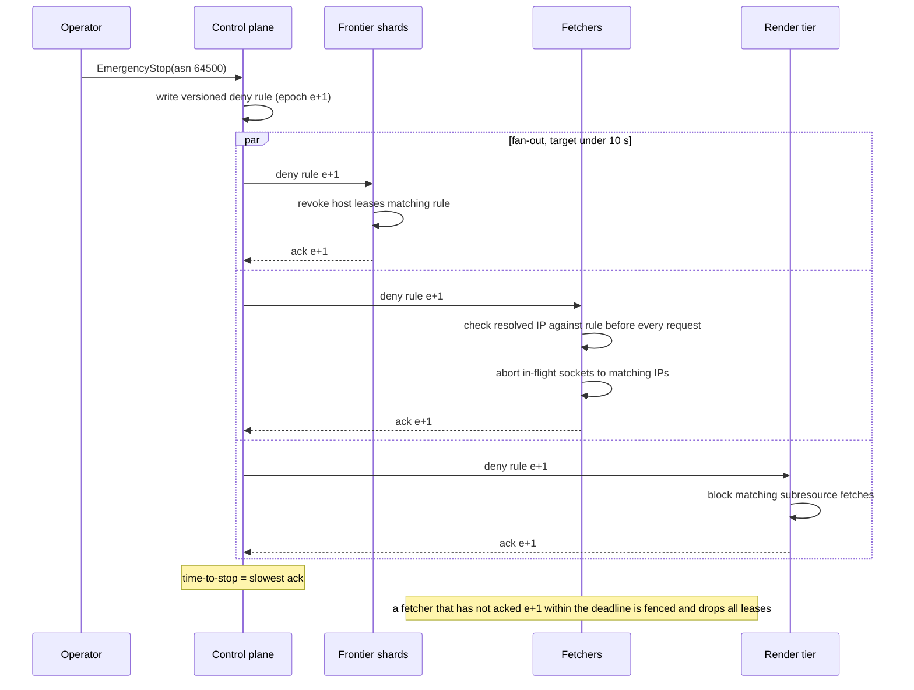

**Two design rules fall out:**

| Rule | Why |
|---|---|
| **Deny check against the resolved IP, at request time**, not the hostname at lease time | an ASN or IP-range stop has no hostname to match, and a lease issued a minute ago predates the rule |
| **Time-to-stop = slowest ack**; a fetcher that fails to ack **fences itself** | an average hides the one straggler still hitting the site |

#### Beginner version: why "epoch" and "fence itself"

The deny list is versioned: epoch 41, 42, 43… Each fetcher reports "I have applied epoch 43". The control plane knows exactly who's caught up. Fetcher-88 is partitioned and never hears about epoch 43. Without self-fencing it keeps crawling the stopped ASN. With self-fencing: "If I haven't heard from the control plane within the deadline, I can't prove I'm obeying the latest rules, so I **drop all my leases and stop**." Losing one fetcher's throughput for a minute costs nothing; one unstoppable fetcher costs an abuse escalation.

---

## 5. High-level design

> **⚡ 30-second version**
> 1. Loop: **ingest → state → schedule → fetch → parse → ingest**.
> 2. Two feedback edges make it a control system: **parse → recrawl planner** (change rates) and **parse → reputation** (dup/spam/trap → smaller budgets).
> 3. **Everything is sharded by registrable domain** (eTLD+1 via the Public Suffix List): politeness for a domain lives in one place, and most links are internal, so most seen-checks are local.
> 4. Fetchers sit in an **isolated network segment** with their own egress IPs.

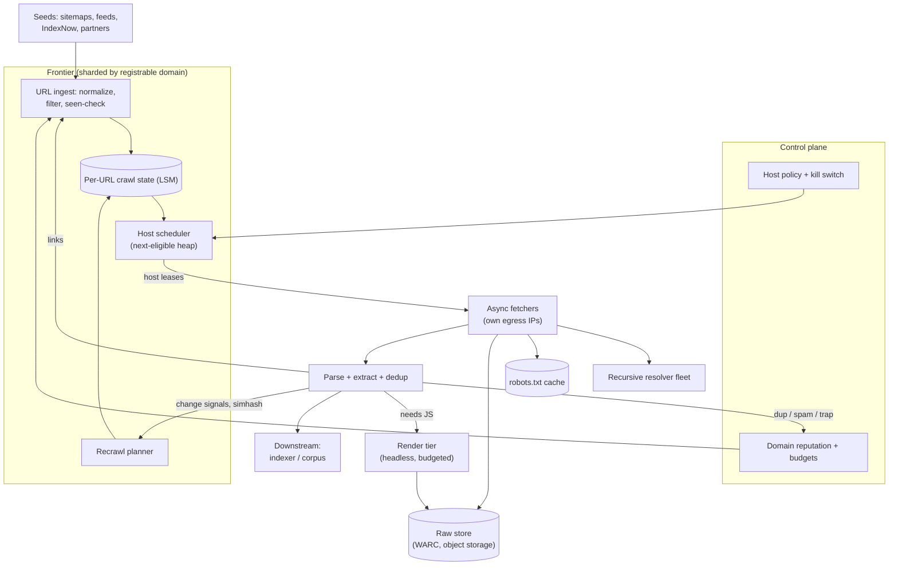

### Why shard by registrable domain (and not by URL hash or hostname)

| Shard key | What goes wrong |
|---|---|
| **URL hash** | one host's URLs land on every shard → politeness needs a distributed limiter; every link is a remote seen-check |
| **Hostname** | `*.spamfarm.net`'s 10M subdomains spread over every shard → no single place can cap the **domain** rate |
| **Registrable domain (eTLD+1)** ✓ | all of `example.com`'s hosts in one shard → one owner for domain + host buckets; internal links (the majority) are local |

**Why the Public Suffix List matters.** "Registrable domain" isn't "last two labels". `bbc.co.uk` is registrable but `co.uk` is not. `alice.github.io` and `bob.github.io` are **different owners**, because `github.io` is on the PSL. Get this wrong and you either lump millions of unrelated GitHub Pages sites into one domain bucket (starving them) or treat `a.b.co.uk` and `c.co.uk` as one owner.

### The spine in one paragraph

Seeds and extracted links arrive at **URL ingest**, which normalises, checks the seen set and admits new URLs within the domain's budget. Admitted URLs get **per-URL state** (LSM) and a place on their **host queue**. The **activator** keeps several hundred thousand hosts warm (DNS and robots resolved). The **host scheduler** pops the host with the earliest `next_eligible_at` that passes all three buckets and **leases** it to a fetcher. The fetcher fetches, writes **WARC** to object storage and hands the body to **parse**, which extracts links (back to ingest), computes exact and near-dup fingerprints, tells the **recrawl planner** whether the page changed, and tells **reputation** about dups, spam and traps.

### Cost per unit

| Unit | Rough cost driver |
|---|---|
| One static fetch | ~1 politeness slot + ~30 KB transfer + ~10–30 ms parse CPU |
| One 304 | 1 politeness slot, ~0 bytes, no parse, **no body stored** |
| One render | ~2 CPU-s + **~3 extra origin requests** (each a politeness slot, §11) |
| One link observation | one batched seen-check + one blind merge operand |
| One new URL admitted | ~100 B of LSM state + a host-queue entry, forever until TTL |

> **The scarce resource is the politeness slot, not bytes or CPU.** A 304 saves bytes and CPU but still spends a slot.

---

## 5.5 Data model — tables, database choices and caches

> **⚡ 30-second version**
> 1. **Seen set** = in-RAM hash set of 96-bit keys per frontier shard (~1.2 TB fleet-wide), with a sorted on-disk tier for DRUM-style batch merges.
> 2. **Per-URL state + host queues** = **embedded LSM** (RocksDB) on each frontier shard's SSD, replicated. ~10 TB total.
> 3. **Host politeness state** = small (tens of bytes per active host), **replicated with the shard**, snapshotted.
> 4. **Raw responses** = **WARC on object storage**; 304 / exact dup → pointer record only.
> 5. **Content fingerprints** = exact-hash KV + **permuted sorted SimHash tables**.
> 6. **Control plane** (policies, deny rules, budgets, shard leases) = **etcd / Spanner-class**, tiny, strongly consistent.
> 7. **Never cached:** the deny-rule epoch check at request time, and the fencing token on a lease.

### Table design (sketch)

```sql
-- ================= Per-URL crawl state: embedded LSM on the owning frontier shard =================
-- key = (domain_hash, host_hash, url_fp96)  → one domain contiguous on disk
CREATE TABLE url_state (
  url_key          BYTES PRIMARY KEY,      -- 32-bit host hash + 64-bit URL hash (§7)
  url              STRING,                 -- normalized, with normalizer_version
  normalizer_version INT,                  -- lets a normalizer change migrate lazily (§15)
  template_id      BIGINT,                 -- structural URL template (§12)
  status           STRING,                 -- 'new'|'ok'|'redirect'|'gone'|'soft404'|'dup'|'blocked'
  first_seen       TIMESTAMP,
  last_fetch       TIMESTAMP,
  next_crawl_at    TIMESTAMP,              -- set by the recrawl planner (§10)
  value_score      FLOAT,                  -- importance prior × expected gain (§6)
  change_rate      FLOAT,                  -- bias-corrected λ estimate (§10)
  visits           INT, changes_seen INT,  -- inputs to the estimator
  etag             STRING, last_modified STRING,   -- for conditional GET
  content_fp       BYTES,                  -- exact hash of normalized body (§9)
  simhash          BIGINT,                 -- 64-bit near-dup fingerprint (§9)
  canonical_key    BYTES,                  -- if dup, points to the canonical URL
  inlink_domains   COUNTER,                -- folded from MERGE OPERANDS, never read-modify-write (§7)
  anchor_terms     MERGE_LIST,             -- bounded, folded at compaction
  warc_ptr         STRING                  -- object store pointer of last stored body
);

-- ================= Per-host queue (same LSM, separate column family) =================
-- key = (host, -score, url_key)   → range scan = best URLs first
CREATE TABLE host_queue (
  host      STRING,
  neg_score FLOAT,
  url_key   BYTES,
  kind      STRING,                        -- 'discovery' | 'refresh' (separate shares, §10)
  PRIMARY KEY (host, neg_score, url_key)
);

-- ================= Host politeness state: small, replicated with the shard =================
CREATE TABLE host_state (
  host              STRING PRIMARY KEY,
  registrable_domain STRING,
  ip                INET,                  -- validated at activation (§8)
  ip_expires_at     TIMESTAMP,             -- clamped TTL
  state             STRING,                -- Dormant|Resolving|RobotsPending|Ready|Leased|
                                           -- Cooling|Backoff|SlowMode|Blocked|DeadDNS (§6)
  next_eligible_at  TIMESTAMP,
  current_delay_ms  INT,                   -- adaptive delay (§6)
  max_concurrency   INT,                   -- earned, never assumed
  latency_p50_ms    INT,                   -- rolling
  error_window      BYTES,                 -- recent status classes for AIMD
  backoff_until     TIMESTAMP,
  discovery_share   FLOAT,                 -- fraction of allowance for new URLs (§10)
  lease_id          STRING, lease_until TIMESTAMP, fencing_token BIGINT
);

-- ================= robots.txt cache, per host =================
CREATE TABLE robots_cache (
  host        STRING PRIMARY KEY,
  fetched_at  TIMESTAMP,                   -- reuse ≤ 24 h unless unreachable (RFC 9309)
  http_status INT,
  rules       BYTES,                       -- parsed groups for our UA; parse ≥ 500 KiB
  crawl_delay_ms INT,
  effective   STRING                       -- 'rules' | 'allow_all' (4xx) | 'disallow_all' (5xx/429/unreachable)
);

-- ================= Domain budget + reputation =================
CREATE TABLE domain_state (
  registrable_domain STRING PRIMARY KEY,
  reputation         FLOAT,                -- external in-link domains, unique-content yield, usage
  admit_budget_day   BIGINT, admitted_today BIGINT,
  fetch_budget_day   BIGINT, fetched_today  BIGINT,
  domain_bucket_qps  FLOAT,                -- caps subdomain farms (§6)
  url_count          BIGINT,               -- triggers sub-shard salting past a threshold (§7)
  home_region        STRING                -- multi-region (§13)
);

-- ================= URL templates (trap + render decisions) =================
CREATE TABLE url_template (
  template_id   BIGINT PRIMARY KEY,
  domain        STRING,
  pattern       STRING,                    -- '/product/{id}?color={*}&size={*}'
  sampled       INT, near_dup_rate FLOAT, unique_yield FLOAT,
  state         STRING,                    -- 'normal' | 'demoted' | 'dead'
  render        STRING,                    -- 'never' | 'always' | 'sample' (§11)
  static_vs_render_ratio FLOAT
);

-- ================= Content dedup =================
CREATE TABLE content_exact (               -- KV: exact body hash → canonical url
  content_fp BYTES PRIMARY KEY, canonical_key BYTES, first_seen TIMESTAMP
);
-- SimHash: T permuted, sorted tables (e.g. 4 tables keyed by different 16-bit blocks)
-- simhash_table_k: key = permute_k(simhash) → url_key      (§9)

-- ================= Control plane (etcd / Spanner-class) =================
CREATE TABLE host_policy (pattern STRING PRIMARY KEY, max_qps FLOAT, max_conc INT,
                          budget_per_day BIGINT, mode STRING, set_by STRING, reason STRING);
CREATE TABLE deny_rules  (epoch BIGINT, target_type STRING,   -- 'domain'|'ip_range'|'asn'
                          target STRING, created_at TIMESTAMP, ticket STRING);
CREATE TABLE fetcher_ack (fetcher_id STRING PRIMARY KEY, acked_epoch BIGINT, at TIMESTAMP);
CREATE TABLE shard_lease (shard_id INT PRIMARY KEY, owner STRING, fencing_token BIGINT,
                          expires_at TIMESTAMP);

-- ================= Raw store (object storage) =================
-- s3://crawl-raw/{yyyy-mm-dd}/{fetcher}/{seq}.warc.gz      full records
-- 304 / exact dup → a small 'revisit' WARC record pointing at the earlier warc_ptr
```

**How one fetch uses these tables.** `smallblog.org/post/42`, last fetched 3 days ago, `etag "abc"`:

```text
0. Planner: url_state.next_crawl_at reached → host_queue(smallblog.org, -0.31, key) as 'refresh'
1. Scheduler: host_state(smallblog.org) Ready, next_eligible_at passed, host/domain/IP buckets have tokens
2. Lease: {host, ip=203.0.113.9 (validated at activation), urls=[post/42,...], min_delay=2000ms, token=t}
3. Fetcher: deny epoch current? IP not denied? → GET /post/42, If-None-Match: "abc"
4. Response 304 in 180 ms
5. Raw store: revisit record → pointer only
6. Complete(outcome=304, latency=180)
   → host_state: latency_p50 updated, delay recomputed, next_eligible_at = now + delay
   → url_state: visits+1, changes_seen+0 → change_rate re-estimated → next_crawl_at pushed later
```

### Database choices

| Data | Store | Why this one | Why not the obvious alternative |
|---|---|---|---|
| Seen set | **in-RAM hash set per shard** (96-bit keys) + sorted on-disk tier with DRUM batch merges | 2.3M checks/s; exact; ~1.2 TB fleet-wide | Bloom filter as truth: ~1B silently lost URLs (§7); a remote KV per link: millions of RPCs/s |
| Per-URL state + host queues | **embedded LSM (RocksDB)** on each frontier shard, replicated | write-heavy, sorted keys for `(host, -score)` range scans, **merge operators** for in-links | a shared Cassandra / Bigtable cluster works too but adds a network hop on the scheduler's hottest path; SQL: write rate too high |
| Host politeness state | in-memory on the shard owner, **replicated + snapshotted** | tens of bytes per active host, needed every scheduling decision, must survive failover | only in memory: failover = burst (§13) |
| Raw responses | **WARC on object storage** | ~120 TB/day append-only, cheap per GB, standard format | a database: wrong cost model by orders of magnitude |
| Exact content fp | **KV** (same LSM or a dedicated one) | point lookups | — |
| Near-dup index | **permuted sorted SimHash tables** | a probe = a few sorted-range lookups, not pairwise comparisons | brute-force Hamming scan over billions |
| Robots cache | in the **frontier shard** next to host state | read on every activation, ≤ 24 h | refetch per URL: hammers robots.txt |
| Policies, deny rules, budgets, shard leases | **etcd / Spanner-class** | tiny, rarely written, must never disagree across fetchers | an eventually consistent store: two fetchers obeying different deny lists |
| Fetch outcome stream | **Kafka** (or a log) keyed by URL domain shard | parse, planner, reputation and the indexer all consume outcomes | direct RPC fan-out: no replay after a parser bug |

### Caches

| Cache | Key → value | Where | How it stays correct | Why it exists |
|---|---|---|---|---|
| **DNS cache** | host → IP + clamped TTL | resolver fleet + `host_state.ip` | TTL floor of minutes, cap of hours; NXDOMAIN negative-cached | DNS off the fetch path (§8) |
| **robots.txt** | host → parsed rules | frontier shard | ≤ 24 h; on unreachable keep the last good copy | RFC 9309; never per-URL refetch |
| **Host head buffer** | active host → top-k URLs | frontier RAM | refilled from the LSM queue by the activator | scheduler never reads disk |
| **Seen set** | 96-bit key → present | frontier RAM | it **is** the truth for "seen" (exact) | 2.3M checks/s |
| **Render subresources** | URL → bytes | render tier | hashed names: forever; unhashed: short TTL + conditional GET (§11) | ~95% hit rate cuts politeness cost |
| **Deny rules** | epoch → rules | every fetcher and renderer | pushed; fetchers fence themselves if behind | per-request check without a remote call |

**Never cached:** whether a lease's **fencing token** is current (fetchers reject stale tokens), and whether the fetcher's **deny epoch** is current (an unacked fetcher stops). Both protect the outside world, so neither is allowed to be "probably fine".

---

## 6. Deep dive 1 — The URL frontier and politeness

> **⚡ 30-second version**
> 1. The frontier answers **two different questions**: *which host gets the next slot?* (global, politeness-bound) and *which URL on that host?* (local, value-bound). One global URL priority queue gets **both** wrong.
> 2. Use the **Mercator split**: per-host queues + a **heap of hosts keyed by `next_eligible_at`**, disk-backed, only active hosts in RAM.
> 3. Politeness is **hierarchical**: host, registrable domain, IP (/24) buckets. IP bucket **off for CDNs**.
> 4. **Adaptive delay:** `max(Crawl-delay, α × recent latency, floor)`. 429/503 → honour Retry-After, then **slow mode (AIMD)**. Rising latency → cut concurrency **before** errors.
> 5. **robots.txt:** 4xx = allow; **5xx / 429 / unreachable = disallow all**; long outage → keep the cached copy.
> 6. Priority within a host matters **less** than allocation across hosts.

### Why one global priority queue fails

```text
Global queue head (by priority):
  1. bigslow.com/a   score 0.99   host delay 10 s, just fetched → can't fetch for 9 s
  2. bigslow.com/b   score 0.98   same host
  3. bigslow.com/c   score 0.97   same host
  ...
  5,000. idle-site.org/x  score 0.40   host idle for an hour, eligible NOW
```

The fetcher either **waits** at the head (throughput collapses) or **skips ahead** and re-checks politeness for every item (O(queue) work) or **ignores politeness** (DDoS). The fix is to separate the two questions:

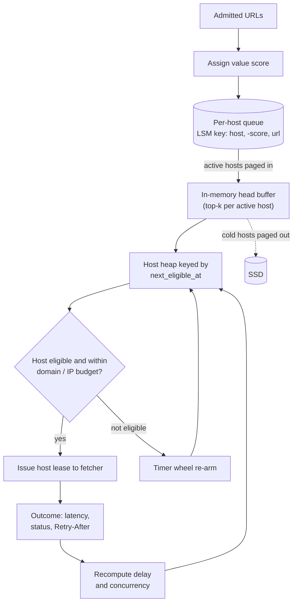

**Only active hosts are in memory.** Hundreds of millions of hosts are known; the heap holds the few hundred thousand currently eligible or cooling. The rest live on disk and are **paged in by a background activator ahead of need**, and that same activator triggers DNS and robots.txt resolution (§8), so neither ever blocks the fetch path.

### Politeness is hierarchical, and the key is not the hostname

Rate-limiting by hostname fails **both ways**:

| Failure | Example | What happens with a per-hostname limit |
|---|---|---|
| **Too loose** | `*.spamfarm.net`: 10M subdomains → 3 servers. Also user subdomains on hosting platforms | you hit that 3-server cluster at **N × the intended rate** |
| **Too tight** | `cdn-edge`: one anycast IP fronts 2M unrelated sites | a per-**IP** limit throttles a large slice of the web to one request every couple of seconds |

So the scheduler checks **three nested token buckets**: **host**, **registrable domain**, and **IP (or /24)**, where the IP bucket is **disabled for known CDN and anycast ranges** (classified by ASN and observed hostname fan-in). The domain bucket is what stops a spam farm of ten million subdomains from turning into ten million polite crawlers.

#### Beginner version: three buckets, one decision

```text
Host bucket      blog7.spamfarm.net   0.5 tokens/s   has 1 token   ✓
Domain bucket    spamfarm.net          2 tokens/s    has 0 tokens  ✗  ← blocks
IP bucket        198.51.100.0/24       5 tokens/s    has 3 tokens  ✓
→ not eligible; re-arm when the domain bucket refills (0.5 s)

Without the domain bucket:
  10M subdomains × 0.5/s each = 5,000,000 req/s at 3 servers
With it:
  2 req/s total for the whole farm, whatever the subdomain count

CDN case:
  2M sites behind one anycast IP; IP bucket disabled for that ASN;
  each site limited only by its own host + domain bucket ✓
```

**How do you know an IP is a CDN?** Two signals: the **ASN** belongs to a known CDN/cloud edge, and **hostname fan-in** (how many unrelated registrable domains resolve to that IP) is huge. A /24 with 50 domains is shared hosting (keep the IP bucket); one with 2M domains is an edge (disable it).

### Adaptive delay

Static delays are wrong for most hosts. The working rule:

```text
delay = max( robots Crawl-delay,  α × recent_response_time,  floor )
```

Mercator used α ≈ **10 × the last download time**, and the principle holds: **latency is the server telling you how loaded it is.** On top of that:

| Signal | Reaction |
|---|---|
| **429 / 503 with Retry-After** | honour it **exactly**, then resume in **slow mode**: half the prior rate, ramping back up additively (**AIMD**, same reason it works in TCP) |
| **Rising p50 latency** during your crawl | **reduce concurrency before** the server starts returning errors. By the time a small site returns 503s, you've already hurt it |
| **Sustained low latency, zero errors**, ideally an explicit operator signal (Crawl-delay, a rate in your webmaster console) | allow more than one connection. **Concurrency is earned, never assumed** |

#### Beginner version: AIMD on `smallblog.org`, minute by minute

```text
t=0     rate 0.5/s (1 every 2 s), p50 latency 120 ms
t=5m    p50 latency climbs to 900 ms   → α × latency = 10 × 0.9 s = 9 s delay → rate 0.11/s
t=7m    503, Retry-After: 120          → no fetches for exactly 120 s
t=9m    resume in SlowMode at half the last good rate: 0.055/s (1 every ~18 s)
t=10m+  each error-free minute: +0.02/s   (additive increase)
t=30m   back near 0.45/s; any new 503 → halve again (multiplicative decrease)
```

The key move is at **t=5m**: latency alone cut the rate by ~4× **before** any error. That's the difference between "a crawler that slowed down" and "the crawler that took my blog down".

### The host state machine

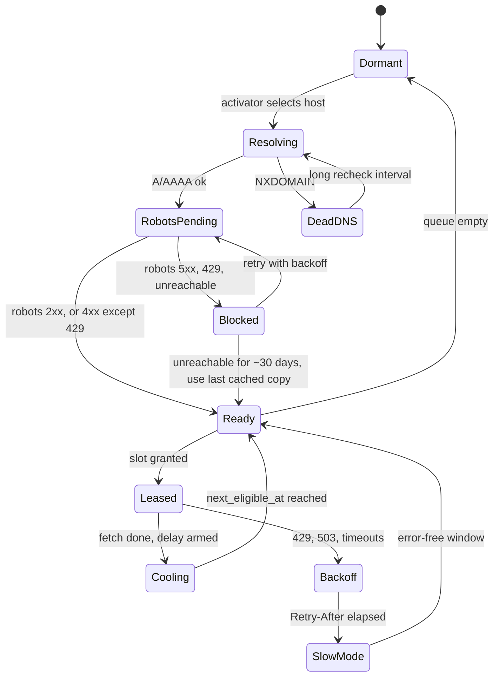

### robots.txt — RFC 9309, and the branches teams get backwards

| robots.txt response | RFC 9309 says | What we do | Why |
|---|---|---|---|
| **2xx** | parse and obey | parse ≥ 500 KiB, obey our UA group | — |
| **3xx** | follow ≥ 5 redirects | follow, then treat as above | — |
| **4xx** (404, 403…) | may treat as unrestricted | allow all | the site has no rules |
| **429** | technically 4xx → "allow all" | **treat as 5xx: disallow all** (Google documents the same choice) | a server rate-limiting your robots.txt fetch is the **clearest distress signal you'll get** |
| **5xx / unreachable** | **must assume complete disallow** | disallow all, retry with backoff | the server is struggling right now |
| **unreachable for a long time** (RFC example: 30 days) | may treat as absent **or** keep a cached copy | **keep the cached copy** | "absent" turns a month-long outage into an unrestricted crawl of a site that is, by construction, not healthy |
| **cache lifetime** | should not use a cached copy > 24 h (except when unreachable) | ≤ 24 h per host, cached in the frontier shard | **never refetch per URL** |

> **The classic bug:** treating a 503 on robots.txt as "no rules". That's exactly when the server is struggling, and exactly when you'd start hammering it.

### Priority within a host

The URL score approximates **marginal index value per fetch**:

```text
score = importance_prior × expected_gain

importance_prior:  distinct-DOMAIN in-links (not raw in-links, trivially gamed within a site)
                   + depth from a known-good page + sitemap priority (weak hint)
expected_gain:     new URL   → novelty value
                   known URL → P(changed since last fetch) × value      (§10)
```

**A very accurate score is worth less than you'd think.** It only ranks URLs **within one host's queue**, and politeness caps how many of them you fetch anyway. **Allocation of budget across hosts matters far more than ordering within a host.**

---

## 7. Deep dive 2 — URL dedup at millions of checks per second

> **⚡ 30-second version**
> 1. **Normalize safely:** lowercase scheme/host, strip default port, drop fragment, resolve dot-segments, normalise unreserved percent-encoding. **Don't** lowercase paths, sort params or strip "tracking" params globally. **Learn param stripping per site** from identical content fingerprints.
> 2. **Most links are same-domain → local seen-check.** Cross-shard checks are **batched every ~100 ms**.
> 3. **Exact fingerprints, not Bloom.** Bloom 1% = ~1B new URLs silently never crawled. 64-bit exact = ~270 collisions across 10¹¹ URLs.
> 4. **Host-prefixed keys** make batch disk merges sequential (IRLbot **DRUM**), but a 24-bit prefix with a 40-bit remainder **concentrates collisions on the biggest sites**. Store the **full 64-bit hash after the prefix** (96-bit keys).
> 5. **Discovery hot partitions:** per-domain admission budgets + salt huge domains' URL state across sub-shards.
> 6. **In-link updates = blind merge operands**, pre-aggregated per batch. Never read-modify-write.

### Normalization: safe vs unsafe

| Transform | Safe? | Why |
|---|---|---|
| lowercase scheme and host | ✓ | case-insensitive by spec |
| strip default port (`:80`, `:443`) | ✓ | — |
| remove `#fragment` | ✓ | never sent to the server |
| resolve `/a/./b/../c` → `/a/c` | ✓ | — |
| normalise percent-encoding of **unreserved** chars (`%7E` → `~`) | ✓ | same resource by spec |
| **lowercase the path** | ✗ | case-sensitive on many servers |
| **sort query parameters** | ✗ | a few apps are order-sensitive |
| **strip "tracking" params by a global list** | ✗ | a global rule stripping `id=` **deletes half of some forum** |

**Learn parameter stripping per site.** Confirm that pages differing **only** in parameter `p` have **identical content fingerprints** (§9), across a meaningful sample, and only then add a **site-scoped** rewrite rule.

#### Beginner version: learning that `ref=` is junk on `shop.example.com`

```text
Fetched:
  /p/123?ref=home     content_fp = 9f2c…
  /p/123?ref=email    content_fp = 9f2c…
  /p/123?ref=ads      content_fp = 9f2c…
  /p/456?ref=home     content_fp = 1ab7…
  /p/456?ref=footer   content_fp = 1ab7…
→ across 200 sampled pairs differing only in 'ref', 100% identical
→ add rule: shop.example.com strip 'ref'   (scoped, versioned)

But on forum.example.org:
  /thread?id=1  fp = aa11…
  /thread?id=2  fp = bb22…    ← different content → 'id' is meaningful, never strip
```

### The seen-check flow

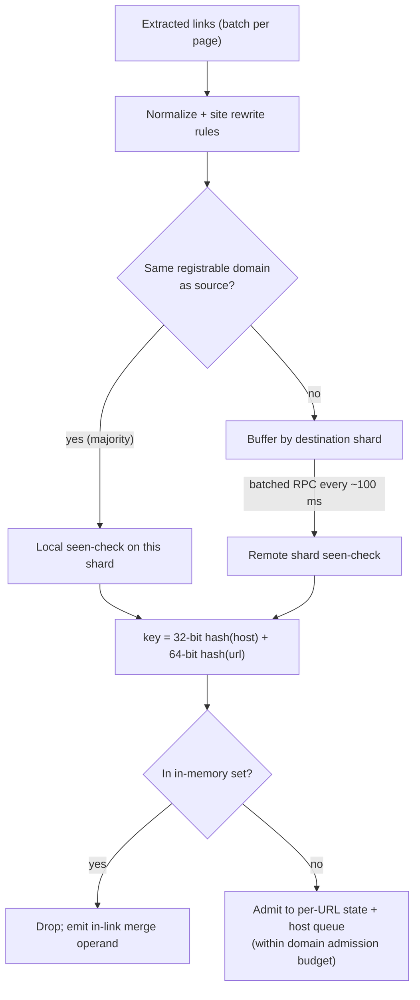

### Why exact fingerprints and not a Bloom filter

A Bloom filter's false-positive rate applies to **every genuinely new URL** you test against it.

```text
Over a crawl that eventually discovers ~100B distinct URLs:
  Bloom at 1% FP  → ~1B URLs marked "seen" that never were
                  → never crawled, nothing surfaces the loss, and the error lands on NEW pages
  Memory:   Bloom 1%  ≈ 9.6 bits/element ≈ 120 GB
            bare 64-bit fingerprints      ≈ 800 GB
            96-bit host-prefixed keys     ≈ 1.2 TB

Uniform 64-bit fingerprints, birthday bound:
  n² / 2^65 = (10^11)² / 3.7×10^19 ≈ 10^22 / 3.7×10^19 ≈ ~270 colliding pairs
```

Paying roughly **a terabyte of fleet RAM** to turn **a billion silent losses into a few hundred** is the easiest trade in this design. A Bloom filter still earns a place as a **negative pre-filter** in front of a remote or disk check ("definitely not seen → skip the disk read"), **never as the source of truth**.

### Why the host-prefixed fingerprint, and the bug it introduces

Putting a host hash in the high bits makes one host's fingerprints **contiguous in sorted order**, so batch lookups against the disk tier touch a handful of pages per host instead of scattering. That's the core of **IRLbot's DRUM**: accumulate checks, sort, merge against the on-disk set in one sequential pass. At millions of checks per second, random I/O per URL isn't an option at any price.

<details>
<summary><b>Beginner version: how DRUM works, step by step</b></summary>

**DRUM = Disk Repository with Update Management** (IRLbot, 2008). Job: check millions of URLs/s against a seen set **too big or too durable-critical for RAM alone**, using only **sequential** disk I/O.

> **The whole trick in 3 words: collect, sort, walk.** Disks are slow at jumping (random reads), fast at reading straight through.

**Architecture**

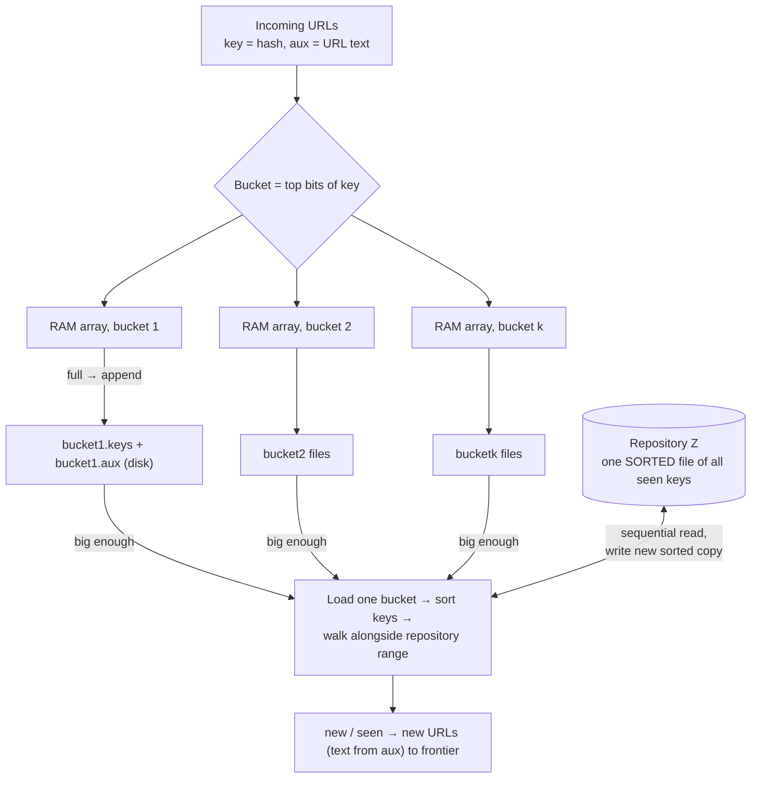

| Piece | What | Why |
|---|---|---|
| **Key** | URL hash | small → cheap to sort |
| **Aux** | full URL text | needed for new URLs, **kept out of the sort** |
| **Buckets** | key ranges (top bits of hash) | a merge touches one range only |
| **Bucket files** | append-only per bucket | appends are sequential |
| **Repository Z** | sorted file of every seen key | read straight through |

**Which bucket?** Computed from the hash, so the **same URL always lands in the same bucket**. A key can only ever live in its own bucket, so never look elsewhere.

**Tiny example** (numbers instead of hashes; 2 buckets):

```text
Z bucket A (1–50):   [5, 12, 30, 47]        Z bucket B (51–100): [55, 70, 88]

Incoming:  bbc/sport=30  cnn/world=70  bbc/news=15  cnn/tech=92  bbc/sport=30  bbc/weather=47

1. Route (RAM, arrival order kept):
   A keys [30, 15, 30, 47]   urls [bbc/sport, bbc/news, bbc/sport, bbc/weather]
   B keys [70, 92]           urls [cnn/world, cnn/tech]
2. Bucket full → append to A.keys / A.urls on disk
3. Merge A: sort keys → [15, 30, 30, 47], walk with Z A [5, 12, 30, 47]
4. Restore arrival order, read A.urls straight through → bbc/news is NEW → frontier
5. Merge B: [70, 92] vs [55, 70, 88] → cnn/tech is NEW
```

**How "seen" vs "new" is decided: the two-finger walk.** One finger on the sorted batch, one on Z:

| Compare | Meaning | Action |
|---|---|---|
| Z < batch key | not reached yet | move Z finger |
| Z = batch key | found | **SEEN** |
| Z > batch key, or Z ended | passed where it would be | **NEW** |

```text
Z = [5, 12, 30, 47], batch = [15, 30, 47]
15: 5<15 → 12<15 → 30>15  → NEW
30: 30=30                 → SEEN
47: 30<47 → 47=47         → SEEN
```

```python
i = 0
for key in batch:                       # both sorted
    while i < len(Z) and Z[i] < key: i += 1
    print(key, "SEEN" if i < len(Z) and Z[i] == key else "NEW")
```

The Z finger only moves forward → Z is read **once**, start to end.

**Inserting new keys: never in place.** During the walk, **write a fresh sorted copy** by always appending the smaller of (next old key, next new key), then swap it in:

```text
A_old [5, 12, 30, 47] + new {15, 40}
→ A_new [5, 12, 15, 30, 40, 47]   written start-to-end = consecutive blocks
→ swap, delete A_old
```

Same idea as merge sort's merge step and LSM compaction (RocksDB, Cassandra).

**"Doesn't that need 2× storage?"** Only for **the one bucket being merged**. 24 GB ÷ 1,024 buckets ≈ **24 MB extra**, freed right after. A full rewrite cycle of 24 GB at ~1 GB/s sequential ≈ ~24 s of disk time; big batches amortise it.

**Why it beats a remote KV (e.g. Cassandra) when internal bandwidth is limited** (illustrative, ~100 B/msg, ~25% cross-site links):

| | Cassandra | In-node RAM set + DRUM |
|---|---|---|
| Checks over the network | all 2.3M/s | cross-site only (~0.6M/s), batched |
| Fan-out | quorum reads ×2, writes ×3 | replica receives new URLs only |
| Rough internal traffic | ~3–5 Gbps | ~0.5 Gbps |

Not zero: cross-site batches, replication of new keys and shard moves still use the network. With plentiful bandwidth and moderate scale, Cassandra / DynamoDB (PK = URL hash, batched, hot-URL cache) is simpler.

</details>

**The catch.** The ~270 figure assumed 64 **uniformly random** bits. With a `b`-bit host prefix inside a 64-bit key, URLs on the same host collide in only `64 − b` bits, and collisions concentrate **exactly on the biggest hosts**:

```text
collisions on one host with m URLs ≈ m² / 2^(65 − b)

b = 24-bit prefix (40 bits left for the URL):
  m = 100M URLs → 10^16 / 2^41 ≈ 10^16 / 2.2×10^12 ≈ ~4,500 URLs lost
  m = 1B URLs   → 10^18 / 2.2×10^12            ≈ ~450,000 URLs lost
```

…and those are the **high-value large sites**. Two fixes:

| Fix | Size |
|---|---|
| keep the prefix **plus** a full 64-bit URL hash after it (**96-bit keys**) | ~1.2 TB fleet-wide (the sizing in §3) |
| a 128-bit fingerprint, sort on its host-hash component | ~1.6 TB |

> **The failure is invisible in aggregate metrics, which is why it ships.** The total collision count looks tiny; it's all on three sites.

### Discovery hot partitions

Politeness naturally balances the **fetch** side: a huge site can't take more than its allowance. The **discovery** side has no such limiter. One site exposing **a billion faceted URLs** floods its shard's ingest, LSM compaction and per-URL state, and every other domain on that shard backs up behind it.

| Defence | How |
|---|---|
| **Per-domain admission budgets** | URLs admitted/day scale with domain reputation (§12); the rest go to a low-priority overflow that's only sampled |
| **Sub-shard salting** | once a domain's URL count crosses a threshold, spread its **per-URL state** across sub-shards (`hash(url) mod s`), while keeping its **politeness state single-owner** |

> The frontier is sharded by domain **for politeness**. Storage has to be allowed to split underneath that.

### The write path nobody sizes: "bump in-link counters"

The seen-check is a read, and the flowchart makes the duplicate branch look free. It isn't. Of ~2.3M observations/s, the **large majority are links to already-known URLs**, and each wants to update in-link counts or anchor text on the target (which feeds the importance prior, §6).

```text
Read-modify-write against the LSM:
  ~2M random reads/s + ~2M writes/s   ≈ 40× the fetch rate
  vs 46k/s per-URL state updates from fetch outcomes
```

**The fix: never read on this path.**

1. Emit **blind merge operands** (`+1 from domain X`) that the LSM folds at compaction (RocksDB merge operator).
2. **Pre-aggregate per batch** before leaving the extracting node: one page linking to the same nav targets 30 times is **one** operand.
3. Accept that importance is **eventually consistent** with a lag of a compaction cycle. The scheduler doesn't need exact counts; it needs an ordering that's **roughly right within one host** (§6).

#### Beginner version: read-modify-write vs merge operand

```text
Read-modify-write (slow):
  read url_state(/about)          → inlink_domains = 41      (random disk read)
  write url_state(/about) = 42                                (write)
  ×2M per second

Merge operand (fast):
  append  (/about, +1 from blog.net)                         (sequential write, no read)
  append  (/about, +1 from news.org)
  ... compaction later folds: 41 + 1 + 1 = 43
```

---

## 8. Deep dive 3 — DNS: a dependency and a security boundary

> **⚡ 30-second version**
> 1. **Run your own recursive resolvers.** Public resolvers will rate-limit you, and your own cache protects small domains' authoritative DNS from you.
> 2. **Resolve at activation, not at fetch.** The lease carries the IP; DNS latency leaves the critical path.
> 3. **Clamp TTLs** (floor minutes, cap hours). Refresh load is tiny (~1.7k qps). **Discovery** of cold hostnames is the load that hurts. Negative-cache NXDOMAIN.
> 4. **Isolate resolver pools**: known-good refresh vs new-host discovery.
> 5. **The resolved IP is a security boundary**: reject private, loopback, link-local (incl. `169.254.169.254`), your VPC ranges. **Connect to the validated IP**, re-check every redirect hop, put fetchers in an isolated segment.

### Why own resolvers, and why at activation

| Choice | Why |
|---|---|
| **Own recursive resolver fleet** | public resolvers rate-limit you at this volume; and you'd be pushing a large, sustained load onto small domains' authoritative servers through a cache you don't control. **Your own cache is what protects their DNS from you.** |
| **Resolve at activation** | the activator resolves a host as it pages it in (§6); the fetch path reads the IP from the lease. Broken delegations can take **seconds**; that latency leaves the critical path entirely |

### TTL clamping and where DNS load really comes from

```text
Floor very short TTLs: a 0–30 s TTL on a site you fetch every few seconds = a query storm
Cap long TTLs:         so server migrations propagate

Steady-state refresh: ~500k active hosts ÷ 300 s floor ≈ 1.7k queries/s   (vs 46k fetches/s)  → tiny
```

**The load that hurts is discovery, not refresh.** Every never-seen hostname is a **cold, uncacheable, multi-hop resolution**, and a wildcard spam zone can mint them faster than you can resolve them. **Negative-cache NXDOMAIN aggressively.** Treat **SERVFAIL and timeouts as transient** with backoff (don't mark the host dead after one failure).

### Isolate resolver pools

Timeouts against dead or lame authoritative servers tie up resolver capacity. A spam burst of millions of random subdomains under a wildcard, or a new domain cluster with broken delegation, can **starve lookups for healthy hosts**.

| Pool | Serves | Concurrency limit |
|---|---|---|
| **A: known-good refresh** | hosts we've resolved successfully before | generous; protected |
| **B: new-host discovery** | never-seen hostnames | capped, plus **per-zone caps** so one zone can't take the pool |

Without isolation, the failure looks like this: throughput drops, **zero fetch errors**, hosts sit in `Resolving`. It's the start of the most dangerous failure chain in §14.

### The resolved IP is a security boundary (SSRF)

A crawler that fetches arbitrary URLs from inside a cloud VPC is **an SSRF tool that never sleeps**. Anyone can put `http://169.254.169.254/latest/meta-data/` or `http://10.0.3.7:8080/admin` in a link, or point a DNS name at it.

| Rule | Why |
|---|---|
| **Reject after resolution**: private (10/8, 172.16/12, 192.168/16), loopback, link-local (**169.254.169.254** metadata), CGNAT, IPv6 ULA/link-local, **your own VPC and service ranges** | the URL's hostname tells you nothing; the IP is what you connect to |
| **Connect to the IP you validated**, not the hostname (set `Host` header + TLS SNI yourself) | resolving twice invites **DNS rebinding**: the first answer passes the check, the second points inside |
| **Repeat the check at every redirect hop** | `https://evil.com` → `302 Location: http://169.254.169.254/` |
| **Isolated network segment**, no route to internal services; the IP filter is the **second** layer | defence in depth: a filter bug alone shouldn't expose internals |

#### Beginner version: DNS rebinding in four lines

```text
1. Fetcher resolves rebind.evil.com → 93.184.216.34 (public)  → check passes ✓
2. Fetcher's HTTP library resolves AGAIN to connect           → TTL 0, now 169.254.169.254
3. Connects to the cloud metadata service, fetches credentials, stores them in the WARC
4. Attacker searches your index for them
Fix: resolve once, validate, connect to THAT IP. No second resolution exists to rebind.
```

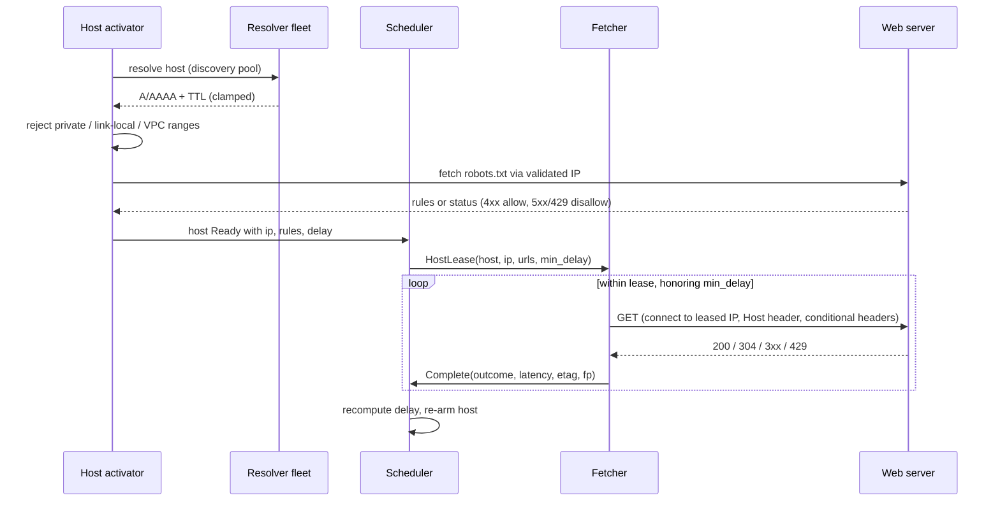

---

## 9. Deep dive 4 — Content dedup, exact and near

> **⚡ 30-second version**
> 1. URL dedup can't see that `http://`, `https://`, `www.`, `m.`, `?ref=x` and a syndicated copy are the same page. **Content dedup can**, and the dup signal **feeds back into the frontier**.
> 2. **Exact:** hash of the normalised body after stripping volatile tokens (CSRF, timestamps, session IDs).
> 3. **Near:** **SimHash 64-bit** over main-content shingles, near-dup at **Hamming ≤ 3**, found via **permuted sorted tables** (Manku, Jain, Das Sarma, WWW 2007).
> 4. **Boilerplate removal isn't optional**; tune **toward misses** (a false dup deletes a unique page).
> 5. **Host-level mirror detection** gives the real savings.
> 6. **rel=canonical is a hint**, not truth.

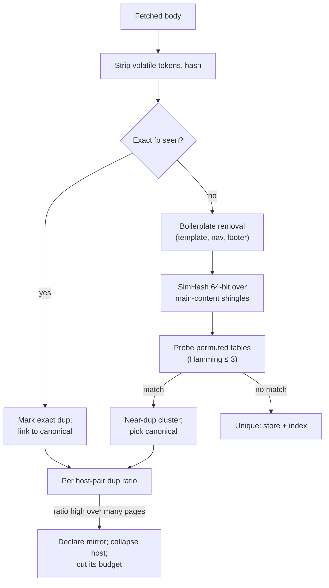

### Exact dedup

Hash the normalised body **after stripping volatile bits**: CSRF tokens, timestamps, session IDs embedded in HTML, cache-busters. Cheap, and it catches mirrors and parameter variants. Without stripping, every fetch of the same page has a different hash and exact dedup catches nothing.

### Near-dup with SimHash

**What SimHash does, in one paragraph.** Split the main content into shingles (overlapping 4-word sequences). Hash each shingle to 64 bits. For each bit position, add +1 if the shingle's bit is 1, −1 if it's 0 (optionally weighted). The final fingerprint bit is 1 where the total is positive. Two documents sharing most shingles produce fingerprints that differ in **few bits**.

#### Beginner version: SimHash with 8 bits and 3 shingles

```text
shingle hashes:     s1 = 1 0 1 1 0 0 1 0
                    s2 = 1 1 1 0 0 0 1 0
                    s3 = 0 0 1 1 0 1 1 0
column sums (+1/−1): +1 −1 +3 +1 −3 −1 +3 −3
simhash:             1  0  1  1  0  0  1  0

Change one word → one shingle changes → a few column sums move by 2
→ only bits near zero flip → new simhash differs in ~1-2 bits → Hamming small → near-dup
Totally different page → all shingles differ → ~32 of 64 bits differ
```

**Finding "within Hamming 3" among billions without comparing pairs.** Split the 64 bits into blocks. If two fingerprints differ in ≤ 3 bits, then by pigeonhole **at least one** of 4 blocks of 16 bits is **identical**. Keep 4 tables, each sorted with a different block in the high bits. A probe = 4 sorted-range lookups on an exact 16-bit prefix, then check the few candidates' full Hamming distance. That's the Manku et al. configuration at web scale: **64-bit fingerprints, k ≤ 3, permuted sorted tables**.

### Three things that bite in production

| Problem | What happens | Fix |
|---|---|---|
| **No boilerplate removal** | the site template dominates the shingles → every page on a template-heavy site looks like a near-dup of every other. E-commerce product pages differing only in SKU, price and a sentence fall inside the threshold, and you **dedupe away the catalogue** | strip template/nav/footer first; **tune toward misses**; per-site thresholds for template-heavy verticals |
| **Page-level only** | you still spend a fetch to discover each dup | **host-level mirror detection**: when host pair (A, B) shows a sustained dup ratio above a threshold across a meaningful sample → declare a mirror, pick a canonical host, cut the non-canonical host's budget to a **trickle** that only checks the relationship still holds. This is also how **http/https and www/apex** splits get resolved without a fragile global rewrite rule |
| **Trusting rel=canonical** | any page can claim to be the canonical of any other (hijacking) | honour it when it points **within the same site** and **content matches**; otherwise treat it as one weak signal |

> **Asymmetric costs.** A false negative (stored a dup) costs storage. A false positive (dropped a unique page) **deletes content no one will notice is gone**. Bias toward keeping.

---

## 10. Deep dive 5 — Recrawl policy (where most of the budget goes)

> **⚡ 30-second version**
> 1. Once mature, **refresh is the dominant consumer** of fetches. The question: split a fixed budget across ~10B pages with different change rates and values.
> 2. **Cho & Garcia-Molina:** under average freshness, **proportional-to-change-rate is worse than uniform**. The optimum **under-visits the fastest-changing pages**.
> 3. Make it usable: **weight by value** (`Σ value × freshness`) and choose the metric (freshness vs age) deliberately.
> 4. **The naive change-rate estimator is biased low**, worst on rarely visited pages → self-reinforcing under-visit. Use a **bias-corrected estimator + template prior + exploration budget**.
> 5. **Explicit, adaptive discovery share per host**, or refresh eats the allowance and coverage silently stops growing.
> 6. 304 saves bytes but **still spends a politeness slot**. Sitemap lastmod is cheap but often lies. **Push (IndexNow, WebSub) is the only signal that doesn't cost a fetch**; reputation-gate it.

### The counter-intuitive result

Model each page as a **Poisson change process** with rate λ, revisited every `I`. The expected freshness of your copy is:

```text
freshness(λ, I) = (1 − e^(−λI)) / (λI)
```

Cho and Garcia-Molina showed that allocating visits **in proportion to change rate is worse than uniform allocation**, and the optimal policy **deliberately under-visits the fastest-changing pages**. A page that changes every ten minutes is stale almost regardless of whether you visit it hourly or daily, so those fetches buy almost no freshness. The same budget spent on weekly-changing pages moves them from "usually stale" to "usually fresh".

#### Beginner version: where an extra fetch buys freshness

```text
Page F: changes every ~10 min (λ = 6/hour)
  visit hourly (I = 1 h):  λI = 6   → freshness = (1 − e^−6)/6  ≈ 0.17
  visit daily  (I = 24 h): λI = 144 → freshness ≈ 0.007
  cost of hourly over daily: +23 fetches/day for +0.16 freshness

Page W: changes ~weekly (λ = 1/168 per hour)
  visit weekly (I = 168 h): λI = 1     → freshness = (1 − e^−1)/1 ≈ 0.63
  visit daily  (I = 24 h):  λI = 0.143 → freshness ≈ 0.93
  cost of daily over weekly: +6 fetches/week (~0.86/day) for +0.30 freshness

Per extra fetch:  F gains ~0.007 freshness,  W gains ~0.35
→ the weekly page is ~50× better use of a fetch
```

"It changes a lot, crawl it a lot" is **exactly wrong** under the freshness metric.

### Two corrections that make the result usable

**1. Weight by value.** Freshness of a page nobody queries is worth nothing. The objective is:

```text
maximise  Σ value(p) × freshness(p)   subject to   Σ fetches(p) ≤ budget,  per-host politeness
```

High-value, fast-changing pages (the `news.example.com` front page) earn frequent fetches **through their value, not their change rate**. Under an **age** (staleness-duration) metric, fast-changing pages are penalised less harshly. **Choose the metric deliberately**, because it changes the policy.

**2. Estimate change rates properly.** You only see "changed / not changed" at **your own irregular visit times**, and several changes between visits look like one. The naive estimator (`observed changes ÷ elapsed time`) is **biased low**, worst on the pages you visit too rarely. That's a **self-reinforcing loop**: underestimate → visit less → underestimate more.

#### Beginner version: the bias in one example

```text
Visited daily for 10 days; changed at all 10 visits (X = 10, n = 10, I = 1 day)

Naive:          λ = X / (n·I) = 1 change/day
Truth could be: 5 changes/day — you can't tell, every visit saw "changed"

Bias-corrected (Cho & Garcia-Molina, regular visits):
  λ̂ = −ln( (n − X + 0.5) / (n + 0.5) ) / I
     = −ln( 0.5 / 10.5 ) / 1  ≈ 3.0 changes/day
```

Plus: a **prior from similar pages** (same site, same URL template), so a new page doesn't start at "unknown", and a small **exploration budget** re-measuring pages whose estimates are old.

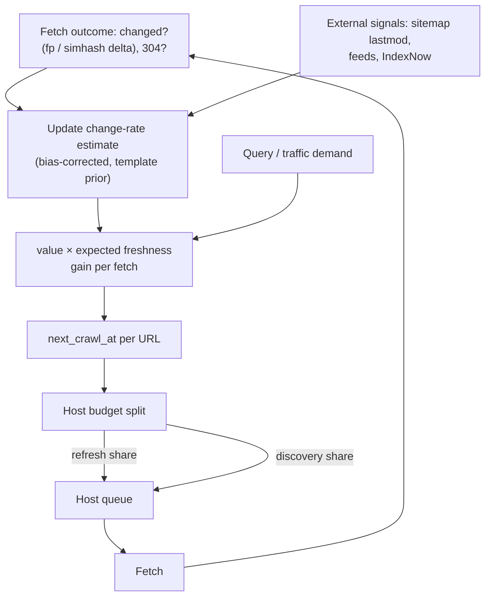

**"Changed" must mean main content.** Compare the exact hash / SimHash of the **boilerplate-stripped main content**, not the raw HTML. Otherwise a rotating ad or "N minutes ago" stamp makes every page "change on every visit", the estimator decides λ is huge, and (because of Cho's result) the planner **stops** visiting pages that are actually stable-but-valuable, or (with value weighting) wastes budget on them.

### Host budget split: protect discovery

A host's politeness allowance is shared between refresh and discovery. Without an explicit split, a large site's refresh load eats its whole allowance and new URLs on that site are **never fetched**. You'll see it as "**our coverage of site X stopped growing**" with no error anywhere.

```text
shop.example.com allowance: 0.5 fetch/s = 43,200/day
known valuable pages: 2M, refresh needs at planner's rates: 45,000/day   ← already > allowance
new products added: 3,000/day                                             ← never reached

With an explicit discovery share of 20%:
  refresh gets 34,560/day (planner prioritises the highest value×gain)
  discovery gets 8,640/day → new products fetched within ~a day
Adapt the share: recently discovered URLs turned out valuable → raise it; dups / thin → lower it
```

### Cheap signals vs true signals

| Signal | Cost | Trust | How to use |
|---|---|---|---|
| **Conditional GET** (`If-None-Match` / `If-Modified-Since`) | saves bandwidth + parse on 304, **still spends a politeness slot** (the scarce resource) | high | always send; don't store a body on 304 |
| **Sitemap `lastmod`, feed timestamps** | free | often lies (every URL stamped "now" on every generation) | trust **per site**, by how often a claimed change turned out real |
| **Push: IndexNow, WebSub** | **no fetch needed to learn "changed"** | variable; also a **spam injection path** | accept, **rate-limit and reputation-gate** |

---

## 11. Deep dive 6 — The render tier

> **⚡ 30-second version**
> 1. Rendering costs **1–2 orders of magnitude** more CPU, and **subresource requests spend politeness** too (~3 extra origin requests per render → **~4× politeness cost** on client-rendered hosts).
> 2. **10% rendered ≈ 9,000 cores**, likely more than all static fetch + parse.
> 3. **Decide per URL template**, by sampling static vs rendered content. Never per page.
> 4. **Cache subresources hard; revalidate unhashed script names** (version skew → thin renders → wrong lessons).
> 5. **Define "done"**: wall-clock budget, subresource cap, DOM-stability check. Network-idle never fires.
> 6. **Renders aren't deterministic** → fingerprint stripped main content; freeze `Date`, `Math.random`, time zone.
> 7. **Separate frontier, separate per-host budget, sandboxed** with the same IP filtering.

### Sizing makes the policy obvious

```text
10% of 46k/s needs rendering     = ~4,600 renders/s
× ~2 CPU-seconds per render       = ~9,200 cores running continuously

A page pulls 60 subresources, 95% cache hit → ~3 extra origin requests per render
Client-rendered host: 1 HTML + 3 origin subresources = ~4 politeness slots per page
→ the same host allowance covers a QUARTER as many pages
```

### The rules

| Rule | Why / how |
|---|---|
| **Render selectively, per URL template** | render a sample from each template; compare rendered vs static **main-content size and outlinks**. If static already carries **≥ 90%**, stop rendering that template. Re-sample periodically |
| **Cache subresources hard; watch for version skew** | content-hashed names (`app.3f9c1.js`) cache forever. Unhashed (`/static/app.js`) cached long-lived will, after a deploy, **run old JS against new HTML** → the render fails or comes back thin → looks like a **soft-404 or removal** → the planner and trap detector both learn the wrong lesson. **Revalidate unhashed scripts with conditional GETs on a short TTL** |
| **Define "done" explicitly** | network-idle never fires on long-polling, analytics beacons, websockets. Use a **hard wall-clock budget**, a **cap on subresource count**, and a **DOM-stability check** (main-content size unchanged over a short window). Whatever the page has at the deadline is the result |
| **Neutralise nondeterminism** | ad slots, A/B buckets, "N minutes ago", random element IDs differ every render. Fingerprint over rendered DOM → every render looks like a change → change-rate estimate explodes → planner re-renders more → **positive feedback loop on the most expensive fetch class**. Fingerprint **extracted main content with volatile nodes stripped**; **freeze `Date`, `Math.random` and time zone** |
| **Budget rendering per host separately** | the render queue is a **second frontier with its own scheduler**. As "just another worker pool" it starves the static crawl whenever a heavily client-rendered site gets popular |
| **Sandbox it** | headless browsers run **attacker-supplied code at scale**. Own network segment, the **same post-resolution IP filtering** (§8) on **every subresource and every `fetch()`** the page makes, CPU and wall-clock caps, **no credentials** |

#### Beginner version: the per-template render decision

```text
shop.example.com template /product/{id}
  sample 50 pages, static vs rendered:
    static main content: avg 180 words, 12 outlinks
    rendered:            avg 1,450 words, 85 outlinks   → static carries ~12%
  → render = 'always' for this template

shop.example.com template /help/{slug}
    static 900 words, rendered 930 words                → static carries ~97%
  → render = 'never'   (saves ~2 CPU-s and ~3 politeness slots per page)

Re-sample monthly: the site might move help pages to client-side rendering next quarter.
```

---

## 12. Deep dive 7 — Crawler traps and adversarial content

> **⚡ 30-second version**
> 1. A trap = **URL count → ∞ while marginal value → 0**. Accidental (calendars, session IDs, `/a/b/a/b/…`, faceted navigation, soft-404s) or deliberate (tarpits, link farms, wildcard-DNS spam).
> 2. **Detection is supporting. Budget is primary.** You can't enumerate every trap, but no domain gets more budget than its demonstrated value justifies.
> 3. **Domain reputation drives budget** (IRLbot's STAR / BEAST). New domains start small and **earn** more.
> 4. **Template-level learning** demotes whole faceted-nav explosions.
> 5. **Soft-404 probe** once per host per period.
> 6. **Tarpits / bombs:** total deadline (not idle timeout), decompressed-size cap, byte ceiling, sandboxed parser.

### The trap zoo

| Trap | Accidental or deliberate | How it explodes |
|---|---|---|
| Calendar "next month" links | accidental | infinite months |
| Session IDs in URLs | accidental | a new URL for every visit |
| Relative-link bugs | accidental | `/a/b/a/b/a/b/…` forever |
| **Faceted navigation** | accidental | 10 independent filters × 10 values each (+ "unset") = **11¹⁰ ≈ 2.6×10¹⁰ URLs**, before parameter order multiplies it further |
| Soft-404s | accidental | 200 OK for every path, so every typo'd link is a "page" |
| Tarpits | deliberate | trickle bytes to hold sockets for hours |
| Link farms | deliberate | millions of pages linking to each other to fake importance |
| **Wildcard-DNS spam** | deliberate | infinite hostnames, each with infinite pages |

### Budget first, detection second

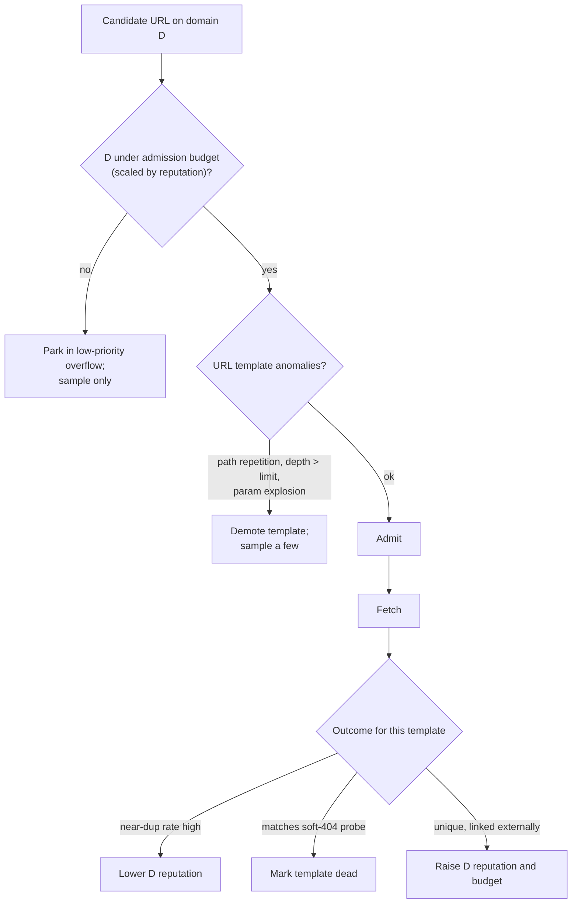

| Defence | How |
|---|---|
| **Domain reputation drives budget** | admission and fetch budgets per registrable domain scale with evidence of value: **distinct external domains linking in**, historic **unique-content yield**, downstream usage. IRLbot formalised this as reputation-based budgeting (**STAR** and **BEAST**) after discovering how effectively spam farms absorb naive crawl budget. New domains start small and earn more |
| **Template-level learning** | cluster URLs by structural template (path shape, parameter names). Per template, track near-dup rate and unique-content yield. A template whose samples are **95% near-dups** is demoted as a whole. That's how faceted-navigation explosions are defused **without site-specific rules** |
| **Soft-404 detection** | fetch a random, surely-nonexistent path (e.g. `/zq7x…`) and SimHash the response. Pages matching it are soft-404s. **Once per host per period**, not per URL |
| **Tarpits and resource bombs** | a **total wall-clock deadline per fetch**, not just an idle timeout (a server trickling one byte every nine seconds never trips a 10-second idle timeout and can hold a socket for hours). **Cap decompressed size** (a few MB of gzip can expand to many GB). **Stream-parse with a byte ceiling**. Parsers in a **sandboxed process** so a pathological document kills the worker, not the node |

#### Beginner version: faceted navigation meets template learning

```text
shop.example.com/c/shoes?color=red&size=9&brand=x&price=50-100&sort=asc ...
Template: /c/{cat}?color=*&size=*&brand=*&price=*&sort=*&... (10 params)

Sample 200 URLs of this template:
  190 are near-dups of a handful of base category pages (same 24 products, re-ordered)
  near_dup_rate = 95%, unique_yield = 0.05
→ template state = 'demoted': only a small sample per day is fetched
→ the 2.6×10^10 URL space costs ~nothing; /product/{id} pages (unique) are unaffected
→ domain reputation slightly down for the dup ratio, not enough to hurt the real catalogue
```

#### Beginner version: reputation budgets vs a spam farm

```text
Day 1: spamfarm.net discovered via 1 link. Reputation = new domain → admit 1,000 URLs/day, fetch 500/day
       10M subdomains × 1,000 pages offered; 1,000 admitted; rest in overflow (sampled)
Day 2: fetched pages: 98% near-dup, 0 external domains linking in → reputation ↓ → admit 200/day
Day 7: budget at the floor. Total spend: a few thousand fetches.

Compare: news.example.com, linked from 400k distinct domains, high unique yield → admit 5M/day
```

---

## 13. Deep dive 8 — Distributed scheduling, ownership and multi-region

> **⚡ 30-second version**
> 1. Frontier shards are owned under a **lease with fencing tokens**.
> 2. **Ownership change must not reset politeness.** Replicate per-host state; new owner **waits out the longest outstanding lease**; fetchers **reject stale tokens**; every host starts in **slow mode**.
> 3. **Deploys are the same failure**: persist state, roll shard by shard.
> 4. Fetch semantics are **at-least-once**. GET is idempotent; the raw store dedups by content fp.
> 5. **Multi-region: politeness is global per host.** One **home region** per domain. Never let regions fetch independently.
> 6. Multi-region is worth it **only** for geo-variant content, geo-blocking sites, or egress cost. Sockets were never the bottleneck.

### Ownership change must not reset politeness

If shard ownership moves (node loss, rebalance) and the new owner starts with **empty per-host state**, every host it owns looks "never fetched, eligible now". **Hundreds of thousands of hosts become eligible at the same moment**, and the ones in backoff **lose their backoff**. Worse variant: during a handover, **both old and new owner briefly issue leases** for the same hosts, **doubling the rate**.

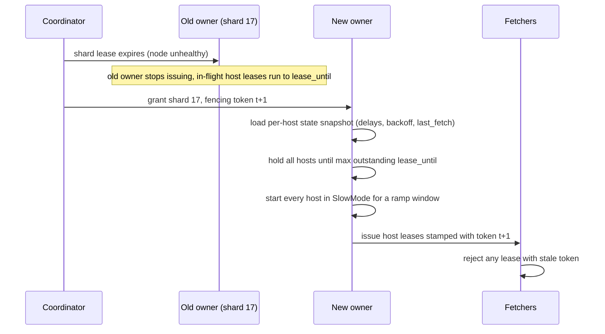

| Defence | Why |
|---|---|
| **Replicate per-host politeness state** (last fetch, current delay, backoff) with the shard | it's tiny: tens of bytes per active host |
| **New owner waits out the longest outstanding host lease** | no overlap where two owners both lease the same host |
| **Fetchers reject leases with stale fencing tokens** | a zombie old owner can't double the rate |
| **Slow mode on start**, ramp up | restarting conservatively costs minutes of throughput on one shard; restarting aggressively gets you an abuse report from a hosting provider |
| **Deploys: persist state, roll shard by shard** | a fleet-wide rollout that resets in-memory backoff is, from the web's side, a **synchronised burst** |

#### Beginner version: the failover burst, with and without the defences

```text
Shard 17 owns 300k active hosts. 2,000 of them are in Backoff (served 503s recently).

Without:  new owner, empty state → all 300k eligible at t=0
          → ~150k fetches in the first second against hosts normally getting ~0.5/s each,
            including the 2,000 that were already struggling

With:     snapshot loaded (backoff kept for the 2,000)
          wait until max lease_until (say 60 s)
          SlowMode: every host at half rate, ramping over ~10 min
          → shard 17's throughput dips for ~10 minutes; no one on the web notices
```

### Fetch semantics are at-least-once

A fetcher that dies mid-lease loses its outcomes. URLs return to the queue after `lease_until`, and some pages get fetched twice. That's **harmless**: GET is idempotent and the raw store dedups by content fingerprint. It's far cheaper than trying for exactly-once.

### Multi-region

Fetching from a region near the target server cuts RTT, and since fetch time sets socket concurrency, that means fewer open connections. Some content also varies by geography. **But politeness is global per host**: two regions each running a "polite" rate against one server add up to **double**.

| Option (in order of preference) | How |
|---|---|
| **(a) Home region per domain** | by the server's geolocation; that region owns its politeness **and all its fetching** |
| **(b) Split budget explicitly** | if several regions must fetch one host (geo-variant content), split the host's budget across them **through the owning shard** |
| ✗ **Never** | let regions discover and fetch independently |

**Publish every region's egress ranges and keep reverse DNS consistent**, or site operators will block the region they don't recognise.

### Is multi-region worth it? Do the socket math

```text
Little's law: open sockets = rate × mean fetch time
  single region, mean 1.5 s:        46k × 1.5 = ~70k sockets
  home-region, mean 0.8 s (no cross-ocean RTT in connect + TLS + slow-start):
                                    46k × 0.8 = ~37k sockets
```

Real, but **sockets were never the bottleneck** (§3). Multi-region pays for itself only when one of three is true:

1. **geo-variant content** you're required to capture,
2. sites that **block or throttle traffic from outside their market**,
3. **egress/transit cost** from one region exceeding the cost of a second frontier.

If none holds, a single region with well-placed egress is simpler and politeness stays trivially global.

**The home-region failure mode to plan for:** when a region fails, its domains must **not** fail over to another region with fresh politeness state. They fail over **with the replicated per-host state and slow-mode start**, exactly like a shard move, **or they pause**.

---

## 14. Failure modes (cheat list)

| Failure | How it unfolds in production | Mitigation |
|---|---|---|
| **Crawler becomes a DDoS** | politeness state lost on failover or deploy, or domain bucket bypassed via subdomains; a small host sees a burst and goes down | replicated host state, slow-mode restart, domain + IP buckets, emergency stop |
