# File Storage & Sync Service (Dropbox-style) — Easy Master Guide

> **What we build:** a service that keeps **one folder tree identical** on your laptop, phone and the web, lets you **share folders**, and keeps **old versions** for a while. Scale: **~1B accounts, ~1 EB of data, ~300M connected devices.**

> **The one-line thesis:** a sync service = an **immutable block store** (bytes, named by their hash) + a **per-folder ordered log** (metadata), joined by one rule: **metadata never points to bytes that aren't provably saved.** And one principle: **anything that can delete must be slower, more checked and more reversible than anything that can create.**

**Study path (~25 min):** [Glossary](#glossary-read-once) → [§1 Big picture](#1-the-big-picture) → [§3 Numbers](#3-capacity--the-3-numbers-that-decide-everything) → [§5.5 Tables, DBs, caches](#55-data-model--tables-database-choices-and-caches) → [§6 Chunking](#6-deep-dive-1--chunking) → [§7 Upload + GC race](#7-deep-dive-2--upload-dedup-and-the-gc-race) → [§8 Sync protocol](#8-deep-dive-3--namespaces-journals-and-sync) → [§9 Client + conflicts](#9-deep-dive-4--the-client-and-conflicts) → [§11 Storage cost](#11-deep-dive-6--storage-cost-erasure-coding-gc) → [§12 Multi-region](#12-deep-dive-7--multi-region-residency-failover) → [§17 FAANG insights](#17-faang--staff-level-insights)

### ⚡ How to read this guide (low-attention mode)

- **Only 10 minutes?** Read the two pictures below (the architecture, then the save flow), then just the **⚡ 30-second version** boxes at the top of the long sections.
- **Want depth?** Keep reading under the box.
- **Stuck on a part?** Look for the **"beginner version"** subsections. They explain slowly, with examples.

### ⚡ Architecture at a glance (HLD)

Every box, database and cache in the design, with the technology we'd use. Read it top to bottom: **clients → edge → services → data stores**, then the **event bus and background workers** underneath.

```text
CLIENTS
┌──────────────────────────────────────────────────────────────────────────────────────────┐
│ Desktop app (Win / Mac / Linux) · Mobile app · Web                                       │
│ Watcher (FSEvents / inotify / USN) → Planner (3 trees) → Chunker (CDC + SHA-256)         │
│ SQLite: synced tree, cursors, pending ops            Local chunk cache (disk, LRU)       │
└────────┬─────────────────────────────────────┬────────────────────────────────┬──────────┘
         │ HTTPS                               │ long-poll /notify              │ signed-URL GET
         │ commit, list_changes, move,         │ "which folders changed?"       │ (share links,
         │ chunk check-missing / PUT / GET     │                                │  popular chunks)
         ▼                                     ▼                                ▼
EDGE
┌─────────────────────────────────┐ ┌──────────────────────────────┐ ┌─────────────────────────┐
│ Load balancer + API gateway     │ │ Notification fleet           │ │ CDN (edge + shield)     │
│ TLS, auth, rate limits          │ │ ~1,000 hosts, all in memory: │ │ chunks cached by hash   │
│                                 │ │  ns_id → open connections    │ │ (they never change)     │
│                                 │ │  ns_id → latest_seq          │ │ miss → Block service    │
└────────┬───────────────┬────────┘ └──────────────▲───────────────┘ └─────────────────────────┘
         │ metadata      │ bytes                   │ "ns 42 advanced" (from Kafka, below)
         │               └──────────────────────┐
         ▼                                      ▼
SERVICES (stateless, autoscaled)
┌─────────────────────────────────┐   ┌─────────────────────────────────┐
│ Metadata service                │──►│ Block service                   │
│ commit (CAS), list_changes,     │   │ check-missing, PUT (re-hash),   │
│ move, sharing / ACL checks      │   │ GET; "are these chunks durable?"│
└────────────────┬────────────────┘   └────────────────┬────────────────┘
                 ▼                                     ▼
DATA STORES
┌─────────────────────────────────┐   ┌─────────────────────────────────┐
│ Redis (caches)                  │   │ Bloom filter (in memory)        │
│  delta cache:                   │   │  "is h7 maybe stored?"          │
│   (ns_id, from_cursor) → page   │   │ Block index: KV on SSD          │
│  ACL cache:                     │   │  (RocksDB), sharded by hash     │
│   (user_id, ns_id) → role       │   │  hash → volume + offset         │
│ MySQL, sharded by ns_id         │   │ Volume map: small, strongly     │
│  namespaces, journal, files,    │   │  consistent (etcd-like)         │
│  members, commit_requests,      │   │  volume → 14 disks              │
│  move_intents                   │   │ Volume store: S3 (v1) → own     │
│ MySQL, sharded by user_id       │   │  disks (like Magic Pocket)      │
│  mounts, devices, share_links   │   │  open = 3 copies,               │
│                                 │   │  sealed = RS(10,4)              │
└─────────────────────────────────┘   └─────────────────────────────────┘

EVENTS + BACKGROUND
Metadata service ──"ns 42 advanced to 1005"──► Kafka (topic ns-events, partitioned by ns_id)
                                                 ├──► Notification fleet → pings members' devices
                                                 ├──► GC mark (new references)
                                                 └──► Audit log (Kafka → S3 / data warehouse)
Workers:  GC mark + sweep · Compaction · Repair (rate-limited) · Move reconciler (stuck moves)
Security: KMS holds the encryption keys (per-tenant keys for BYOK) · TLS on every hop
```

Why each technology was chosen: §5.5 (database choices and caches).

### ⚡ The save-and-sync flow in one picture

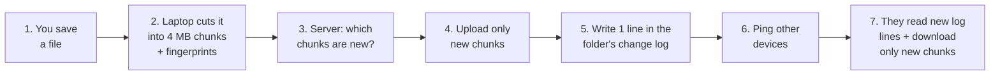

---

## Glossary (read once)

**One picture for the whole guide:** think of a **library**. Book *pages* sit on shelves, each labelled by a fingerprint (the **block store**). A **catalogue** says "book X = pages 7, 12, 40" (the **metadata**). Each shared room has its own **logbook** of every change (the **journal**). Your device remembers "I've read the logbook up to line 1005" (the **cursor**).

| Term | Plain meaning |
|------|---------------|
| **Chunk / block** | A piece of a file (~4 MB). Stored once, named by its hash |
| **Hash (SHA-256)** | A fingerprint of bytes. Same bytes → same hash |
| **Content-addressed** | You find data by its hash, not by a name. Data never changes in place |
| **Blocklist** | The list of chunk hashes that make up one file version |
| **Dedup** | "Already have this chunk? Don't store it again" |
| **Dedup index** | The giant table `hash → where the chunk lives` |
| **CDC (content-defined chunking)** | Cut files where the *content* says, not every fixed 4 MB, so an insert doesn't shift every cut |
| **Rolling hash (Rabin / Gear)** | A fast hash over a small sliding window. CDC cuts where it matches a pattern. It only picks cut points; SHA-256 names the chunk |
| **Signed URL** | A link with a tamper-proof expiry, valid for a few minutes. Anyone holding it can use it (a bearer token) |
| **Namespace (ns)** | A folder that is a unit of sharing. Your root = 1 ns. Each shared folder = its own ns |
| **Journal** | Append-only, ordered log of changes in one namespace |
| **Cursor** | "I've seen this namespace up to entry N" |
| **rev / based_on_version** | Version id of a file / the version your edit started from (the article calls it `parent_rev`) |
| **CAS (compare-and-swap)** | "Save only if current version is still what I think it is" |
| **Erasure coding RS(10,4)** | Split data into 10 pieces + 4 repair pieces; any 10 of 14 rebuild it. 1.4x cost instead of 3x |
| **LRC** | Erasure code with small local repair groups → cheaper repairs |
| **GC (garbage collection)** | Finding and deleting chunks no file uses anymore |
| **Tombstone** | "Deleted, but bytes still kept for a while" marker |
| **Epoch** | A "generation number" that bumps each time a new leader takes over |
| **Residency** | Legal rule: "this customer's data must stay in the EU" |
| **BYOK / CMK** | Customer brings their own encryption key |

### Beginner notes: what a chunk "fingerprint" (hash) is, and how it's made

**What it is.** A fingerprint is a **short code computed from a chunk's bytes**. A person's fingerprint identifies the person without being the person; in the same way, a chunk's fingerprint identifies the chunk without being the chunk. The function that computes it is called a **hash function**. We use **SHA-256**.

**What SHA-256 does.** You give it **any amount of bytes**, whether 5 bytes or 100 MB. It always gives back **256 bits = 32 bytes**, usually written as **64 hex characters**. Real outputs (try `printf 'hello' | shasum -a 256` on a Mac):

| Input | SHA-256 fingerprint |
|---|---|
| `hello` | `2cf24dba5fb0a30e26e83b2ac5b9e29e1b161e5c1fa7425e73043362938b9824` |
| `Hello` (one capital letter) | `185f8db32271fe25f561a6fc938b2e264306ec304eda518007d1764826381969` |
| `hello!` (one extra character) | `ce06092fb948d9ffac7d1a376e404b26b7575bcc11ee05a4615fef4fec3a308b` |

A tiny change in the input gives a **completely different** fingerprint.

**The 4 properties we rely on:**

| Property | Meaning |
|---|---|
| **Same input → same fingerprint** | on every laptop, phone and server, forever |
| **Any change → a totally different fingerprint** | even one bit |
| **No two different chunks share a fingerprint** (in practice) | in theory many files share each hash, but there are 2²⁵⁶ possible values (more than atoms on Earth), so finding even one pair is practically impossible |
| **One-way** | you can't rebuild the chunk from its fingerprint |

**Not compression.** 100 MB really does end up as 256 bits, but you can never get the file back from them. So we **still store all the real bytes** in the block store. The hash is only the **label on the box**, like an ISBN on a book.

**How can any size always end up as 256 bits?** SHA-256 keeps a **running "state" of 256 bits** and feeds the file in, **64 bytes at a time**:
1. Start with a fixed 256-bit starting state (the same for everyone).
2. Take the next 64 bytes of the file and **scramble them into the state** (64 rounds of mixing). The state is still 256 bits.
3. Repeat until the file ends. A 100 MB file is about **1.6 million** such steps.
4. The final state **is** the hash.

The output size never grows, because each step **overwrites** the same 256 bits.

**Toy version:** keep a running total of numbers, but **only keep the last 3 digits**. Feed in 5 numbers or 5 million numbers, and the result is always 3 digits. SHA-256 works the same way, with 256 bits and a much better scramble, so a one-bit change anywhere changes the whole result.

**How it's done, step by step, on the laptop:**
1. Read the file.
2. Cut it into ~4 MB chunks (§6).
3. Run SHA-256 on each chunk to get its 64-character fingerprint.
4. Put the fingerprints in order. That list is the file version's **blocklist** (`chunk_list`).

```python
import hashlib

def chunk_fingerprints(path, chunk_size=4 * 1024 * 1024):
    chunk_list = []
    with open(path, "rb") as f:
        while chunk := f.read(chunk_size):
            chunk_list.append(hashlib.sha256(chunk).hexdigest())
    return chunk_list
```

This is fast: a modern CPU hashes roughly 1 GB per second or more, so a 12 MB file takes a few milliseconds. (Real clients cut chunks with CDC, §6, not at fixed 4 MB, but the hashing step is the same.)

**Example: finding what changed.** `report.docx` is 12 MB = 3 chunks. Alice edits only the last page.

| | Chunk 1 | Chunk 2 | Chunk 3 |
|---|---|---|---|
| Before | `a1f3…` | `b7c2…` | `c9d4…` |
| After | `a1f3…` | `b7c2…` | **`9e05…`** |

Only chunk 3's fingerprint changed, so only that **4 MB** is uploaded, not 12 MB.

**Where the fingerprint is used in this design:**
- **As the chunk's name in storage:** chunks are stored and found by their hash ("content-addressed").
- **For dedup:** two users with the same photo get the same hash, so "do you already have `9e05…`?" (`/blocks/check-missing`).
- **To verify uploads:** the server re-computes the hash of the bytes it receives. If it doesn't match the claimed name, the upload is rejected.
- **To describe a file version:** the blocklist is just the list of fingerprints.

---

## 1. The big picture

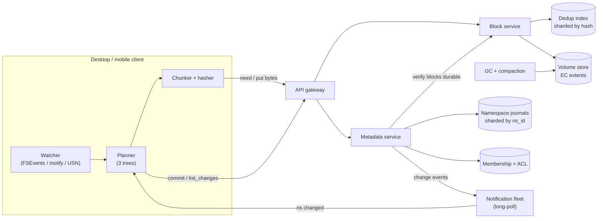

(The same system with every database, cache and technology drawn in is the [HLD at the top](#-architecture-at-a-glance-hld); why each was chosen is in §5.5.)

**Three planes, each fails independently:**

| Plane | Holds | Knows about users/paths? |
|-------|-------|--------------------------|
| **Block** | Bytes. Immutable, content-addressed | **No.** Only hashes |
| **Metadata** | Trees, revisions, journals, ACLs | Yes. Bytes only as a list of hashes |
| **Notification** | Nothing. Just "ns 42 changed" | Lossy is fine |

> **Insight:** the whole design is the **seam between bytes and metadata**. Only two things cross it: (1) the **durability check at commit**, (2) the **reachability walk in GC**. Teams that let the block store learn about users ("for quotas", "for fast delete") end up with deletion spread across two systems and a GC no one can reason about.

---

## 2. Clarify & requirements (the questions that change the architecture)

**⚡ 30-second version** (each line is explained slowly in the beginner version below):

| Question | Why it matters | Our answer |
|----------|----------------|-----------|
| Sync or just storage? | Sync = stateful client with a local copy = all the hard bugs | **Sync** (storage API falls out of it) |
| Unit of sharing? | Decides if a folder move is O(1) or O(files) | **Shared folder = namespace**; single files via links |
| Consumer or enterprise? | Enterprise = residency, own keys, legal hold, audit, remote wipe. **Own keys kill cross-tenant dedup** | Both |
| Version/trash retention? | **Biggest storage multiplier** after redundancy | e.g. 30–180 days |
| Real-time co-editing? | That's OT/CRDT, a different product | **No.** Opaque files, file-level conflicts |

**Non-functional (the ones that bite):**
- **Durability 11+ nines.** Losing committed bytes is the only unfixable failure. Everything else is "just an outage."
- **Convergence:** all devices end up with the same tree.
- **No silent loss on conflict:** when unsure, **keep both**.
- **Latency:** small edit on another device p50 < 5 s, p99 < 30 s.
- **Cost:** < 1.5x raw bytes per logical byte.
- **On-demand files:** placeholders download on open → a slow block fetch = **a frozen app**, not a slow sync.

### §2 explained in detail, with examples (beginner version)

**Why we ask questions first.** "Design Dropbox" is vague. Depending on the answers, you could end up building a simple upload website or a very complicated system that keeps many devices in step. Each question below changes **what we build**, so we ask it before drawing anything.

---

#### Question 1: is it "sync", or just "storage"?

**Storage only** works like a website where you upload and download files. Your laptop doesn't keep its own copy; the server holds the only copy. When you want a file, you download it. This is fairly easy to build, because there is just one copy to look after.

**Sync** works like the Dropbox folder on your laptop. **Every device keeps its own full copy** of your files, and the app works all the time to keep those copies the same. The phrase "stateful client" means each device has its own state (its own copy), and that copy can change without the server knowing, for example while you are offline.

That is where "all the hard bugs" come from:
- You edit a file on a plane with no internet. The server only learns about it hours later.
- You edit the same file on your laptop **and** your office PC before either one syncs. Which edit wins?
- Your laptop was switched off for two weeks. It has to catch up on everything that changed.
- You rename a folder, and the laptop must work out that it was a rename and not "delete everything, create new".

**Example:** Alice edits `budget.xlsx` on a flight. Meanwhile, Bob edits the same file in the office. When Alice lands, both versions reach the server. The system has to notice the clash and keep both, without losing either person's work.

**Our answer: sync.** "The storage API falls out of it" means that once sync works, plain upload and download come almost for free. They are a simpler subset of the same system.

---

#### Question 2: what is the unit of sharing, a file or a folder?

When people share, what do they share: single files, or whole folders? We decide that **each shared folder is a "namespace"**. A namespace is its own little world, with its own list of files and its own change log (the journal). Your personal Dropbox is one namespace, and a shared folder called "Team Photos" is another namespace that is **mounted** (attached) inside your tree at some path.

**Why it matters: O(1) vs O(files).**
- **O(1)** means the work takes **one step**, no matter how big the folder is.
- **O(files)** means the work takes **one step per file**, so a bigger folder means more work.

**Example:** "Team Photos" has **50,000 files**, and you move it from `/Work` to `/Archive`.
- **If sharing were stored on every file** (each file remembers who can see it), the server would have to update **50,000 records**. A big shared folder could take minutes, and could go wrong halfway through.
- **With namespaces,** the shared folder is a single namespace attached at a path. Moving it changes **one record**: "Team Photos is now attached at `/Archive`". The 50,000 files inside don't change at all. **One step.**

**Our answer:** a shared folder is a namespace. A single file is shared with a **link** (a URL) instead of becoming a namespace.

---

#### Question 3: is it for consumers, enterprises, or both?

**Consumers** are ordinary people storing photos and documents. **Enterprises** are companies, and they need extra features, each of which changes the design:

| Enterprise feature | Plain meaning | What it forces us to build |
|---|---|---|
| **Residency** | "Our data must stay in the EU" (a legal rule) | storage and servers in several regions, with each customer pinned to theirs |
| **Own keys (BYOK)** | the company encrypts its files with **its own** key | encryption per customer, plus a key service |
| **Legal hold** | during a lawsuit, files **must not be deleted**, even if a user deletes them | a "hold" flag that blocks deletion and garbage collection |
| **Audit** | a record of who opened, shared or deleted what | an audit log of every action |
| **Remote wipe** | erase company files from a stolen laptop | a command the client obeys to delete its local copy |

**"Own keys kill cross-tenant dedup", explained.** **Dedup** means storing identical data only once. If 1 million people upload the same viral video, we can store it **once**, because the same bytes give the same hash (fingerprint), so we notice it's already there. That saves a lot of disk.

With **own keys**, Company A encrypts the video with key A, and Company B encrypts the same video with key B. After encryption, the two copies are **completely different bytes**, so they get different hashes. We can no longer tell they're the same video, and we store it twice. ("Tenant" = a customer, so "cross-tenant" means "between different customers".) It would be wrong to share data between two companies' encrypted stores anyway.

**So:** customers who bring their own keys get dedup **only inside their own company**, which means more disk.

**Our answer: both,** so the design must support these enterprise features from the start.

---

#### Question 4: how long do we keep old versions and the trash?

**Versions:** every time you save a file, the old version is kept for a while, so you can go back. **Trash:** deleted files are kept for a while, so you can restore them.

**Why it is the "biggest storage multiplier after redundancy".** "Redundancy" is the extra copies we keep for safety (for example 1.4× or 3×, covered in §11). After that, **retention** is the next biggest reason we need more disk, because old data **can't be deleted until the retention time ends**.

**Example, day by day:** a 12 MB spreadsheet is stored as 3 pieces of 4 MB: `A B C`. It's edited once a day, and each edit changes **only piece B**.

| Day | Current file | New piece saved | Old pieces we must keep | Total on disk |
|---|---|---|---|---|
| 1 | A B C | A, B, C (12 MB) | — | 12 MB |
| 2 | A **B2** C | B2 (4 MB) | B (so day 1 can be restored) | 16 MB |
| 3 | A **B3** C | B3 (4 MB) | B, B2 | 20 MB |
| … | … | +4 MB each day | … | … |
| 30 | A **B30** C | B30 | B … B29 | 12 + 29 × 4 = **128 MB** |
| 31 | A **B31** C | B31 | day 1 expires → **B can be deleted** | stays ≈ **128 MB** |

- With **no versions**, we'd store only the current file: **12 MB**.
- With **30 days** of versions: about **128 MB**, roughly **10×**.
- With **180 days**: 12 + 179 × 4 ≈ **728 MB**, roughly **60×**.

Analogy: every day you photocopy the one page of a notebook you changed and keep the copies in a drawer for 30 days. The notebook stays the same size, but **the drawer keeps filling** until the oldest copies are allowed to be thrown out.

Another example: a user deletes a 50 GB folder. With a 30-day trash, we **still pay for 50 GB for 30 more days**.

**Our answer:** 30–180 days (for example, short on free plans and long on business plans). This number directly drives the storage bill.

---

#### Question 5: do people edit the same file at the same time (like Google Docs)?

**Real-time co-editing** is Google Docs-style: two people type in the same document at the same moment and see each other's cursor. That needs special algorithms called **OT (Operational Transformation)** or **CRDT (Conflict-free Replicated Data Types)**, which merge individual keystrokes from several people. That is a **different product**.

**Our service treats files as "opaque".** We don't look inside a `.docx` or `.psd`; to us it's just bytes. If two people change the same file before syncing, we have a **file-level conflict**, and we keep both:
```
report.docx                          ← one version
report (Bob's conflicted copy).docx  ← the other version
```

**Our answer: no co-editing.** It's whole files, and conflicts are handled per file.

---

#### The non-functional requirements (the "how well" rules)

**1. Durability of 11+ nines (99.999999999%).** This is the chance that a stored piece of data is **not lost** in a year. Put simply, if you stored **10 million files**, you'd expect to lose **about 1 file every 10,000 years**.
- *Why it's the "only unfixable failure":* if the service goes down for an hour, people are annoyed, but when it comes back everything is still there. If bytes are **lost**, they're gone forever, and no restart brings back someone's wedding photos.

**2. Convergence.** After syncing settles, **every device shows exactly the same files**. Your laptop, phone and the website must never stay permanently different.
- *Example:* you rename a folder on the phone. A minute later the laptop and the website show the new name too, and no device is stuck with the old one forever.

**3. No silent loss on conflict ("when unsure, keep both").** If the system can't tell which edit should win, it must **never quietly throw one away**. It keeps both copies and lets the human decide.
- *Example:* Alice's and Bob's edits clash, so both are saved: `report.docx` and `report (Bob's conflicted copy).docx`.

**4. Latency (p50 < 5 s, p99 < 30 s).** This is the time from "I saved on my laptop" to "it shows up on my phone".
- **p50 < 5 s** means half of all edits appear on other devices **within 5 seconds**.
- **p99 < 30 s** means 99 out of 100 edits appear **within 30 seconds**.
- *Example:* you save a note on your laptop and pick up your phone. Usually it's already there; very rarely it takes up to half a minute.

**5. Cost under 1.5× raw bytes per logical byte.**
- **Logical bytes** are what the user thinks they store, for example 1 GB of photos.
- **Raw bytes** are what our disks actually hold, including the safety copies.
- Keeping 3 full copies would be 3 GB of disk for 1 GB of photos, which is too expensive. The target of **under 1.5 GB of disk per 1 GB of user data** forces us to use **erasure coding** (≈1.4×, explained in §11) instead of 3 full copies.

**6. On-demand files (placeholders).** Many sync apps show files in your folder that **aren't actually downloaded yet**; they're downloaded only when you open them. (Dropbox calls these "online-only" files, and OneDrive calls them "Files On-Demand".)
- When you double-click such a file, the operating system **makes the app wait** until the bytes arrive.
- So if fetching the bytes is slow, **Word or Photoshop freezes** on the user's screen. That's much worse than "sync is a bit slow in the background".
- *Example:* you open a 200 MB video placeholder on a slow connection, and the player hangs. That's why fetching pieces must be fast and predictable, like a web page load, not like a background job.

---

> *Interview opener:* "Before designing, I'd confirm: true sync with a local copy (yes), shared folders as the unit of sharing (namespaces), enterprise needs like residency and customer keys (yes, which limits dedup), retention of 30–180 days (the biggest cost driver after redundancy), and no real-time co-editing (file-level conflicts only). The key non-functionals are 11-nines durability, convergence, never losing data silently on conflict, a few seconds of sync latency, under 1.5× storage overhead, and fast fetches for on-demand files."

---

## 3. Capacity — the 3 numbers that decide everything

> **⚡ 30-second version: 5 numbers, 5 decisions**
> 1. **4 MB chunks** keep the dedup lookup table at ~22 TB. 64 KB chunks would make it ~1.4 PB, 64× bigger.
> 2. **Erasure coding instead of 3 copies** saves ~1.4 EB of disk, about **$6–9M every month**.
> 3. **~1.7 disks die every day**, so repair is a nonstop background job, not an emergency.
> 4. **200 TB of metadata needs 50–100 database shards.** Size decides this, not traffic. Cap the files per shared folder early.
> 5. **A million tiny files cost more than 50 GB of photos**, because cost follows the number of files. That's why ignore rules and file limits exist.

| Quantity | Math | Result |
|----------|------|--------|
| Logical data | 1B × 1.2 GB | ~1.2 EB |
| Unique after dedup | ~25% saved | ~0.9 EB |
| Raw @ 3x replication | 0.9 × 3 | **~2.7 EB** |
| Raw @ RS(10,4) | 0.9 × 1.4 | **~1.26 EB** |
| Drives (20 TB) | 1.26 EB / 20 TB | ~63,000 |
| Chunks @ 4 MB | 0.9 EB / 4 MB | ~225B |
| **Dedup index @ 4 MB** | 225B × 100 B | **~22 TB** |
| **Dedup index @ 64 KB** | | **~1.4 PB** (64x bigger!) |
| Metadata rows | 500B versions × 400 B | ~200 TB |
| Peak commits | 5B/day ÷ 86,400 × 3 | ~170k/s |
| **Drive failures** | 63k × 1% ÷ 365 | **~1.7/day** |
| Unique growth | 30%/yr | ~740 TB/day (~70 Gbps) |
| Notification hosts | 300M ÷ 250–500k | 600–1,200 |

### §3 explained in detail, with examples (beginner version)

Only 5 of the numbers above actually change the design. Each one is explained below: what it means, where it comes from, and what decision it forces.

#### 1. "Chunk size = index size"

**What the dedup index is.** Every file is cut into chunks. Each chunk is named by its fingerprint (hash). The **dedup index** is one giant table that says `fingerprint → where this chunk is stored`. Every upload asks it: "Do you already have this fingerprint?" If yes, we skip the upload. Because it is asked on **every single upload**, it has to be very fast, so it must sit on fast, expensive hardware (RAM / SSD). That is why the guide calls it the "hottest lookup table".

**Why chunk size decides its size.** The index has **one row per chunk**. Smaller chunks mean more chunks, and more chunks mean more rows.

| Chunk size | How many chunks for 0.9 EB of unique data | Index size (≈100 bytes per row) |
|---|---|---|
| 4 MB | 0.9 EB ÷ 4 MB ≈ **225 billion** | 225B × 100 B ≈ **22 TB** |
| 64 KB | 0.9 EB ÷ 64 KB ≈ **14 trillion** | 14T × 100 B ≈ **1.4 PB** |

4 MB ÷ 64 KB = 64, so the index becomes **64 times bigger**. 22 TB of fast storage fits on a few dozen machines. 1.4 PB of fast storage is a whole fleet of expensive servers.

**Small example with one file.** A 1 GB video:
- at 4 MB chunks → **250 chunks** → 250 index rows, and its blocklist (the list of chunk fingerprints) is about 8 KB;
- at 64 KB chunks → **16,000 chunks** → 16,000 index rows, and its blocklist is about 512 KB.

**Why it's a "cost decision".** You might think smaller chunks save space because they dedup better. For personal files they barely do: most duplicates are **whole files** (the same photo, the same installer) that already dedup perfectly at 4 MB. So going smaller gives almost no savings but makes the index 64× bigger. You choose chunk size by **what you can afford to look up**, not by dedup.

**Analogy:** a library catalogue with one card per **book** fits in one drawer. One card per **page** fills a whole building.

#### 2. "Replication vs EC = 1.4 EB raw difference ≈ $6–9M/month"

To survive dead disks, you can keep **3 full copies** (3× the disk) or use **erasure coding RS(10,4)** (1.4× the disk, and it survives even more lost disks; how it works is explained in §11). At our scale, with about 0.9 EB of unique data:
- 3× replication → 0.9 × 3 = **2.7 EB** of disk;
- RS(10,4) → 0.9 × 1.4 = **1.26 EB** of disk;
- difference ≈ **1.44 EB** = 1,440,000 TB of disk you don't have to buy and run.

Disk costs about **$4–6 per TB per month** once you add servers, power and the data centre. 1,440,000 TB × $4–6 ≈ **$6–9 million every month**. That's why EC is not optional at this size.

**The catch:** repairing EC is heavy. To rebuild one lost piece, you must read **10 other pieces**. That leads straight into the next number.

#### 3. "1.7 drive deaths/day → repair is permanent background load, not an incident"

**Where 1.7 comes from.** 1.26 EB ÷ 20 TB per drive ≈ **63,000 drives**. Hard drives die at about **1% per year**, so 63,000 × 1% = 630 dead drives per year, and 630 ÷ 365 ≈ **1.7 dead drives every day**.

**What each death costs.** A dead drive held 20 TB of pieces. To rebuild them with RS(10,4) we read 10× that from other drives:
- per dead drive: 20 TB × 10 = **200 TB read**;
- per day: 1.7 × 200 TB ≈ **340 TB read every day**;
- that's about **30 Gbps** of network traffic, all day, forever.

**What "background load, not an incident" means.** At a small company, a dead disk is an emergency: someone gets paged and fixes it. Here, disks die **every single day**. If each one paged a human, the team would do nothing else. So repair is designed as a **normal job that never stops**:
- It runs automatically.
- It is speed-limited, so it doesn't steal bandwidth from user downloads.
- It fixes the **most at-risk data first**. A stripe that has lost 3 of its 4 spare pieces is repaired before one that has lost only 1.

**Analogy:** in a big city hospital, babies being born every day is normal planned work, not an emergency. You build a maternity ward with staff on shifts; you don't sound an alarm for each birth.

#### 4. "Sharding by bytes, not by writes"

**What we're sharding.** The **metadata database** holds the file names, versions, blocklists and journals: about **200 TB** in total. It's too big for one database, so we split it into many smaller databases called **shards**. The question is: **how many shards?** There are two ways to count, and you must take **the bigger answer**.

**Count by writes (how busy).** At peak we get about **170,000 commits per second** (a commit = "save this new file version"). One MySQL-style primary can handle about **5,000–10,000 writes per second**.
- 170,000 ÷ 10,000 ≈ 17, and 170,000 ÷ 5,000 = 34, so **~20–35 shards** would be enough for the writes.

**Count by bytes (how big).** We want each shard to hold only **2–4 TB**. The reason is recovery: when a replica of a shard dies, we must copy the whole shard to a new machine. Copying 2–4 TB takes **a few hours**. Copying 20 TB would take more than a day, and during that time you're running with one less safety copy.
- 200 TB ÷ 4 TB = 50, and 200 TB ÷ 2 TB = 100, so we need **~50–100 shards**.

**The bigger answer wins: 50–100 shards.** Size forces more shards than traffic does. That's what "sharding by bytes, not by writes" means. Many people only count requests per second and get this wrong.

**Then check skew (one giant customer).** We shard **by namespace**: everything about one shared folder lives on **one** shard. That's what keeps the design simple. The folder's journal (its ordered list of changes) is one list in one database, and "save only if the version is still X" (CAS) is one local transaction.

Now imagine a huge company puts **everything** in one shared folder, with billions of file versions. At 400 bytes each, 5 billion versions = **2 TB**. That alone fills a whole shard, and it keeps growing. Once it doesn't fit, you have to split that one folder across two databases. Then:
- the journal is no longer one ordered list; it's two lists you have to merge in the right order;
- a save that touches both halves needs a **distributed transaction**, which is slow and complicated.

So the "one journal per namespace" rule breaks.

**The fix: set the limit early.** Put a **hard cap on how many files one namespace can hold** from day one (for example, some hundreds of millions). Adding a limit later is very hard, because big customers are already above it and will complain. Adding it on day one is easy.

#### 5. "Small files cost metadata, not disk"

Each file costs us money in **two** places:
1. **Blocks:** the actual bytes, stored on cheap hard disks with erasure coding.
2. **Metadata:** one or more database rows per file (name, version, blocklist), stored on **expensive** fast SSD databases with several replicas and indexes. Each new file is also a **commit** in the journal, and **every other device** of that user must download and apply it.

Now compare two users.

| | Photographer | Developer |
|---|---|---|
| What they store | 50 GB of photos, ~5 MB each | 1 million tiny files of ~10 KB each (`node_modules`) |
| Number of files | ~10,000 | **1,000,000** |
| Total bytes | 50 GB | only 10 GB |
| Block cost (bytes × 1.4 × ~$5/TB) | 70 GB raw ≈ **$0.35/month** | 14 GB raw ≈ **$0.07/month** |
| Metadata | 10,000 rows × 400 B ≈ 4 MB → **≈ $0** | 1,000,000 rows × 400 B ≈ 400 MB on replicated SSD databases → **as much as the blocks, or more** |
| Commit load | a few saves now and then | **one `npm install` creates tens of thousands of files in seconds**: a burst of commits on one namespace, and every other laptop must sync all of them |

The developer stores **5 times fewer bytes** but costs us **more**, because the cost follows the **number of files**, not their size.

**Why "a cost control dressed up as a product rule".** To protect against this, the app:
- ships **default ignore rules**: it doesn't sync junk like temp files, caches or build folders;
- sets a **per-account file-count limit**.

To the user these look like product features ("we skip temp files for you"). The real reason is that millions of tiny files are expensive for the metadata database.

**Analogy:** a warehouse charges for shelf space, but the real work is the paperwork. One big box needs one form. A million tiny envelopes need a million forms, even though they fit on one shelf.

---

## 4. API — three planes, four key contracts

> **⚡ 30-second version**
> 1. **Block API:** upload and download bytes by hash. Uploading the same chunk twice is harmless.
> 2. **Metadata API:** `commit` (save a version), `list_changes` (what changed since my bookmark?), `move`.
> 3. **`commit` succeeds only if the file is still at the version you started from** (compare-and-swap). If someone saved first, you get **409**. That isn't an error; it's how conflicts are detected.
> 4. **`commit` is refused with 412** if any chunk isn't safely stored yet, so a file can never point at missing bytes, even during failovers or GC races.
> 5. **"Do you already have this chunk?"** is answered only for **your own folders**, otherwise it leaks secrets (see §7).
> 6. **Notifications carry no data.** Losing one is fine, because a poll catches up.

The API, with readable names (the article's short names are in the translation table below):

```text
# Block plane — immutable, idempotent; knows only fingerprints
POST /blocks/check-missing   {folder_id, chunk_hashes[]}  → {missing_chunk_hashes[]}
PUT  /blocks/{chunk_hash}    body = chunk_bytes           → 201 Created
GET  /blocks/{chunk_hash}?signature=…&expires_at=…        → chunk_bytes

# Metadata plane — the ONLY place file state changes
POST /commit        {folder_id, file_path, based_on_version, chunk_list[],
                     file_size_bytes, modified_at, save_request_id}
                    → 200 {new_version}
                    | 409 {latest_version_on_server}
                    | 412 {missing_chunk_hashes[]}
POST /list_changes  {folder_id, last_seen_change_no}
                    → {changes[], new_last_seen_change_no, more_changes_waiting}
POST /move          {from_folder_id, from_path, to_folder_id, to_path, move_request_id}

# Notification plane — "something changed", never what
GET /notify?watching=alice_home:1004,team_launch:530  → {folders_with_changes[]}
```

**Translation table: article name → readable name**

| Article name | Readable name |
|---|---|
| `ns` (namespace) | `folder_id` |
| `hashes[]` / `blocklist[]` | `chunk_hashes[]` / `chunk_list[]` |
| `missing[]` / `missing_blocks[]` | `missing_chunk_hashes[]` |
| `/blocks/need` | `/blocks/check-missing` |
| `path` | `file_path` |
| `parent_rev` | `based_on_version` |
| `rev` / `current_rev` | `new_version` / `latest_version_on_server` |
| `size` / `mtime` | `file_size_bytes` / `modified_at` |
| `client_op_id` / `op_id` | `save_request_id` / `move_request_id` |
| `/list_delta` | `/list_changes` |
| `cursor` | `last_seen_change_no` |
| `entries[]` / `has_more` | `changes[]` / `more_changes_waiting` |
| `src_ns`, `src_path` / `dst_ns`, `dst_path` | `from_folder_id`, `from_path` / `to_folder_id`, `to_path` |
| `cursors=ns1:c1,…` / `changed[]` | `watching=folder:bookmark,…` / `folders_with_changes[]` |

### §4 explained in detail, with examples (beginner version)

**One running example.** Alice's personal folder is **`folder_id = "alice_home"`**. She edits `/Docs/report.docx` (12 MB). The server's current version of that file is **`v41`**. After her edit, the file is 3 chunks with fingerprints **`[hash_1, hash_2, hash_3]`**. The server already has `hash_1` and `hash_2`, but not `hash_3`.

**Two words from the block plane comment:**
- **Immutable:** a stored chunk is **never changed**. New content gives a new hash, so it's a new chunk.
- **Idempotent:** sending the **same request twice is harmless**, with the same result and no duplicates. This matters because phones and laptops retry a lot on bad networks.

---

#### Block plane: moving bytes (it knows only hashes)

**1. `POST /blocks/check-missing`: "Which of these chunks don't you have?"**

```json
// request: the folder you're uploading into + your file's chunk fingerprints
{ "folder_id": "alice_home", "chunk_hashes": ["hash_1", "hash_2", "hash_3"] }
// reply: the chunks you must upload
{ "missing_chunk_hashes": ["hash_3"] }
```

- **When:** before uploading, so you don't send bytes the server already has.
- **Only your own folders:** the server says "I have it" only if the chunk is already in a folder **you can read**. Otherwise attackers could probe for other people's files (§7).
- Note: `commit` can also tell you what's missing (the 412 reply below), so this call is an optional "ask first" shortcut, handy for big files.

**2. `PUT /blocks/{chunk_hash}`: "Here is one chunk."**

```text
PUT /blocks/hash_3          ← the fingerprint the client says these bytes have
body: <the 4 MB of bytes>
→ 201 Created               ← stored safely
```

- **When:** once for each missing chunk.
- **The server re-checks the fingerprint:** it computes the fingerprint of the bytes itself. If it isn't `hash_3`, the upload is rejected. Otherwise a buggy or malicious client could store junk under `hash_3`, and **everyone** who dedups against `hash_3` would get junk.
- **Idempotent:** uploading `hash_3` twice is fine, because it's stored once.

**3. `GET /blocks/{chunk_hash}?signature=…&expires_at=…`: "Give me this chunk."**
- **When:** another device needs `hash_3`, or you open an online-only file.
- **Signed, short-lived URL:** the metadata server first checks that you're allowed to read the file. Then it gives you a link like `https://blocks.example.com/hash_3?signature=ab12&expires_at=10:05`.
  - Without the right `signature`, the link doesn't work.
  - After about 5 minutes it expires, so a leaked link becomes useless quickly.
  - Block servers don't need to know about users. They just check the signature.

---

#### Metadata plane: the only place where file state changes

**4. `POST /commit`: "Save a new version of this file."**

```json
// request
{
  "folder_id": "alice_home",
  "file_path": "/Docs/report.docx",
  "based_on_version": "v41",
  "chunk_list": ["hash_1", "hash_2", "hash_3"],
  "file_size_bytes": 12000000,
  "modified_at": "2026-11-08T10:02:00Z",
  "save_request_id": "alice-laptop-7781"
}
// reply (success)
{ "new_version": "v42" }
```

| Field | Meaning |
|---|---|
| `based_on_version` | **the version you started editing from** |
| `chunk_list[]` | the new version, as a list of chunk fingerprints |
| `modified_at` | the laptop's clock time (display only, because clocks can be wrong) |
| `save_request_id` | a unique id the client makes for **this save**, so a retry doesn't create 2 versions |

**The 3 possible replies:**

| Reply | Meaning | What the client does next |
|---|---|---|
| **`200 {new_version: "v42"}`** | saved. The new version is `v42`, and a line is added to the folder's change log | done |
| **`409 {latest_version_on_server: "v42"}`** (saved by Bob) | **someone saved first**, so the server isn't at `v41` anymore. This is a conflict | keep both: save Alice's version as `report (Alice's conflicted copy).docx` |
| **`412 {missing_chunk_hashes: ["hash_3"]}`** | some chunks aren't stored yet | upload `hash_3`, then send the same commit again |

**Why `save_request_id` matters:** Alice's commit reaches the server and is saved as `v42`, but the reply is lost on bad Wi-Fi. Her laptop retries with **the same** `save_request_id`. The server sees it already did this save and answers `v42` again, instead of creating a duplicate `v43`.

**5. `POST /list_changes`: "What changed since my bookmark?"**

```json
// request: "I've applied changes up to 1004"
{ "folder_id": "alice_home", "last_seen_change_no": 1004 }
// reply: the changes after 1004, in order + the new bookmark to save
{
  "changes": [
    { "change_no": 1005, "file_path": "/Docs/report.docx", "version": "v42",
      "chunk_list": ["hash_1", "hash_2", "hash_3"], "is_deleted": false }
  ],
  "new_last_seen_change_no": 1005,
  "more_changes_waiting": false
}
```

- **When:** another device changed something, or this device was offline and must catch up.
- **After the reply,** the device compares each `chunk_list` with the chunks it already has and downloads only the missing ones with `GET /blocks/...`.
- **`more_changes_waiting` example:** a laptop off for 2 weeks has 50,000 changes waiting. The server returns them in pages of, say, 1,000. The laptop calls 50 times, saving the bookmark after each page, so a crash halfway doesn't restart from zero.

**6. `POST /move`: "Move or rename this."**

```json
// move /Q3 from Alice's private folder into the shared "Launch" folder
{
  "from_folder_id": "alice_home",  "from_path": "/Q3",
  "to_folder_id":   "team_launch", "to_path":   "/Q3",
  "move_request_id": "move-5531"
}
```

- **When:** renaming, or moving a file or folder, especially **between** folders. For a simple rename, `from_folder_id` and `to_folder_id` are the same.
- **Why it isn't just a commit:** a move between folders touches **two change logs**, maybe on two database shards, and changes **who can see the files**. The server adds to the destination **first**, then removes from the source (§8).
- **Why `move_request_id`:** other devices see "moved", not "deleted + new file", so they don't re-download everything.

---

#### Notification plane: "something changed", never what

**7. `GET /notify`: "Tell me when any of my folders changes."**

```text
GET /notify?watching=alice_home:1004,team_launch:530   ← each folder I follow : my bookmark
… waits up to ~60 s …
→ { "folders_with_changes": ["alice_home"] }
```

- **When:** **all the time, in the background.** It's a **long-poll**: the request stays open for up to about 60 s. If something changes, the server answers **immediately**. If not, it answers "nothing" at the timeout and the device asks again.
- **Why the reply has no data:** it's tiny and cheap, and losing one is harmless, because the device will call `list_changes` anyway. It also needs no permission logic.
- **Why you need it:** without it, every device would have to call `list_changes` for every folder every few seconds. 300M devices doing that would melt the servers.

---

#### Which API for which scenario

| Scenario | API calls, in order |
|---|---|
| **You save an edit** on your laptop | (`check-missing`) → `PUT` each missing chunk → `commit` → `200` |
| **Someone else changed a file** (or your other device did) | `notify` returns `["alice_home"]` → `list_changes` → `GET` the new chunks |
| **You open an online-only file** | `GET` its chunks (fast, or the app freezes) |
| **Two people edited the same file** | `commit` → `409` → client saves a conflicted copy → `commit` the copy as a new file path |
| **The laptop was offline for 2 weeks** | `list_changes` again and again while `more_changes_waiting = true` → `GET` chunks |
| **You move a folder into a shared folder** | `move` |
| **You save a file whose chunks the server already has** | `commit` → `200`. **Zero bytes uploaded** |

The full save flow, from laptop to phone, is drawn in §5.

---

## 5. Example: what happens when you save a file

Alice edits `report.docx` (12 MB) on her laptop. Only one 4 MB chunk changed, so **only 4 MB is uploaded**, and her phone downloads **only that 4 MB**.

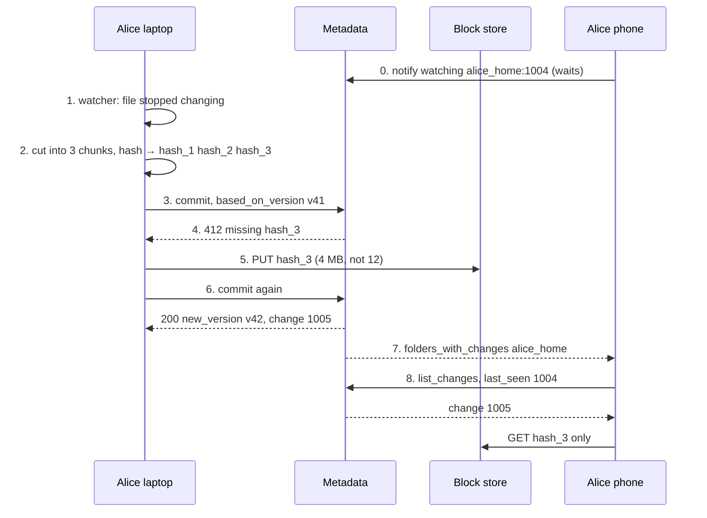

Unchanged file? **One metadata round trip, zero bytes.**

---

## 5.5 Data model — tables, database choices and caches

> **⚡ 30-second version**
> 1. **Metadata** (folders, journals, current files, members) goes in a **sharded relational DB, sharded by `ns_id`**, because a save must be **one ACID transaction** inside one namespace.
> 2. **The block index** (`hash → where the chunk is`) goes in a **sharded key-value store, sharded by hash**: huge, point lookups only.
> 3. **Chunk bytes** go in an **object store** (S3 at first, later your own disks with erasure coding), **never in a database**.
> 4. **Kafka** carries "namespace advanced" events to notifications, GC and the audit log.
> 5. **Caches** are safe almost everywhere because **chunks and journal lines never change**. The one place that must always be fresh is the **compare-and-swap** at commit time.

### The whole system, with databases and caches

The full diagram is at the top: [Architecture at a glance (HLD)](#-architecture-at-a-glance-hld). Who owns what: the **metadata service** owns the namespace tables and is the only place file state changes; the **block service** owns everything about bytes; **Kafka** fans the "namespace advanced" event out to notifications, GC and audit; **workers** clean up, compact and repair in the background.

### Table design (sketch)

```sql
-- ================= Metadata DB: sharded by ns_id =================
-- every row of one namespace lives on ONE shard → a commit is a local transaction

CREATE TABLE namespaces (
  ns_id          BIGINT PRIMARY KEY,
  kind           VARCHAR(8),    -- 'root' | 'shared'
  owner_id       BIGINT,
  home_region    VARCHAR(16),   -- where its journal leader lives (§12)
  residency_zone VARCHAR(16),   -- e.g. 'EU': its bytes never leave this zone
  latest_seq     BIGINT,        -- number of the last journal line
  file_count     BIGINT,        -- checked against the hard cap (§3)
  epoch          INT            -- bumps on failover (§12)
);

CREATE TABLE journal (           -- append-only: rows are never updated
  ns_id        BIGINT,
  seq          BIGINT,          -- 1001, 1002, … (the cursor points here)
  file_id      BIGINT,          -- stable id, survives renames (§9)
  parent_id    BIGINT,          -- the folder it's in (a file_id in the same ns)
  name         TEXT,            -- 'spec.docx'
  rev          BIGINT,
  blocklist    BLOB,            -- [h1, h7, …]; empty for folders
  size_bytes   BIGINT,
  is_deleted   BOOLEAN,
  origin_op_id VARCHAR(64),     -- set for moves → clients show "moved", not "deleted"
  actor_id     BIGINT,          -- who did it (audit)
  created_at   TIMESTAMP,
  PRIMARY KEY (ns_id, seq)
);

CREATE TABLE files (             -- the CURRENT tree: latest state of each file and folder
  ns_id       BIGINT,
  file_id     BIGINT,
  parent_id   BIGINT,           -- stored as parent + name, NOT a full path,
  name        TEXT,             -- so moving a folder inside the ns updates ONE row
  is_folder   BOOLEAN,
  rev         BIGINT,           -- the compare-and-swap target for commit
  blocklist   BLOB,
  size_bytes  BIGINT,
  is_deleted  BOOLEAN,          -- soft delete: in the trash, bytes kept
  updated_seq BIGINT,
  PRIMARY KEY (ns_id, file_id),
  UNIQUE (ns_id, parent_id, name)   -- one live item per name in a folder
);

CREATE TABLE members (           -- ACL: one member list per namespace (§10)
  ns_id          BIGINT,
  principal_id   BIGINT,        -- a user or a group
  principal_type VARCHAR(8),    -- 'user' | 'group'
  role           VARCHAR(8),    -- 'owner' | 'editor' | 'viewer'
  PRIMARY KEY (ns_id, principal_id)
);

CREATE TABLE commit_requests (   -- makes retries safe (§4 save_request_id)
  ns_id           BIGINT,
  save_request_id VARCHAR(64),
  result_rev      BIGINT,
  expires_at      TIMESTAMP,    -- kept a few days
  PRIMARY KEY (ns_id, save_request_id)
);

CREATE TABLE move_intents (      -- the saga for cross-namespace moves (§8.5)
  op_id       VARCHAR(64) PRIMARY KEY,
  src_ns      BIGINT,  src_path TEXT,
  dst_ns      BIGINT,  dst_path TEXT,
  state       VARCHAR(12),      -- 'STARTED' | 'DEST_DONE' | 'DONE'
  actor_id    BIGINT,
  deadline    TIMESTAMP         -- the reconciler picks up intents past this
);

-- ================= User DB: sharded by user_id =================
CREATE TABLE mounts (            -- where each namespace appears in a user's tree
  user_id    BIGINT,
  ns_id      BIGINT,
  mount_path TEXT,              -- Alice: ns 42 at '/Projects/Launch'
  PRIMARY KEY (user_id, ns_id)
);

CREATE TABLE devices (           -- for remote wipe and client-version checks
  device_id      BIGINT PRIMARY KEY,
  user_id        BIGINT,
  client_version VARCHAR(16),
  managed        BOOLEAN,       -- remote wipe works only on managed devices
  last_seen      TIMESTAMP
);

CREATE TABLE share_links (
  token_hash VARCHAR(64) PRIMARY KEY,   -- store a hash of the token, never the token
  ns_id      BIGINT,  path TEXT,
  expires_at TIMESTAMP,
  revoked    BOOLEAN,                   -- checked on every request (§10)
  created_by BIGINT
);

-- ================= Block index: KV store sharded by hash =================
-- key   = (residency_zone, chunker_version, hash)       (§6, §12)
-- value = { volume_id, offset, length,
--           state: 'pending' | 'live' | 'tombstoned',
--           last_pinned,            -- the GC time contract (§7)
--           refcount_hint }         -- a hint only; the mark phase decides (§11)

-- ================= Volume map: small, strongly consistent =================
-- key   = volume_id
-- value = { state: 'open' | 'sealed' | 'cold' | 'compacting',
--           scheme: '3x' | 'RS(10,4)' | 'LRC',
--           pieces: [ (piece_no, disk_id, rack) × 14 ],
--           live_bytes, garbage_bytes }   -- drives compaction (§11)

-- ================= On the device: SQLite =================
-- synced_tree(ns_id, file_id, path, rev, blocklist, local_inode)  -- the merge base (§9)
-- cursors(ns_id, cursor, epoch)
-- pending_ops(op_id, kind, payload)                               -- survives app crashes
```

**How a commit uses these tables.** Alice saves `/spec.docx` in `ns 42`, based on `v3`:

```sql
-- 0. Before: block service confirms h1, h7 are durable and touches last_pinned (else 412)
-- 1. Already done? (a retry) → return the stored result
SELECT result_rev FROM commit_requests WHERE ns_id = 42 AND save_request_id = 'alice-laptop-7781';

-- 2. ONE transaction on the shard that owns ns 42
BEGIN;
SELECT rev FROM files WHERE ns_id = 42 AND file_id = 77 FOR UPDATE;        -- spec.docx: must be v3, else 409
SELECT latest_seq FROM namespaces WHERE ns_id = 42 FOR UPDATE;            -- e.g. 1003
INSERT INTO journal (ns_id, seq, file_id, parent_id, name, rev, blocklist, is_deleted, actor_id)
     VALUES (42, 1004, 77, 5, 'spec.docx', 4, '[h1,h7]', false, 1);
UPDATE files      SET rev = 4, blocklist = '[h1,h7]', updated_seq = 1004
                WHERE ns_id = 42 AND file_id = 77;
UPDATE namespaces SET latest_seq = 1004 WHERE ns_id = 42;
INSERT INTO commit_requests (ns_id, save_request_id, result_rev) VALUES (42, 'alice-laptop-7781', 4);
COMMIT;

-- 3. After: publish "ns 42 advanced to 1004" to Kafka → notification fleet pings members
```

That's why **everything about one namespace must live on one shard**: the compare-and-swap, the journal line, the current tree and the retry record all change in **one local transaction**.

### Database choices

| Data | Store | Why this one | Why not the obvious alternative |
|---|---|---|---|
| Namespaces, journal, files, members, intents, commit ids | **Sharded relational DB** (MySQL/InnoDB; or Spanner / CockroachDB), shard key **`ns_id`** | a save = check + append + update in **one ACID transaction**; per-namespace order comes from one database | Cassandra / DynamoDB: no multi-row transactions or strict per-namespace order without extra machinery |
| Mounts, devices, share links | same kind of DB, shard key **`user_id`** | "which folders can I see?" at login, per user | sharding by `ns_id` would scatter one user's mounts across shards |
| Block index (~22 TB) | **Sharded KV store on SSD** (RocksDB- or MySQL-backed), shard key **hash** | only point lookups ("have `h7`?"); hashes spread evenly across shards | a relational schema adds nothing; sharding by namespace would break global dedup |
| Volume map | **Small, strongly consistent DB**, replicated | changes only on seal, repair and compaction, but must never be wrong | an eventually consistent store could point reads at the wrong disk |
| Chunk bytes (~1 EB) | **Object store** (S3) in v1 → **own disks + erasure coding** later (like Dropbox's Magic Pocket) | cheap, huge, immutable blobs | bytes in a database: expensive, slow, giant backups |
| "Namespace advanced" events | **Kafka**, partitioned by `ns_id` | one event feeds notifications, GC, audit; replayable; ordered per namespace | direct service-to-service calls: tight coupling, nothing to replay after an outage |
| Long-poll subscriptions | **In memory** on the notification fleet | 300M open connections, no durable state needed (lost = device polls) | storing them in a DB: millions of writes for data that can be rebuilt |
| Audit log | **Append-only** (Kafka → object store / warehouse) | enterprise compliance, one event per action | — |
| Device state | **SQLite** on the device | crash-safe cursor + synced tree on the laptop | plain files: corrupt on a crash mid-write |

Real-world reference: Dropbox keeps metadata in sharded MySQL (its "Edgestore" layer) and block bytes in its own erasure-coded store, Magic Pocket.

### Caches

| Cache | Key → value | Where | How it stays correct | Why it exists |
|---|---|---|---|---|
| **Delta cache** | `(ns_id, from_cursor)` → `list_changes` answer | Memcached / Redis in front of journal shards | journal lines never change, so a cached answer is never wrong; short TTL only to save memory | 80,000 members asking the same question (§8.4) |
| **ACL cache** | `(user_id, ns_id)` → role | near the metadata service | delete on member change, plus a **consistency token** so a check is never older than the last permission change (§10) | permission is checked on every request |
| **Namespace head** | `ns_id` → `latest_seq` | notification fleet memory | updated from Kafka events | answer "did ns 42 pass 1001?" without the DB |
| **Bloom filter** | "is hash `h7` possibly stored?" | block service memory | rebuilt periodically; "maybe" → a real index lookup | "definitely not stored" answered without touching the index |
| **Hot chunk cache / CDN** | `hash` → bytes | SSD on block servers; CDN with signed URLs for public share links | chunks never change; plain LRU eviction | a popular shared installer downloaded a million times |
| **Local chunk cache** | `hash` → bytes | the device's disk | LRU | a rename or copy needs no download |

**Never cached:** the `files.rev` read inside the commit transaction. Compare-and-swap is only correct against the **real, current** value; a cached `rev` would let two saves both "win".

---

## 6. Deep dive 1 — Chunking

> **⚡ 30-second version**
> 1. Files are cut into **~4 MB chunks**, and each chunk is named by its fingerprint (hash).
> 2. **Fixed-size cuts break on inserts:** add 10 bytes near the start and every later chunk shifts, so every chunk "changes".
> 3. **Content-defined cuts (CDC)** cut where a byte pattern appears, so after an insert only **one** chunk changes.
> 4. **4 MB is chosen for cost.** Finer comparison is done only on the laptop, to shrink uploads, and never goes into the global index.
> 5. **Set a min and max chunk size** (e.g. 1–8 MB), otherwise a file of zeros becomes millions of chunks (an attack).
> 6. **Zip and Office files** change everywhere after a tiny edit, so they dedup only as whole files.
> 7. **The chunking rules and the hash (SHA-256) are permanent.** Changing them breaks dedup with all old data.

### Fixed vs content-defined

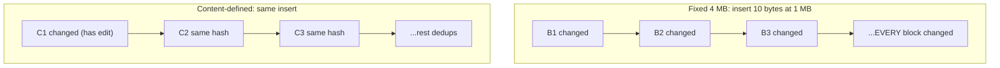

**How CDC works:** slide a small window over the bytes, compute a rolling hash (Rabin, or the cheaper **Gear / FastCDC**), and cut where it matches a pattern (step by step below). **Fixed-size chunks are fine for v1; switch to CDC by v3** (§14).

### Rabin fingerprint, step by step (beginner version)

**Two hashes, two jobs. Don't mix them up:**

| | Rabin (rolling hash) | SHA-256 |
|---|---|---|
| Job | Decide **where to cut** (the scissors) | Give each finished chunk its **name** (the label) |
| Runs on | A small window (~48 bytes) at **every byte position** | Each **whole chunk**, once |
| Must be | Very fast | Collision-proof |

**Toy example with digits.** Window = 3 digits, hash = the 3 digits read as a number, rule = **cut when `hash % 3 == 0`**.

```text
File:    3 1 4 1 5 9 2 6 5 3 5 8 9 7 9
Windows: 314 141 415 159 592 926 265 653 535 358 589 897 979
% 3:      2   0   1   0   1   2   1   2   1   1   1   0   1
                ↑       ↑                               ↑
               cut     cut                             cut
Chunks:  [3141] [59] [26535897] [9]
```

**Why "rolling":** to go from `314` to `141`, don't recompute. Remove the digit leaving (`314 − 300 = 14`), shift (`× 10 = 140`), add the digit entering (`+ 1 = 141`). That's a few operations per byte, whatever the window size, so it scans GBs fast.

**Insert `8` at the start and run it again:**

```text
Before:  [3141]       [59] [26535897] [9]
After:   [831] [41]   [59] [26535897] [9]
          changed     SAME    SAME    SAME
```

Each cut decision looks **only at the 3 digits in the window**. Once the window has passed the edit, it sees the same digits as before, so it cuts in the same places. With fixed 4-digit cuts, the same insert changes **every** chunk: `[3141][5926][5358][979]` → `[8314][1592][6535][8979]`.

**Real version:** bytes instead of digits, a ~48-byte window, `mod` a big prime to keep numbers small, and cut when `hash % 8192 == 0` (about one cut per 8 KB; use a larger mask for MB-sized chunks), plus min/max clamps.

### How the client knows which chunk changed

The OS watcher only says **"report.txt changed"**, not which bytes. The old bytes are already overwritten, so the client **compares hash lists, not bytes**:

1. The client's local DB remembers the last-synced blocklist: `[h1, h2, h3, h4, h5]`.
2. Re-read the file → CDC cuts → SHA-256 each chunk → `[h1, h2, h9, h4, h5]`. (Local only. ~1 GB/s, no network.)
3. Hashes in the new list but not the old one = changed chunks → `{h9}`.
4. `commit` sends the new list (256 hashes × 32 B ≈ 8 KB for a 1 GB file). The server replies with what it's **actually** missing (it may already have `h9`).
5. Upload only the missing chunks. Other devices do the same diff and download only `h9`.

| You did | Old list | New list | Upload |
|---|---|---|---|
| Edited the middle | h1 h2 h3 h4 h5 | h1 h2 **h9** h4 h5 | h9 |
| Inserted a paragraph | h1 h2 h3 h4 h5 | h1 h2 **h9 h10** h3 h4 h5 | h9, h10 |
| Deleted a section | h1 h2 h3 h4 h5 | h1 h2 h5 | nothing |
| Same insert, **fixed** chunks | h1 h2 h3 h4 h5 | h1 h2 **h9 h10 h11 h12** | almost all |

**Not all chunks are re-sent.** All chunks are re-**hashed** locally, but only the **list** of hashes and the **missing** chunks go over the network.

> *Interview:* "Rabin decides where to cut, SHA-256 names each chunk, and a file version is just the ordered list of names. The client diffs the new list against the last-synced one, and the server decides what's really missing."

### What textbooks miss

| Point | Plain version |
|-------|---------------|
| **Chunk size is a cost dial** | Half the size → 2x index entries, 2x blocklist size, 2x IOPS per byte, for almost no extra dedup (§3 #1) |
| **Small chunks only help** | Big files edited in place: VM images, databases, PST mailboxes, video projects |
| **Two-level chunking** (the answer) | **4 MB CDC chunk** = storage + dedup unit. Client computes **finer fingerprints locally** just for transfer deltas vs the old version it has. **Fine ones never touch the global index** |
| **Clamp min/max** (e.g. 1 / 4 / 8 MB) | Pure CDC gives wild sizes. A run of zeros can match at *every byte* → tens of millions of chunks per GB → one user = index hot spot. Attackers can do this on purpose. **Min/max is a DoS control** |
| **Zip/Office/encrypted files defeat CDC** | 1-byte change rewrites the compressed stream. Plan for these to dedup only as whole files. Unzipping before chunking works but adds a **parser attack surface** |
| **Chunker = protocol constant forever** | Change the gear table/mask/min/max → new files stop deduping against old ones. Key the index by `(chunker_version, hash)`; treat it like a wire format |
| **Hash = correctness** | A collision = **someone else's bytes served as your file**. SHA-1 broken in 2017 (SHAttered). Use **SHA-256** (or **BLAKE3** for client CPU). Have a migration plan: re-hashing an EB = multi-quarter job |

---

## 7. Deep dive 2 — Upload, dedup, and the GC race

> **⚡ 30-second version**
> 1. **Upload:** commit first. The server replies with which chunks are missing, you upload only those, then commit again.
> 2. **The GC race (the scariest bug):** the cleaner (GC) decides chunk `h9` is unused. Meanwhile a new file starts using `h9`. The cleaner deletes it, and the new file is broken.
> 3. **The fix:** every use **stamps** the chunk ("last used = now"). The cleaner may delete only chunks whose stamp is **well before** it started. The rule is `margin > g + commit_deadline`, kept as an assertion in code.
> 4. **The dedup leak:** if the server says "already have it" for a file you don't own, attackers can guess secrets, such as a salary in an offer letter.
> 5. **The fix:** skip uploads only for chunks already in **your own** folders. Dedup across users happens quietly on the server **after** upload.
> 6. **Own encryption keys mean no dedup across companies.**

### Upload flow (commit first, upload only what's missing)

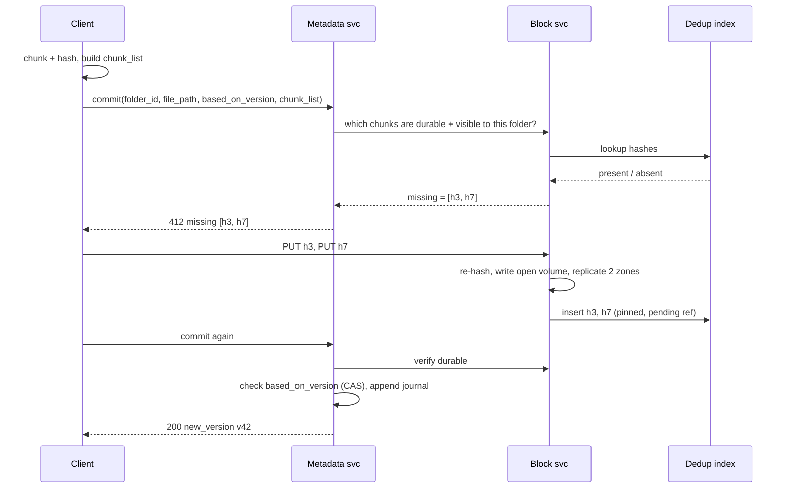

### Making uploads, downloads and sync fast (beginner version)

You can't widen the user's pipe (bandwidth is fixed). Every speed trick does one of three things: **keep the pipe full**, **move data closer**, or **send fewer bytes**.

| Trick | Plain meaning | Helps |
|---|---|---|
| **Parallel chunks** | Upload 4–8 chunks at once. One TCP stream rarely fills the pipe | Upload |
| **Adaptive chunk size** | Bigger transfer pieces on fast, stable Wi-Fi (less overhead); smaller on flaky mobile (a failure re-sends less) | Upload |
| **Delta sync (CDC)** | Send only chunks whose hash changed (§6) | Sync |
| **CDN** | Popular chunks cached at edge servers near the user. Mumbai downloads from Mumbai, not Virginia | Download |
| **Compression** | Client shrinks bytes before upload, expands after download. The server never touches the data | Both |

**When to compress:** only if *time saved sending fewer bytes > time spent compressing*. The client decides by **file type, size and network speed**.

| File type | Compresses? | Decision |
|---|---|---|
| Text, code, CSV, logs, JSON | Yes, often 3–10× (5 GB of logs → ~1 GB) | Compress |
| JPG, PNG, MP4, ZIP, DOCX | No, already compressed (a few % at best) | Skip |

**Which algorithm:** **Gzip** = supported everywhere, average. **Brotli** = smaller output for text, built into browsers. **Zstandard (zstd)** = very fast with a good ratio and a tunable speed/size dial, so it's the best fit for a desktop sync client.

**Order matters: CDC → SHA-256 → compress → encrypt → upload.**
- Compression works by finding repeated patterns. Encrypted data looks random, with no patterns. **Encrypt first and nothing shrinks.** (Like folding clothes before vacuum-sealing the bag.)
- **Hash before compressing**, so the chunk's name depends on its content, not on compression settings. Otherwise dedup breaks when the zstd level changes.

### The GC race (the scariest bug in the system)

**Problem:** GC's mark phase takes a snapshot of "which chunks are used" and then runs for hours. Meanwhile a new save can reuse a chunk the snapshot thought was dead:

```text
09:00  GC starts its scan. Nobody uses chunk h9.
09:05  Bob saves a file whose content is exactly h9 → dedup, no upload, his file now points to h9
11:00  GC finishes: "h9 was unused at 09:00" → deletes h9 → Bob's committed file points to nothing ✗
```

**Fix = a time contract, not a cross-plane lock:**
1. Every commit durability check and every PUT **touches** the chunk: `last_pinned = now` (Bob's save sets h9 to 09:05).
2. GC may only reclaim chunks with `last_pinned < mark_start − margin`. h9 was touched after 09:00, so it survives.
3. **margin > max gap between durability check and journal append.** Enforce a **commit deadline** (a GC-paused JVM can stretch it!).

**Don't confuse with client retry window:** a laptop that sleeps all weekend mid-upload just gets **412 and re-uploads** — costs bandwidth, not data. Teams that set multi-day leases fill disks with weeks of orphan uploads, then shorten it without knowing the commit deadline was the real invariant.

**Why it matters:** a wrong invariant = maybe a few corrupt files per billion commits. At 170k/s that's **dozens a day**, found months later via support tickets.

**Coarse touching (the hidden cost):** naive touch = hundreds of thousands of random writes/s into the hottest table. Fix: only write if stored `last_pinned` is older than **g** (e.g. 1 h). But now:

> **margin > g + commit_deadline**

Put this inequality **in code as an assertion**, not in a doc — someone will "optimise" g two years later.

### Global dedup leaks (the existence oracle)

If the server says "you don't need to upload H" for content you never had:
- **(a) Free distribution:** anyone who knows a hash can claim the file. Untraceable piracy channel.
- **(b) Confirmation attack:** take a template (offer letter, bank letter) with one unknown field (salary, PIN). Generate all candidates, upload-probe each. **The one that dedups is the answer.** Known since ~2010, still works on naive designs.

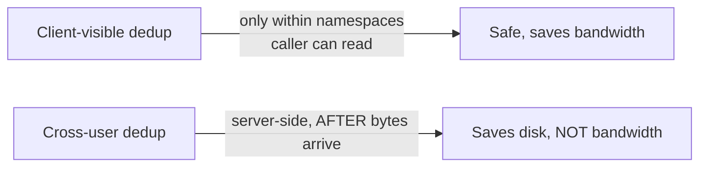

- You **pay ingress for every cross-user duplicate.** That's the right cost.
- Proof-of-ownership (server asks for random byte ranges) doesn't stop attack (b), since the attacker *has* the whole candidate file.

**Encryption scope = dedup scope:**
- Per-tenant keys (BYOK) → ciphertext never matches across tenants → **price BYOK without cross-tenant dedup** (big for enterprises sharing installers/videos).
- Convergent encryption (key = hash of content) restores dedup but **brings back the oracle, cryptographically.**

---

## 8. Deep dive 3 — Namespaces, journals, and sync

> **⚡ 30-second version**
> 1. Each shared folder (namespace) has **one numbered change log** (journal): #1001, #1002, …
> 2. Each device keeps **one bookmark (cursor) per folder**, such as "read up to #1005".
> 3. **The sync loop:** get a "changed" ping, ask "what's after #1005?", apply the changes, move the bookmark.
> 4. **A huge folder (80k members):** one change makes 80k devices ask the same question at once. The fixes are to spread the pings out, **cache the identical answer**, and add read replicas.
> 5. **Moving between folders:** add to the new folder **first**, then remove from the old one. There must never be a moment when the folder exists nowhere, or devices would delete it.

### 8.1 What a namespace is

A **namespace (ns)** is a folder with its own little world: **its own file list, its own member list and its own change log.**

| Namespace | What it is | Who can see it |
|---|---|---|
| `ns 10` | Alice's personal root folder | only Alice |
| `ns 20` | Bob's personal root folder | only Bob |
| `ns 42` "Launch" | a shared folder | Alice, Bob, the Eng group |

**Mounted** means the shared folder appears **inside** each member's own tree, at a place each member chooses. Alice sees `ns 42` at `/Projects/Launch`, Bob at `/Work/Launch`. It's **one** folder, not two copies (picture in §10).

### 8.2 The journal: each namespace's numbered change log

Every change in a namespace is added as **one numbered line**. Lines are never edited (**append-only**), and there is exactly one order (**totally ordered**):

```text
Journal of ns 42 ("Launch")
seq    path             rev   blocklist     deleted?
1001   /spec.docx       v3    [h1, h2]      no
1002   /logo.png        v1    [h9]          no
1003   /old-notes.txt   v2    —             yes
1004   /spec.docx       v4    [h1, h7]      no     ← someone edited spec.docx
```

All rows of `ns 42` live on **one database shard** (the data is split by `ns_id`). Because everything about sync only has to be correct **inside one journal**, the namespace is the unit of four things at once:

| Unit of… | Plain meaning | Why it's easy here |
|---|---|---|
| **Consistency** | the order of changes | one journal = one order, decided by one database |
| **Placement** | which shard stores it | all of `ns 42` sits together on one shard |
| **Residency** | which country/region | `ns 42` has one home region (§12) |
| **ACL** | who may read or write | one member list for the whole folder (§10) |

### 8.3 How a device syncs: one bookmark per folder

A device's entire sync state is **one cursor (bookmark) per namespace it can see**, for example Alice's laptop stores `ns 42 → 1001` and `ns 77 → 530`.

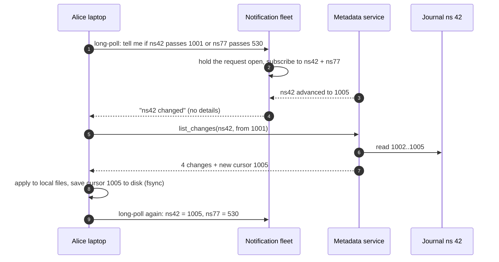

In words: **wait for a ping → ask "what's after my bookmark?" → apply → save the new bookmark → wait again.**

This is the same "log + offset" pattern as a Kafka consumer. The difference: this consumer is a **laptop** that can't be trusted, is often offline, and has a file system that "fights back" (renames, unplugged drives, lost events: §9).

### 8.4 Hot namespaces: 80,000 members asking at once

**The problem.** Writes are not the issue; even a busy folder gets few saves per second. **Reads** are. A company-wide folder with **80,000 members**:

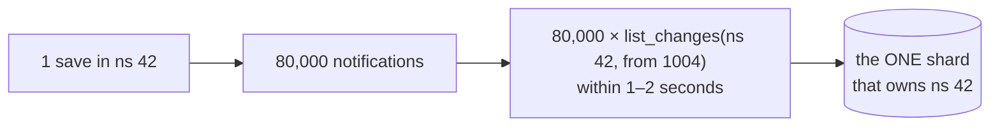

**The fix: three layers, in the order you'd build them.**

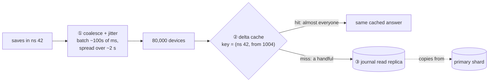

| # | Fix | What it does | Why it's safe |
|---|---|---|---|
| ① | **Coalesce + jitter notifications** | 10 saves in a few hundred ms → **one** ping; deliver to the 80k members spread over ~2 s instead of at the same instant | 2 s of delay breaks no latency target (p50 < 5 s) |
| ② | **Cache deltas by `(ns, from_cursor)`** | nearly all members sit at the **same cursor**, so they ask the identical question. Answer it once, cache it: 80k reads → a handful | the journal never changes, and permission is **per namespace**, so everyone gets the same answer. Per-file permissions would make each answer user-specific → uncacheable |
| ③ | **Journal read replicas** for very big namespaces | copies of the journal serve the reads | a replica a moment behind is harmless: the device just asks again |

### 8.5 Moving a folder between namespaces (a distributed transaction)

A move **inside** one namespace is one row and one journal line (table at the end of 8.5). Moving `ns 10:/Q3` → `ns 42:/Q3` (your folder → a shared folder) is hard: it touches **two journals**, maybe on **two shards**, and changes **who can see the files**.

Two ways to do the hard one: **two-phase commit** across both shards, or an **intent-logged saga**: write down "I'm doing move X", then add to the destination, remove from the source, clear the intent. Each step is safe to repeat, and a **reconciler** finishes moves that got stuck.

**The golden rule: add to the destination BEFORE removing from the source.**

```text
Right order                              Wrong order
1. add /Q3 to ns 42                      1. delete /Q3 from ns 10
   → exists in BOTH for a few seconds       → exists NOWHERE
   → devices may show a duplicate           → a device syncing now
     (annoying but safe: "window A")          DELETES it locally ("window B")
2. delete /Q3 from ns 10                 2. add /Q3 to ns 42
```

**With a crash in the middle:**

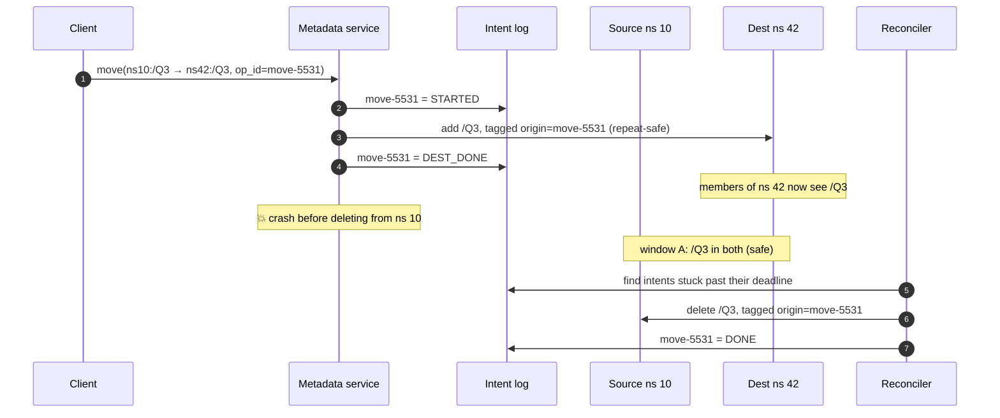

**Two details that make it safe, not just correctly ordered:**
1. **Tag the source delete with the `op_id`.** Devices then show "moved out", not "deleted". Without the tag, a device sees a plain delete here and an add there: it **re-downloads the whole folder**, and if you were editing a file inside, it looks like an **edit-vs-delete conflict**.
2. **The permission change is the real event.** Private folder → folder with 80,000 members = a **disclosure**. Folder moved out of a shared folder = a **revocation** for everyone else. Admins want each as **one audit-log event with one actor**, and the intent record already has exactly that.

**Huge moves: what actually moves?** **No file bytes ever move.** Chunks stay where they are in the block store; only **metadata rows** are written. How many depends on the kind of move:

| Move | Rows written | Why |
|---|---|---|
| Folder `/Q3` → `/Archive/Q3` **inside** `ns 10` | **1** row (`parent_id` of `/Q3` changes) + 1 journal line | the tree is stored as parent + name, so children don't change (§5.5) |
| The whole shared folder `ns 42` to another place in Alice's tree | **1** row in `mounts` | a namespace is mounted, not copied (§2 Question 2) |
| Ordinary folder `/Q3` (1M files) **from `ns 10` into `ns 42`** | **~1M rows** added in `ns 42` + ~1M "moved out" lines in `ns 10` | each file row belongs to `ns 10` and lives on **its** shard. `ns 42` has its **own** shard and journal, and its members' devices read **only** `ns 42`'s journal, so every file needs a new row there (pointing at the **same** chunk hashes) |

**Why not one big database transaction?** For a 20-file folder it is effectively one (the saga above). For 1M rows on two shards, one transaction would hold locks for minutes, blocking every other save in `ns 42`, and would create a giant replication backlog. So it runs as a **rate-limited, resumable background job**: batches of, say, 10,000 rows, each tagged with the move's `op_id` (so a retried batch changes nothing), progress kept in `move_intents`, all adds before the source deletes. The real cost lands on **the members' devices**: each of them now downloads 1M files. Some products refuse cross-namespace moves above a size limit and turn them into an explicit **copy-then-delete** in the UI.

---

## 9. Deep dive 4 — The client, and conflicts

> **⚡ 30-second version**
> 1. **The app on your laptop is the most dangerous part.** It can delete files both on your disk and on the server.
> 2. **It compares 3 trees:** Local (your disk), Remote (the server) and Synced (the last state both agreed on). Synced tells "you deleted it" apart from "it was never downloaded".
> 3. **Missing is not deleted.** An unplugged drive looks like "everything deleted". The defences are to check the drive's identity, **pause on mass deletes and ask the user**, and keep a server-side trash with "restore to yesterday 9:14".
> 4. **Track files by OS id, not by name**, so a rename isn't mistaken for delete + create.
> 5. **Conflicts:** never throw bytes away. Two edits means keep both copies, and edit vs delete means the edit wins.
> 6. **Odd names** (`Report` vs `report`, Unicode forms, Windows-illegal names) are handled by renaming or showing an error, **never by deleting**.

### 9.1 Why the client is the most dangerous part

The sync app on your laptop has **delete power in both directions**. If it wrongly decides "Alice deleted `/Photos`", it deletes `/Photos` **on the server**, and then **every other device** of Alice reads the journal and deletes it too. One wrong conclusion on one laptop wipes the folder everywhere. Almost everything in §9 exists to stop that.

### 9.2 The three trees (and why "before" matters)

The client keeps **three lists of files** (trees):

| Tree | What it says | Where it comes from |
|---|---|---|
| **Local** | what is on my disk **now** | disk scan + watcher (9.4) |
| **Remote** | what the server has **now** | the journal, via `list_changes` (§8.3) |
| **Synced** | what **both sides agreed on** at the last successful sync | the client's own SQLite (§5.5) |

**Synced is the "before" picture** (the **merge base**). Changes are found by comparing **Local with Synced** and **Remote with Synced**, never Local directly with Remote.

**Why "before" matters.** `notes.txt` is on the server but not on the laptop. Two very different stories look the same if you only compare Local with Remote:

```text
Story A: Alice deleted it on the laptop      Story B: added on her phone, not downloaded yet
  Synced: notes.txt ✔                          Synced: (nothing)
  Local : (missing)                            Local : (missing)
  Remote: notes.txt ✔                          Remote: notes.txt ✔
  → correct action: delete on server           → correct action: download it
```

Without Synced, both are just "Local missing, Remote has it". If the client assumes A when B is true, it deletes the phone's new file; if it assumes B when A is true, the file Alice deleted keeps coming back. With Synced there is nothing to guess.

**One planning cycle, worked example:**

```text
file     Synced  Local       Remote   Local changed?  Remote changed?  Plan
a.txt    v3      v3          v4       no              yes              download v4
b.txt    v2      v2 edited   v2       yes             no               upload (commit based on v2)
c.txt    v1      missing     v1       yes (deleted)   no               delete on server (→ trash)
d.txt    —       —           v1       no              yes (new)        download
e.txt    v5      v5 edited   v6       yes             yes              CONFLICT → 9.6
```

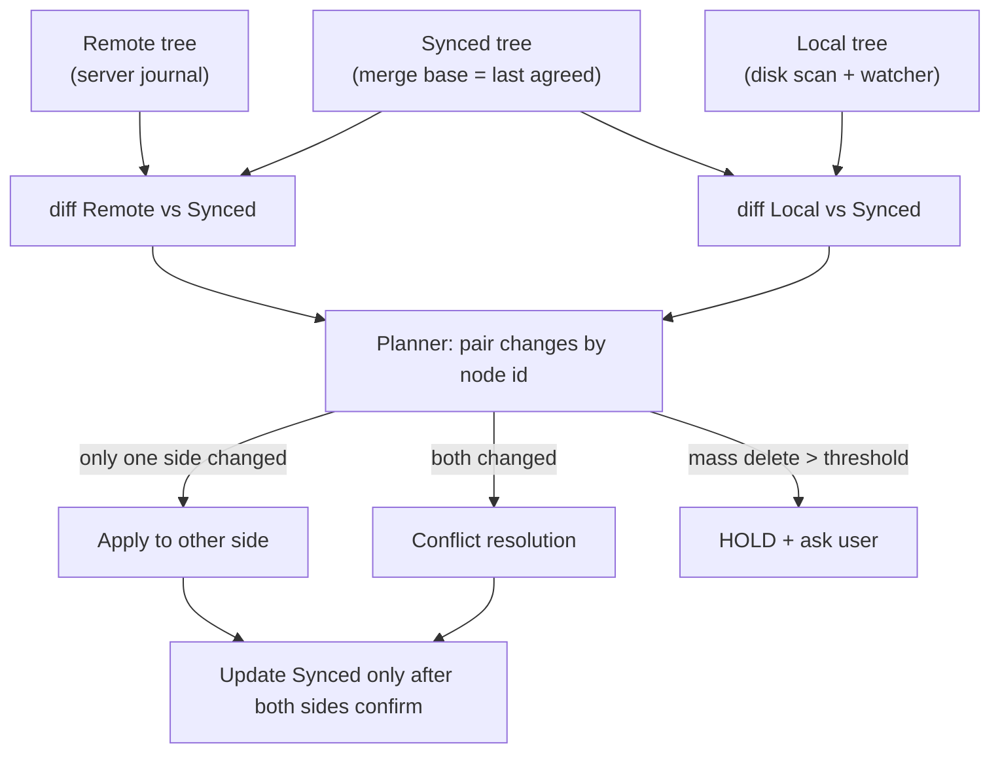

**Why "update Synced only after both sides confirm"?** Say the download of `a.txt` v4 fails halfway. Synced must stay at v3, so the next cycle simply retries. If Synced had already been moved to v4, the laptop's v3 would look like a **local edit back to v3**, and the client would upload the old content over Bob's new version.

### 9.3 Missing is not deleted (the #1 damaging bug)

**The disaster, step by step:**

```text
Alice keeps her Dropbox folder on an external SSD.
09:00  Synced tree: 40,000 files under /Dropbox
09:05  She unplugs the SSD to take it home
09:05  Local scan: /Dropbox is empty
       Naive client: Local vs Synced → "40,000 files deleted" → tells the server
09:06  Server: 40,000 deletes appended to ns 10's journal
09:07  Her desktop and phone read the journal → they delete 40,000 files too
```

The client did exactly what the diff said. The diff was wrong because **"I can't see it" was treated as "it's gone"**. Other things that look like deletes:

| Cause | What the client sees |
|---|---|
| External drive unplugged | the whole sync folder is gone |
| Network share offline | folder empty or unreadable |
| Permissions changed | a folder becomes unreadable, so it looks empty |
| Antivirus quarantine | some files vanish |
| OS "optimise storage" | the OS removes local copies to free space |

**The three defences (you need all three):**

| Defence | How it works | What it catches |
|---|---|---|
| **1. Check the drive's identity** | at setup, record the filesystem UUID and the inode of the sync folder. Every cycle, check them. If they're different or missing, **pause**: "Your Dropbox folder can't be found" | unplugged or swapped drives (precise, but only this case) |
| **2. Mass-delete circuit breaker** | if one cycle wants to delete more than a limit (say 1,000 files **or** 10% of the tree), **hold the deletes and ask the user** | permissions, antivirus, unknown bugs (broad, but a 900-file wipe still slips under the limit) |
| **3. Server trash + "restore to a time"** | deletes are only **marked** (soft delete); support can run "restore ns 42 to its state at 09:14 yesterday", which re-applies each file's state as of the journal line at 09:14 | everything that got past 1 and 2, including bugs in your own client |

> Defence 3 is the tool your support team will use most in a bad week. **Build it before you need it.**

### 9.4 Track identity, not paths (the watcher: FSEvents / inotify / USN)

**Watcher** = the part of the sync app that **asks the operating system to tell it when files change**, instead of re-checking every file again and again.

**Analogy:** a **doorbell** instead of checking the door every minute. The OS rings: "report.docx changed."

| Name | Operating system | Plain meaning |
|---|---|---|
| **FSEvents** | macOS | macOS tells you **which folders** had changes (sometimes not which file) |
| **inotify** | Linux | Linux sends an event per file: created, modified, deleted, moved |
| **USN journal** | Windows (NTFS) | Windows keeps a **diary of every file change** on the drive, and you read new entries |

(Windows also has `ReadDirectoryChangesW`, a simpler per-folder watch.)

**Example:** Alice saves `report.docx`. The OS fires "modified" → the watcher **waits until the file stops changing** (apps often write in several bursts) → the chunker hashes it → upload.

**Why the events can't be fully trusted:**

| Problem | What happens | Example |
|---|---|---|
| **inotify overflow** | Linux keeps events in a small queue (default ~16k). If too many arrive at once, it **drops them** and only says "overflow" | `git checkout` touches 50k files → events lost |
| **FSEvents coalescing** | macOS **merges** many changes into one, often just "something in this folder changed" | 10 edits become 1 event: "folder /Docs changed" |
| **USN wrap** | the Windows diary has a fixed size; old entries get **overwritten** | the app was off for a week → the diary wrapped → changes were missed |
| Out of order / rename split | a rename can arrive as "deleted A" + "created B" | if not paired, it looks like a delete plus a new file, and the history is lost |

**The fixes:**
- **Track files by id, not by name:** every file has a fixed number from the OS (**inode** + volume on Mac/Linux, **file ID** on NTFS). A rename keeps the same id, so "deleted A" + "created B" with the **same id** = a **rename**. Pairing them wrong loses history, or makes you conflict with yourself:

```text
Alice renames draft.docx → final.docx
Watcher events:  DELETE draft.docx (inode 8812)   CREATE final.docx (inode 8812)
Paired by path:  "draft deleted" + "new file final"  → draft's history lost, final starts at v1
Paired by id:    same inode 8812 → RENAME → one journal line, history kept, 0 bytes uploaded
```

- **If events were lost, scan everything:** walk the whole folder and compare. It's expensive (500k files = minutes of disk work), so an app update that forces **every user** to rescan at once is a **self-inflicted load event**.

> *Interview:* "The client uses the OS change feed (FSEvents on macOS, inotify on Linux, the USN journal on Windows) as a hint, not the truth. Events can be dropped, merged or reordered, so I pair changes by stable file id (inode or NTFS file ID) and fall back to a full rescan on overflow, budgeted so a client release can't trigger fleet-wide rescans."

### 9.5 Offline edits: what if I changed files while offline?

There are **two different "offline" cases**:

| Case | Watcher running? | What the client does |
|---|---|---|
| **App running, no internet** | Yes (the watcher is local, it doesn't need the network) | Chunk + hash as usual, then save the work to a **pending queue on disk** (survives reboot). On reconnect, drain the queue: commit → upload missing → commit |
| **App closed / laptop off** | No, so **no events at all** | At startup, **catch up** on its own (below) |

**Startup catch-up (when the app was closed):**
1. **Replay the OS diary if possible.** macOS FSEvents can replay "since event ID X" (save X at shutdown). On Windows, read the USN journal from the saved position. **Linux inotify has no history, so a scan is always needed.** If the diary wrapped, fall back to a scan.
2. **Cheap scan, not full hashing.** Compare each file's **size + modified time + inode** with the Synced tree. Run CDC + SHA-256 **only** on files that look different.
3. **Get remote changes:** `list_changes(cursor)` until `more_changes_waiting = false`.
4. **Three-tree planner:** only one side changed → apply it to the other side. Both changed → conflicted copy (never lose bytes).
5. **Commit with `based_on_version`.** If someone else saved first, you get `409` → conflict path. Update Synced **only after** both sides confirm.

> *Interview:* "Offline edits are just local changes discovered late. The watcher is a hint, so on startup I replay the OS journal or do a cheap metadata scan against the Synced tree, hash only suspects, then let the three-tree planner and the `based_on_version` check sort out conflicts."

### 9.6 Conflicts: who loses what

**Detecting a conflict is cheap.** The server applies saves in a namespace one at a time (§8.2), so a save whose `based_on_version` is no longer the current version simply gets `409`:

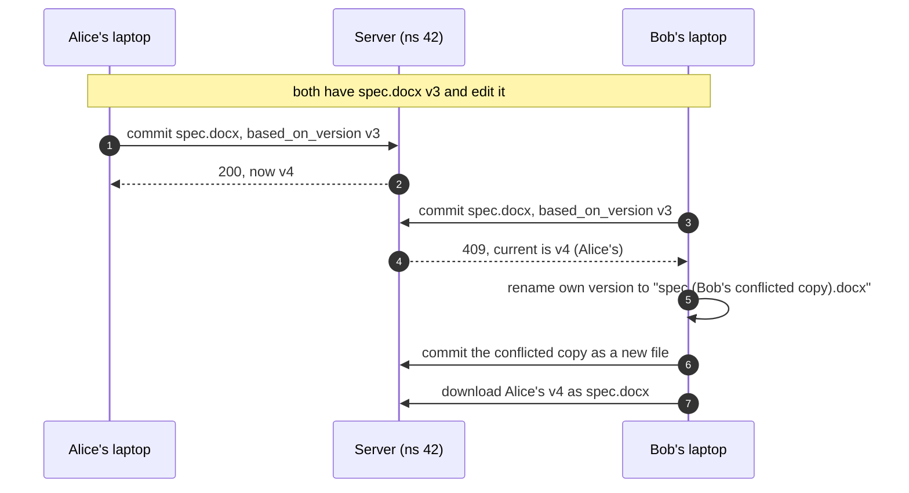

**Resolving it is the hard part.** Each row is a decision about **which user loses what**:

| Both did… | Example | Result | Who loses what |
|---|---|---|---|
| **edit vs edit** | Alice and Bob both edit `spec.docx` from v3 | first save keeps the name; the other becomes a **conflicted copy** beside it | no bytes lost; Bob merges by hand |
| **edit vs delete** | Alice edits `budget.xlsx`, Bob deletes it | **edit wins**: the file comes back with Alice's edit | Bob's delete is undone |
| **delete vs delete** | both delete `old.txt` | nothing to do | nothing |
| **move vs move** | Alice moves `/Q3` → `/Archive`, Bob moves it → `/Old` | the move the server accepted first stands | on Bob's laptop the folder jumps to `/Archive/Q3` |
| **move into a deleted folder** | Alice moves `plan.md` into `/Ideas` while Bob deletes `/Ideas` | `/Ideas` is recreated to hold `plan.md` | Bob's folder delete is partly undone |
| **create vs create, same path** | both create `/notes.txt` offline | both kept; the second becomes `notes (1).txt` | nothing |
| **case / Unicode clash** | `Report.pdf` and `report.pdf` | both kept on the server; renamed only on the device that can't hold both (9.7) | nothing |

> **Principle: never destroy bytes to resolve a conflict.** Edit beats delete, and both sides of an edit/edit survive. Users hate conflicted copies, but they hate lost work far more: a person can clean up a conflicted copy, nobody can bring back a lost edit.

**Why not merge the two edits automatically?** To the server, a `.docx` or `.psd` is just bytes. Mixing bytes from two versions produces a **corrupt file**. Only an app that understands the format (Google Docs, a Markdown editor) can merge safely, so merging is an app feature, not a sync feature.

### 9.7 The production edge cases (not in textbooks)

All five have the same root cause: **devices disagree about names, ids or time**, and a naive client turns that disagreement into a delete or a duplicate.

| Case | What goes wrong | The fix |
|---|---|---|
| **Case collisions** | `Report.pdf` + `report.pdf` can't both exist on a Mac | Mac stores one under a **local alias** and **remembers the mapping** |
| **Unicode forms** | `café` arrives as two different byte strings | **compare normalised** names, **display the original** |
| **Illegal names** | `CON.txt` can't exist on Windows | show a **placeholder with an error**, never delete |
| **Save-by-rename** | one save looks like delete + create | **wait for quiet**, then treat it as **one edit** |
| **Clock skew** | wrong laptop clock picks the wrong winner | **server version order decides**, never the file's modified time |

**1. Case collisions**

**Problem:** Linux allows `Report.pdf` and `report.pdf` in one folder. Default macOS and Windows treat them as the **same** name, so only one can exist on disk. The server keeps both, because it must store faithfully what users created.

**Fix:** the Mac client gives one of them a **local alias** and saves the mapping in its SQLite (§5.5):

```text
Server (from Alice's Linux laptop):  /Docs/Report.pdf   (file_id 90)    /Docs/report.pdf (file_id 91)
Mac disk:                            /Docs/Report.pdf                   /Docs/report (Case Conflict).pdf
Mac's mapping:                       "report (Case Conflict).pdf"  ↔  file_id 91 (server "report.pdf")
```

With the mapping, the next scan sees `report (Case Conflict).pdf`, looks it up, and finds "that's file 91, already synced, nothing to do". If Alice edits it on the Mac, the edit is saved to the server's `report.pdf`.

**Without the mapping**, every cycle repeats itself (this endless loop is called **flapping**):

```text
cycle 1: local "report (Case Conflict).pdf" isn't in Synced → "new file!" → upload it as a 3rd file
cycle 1: server "report.pdf" isn't on disk → download → name clash → rename to "report (Case Conflict 2).pdf"
cycle 2: that one is "new" too → upload → … a new copy every cycle, forever
```

**2. Unicode normalisation**

**Problem:** `café` can be written as two different byte strings that look identical on screen:

```text
composed   (é is one character):        63 61 66 C3 A9      (5 bytes)
decomposed (e + separate accent mark):  63 61 66 65 CC 81   (6 bytes)   ← old Mac HFS+ stored this
```

Alice's old Mac uploads the 6-byte form, and her Windows PC creates the 5-byte form. Compared byte by byte, they're "two different files", so she ends up with two `café` folders.

**Fix:** **normalise to compare, keep the original to display.** Before comparing two names, convert both to one standard form (for example NFC, the composed form). They match, so it's the same file. Store and show the bytes the user actually typed.

**3. Names that can't exist on this device**

**Problem:** `CON.txt`, `notes:v2.txt`, `draft.` (trailing dot) and very long paths are fine on Linux and on the server, but Windows refuses to create them. The file is on the server but **not on this disk**, and that is exactly the 9.3 "missing looks like deleted" trap.

**Fix:** the Windows client shows an **unsynced placeholder with a visible error** ("`notes:v2.txt` can't sync on this PC"), and marks the file in its Synced tree as "exists, can't materialise". It **never** sends a delete for it.

**4. Save-by-rename editors**

**Problem:** many apps (Word, Excel, vim) don't overwrite a file in place. To save safely they do:

```text
1. write ~WRL0003.tmp      (the new content)
2. delete spec.docx
3. rename ~WRL0003.tmp → spec.docx       ← new inode, so "track by id" (9.4) doesn't match it!
```

The watcher reports "delete `spec.docx`" + "create `spec.docx`". A naive client either starts a brand-new file (version history lost) or raises an edit/delete conflict **against its own user**.

**Fix:** **quiescence detection**, meaning wait until the folder has been quiet for a second or two, then look at the result instead of the individual events. The client sees that `spec.docx` disappeared and reappeared **at the same path inside that window**, so it is **one edit** of the same file: `file_id 77`, commit v5 based on v4. The `.tmp` file came and went within the window, so it is never uploaded.

**5. Clock skew**

**Problem:** Alice's laptop clock is 2 hours fast.

```text
real 10:00  Alice saves spec.docx   → server makes v4   (file's modified time says 12:00)
real 11:00  Bob, who already has v4, saves   → server makes v5 based on v4   (modified time says 11:00)
"newest modified time wins" → picks Alice's 12:00 → Bob's newer edit is thrown away ✗
server version order        → v5 is newest → Bob's edit is current, Alice's is v4 in history ✓
```

**Fix:** **the server's version order decides**, never device clocks. If Bob had saved based on v3 (without seeing Alice's v4), he'd get `409` and a conflicted copy (9.6), still decided by versions, not clocks. The file's modified time is only **shown in the UI**.

> *Interview:* "The client diffs Local and Remote each against a Synced merge base, pairs changes by stable file id, treats 'missing' as 'unknown' until the drive identity and a mass-delete breaker say otherwise, and resolves conflicts so no bytes are ever destroyed. Server version order, not device clocks, decides the winner."

---

## 10. Deep dive 5 — Sharing and permissions

> **⚡ 30-second version**
> 1. **Sharing is per shared folder (namespace)**, and each has one member list.
> 2. That makes a permission check **one lookup**, a move of a huge folder **one step**, and every member's "what changed" answer **identical**, so it can be cached.
> 3. **The stale-permission trap:** an admin removes Bob and then adds a secret file. The check must use permission data at least that fresh (a consistency token).
> 4. **Removing access can't erase copies Bob already downloaded.** Be honest about that in the product.
> 5. **Share links work for anyone who holds them.** Log their use, rate-limit them, make them revocable instantly, and cap downloads so links aren't abused as a free CDN.

**The decision with the longest tail:** per-file ACL inheritance vs **namespace = sharing unit.**

| | Per-file ACL + inheritance | **Namespace as unit** (chosen) |
|---|---|---|
| Move 1M-file folder | 1M ACL rewrites or ancestor walk on every read | O(1) |
| Permission check | Walk ancestors | **One lookup** |
| Delta responses | User-specific → **uncacheable** | Identical for all → cacheable |
| "Who can see this?" | Hard | Read one member list |
| Cost | — | Less expressive; narrower subfolder share needs a **nested ns** (restrict nesting — that's a feature) |

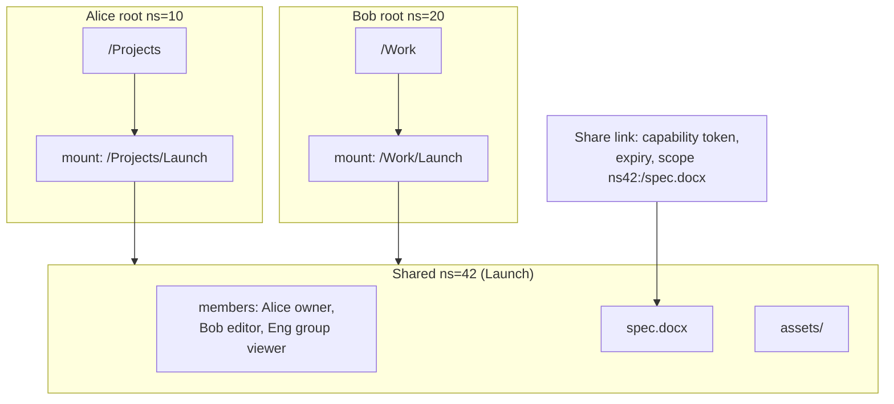

**Architect-level points:**
- **Group membership & the new-enemy problem:** admin removes Bob from Eng, *then* adds a secret file. If the check reads a **stale group** but **fresh content**, Bob sees the secret. Fix: carry a **consistency token** from the ACL write; checks for newer content must be at least that fresh (Zanzibar "zookie" idea).
- **Revocation ≠ recall.** Bytes already on an unmanaged device are gone. Say so in the product. Remote wipe = managed devices only, best-effort.
- **Links are bearer tokens, and they leak** (forums, search engines, email). Log access per token, rate-limit, **instant revocation** (check a revocation set every request — no long-TTL signed URLs). Short-lived block URLs are issued **after** the link check, never instead of it.
- **Abuse turns links into a free CDN.** Day-one controls: per-link/per-account egress caps, hash-match uploads vs known-illegal lists, malware scan **publicly shared** files (not every private file — cost + privacy), takedown **by content hash** across all links. Dedup helps: one hash disables every copy.

### File security basics (beginner version)

| Layer | What it protects | How |
|---|---|---|
| **Encryption in transit** | Data on the network (café Wi-Fi snoopers) | HTTPS / TLS everywhere |
| **Encryption at rest** | Stolen disks, raw stored bytes | Block store / S3 encrypts each object. Keys live in a KMS, **never on the client** |
| **Access control** | Who may get a link at all | Namespace member list (above) checked on **every** request |
| **Short-lived signed URLs** | Leaked links | Link expires in ~5 min and can't be edited |

**Encryption at rest doesn't stop someone with read permission.** The store decrypts automatically for anyone allowed to read. That's why access control still matters.

**How a signed URL works** (S3 or CloudFront):
1. **Generate:** the server checks the ACL, then signs `path + expiry` (+ optional IP) with its **private key**.
2. **Distribute:** the client gets `https://cdn…/h9?expires=…&signature=…`
3. **Validate:** the CDN checks the signature with the **public key**. Edited path or expiry → signature fails. Expired → denied.

**Limitation:** a signed URL is a **bearer token**, like a movie ticket: whoever holds it can use it until it expires. Short expiry limits the damage. For stricter cases, bind it to an IP or require a login cookie as well.

**"Does hashing on the client leak a secret?" No.** SHA-256 and Rabin have **no key**: they're public algorithms, and anyone gets the same output. The real risks come from **trusting** client hashes, and the design already handles them:

| Risk | Fix (where) |
|---|---|
| Client claims hash `h5` but uploads other bytes | Server **re-hashes** received bytes and rejects mismatches (§7 upload flow) |
| Knowing a hash used to claim someone's file (Dropbox "Dropship", 2011) | Skip uploads only for chunks in **your own** namespaces (§7 dedup leaks) |
| "Already have it" confirms a guessed file exists | Cross-user dedup only **after** upload, silently (§7) |
| Chunk sizes hint at content (CDC boundaries) | Minor. Keyed rolling hash (per-user secret seed) for high-security tenants |

> **Rule:** client hashes are **hints to save bandwidth, never proof**. Access comes from the ACL, never from knowing a hash.

---

## 11. Deep dive 6 — Storage cost, erasure coding, GC

> **⚡ 30-second version**
> 1. **Erasure coding RS(10,4)** cuts data into 10 pieces plus 4 math pieces. It uses **1.4× the disk and survives 4 lost disks**, compared with 3 copies, which use 3× and survive 2.
> 2. **The price is repair:** rebuilding 1 piece reads 10, about 30 Gbps nonstop. LRC cuts that to about 6 reads.
> 3. **Data's life:** new chunks go into an **open volume with 3 copies**. When it's full it is **sealed and erasure-coded**. Rarely read data moves to a **cold tier**, which is still online.
> 4. **Finding a chunk takes 3 lookups:** file → chunk hashes → volume + offset → disks. Repairs change only the last one.
> 5. **Deleting doesn't free disk** until **compaction** rewrites the volume with only the live chunks.
> 6. **GC safety:** reference counts are only a hint. A full scan decides, a deleted chunk waits days as a tombstone before it's really removed, and a checker keeps verifying files are readable.

### Redundancy schemes

| Scheme | Raw/logical | Survives | Repair reads per lost piece | Note |
|--------|-------------|----------|-----------------------------|------|
| 3x replication | 3.0x | 2 losses | 1x | Fast; indefensible for cold data |
| RS(6,3) | 1.5x | 3 | 6x | Middle ground |
| RS(10,4) | 1.4x | 4 | 10x | Cheap, heavy repair |
| **LRC (12+2 local+2 global)** | ~1.33x | any 3, most 4 | **6x** single loss | Azure 2012 paper |
| Geo-EC across 3 regions | ~1.5–1.8x | a region | cross-region | Beats "2 regions × EC" (~2.8x) |

**Repair bandwidth (the forgotten bill):** ~340 TB/day ≈ **30 Gbps** of nonstop repair reads (the math is in §3 #3). **LRC** (Local Reconstruction Codes) adds small local groups, so most single-disk repairs read ~6 pieces instead of 10: about 40% less repair traffic, *and* less capacity.

### Erasure coding explained from zero (beginner version)

**The problem.** Disks die every day. If a file sits on only one disk and that disk dies, the file is gone. The simple fix is to keep **3 full copies** on 3 different disks. That works, but you pay for **3× the disk**. Erasure coding gives the same or better safety for about **1.4× the disk**.

**Step 1: the simplest trick, one extra piece.** Say your data is two numbers: `A = 3` and `B = 5`. Store a third number that is their sum: `P = A + B = 8`. Put A, B and P on three different disks.
- If the disk with B dies, you still have A and P, so B = P − A = 8 − 3 = **5**. Recovered.
- If the disk with A dies, A = P − B = **3**. Recovered.
- If P dies, just add A + B again.

You stored 3 pieces for 2 pieces of data, so the cost is **1.5×**, and you survive **any 1** lost disk. (Real systems use XOR on bytes instead of +, but the idea is the same.)

**Step 2: two extra pieces, so you survive two losses.** Data: `A = 3, B = 5, C = 2`. Make two different "recipes" that each mix all the data:
- `P1 = A + B + C = 10`
- `P2 = A + 2B + 3C = 19`

Now suppose **B and C both die**. You still have A = 3, P1 = 10 and P2 = 19:
- from P1: B + C = 10 − 3 = 7;
- from P2: 2B + 3C = 19 − 3 = 16;
- solve the two equations: **B = 5, C = 2**. Recovered.

Each extra recipe is one more equation, and **one more equation lets you solve one more missing number**. That's the whole idea behind **Reed–Solomon (RS)** codes. Real RS uses special byte math (a "Galois field") so the numbers never overflow, but it works like the equations above.

**Step 3: RS(10,4), the real thing.** RS(10,4) means **10 data pieces + 4 repair (parity) pieces = 14 pieces**.
- Take 1 GB of data and cut it into **10 pieces of 100 MB**.
- Compute **4 parity pieces of 100 MB** using 4 different recipes.
- Store all 14 on **14 different disks**, ideally in different racks.
- Total disk used: 14 × 100 MB = **1.4 GB**, so the cost is **1.4×**.
- **Any 10 of the 14** pieces rebuild the data, so you can lose **any 4 disks** and still recover.

**Compare it with 3 copies:**

| | 3 full copies | RS(10,4) |
|---|---|---|
| Disk for 1 GB | 3 GB | **1.4 GB** |
| Disks you can lose | 2 | **4** |
| Normal read | read 1 copy | read the 10 data pieces directly (no math needed while healthy) |
| Repair after 1 dead disk | copy 1 piece from another copy | **read 10 pieces** and compute the missing one (heavy: ~30 Gbps fleet-wide, §3 #3) |
| Small writes | easy: write 3 copies | expensive: parity must be recomputed, so fresh data stays as 3 copies until its volume is sealed (tiering, below) |

### Erasure coding on a real file, and where the piece locations are stored

**1. The math on real bytes (not single numbers).** A piece is just a long row of bytes. The recipe from the A/B/C example is applied **position by position**: byte 1 of the parity piece is made from byte 1 of every data piece, byte 2 from byte 2, and so on.

```
Piece A:   3   7   1   4  ...   (100 MB = 100 million bytes)
Piece B:   5   2   6   0  ...
-------------------------------
P = A+B:   8   9   7   4  ...   (computed at every position)

B is lost → B = P − A at every position:  5  2  6  0 ...  ✔
```

So a 100 MB piece is just **100 million tiny copies of the same small calculation**. Real systems use XOR / Galois-field math instead of `+`, so every result still fits in one byte (0–255). CPUs do this at several GB per second.

**2. We erasure-code volumes, not individual files.** Files are first cut into **4 MB chunks** (§6). The block store packs many chunks from many users into a big container called a **volume** (say 1 GB). A volume is erasure-coded only **after it is full and sealed**.

Example: you upload a **100 MB video**.
- It's cut into **25 chunks** of 4 MB (`h1 … h25`).
- The chunks are appended into **open volumes**, which are kept as 3 full copies while they're still filling up.
- When volume `V9123` (1 GB) is full, it's sealed. Then it's cut into **10 data pieces of 100 MB** (piece 0 = bytes 0–100 MB of the volume, piece 1 = 100–200 MB, …), **4 parity pieces** are computed, and the 14 pieces are written to **14 disks in different racks**. Then the 3 copies are deleted.

**Don't mix up the two cuts.** There are two different cuts, done at two different times, for two different reasons:

| | Cut 1: chunking | Cut 2: erasure coding |
|---|---|---|
| What is cut | **your file** | **the 1 GB volume** (a box holding ~250 chunks from many users) |
| Into what | 4 MB chunks (100 MB video → 25 chunks; a 10 MB file → 3 chunks: 4 + 4 + 2 MB) | 10 equal pieces of 100 MB, plus 4 parity pieces |
| When | on your laptop, before upload | later on the server, when the volume is full |
| Why | dedup, and sync only what changed | survive dead disks cheaply |

Erasure coding doesn't know or care where one file ends and the next begins. It just slices the 1 GB volume at 100 MB, 200 MB, 300 MB, and so on:

```
Volume V9123 (1 GB) — chunks from many users, packed one after another
0 MB      16 MB                         116 MB                    1000 MB
|--others--|=== your h1 … h25 (100 MB) ===|--- Bob's, Carol's, … ---|
|------ piece 0 (0–100 MB) ------|---- piece 1 (100–200 MB) ----| … piece 9
            h1 … h21 land here      h22 … h25 land here
```

So your video's chunks happen to sit in **piece 0 and piece 1**. Table ② records each chunk's offset inside the volume (`h1 → V9123 @ 16 MB`, `h7 → @ 40 MB`, … `h25 → @ 112 MB`). From the offset, the system knows which piece, and so which disk, to read.

**Q: So erasure coding works on a volume full of chunks from different users, and we recover the volume?**
Yes, it works at volume level and doesn't care whose chunks are inside. But we **never rebuild the whole volume**, only the missing piece or slice (steps 4 and 5 below). Two side effects of mixing users in one volume:
- **Deleting a file doesn't free disk right away.** Its chunks are holes inside a shared volume until **compaction** (see "Deletion = compaction" below).
- Chunks are mixed only with data that has the **same rules**: same residency zone (EU data only in EU volumes), same storage tier, and ideally similar lifetimes.

**Q: If I edit a file whose chunk sits in a sealed volume, is the erasure coding recalculated?**
No. Chunks are never changed after being written. The edit makes a **new** chunk (`h3` → `h9`), which is appended to an **open** volume (3 plain copies, no parity yet); the file's new version points to `h9`. The sealed volume holding `h3` is **untouched**, and its parity stays as it was. Parity is computed **once per volume**, when an open volume fills up and is sealed. It is redone only by **compaction**, when a sealed volume is mostly dead chunks and its live chunks are copied into a fresh volume.

**3. Where the locations are written: three lookup tables.** No single table knows everything. Each layer knows only the next step:

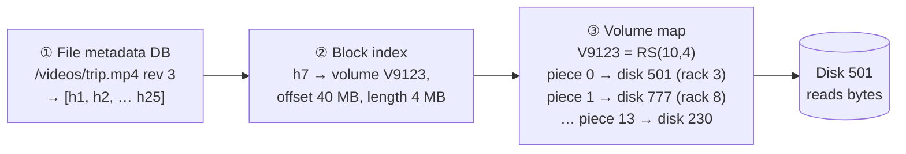

| Table | What it stores | Size | Changes when |
|---|---|---|---|
| ① **File metadata** (the sharded DB from §3) | file path, version, **list of chunk hashes** | ~200 TB | the user edits, moves or deletes a file |
| ② **Block index** (the dedup index) | `chunk hash → volume id + offset + length` | ~22 TB | a new chunk is stored, or compaction moves it |
| ③ **Volume map** (placement) | `volume id → EC scheme + which disk holds each of the 14 pieces` | small (one row per 1 GB volume) | a disk dies and repair moves a piece |

**4. Reading chunk h7 (offset 40 MB in V9123):**
- **Healthy case:** the volume map says offset 40 MB falls inside data piece 0 (bytes 0–100 MB), which is on disk 501. We read 4 MB straight from disk 501. **No math is needed.**
- **Disk 501 is dead (degraded read):** we read the **same 4 MB range** (bytes 40–44 MB) from any 10 of the other 13 pieces and compute the missing 4 MB. We don't need whole 100 MB pieces, only the matching slice.

**5. When a disk dies (repair):** the repair job asks the volume map, "which volumes had a piece on disk 501?" For each one, it rebuilds that piece from 10 others, writes it to a new healthy disk, and **updates only table ③** (`piece 0 → disk 912`).

Tables ① and ② **never change**: the file still points to h7, and h7 is still at "V9123, offset 40 MB". That's the point of the layers. Thousands of repairs a day touch only the small volume map, never the huge file and chunk tables.

**Analogy:** a library catalogue says *which book* (①). The book index says *which shelf box* (②). The warehouse map says *which room each box is in* (③). If a room floods and a box is moved, only the warehouse map changes; the catalogue stays the same.

### Where bytes live (tiering)

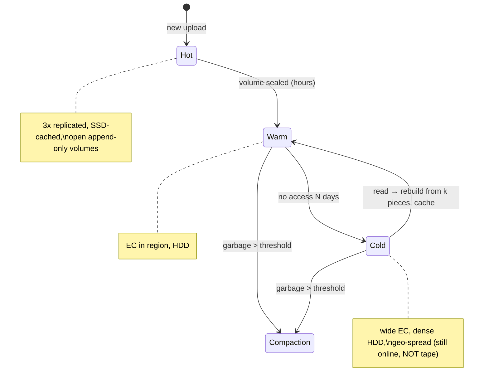

- New writes → **replicated open volumes** (EC on tiny appends is expensive; new data is read most).
- Sealed → EC'd async → drop replicas.
- Most bytes are rarely read after a few weeks → **cold tier sets fleet cost.** But a 5-year-old photo must open in seconds → cold = wider codes, denser disks, not tape.

### Deletion = compaction (it costs I/O)

Delete file → refs drop → bytes stay until the volume is **rewritten** with only live chunks.

**Write amplification = live / garbage.**
- 50% garbage → write 1 byte per byte reclaimed.
- 20% garbage → write **4** bytes per byte reclaimed.

Policy: **warm at 20–30% garbage, cold only at 50–60%** (cold rewrite = full re-encode + wide stripe write + cross-region traffic with geo-EC).
**Trick:** group chunks with similar lifetimes (same upload week, same retention class) into the same volume → **volumes die together** instead of fragmenting. Every retained version is live data compaction must carry.

### GC: the only component that destroys data by being "mostly right"

**What GC (garbage collection) does:** it finds chunks that **no file version uses any more** and frees their disk space.

**Why it's the most dangerous part:** everything else in the system only **adds** data. GC is the only part that **really deletes bytes**. If it's wrong for 1 chunk in a billion, some user's file is silently empty. There's no error at that moment; it shows up months later as "my old file won't open."

**Analogy:** a library throwing out books. It doesn't shred a book just because the borrowing counter says 0. It checks every shelf list, then puts the book in a locked "to be destroyed" room for a week, and shreds it only if nobody asks for it.

**1. Two ways to know a chunk is unused: a fast hint and a slow truth.**
- **Refcount (the hint):** each chunk has a counter, "how many file versions use me". A new version using it adds +1; an expired version subtracts −1.
- **Mark phase (the truth):** walk **every** list of chunk hashes that still matters (all journals, **retained versions, trash, legal holds**; ~200 TB, scanned incrementally) and mark every hash found. Anything not marked is truly unused.

**2. Why the counter alone is not trusted.** A counter bug costs very different amounts depending on its direction:

| Counter bug | Result | Cost |
|---|---|---|
| A −1 is lost | counter says 1, chunk is really dead | wasted disk (**just money**) |
| A +1 is lost | counter says 0, chunk is **still used** | GC deletes live data (**data loss**) |

Example of a lost +1: a save is retried; the block index dedups the chunk and counts it once, but the metadata ends up with two versions using it. Later one version expires (−1 → 0) while the other still needs the chunk. So the **counter only nominates candidates, and the mark phase must confirm**.

**3. Never delete straight away: a chunk passes through stages.** At any stage, if a reference to it turns up, it goes back to Live.

| Stage | Plain meaning |
|---|---|
| **Pending** | uploaded, but no committed file uses it yet |
| **Orphan** | uploaded, but the commit never came (the laptop gave up) |
| **Live** | at least one file version uses it |
| **Candidate** | counter hit 0, so **wait a grace period** in case a new upload reuses it |
| **Verified** | the mark phase confirms that nothing uses it |
| **Tombstoned** | hidden ("logically deleted"), but **bytes kept for days** (quarantine) |
| **Reclaimed** | compaction rewrites the volume, and the bytes are finally gone |

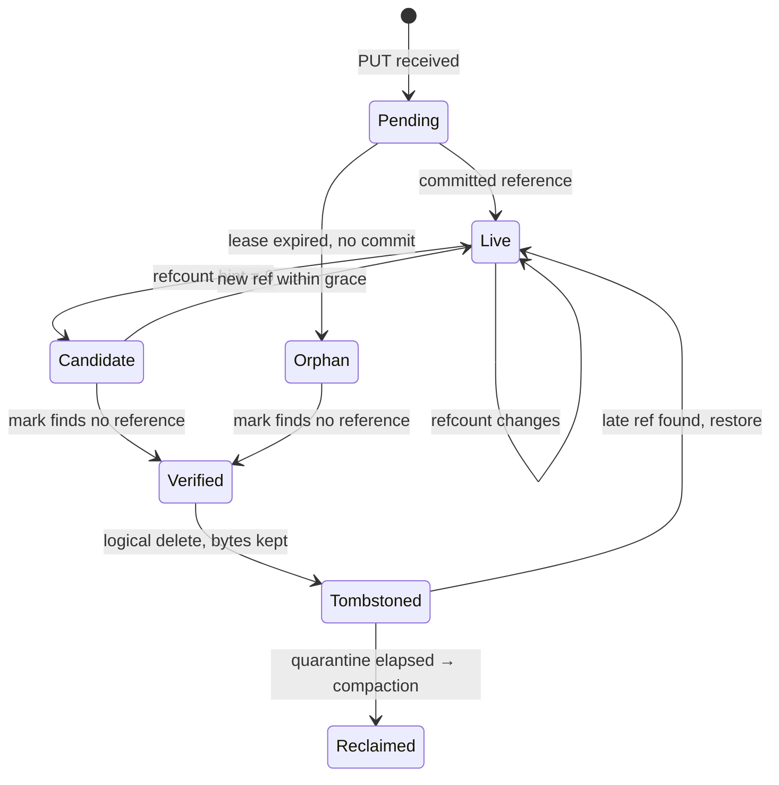

**4. The race with new uploads.** A save can start using a chunk while GC's scan is running. Every save **touches** the chunks it uses, and GC deletes only chunks whose last touch is **older than its scan start minus a safety margin** (worked example in §7, "The GC race").

**5. Catch GC's own bugs before users do.**
- **Reverse verifier** (runs forever): pick random real files and check that every chunk they point to can still be read.
- **Dark launch:** a new GC version first runs for weeks in "log what I would delete" mode, and the log is compared against the verifier.
- **Stricter review** for GC code changes than for anything else.

> *Interview:* "GC is the only path that destroys bytes, so refcounts only nominate candidates; an independent mark over every journal, retained version, trash and legal hold confirms them; a time contract with commits protects fresh dedup hits; and tombstone, quarantine, a reverse verifier and dark launches catch GC's own bugs before a customer does."

---

## 12. Deep dive 7 — Multi-region, residency, failover

> **⚡ 30-second version**
> 1. **Each shared folder has a home region**, with one leader writing its log. That keeps conflicts simple.
> 2. **A commit is accepted only after its bytes are safe in the home region.**
> 3. **EU-only data** never touches disk outside the EU, not even briefly, and not even its hash in a dedup index or logs.
> 4. **Failover:** the new leader gets a higher **epoch** number. Devices still on the old epoch resync, and their lost edits come back as normal changes, or as conflict copies.
> 5. **Build a tool before the first failover** that lists exactly which commits were lost.

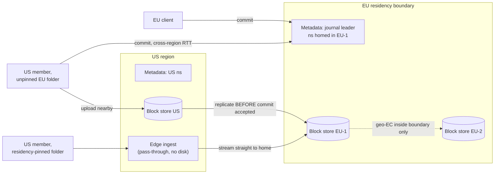

- **Each namespace has a home region** with its single journal leader → trivial conflict model. 100–150 ms cross-region RTT is invisible against a 5 s SLO.
- **Rule from §4 again:** commit must not reference blocks not durable **in the home region**. Else: EU metadata → bytes only in US → lose US → files with no content.
  - Normal folders: upload nearby, **commit waits for cross-region replication.**
  - **Residency-pinned folders:** "transiently stored in US" is **not acceptable to lawyers**. Edge terminates TLS and **streams through without persisting**; block service **hard-rejects** PUTs from non-approved regions.
- Residency leaks everywhere: geo-EC stripes, compaction targets, **dedup index shard that learns the hash**, crash dumps, debug logs. Dedup key becomes `(residency_zone, hash)` → cross-zone duplicates stored twice **by design**.
- **Small zones are expensive:** one country, two buildings = not enough failure domains for wide codes → 2–3x overhead vs fleet's 1.4x. **Put it in the enterprise price.**

### Failover with epochs (no silent divergence)

Data-loss window = journal replication lag. A client committed r41 on EU-1, then EU-1 died before replicating.

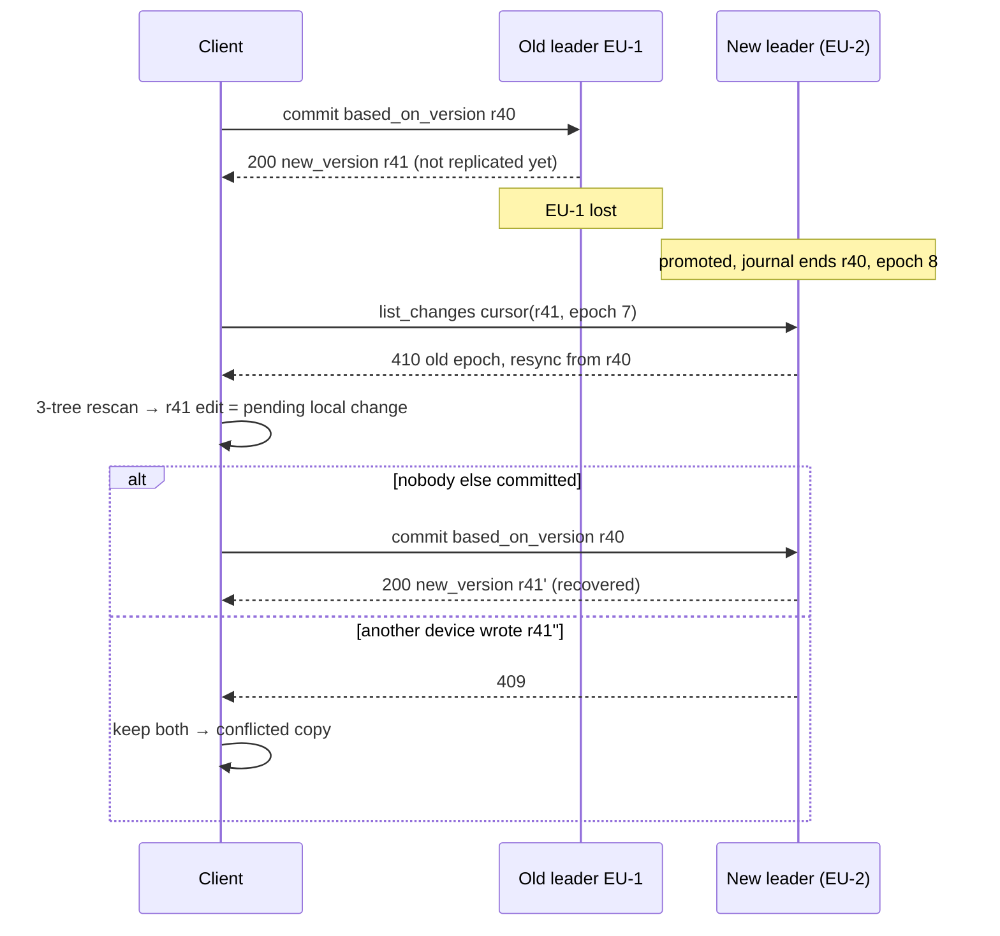

- **Without epoch:** client asks "after r41", gets nothing (or a *different* r41'' with the same number) and silently keeps a tree the server never saw.
- **Conflict machinery doubles as disaster recovery.** That's why it must be robust.
- **Not recovered:** commits from devices that never come back. Cross-check: if geo-EC kept blocks outside EU-1, scan for **blocks with recent `last_pinned` but no reference in the new journal** = exact list of lost commits. Build this tool **before** the first failover.

---

## 13. Failure modes (cheat list)

| Failure | Defence |
|---------|---------|
| Mass delete from unplugged drive / bad client | Volume identity, circuit breaker, soft delete, namespace point-in-time restore |
| **Bad client build on 100M devices** | Can't roll back instantly. Staged % rollout, **server-side kill switches** for planner behaviours, server rejects commit patterns from bad versions |
| **Rescan storms** | 1% of 300M devices × 20k entries in an hour = **17M rows/s** vs tier sized for 170k. Admission-control cursor-zero requests (token bucket per shard + `retry-after`); migrate sync DB in place, never discard |
| GC bug/race | Time contract, mark phase, tombstone quarantine, reverse verifier |
| Hot namespace | Coalesce, delta cache, read replicas |
| Correlated drive failure (bad firmware batch, power domain) | Spread fragments across failure domains **and drive models/batches**; repair by remaining redundancy |
| **Notification fleet down** | Clients poll. 300M every 60 s = **5M req/s (30x peak)** arriving when you're already sick. **Server dictates + jitters** poll interval (raise to 10+ min). Never a client constant |
| **Poison file** (crashes chunker) | Quarantine after N failures + report; never retry forever |
| **Hydration stalls** (on-demand files) | Finder thumbnails 2,000 placeholders → 2,000 fetches → frozen desktop. Per-hydration timeout (fail with I/O error), cap concurrency, **refuse to hydrate for indexers/thumbnailers/antivirus**. Block-fetch p99 SLO > sync latency SLO |

---

## 14. Build order

| Phase | Build | Defer (why) |
|-------|-------|-------------|
| **v1** | Fixed 4 MB blocks, per-user dedup, cloud object store, sharded SQL metadata, per-ns journal, 3-tree client, conflicted copies, **soft delete + restore** | CDC, cross-user dedup — small savings until big, risk isn't small |
| **v2** | Shared-folder namespaces, links + revocation, notification fleet, delta cache, mass-delete telemetry | Per-file ACLs — probably never |
| **v3** | CDC for big-file deltas, server-side cross-user dedup, open/sealed volumes, compaction | Owned hardware until bill > storage team + capex (~tens–low hundreds of PB) |
| **v4** | Owned storage + EC, LRC, cold tier, geo-EC, residency pinning, customer keys | Convergent encryption — keeps dedup, brings back the oracle |

> **Ordering rule: everything touching deletion ships before everything touching cost.** Cost can be fixed later; lost data can't.

### The riskiest project: cloud → owned hardware

0.9 EB at a sustained 1 Tbps = **~83 days** minimum; really multi-quarter. Blocks live in **two places** while GC keeps running.

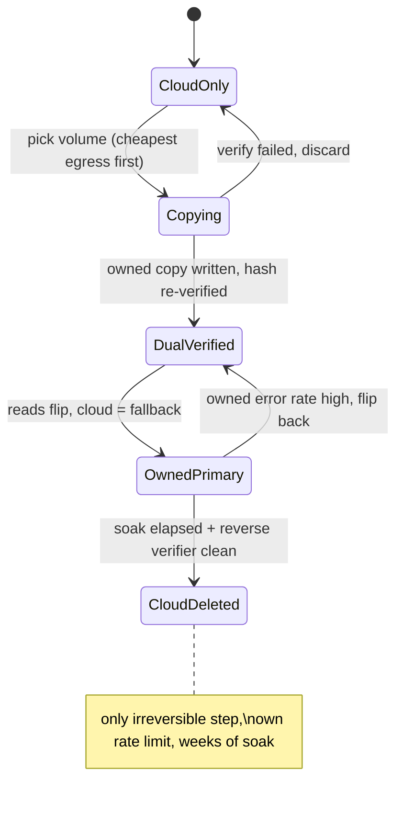

Three rules:
1. **Delete cloud copy last and slowly** (own rate limit + soak, independent of copy progress).
2. **Freeze compaction on volumes in Copying** (else you verify a volume whose live set changed).
3. **Price egress up front** — it belongs in the "buy hardware" business case, and it sets the order (cheapest out first; let retention expiry shrink the rest).

---

## 15. Design-review questions (what a staff interviewer asks)

Each question ends with the section that answers it.

1. Biggest namespace by **file count** — fits one shard with headroom? If "we'll split it", how does ordering survive? *(§3)*
2. Show me the **inequality: GC margin > touch granularity + commit deadline.** Where's it enforced in code? What alarm fires on a slow commit? *(§7)*
3. Sync root disappears / goes read-only / changes UUID — what happens? (Both "syncs the deletion" and "silently stops" are wrong.) *(§9)*
4. Mass-delete threshold in **count and fraction** — tuned on what data? (Fixed count is wrong for both 50 and 5M files.) *(§9)*
5. Which responses are **cacheable across namespace members**? Anything per-user kills the hot-ns defence. *(§8, §10)*
6. Server-dictated poll interval under load — tested 300M devices falling back at once? *(§13)*
7. After failover, how do you **list commits acked but lost**? "Ask customers" = epoch + block scan missing. *(§12)*
8. For a pinned namespace, list **every system that sees a byte or a hash** (edge buffers, dedup shard, crash dumps, logs, backups, malware scanner). *(§12)*
9. Cost per paid user at p50 and p99 **of file count**, not bytes? *(§3)*

---

## 16. Trade-offs in one table

| Choice | Gives | Costs | Verdict |
|--------|-------|-------|---------|
| 4 MB chunks + fine client deltas | Small index, good transfer deltas | Slightly less dedup | Yes |
| Dedup scoped to caller's namespaces | No existence oracle | Pay ingress for cross-user dups | Yes |
| Namespace = sharing unit | O(1) checks, cacheable deltas, cheap moves | Less expressive ACLs | Yes |
| Erasure coding | 50%+ capacity saved | Repair bandwidth, reconstruct latency | Yes (replicate only hot/open) |
| Keep-both conflicts | Zero lost edits | User annoyance | Yes |
| Slow, verified, quarantined GC | Safety | Slower reclaim | Yes, always cheaper than one loss incident |

---

## 17. FAANG / staff-level insights

1. **Name the seam.** "Bytes and metadata only meet at two points: the commit durability check and the GC walk." Saying this sets you apart from "chunk + hash + DB" answers.
2. **Chunk size is a cost decision, not a dedup decision.** Quote the 22 TB vs 1.4 PB index.
3. **Asymmetric failure → asymmetric design.** Lost decrement = money; lost increment = data. So refcount is a hint, mark phase is the authority.
4. **Invariants belong in code.** `margin > g + commit_deadline` as an assertion; someone *will* optimise it away later.
5. **Global dedup is a security bug**, and encryption scope = dedup scope = pricing. Connects security to gross margin — very staff-level.
6. **The client is a distributed system you can't roll back.** Kill switches, staged rollout, server-side rejection of bad versions.
7. **Missing ≠ deleted.** Volume identity + circuit breaker + point-in-time restore. Build the restore tool first.
8. **Unit choice for sharing decides cacheability.** Namespace ACL → identical deltas → the 80k-member folder survives.
9. **Order steps so the bad window is safe.** Add-before-remove in moves; replicate-before-commit across regions; delete-cloud-last in migration.
10. **Conflict handling doubles as disaster recovery** (with epochs in cursors).
11. **Server controls every client timer** (poll interval, retry-after). A client constant becomes a DDoS during an outage.
12. **Residency is a hash problem too.** The dedup index learning a hash can itself break residency.
13. **Shard by bytes, then check skew.** Cap namespace file count early — it's a product rule protecting an architectural invariant.
14. **Deletion before cost** in the roadmap.

> **Closing line for the interview:** "A sync service is an immutable, content-addressed block store plus a per-namespace ordered journal, joined by one rule — metadata never references bytes that aren't provably durable — and every path that can delete is slower, more verified and more reversible than every path that can create."
