# Leaderboard (200M players) — Easy Master Guide

> **What we build:** the ranking system for a huge online game. Every finished match sends a score. The leaderboard answers three questions: **Who is at the top? Where am I? Who is around me?** It answers them for several **scopes** (global, country, friends) and several **windows** (all-time, season, weekly, daily). Scale: **200M registered players, 50M daily actives, 10M online at peak, ~170k score events/s at tournament end.**

> **The one-line thesis:** a leaderboard at scale is a **derived view over a durable score ledger**. It has an **exact top tier** (sorted set, ~100k players), where humans compare numbers, and **quantile histograms** (bounded error) for everyone else. Three rules hold it together: **write absolute values, never increments**, **freeze before you pay**, and **spend anti-cheat effort on the top ranks, where the money is.**

**Study path (~30 min):** [Glossary](#glossary-read-once) → [§1 Clarify](#1-clarify-the-problem) → [§3 Numbers](#3-capacity--the-numbers-that-decide-everything) → [§5 HLD](#5-high-level-design) → [§5.5 Tables, DBs, caches](#55-data-model--tables-database-choices-and-caches) → [§6 Write path](#6-deep-dive-1--the-write-path-idempotency-and-coalescing) → [§7 Tiering](#7-deep-dive-2--exact-rank-does-not-shard-tier-it-instead) → [§8 Ties + 2^53](#8-deep-dive-3--tie-breaking-and-the-53-bit-trap) → [§9 Windows](#9-deep-dive-4--time-windowed-boards) → [§12 Anti-cheat](#12-deep-dive-7--anti-cheat-and-integrity) → [§13 Multi-region](#13-deep-dive-8--multi-region) → [§18 FAANG insights](#18-faang--staff-level-insights)

### ⚡ How to read this guide (low-attention mode)

- **Only 10 minutes?** Read the two pictures below (the architecture, then the score flow), then just the **⚡ 30-second version** boxes at the top of each long section.
- **Want depth?** Keep reading under the box.
- **Stuck on a part?** Look for the **"beginner version"** subsections. They explain slowly, with small numeric examples.

### ⚡ Architecture at a glance (HLD)

Every box, store and cache in the design, with the technology we'd use. **Left half = WRITE path** (scores in), **right half = READ path** (screens out), **bottom = background jobs**. Numbers are peak (tournament end).

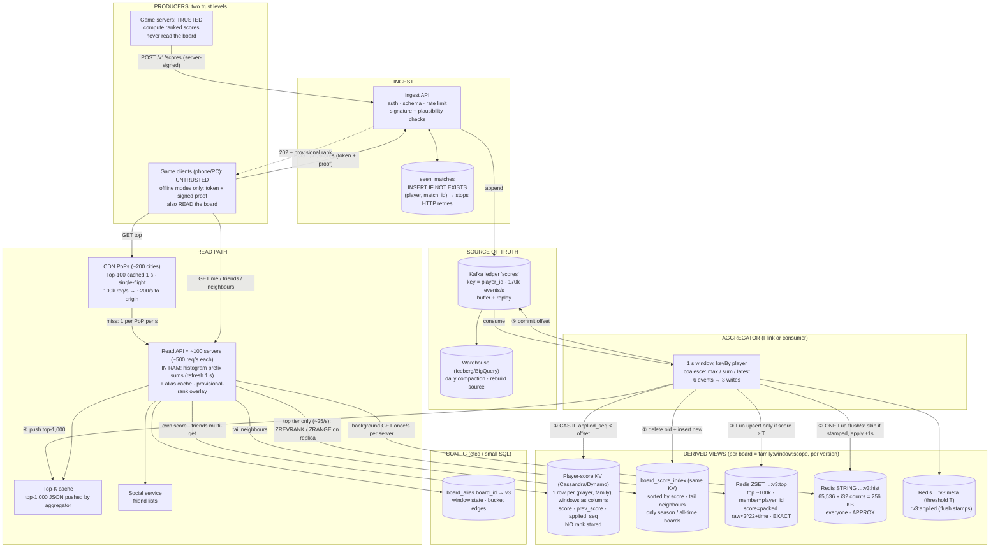

**How each read is answered** (the decision every "my rank" request makes):

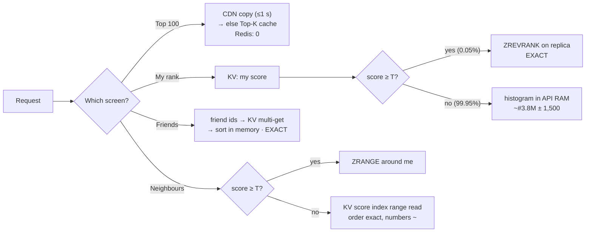

**Background jobs** (off the hot path):

| Job | Does | When |
|---|---|---|
| Window finalizer | watermark freeze → snapshot to **S3** → audit top-N → **pay from snapshot** → `UNLINK` keys | each window end |
| Anti-cheat streams | velocity / device / graph checks → **shadow quarantine** → re-rank | continuous |
| Rebuild job | warehouse → board **v4** → dual-write from offset X → verify → **flip alias** | after bugs / rule changes |
| Reconciler | recount histogram from KV snapshot, alert on diff | nightly (season / all-time), at freeze (weekly) |
| Bucket boundaries | recompute quantile edges (weekly boards reuse last week's) | daily, off-peak |
| Global merger | merge regional top-K + **add** regional histograms | every 1–2 s (multi-region) |

**Revision cheat strip:**

| Remember | Why |
|---|---|
| Rank is **never stored**, always computed | one score change would shift millions of ranks |
| Writes are **absolute** (`ZADD`, KV CAS), never `ZINCRBY` | Kafka/Flink replays must be harmless |
| Two dedupe layers: `match_id` at ingest + `applied_seq` in KV | HTTP retry gets a new offset; Kafka replay reuses the old one |
| Only scores **≥ T** touch the zset | write hot key disappears |
| Histogram = score range → **count** | approximate rank for 200M in 256 KB |
| Histogram copy in **every API server's RAM**, refreshed 1 s | 50k req/s → 100 Redis reads/s |
| Top-100 via **CDN + single-flight + pushed cache** | 100k req/s → ~0 zset reads |
| Friends = **compute on read** | storing them = 2M writes when a streamer scores |
| Each window = **new board**; freeze on **watermark**; pay from **snapshot** | late events, burst backlog, disputes |
| Everything derives from the **ledger** | any board can be rebuilt (`v3 → v4`) |

**Why two separate producers at the top.** Both send the same score event `(player_id, family, value, event_time, match_id, proof)`, but we trust them very differently. A **game server** is ours: in ranked online matches it computes the score, so the player's device never reports a number. A **game client** runs on the player's phone or PC and can be modified, so its scores (offline and single-player modes only) must carry a session token and a signed result and get the plausibility checks (§12). Only clients read the board; the read path on the right is theirs.

Why each technology was chosen: §5.5 (database choices and caches).

### ⚡ The score flow in one picture

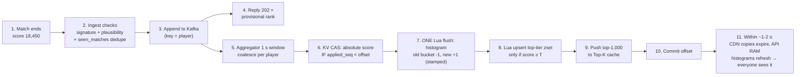

---

## Glossary (read once)

**One picture for the whole guide:** think of a **marathon**. Every runner's finishing time is written in a **logbook** at the finish line (the **ledger**). The big screen shows the **top 100 by name and exact place** (the **top tier**). For everyone else the organisers just count "how many runners finished in each minute" (the **histogram**), so they can tell you "you were about #38,400, top 19%". Prizes are paid only from the **official results sheet**, printed after the course closes and checked by judges (the **frozen snapshot**), never from the live screen.

| Term | Plain meaning |
|------|---------------|
| **Board** | One ranked list, e.g. `ranked_s14:weekly:2026-W39` (family + window + scope) |
| **Board family** | All boards fed by one game mode, e.g. `ranked_s14` (its daily, weekly, season, all-time boards) |
| **Scope** | Who is on the board: global, country, friends, guild, tournament |
| **Window** | Time range of the board: daily, weekly, season, all-time |
| **Sorted set (zset)** | Redis structure: members ordered by a numeric score. Rank lookup in O(log N) |
| **Skiplist** | The linked-list-with-express-lanes structure inside a sorted set |
| **Span** | On each skiplist pointer, "how many members this link skips". Summing spans gives rank |
| **Top-K** | The first K players (e.g. top 100) |
| **Rank** | Position on the board (1 = best) |
| **Percentile** | "You beat 81% of players" |
| **Ordinal / competition / dense rank** | Ties: 1,2,3,4 / 1,2,2,4 / 1,2,2,3 |
| **Score function** | How a player's board score is computed: **max** (best ever), **sum** (cumulative), **latest** |
| **Ledger** | Append-only log of every score event (Kafka + warehouse). The only source of truth |
| **Aggregator** | Worker that reads the ledger and updates the boards |
| **Coalescing** | Merging a player's many events in one batch into one board write |
| **Idempotent** | Applying the same thing twice gives the same result as once |
| **At-least-once delivery** | Messages are never lost but may arrive twice (Kafka after a crash) |
| **CAS (compare-and-swap)** | "Write only if the current value is still what I read" |
| **Top tier** | The exact sorted set holding only players above threshold **T** (~100k members) |
| **Threshold T** | Lowest score currently in the top tier |
| **Hysteresis** | A gap between "admit" and "evict" rules so players near T don't churn in and out |
| **Histogram** | Count of players per score bucket |
| **Prefix sum** | Running total of bucket counts from the top: "how many players score above bucket b" |
| **Quantile-balanced buckets** | Bucket edges chosen so each bucket holds about the same number of players |
| **Point mass** | Many players on exactly one score (e.g. 18M at the starting rating 1,000) |
| **`rank_error`** | The published "± this many places" on an approximate rank |
| **Sketch (KLL, t-digest)** | Tiny mergeable summary for percentiles. Error is ε·N, too coarse for a displayed rank |
| **Packed score** | Score and tie-breaker squeezed into one number: `raw × 2^22 + time bits` |
| **2^53** | Largest range where a double (the zset score type) stores every integer exactly |
| **Grace period** | Time after a window ends during which late events (played inside it) are still accepted |
| **Watermark** | "This partition has processed all events up to event time X" |
| **Freeze / snapshot** | Stop changing the window, write the final standing to object storage |
| **Shadow quarantine** | A flagged player sees themselves ranked; nobody else sees them |
| **Board alias** | Indirection `board_id → version` so a rebuilt board is swapped in by a config change |
| **Hot key** | One key that gets far more traffic than any other; it lives on one shard and one thread |
| **Big key** | One key that is huge (multi-GB). It cannot be split across shards |
| **UNLINK vs DEL** | Delete a key in the background vs on the main thread (blocking) |
| **Fork / copy-on-write (CoW)** | How Redis snapshots: a child process shares memory pages until the parent writes them |
| **G-counter** | CRDT counter: one partial sum per region, total = sum of parts |

### Data model primer: family, window, scope, board, version

> **⚡ 30-second version**
> - **Family:** a config entity that owns one score domain (one game mode). It fixes the score function, tie-break rule, validation bounds, and the set of windows and scopes. Events are addressed to a family.
> - **Window:** a half-open time interval `[starts_at, ends_at)` plus a grace period. An event is assigned to windows by **`event_time`**, never by arrival time.
> - **Scope:** a predicate that selects which players a board ranks. **Partitioning scopes** (global, country) are materialized. **Ego-centric scopes** (friends) are computed on read.
> - **Board:** `board_id = family : window_id : scope`. It is the unit of ranking: one total order, with its own top tier, histogram, threshold `T`, lifecycle state and snapshot.
> - **Version:** one physical materialization of a board in Redis. `board_alias(board_id → version)` in the config store decides which version is read.

#### Entity relationships

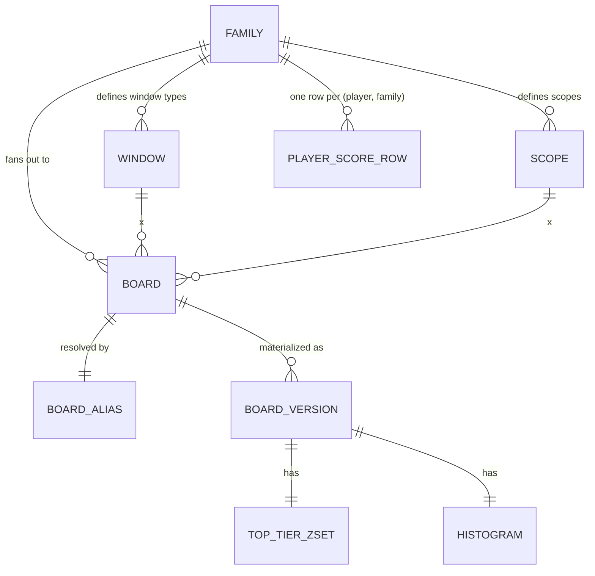

#### 1. Family: the configuration and consistency unit

A family is static configuration that every board inside it inherits:

```yaml
family: ranked_s14
score_fn: max                 # max | sum | latest  → decides idempotency (§6)
tie_break: earliest_achieved  # packed into low 22 bits (§8)
validation: { min: 0, max: 60000, max_delta_per_match: 9000 }
windows:
  - { type: daily,  tz: player_local, grace: 30m }
  - { type: weekly, tz: UTC, iso_week: true, grace: 2h }
  - { type: season, starts: 2026-09-01, ends: 2026-11-30, grace: 24h }
  - { type: alltime }
scopes: [global, country]     # materialized
ego_scopes: [friends]         # computed on read
exact_top_k: 100000
```

Why it's a separate entity:
- **The ingest contract is per family.** Producers send `(player_id, family, value, event_time, match_id)`. The server owns the mapping from family to boards, so adding a scope or window is a config change with no client release.
- **Same score function across all its boards.** A max family and a sum family need different dedupe and replay logic (§6). Mixing them in one family breaks the single-row storage layout below.
- **Storage key.** The player-score KV partitions on `(player_id, family)`, so one event updates exactly **one partition**.

#### 2. Window: event-time interval with a lifecycle

| Window type | `window_id` example | Interval | Cardinality over time |
|---|---|---|---|
| Daily (tumbling) | `daily:2026-09-25` | 24 h, per timezone if `tz: player_local` | +1 per day (× timezones) |
| Weekly (tumbling) | `weekly:2026-W39` | ISO week, UTC | +1 per week |
| Season (fixed) | `season` | family-defined start/end | 1 per family |
| All-time (unbounded) | `alltime` | `[-∞, +∞)` | 1, never closes |

- **Assignment function:** `windows(event) = { w ∈ family.windows | w.starts_at ≤ event.event_time < w.ends_at and now ≤ w.grace_until }`. A late event within grace goes to the window it was **played** in. After grace it's marked `too_late` in the ledger and never touches the board.
- **Each window instance has its own state machine:** `PRECREATED → OPEN → GRACE → FROZEN → AUDITED → PAID → ARCHIVED` (§9). The freeze is triggered by the **watermark**, not the wall clock.
- **Rolling windows** ("last 7 days") are not tumbling windows. A score has to *leave* the board when it ages out, which a sorted set can't express cheaply (§9).

#### 3. Scope: which players a board ranks

| Scope kind | Example | Membership | Player in how many boards of this kind? | Strategy |
|---|---|---|---|---|
| Universal | `global` | all players | 1 | materialize |
| **Partitioning** | `country=IN`, `region=EU` | `player.attr = value` | exactly 1 (the partitions don't overlap) | materialize (one zset + histogram per value) |
| Group | `guild=4412`, `tournament=t-91` | explicit member list | 0..few | materialize if small; plain zset |
| **Ego-centric** | `friends(viewer)` | depends on the viewer | 1 per follower (overlapping) | **compute on read**: multi-get + in-memory sort |

The split rule is **write amplification**:
- With partitioning scopes, one event costs **+1 board write per scope kind**, whatever the number of countries.
- Ego-centric scopes would cost **+1 write per follower**. A streamer with 2M followers would trigger 2M zset updates per match (§10). So they're never materialized.

Scope attributes (e.g. `country`) are stored **on the player-score row** and snapshotted per window. This means a player who changes country mid-week stays on one country board for that window and doesn't appear twice.

#### Do we store every family × window × scope combination? No.

A `board_id` is a **logical name**. Storage (a zset + histogram) is created only when the board passes a cost rule:

> **Materialize a board only if (1) each event adds a small, bounded number of board writes, and (2) many viewers read the same list.** Otherwise compute it on read.

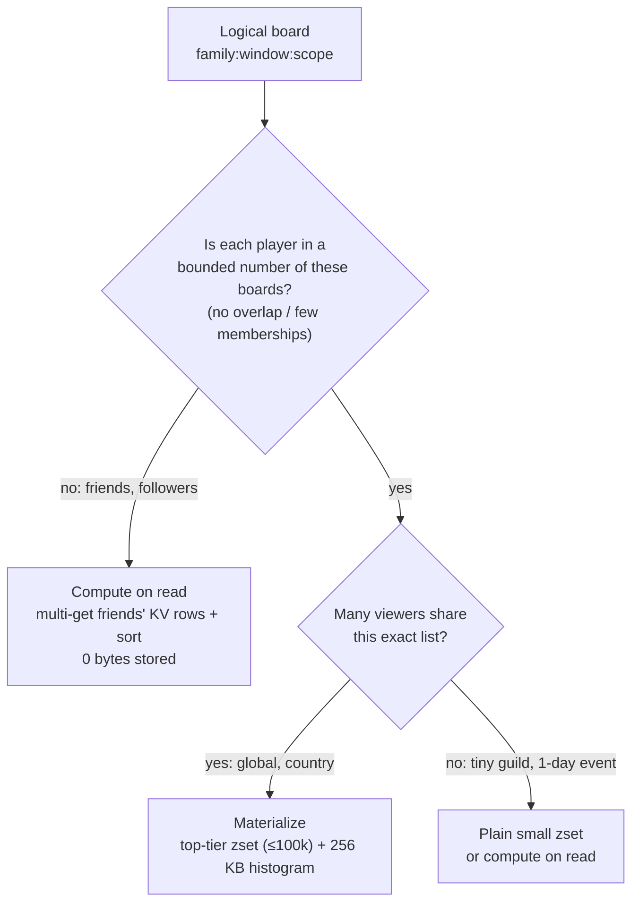

**Why friends boards are never stored.** Compare the two approaches:

| | Store one friends board per player | Compute on read |
|---|---|---|
| Boards | 200M players × 4 windows = **800M zsets** | 0 |
| Writes per score event | 1 per **follower**. Average ~140, a streamer 2M | 0 extra |
| Write rate at 170k events/s | 170k × 140 ≈ **24M zset writes/s**, with 2M-write spikes | unchanged |
| Read cost | 1 `ZREVRANK` | 1 KV **multi-get** of N friends' rows (one row per `(friend, family)` holds all windows) + sort N numbers in memory. N ≈ a few hundred → sub-millisecond |
| Freshness | Lags behind the fan-out queue | Always current (reads the KV) |

A friends board is exactly the News Feed **fan-out-on-write vs fan-out-on-read** trade-off. Overlapping, per-viewer membership makes write fan-out unbounded, so we read instead. The friends list is capped (a few thousand). For the rare huge graph, read "top friends by score" via a secondary index (§10).

**What is actually stored, and how big it is:**

| Board class | Stored? | Count | Memory |
|---|---|---|---|
| `global` × 4 windows, per major family | yes | 4 | ≤ 11 MB zset + 256 KB histogram each |
| `country=XX` × 4 windows | yes | ~800 | zset capped at the top 100k. Most countries have fewer active players, so it's often much smaller |
| Guild / tournament (each player in ~1) | small plain zset | thousands | KB–MB each, deleted when the event ends |
| Friends / followers | **no** | 0 | 0 |
| Closed daily/weekly windows | **no** (moved out of Redis) | — | Parquet + histogram in S3 |

Upper bound for the live in-memory tier: ~800 × ~11 MB ≈ **under 10 GB** per major family, before replicas. That's small because:
- **Player scores aren't copied per board.** There's one KV row per `(player, family)` on disk. Boards hold only the **top tier** (≤100k members) and a **fixed-size histogram**.
- **Scope isn't in the KV key.** `global` and `country=IN` read the same row; scope only decides which zset/histogram gets the update.

#### 4. Board: the unit of ranking

```text
board_id = {family}:{window_id}:{scope}
         = ranked_s14:weekly:2026-W39:country=IN
```

(In the rest of this guide, a board id with no scope suffix means `:global`.)

A board is where every ranking invariant lives:
- A player appears **at most once**: one member, with the score from `score_fn` over that window's events.
- **One total order:** packed score = `raw × 2^22 + tie_bits` (§8).
- It owns its **top-tier zset**, **threshold T**, **histogram + bucket boundaries**, **window state** and **frozen snapshot**.
- Read APIs are addressed by `board_id`: `GET /v1/boards/{board_id}/top`.

**The fan-out function** (inside the aggregator):

```text
boards(event) = { family:w:s  |  w ∈ windows(event),  s ∈ materialized_scopes(player) }

|boards(event)| = |active windows| × |materialized scope kinds|
               = 4 × 2 = 8        (daily, weekly, season, alltime) × (global, country)
```

**Worked example.** Priya (`country=IN`) sends `{family: ranked_s14, value: 18450, event_time: 2026-09-25T10:13Z}`. The score function is max. Her previous bests were weekly 17,900 and season/all-time 21,000.

| board_id | Old | New (`max`) | KV changed? | Histogram delta | Zset op |
|---|---|---|---|---|---|
| `…:daily:2026-09-25:global` | none | 18,450 | yes | +1 into bucket(18450) | upsert if ≥ T |
| `…:daily:2026-09-25:country=IN` | none | 18,450 | yes | +1 | upsert if ≥ T |
| `…:weekly:2026-W39:global` | 17,900 | 18,450 | yes | −1 b(17900), +1 b(18450) | upsert if ≥ T |
| `…:weekly:2026-W39:country=IN` | 17,900 | 18,450 | yes | same | upsert if ≥ T |
| `…:season:{global, country=IN}` | 21,000 | 21,000 | no | none | none |
| `…:alltime:{global, country=IN}` | 21,000 | 21,000 | no | none | none |

8 logical board updates. 4 of them are no-ops, because `max` didn't change the value.

#### 5. Physical layout: why the KV is keyed by family, not by board

```sql
PRIMARY KEY ((player_id, family), window_id)   -- partition = (player, family); rows = windows
```

```text
partition (priya, ranked_s14)
  window_id=daily:2026-09-25  score=18450 prev_score=NULL  applied_seq=9001233
  window_id=weekly:2026-W39   score=18450 prev_score=17900 applied_seq=9001233
  window_id=season            score=21000 ...
  window_id=alltime           score=21000 ...
  (static) country=IN
```

- **One partition write per coalesced event.** All windows of one family change together, so they share an LSM partition. 8 board-level writes collapse into 1 partition mutation (§5 table).
- **Scope isn't part of the KV key.** `global` and `country=IN` read the **same row**. Scope only matters downstream (which zset/histogram gets the delta) and in the `(board_id, bucket)` range index, which is built only for boards that serve tail-neighbour queries.
- **Rollover isn't a data move.** A new day just starts writing `window_id=daily:2026-09-26`. Old window rows expire by TTL after the window is archived.

#### 6. Version and alias: an indirection for rebuilds

```text
config store (etcd / strongly consistent SQL):
  board_alias  ranked_s14:weekly:2026-W39:global  →  v3

Redis Cluster keys (hash tag {…} = same slot = same shard → Lua can touch all atomically):
  lb:{ranked_s14:weekly:2026-W39:global}:v3:top      ZSET  ~100k members, packed scores
  lb:{ranked_s14:weekly:2026-W39:global}:v3:hist     65,536 × int32 (256 KB)
  lb:{ranked_s14:weekly:2026-W39:global}:v3:meta     HASH  threshold_T, target, max
  lb:{ranked_s14:weekly:2026-W39:global}:v3:applied  SET   (aggregator_id, offset_range)
```

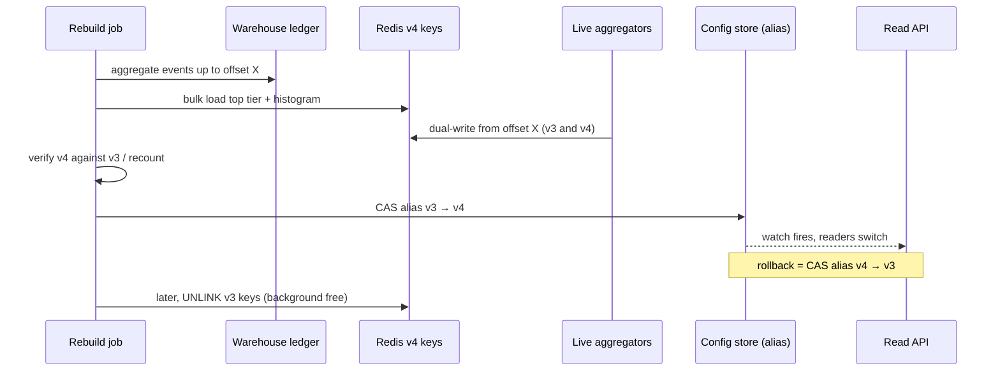

Why it's done this way:
- **No key rename.** `RENAME` onto an existing key implicitly deletes the old multi-MB zset. Unless `lazyfree-lazy-server-del` is on, that delete runs synchronously on the Redis main thread and stalls the shard. The alias flip is a metadata write.
- **Instant rollback.** v3 stays intact until v4 has soaked.
- **Caches key on `board_version`, not `board_id`.** A flip invalidates them naturally, with no stale mix of two versions (§5.5 caches).

#### 6b. Redis key design and what's inside the sorted set

**Key format:**

```text
lb:{<board_id>}:v<version>:<structure>
│   │            │          └─ top | hist | meta | applied
│   │            └─ physical version from board_alias (rebuilds, §11)
│   └─ hash tag: Redis Cluster hashes ONLY the part inside {}, so all keys of one board → same slot → same shard
└─ namespace prefix (keeps leaderboard keys apart from other apps on the cluster)
```

**Concrete keys for one board, `ranked_s14:weekly:2026-W39:global`, version 3:**

| Key | Redis type | Contents | Size |
|---|---|---|---|
| `lb:{ranked_s14:weekly:2026-W39:global}:v3:top` | **ZSET** | member = `player_id`, score = packed score | ≤ 100k–120k members, ~11 MB |
| `lb:{ranked_s14:weekly:2026-W39:global}:v3:hist` | STRING (`BITFIELD`) | 65,536 × i32 counters | 256 KB |
| `lb:{ranked_s14:weekly:2026-W39:global}:v3:meta` | HASH | `threshold_T`, `target=100000`, `max=120000`, `as_of` | bytes |
| `lb:{ranked_s14:weekly:2026-W39:global}:v3:applied` | SET | flush stamps `agg-7:500-520` (TTL'd) | small |

More board ids, same pattern:

```text
lb:{ranked_s14:weekly:2026-W39:country=IN}:v3:top
lb:{ranked_s14:daily:2026-09-25@UTC+05:30:global}:v1:top     ← daily, per-timezone
lb:{ranked_s14:alltime:global}:v7:top                         ← rebuilt 6 times
lb:{weekend_cup_oct:event:tournament=t-91}:v1:top             ← small event board
```

**Why the hash tag matters:** the Lua scripts (top-tier upsert, histogram flush) read `:top` + `:meta` or `:hist` + `:applied` atomically. Redis Cluster only allows that if every key in the script sits in **one slot**. Without `{...}`, the script fails with `CROSSSLOT`.

**Inside the ZSET: member and score**

| Field | Value | Why |
|---|---|---|
| **member** | `player_id` as a decimal string, e.g. `"881234567"` | Stable and compact. **Not** the display name: names change, can collide, are PII, and cost memory × 100k × 800 boards |
| **score** | packed `raw × 2^22 + (2^22 − 1 − t)` (§8) | One double has to encode "higher score wins, earlier wins ties" |

Example contents of `...:v3:top` (`ZRANGE key 0 4 REV WITHSCORES`):

| Rank | member | score (packed) | raw = ⌊score / 2^22⌋ | achieved at |
|---|---|---|---|---|
| 1 | `"104"` | 125,829,120,000,000 + 4,194,000 | 30,000,000 | early |
| 2 | `"881234567"` (Priya) | 77,389,099,503 | 18,450 | 01:00 |
| 3 | `"77120"` (Kai) | 77,389,095,903 | 18,450 | 02:00 |
| 4 | `"5001"` | 77,380,000,000 | 18,448 | — |
| … | … | … | … | … |

Priya and Kai tie on raw 18,450. Priya's larger time bits (she scored earlier) put her above Kai.

**Display names, avatars and country flags are not in the zset.** The read API batch-fetches them from the profile service (cached) after reading the zset, and **joins in memory**. Storing them in the zset would mean renaming a player rewrites every board they're on.

**Writing (aggregator → Redis):**

```text
packed = pack(raw=18450, event_time, window_start)     # asserts packed < 2^53

EVALSHA <top_tier_upsert_sha> 2
        lb:{ranked_s14:weekly:2026-W39:global}:v3:top
        lb:{ranked_s14:weekly:2026-W39:global}:v3:meta
        881234567  77389099503  100000  120000
→ returns the new threshold_T (the aggregator caches it as a pre-filter only)
```

- Score **up** and clearly below the cached T → skip Redis entirely (the player stays in the tail; the histogram covers them).
- Score **down** for someone who was above T → always run the script / `ZADD XX` (§7: the pre-filter is unsafe for decreases).
- The aggregator never sends `ZINCRBY`. Always the absolute packed value (§6).

**Reading (read API → Redis):**

| Question | Command | Cost |
|---|---|---|
| Top 100 | `ZRANGE key 0 99 REV WITHSCORES` | O(log N + 100) |
| Next page (cursor = last packed score) | `ZRANGE key (77380000000 -inf BYSCORE REV LIMIT 0 100` | O(log N + 100), no duplicates or gaps (§4) |
| My exact ordinal position | `ZREVRANK key 881234567` → 1 (0-based) | O(log N) |
| My **competition** rank (1, 2, 2, 4) | `ZCOUNT key 77389103104 +inf` + 1 (that number = 18,451 × 2^22, the lowest packed value with raw > 18,450) | O(log N) |
| 5 above and 5 below me | `r = ZREVRANK`, then `ZRANGE key max(r-5,0) r+5 REV WITHSCORES` | O(log N + 11) |
| Am I in the top tier? | `ZSCORE key 881234567` → nil means tail → use histogram | O(1) |

Reads go to **replicas**. Writes (the Lua scripts) go to the primary.

**Tie-time unit per window type.** 22 bits of **seconds** covers only 48.5 days, which fits daily and weekly but not a 90-day season or all-time. Choose the unit per window type, and make it part of the board's schema:

| Window | Time unit in low 22 bits | Covers |
|---|---|---|
| daily, weekly | seconds | 48.5 days |
| season (≤ ~8 years) | minutes | ~8 years |
| all-time | minutes since game launch, or drop time-based ties and tie-break by a stable rule | — |

Changing the unit changes every packed value, so it means building a **new version** of the board (`v4`), not an in-place edit.

**Lifecycle of the keys:**
- **Live boards have no TTL.** Expiry would silently delete a board mid-window.
- After FROZEN → snapshot to S3 → the alias moves to the snapshot, then **`UNLINK`** the Redis keys (background free; `DEL` on an 11 MB zset blocks the event loop).
- An old version (`v3` after a flip to `v4`) is `UNLINK`ed after the soak period.

#### 6c. Redis commands walkthrough: what each key holds after each command

To keep the numbers readable, this toy board has 4 players and uses **raw scores**. On a real board the score is the packed value (§8). The commands behave exactly the same, only the numbers are bigger.

Board: `lb:{demo}:v1:*`. Players: Alice 900, Priya 750 (scored first), Bob 750, Ravi 500.

```text
Redis is one big dictionary:   key (string)  →  value (one of several types)

  lb:{demo}:v1:top      →  ZSET    (sorted set: member → score, kept ordered)
  lb:{demo}:v1:meta     →  HASH    (small dictionary: field → value)
  lb:{demo}:v1:applied  →  SET     (unordered unique strings)
  lb:{demo}:v1:hist     →  STRING  (raw bytes, used as an array of counters)
```

##### 1. ZSET: the top tier

**`ZADD key score member`** inserts the member, or updates its score if it already exists.

```text
> ZADD lb:{demo}:v1:top 900 alice 750 priya 750 bob 500 ravi
(integer) 4                     ← 4 new members added
```

What's stored. Redis keeps the members **sorted by score**, and on a tie by member name:

| (internal order, low → high) | member | score |
|---|---|---|
| 0 | ravi | 500 |
| 1 | bob | 750 |
| 2 | priya | 750 |
| 3 | alice | 900 |

Note that Bob comes before Priya **only because "b" < "p"**. That's the unfair default tie-break (§1), and the reason the real board packs time into the score.

**`ZRANGE key start stop REV WITHSCORES`** lists members by position, highest first because of `REV`.

```text
> ZRANGE lb:{demo}:v1:top 0 2 REV WITHSCORES      ← top 3
1) "alice"  2) "900"
3) "priya"  4) "750"
5) "bob"    6) "750"
```

**`ZREVRANK key member`** returns the 0-based position from the top. Add 1 for a human rank.

```text
> ZREVRANK lb:{demo}:v1:top bob
(integer) 2          ← Bob is #3
> ZREVRANK lb:{demo}:v1:top zoe
(nil)                ← not in the zset → he's in the tail, ask the histogram
```

**`ZSCORE key member`** returns the member's score.

```text
> ZSCORE lb:{demo}:v1:top priya
"750"
```

**`ZCOUNT key min max`** counts members whose score is in `[min, max]`. It's used for competition rank (1, 2, 2, 4).

```text
> ZCOUNT lb:{demo}:v1:top 751 +inf     ← how many strictly above 750?
(integer) 1                            ← only Alice → Priya and Bob are both rank 1+1 = #2
```

**Updating a score.** `ZADD` on an existing member overwrites its score, and the member is re-sorted automatically.

```text
> ZADD lb:{demo}:v1:top 950 ravi       ← Ravi plays a great match
(integer) 0                            ← 0 new members (it was an update)
```

| member | score |
|---|---|
| bob | 750 |
| priya | 750 |
| alice | 900 |
| **ravi** | **950** ← moved to the top |

**Useful `ZADD` flags:**

| Command | Meaning | Example result |
|---|---|---|
| `ZADD key GT 800 ravi` | update **only if greater** (max boards) | 800 < 950 → no change |
| `ZADD key XX 700 zoe` | update **only if the member exists** | Zoe isn't there → no-op, not inserted |
| `ZADD key NX 700 zoe` | insert **only if new** | Zoe added with 700 |

**Removing and trimming:**

```text
> ZREM lb:{demo}:v1:top bob                 ← Bob fell below threshold T
(integer) 1
> ZCARD lb:{demo}:v1:top                    ← how many members?
(integer) 3
> ZREMRANGEBYRANK lb:{demo}:v1:top 0 0      ← delete the lowest one (position 0)
(integer) 1                                  ← trims the bottom when over max size
```

**Paging with a cursor** (`BYSCORE`): "the next 2 below score 900".

```text
> ZRANGE lb:{demo}:v1:top (900 -inf BYSCORE REV LIMIT 0 2 WITHSCORES
                          └ "(" = strictly less than 900
```

##### 2. HASH: board metadata

**`HSET key field value [field value ...]`** sets fields in a small dictionary. **`HGET`** reads one field, **`HGETALL`** reads all of them.

```text
> HSET lb:{demo}:v1:meta threshold_T 500 target 100000 max 120000
(integer) 3
> HGET lb:{demo}:v1:meta threshold_T
"500"
> HGETALL lb:{demo}:v1:meta
1) "threshold_T"  2) "500"
3) "target"       4) "100000"
5) "max"          6) "120000"
```

Stored as:

| field | value |
|---|---|
| threshold_T | 500 |
| target | 100000 |
| max | 120000 |

##### 3. SET: which flushes were already applied

**`SADD key member`** adds a string to a set. Duplicates are ignored. **`SISMEMBER`** asks "is it in there?". **`EXPIRE`** sets a TTL in seconds.

```text
> SADD lb:{demo}:v1:applied "agg-7:500-520"
(integer) 1                    ← newly added
> SADD lb:{demo}:v1:applied "agg-7:500-520"
(integer) 0                    ← already there (this is how a replay is detected)
> SISMEMBER lb:{demo}:v1:applied "agg-7:500-520"
(integer) 1                    ← yes
> EXPIRE lb:{demo}:v1:applied 86400
```

Stored as: `{ "agg-7:500-520", "agg-3:120-140", ... }`, with no order and no duplicates.

##### 4. STRING + BITFIELD: the histogram as an array of counters

A Redis string is just **bytes**. `BITFIELD` lets you treat those bytes as an **array of fixed-size integers**. With `i32` (4 bytes each), counter number *n* lives at byte offset *4n*. The `#n` syntax means "the n-th i32".

Toy histogram with 4 buckets:

| bucket | score range |
|---|---|
| #0 | 900 and up |
| #1 | 700–899 |
| #2 | 400–699 |
| #3 | below 400 |

```text
> BITFIELD lb:{demo}:v1:hist INCRBY i32 #0 1   INCRBY i32 #1 2   INCRBY i32 #2 1
1) (integer) 1        ← bucket 0 = 1   (Alice)
2) (integer) 2        ← bucket 1 = 2   (Priya, Bob)
3) (integer) 1        ← bucket 2 = 1   (Ravi)
```

What's actually stored (16 bytes, 4 per counter):

```text
byte offset:  0  1  2  3 | 4  5  6  7 | 8  9 10 11 |12 13 14 15
counter:        #0 = 1   |   #1 = 2   |   #2 = 1   |   #3 = 0
hex:         00 00 00 01 |00 00 00 02 |00 00 00 01 |00 00 00 00
```

Ravi moves from 500 (bucket #2) to 950 (bucket #0). That's one flush with two changes:

```text
> BITFIELD lb:{demo}:v1:hist INCRBY i32 #2 -1   INCRBY i32 #0 1
1) (integer) 0
2) (integer) 2
> BITFIELD lb:{demo}:v1:hist GET i32 #0  GET i32 #1  GET i32 #2  GET i32 #3
1) 2   2) 2   3) 0   4) 0
```

The read API does `GET lb:{demo}:v1:hist` (the whole 256 KB string, once per second), turns it into an int array in memory, and builds the prefix sums:

| bucket | count | prefix (players in higher buckets) |
|---|---|---|
| #0 | 2 | 0 |
| #1 | 2 | 2 |
| #2 | 0 | 4 |
| #3 | 0 | 4 |

A tail player with 750 is in bucket #1, so they're ranked ~#3–#4.

The real board has 65,536 counters × 4 bytes = **262,144 bytes = 256 KB**, in **one key**.

##### 5. Running a Lua script: `SCRIPT LOAD` and `EVALSHA`

```text
> SCRIPT LOAD "<lua source of the flush script>"
"a42f...9c1"                         ← SHA1 of the script; Redis caches it

> EVALSHA a42f...9c1 2  lb:{demo}:v1:hist  lb:{demo}:v1:applied  "agg-7:500-520"  2 -1  0 1
          └ sha       └ number of keys  └ KEYS[1]            └ KEYS[2]              └ ARGV...
```

- **`EVAL`** sends the script text every time. **`EVALSHA`** sends only the hash: less network, same result.
- The script runs **atomically**: no other command runs on that shard until it finishes. So the check-then-apply can't be interleaved.
- All `KEYS` must hash to the same slot, which is why the `{demo}` hash tag is there.

##### 6. Deleting: `UNLINK` vs `DEL`

```text
> DEL    lb:{demo}:v1:top     ← frees memory ON the main thread: an 11 MB zset can stall it
> UNLINK lb:{demo}:v1:top     ← removes the key instantly, frees memory in a background thread
```

Always `UNLINK` board keys.

##### 7. Not Redis: the player-score KV row (Cassandra-style)

The full per-player score lives on disk, not in Redis:

```sql
-- write (compare-and-set, safe under replay)
UPDATE player_scores
   SET score = 950, prev_score = 500, applied_seq = 520
 WHERE player_id = 'ravi' AND family = 'demo' AND window_id = 'weekly:2026-W39'
    IF applied_seq < 520;
```

Stored as:

| player_id | family | window_id | score | prev_score | applied_seq |
|---|---|---|---|---|---|
| ravi | demo | daily:2026-09-25 | 950 | 500 | 520 |
| ravi | demo | weekly:2026-W39 | 950 | 500 | 520 |
| ravi | demo | alltime | 950 | 500 | 520 |

##### All four together, for one event

Ravi scores 950 (was 500):

| Step | Store | Command | After |
|---|---|---|---|
| 1 | KV | `UPDATE ... IF applied_seq < 520` | score 950, prev 500 |
| 2 | HIST (STRING) | Lua flush: `SISMEMBER applied` → `BITFIELD INCRBY #2 -1, #0 +1` → `SADD applied` | bucket #2 −1, #0 +1 |
| 3 | ZSET | Lua upsert: `ZADD top 950 ravi`, trim, `HSET meta threshold_T` | Ravi at the top |
| 4 | Kafka | commit offset 520 | batch done |

#### 7. Cardinality and lifecycle

| Board class | Count | Per-board memory | Lifetime |
|---|---|---|---|
| Live big boards: 4 windows × (1 global + ~200 countries) per major family | ~800 | ≤ 11 MB zset + 256 KB histogram | daily/weekly: days, then frozen |
| Daily × timezone variants (if `tz: player_local`) | × ~24–38 tz offsets for the daily window | same | 1 day + grace |
| Event / tournament families | thousands | small, plain zset (v1 layout, §15) | event duration |
| Ego-centric (friends) | 0 stored | none | computed per request |
| Archived windows | unbounded | 0 in Redis; Parquet + histogram in S3 | forever (audit, disputes) |

So the system has **two scaling regimes**. A few hundred **huge** boards, where hot-key, big-key and exact-rank problems live (§3, §7, §10). And a long tail of **small, short-lived** boards, where the problems are creation and deletion: pre-creation, `UNLINK` on archive, and thundering herds at midnight (§9).

#### Terms that are easy to mix up

| Term | Precisely | Not to be confused with |
|---|---|---|
| `family` | Config + ingest address + KV partition component | A board (a family *produces* many boards) |
| `window_id` | One interval instance (`weekly:2026-W39`) | Window *type* (`weekly`) |
| `scope` | Membership predicate on a board | A KV key (scope is applied after the KV) |
| `board_id` | Logical name that clients use | Redis key (that's per version) |
| `version` | Physical materialization | Window instance (a new week is a new `board_id`, not a new version) |
| `board_alias` | `board_id → version` pointer in the config store | Redis `RENAME` |

### Beginner notes: what a sorted set is, and why rank is cheap in it

**What it is.** A Redis sorted set is a collection of `(member, score)` pairs, always kept ordered by score. You can ask:

| Command | Question | Cost |
|---|---|---|
| `ZADD board 18450 alice` | set Alice's score | O(log N) |
| `ZREVRANK board alice` | Alice's 0-based rank, highest score first | O(log N) |
| `ZREVRANGE board 0 99 WITHSCORES` | the top 100 | O(log N + 100) |
| `ZCOUNT board 18451 +inf` | how many players score at least 18,451 | O(log N) |

**Why rank is O(log N).** Inside is a **skiplist**: a sorted linked list with extra "express lanes" that skip many members at once. Redis promotes a node to the next lane with probability **p = 1/4**, so 200M members need about **log₄(200M) ≈ 14 lanes**. Each express pointer also stores its **span**, meaning how many members it jumps over. To find Alice's rank, Redis walks down the lanes toward her and **adds up the spans** it crossed. About 14 steps, no counting.

**Toy example (8 players, scores high to low):**

```text
lane 2:  HEAD ──────────(span 4)──────────► D ──────(span 4)──────► nil
lane 1:  HEAD ──(2)──► B ──────(2)───────► D ──(2)──► F ──(2)──► nil
lane 0:  HEAD ─► A ─► B ─► C ─► D ─► E ─► F ─► G ─► H
          990   950   900   870   860   800   700   650

rank(F) = span(HEAD→D on lane 2) + span(D→F on lane 1) = 4 + 2 = 6  → F is #6
```

**Why a normal database index can't do this.** A B-tree index in MySQL/Postgres doesn't store "how many rows are under this node". So `SELECT COUNT(*) FROM scores WHERE score > 7210` has to **walk every matching row**. That's fine for rank 40, but rank 40 million means scanning 40 million index entries. Keeping counts in every B-tree node would mean every insert updates counts all the way up to the root, and every writer would fight over the root. So general-purpose databases don't do it.

**The catch that drives this whole guide:** that clever skiplist is **one key**. One key lives on **one shard**, is served by **one thread**, replicates as **one stream** and is snapshotted by **one fork**. That's why "just put 200M players in one sorted set" breaks (§3).

---

## 1. Clarify the problem

Before drawing any boxes, we ask the product team a few questions. We only ask the questions whose answers **change the architecture**. Questions like "what colour is the leaderboard screen?" change the UI, not the system, so we skip them here.

> **⚡ 30-second version** (each point is explained slowly in the beginner version below)
> 1. **How is a player's score calculated: best-ever (max), running total (sum) or most recent (latest)?** This is the most important question. A max board can safely process the same score twice, while a sum board counts it twice and inflates the player's score.
> 2. **How are ties ranked: 1-2-3-4, 1-2-2-4 or 1-2-2-3?** Redis's default puts tied players in alphabetical order of their user ID, which is unfair. The rule must be agreed with product and legal before any prizes exist.
> 3. **Who actually needs an exact rank number?** Only the top few thousand players and the viewer's friends do. Everyone else is happier with "Top 19%", and that lets us keep 100k players in memory instead of 200M.
> 4. **How fresh must the board be?** Showing a player their own new rank right after a match is cheap. Making the top 100 live to the second for everyone is expensive, and players can't tell the difference.
> 5. **When do daily and weekly boards reset, and where do late results go?** We need to know whose midnight counts, whether a week is calendar or rolling, and whether an offline match counts when it was played or when it arrived.
> 6. **How many boards, and how big?** One gigantic board and a million tiny boards are two different engineering problems.
> 7. **Are prizes attached?** If yes, we must freeze and audit the final standings and pay from that frozen copy, never from the live board.

| Question | Why the answer changes the architecture | Our answer for this design |
|---|---|---|
| How is the score calculated? | A max score can be safely re-applied after a crash. A sum score needs a de-duplication system so that no match is counted twice. | Chosen per board. We prefer **max** whenever the product allows it. |
| How are ties ranked? | Redis's built-in rank breaks ties by user ID, so we must build our own tie-breaker. | **Competition ranking** (1, 2, 2, 4) for the number shown, and **"whoever got the score first"** for the order of the list. |
| Who needs an exact rank? | It decides how many players must sit in the expensive, exact, in-memory structure. | The **top 100k** and **friends boards** are exact. Everyone else gets an approximate rank with a published error margin. |
| How fresh? | Global freshness needs fresh reads for every viewer. Freshness for one's own score can come from the write response. | A player's own rank updates instantly. The top-K list may be up to 1 second old. |
| Resets and late results | It decides how many boards exist and how a board is closed. | Daily, weekly, season and all-time boards. A late match counts for the window **in which it was played**, as long as it arrives within a grace period. |
| How many boards? | One huge board causes "hot key" problems. Millions of small boards cause creation and clean-up problems. | A few huge boards plus many small event boards. |
| Prizes attached? | Payouts need a frozen, audited, provable final result. | **Yes**, so every window goes through freeze, snapshot and audit before payout. |

### §1 explained in detail, with examples (beginner version)

**The running example used in this section.** Our game is a ranked online shooter. Season 14 is running. Alice, Bob, Priya and Ravi are players. Every time one of them finishes a match, the game sends us a score.

---

#### Question 1: how is a player's score calculated (max, sum or latest)?

**What we are asking.** A player plays many matches, but the leaderboard shows **one number** per player. We need to know how to turn many match scores into that one number. There are three common choices.

**Example.** Alice plays three matches this week. She scores **500**, then **800**, then **300**.

| Score function | What it means | Alice's number on the board |
|---|---|---|
| **Max** (best-ever) | The board shows the player's single best match. | **800** |
| **Sum** (cumulative) | The board shows the total of all the player's matches, like "total XP this week". | 500 + 800 + 300 = **1,600** |
| **Latest** | The board shows the player's most recent result, like a current skill rating. | **300** |

**Why this matters so much: messages can arrive twice.** In a large system, a message is sometimes delivered **more than once**. This is normal, not a rare bug. For example, a worker reads Alice's "+300" message from Kafka, updates the board, and then crashes before it can record "I have finished this message". When it restarts, it reads the same message again. Kafka guarantees that messages are never lost, but not that they arrive only once. This guarantee is called **at-least-once delivery**.

Now look at what happens to Alice's score when the "300" message is processed twice:

| Score function | Correct value | Value after processing "300" twice | Is the board still correct? |
|---|---|---|---|
| **Max** | 800 | max(800, 300, 300) = 800 | **Yes.** Seeing the same score again changes nothing. |
| **Latest** | 300 | 300 | **Yes, but only if** an *older* message arriving late can't overwrite a newer one. We must compare match times before writing. |
| **Sum** | 1,600 | 1,600 + 300 = **1,900** | **No.** Alice gained 300 points she never earned. |

**Why only the sum board goes wrong, step by step.** A sum board is updated with `ZINCRBY board 300 alice`, which means "add 300 to whatever Alice has now". The command doesn't know which match the 300 came from, so it can't tell that it has already added this match before.

```text
Alice's total before her third match: 1,300  (500 + 800)

1. Worker reads message "match m-3: alice +300" from Kafka
2. Worker runs  ZINCRBY board 300 alice    → board says 1,600   ✓ correct
3. Worker crashes BEFORE telling Kafka "I finished m-3"
4. Worker restarts. Kafka thinks m-3 was never finished, so it delivers it again
5. Worker runs  ZINCRBY board 300 alice    → board says 1,900   ✗ counted twice
```

Compare the max board in the same crash. Step 2 runs `ZADD board GT 300 alice`, which means "set Alice to 300 only if that is higher than what she has". She already has 800, so nothing changes. Step 5 does the same thing again, and again nothing changes. **"Add 300" depends on what is already there, so repeating it changes the result. "Keep the bigger of the two" gives the same answer no matter how often it is repeated.**

Nobody notices the sum mistake, because 1,900 looks like a normal score from an active player. There is no error and no alarm; scores just drift upwards after every crash and every deploy.

**The fix** (detailed in §6) is to stop sending "add 300" to the board. Instead:

1. Keep a record of which `match_id`s have already been counted for Alice. If `m-3` is already there, skip it.
2. Calculate Alice's new **total** in the player-score database (1,300 + 300 = 1,600) and save it together with "last message applied".
3. Write that **total** to the board: `ZADD board 1600 alice`. Writing "1,600" twice still gives 1,600.

**The technical words, explained.** The article says a max board is a **"max-register"** that is **commutative**, **idempotent** and **replayable**. In plain words:

- **Commutative** means the order doesn't matter. Processing 500, 800, 300 or 300, 500, 800 gives the same best score, 800.
- **Idempotent** means doing something twice has the same effect as doing it once. Taking the max with 300 a second time doesn't change 800.
- **Replayable** means we can throw the board away and rebuild it by re-reading every score from the beginning, even if some scores appear twice, and we still get the right answer.

A sum board has **none** of these properties. Every retry can double-count a match. Every rebuild must make sure each match is counted **exactly once**, which needs either "exactly-once" processing (hard and slow) or a **de-duplicating ledger** that remembers which match IDs it has already counted.

**Why it changes the architecture.** Choosing sum commits us to building three extra things:

1. A de-duplication record keyed by `match_id`, so the same match is never counted twice (§6).
2. A rule that the board only ever stores **absolute totals** ("Alice = 1,600"), never increments ("Alice +300"), so that a replay can't add the same points again (§6).
3. Per-region partial totals if players can play in several regions, because two regions can't simply take the bigger of their two sums (§13).

A max board needs none of this.

**Interview tip.** Ask the product team: "Which of these boards use sum only because nobody asked?" A "total XP this week" board can often become a "best match this week" board, which players enjoy just as much and is far simpler to run.

---

#### Question 2: how are ties ranked?

**What we are asking.** When several players have exactly the same score, what rank does each of them get? There are three standard answers.

**Example.** Five players have the scores 900, 800, 800, 800 and 700.

| Ranking style | Ranks given | How to read it | Where it is used |
|---|---|---|---|
| **Ordinal** | 1, 2, 3, 4, 5 | Every player gets a different number, even when scores are equal. Something else has to decide the order of the tied players. | This is what Redis's `ZREVRANK` command returns. |
| **Standard competition** | 1, 2, 2, 2, 5 | Tied players share a rank, and the next rank skips the shared places. | Olympic medals, golf, most games. |
| **Dense** | 1, 2, 2, 2, 3 | Tied players share a rank, and the next rank does not skip. | Some tournaments. |

**The hidden trap in Redis.** Redis stores the leaderboard as a sorted set. When two players have equal scores, Redis orders them **alphabetically by their member name** (their user ID, compared byte by byte). On a leaderboard we read the list from highest to lowest score, which reverses that alphabetical order as well. The result is that among tied players, the one whose ID comes **earlier in the alphabet always ranks lower**.

So if `aaron` and `zoe` both score 800, Zoe will **always** be placed above Aaron. This happens in every tie, in every match, for the whole season. Aaron has no way to change it, and a support agent has no sensible way to explain it to him.

**Why this must be decided early, with product and legal.** Once prizes are attached, the tie rule decides **who gets paid**. Suppose the prize goes to the top 3, and four players tie on third place. If we change the tie rule mid-season, a different player gets the prize, and the one who lost it can rightly complain. So the rule is fixed **before** any rewards exist.

**What we choose.** We display **competition rank** (1, 2, 2, 4), because players understand "we tied for second". For the **order** of the list, we break ties by **who reached the score first**, which players see as fair. §8 explains how to build that inside a sorted set.

---

#### Question 3: who actually needs an exact rank?

**What we are asking.** Is "you are #3,812,944" really more useful than "you are about #3.81 million" or "you are in the top 19%"? And if not, for whom does the exact number matter?

**The answer is almost always the same:**

| Who | Do they need an exact number? | Why |
|---|---|---|
| **The top few thousand players** | **Yes.** | They compete for prizes. They take screenshots and compare them. If one of them is shown #41 while they're really #40, they open a support ticket. |
| **The viewer's friends** | **Yes.** | Players compare themselves directly with people they know. "I'm two places above Ravi" must be exactly right. |
| **Everyone else** (the other ~199.9 million) | **No.** | A player at rank 38,411,202 can't tell the difference between that number and 38,414,000. Being off by ±3,000 means nothing to them. "Top 19%" tells them more. |

**Why this one answer changes the architecture so much.** Keeping **every** player in one exact sorted set means holding all 200M players in memory, which is about 22 GB in a single key (§3). That key becomes very hard to operate. If only the top **100,000** players need exact ranks, the exact structure holds 100k players instead of 200M. That is **2,000 times smaller**, about 11 MB.

Everyone else gets a rank computed from a **histogram**, which is a simple count of how many players fall in each score range (§7). The histogram's rank is approximate, and we tell the client how approximate it is with a `rank_error` field (§4).

---

#### Question 4: how fresh must the board be?

**What we are asking.** When a score changes, how quickly must the change be visible, and **to whom**? These two sentences sound similar but cost very different amounts:

| Requirement | Who must see the change | What it costs |
|---|---|---|
| "My rank updates the instant I finish a match." | **Only me.** This is called **read-your-writes** for one user. | **Almost nothing.** When the server accepts my score, it calculates my new rank and sends it back in the same response (§4). My app simply shows that number. |
| "The top 100 is live to the second." | **Everyone** watching the board. This is **global freshness**. | **Expensive.** Every one of millions of viewers would need a fresh read of the real board, so we could not use a cache. |

**Example.** Priya finishes a match and jumps from #52 to #47. Her app shows **#47** immediately, because the server returned it with her score. Bob is looking at the top-100 page at the same moment. His page is served from a cache that is up to one second old, so he sees Priya at #52 for at most one more second. Bob can't tell, and Priya sees exactly what she expects.

**What we choose.** A player's own rank is fresh instantly, and the top-K list may be up to one second old. This gives players the experience they care about at a tiny fraction of the cost.

---

#### Question 5: when do boards reset, and where do late results go?

**What we are asking.** Daily, weekly and season boards have to start and end at some moment. The exact rules decide how many boards we need and how we close them.

**Sub-question A: daily at whose midnight?** If "daily" means midnight UTC, there is one daily board for the whole world. If it means **local** midnight, we need one daily board per time zone in use. There are dozens, including half-hour and quarter-hour zones such as India (UTC+5:30) and Nepal (UTC+5:45). Each extra board means extra memory and extra writes (§9). Many games simply choose one global reset time and accept that it falls at 3 a.m. somewhere.

**Sub-question B: rolling 7 days or calendar week?** A **calendar week** is "Monday 00:00 to Sunday 23:59", so it's one board that starts empty and ends on a fixed date. A **rolling 7 days** is "the last 7 days, right now", so scores from 8 days ago must drop off continuously. A sorted set can't do that cheaply. The usual workaround is to merge 7 daily boards, which is very slow for large boards (§9).

**Sub-question C: when does a late result count?** Mobile players often play **offline**, and the phone sends the result when it gets a connection back. Game servers also retry after outages.

**Example.** Ravi plays a match on the train at **23:50 on Monday** with no signal. His phone submits the result at **02:00 on Tuesday**.

| Rule | Which daily board gets Ravi's score | Problem |
|---|---|---|
| Count by **arrival time** | Tuesday | It is unfair. Players with poor networks have their scores moved to the wrong day. |
| Count by **event time** (when it was played) | Monday | Monday's board must stay open a while after midnight to accept late results. A cheater could also lie about the time to land on an easier day. |

**What we choose.** We count by **event time**, but only if the result arrives within a **grace period** (for example 2 hours) after the window ends. Results arriving later are kept in the ledger for auditing but don't change the board. This is why a window has a lifecycle (open, grace, frozen, and so on) rather than a single closing instant (§9).

---

#### Question 6: how many boards are there, and how big is each?

**What we are asking.** Is there one global board, or a separate board for every level, track, tournament or guild? These lead to two very different systems.

| Situation | Example | The main engineering problem |
|---|---|---|
| **One enormous board** | "All-time global", with 200M players | **Hot key and fan-in.** All writes and reads go to one key, which lives on one server and is handled by one thread. That key is also too big to move or snapshot safely (§3, §10). |
| **A million tiny boards** | One board per guild or per creator tournament, each with a few hundred players | **Placement and lifecycle.** We must create boards quickly, spread them evenly across servers, and delete them reliably when they end. |

**Why it matters.** The techniques that solve the first problem (tiering, histograms, caching) do little for the second, and the reverse is also true. So we ask which one we're building before choosing techniques. Our game has both: a few huge global and country boards, plus many small event boards.

---

#### Question 7: are rewards attached?

**What we are asking.** Does anything valuable depend on the final rank, such as money, in-game currency, skins or titles?

**Why it matters.** If yes, the final rank becomes something we must be able to **prove later**. A live leaderboard keeps changing: late scores arrive, cheaters are removed, and a server failure might roll back the last second of writes. If we calculated prizes by reading the live board, we couldn't later prove what it said at that moment.

**Example.** The weekly top 10 win a prize. On Monday at 00:05 we read the live board and pay the top 10. At 00:20 a late result arrives that would have put Bob in 9th place. Bob now has a screenshot showing 9th place and no prize. We can't say what the board showed at 00:05, because it has already changed.

**What we choose.** When a window ends, it goes through **finalization**:

1. **Freeze:** stop accepting changes for that window, after the grace period and after every pending score is processed (§9).
2. **Snapshot:** write a permanent copy of the final standings to file storage.
3. **Audit:** check the top entries for cheating (§12).
4. **Pay:** calculate prizes only from the snapshot.

> **Rule:** we never pay out from a live structure that can still change. We pay from a frozen, audited snapshot.

---

## 2. Requirements

Requirements come in two kinds. **Functional requirements** describe *what* the system must do: the features a player or operator can use. **Non-functional requirements** describe *how well* it must do them: how fast, how much traffic, how accurate, and how safe.

> **⚡ 30-second version**
> - **Functional:** players submit scores and can see the top players, their own rank and percentile, the players just above and below them, and a friends-only board. Boards exist for daily, weekly, season and all-time windows, with a frozen final result. Moderators can remove or hide cheaters.
> - **Non-functional:** we must handle **150k score events per second** at peak with room for **3× bursts**, answer reads in **under 50 ms** for 99% of requests, keep ranks **exact for the top 100k and for friends**, **rebuild any board in under 30 minutes**, and **never pay a prize without an audit**.

### Functional requirements (what the system does)

| # | Requirement | What it means in plain words | Example |
|---|---|---|---|
| 1 | **Submit a score event** `(player, board_family, value, event_time, match_id)` | When a match ends, the game sends who played, which game mode, the score, when the match was played, and a unique match ID. The match ID lets us spot the same match being sent twice. | Priya, ranked season 14, 18,450 points, played at 10:13, match `m-88213` |
| 2 | **Top-K** for a board, with K up to 1,000, paginated, and with stable tie-breaking | Show the best K players in order. Show them one page at a time. Tied players must appear in the same order every time, so that pages don't swap them around between requests. | "Top 100 this week", then "next 100" |
| 3 | **`rank(player)`** and **`percentile(player)`** for any board the player is on | Tell a player their position, and what share of players they beat. | "You are #41,822, better than 99.1% of players" |
| 4 | **Neighbours** | Show the N players directly above and directly below the viewer, so they can see who they're about to overtake. | 5 players above Priya and 5 below |
| 5 | **Friends board** | Rank the viewer only among their friends. | "You are 3rd of your 140 friends" |
| 6 | **Windowed boards** (daily, weekly, season, all-time) | Each window resets at a fixed, predictable time. Late results are accepted for a grace period. When the window closes, its final standing is frozen and can be audited later. | The weekly board for week 39 closes, waits 2 hours for late results, then freezes |
| 7 | **Moderation** | Staff can remove a cheater, hide them while investigating (shadow quarantine), or restore them if they were innocent. Everyone's ranks are recalculated afterwards. | A cheater at #12 is removed, and everyone from #13 onward moves up one place |

**Two of these deserve a closer look.**

**Stable tie-breaking (requirement 2).** Suppose Bob and Kai both have 9,000 points and sit at the bottom of page 1. If their order were random, Bob could appear on page 1 in one request and on page 2 in the next, while Kai disappears. A fixed tie rule (who reached 9,000 first) keeps every page consistent.

**Shadow quarantine (requirement 7).** A suspected cheater still sees themselves on the board at their usual rank, but nobody else sees them. If cheaters could see that they had been removed, they would immediately try a new trick. If they can't tell, they keep wasting time on an account that no longer matters (§12).

### Non-functional requirements (how well it must do it)

| Requirement | Target | Where the number comes from | What it forces in the design |
|---|---|---|---|
| **Write ingest** | **150k score events/s** at peak, with **3× burst** headroom | 10M players online, each finishing a match about every 3 minutes, gives ~55k/s. At tournament end, many players submit at once, roughly tripling that (§3). | The ingest path and aggregators must be sized for the burst, not the average (§9). |
| **Read latency** | **p99 < 50 ms** for top-K and my-rank, measured at the API edge | Players open the leaderboard screen expecting it to appear instantly. | We can't ask dozens of database shards for every request, because the slowest one would decide the response time (§7). |
| **Read-your-writes for self** | After submitting a score, the rank I see includes that score | A player who just won expects to see their new rank immediately. | The submission response returns the new rank, so we don't need an expensive strongly consistent read (§4). |
| **Exactness** | Exact rank for the **top 100k** and for **friends boards**. Approximate rank, with a **published error bound**, for everyone else | See Question 3 above. | We split each board into an exact top tier and a histogram for the rest (§7). |
| **Rebuildability** | Any board can be rebuilt from the ledger in **under 30 minutes**, with reads staying online | Scoring bugs, rule changes and cheater purges all require recalculating a board. | We keep a durable ledger of all scores, write absolute values, and use versioned boards that we can switch between (§11). |
| **Integrity** | No prize is paid on a standing that hasn't passed an **audit gate**. Removing a player after payout is an explicit compensation process, not a silent re-rank | Prizes involve real value and real disputes. | Every window goes through freeze, snapshot, audit and payout (§9, §12). |

### §2 explained in detail (beginner version)

#### What "p99 < 50 ms" means

"p99" stands for the **99th percentile**. If we sort the response times of 100 requests from fastest to slowest, p99 is the 99th one. So "p99 < 50 ms" means that **99 out of every 100 requests finish in under 50 milliseconds**. Only one in a hundred is allowed to be slower.

We use p99 instead of the average because the average hides slow requests. If 99 requests take 5 ms and one takes 2 seconds, the average is about 25 ms, which looks fine. But the player who waited 2 seconds noticed, and with millions of views per hour, one in a hundred is a very large number of players.

#### Why we need 3× burst headroom

Tournaments and weekly windows end at a fixed time. In the last few minutes, a big share of players rush to submit one more match. Traffic in that minute can be about three times the normal peak.

If we size the system for normal traffic, a backlog of unprocessed scores builds up during the rush. That rush happens at exactly the moment the window closes. If we freeze the board while the backlog is still being processed, the final standing is missing scores that players legitimately earned, and prizes are calculated on an incomplete board (§9).

#### Why "my rank reflects my own submission" doesn't need strong consistency

"Strong consistency" would mean every read, from every viewer, always sees the very latest data. That is expensive, because it rules out caches and replicas.

But each player only cares about **their own** latest score. So when the server accepts Priya's score, it calculates her new rank and sends it back in the same response. Her app shows that number straight away. Other players see a board that may be up to a second old, and they have no way to notice. We get the experience of strong consistency for the one person who can tell, at almost no cost.

#### What "exact for the top 100k, bounded error below" means in practice

For a player in the top 100,000, the rank is exact. "#41,822" means exactly 41,821 players are ahead.

For everyone else, the rank comes from a histogram and has a known margin of error. The API returns that margin explicitly, for example `rank: 3,812,944, rank_error: 2,900`. This means the true rank is within about 2,900 places of the number shown. The app can then choose how to display it: "#3,812,944", "about 3.81 million", or "Top 19%". Publishing the error means a player never sees an exact-looking number jump around for no reason.

#### Why "rebuild in under 30 minutes" is a requirement, not a nice-to-have

Every board is calculated from the ledger, the permanent log of all score events. Sooner or later we will need to recalculate a board, for example:

- a bug gave some players the wrong score;
- the designers change the rules, such as "ranked scores are now multiplied by 1.2";
- we remove a large group of cheaters;
- we move the boards to a new cluster.

If rebuilding a board takes a full day, we either show wrong ranks for that day or take the board offline. If it takes under 30 minutes and readers keep seeing the old version until the new one is ready, these events become routine maintenance instead of incidents (§11).

#### What "removals after payout are an explicit compensating process" means

Imagine the weekly prizes have been paid, and the next day we discover that the player in 2nd place cheated. Removing them moves everyone below up one place, so the old 3rd-place player is now 2nd.

A **silent re-rank** would just change the board and say nothing. The old 3rd-place player would notice they are now 2nd and ask for the 2nd-place prize, and nobody would have decided whether they deserve it.

An **explicit compensating process** means this situation was decided in advance. One option is that we take the prize back from the cheater but don't upgrade anyone else. The other is that we upgrade everyone and pay the difference. Either way, we create a new version of the snapshot with a written record of who moved and why, so support can explain it (§12).

---

## 3. Capacity — the numbers that decide everything

> **⚡ 30-second version: 4 numbers, 4 decisions**
> 1. **~170k events/s × 8 boards = ~1.4M board writes/s** at burst. Write amplification, not players, is the multiplier.
> 2. **One all-time board with every player = ~22 GB in one key.** It fits in RAM. The problem is that it's **one shard, one thread, one fork**.
> 3. **One thread does ~50–100k ZADD/s** on a 200M skiplist. A single board can't absorb its share of 1.4M/s.
> 4. **Top 100k exact + histograms = < 200 MB for all boards** vs ~120 GB exact-for-everyone. **That row is the architecture.**

Illustrative numbers: 200M registered, 50M DAU, 10M peak concurrent, one result every ~3 minutes per active player.

| Quantity | Calculation | Result |
|---|---|---|
| Score events/s (peak steady) | 10M ÷ 180 s | **~55k/s** |
| Score events/s (tournament end, ~3×) | 55k × 3 | **~170k/s** |
| Board writes per event | 4 windows × 2 scopes (global, country) | **8** |
| Naive board writes/s at burst | 170k × 8 | **~1.4M/s** |
| Leaderboard screen views/s | 10M CCU, one view per 5 min | ~33k/s |
| Backend reads per view | top-K + my-rank + neighbours | 3 → **~100k/s** |
| Sorted-set memory per member | dict entry + member string + skiplist node + levels + allocator | ~100–120 B |
| All-time global board, exact | 200M × ~110 B | **~22 GB, one key** |
| All exact boards (4 windows, 2 scopes, sized by actives) | ≈ (22 + 22 + 10 + 5 GB) × 2 | **~120 GB** before replicas |
| **Tiered design** (top 100k exact + histograms) | 8 × 100k × 110 B + 8 × 256 KB | **< 200 MB** |

### §3 explained in detail, with examples (beginner version)

#### 1. "Memory isn't the problem at first; one key is"

22 GB fits on one ordinary server. So why not just do it? Because in Redis (and every Redis-style cluster) **a key is the unit of placement**. One key can't be split across shards. That means:

| What happens | Because it's one key |
|---|---|
| All writes to it run on **one event-loop thread** | Redis executes commands one at a time per shard |
| All replicas copy it through **one replication stream** | one shard = one primary |
| Every snapshot **forks the whole process** | copy-on-write makes memory balloon under writes (§10) |
| Adding a node can't move **part** of it | slot migration moves the whole 22 GB key at once |

**Throughput check.** On a 200M-member skiplist, each `ZADD` walks ~14 levels and most steps are a **cache miss** (the node isn't in CPU cache). Realistically one thread does about **50–100k ZADD/s**. The global all-time board alone gets 170k writes/s at burst, before it serves a single rank read. It doesn't fit.

#### 2. "Write amplification is the real multiplier"

One match result doesn't update one board. It updates:

```text
ranked_s14:daily:global      ranked_s14:daily:IN
ranked_s14:weekly:global     ranked_s14:weekly:IN
ranked_s14:season:global     ranked_s14:season:IN
ranked_s14:alltime:global    ranked_s14:alltime:IN
= 8 board writes for 1 event
```

Add per-tournament boards, per-guild boards, per-timezone dailies, and the number grows **linearly with every new board type**. Product will keep adding them, because they're cheap to ask for. Design so that adding a board doesn't add a full copy of all players.

#### 3. "The last row is the architecture"

If exactness is only needed for the top 100k per board:

- Exact structure per board: 100k × 110 B = **11 MB** (instead of 22 GB).
- Everyone else: a **histogram** of 65,536 counters × 4 B = **256 KB** per board.
- 8 boards: 88 MB + 2 MB ≈ **90 MB**. With replicas and headroom, comfortably under 200 MB.

The "one giant key" problem disappears: 11 MB keys migrate in milliseconds, fork cheaply and see writes only from players near the top. **Everything else in this guide exists to make that trade safe.**

**Analogy:** a stadium scoreboard shows the top 10 runners by name. It doesn't try to show all 40,000 runners. Those get a result sheet later.

---

## 4. API design

> **⚡ 30-second version**
> 1. **`rank_error` is in the contract.** The client decides: "#3,812,944", "~3.81M" or "Top 19%".
> 2. **`as_of` on every read.** Top-K may be a second old; say so.
> 3. **Submitting returns a provisional rank.** That's how read-your-writes works, cheaply.
> 4. **Paginate top-K by `(score, tiebreak)` cursor, not offset**, otherwise pages show duplicates and gaps while scores change.

```text
POST /v1/scores
  { player_id, family: "ranked_s14", value: 18450, event_time, match_id, proof }
  -> 202 { accepted: true, provisional: { board: "ranked_s14:weekly:2026-W39",
           rank: 41822, rank_error: 0, percentile: 99.1 } }

GET  /v1/boards/{board_id}/top?limit=100&cursor=...
  -> { as_of: "2026-09-25T10:14:03Z", entries: [{rank, player_id, score}], next_cursor }

GET  /v1/boards/{board_id}/players/{player_id}
  -> { rank: 3812944, rank_error: 2900, percentile: 80.9, score: 7210, as_of }

GET  /v1/boards/{board_id}/players/{player_id}/neighbours?n=5
GET  /v1/boards/{board_id}/friends/{player_id}
GET  /v1/boards/{board_id}/final          # only for FROZEN / AUDITED windows
```

### §4 explained in detail, with examples (beginner version)

**One running example.** Priya plays ranked season 14. She finishes a match with **18,450** points in week 39. Her friend Ravi is a casual player with **7,210** points.

#### `POST /v1/scores`: submit a score

```json
// request (sent by the game server for server-authoritative modes)
{ "player_id": "priya", "family": "ranked_s14", "value": 18450,
  "event_time": "2026-09-25T10:13:58Z", "match_id": "m-88213", "proof": "sig:..." }
// reply
{ "accepted": true,
  "provisional": { "board": "ranked_s14:weekly:2026-W39",
                   "rank": 41822, "rank_error": 0, "percentile": 99.1 } }
```

| Field | Why it's there |
|---|---|
| `family` (not a board id) | the server fans the event out to every window/scope board of that family; the client doesn't need to know them |
| `event_time` | when the match was **played**; decides which window it counts for and breaks ties (§8, §9) |
| `match_id` | **dedupe key**: the same match submitted twice counts once (§6) |
| `proof` | signature / session token, checked by anti-cheat (§12) |
| `202 Accepted` | the score is in the ledger, but boards update asynchronously (~1 s) |
| `provisional` rank | Priya sees her new rank **immediately**, without a strongly consistent read |

**How read-your-writes works.** The app stores `rank 41822, as_of = now`. A second later Priya opens the board. If the board response has an **older** `as_of` than her provisional rank, the app overlays her own row with the provisional one. She always sees her latest result. Other players see the board from a second ago, and they can't tell.

**"Can't a player just send a fake `value` with Postman?"** For ranked modes, no, because the player's device never calls this endpoint. The **game server** that ran the match calls it with its own service credentials (mTLS or a service token), and the ingest API rejects any ranked-mode score that doesn't come from a game server. For offline and single-player modes the client does call it, so a fake value is possible, and these layers catch it:

| Layer | What stops a fake 999,999 |
|---|---|
| **`player_id` comes from the auth token, not the body** | a player can only submit for themselves |
| **Session token issued at match start** (`proof`) | the server recorded which player started which mode at what time; a result without a real session, or claiming a longer match than the session lasted, is rejected |
| **Plausibility bound** | `value ≤ max points per second for this mode × match length`; 999,999 in a 3-minute match is impossible, so it's rejected and logged |
| **`match_id` dedupe + rate limits** | the same session can't be submitted twice, and one account can't spray thousands of results |
| **Risk scoring → shadow quarantine** | a "possible but suspicious" score is shown only to that player |
| **Replay verification before freeze** | any score entering the top tier is re-simulated from the uploaded inputs before prizes are paid (§12) |

A player can still submit a slightly inflated but plausible score in an offline mode. It can't reach the paid top tier without passing replay verification.

#### `GET /v1/boards/{board_id}/top`: the top players

```json
{ "as_of": "2026-09-25T10:14:03Z",
  "entries": [ { "rank": 1, "player_id": "kai", "score": 31200 }, ... ],
  "next_cursor": "score=29950&tb=4190012" }
```

**Why a cursor, not `offset=100`?** Page 1 shows ranks 1–100. Before you request page 2, someone at rank 150 scores big and jumps to rank 50. Everyone from 50 to 149 shifts down by one. `ZREVRANGE 100 199` now starts at the player who was #100, so **you see them twice**. If someone drops out instead, you **skip** one. A cursor says "continue below score 29,950 with tiebreak 4,190,012" (`ZRANGE board (cursor -inf BYSCORE REV LIMIT 0 100`). It's anchored on a value, so concurrent changes can't create duplicates or gaps.

#### `GET /v1/boards/{board_id}/players/{player_id}`: my rank

```json
// Ravi, in the tail of the weekly board (~20M active players this week)
{ "rank": 3812944, "rank_error": 2900, "percentile": 80.9, "score": 7210, "as_of": "..." }
// Priya, in the top tier
{ "rank": 41822, "rank_error": 0, "percentile": 99.1, "score": 18450, "as_of": "..." }
```

**Why `rank_error` is part of the contract.** Ravi's rank comes from a histogram (§7) and is only accurate to about ±2,900. If the API hid that and sent `3812944` as if it were exact, the number would wobble by a few thousand between refreshes even when Ravi didn't play. He'd file a ticket: "my rank went down and I didn't do anything". With `rank_error` the client can choose:

| `rank_error` | What the client shows |
|---|---|
| 0 | `#41,822` |
| small relative to rank | `~3.81M` |
| large / point mass | `Top 19%` |

**Ship `rank_error` in v1 even though it's always 0.** Clients then handle it before it ever becomes non-zero (§15).

#### Other endpoints

| Endpoint | Answers | How (section) |
|---|---|---|
| `/neighbours?n=5` | 5 above and 5 below me | top tier: zset range; tail: KV range index (§10) |
| `/friends/{player_id}` | my rank among friends | multi-get friends' scores, sort in memory (§10) |
| `/final` | the official standing | only for frozen/audited windows, from the snapshot (§9) |

---

## 5. High-level design

> **⚡ 30-second version**
> 1. **Ledger → aggregators → derived views.** The ledger (Kafka + warehouse) is the only truth. Every board can be dropped and rebuilt.
> 2. **Three tiers per board:** player-score KV (everyone, exact, on disk), top-tier sorted set (~100k, exact, in RAM), histogram (everyone, approximate, 256 KB).
> 3. **Tiering moves write amplification into the KV.** Store **one row per (player, family)** with windows as columns, and index only boards that show tail neighbours.
> 4. **Cost per million events** is the design-doc number. The ledger, not RAM, is the line item that grows.

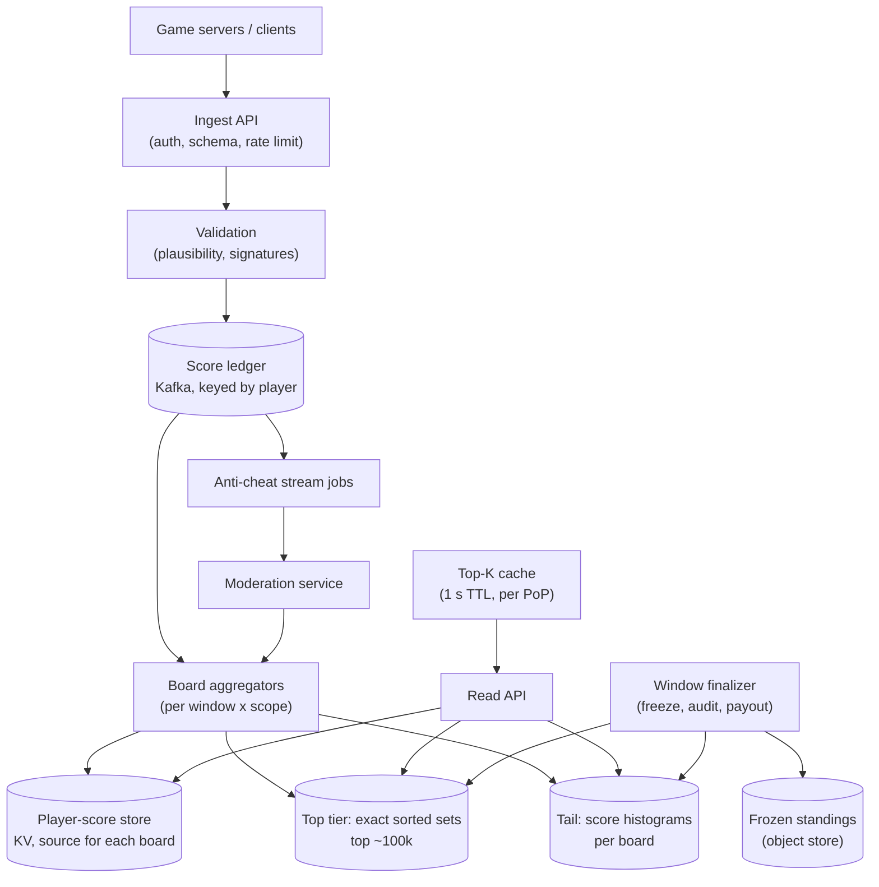

(The same system with every database, cache and technology drawn in is the [HLD at the top](#-architecture-at-a-glance-hld).)

### The spine: ledger → aggregators → derived views

The **ledger** is Kafka with long retention, compacted daily into a warehouse table. It's the **only source of truth**. Every board is a **materialized view**: it can be dropped and rebuilt from the ledger. That's the CQRS shape (write model ≠ read model).

**Why it matters concretely.** Redis replicates asynchronously. When a primary dies, the last few hundred milliseconds of writes are lost on failover. The only sane recovery is "rewind the aggregators to the last committed ledger offset and replay". That works **only if** (a) the board is derived, and (b) replaying writes is safe (§6).

#### Beginner version: rewind and replay, step by step

Think of the **ledger as a notebook** (every event, numbered, kept forever), the **board as a whiteboard** (a summary worked out from the notebook), and the **committed offset as a bookmark** ("done up to line 520").

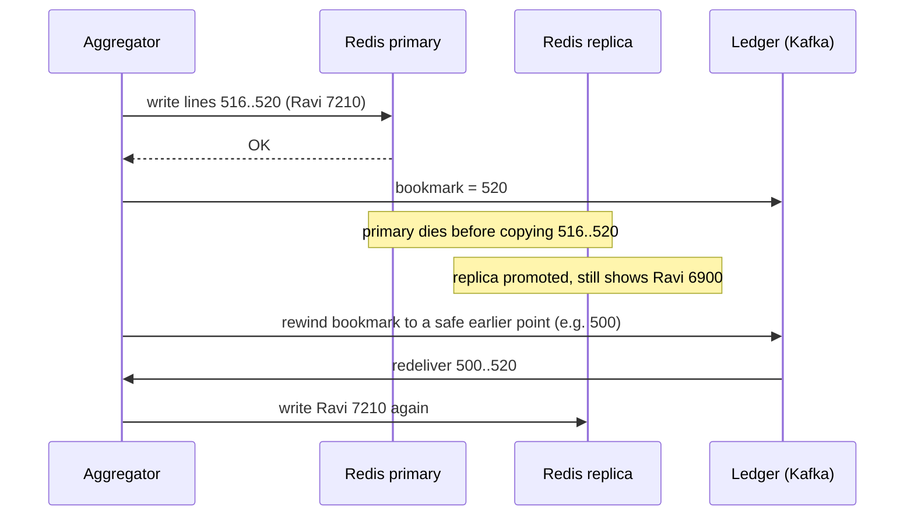

Redis said "OK" before copying the write to its replica, so after failover the whiteboard is **behind** the bookmark. Rewind a little before the bookmark and redo the lines.

- **(a) Derived:** Ravi's 7,210 is still in the notebook, so replay restores it. If the game server had written `ZINCRBY` straight into Redis, that update existed **only** in Redis and is gone for good.
- **(b) Safe to replay:** some replayed lines were already applied and survived. `ZADD board 1050 ravi` twice gives 1,050 (fine). `ZINCRBY board 50 ravi` twice gives 1,100 (double-counted). Hence "state, not operations" in §6.

### Three storage tiers per board

| Tier | Holds | Answers | Exactness | Size (200M players) |
|---|---|---|---|---|
| **Player-score KV** | every player's current score per board | "what's my score?", old score for delta updates | exact | ~10 GB per board, disk-backed |
| **Top-tier sorted set** | players above an adaptive threshold (~100k) | top-K, exact rank, neighbours near the top | exact | ~11 MB per board |
| **Histogram** | count per score bucket, prefix sums | rank and percentile for everyone else | bounded error | ~256 KB per board |

### Tiering moves write amplification into the KV

Tiering doesn't remove the 8 writes per event. It moves them into the KV, which now takes one write per (event, board) **plus** the `(board, score)` range index needed for refills (§7) and tail neighbours (§10).

| Layout | Physical writes per coalesced event | At ~170k events/s | Notes |
|---|---|---|---|
| One row per (player, board) + index per board | 8 rows + 8 index changes (delete old + insert new → often 16) | **~2.7–4M mutations/s** | index updates are the expensive half on an LSM (tombstone + insert) |
| **One row per (player, family), windows as columns; index only boards that need tail neighbours** | 1 row + index on ~2 boards | **~0.5–0.9M/s** | window rollover is a column rename in logic, not a data move |
| Same, coalesced over the 1 s batch | ÷ repeat-submitters per second | lower still at tournament end | coalescing helps most exactly at the burst |

**Ship the second layout.** A player's scores across windows of one family change **together** (one match updates daily, weekly, season, all-time at once), so store them together: 8 writes become 1. And only boards whose UI actually shows tail neighbours (usually all-time and season, not daily-per-timezone) get a range index.

#### Beginner version: why index writes are the expensive half

The KV is usually an **LSM tree** (Cassandra, RocksDB, DynamoDB internals). In an LSM you never overwrite in place. Changing Ravi's indexed score from 6,900 to 7,210 means:

1. Write a **tombstone** for index entry `(board, 6900, ravi)` ("this is deleted").
2. Insert a new entry `(board, 7210, ravi)`.

Tombstones stay until **compaction** merges files and drops them. Now picture the low-score band, where millions of players move a few points every match. Tombstones pile up faster than compaction clears them. A range read ("players near 7,210") must **skip over** all the tombstones in that range, so it gets slower and slower until the next major compaction.

**What to watch:** *tombstones scanned per range read* on the neighbour query. It degrades **weeks** before the latency alarm fires.

### Cost per unit

The number to put in a design doc is **cost per million score events**, not cluster size.

| Item | Size | Grows with |
|---|---|---|
| In-memory top tier + histograms | < 200 MB replicated | number of boards (barely) |
| Player-score KV | write IOPS, dominated by the index | events × indexed boards |
| Aggregator compute | CPU | events |
| **Ledger** | ~150 B/event × 1.7–4.7B events/day ≈ **a few hundred GB/day**, **~1–2 TB/day** after replication factor 3 | **retention × events** |

**The ledger is the line item that grows with the product**, not RAM. So: compact the Kafka topic into the warehouse daily, and keep **hot Kafka retention = longest grace period + rebuild window**. Older history lives in cheap warehouse storage.

---

## 5.5 Data model — tables, database choices and caches

> **⚡ 30-second version**
> 1. **Ledger** = Kafka topic keyed by `player_id`, compacted daily into a **warehouse** table (Iceberg/BigQuery). Rebuilds read the warehouse.
> 2. **Player scores** = **disk-backed KV** (Cassandra / DynamoDB / RocksDB-backed), one row per `(player, family)`, windows as columns, storing `(score, prev_score, applied_seq)`.
> 3. **Top tier** = **Redis sorted set** per board version, ~100k members, packed scores.
> 4. **Histograms** = small arrays in Redis (or a tiny KV), additive deltas, copied into every read-API process.
> 5. **Config store** (etcd / small SQL) holds the board alias, window state and bucket boundaries.
> 6. **Snapshots** = object store, versioned, never overwritten.
> 7. **Caches** are safe because every read says `as_of`. The thing never served from cache: the **CAS on the player's KV row**.

### Table design (sketch)

```sql
-- ================= Ledger: Kafka topic "scores", key = player_id =================
-- event = { event_id, player_id, family, value, event_time, match_id,
--           received_at, source: 'server' | 'client', proof, risk_score }
-- Compacted daily into the warehouse:
CREATE TABLE score_events (            -- warehouse (Iceberg / BigQuery), partitioned by day
  event_id     STRING,
  player_id    BIGINT,
  family       STRING,                 -- 'ranked_s14'
  value        BIGINT,
  event_time   TIMESTAMP,              -- when played: decides the window (§9)
  received_at  TIMESTAMP,
  match_id     STRING,                 -- dedupe key for sum boards (§6)
  source       STRING,
  status       STRING,                 -- 'applied' | 'rejected' | 'too_late' | 'quarantined'
  kafka_partition INT, kafka_offset BIGINT
);

-- ================= Match dedupe (ingest) =================
CREATE TABLE seen_matches (            -- KV with TTL = longest grace + retry window
  player_id  BIGINT,
  match_id   STRING,
  first_seen TIMESTAMP,
  PRIMARY KEY (player_id, match_id)
);

-- ================= Player-score KV: one row per (player, family) =================
CREATE TABLE player_scores (
  player_id    BIGINT,
  family       STRING,
  window_id    STRING,                 -- 'daily:2026-09-25', 'weekly:2026-W39', 'season', 'alltime'
  score        BIGINT,                 -- ABSOLUTE value, never a delta (§6)
  prev_score   BIGINT,                 -- lets a replay recompute the histogram delta (§6)
  applied_seq  BIGINT,                 -- ledger offset of the last applied event
  best_event_time TIMESTAMP,           -- tie-breaker source (§8)
  country      STRING,
  quarantined  BOOLEAN,                -- shadow quarantine (§12)
  PRIMARY KEY ((player_id, family), window_id)   -- one partition per player-family
);

-- Range index ONLY for boards that show tail neighbours / need top-tier refill (§7, §10)
CREATE TABLE board_score_index (
  board_id   STRING,                   -- 'ranked_s14:season:global'
  bucket     INT,                      -- coarse score band: spreads one board over many partitions
  score      BIGINT,
  player_id  BIGINT,
  PRIMARY KEY ((board_id, bucket), score, player_id)
) WITH CLUSTERING ORDER BY (score DESC);

-- ================= Top tier: Redis sorted set, per board VERSION =================
-- key    = lb:{ranked_s14:weekly:2026-W39}:v3:top
-- member = player_id
-- score  = raw * 2^22 + (2^22 - 1 - seconds_since_window_start)    (§8)
-- meta   = lb:{...}:v3:meta  HASH { threshold_T, target: 100000, max: 120000 }

-- ================= Histogram, per board version =================
-- key   = lb:{...}:v3:hist     65,536 x int32 counts (256 KB)
-- key   = lb:{...}:v3:applied  set of (aggregator_id, offset_range) already applied (§6)
-- bucket boundaries: config store, versioned, recomputed daily off-peak (§7)

-- ================= Config store (etcd / small SQL) =================
CREATE TABLE board_alias (
  board_id   STRING PRIMARY KEY,       -- what clients ask for
  version    INT,                      -- what is actually read (§11)
  updated_at TIMESTAMP
);

CREATE TABLE windows (
  board_id      STRING PRIMARY KEY,
  starts_at     TIMESTAMP,
  ends_at       TIMESTAMP,
  grace_until   TIMESTAMP,             -- an upper bound; freeze waits for watermarks (§9)
  state         STRING,                -- PRECREATED|OPEN|GRACE|FROZEN|AUDITED|PAID|ARCHIVED
  snapshot_version INT
);

-- ================= Object store: frozen standings =================
-- s3://lb-standings/{board_id}/v{n}/top.parquet       top tier, final ranks
-- s3://lb-standings/{board_id}/v{n}/histogram.bin
-- s3://lb-standings/{board_id}/v{n}/diff_from_v{n-1}.json   who moved and why (§9, §12)

-- ================= Anti-cheat =================
CREATE TABLE quarantine (
  player_id BIGINT, family STRING,
  reason STRING, flagged_at TIMESTAMP, reviewer STRING, state STRING,  -- 'shadow'|'removed'|'cleared'
  PRIMARY KEY (player_id, family)
);
```

**How one score uses these tables.** Priya scores 18,450 in match `m-88213`, previous weekly best 17,900:

```text
0. Ingest: verify proof, plausibility; INSERT seen_matches(priya, m-88213) IF NOT EXISTS → new
1. Kafka: append to partition hash(priya) at offset 9,001,233
2. Aggregator (batch of 1 s): coalesce Priya's events → max = 18,450
3. KV CAS: UPDATE player_scores SET score=18450, prev_score=17900, applied_seq=9001233
           WHERE player_id=priya AND family=ranked_s14 AND window_id='weekly:2026-W39'
           IF applied_seq < 9001233
4. Histogram: bucket(17900) -1, bucket(18450) +1, stamped with offset range
5. Top tier: Lua upsert with packed score (18450 >= T, so admit/update)
6. Commit Kafka offset 9,001,233
```

### Database choices

| Data | Store | Why this one | Why not the obvious alternative |
|---|---|---|---|
| Score ledger | **Kafka**, keyed by `player_id`, long retention | durable, ordered per player, replayable, feeds aggregators + anti-cheat + warehouse | a DB table as a queue: no cheap fan-out or replay; keying by board → one hot partition |
| Ledger history | **Warehouse** (Iceberg on S3 / BigQuery) | batch rebuild = one aggregation over billions of rows in minutes (§11) | replaying Kafka through live aggregators: hours and competes with live traffic |
| Player scores (everyone) | **Disk-backed KV**: Cassandra / ScyllaDB / DynamoDB | 200M+ rows × boards, point reads + CAS, cheap per GB | Redis for everyone: ~120 GB RAM + big-key pain (§3) |
| `(board, score)` range index | same KV, clustering by score DESC | refills (§7) + tail neighbours (§10) | a SQL index: fine at small scale, write-heavy at 1M/s |
| Top tier | **Redis sorted set** (Redis Cluster / Valkey / MemoryDB) | O(log N) rank via spans, range by score, Lua for atomic admit/evict | SQL `ORDER BY ... LIMIT`: no O(log N) rank |
| Histograms | small Redis keys or KV blobs; **copied into read-API memory** | 256 KB, additive updates, rank = binary search in local RAM | a sketch (KLL): ±ε·N is too coarse for a displayed rank (§7) |
| Alias, window state, bucket boundaries | **etcd / small strongly consistent SQL** | tiny, rarely written, must never be wrong | an eventually consistent store: two readers could see different board versions |
| Frozen standings | **Object store** (S3), versioned | immutable record for payouts, disputes, audit | a live Redis key: mutable, can't prove what it said yesterday |
| Friends graph | existing social service | multi-get friend list | duplicating the graph into the leaderboard |

### Caches

| Cache | Key → value | Where | How it stays correct | Why it exists |
|---|---|---|---|---|
| **Top-K cache** | `(board_version, page)` → entries + `as_of` | CDN / PoP, 1 s TTL, single-flight | stale by ≤ 1 s and says so; **pushed** by the aggregator on each flush | 33k views/s of the same bytes (§10) |
| **Histogram prefix sums** | `board_version` → int array | every read-API process | refreshed every 1 s; reads return `as_of` + `rank_error` | tail rank without touching Redis (§7) |
| **Board alias** | `board_id` → version | read-API memory | watch on config store | one lookup per request otherwise |
| **Cached threshold T** | `board_version` → T | aggregator memory | **only a pre-filter**; the Lua script decides against the live minimum (§7) | skip a round trip for obvious tail scores |
| **Provisional rank** | the player's own last result | the client app | overlay only if newer than board `as_of` | read-your-writes for self (§4) |
| **Previous window final** | `board_id` → snapshot | CDN | immutable once frozen | midnight thundering herd (§9) |

**Never cached:** the player's KV row inside the aggregator's CAS. The CAS (`IF applied_seq < X`) is only correct against the real, current row; a cached copy would let a replay or a parallel writer slip through.

---

## 6. Deep dive 1 — The write path, idempotency and coalescing

> **⚡ 30-second version**
> 1. **Key the ledger by player, not by board.** By board = one hot partition with one consumer.
> 2. **Coalesce before touching the sorted set.** 5 results in 1 s = 1 ZADD. Turns 1.4M logical writes/s into a few hundred thousand.
> 3. **Max = safe. Latest = needs a time guard. Sum = double-counts** if you use `ZINCRBY`.
> 4. **Never apply deltas to a view.** Compute the absolute total in the KV with CAS, then `ZADD` the absolute value.
> 5. **Commit order: KV → histogram → sorted set → offset.**
> 6. **The lost-flush bug:** crash after KV, before histogram → replay computes delta 0 → histogram drifts forever. Fix: store `prev_score` + `applied_seq`, and **recount nightly**.

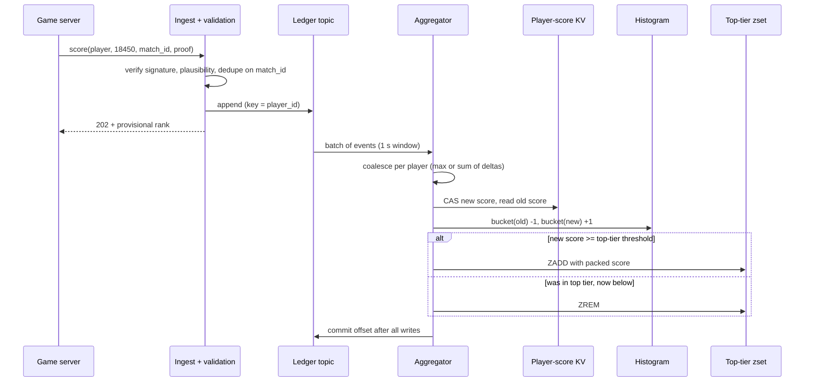

### Key the ledger by player, not by board

**The obvious choice is wrong.** "Put all writes for the global board in one partition, in order." Then the global board is **one Kafka partition, consumed by one consumer**. 170k events/s through one consumer doesn't work.

**Key by `player_id`.** Load spreads evenly over hundreds of partitions, and each player's events stay in order. That's the only ordering you need: a board is just an aggregate over **independent per-player registers**. Nobody cares if Priya's update is applied before or after Ravi's.

### Coalesce before touching the sorted set

A player who submits 5 results in one 1-second batch needs **one** board write, not five.

| Board type | Coalesce rule | Example: events 500, 800, 300 in one batch |
|---|---|---|
| Max | `max()` | one write: 800 |
| Sum | sum of deltas | one write: +1,600 (applied as an absolute total, below) |
| Latest | newest by event_time | one write: 300 |

At tournament end, a large share of the population submits in the same minute, and repeat submitters are common. Coalescing plus per-shard **pipelining** (send many commands in one round trip) turns ~1.4M logical writes/s into a **few hundred thousand** physical ones.

**The batch window is your latency/throughput knob.** One second is invisible to players (they already got a provisional rank) and roughly **an order of magnitude cheaper** than per-event writes.

### Idempotency depends on the score type

| Score type | Operation | Replay after a crash | What you need |
|---|---|---|---|
| **Max** | `ZADD ... GT` | safe, idempotent, commutative | nothing |
| **Latest** | `ZADD` with an event-time guard | safe only if older events can't overwrite newer | CAS on `event_time` in the KV |
| **Sum** | `ZINCRBY` | **double-counts** | dedupe on `match_id`; apply as a SET of a recomputed total |

#### Beginner version: how `ZINCRBY` silently inflates scores

Ravi's weekly XP is **1,000**. His batch contains a +50 match.

```text
1. Aggregator reads batch at offsets 500..520 (includes Ravi +50)
2. ZINCRBY board 50 ravi          → 1,050   ✓
3. Aggregator crashes BEFORE committing offset 520
4. Restart: Kafka redelivers 500..520 (at-least-once)
5. ZINCRBY board 50 ravi          → 1,100   ✗ (should be 1,050)
```

Nobody notices. Inflated scores look like **engaged players**. Months later a data scientist finds that weekly XP doesn't match match history.

**The fix: state, not operations.** Never send deltas to the view:

```text
1. KV row: ravi { score: 1000, applied_seq: 499 }
2. Batch 500..520: Ravi +50
3. CAS: SET score = 1050, prev_score = 1000, applied_seq = 520
        IF applied_seq < 520                      ← replay fails this check
4. ZADD board 1050 ravi                           ← absolute value: replay sets 1050 again
```

Absolute writes are idempotent. Writing "1,050" ten times gives 1,050. Writing "+50" ten times gives +500. The same argument makes **state-based CRDTs** replayable: you send the state, not the operation.

For sum boards, also dedupe on `match_id` at ingest (`seen_matches`), because a **game server** retrying the HTTP call creates a second ledger event with a new offset, which `applied_seq` alone can't catch.

### Commit order, and the replay bug hiding in it

**Order: KV → histogram → sorted set → Kafka offset.** If anything fails, the offset isn't committed and the batch replays. KV and sorted-set writes are absolute, so replays are harmless there.

**The histogram is the odd one out.** It's the only structure updated by **delta** (`old bucket −1, new bucket +1`). Two cases:

| Case | What happens | Fix |
|---|---|---|
| **Duplicate flush** (histogram applied, crash before offset commit) | replay applies −1/+1 again → double-move | stamp each flush with `(aggregator, offset range)`; histogram store ignores ranges already applied |
| **Lost flush** (KV applied, crash before histogram) | replay reads "old score" = new score → delta 0 → **the move is lost forever** | below |

#### Beginner version: the lost flush, step by step

Ravi moves from **6,900** to **7,210**. Bucket A = [6,800–7,000), bucket B = [7,200–7,300).

```text
1. KV CAS:      ravi 6900 → 7210                ✓
2. Histogram:   A -1, B +1                      ✗ crash before this
3. Restart, replay the same batch
4. Aggregator reads old score from KV = 7210    (already new!)
5. delta: bucket(7210) -1, bucket(7210) +1 = nothing
6. Histogram still says Ravi is in bucket A. Forever.
```

Nothing alarms. The histogram slowly drifts from the population it claims to describe. Every crash and every deploy makes tail ranks a little more wrong.

**You want both fixes:**

1. **Make the delta reproducible.** The KV row stores `(score, prev_score, applied_seq)`. A replay whose sequence **equals** `applied_seq` recomputes the delta from `prev_score` (6,900 → 7,210) instead of treating the write as a no-op.
2. **Reconcile nightly.** Batch-recount the histogram from the KV snapshot (one aggregation over 200M rows) and emit the diff as a metric. **A non-zero diff is a bug report about your write path**, and it's the only detector you'll have.

> **Insight:** it's cheaper to make one small structure **reconcilable** than to make the whole hot path **exactly-once**.

---

## 7. Deep dive 2 — Exact rank does not shard; tier it instead

> **⚡ 30-second version**
> 1. Exact rank needs **one ordered structure with subtree counts**. Once it's too big or too hot for one thread, you have 3 options.
> 2. **Hash-shard:** writes scale; every rank read fans out to S shards. Fan-out to 32 shards → **27%** of requests hit a slow shard.
> 3. **Range-shard by score:** reads cheap; skewed bands, rebalancing, non-atomic cross-band moves.
> 4. **Tier (ship this):** exact zset for the **top ~100k**, **quantile histogram** for everyone else.
> 5. **Top tier needs hysteresis** (admit above T, trim at 1.2× target) and **server-side Lua** for admit/evict. A cached T causes stale high scores in the top 100.
> 6. **65,536 quantile buckets → ±~1,500 ranks**, except at **point masses** (18M players at 1,000). Report `rank_error` per bucket.
> 7. **Sketches (KLL) answer percentiles, not ranks:** ε = 0.1% on 200M = ±200,000.

**Why a sorted set gives O(log N) rank:** spans on skiplist pointers (see the [glossary notes](#beginner-notes-what-a-sorted-set-is-and-why-rank-is-cheap-in-it)). A B-tree index doesn't keep subtree counts, so `COUNT(*) WHERE score > ?` scans everything above you. Order-statistic trees are rarely built into general databases because every insert updates counts up to the root, which destroys concurrency.

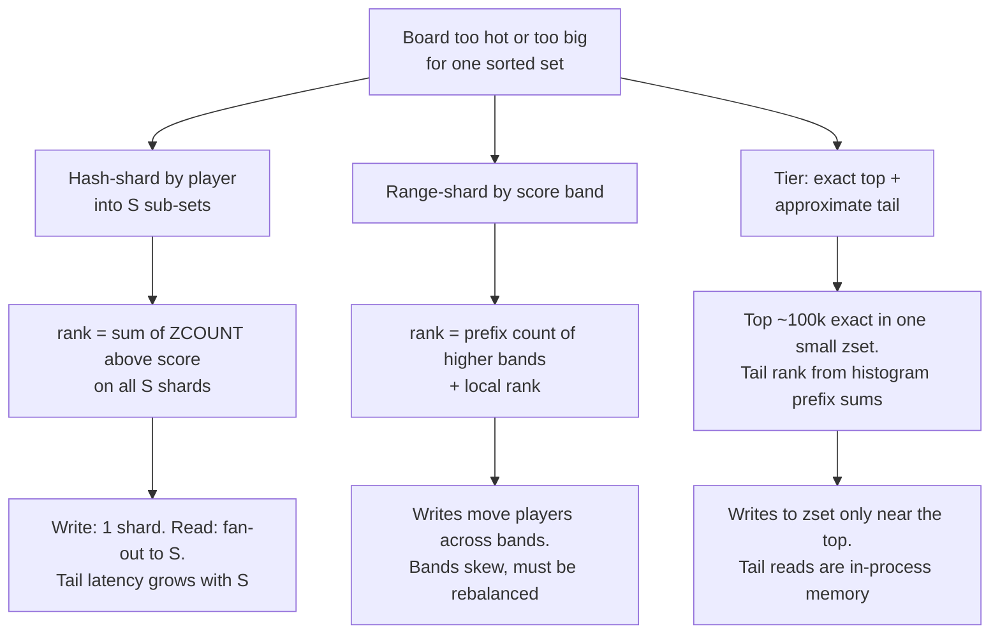

### Option 1: hash sharding

Split the board into **S** sub-sets by `hash(player) % S`. A write goes to one shard. A rank read asks **every** shard "how many players score above X?" (`ZCOUNT`) and adds them up.

**The cost isn't the S round trips; it's tail latency.** If each shard's p99 is 2 ms and you ask 32 shards, the chance at least one is slower than its p99 is:

```text
1 − 0.99^32 = 1 − 0.725 ≈ 27%
```

So 27% of requests are "slow requests". Your request p99 is now set by each shard's **p99.97**. Hedged requests (send a backup request if the first is slow) help, and so does keeping S small.

**Top-K under hash sharding** is a K-way merge of each shard's top-K: exact, but **S × K entries** on the wire per request (32 × 100 = 3,200). That's why you cache it.

### Option 2: range sharding by score band

Shard 1 = scores 0–999, shard 2 = 1,000–4,999, and so on. Rank = (players in all higher bands, cached) + local rank in your band. One shard per read. Cheap.

**Everything else gets hard:**

| Problem | Why |
|---|---|
| **Skew** | score distributions are heavy-tailed: a huge share of players sits at/near the starting score. The lowest band is enormous and hot, the top band is tiny |
| **Drift** | the distribution moves through a season, so band edges need periodic **live rebalancing** of members while they're being written |
| **Non-atomic moves** | a player crossing a band edge needs remove-from-one-shard + add-to-another. For a moment they're on the board **twice or not at all** |

### Option 3: tiering — the one to ship

It matches **where exactness is actually observed**: at the top, by humans comparing numbers.

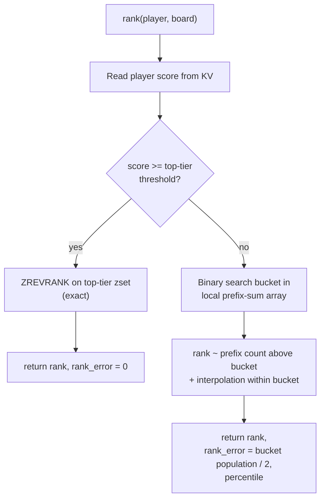

### The top tier: threshold with hysteresis

The top tier is a sorted set holding only players with score **above threshold T**, sized to roughly **100k**.

**Hysteresis, with numbers.** Target = 100,000, max = 120,000.

```text
- Admit anyone scoring >= T.                         (set grows: 100k → 101k → ... )
- Do nothing until size > 120,000.
- Then ZREMRANGEBYRANK: trim the bottom back to 100,000 (removes ~20,001).
- New T = score of the new lowest member.
```

**Without hysteresis**, you trim on every insert. A player hovering around T gets admitted, evicted, admitted, evicted on every match: constant churn for no visible benefit.

**Hysteresis only works one way.** On max and cumulative boards, T **only rises** (scores never go down). But:

- on **latest** boards (scores can drop), and
- after a **moderation purge** removes a few thousand top entries,

the set shrinks below target and **T must fall**. The players between the new T and the old T **aren't in the set**. Refilling needs a **score-ordered scan of the KV**: "give me the next 5,000 players below T". So the KV needs a `(board, score)` range index or a cheap range read. **You won't notice this requirement until the first purge.**

### The threshold race (check-then-act)

The ledger is keyed by player, so **dozens of aggregator instances** write to the **same** top-tier set. Each decides "admit or not" against **its own cached copy of T**. That's a check-then-act race:

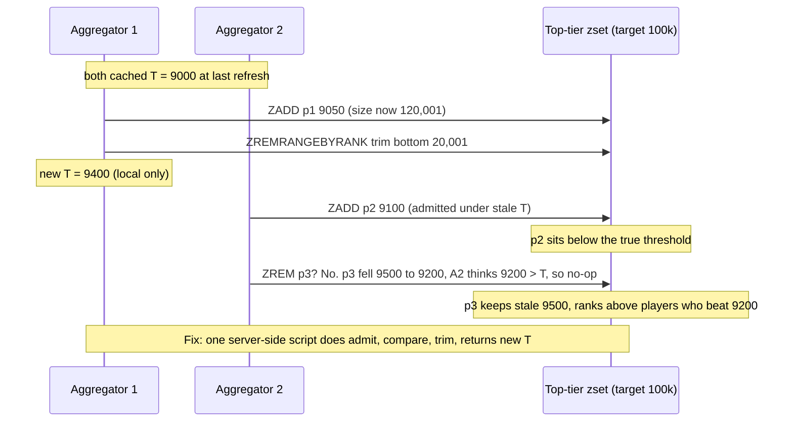

| Case | Harm |
|---|---|
| **p2** admitted below the true T | benign: an extra member, wrong by a few ranks until the next trim |
| **p3** keeps a stale high score | **bad**: on a latest or decayed-rating board, a ghost 9,500 outranks real players, right where the **top-100 screenshot** is taken |

**Two rules close it:**

1. **Every top-tier mutation is one server-side script** (Lua or a Redis function). It reads the **live** minimum, decides admit / update / evict, trims if over 1.2× target, and returns the new T. The aggregator's cached T is only a **pre-filter** to skip a round trip for obviously-tail scores. It never decides.
2. **A score decrease for a player whose previous score was above the cached T always issues the update.** `ZADD XX` updates only if the member exists, so for non-members it's a cheap no-op.

> **The pre-filter is safe for increases and unsafe for decreases. That asymmetry is the whole bug.**

Sketch of the script:

```lua
-- KEYS[1] = top zset, KEYS[2] = meta hash
-- ARGV[1] = member, ARGV[2] = packed score, ARGV[3] = target, ARGV[4] = max
local member, score = ARGV[1], tonumber(ARGV[2])
local target, maxn = tonumber(ARGV[3]), tonumber(ARGV[4])
local n = redis.call('ZCARD', KEYS[1])
local lowest = redis.call('ZRANGE', KEYS[1], 0, 0, 'WITHSCORES')
local T = (#lowest > 0 and n >= target) and tonumber(lowest[2]) or -math.huge

if score >= T then
  redis.call('ZADD', KEYS[1], score, member)          -- admit or update
else
  redis.call('ZREM', KEYS[1], member)                 -- fell below the live T
end

n = redis.call('ZCARD', KEYS[1])
if n > maxn then
  redis.call('ZREMRANGEBYRANK', KEYS[1], 0, n - target - 1)   -- trim bottom back to target
end
lowest = redis.call('ZRANGE', KEYS[1], 0, 0, 'WITHSCORES')
local newT = (#lowest > 0) and lowest[2] or '0'
redis.call('HSET', KEYS[2], 'threshold_T', newT)
return newT
```

(If `n` falls below target after a purge or decreases, the aggregator triggers a **refill** from the KV range index.)

### The tail: quantile-balanced histogram

The tail is a histogram of **B = 65,536 buckets** per board. Bucket edges are **quantile-balanced from the previous day's distribution**, not fixed-width.

```text
200M players ÷ 65,536 buckets ≈ 3,052 players per bucket
Interpolated rank error  ≈ ± half a bucket ≈ ±1,500
Relative error at rank 4M = 1,500 ÷ 4,000,000 ≈ 0.04%
```

**Fixed-width buckets would be useless.** If buckets were "every 10 points", 100M players would sit in the bottom few buckets, and ranks would be meaningless exactly **where most of your users live**.

**The histogram covers everyone, top tier included.** So tail rank = prefix count above the player's bucket + interpolation. There's no separate "top tier offset" to keep consistent.

#### Beginner version: computing Ravi's rank from a histogram

Ravi has **7,210** on the **all-time board (200M players)**. A slice of the histogram (sorted high to low, with prefix sums = "players in all higher buckets"):

| Bucket | Score range | Players in bucket | Prefix above this bucket |
|---|---|---|---|
| … | … | … | … |
| 21,402 | [7,300 – 7,420) | 3,040 | 3,806,960 |
| **21,403** | **[7,200 – 7,300)** | **3,000** | **3,810,000** |
| 21,404 | [7,110 – 7,200) | 3,060 | 3,813,000 |

```text
1. KV read: Ravi's score = 7,210
2. Binary search the local prefix array → bucket 21,403 ([7,200, 7,300))
3. Players above his bucket: 3,810,000
4. Interpolate inside the bucket: (7,300 − 7,210) ÷ 100 = 0.9 → ~2,700 players above him in the bucket
5. rank ≈ 3,810,000 + 2,700 + 1 = 3,812,701
6. rank_error = bucket population ÷ 2 = 1,500 ; percentile = 1 − 3,812,701 ÷ 200M ≈ 98.1% → "Top 2%"
```

No sorted set call at all: one KV read + a binary search in local memory.

### Point masses break quantile balancing

A bucket can't be split below one score value. If **18M players** sit at exactly **1,000** (the starting rating), one bucket holds 18M players, and the "±1,500" promise is false for every one of them.

**Fix:**
- Build boundaries by **greedy fill**: give each heavily populated score value **its own bucket**, and spread the rest evenly.
- Report **`rank_error` per bucket**, not one global constant.

The midpoint bound (population ÷ 2) is the honest worst case. Interpolation usually does much better in dense, smooth regions, and **no better inside a point mass**, where every player genuinely shares one competition rank.

### Why the tail is so cheap

- The histogram is a **65,536-entry int array = 256 KB**.
- **Every read-API replica** keeps a copy of the prefix sums **in process memory**, refreshed every second.
- A tail rank query = **one KV read + one binary search** in local memory.
- The histogram store takes **additive deltas**. Each aggregator accumulates deltas locally for one second and flushes **one sparse vector**. So even the hot low-score buckets see **one write per aggregator per second**, not one per event.

### Two honest caveats

1. **Ties are ties.** If 30% of players have the starting score, they really share a rank under competition ranking. No data structure fixes that. Show **"Top 70%"**, not a seven-digit number.
2. **Boundaries shift.** Quantile boundaries are recomputed daily, so a player's reported rank can move by up to the bucket error **without anyone scoring**. Recompute off-peak, and publish `rank_error` so the client suppresses changes smaller than the error.

### Histogram vs sketch (KLL, t-digest)

| | Histogram with quantile buckets | Sketch (KLL, t-digest) |
|---|---|---|
| Best for | **displayed rank** on a known population | **percentiles** across many dynamic segments (per country, per cohort, ad-hoc) |
| Error | ± half a bucket (~1,500 on 200M) | **additive ε·N**: ε = 0.1% on 200M = **±200,000 ranks** |
| Mergeable | yes, if boundaries are shared | yes, always |
| Use it for | "#3,812,701 ± 1,500" | "you're in the top 3%" |

> **Sketches answer percentile questions; histograms with tight quantile buckets answer rank questions.**

---

## 8. Deep dive 3 — Tie-breaking and the 53-bit trap

> **⚡ 30-second version**
> 1. Zset scores are **doubles**: exact integers only up to **2^53**.
> 2. To break ties by "who got there first", pack: `raw × 2^22 + (2^22 − 1 − seconds_since_window_start)`.
> 3. 22 bits of time = **48.5 days**; that leaves **31 bits = ~2.1B** for the raw score.
> 4. Go past 2^53 and values **round silently**. Ties then fall back to member-id order. Put an **assertion** on pack.
> 5. **Use event time, not arrival time**, and bound how far back it can claim.
> 6. **Competition rank** = `ZCOUNT board ((raw+1) × 2^22) +inf` + 1, not `ZREVRANK`.

```text
packed = raw_score * 2^22 + (2^22 - 1 - seconds_since_window_start)
```

### §8 explained in detail, with examples (beginner version)

**Why pack at all?** A sorted set orders by one number. You want "higher score wins; if equal, whoever got it **earlier** wins". So you put the score in the high bits and a "how early" number in the low bits. Earlier = larger low bits = ranks higher.

**Worked example.** Window started Monday 00:00. Priya hits 18,450 at 01:00 (3,600 s in). Kai hits 18,450 at 02:00 (7,200 s in).

```text
2^22 = 4,194,304

Priya: 18,450 × 4,194,304 + (4,194,303 − 3,600) = 77,384,908,800 + 4,190,703 = 77,389,099,503
Kai:   18,450 × 4,194,304 + (4,194,303 − 7,200) = 77,384,908,800 + 4,187,103 = 77,389,095,903

Priya > Kai → Priya ranks higher (she got there first).
Unpack: raw = floor(packed / 2^22) = 18,450
```

**Why 22 bits of time and 31 bits of score?**

| Part | Bits | Range |
|---|---|---|
| time (seconds) | 22 | 4,194,304 s ≈ **48.5 days** |
| raw score | 53 − 22 = **31** | up to ~**2.1 billion** |
| total | **53** | 2^53 ≈ 9.007 × 10^15, the largest range where doubles hold every integer exactly |

**What happens past 2^53.** Doubles have 53 bits of precision. Beyond 2^53, they can only represent **even** numbers, then multiples of 4, and so on. Two different packed values **round to the same double**. There's no error message. They just compare equal, ties fall back to lexicographic member order (`aaron` vs `zoe`, §1), and "earlier wins" quietly stops being true.

**How it shows up, months later:**
- a season is extended past **48 days** → the time part overflows into the score bits;
- a **score multiplier event** pushes top scores past **2^31** → packed value passes 2^53.

**Defences:**
- **Assert** on the packed value in the aggregator (`assert packed < 2**53`).
- A **unit test** on the maximum reachable score per game mode.
- **Treat a season-length change as a schema change** for this board.

```python
TIME_BITS = 22
MAX_TIME = (1 << TIME_BITS) - 1

def pack(raw: int, event_time_s: int, window_start_s: int) -> int:
    t = event_time_s - window_start_s
    assert 0 <= t <= MAX_TIME, "window longer than 48.5 days: change the packing"
    assert 0 <= raw < (1 << (53 - TIME_BITS)), "raw score exceeds 2^31"
    packed = raw * (1 << TIME_BITS) + (MAX_TIME - t)
    assert packed < (1 << 53)
    return packed
```

### Two more details that bite

**1. Earlier-wins needs event time, not arrival time.**

| Pack | Problem |
|---|---|
| arrival time | a player on a slow network loses ties to one on a fast network |
| event time | the client can **lie**: submit late, claim early, win the tie |

So pack event time **and bound how far in the past it can claim** (the grace bound, §9). Server-authoritative modes take event time from the game server, not the client.

**2. Competition rank isn't `ZREVRANK`.** `ZREVRANK` gives ordinal rank (1, 2, 3, 4). For competition rank (1, 2, 2, 4), count everyone whose **raw** score is strictly higher:

```text
competition_rank(Priya) = ZCOUNT board (18,451 × 2^22) +inf  + 1
                        = ZCOUNT board 77389103104 +inf      + 1
```

Every packed score with raw ≥ 18,451 is ≥ 18,451 × 2^22, whatever its time bits. So the packed score **orders the list**, and **rank is computed from the unpacked score range**.

---

## 9. Deep dive 4 — Time-windowed boards

> **⚡ 30-second version**
> 1. **Each window is its own board**, keyed by window id. Costs: write amplification + memory + boundaries.
> 2. **Rolling windows aren't sorted sets.** `ZUNIONSTORE` of 7 × 50M = seconds of blocking. Do rolling only on the top tier, or use calendar windows.
> 3. **Local-midnight resets = one board per UTC offset** (dozens). Fine for top tier + histograms only.
> 4. **A window has a lifecycle:** Precreated → Open → Grace → Frozen → Audited → Paid → Archived.
> 5. **Freeze on a watermark, not the clock**, because the window closes exactly when the burst peaks.
> 6. **Size aggregators for the burst drain.** Drain time is a floor on the grace period.
> 7. **Midnight is a thundering herd:** serve yesterday's final, pre-warm the new top-K, jitter refreshes.
> 8. **Archive with `UNLINK`, never `DEL`.**

Window ids: `ranked_s14:daily:2026-09-25:utc+5:30`, `ranked_s14:weekly:2026-W39`.

### Rolling windows aren't sorted sets

"Top players over the last 7 days" can't be maintained by subtracting old scores from a sorted set cheaply. The usual trick is 7 daily sets + `ZUNIONSTORE`. That costs O(N) + O(M log M) over the union. At **50M members per day**, it's a **multi-second blocking** operation on a single-threaded server, and every other board on that shard stalls.

**Options:**
- compute rolling windows **only for the top tier** (union of seven 100k-member sets is trivial), or
- **reframe the product** as calendar windows ("this week").

### Timezone resets multiply boards

A daily board that resets at **local** midnight needs **one board per UTC offset in use**: dozens, including half- and quarter-hour offsets (India +5:30, Nepal +5:45). Fine for top tier + histograms (11 MB + 256 KB each). Not fine if each is a full exact sorted set. Many teams choose **one global reset time** and accept that it's 3 a.m. somewhere.

### Late events → windows have a lifecycle, not an instant

Mobile clients play offline and submit hours later. Game servers retry through outages. So a window can't just "end" at midnight.

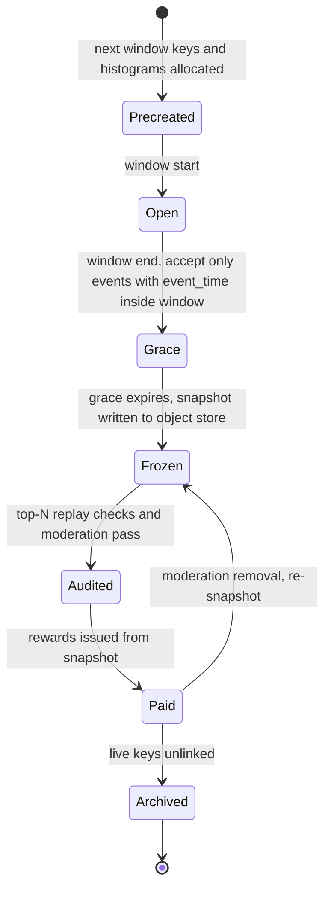

| State | What happens | Why |
|---|---|---|
| **Precreated** | next window's keys and histograms allocated **before** it starts | the first write after midnight isn't a key-creation race between aggregators |
| **Open** | normal writes | |
| **Grace** | accept events whose **event_time** is inside the window, up to a bound (e.g. 2 h). Older → ledger for audit, not applied | late offline play counts; the bound also blocks "claim an early timestamp to win ties" |
| **Frozen** | snapshot of top tier + histogram written to the **object store** | rewards are **always** computed from the snapshot, never the live key |
| **Audited** | replay verification of top-N, moderation pass | §12 |
| **Paid** | rewards issued from the snapshot | a removal after this = a **new snapshot version with a diff**, so support can explain exactly whose rank changed and why |
| **Archived** | live keys removed with **`UNLINK`** | below |

**`UNLINK`, never `DEL`.** Deleting a multi-GB sorted set synchronously frees tens of millions of allocations **on the event loop**, stalling the shard for seconds. `UNLINK` frees in a background thread. Watch out: `RENAME` onto an existing key does the same hidden delete unless lazy-free for server-side deletes (`lazyfree-lazy-server-del`) is enabled. Check before you rely on rename-swap (§11).

### Freeze on a watermark, not the clock

The obvious implementation is "freeze at `window_end + 2h`". That's correct only if aggregators are **caught up** at that moment. The one moment they're guaranteed **not** to be is the end of a tournament, because the window closes precisely when the submission burst peaks.

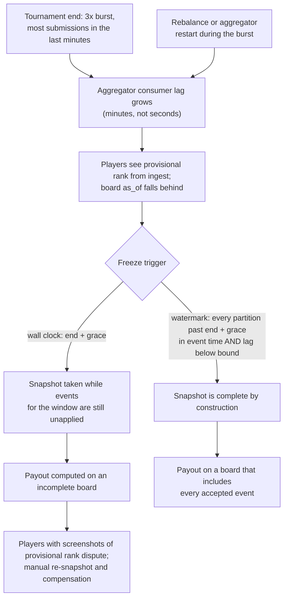

**The fix: freeze on per-partition low watermarks.** Freeze a window only when:

1. **every** ledger partition's committed offset has reached an event whose `event_time` is past `window_end + grace`, **and**
2. the ingest tier has **stopped accepting** events for the window.

**Details that matter:**
- **A partition with no traffic must emit heartbeat records**, or its watermark never advances and the freeze never fires.
- **Put an upper bound on the wait and page** when it's hit, rather than silently freezing on the clock.

```python
def can_freeze(window, partitions, now):
    if ingest.accepting(window):
        return False
    for p in partitions:
        wm = p.committed_event_time_watermark()    # includes heartbeats
        if wm < window.ends_at + window.grace:
            if now > window.ends_at + window.grace + MAX_FREEZE_WAIT:
                page("freeze blocked", window, p)
            return False
    return True
```

**What the provisional rank promises.** It's computed **at ingest**, against the **last-applied** board. During a burst it can be off by the size of the unapplied backlog near the player's score. For the top tier, label it **"provisional"** in the UI until the window is frozen. A screenshot of a provisional #3 that becomes a final #7 is **the most common leaderboard support escalation**, and the API creates it, not a bug.

### Size aggregators for the burst drain

```text
Burst input:              170k events/s for 5 minutes
Aggregator capacity:      100k events/s
Backlog after burst:      (170k − 100k) × 300 s = 21M events
Post-burst input:         ~55k/s → surplus = 100k − 55k = 45k/s
Drain time:               21M ÷ 45k/s ≈ 467 s ≈ 8 minutes
```

**That drain time is a floor on your grace period.** It's also why grace should be expressed as **"watermark + N minutes"**, not a fixed constant chosen when the game had a tenth of its players.

### Midnight is a thundering herd

At reset:
- every client with the board open refetches;
- the top-K cache for the new window is **empty**;
- the new board is nearly empty, so every rank is changing rapidly.

| Defence | How |
|---|---|
| Serve the **previous window's final standing** for the first few minutes | clients show "yesterday's winners" anyway |
| **Pre-warm** the new window's top-K cache from the aggregator | not from reads |
| **Jitter** client refreshes | server-dictated, not a client constant |

---

## 10. Deep dive 5 — Hot keys and read fan-in

> **⚡ 30-second version**
> 1. With tiering, the **write** hot key is mostly gone. Heat moves to **reads**.
> 2. **Top-K is the same bytes for everyone** → 1 s TTL cache + single-flight + aggregator push.
> 3. **My rank:** tail = local histogram; top tier = one `ZREVRANK` on 100k members (microseconds), replicas OK.
> 4. **Friends: compute on read** (multi-get + sort). Fan-out on write inherits the celebrity problem.
> 5. **Tail neighbours** come from the KV `(board, score)` range index, labelled approximate.
> 6. **Big keys still hurt operations:** slot migration, fork/CoW OOM, full resync.

| Read | Why it's hot | Defence |
|---|---|---|
| **Top-K** | 33k views/s of the **same** global top-100 | 1 s TTL per PoP + request coalescing (single-flight) → **one origin read per second per PoP**. Aggregator precomputes top-1,000 on each flush and **pushes** it to the cache, so a miss never reaches the zset |
| **My rank** | per user, uncacheable in general | tail players: local histogram, never touches the zset. Top tier: one `ZREVRANK` on 100k members = microseconds. Replicas can serve it; tens of ms replica lag is invisible because the player's own write returned a provisional rank |
| **Friends board** | per user | **compute on read**: median few hundred friends → one KV multi-get + in-memory sort = sub-millisecond |
| **Tail neighbours** | histogram says "~#3.8M" but not who is at #3,812,943 | KV range read: N nearest scores above and below |
| **Event boards** (creator tournament) | small membership, enormous viewers | the read cache makes membership irrelevant. Below ~100k members a board is **top-tier only**, no histogram |

### §10 explained with one running example: Sunday, tournament end

#### First, the two words

- **Hot key:** one Redis key gets more requests than **one shard** can serve. In Redis Cluster, a key lives on exactly one shard, and that shard runs commands on **one thread**. Adding more shards doesn't help, because the key can't be split.
- **Read fan-in:** **many readers converge on the same data** (many → one). It's the opposite of fan-out (one write → many copies). 10M phones all opening "Top 100" is fan-in onto one key.

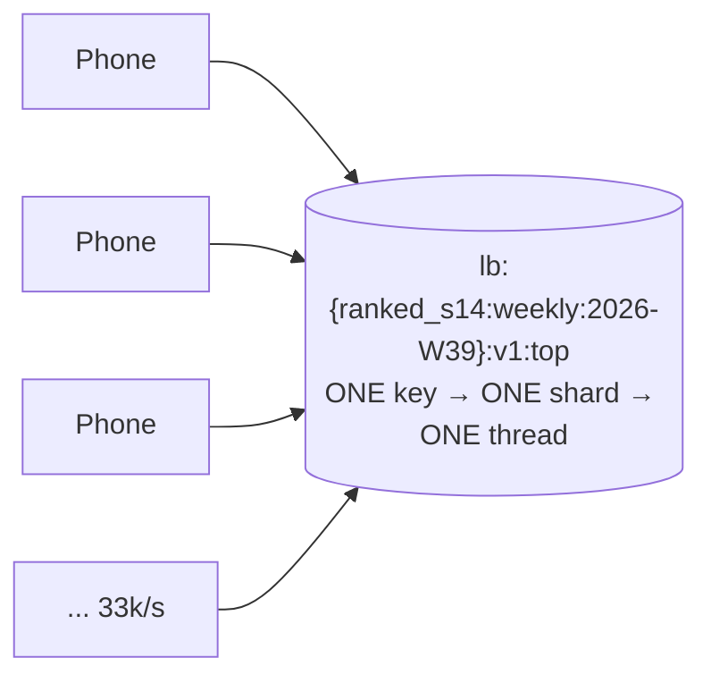

#### The setup

Sunday 23:00, the last hour of the W39 tournament. 10M players are online.

| Read | Rate | Same answer for everyone? |
|---|---|---|
| "Top 100" screen | **33k/s** (×3 at the final minutes ≈ 100k/s) | **yes**, identical bytes |
| "My rank" | ~50k/s | no, per user |
| "Friends" tab | ~10k/s | no, per user |
| "Around me" (neighbours) | ~10k/s | no, per user |

#### Problem 1: Top 100, everyone wants the same bytes

**Without a cache:** every view runs `ZRANGE ... 0 99 REV WITHSCORES` on **one key**.

```text
100k ZRANGE/s × (100 entries each) → one Redis thread saturated
→ latency for EVERY key on that shard spikes, including the top-tier writes
```

Adding read replicas only helps a little: every replica holds the same key, so you'd need dozens of them just for one list.

**The fix, in three layers:**

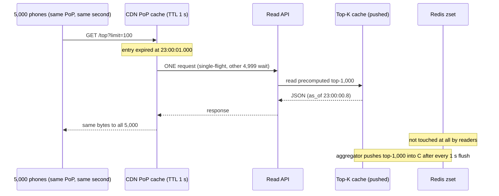

| Layer | What it does | Example effect |
|---|---|---|
| **1 s TTL per PoP** | Each CDN location answers from its copy for 1 second | 200 PoPs → at most **~200 origin reads/s** instead of 100k |
| **Single-flight** (request coalescing) | When the entry expires, **only one** request goes to the origin; the others **wait for that answer** | Without it: 5,000 phones hit expiry at the same ms → 5,000 origin calls (a **cache stampede**) |
| **Aggregator push** | After each flush the aggregator writes the top-1,000 as JSON into the cache | Even a cache miss never reaches the zset. **Reads cost Redis 0 ops** |

Result: **100k reads/s → ~200 cheap cache reads/s → 0 zset reads.** The answer is up to 1 s stale and says so with `as_of`. Nobody can see a 1-second delay on a top-100 list.

**Why it's 1,000, not 100:** pages 1–10 (`?limit=100&cursor=...`) are served from the same pushed blob.

#### Problem 2: "My rank": per user, so it can't be shared

Ravi's rank isn't Priya's rank, so a shared CDN copy can't serve it. It does split cheaply, though:

```text
50k "my rank" reads/s
 ├─ 99.95% are tail players (score < T)
 │    → KV read (own score) + binary search in the histogram copy IN API MEMORY
 │    → Redis ops: 0
 └─ 0.05% are top-tier players (~25/s)
      → ZREVRANK on a ~100k-member zset = microseconds
      → served by a REPLICA (a few ms of lag is fine)
```

**Why replica lag is fine:** right after a match, the player's own app already shows the **provisional rank** returned by the write (§4). The replica only has to catch up before the player's *next* look.

So "my rank" sends about **25 Redis ops/s**, not 50k.

#### Problem 3: Friends: compute on read

Ravi has 140 friends. He opens the Friends tab:

```text
1. friends(ravi) → 140 ids                 (social service, cached)
2. KV multi-get: (friend, ranked_s14) × 140 → each row has the weekly:2026-W39 column
3. sort 141 numbers in memory               → microseconds
4. "You are #3 of 141"                      (exact)
```

**Why not a stored friends board per player?** That's fan-out on write:

| | Store per player (fan-out on write) | Compute on read |
|---|---|---|
| A streamer with 2M followers scores once | **2M sorted-set updates** | 0 |
| Normal player (140 friends) scores | 140 updates | 0 |
| At 170k events/s | ~24M writes/s | 0 |
| Friends tab open | 1 `ZREVRANK` | 1 multi-get of ~140 rows + sort |

Reads are rarer than writes here, and each read is small, so **compute on read** wins. Cap the friends list at a few thousand. For huge graphs, use "top friends by score" via a secondary index.

#### Problem 4: Neighbours ("around me")

A tail player isn't in the zset, so neighbours come from the **KV range index** on disk: one short sorted read around their score (see the tail-neighbours example below). Redis isn't involved.

#### Problem 5: Event boards: tiny board, huge audience

A creator runs a tournament: **5,000 players**, but **2M viewers** watching the stream open the board.

- **Writes:** tiny. A plain sorted set, no histogram (below ~100k members, top-tier only).
- **Reads:** 2M viewers → **the same Top-K cache path as Problem 1.** It's the same fan-in problem, just on a small key.

The size of the board doesn't matter. What matters is **how many people read the same bytes**.

#### Where the write hot key went

Before tiering, every score change hit `ZADD` on the one big key: 170k/s on one thread. With tiering:

```text
170k events/s
 → coalesced to a few hundred thousand KV writes (spread over many KV nodes)
 → histogram: 1 flush per aggregator per second
 → zset: only scores ≥ T (a small fraction), via one Lua call each
```

**The write hot key mostly disappears.** That's why §10 is about **reads**.

#### Summary: what each read costs Redis at the peak

| Read | Incoming | Path | Redis zset ops/s |
|---|---|---|---|
| Top 100 | ~100k/s | CDN 1 s TTL + single-flight + pushed blob | **~0** |
| My rank | ~50k/s | histogram in API memory; `ZREVRANK` on a replica for the top tier | **~25** |
| Friends | ~10k/s | KV multi-get + sort | **0** |
| Neighbours | ~10k/s | KV range index (tail), `ZRANGE` (top tier) | **small** |

### §10 follow-up questions, answered

#### Q1. What is a PoP, and what does "200 PoPs × 1 refresh/s → ~200 origin reads/s" mean?

A CDN (Cloudflare, Akamai, CloudFront) has **data centers in many cities**. Each one is a **PoP (Point of Presence)**: Mumbai, Delhi, London, Frankfurt… about 200 of them. A phone talks to its **nearest PoP**, not to our servers.

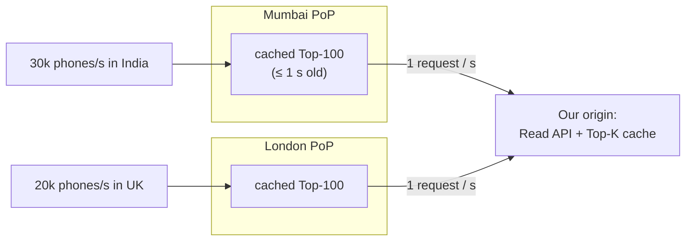

"1 s refresh" = each PoP keeps its copy for 1 second, then asks our origin **once** for a fresh one. Everyone else in that city gets the copy.

```text
Mumbai PoP: 30,000 phones/s → served from its copy → 1 request/s reaches us
London PoP: 20,000 phones/s → served from its copy → 1 request/s reaches us
... × 200 PoPs
Total reaching our servers ≈ 200 requests/s, instead of 100,000
```

#### Q2. The CDN fixes reads. What fixes writes?

**The CDN does nothing for writes.** Writes never pass through it. They take a separate path with its own tricks:

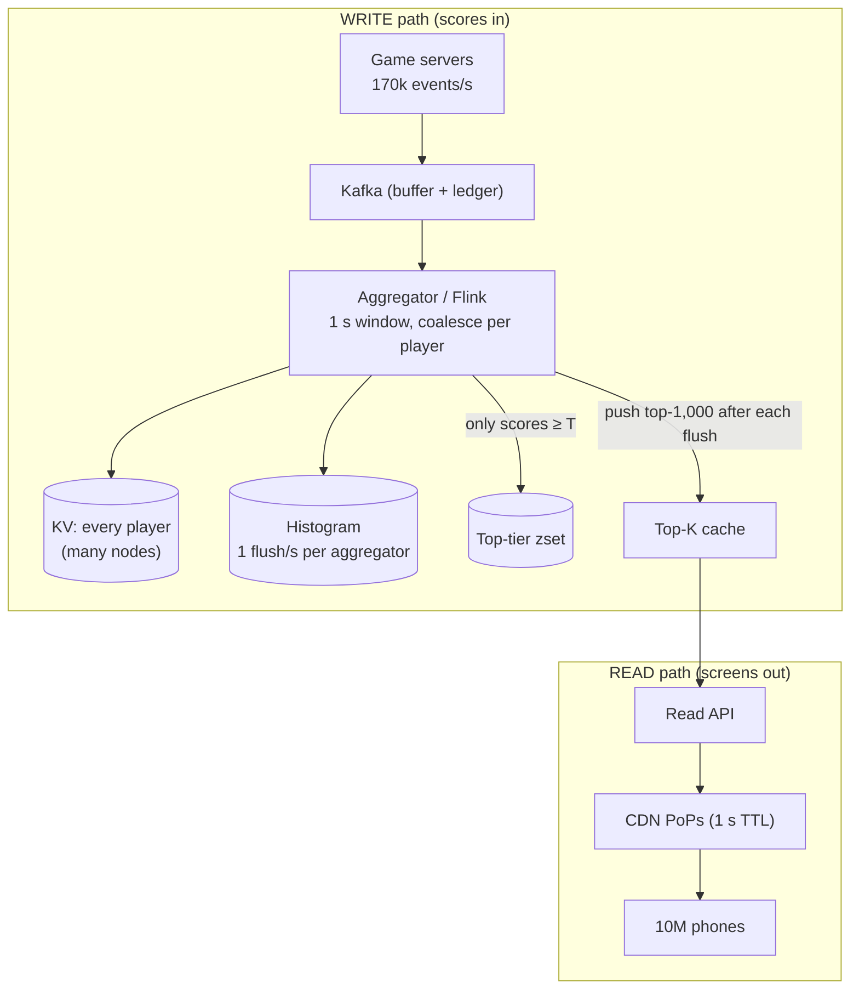

| Trick | What it does | Example |
|---|---|---|
| **Kafka buffer** | Absorbs the burst; aggregators drain at their own pace | 170k/s arrive, 100k/s drained, backlog clears after the burst (§9) |
| **1 s coalescing** | A player's 5 matches in one second = 1 write | 1.4M logical writes → a few hundred thousand |
| **KV across many nodes** | Each player's row is on a different node | no single hot key |
| **Histogram flush** | ±1s gathered in memory, flushed once per second | 1 Redis write/s per aggregator |
| **Tiering** | Only scores ≥ T touch the zset | Ravi (7,210 < T = 21,900) never writes the zset |

How the two paths meet (freshness):

```text
t = 0.0 s   Priya scores 18,450
t ≈ 0.5 s   aggregator flushes: KV → histogram → zset (Lua)
t ≈ 0.5 s   aggregator pushes the new top-1,000 into the Top-K cache
t ≤ 1.5 s   each PoP's copy expires → it fetches the new list → phones see Priya at #2
```

#### Q3. Is Kafka or Flink doing the 1-second batching?

| Piece | Job | Batches the logic? |
|---|---|---|
| **Kafka** | Durable buffer + ledger; keeps per-player order; replayable | **No.** It stores events (its producer/consumer batching is only network efficiency) |
| **Flink / aggregator** | Reads Kafka, groups into **1 s windows per player**, merges, writes once | **Yes** |

**Example: one second of events:**

```text
offset  player  score
500     ravi    7,100
501     priya   18,200
502     ravi    7,210
503     ravi    6,950
504     priya   18,450
505     kai     9,000
```

```text
Step 1  group by player (max board):  ravi 7,210 · priya 18,450 · kai 9,000   (6 events → 3)
Step 2  KV CAS per player, applied_seq = last offset for that player (503, 504, 505)
Step 3  merge histogram deltas of ALL players → ONE Lua flush with 6 bucket changes
Step 4  top-tier zset: only Priya ≥ T → one Lua upsert
Step 5  commit Kafka offset 505
Result: 6 events → 3 KV writes + 1 histogram flush + 1 zset call
```

The same thing in Flink:

```java
events                                       // Kafka topic "scores", key = player_id
  .keyBy(e -> e.playerId + ":" + e.family)   // one player's events on one worker, in order
  .window(TumblingProcessingTimeWindows.of(Time.seconds(1)))
  .reduce((a, b) -> a.score >= b.score ? a : b)   // max board; sum board: add deltas
  .addSink(new BoardSink());                 // KV CAS → collect histogram deltas → Lua flush → top-tier Lua
```

**Catch:** Flink's exactly-once covers **its own state**, not Redis or the KV. After a crash it replays the window and writes again. So you still need absolute values (no `ZINCRBY`), the `applied_seq` CAS, and stamped histogram flushes. **Flink batches; idempotent writes make the replays safe.**

| Window size | Writes saved | Board delay |
|---|---|---|
| 100 ms | less | fresher |
| **1 s** | **~10× cheaper than per-event** | invisible (the player already has a provisional rank) |
| 10 s | more | top-100 feels laggy at tournament end |

#### Q4. What do the "Incoming" and "Redis load" numbers mean, row by row?

**Incoming** = requests/s from phones. **Redis load** = how many of those actually reach the Redis sorted set.

**"My rank": 50k/s in, ~25/s to Redis.**

Tail player, Ravi (7,210):

```text
1. KV: Ravi's score                 → 7,210
2. 7,210 < T (21,900)               → tail player
3. histogram copy in API RAM        → ~#3,812,701 ± 1,500
Redis touched? NO
```

Top-tier player, Priya (18,450):

```text
1. KV: Priya's score                → 18,450
2. 18,450 ≥ T                       → top tier
3. Redis REPLICA: ZREVRANK priya    → 1 → #2 exact
Redis touched? YES: one tiny command on a read-only copy
```

**Where ~25/s comes from:**

```text
Top tier share  = 100,000 ÷ 200,000,000 = 0.05%  (1 in 2,000 players)
50,000 req/s ÷ 2,000 ≈ 25 req/s need Redis; the other 49,975 use the histogram
```

Caveat: top players check more often. Even at 10× that's ~250/s, which is still tiny for one Redis shard (~100k simple ops/s). **Replica lag is fine** because the player's app already shows the provisional rank returned by their write.

**"Friends": 10k/s in, 0 to Redis.**

```text
1. social service: Ravi's friends     → 140 ids
2. KV multi-get: 140 rows (weekly:2026-W39 column)
3. add Ravi → sort 141 numbers in memory (µs)
4. "You are #3 of 141" (exact)
```

There's no stored friends board: one streamer with 2M followers scoring once would mean 2M writes.

**"Neighbours": 10k/s in, small load on Redis.**
- Tail player: KV score index → 2 rows above and 2 below 7,210. No Redis.
- Top-tier player: `ZREVRANK` + `ZRANGE` around the position. Only that 0.05%.

| Screen | Phones/s | Answered by | Reaches Redis/s |
|---|---|---|---|
| My rank | 50,000 | tail: API-memory histogram · top tier: Redis replica | ~25 |
| Friends | 10,000 | KV multi-get + sort | 0 |
| Neighbours | 10,000 | tail: KV index · top tier: Redis | small |

#### Q5. "Histogram in API memory": why not a cache?

**API memory *is* a cache: a local, in-process one.** Each read-API server keeps its own copy in RAM. The real choice is **local vs. remote cache vs. CDN**:

| Option | Where | Verdict |
|---|---|---|
| **CDN** | PoPs | **No.** The answer is per user (Ravi's rank ≠ Priya's); one shared response can't serve everyone |
| **Remote cache (one Redis key)** | `...:hist` | **No: it becomes the hot key.** 50k req/s × 256 KB ≈ **12.8 GB/s** from one shard |
| **Local copy in each API server** | server RAM | **Yes.** Small, read by every request, same for all users, OK to be 1 s stale |

**Rule of thumb:**

| Data | Small? | Same for everyone? | Where it lives |
|---|---|---|---|
| Top-100 list | yes | **whole response** is the same | **CDN** |
| Histogram | yes (256 KB) | the **data** is the same (the answer isn't) | **local API memory** |
| Board alias (`board_id → v3`) | tiny | yes | **local API memory** |
| Player's score | small each, 200M of them | **no** | **KV** (not cached in the CAS path) |

#### Q6. Doesn't that mean one server handles ~50k requests/s? Isn't it risky?

**No: the load is spread across many servers, and each one has its own copy.**

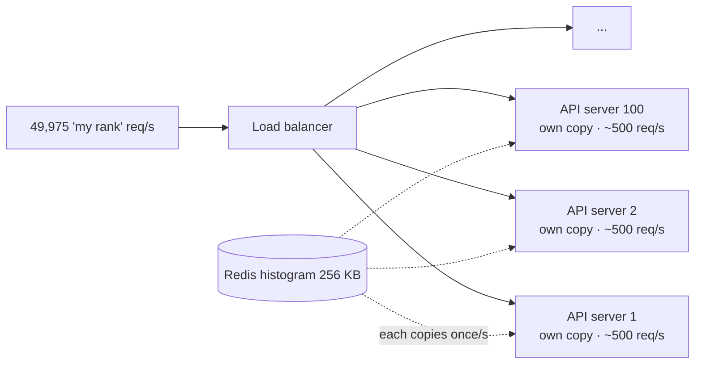

```text
49,975 ÷ 100 servers ≈ 500 req/s each
Histogram work per request ≈ 1 µs → 0.5 ms CPU per second per server
The real per-request cost is the KV read, spread over the KV cluster
```

| Risk | What happens | Why it's OK, or the fix |
|---|---|---|
| A server crashes | its requests fail briefly | the LB routes to the other 99; the copy is **derived**, nothing is lost |
| Cold start | no histogram in RAM yet | load from Redis on boot (~200 MB for ~800 boards), **then** report healthy |
| Servers slightly out of sync | copies from 10:00:01 vs 10:00:02 can differ by a few ranks | every reply has `as_of` + `rank_error`; the client hides changes smaller than the error |
| All servers refresh at once | 100 × 256 KB in the same ms | ~25 MB/s total, small; **jitter** the refresh anyway |
| Too many boards | memory grows | ~800 × 256 KB ≈ 200 MB; beyond that keep only hot boards local, fetch rare ones on demand |
| Redis down | copies can't refresh | **keep serving the last copy** with an older `as_of`; slightly stale, nothing breaks |

| | One shared Redis key | Local copy per server |
|---|---|---|
| Load | 50k req/s on **one key** (hot key) | ~500 req/s per server |
| One machine dies | **all** "my rank" requests fail | 1% capacity lost, LB reroutes |
| Network per request | 1 call (~1 ms) | none (~1 µs) |

#### Q7. So the copy is fetched from Redis: once a second, then served from memory?

**Yes.** Each server fetches **once per second, in a background thread**. User requests never wait on it.

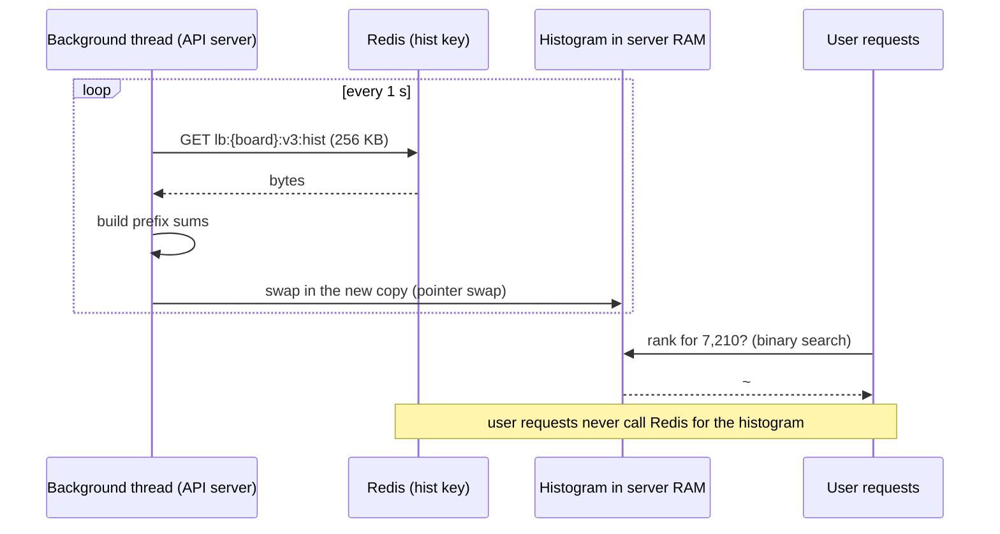

```text
Time        API server 1
10:00:00.0  GET histogram from Redis (1 call)  → copy A in RAM
10:00:00.0 – 10:00:00.999   ~500 requests answered from copy A   (0 Redis calls)
10:00:01.0  GET histogram from Redis (1 call)  → copy B replaces A
10:00:01.0 – 10:00:01.999   ~500 requests answered from copy B   (0 Redis calls)
```

| | Background refresh | User request |
|---|---|---|
| Who | 1 thread per server | ~500 req/s per server |
| Talks to Redis? | **yes**, 1 `GET`/s | **no** |
| Cost | 256 KB + build prefix sums (~1 ms) | ~1 µs binary search |

**Pointer swap:** the new array is built on the side, then one reference is switched. In-flight requests finish on the old copy, and nobody waits.

**Redis load:** 100 servers × 1 read/s = **100 reads/s** (~25 MB/s), however many users ask. Answers are at most **1 s old**, marked `as_of`.

**When the fleet gets much bigger** (e.g. 1,000 servers → ~256 MB/s from one key):
1. Fetch from **Redis replicas** to spread the load.
2. Have the **aggregator push** the histogram (pub/sub or a fan-out service) instead of every server pulling.
3. Ship **only changed buckets** (deltas), not the full 256 KB.

### §10 explained in detail (beginner version)

**Friends: why not precompute a sorted set per player?** That's fan-out on write. When a streamer with **2M followers** scores once, you'd update **2M** sorted sets. Same celebrity problem as a News Feed. Compute on read instead. Cap the friends board at a few thousand and, for the rare huge graph, switch to "top friends by score" via a secondary index.

**Tail neighbours, with an example.** Ravi (7,210, ~#3,812,701 ± 1,500) asks for 2 neighbours each side:

```text
Range read on board_score_index around 7,210:
  above:  meera 7,214   omar 7,212
  me:     ravi  7,210   (~#3,812,701)
  below:  li    7,209   sam  7,205

Shown as: ~#3,812,699 meera · ~#3,812,700 omar · ~#3,812,701 you · ~#3,812,702 li · ~#3,812,703 sam
```

The **ordering** is exact (real people with real scores). Only the **absolute numbers** carry `rank_error`. Players accept that, and it costs one short range read on disk, not a 22 GB sorted set.

**Inside a point mass**, "neighbours" are an arbitrary slice of millions of tied players. Product should render **"tied with 18M players"**, not a list.

### The big-key problem doesn't vanish because it's rare

If you keep **any** board as a single multi-GB sorted set (a legacy all-time board, say), know what it does to operations:

| Operation | What happens to a 22 GB key |
|---|---|
| **Redis Cluster slot migration** | moves it as **one key**, blocking the source while it serializes |
| **`BGSAVE` (snapshot)** | forks the process; under write load, copy-on-write duplicates touched pages, so a node at **60% memory** can **OOM during a snapshot** |
| **Full resync to a new replica** | ships the whole key before the replica is useful |

**None of these appear in a benchmark. All of them appear on the day you add a node.**

#### Beginner version: fork and copy-on-write

To snapshot, Redis calls `fork()`. The child process **shares** all memory pages with the parent and writes them to disk. When the parent (still serving writes) modifies a page, the OS **copies** that page first, so the child keeps a consistent view. With heavy writes spread across a 22 GB skiplist, a large share of pages get copied during the snapshot, so resident memory can approach **2×**. A node "only" at 60% memory then runs out and gets killed, which triggers a failover, which loses the last writes (§14 first row).

---

## 11. Deep dive 6 — Rebuilds, backfills and migrations

> **⚡ 30-second version**
> 1. Boards are derived, so you **will** rebuild them: scoring bug, rule change, cheater purge, new cluster.
> 2. **Versioned boards behind an alias.** Flip = a config change, with instant rollback.
> 3. **Rebuild from the warehouse**, not by replaying Kafka through live aggregators.
> 4. **Dual-write from offset X.** Absolute writes make the overlap harmless.
> 5. **Verify before flip:** counts, histogram total = KV rows, top-1,000 diff, sampled tail ranks.
> 6. The same procedure is your **cluster migration** and **cross-region bootstrap**. Build it in v1.

```mermaid
sequenceDiagram
  participant Op as Operator
  participant RB as Rebuild job
  participant W as Warehouse ledger
  participant LA as Live aggregators
  participant V2 as New board version v2
  participant RA as Read API
  Op->>RB: rebuild board at ledger offset X
  RB->>W: scan scores up to offset X, apply rules v2
  RB->>V2: bulk load top tier and histogram
  LA->>V2: dual-write events after offset X
  Note over LA: keep writing v1 as well
  RB->>RB: verify counts, top-1000 diff, sampled ranks
  Op->>RA: flip board alias v1 to v2
  Note over RA: reads now served from v2
  Op->>LA: stop v1 writes after soak
```

| Step | What | Why |
|---|---|---|
| **Versioned boards behind an alias** | reads resolve `board_id → version` from a small config store | the flip is metadata, not a key rename: no hidden delete (§9), **instant rollback** |
| **Rebuild from the warehouse** | a batch job computes per-player final scores; sorting 200M rows = minutes | replaying events one by one through the online path takes **hours** and competes with live traffic |
| **Dual-write from a known offset** | rebuild captures offset X; live aggregators write **both** v1 and v2 from X | writes are absolute and max/absolute-sum are idempotent (§6), so overlap is harmless. **With delta writes, this is where double-counting creeps in** |
| **Verify before flip** | member counts; histogram total = KV row count; **exact diff of top 1,000**; sampled tail ranks within `rank_error` | most rebuild bugs show up as a **top-1,000 diff**, e.g. a rule change that hit more players than intended |
| **Soak, then stop v1** | keep v1 warm for rollback | |

### Beginner version: why the overlap is harmless

The batch job reads the warehouse up to offset **X = 9,000,000** and computes Priya's season score = **18,450**. Meanwhile live aggregators start dual-writing from X. Priya's event at offset 8,999,990 (already included in the batch) gets re-delivered, and the live path writes **18,450** to v2 again. With absolute values, writing 18,450 twice is the same as once. With `ZINCRBY +500`, she'd get 18,950: wrong, and invisible.

**Build this in v1.** You'll need it the first time a scoring bug ships.

---

## 12. Deep dive 7 — Anti-cheat and integrity

> **⚡ 30-second version**
> 1. **Attack volume scales with N; reward concentrates in K.** Cheap filters on everything, expensive checks on the top few thousand.
> 2. **Server-authoritative** where possible. Client modes need a **session token** issued at match start.
> 3. **Plausibility bounds per mode and per second of play**, in **versioned config** shipped with the game build.
> 4. **Shadow quarantine:** cheaters see themselves ranked; nobody else does.
> 5. **Replay-verify only entries entering the top tier**, before freeze. Cost ∝ K.
> 6. **Collusion** shows up only in **graph features** over the ledger (batch job).
> 7. **Post-payout removal policy** must be decided **before** the incident.

```mermaid
flowchart TB
  S["Score submission"] --> A{"Authoritative source?"}
  A -->|server-reported| R["Risk score: velocity, device,<br/>account age, graph"]
  A -->|client-reported| P["Plausibility: max score per<br/>second of match, per mode"]
  P --> V["Verify session token<br/>+ signed result"]
  V -->|fails hard bound| X["Reject, log to ledger for audit"]
  V -->|passes| R
  R -->|low| AP["Apply to boards"]
  R -->|high| Q["Quarantine: visible<br/>only to the player"]
  AP --> T{"Enters top tier?"}
  T -->|yes| RP["Deterministic replay or<br/>manual review before freeze"]
  T -->|no| D["Done"]
  RP -->|fails| Q
```

| Defence | What it does | Cost / catch |
|---|---|---|
| **Server-authoritative** | the game server computes the result; the client never submits a score | only possible for server-run modes |
| **Session token** (client modes) | issued at match start; result bound to it, so a result can't claim a duration longer than the session existed | kills crude "POST a big number" attacks |
| **Plausibility bounds** | `score ≤ theoretical max for match duration`, **per mode, per second of play** | cheap and exact; catches most memory-editing cheats. A balance patch that raises achievable scores will reject legit players at scale (you'll find out on social media) → **versioned config shipped with the build** |
| **Shadow quarantine** | flagged scores go into a quarantine structure; the read API merges them **only into that player's own view** | cheaters who see removal iterate faster; ones who don't waste weeks. Support must see both views |
| **Replay verification** | client uploads inputs; server re-simulates (deterministic games) | real compute per check, so **only for entries crossing into the top tier before freeze**. Verification cost ∝ **K**, not N |
| **Collusion / boosting** | win-trading, smurf farms feeding a main, many accounts on one device | invisible per event; visible in **graph features over the ledger** (repeated opponent pairs, lopsided win rates). Batch job → same quarantine. A reason to keep **full match-level events**, not just scores |

### Beginner version: the economics in one example

200M players submit. Suppose 0.1% cheat = 200,000 cheaters. Only those reaching the **top 100k** of a board can win anything, and in practice only a few thousand do. Re-simulating every match for everyone costs millions of CPU-hours. Re-simulating only matches that push someone **into the top tier before freeze** costs a few thousand simulations per window. **Cheap filters everywhere, expensive verification where the money is.**

### Retroactive removal re-ranks everyone below

Removing #12 promotes #13 onward. **Before freeze** that's free. **After payout** it's a customer-facing event: #13 now says "I'm #12, pay me the #12 prize".

Decide the policy **up front**:

| Policy | Meaning |
|---|---|
| **A** | claw back from the cheater; **don't** retroactively upgrade others |
| **B** | upgrade everyone below and **pay the difference** |

Either is defensible. **Discovering you need a policy during an incident is not.** Whichever you choose, produce a new snapshot version with a diff (§9).

---

## 13. Deep dive 8 — Multi-region

> **⚡ 30-second version**
> 1. Players are served by the nearest region; the board is global. **Rank is a global-order query**, so something must be global.
> 2. **One home region per player → regional populations are disjoint.** Then:
>    - global top-K = top-K of the union of regional top-Ks (exact);
>    - histograms with shared boundaries **merge by addition**;
>    - only a few MB cross regions, not the event stream.
> 3. **Partitioned region** → its contribution freezes; publish per-region `as_of` and **widen `rank_error`**.
> 4. **Roaming players** break disjointness: route writes to a home region, or use a score whose merge is safe. **Max merges trivially; sum needs per-region G-counters.**

```mermaid
flowchart TB
  subgraph EU["Region EU"]
    EA["Aggregators"] --> ET[("Regional top tier")]
    EA --> EH[("Regional histogram")]
  end
  subgraph US["Region US"]
    UA["Aggregators"] --> UT[("Regional top tier")]
    UA --> UH[("Regional histogram")]
  end
  subgraph APAC["Region APAC"]
    AA["Aggregators"] --> AT[("Regional top tier")]
    AA --> AH[("Regional histogram")]
  end
  ET --> M["Global merger<br/>(every 1-2 s)"]
  EH --> M
  UT --> M
  UH --> M
  AT --> M
  AH --> M
  M --> G["Global top-K + merged histogram,<br/>replicated to all regions"]
```

### §13 explained in detail, with examples (beginner version)

**Why the merge is exact at the top.** Each player belongs to exactly one region. Suppose global top-3 is wanted:

```text
EU top-3:   anna 950, ben 940, carl 900
US top-3:   dana 960, eve 930, finn 880
APAC top-3: gita 945, hiro 920, ian 910

Union, sorted: dana 960, anna 950, gita 945, ben 940, eve 930, ...
Global top-3 = dana, anna, gita
```

Could someone **outside** their region's top-3 be in the global top-3? No. If they're 4th in EU, three EU players beat them, so they're at best 4th globally. That's why the union of regional top-Ks is enough.

**Why histograms merge by addition.** If all regions use **the same bucket boundaries**, bucket 21,403 globally = EU's bucket 21,403 + US's + APAC's. Global prefix sums = sum of regional prefix sums. Only ~256 KB per board per region crosses the ocean every second or two.

**Result:** global board is **exact at the top**, bounded-error below, stale by the **merge interval (1–2 s)**. That's invisible next to the 1-second top-K cache.

### When a region is partitioned from the merger

Its contribution **freezes at the last snapshot**. The merger publishes **per-region `as_of`**, and the read API **widens `rank_error`** for tail queries when any region is stale, rather than silently computing ranks against a population that's minutes old.

### What breaks disjointness: roaming players

If a player can submit from two regions:

| Option | How | Cost |
|---|---|---|
| **Single home region** | route the player's writes there | ~100–200 ms extra on the **async** write path (they already got a provisional rank) |
| **Merge-safe score** | let regions write concurrently and merge | depends on score type ↓ |

| Score type | Cross-region merge |
|---|---|
| **Max** | max of maxes. Trivial |
| **Sum** | needs **per-region partial sums per player** (a **G-counter**): EU says 400, US says 250, total = 650. Multiplies top-tier state by the number of regions a player can write from |

> **The score type chosen in §1 decides the architecture again.**

---

## 14. Failure modes (cheat list)

| Failure | How it unfolds in production | Mitigation |
|---|---|---|
| **Primary failover with async replication** | last few hundred ms of ZADDs lost; some ranks regress; players resubmit or complain | commit offsets only after writes; on failover, **rewind consumers to the last committed offset and replay** (safe: writes are absolute) |
| **Aggregator crash mid-batch on a sum board with `ZINCRBY`** | batch re-applied, scores inflate; invisible until a data scientist notices | absolute writes from KV totals; histogram flushes stamped with offset ranges |
| **Lost histogram flush** | replay computes delta 0; tail ranks drift with every crash/deploy | `(score, prev_score, applied_seq)` in KV; **nightly recount, alert on diff** |
| **Packed score exceeds 2^53** | ties resolved by member id; "earlier wins" silently stops | assertion on pack; per-mode max-score test; season length = schema change |
| **Snapshot fork on a big-key node under write load** | CoW doubles resident memory; OOM kill; failover; see row 1 | keep boards small (tiering); snapshot from replicas; size headroom by **write rate during fork** |
| **Synchronous delete of an expired window** | event loop stalls for seconds; all boards on the shard time out at midnight | `UNLINK` + lazy-free; archive **off-peak**, never at the reset instant |
| **Balance patch raises achievable scores** | plausibility rejects legit top players; top-K empties or looks stale | bounds in **versioned config deployed with the build**; alert on rejection rate by mode |
| **Histogram boundary recompute** | tail ranks shift by up to bucket error with no score change | off-peak recompute; client suppresses changes < `rank_error` |
| **Region partitioned from merger** | global tail ranks computed against a stale regional count | per-region `as_of`, widen error, alert on merge lag |
| **Top-tier admit/evict on a cached threshold** | a player whose score drops keeps a stale high entry and outranks real players in the top 100 | **server-side script against the live minimum; decreases always update** |
| **Freeze by wall clock during a tournament-end burst** | snapshot misses unapplied events; payout on an incomplete board; disputes with screenshots | **watermark freeze + partition heartbeats**; grace sized from measured drain time |
| **Range-index tombstone build-up on the low-score band** | tail-neighbour reads slow down over weeks; no single change explains it | one row per player-family; index only boards with tail neighbours; alert on **tombstones per read** |
| **Moderation removal after payout** | everyone below moves up; players demand the reward for their new rank | pre-agreed policy; snapshot versions with diffs; audit gate before payout |

### Observability dashboard (per board family)

| Metric | Why |
|---|---|
| Ledger consumer lag (events and **event-time** seconds) per partition | predicts freeze delays and stale `as_of` |
| Per-partition watermark vs `window_end + grace` | freeze readiness |
| **Histogram reconciliation diff** (nightly) | the only detector of the lost-flush bug |
| Top-tier size vs target, current T, refill count | hysteresis health, purge aftermath |
| Max packed score / 2^53 | headroom to silent rounding |
| Plausibility rejection rate by mode and build | balance-patch regressions |
| Tombstones scanned per neighbour read | LSM degradation weeks before latency |
| Top-K cache hit rate, origin reads per PoP | read fan-in |
| Merge lag per region | multi-region staleness |
| Quarantine inflow, replay-verification queue at freeze | anti-cheat capacity |

---

## 15. Build order — what to build first, and what later

| Phase | Build | Defer (why) |
|---|---|---|
| **v1** (up to a few million players per board) | one sorted set per board on a primary/replica pair; **durable ledger from day one**; **absolute writes**; packed tie-breaker **with assertion**; top-K cache (1 s TTL); window lifecycle with **freeze + snapshot before any reward**; **versioned board aliases**; `rank_error` in the API (always 0) | tiering, histograms, multi-region (not needed yet). **For most games this is the whole product** |
| **v2** (tens of millions, or a board key approaching a few GB) | top tier + histogram; full per-player scores in a **disk-backed KV**; in-process prefix sums in the read API; `rank_error` becomes non-zero | sketches, regional merging |
| **v3** (multi-region, many scopes, real-money rewards) | regional aggregation + global merger; quarantine + replay verification on the top tier; collusion detection over the ledger; sketches for ad-hoc segment percentiles | — |

> **Ordering rule:** the things that are **expensive to retrofit and cheap to do early** are the **ledger, absolute writes, the alias indirection, the freeze-before-payout lifecycle and `rank_error` in the API**. Everything else can wait for the load that justifies it.

### Decision path between stages

Thresholds are illustrative; measure your own per-thread ZADD ceiling and fork headroom before trusting them.

```mermaid
flowchart TB
  S["Per board: members N, write rate W after coalescing,<br/>largest key size"] --> Q1{"Largest key above ~2-4 GB<br/>or W above ~30% of one shard's<br/>measured ZADD ceiling?"}
  Q1 -->|no| V1["v1: one zset per board, primary + replica,<br/>ledger, absolute writes"]
  Q1 -->|yes| Q2{"Does product need exact rank<br/>for the whole population?"}
  Q2 -->|"no (usual)"| V2["v2: top tier + quantile histogram<br/>+ disk KV with range index"]
  Q2 -->|"yes, e.g. contractual ranking"| Q3{"Read p99 budget tolerates<br/>fan-out to S shards?"}
  Q3 -->|yes| HS["Hash-shard zset, hedged reads,<br/>cached top-K merge"]
  Q3 -->|no| RS["Range-shard by score band with rebalancer,<br/>accept non-atomic moves"]
  V2 --> Q4{"Players write from more than one region,<br/>or regional latency SLO on submit?"}
  Q4 -->|no| SR["Single-region aggregation,<br/>global read replicas"]
  Q4 -->|yes| V3["v3: regional aggregation + global merger;<br/>home region per player"]
```

**Why 30%, not 50%?** A shard whose steady ZADD load is half its ceiling has **no room for the tournament-end 3×**. And the fork-time copy-on-write penalty (§10) arrives **at the same moment**, because snapshots are scheduled, not load-aware.

---

## 16. Design-review questions (what a staff interviewer asks)

Each question ends with the section that answers it.

1. What's the score function per board (max, sum or latest), and which are **sum-scored only because nobody asked**? Each sum board is a dedupe and cross-region-merge problem you're signing up for. *(§1, §6, §13)*
2. **Show me the replay:** aggregator killed between KV write and histogram flush. What does the histogram hold afterwards, and what metric tells us? *(§6)*
3. **Who owns the top-tier threshold?** Is admit/evict decided server-side against the live minimum or a cached value? What happens to a player whose score **drops** while above the cached threshold? *(§7)*
4. **What triggers freeze, the clock or a watermark?** What's the measured drain time of a tournament-end backlog, and is grace longer than it? *(§9)*
5. What's the **maximum reachable raw score** per mode, per season length, and where's the assertion that the packed score stays below 2^53? *(§8)*
6. What does `rank_error` look like for the player **at the starting score**, and what does the client render for them? *(§7, §10)*
7. Which boards need **tail neighbours**, and what's the range-index write rate at burst? Tombstone density on the low-score band after a week? *(§5, §10)*
8. What's the **post-payout removal policy**, and who signed it? *(§12)*
9. How long does a **full rebuild** of the largest board take from the warehouse today, and **when was it last run end to end**? *(§11)*

### Answers in one breath each

1. Prefer max; every sum board needs `match_id` dedupe, absolute CAS totals and per-region G-counters.
2. Without `prev_score` it holds the **old** bucket forever. The nightly recount diff metric catches it; `(score, prev_score, applied_seq)` prevents it.
3. A Lua script against the live minimum. Cached T is a pre-filter for increases only. Decreases always issue `ZADD XX`.
4. Watermark with partition heartbeats and a paging upper bound. Grace ≥ measured drain (~8 min in the example) + margin.
5. Assertion in `pack()`, unit test per mode, season length treated as a schema change.
6. It's a point mass: `rank_error` ≈ half of millions. Render "Top 70%" or "tied with 18M players".
7. Usually all-time and season only. One row per player-family; alert on tombstones per read.
8. Claw back without upgrade, or upgrade and pay the difference, decided and signed by product + legal before launch.
9. Target < 30 min via warehouse batch + dual-write + alias flip; run it as a regular drill.

---

## 17. Trade-offs in one table

| Choice | Gives | Costs | Verdict |
|---|---|---|---|
| **Tiered** (exact top 100k + histogram) | < 200 MB vs ~120 GB; no big keys | tail rank is approximate (published error) | **Yes**, unless product truly needs exact rank for everyone |
| Hash-sharded zset | writes scale | every read fans out; p99 set by shard p99.97 | only for contractual exact rank with a loose p99 |
| Range-sharded zset | cheap reads | skew, rebalancing, non-atomic moves | rarely |
| **Max score** | idempotent, replay-safe, trivially mergeable | product may want cumulative | **Prefer** when product has a choice |
| Sum score | "total XP" semantics | dedupe, absolute recompute, G-counters | only when the product really needs it |
| **1 s top-K cache + provisional self rank** | removes the read hot key; self is instant | top-K up to 1 s stale | **Yes**: global strong freshness buys nothing visible |
| **Watermark freeze** | complete snapshots | freeze can wait longer than the clock | **Yes**: always cheaper than one disputed payout |
| **Shadow quarantine** | cheaters iterate slowly | support needs two views | **Yes** |
| **Live board vs frozen standing** | live = a view; snapshot = a record | extra storage + lifecycle | **Rewards, disputes, moderation belong to the record** |

---

## 18. FAANG / staff-level insights

1. **The sorted set isn't the hard part.** Say this first. Exact global rank is a global-order query that resists sharding, and a sorted set is the unit of placement: your biggest board can never be split or cheaply migrated.
2. **Exactness should match human attention.** "Above the line where a human compares their number against someone else's: exact. Below it: statistics with an honest error bar."
3. **Score type decides the architecture.** Max = max-register (idempotent, commutative, mergeable). Sum = dedupe + absolute recompute + G-counters. Ask in minute one.
4. **State, not operations.** Write absolute values. `ZINCRBY` on the hot path is a silent inflation bug.
5. **Make the one delta-updated structure reconcilable**, rather than making the whole hot path exactly-once. Nightly recount diff = your only detector.
6. **Asymmetric pre-filters.** A cached threshold is safe for increases, unsafe for decreases. Decide in a server-side script against the live minimum.
7. **Quantile buckets, per-bucket error, point masses.** Fixed-width buckets fail exactly where most users live; one global error constant lies inside a point mass.
8. **Sketches answer percentiles; histograms answer ranks.** KLL at ε = 0.1% on 200M is ±200,000 ranks.
9. **The 2^53 trap.** Packed tie-breakers round silently; season length is a schema change.
10. **Freeze on a watermark, not the clock.** The window closes exactly when the burst peaks. Drain time is a floor on grace.
11. **Provisional rank is an API promise.** Label it; the "#3 became #7" screenshot is created by the API, not a bug.
12. **Big keys fail in operations, not benchmarks:** slot migration, fork CoW OOM, full resync, synchronous DEL at midnight.
13. **Anti-cheat economics:** attack volume ∝ N, reward ∝ K. Verification cost should be ∝ K.
14. **Retrofit-expensive things go in v1:** ledger, absolute writes, alias, freeze-before-payout, `rank_error` in the API.

> **Closing line for the interview:** "A leaderboard at scale is a derived view whose exactness matches human attention. Keep the truth in a ledger, write absolute values so any view can be replayed, keep the exact ordered structure small enough to never be an operational event, answer everyone else with mergeable counts and an honest error bar, and put a freeze-and-audit gate between the live board and anything that pays out — because the top of the board is where the money is, and therefore where the attacks are."
