# Notification System — Strategic Study Guide

> **Framing:** We are building an **internal notification platform**. Our customers are **other engineering teams**: the auth service sending OTPs, the order service sending "your order shipped", marketing blasting a promo to a million users. They hand us *who* and *what*; we decide *how and when*, deliver through **third-party providers** (APNs/FCM, an email provider, Twilio), and record what happened. We **do not** own the last mile. Apple, Google, and the carriers do.

**Scale anchor:** **10M notifications/day** sustained, but **surges of ~5,000/sec** (one 1M-user campaign at 9am ≈ 3.3k/s on its own) (Hello) · stretch case **1B/day, ~120k/sec peak** (Algoroq) · **at-least-once** delivery with best-effort dedup · **OTPs within 5 seconds, even mid-surge**.

**Study path (≈20 min):** [§0 cheat sheet](#0-cheat-sheet-5-min) → [§1 HLD](#1-chosen-design-default-answer) → [§3 priority isolation (the crux)](#3-deep-dive--otp-in-5s-during-a-campaign-blast-the-crux) → [§5 dedup](#5-deep-dive--deduplication-on-top-of-at-least-once) → [§6 campaigns](#6-deep-dive--scheduling-and-campaign-fan-out) → [§13 drill](#13-interview-drill-card--stress-test) → [§15 staff insight](#15-faang--staff-level-insight-beyond-both-sources)

### Cast of characters (lock this before anything else)

| Party | Role | Example | Where in our design |
|-------|------|---------|---------------------|
| **Upstream caller** | Our customer (an internal service) | Auth service, order service, marketing tool | Calls `POST /v1/notifications` / `POST /v1/campaigns` with an API key |
| **US** | **The notification platform** — a router and a bookkeeper | — | This whole document |
| **Recipient** | The end user who receives it | John, on his iPhone | Has contact info, devices, preferences in *our slice* of user data |
| **Product user service** | Owns the user's real profile | `users` service | Syncs email + phone to us; is the source of truth for them |
| **Mobile app** | Registers push tokens | iOS / Android app | Calls `PUT /v1/users/{id}/devices` on login and on token rotation |
| **Segment tool** | Owns audience membership | "All users in Canada" | We **read** a snapshot at fan-out time; we don't own membership |
| **Providers** | The last mile | **APNs/FCM** (push), **SES/SendGrid** (email), **Twilio** (SMS) | Behind our channel workers; rate-limited, flaky, mostly *not* idempotent |

> **The most common mistake (Hello):** conflating the platform with the provider. If you start designing persistent sockets to phones, you're building APNs, a different and much harder problem. Our system **decides what to send where, and records what happened.**

### Basic flow (one picture)

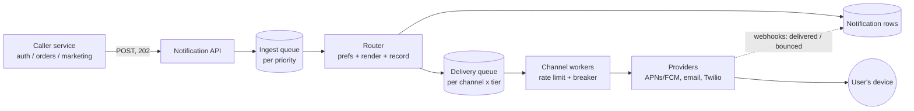

Read it left to right: **accept fast** (queue, 202), **decide once** (router), **send carefully** (rate-limited workers per tier), **record what happened** (rows + webhooks). Scheduled sends and campaigns feed the same router through the scheduler (§6).

### End-to-end flow (summary)

1. **Accept** — The caller POSTs with an **`Idempotency-Key`**, `userId`, `channel`, **`priority`**, `templateId` + `data`, optional `scheduledAt`/`expiresAt`. We claim the key (`PENDING`), **publish to the priority's ingest queue**, flip the key to `ACCEPTED`, and return **`202`**. No provider call happens on the request path.
2. **Route** — A router worker resolves contact info / device tokens, checks **preferences** (opt-out → `SUPPRESSED`; quiet hours → `DEFERRED`), renders the template **once**, **upserts** the `Notification` row by a deterministic `msg_id` (the durable dedup backstop), and enqueues to the **(channel × tier)** delivery queue.
3. **Deliver** — A channel worker from that tier's **own pool** takes a **token** from the tier's provider budget, takes a **short lease claim** on `msg_id`, and calls the provider through a **circuit breaker + bulkhead**. It records `SENT` **after the provider acks**, then deletes the queue message.
4. **Retry / park** — Transient failures retry with exponential backoff and jitter; permanent failures (dead token, hard bounce) are not retried; after N attempts the message goes to a **DLQ**. An ambiguous timeout becomes **`UNKNOWN`**, and a **per-category policy** decides whether to resend (OTP: yes; promo: no).
5. **Track** — Provider webhooks (`delivered`, `bounced`, `opened`) are verified, acked fast, and merged into the row **monotonically**. Bounces and dead tokens feed back into contact hygiene.
6. **Scheduled & campaigns** — A scheduler pulls due rows (`FOR UPDATE SKIP LOCKED`). A campaign **snapshots** its segment, splits it into **chunks**, and many fan-out workers explode the chunks **with checkpoints** onto the **bulk** lane, which is rate-capped and sheddable.

---

## 0. Cheat sheet (5 min)

### Requirements

| Functional | Non-functional (they drive the design) |
|------------|----------------------------------------|
| Upstream services send a notification to **one user** via **push / email / SMS**, **now or scheduled** | **At-least-once** delivery with **best-effort dedup** — "rather twice than never" |
| Upstream services send **campaigns** — the same message to a **segment**, now or scheduled | Absorb **surges of ~5k/sec** (≈50× the 115/s sustained rate) |
| Users set **preferences**: per-channel opt-outs, **quiet hours** (+ per-category toggles, Algoroq) | **High-priority (OTP, security) delivered < 5s after acceptance, even during a surge** |
| Callers can **check status** of a notification (`GET`) | **Isolation**: one dead provider or one giant campaign must not stall anything else |

**Below the line (say it out loud, don't design it):** template *authoring* UI, analytics dashboards (open/click rates), **in-app inbox + badge counts** (Hello puts it out; Algoroq puts it in — we treat it as an extension in §10), strict cross-channel ordering, consent/spam *compliance workflows* (we still honor opt-outs), CI/CD.

> **Notice the tension (Hello):** at-least-once and dedup pull in opposite directions, and dedup gets harder exactly when surges hit. Say this early; it shows you see the whole problem.

### The heart of the problem: two traffic classes in one system

| | **High priority** — OTP, password reset, fraud alert | **Standard / bulk** — "order shipped", promos, digests |
|-|--------------------------------------------------|-------------------------------------------------|
| Volume | Low, steady | Huge bursts (1M at 9:00:00) |
| Latency | **Seconds** — a 20-minute-late OTP = "the site is broken" | Minutes are fine; nobody minds a promo landing at 9:04 |
| Worse failure | **Lost** (user locked out) | **Duplicate** (annoyed user, wasted SMS money, reputation) |
| Quiet hours | **Ignored** | Respected (defer) |
| On overload | **Never** delayed | **Shed / delayed** first |

This is why **every send carries a declared `priority`**, and why nearly every deep dive is about keeping the two classes apart.

### Entities — HLD derivation (do this live on the whiteboard)

**Step 1 — derive from the functional requirements.**

| Requirement | Noun it forces | Why |
|-------------|----------------|-----|
| Send to one user on one channel | **Notification** | One message, one user, one channel, with its own status — the thing `GET` returns |
| Send to a segment | **Campaign** (definition) → many **Notifications** (instances) | Hello's key insight: *a notification is an instance of a campaign*, like a job vs. its executions |
| …to a segment | **Segment** (reference) | The audience — but **owned by the segment tool**, we only read it |
| We need an address / phone | **User** (our slice: email, phone, timezone) | Synced from the product user service |
| Push needs a device token | **Device** | Tokens rotate; the app sends them to us directly, so we *own* this data |
| Users control what reaches them | **Preferences** | Opt-outs, quiet hours, category toggles — attributes of the User |
| Content must be rendered per channel/locale | **Template** (versioned) | Callers send `templateId + data`, not finished text (Algoroq) |

**Step 2 — the HLD gates. An entity is drawn only if it (1) owns business state that outlives a request, (2) is independently queried, (3) has a lifecycle.**

**Step 3 — final entity set:**

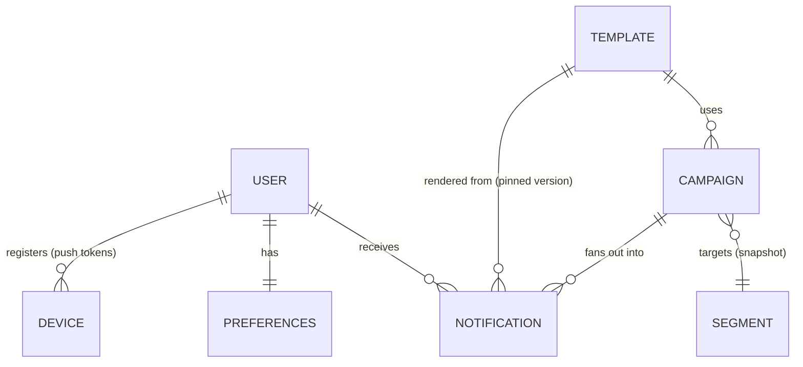

| # | Entity | Minimum fields | Justification |
|---|--------|----------------|---------------|
| 1 | **Notification** | `msg_id` (deterministic), user_id, channel, priority, category, template_id@version, rendered_payload, status, reason, attempts, scheduled_at, expires_at, provider_msg_id, campaign_id? | The unit of delivery and of debugging ("why didn't John get it?") |
| 2 | **Campaign** | campaign_id, segment_id, snapshot_id, template_id, channel, scheduled_at, tz_mode, status, progress counters | The definition; has its own lifecycle (scheduled → fanning out → done / cancelled) |
| 3 | **User** (our slice) | user_id, email, phone, locale, timezone, email_valid, phone_valid | Contact info we deliver to; synced in, flags written by bounce feedback |
| 4 | **Preferences** | user_id, opt_out_channels, category_matrix, quiet_hours {start, end, tz}, global_unsubscribe | A product feature *and* a legal requirement; read on every send |
| 5 | **Device** | device_id, user_id, platform (ios/android/web), push_token, active, last_seen | Owned by us because tokens rotate; pruned on `Unregistered` |
| 6 | **Template** | template_id, version, channel variants, locale variants | Rendering is our job; version pinning keeps in-flight messages stable |

**Step 4 — deliberately NOT entities:**

| Thing | Why not | Where it lives |
|-------|---------|----------------|
| `Segment` membership | Owned by the segment tool — same as "Order" being owned by the merchant in a payment system | Read through their API / export; we store only `segment_id` + `snapshot_id` |
| `IdempotencyKey` | Request-level dedup, no business lifecycle | Redis `idem:{caller}:{key}` (24h) |
| `DedupKey` / send claim | Infra to make at-least-once look like once | Redis lease + the `UNIQUE(msg_id)` on Notification |
| `DeliveryAttempt` | A log, not a noun anyone queries as a product | `attempts` + `last_error` on Notification; full log in cold storage |
| Provider webhook event | An *input* that advances Notification status | Merged into Notification (status + flags) |
| Token bucket, queue message | Mechanisms | Redis / SQS |
| `InboxItem` | Only if in-app is in scope | §10 extension |

**Interview phrasing:** *"Six entities: Notification, Campaign, User, Preferences, Device, Template. A campaign is a definition; notifications are its instances. Segments belong to the audience tool; we snapshot them. Idempotency keys, dedup claims and token buckets are infrastructure — I'll bring them up in the deep dives."*

### APIs

```text
POST /v1/notifications        Header: Idempotency-Key
     { userId, channel, priority, category, templateId, data, scheduledAt?, expiresAt? }
     → 202 { id: msg_id, status: ACCEPTED | SCHEDULED }

GET  /v1/notifications/{id}   → { id, status, reason?, attempts, updatedAt }

POST /v1/campaigns            Header: Idempotency-Key
     { segmentId, channel, templateId, data, scheduledAt?, tzMode: "absolute" | "user_local" }
     → 202 { campaignId, status: SCHEDULED, estimatedDrainTime }
POST /v1/campaigns/{id}/cancel → 202
GET  /v1/campaigns/{id}       → { status, progress: { queued, sent, suppressed, failed } }

PUT  /v1/users/{userId}/preferences  { optOuts, categories, quietHours: { start, end, tz } }
PUT  /v1/users/{userId}/devices      { deviceId, platform, pushToken }

POST /v1/webhooks/{provider}  ← provider callbacks (signature-verified)
```

Why each choice:

- **`202`, not `200`:** delivery is off the request path, so at accept time there's no outcome to report (Hello). Hello starts with a synchronous `200` and evolves it; say that you're evolving the contract.
- **`templateId + data`, not finished text:** rendering, channel shaping, and localization are the platform's job (Algoroq). Callers stay simple, and copy changes don't need a redeploy of every caller.
- **`userId` in the path is fine here.** Callers are internal services authenticated by API key, acting *on behalf of* a user they already authenticated (Hello). On a user-facing API this would be a red flag; here it's correct.
- **`PUT` for preferences and devices:** a full replace of a known resource, so idempotent for free.
- **`priority` is declared by the caller but *authorized* by us:** each API key is granted the tiers it may use (§3). Otherwise marketing marks everything `high`.
- **`expiresAt`:** an OTP is worthless after 5 minutes. A late OTP should be **dropped**, not delivered (§5).
- **`estimatedDrainTime`:** a 20M-email campaign at a 2k/s provider quota takes ~2.8 hours no matter how many workers we run, so we tell the campaign owner before they press send (Algoroq).

### States

**Notification:**

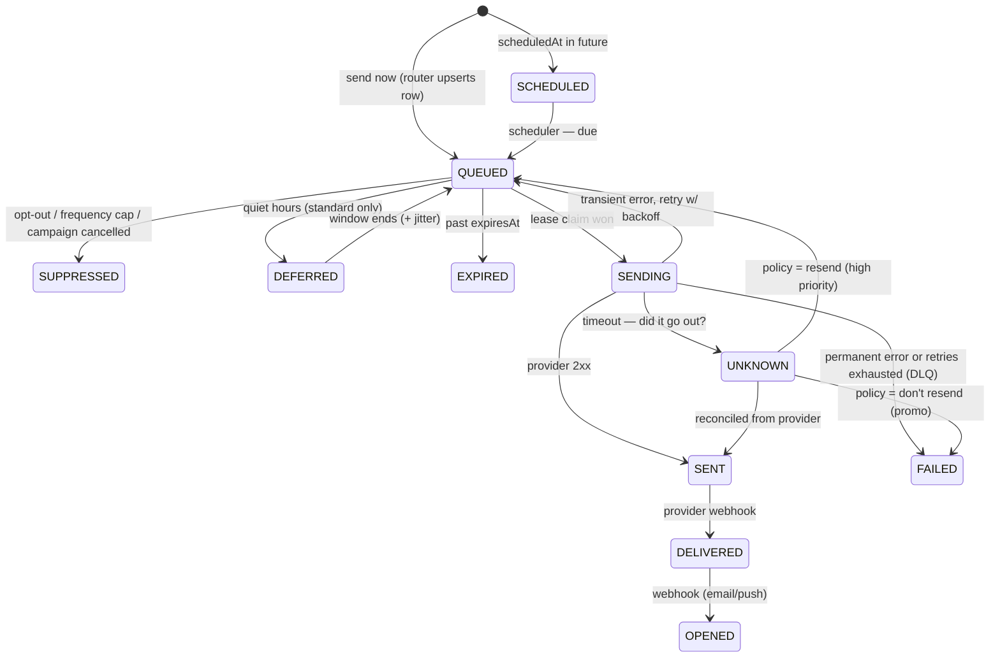

Terminal: `SUPPRESSED`, `EXPIRED`, `FAILED`, `DELIVERED`/`OPENED`. `BOUNCED` and `COMPLAINED` are kept as **flags** rather than states, so a late `opened` webhook can't hide a bounce (Algoroq). Before the router writes the row, `GET` answers from the idempotency record (`ACCEPTED`).

**Campaign:** `SCHEDULED → FANNING_OUT → FANNED_OUT → COMPLETED`, plus `CANCELLED` from any non-terminal state and `PAUSED` for an operator stop.

### Who owns what? (plain English)

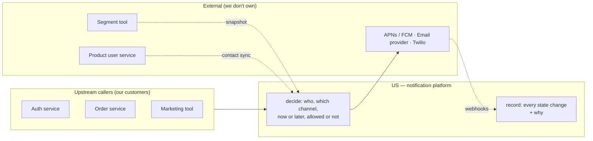

| Party | Owns | Doesn't own |
|-------|------|-------------|
| Upstream caller | *What* to say, *to whom*, *how urgent* (within its grant) | Channel mechanics, retries, preferences |
| **Us** | Routing, preferences enforcement, scheduling, fan-out, rate budgets, retries, dedup, the status record | Final delivery — the provider does that |
| Providers | The connection to the device, inbox, or carrier | Our dedup — most email/SMS APIs **won't dedup a retried send** (Algoroq) |
| Segment tool / user service | Audience membership, user profile | How we deliver |

### 60s opener

> "This is a platform: internal services hand us who and what, and we're a **router and a bookkeeper** in front of APNs, an email provider, and Twilio. Acceptance is decoupled from delivery: we claim an idempotency key, publish to a **durable queue per priority**, and return 202. Workers check preferences and quiet hours, render once, and send. The crux is two traffic classes: **OTPs must land in 5 seconds while a million-user campaign is draining.** So high priority gets its own queues, its own worker pool, and a **reserved slice of each provider's rate limit** in a Redis token bucket, with circuit breakers and bulkheads for provider brownouts. Delivery is **at-least-once**, and we dedup at each place a duplicate can enter: an ingest key, a deterministic `msg_id` with a unique row, and a **leased send claim** with an explicit UNKNOWN state. Campaigns snapshot the segment and fan out in checkpointed chunks on a rate-capped bulk lane."

### Capacity math (two anchors — say which one you're designing for)

| Quantity | **Hello anchor** (one company's platform) | **Algoroq anchor** (consumer-app scale) |
|----------|-------------------------------------------|------------------------------------------|
| Volume | 10M/day → **~115/s** avg | 100M DAU × 10 = **1B/day → ~11.6k/s** avg |
| Peak | **5k/s** surges (a 1M campaign in 5 min ≈ 3.3k/s alone) | **~120k/s** (10× avg); one 20M-target event in 5 min adds ~67k/s |
| Channel mix | — | ~70% push · 15% in-app · 10% email · 5% SMS |
| Notification rows | 10M × ~1 KB ≈ **10 GB/day**, ~1 TB at 90-day retention | ~1 TB/day → partition by day, keep ~30 days hot, archive to S3 |
| Dedup / idempotency keys | 10M × ~200 B × 24h ≈ **2 GB** Redis | **~200 GB/day** at 24h TTL → use a **two-tier window** (short Redis TTL + DB unique backstop) to cut it ~10× |
| Webhook ingest | ~2–4× sends | **2–4× sends** — bigger than the send path (delivered, opened, clicked, bounced…) |
| SMS money | — | 5% of 1B = 50M/day × ~$0.005 ≈ **~$250k/day** — SMS routing is a **finance decision** |

**The number that actually limits you is the provider, not your workers (the staff-level point):**

| Provider limit (illustrative) | Consequence |
|-------------------------------|-------------|
| Twilio sells us **1,000 SMS/s** | A 1M-user SMS campaign takes ≥ **~17 min**, whatever we do |
| Email account quota **2,000/s** | A 20M email campaign takes **~2.8 hours** → publish the ETA |
| Combined send budget **5,000/s** | 1M queued promos drain in ~200s → an OTP behind them waits **200s** (Hello's crux) |

**Worker sizing with Little's law:** concurrent in-flight calls = rate × latency. At 5k/s × 200 ms = **1,000 in flight**, which is a modest pool. In a brownout at 20 s latency, 5k/s × 20 s = **100,000 in flight**. That's why we need bulkheads and latency-based breakers (§4), not "more workers".

### Don't

| ✗ | ✓ |
|---|---|
| Call the provider inside the API request | Accept durably (queue) → 202 → deliver asynchronously |
| Retry inside the request handler | Retries live in the queue (visibility timeout, backoff, DLQ) |
| Write a DB row, *then* publish to the queue (dual write) | Publish first (send-now), or let a committed row drive publishing (scheduled) |
| One FIFO queue for OTPs and promos | Separate queues **and** separate worker pools **and** separate provider budgets |
| "Autoscale workers" as the answer to a 1M backlog | The provider caps you; isolate tiers instead (draining 1M in 5s = 200k/s = 40× target) |
| `SETNX sent(msgId)` before calling the provider | Short **lease** claim; mark `SENT` only after ack; `UNKNOWN` on timeout |
| Retry a `BadDeviceToken` / hard bounce | Permanent errors → prune the token / mark the address invalid, never retry |
| Drop suppressed messages silently | Record `SUPPRESSED` + reason — your future on-call self needs it (Hello) |
| Defer all quiet-hours messages to exactly 08:00:00 | Jitter the release across a window, collapse into digests, use the bulk lane (Algoroq) |
| Let any caller pick `priority: high` | Priority is a **grant** per API key, audited |
| Fail over in-flight `UNKNOWN` promos to the backup provider | Only high priority fails over; promos reconcile first |

---
## 1. Chosen design (default answer)

### Stack

| Layer | Pick | Why (and source) |
|-------|------|------------------|
| Edge | **API Gateway**: per-caller API keys, per-caller rate limits, **priority grants** | A runaway caller must not break OTPs (Hello) |
| Accept | **Notification API**, stateless | Validate, check priority grant, claim the idempotency key, publish, return 202 |
| Ingest queues | **One durable queue per tier**: `high`, `standard`, `bulk` (**SQS**) | Durable buffer between "accepted" and "delivered" (Hello: SQS; Algoroq: Kafka priority topics) |
| Router workers | Per-tier pools | Resolve contact/token, preferences, render once, upsert row, enqueue per channel |
| Delivery queues | **(channel × tier)**, e.g. `sms-high`, `email-bulk` | One slow provider backs up only its own queues (Algoroq isolation) |
| Channel workers | **Separate pools per tier** per channel | High priority never waits behind a stuck bulk call (Hello "Great") |
| Rate budgets | **Redis token buckets** per (provider, tier), reserved slice for high | Provider quota is the real ceiling (Hello) |
| Resilience | Circuit breaker (latency + in-flight aware) · bulkhead · provider router | Brownouts, not outages, kill SLAs (Algoroq) |
| Dedup | Redis fast path (idempotency key, lease claim) + **Postgres `UNIQUE(msg_id)`** backstop | Two-tier dedup window (Algoroq) |
| Store | **Postgres**: notifications (partitioned by day), campaigns, users, preferences, devices, templates | Nothing exotic needed (Hello) |
| Scheduler | Polls due rows with `FOR UPDATE SKIP LOCKED`; minute granularity | Seconds-sensitive sends never go through it (Hello) |
| Campaign fan-out | Coordinator → **chunk tasks** → many fan-out workers with **cursor checkpoints** | No single host making 1M calls (Hello problem 3) |
| Status | **Status service**: verify webhook → ack → enqueue → monotonic merge | Webhooks are 2–4× send volume, late, duplicated, out of order (Algoroq) |
| Caches | Preferences + contact cache (invalidated on write), cancelled-campaign set | Read on every send |

**Why SQS-style queues over Kafka for delivery:** notifications don't need ordering, but they do need **per-message** acks, visibility timeouts, delayed retries, and a DLQ. SQS gives all of that out of the box. A Kafka partition is ordered, so **one slow or poison message blocks everything behind it** (head-of-line blocking) unless you build retry topics and parallel consumers yourself. **Pick Kafka when** you need **replay** (Hello: "ship a bad worker build, reset the offset and reprocess this morning") or Algoroq-scale throughput with stream processing on the same events. Either is defensible; say which property you're buying.

### HLD — component architecture

The full picture has too many arrows for one diagram, so it's drawn as **one overview + four zoom-ins**. Each block letter in the overview has its own diagram below.

#### Overview — the five blocks

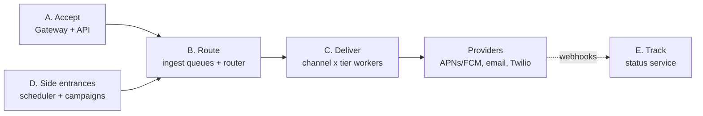

State lives in two stores shared by every block: **Postgres** (notification rows, campaigns, users, prefs, devices, templates) and **Redis** (idempotency keys, lease claims, token buckets, caches).

#### Block A — Accept (fast path, no provider call)

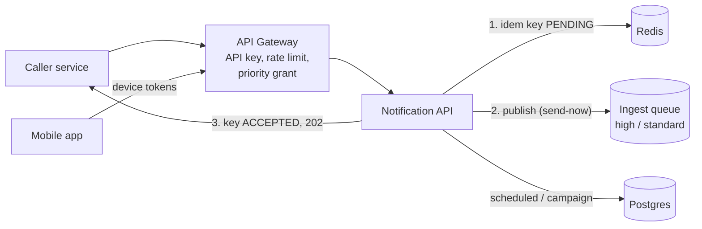

#### Block B — Route (decide once, record once)

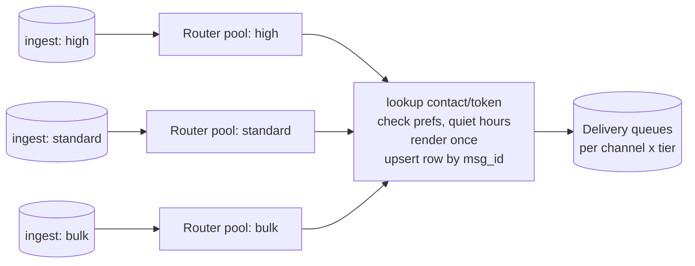

Pools are drawn per tier because a campaign flooding `bulk` must not slow the router for `high`.

#### Block C — Deliver (one channel shown; push and email are identical)

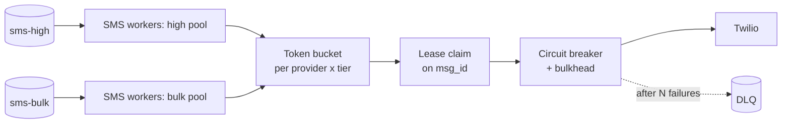

Order inside a worker: **token → claim → breaker → send → record `SENT` → ack**. High-tier workers may borrow bulk tokens; bulk never takes from high.

#### Block D — Side entrances (scheduled sends and campaigns)

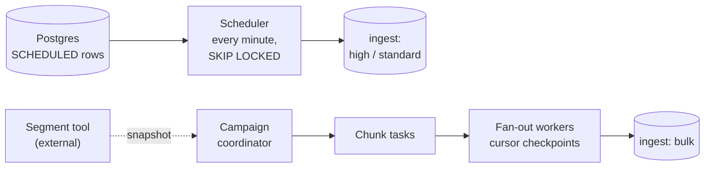

#### Block E — Track (the feedback loop)

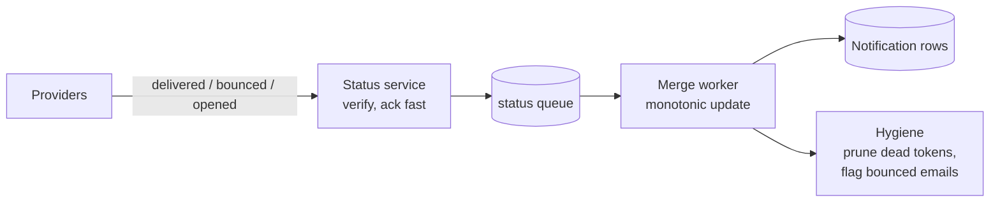

**How to draw it on the whiteboard without the mess:** draw the overview first, the straight line `caller → API → queue → worker → provider`. Then zoom into the block the interviewer cares about, in this order: **(1)** split queues and workers by tier (B, C), **(2)** add the token bucket in front of providers (C), **(3)** add the dedup store and the status service (A, C, E). The scheduler and campaign fan-out (D) are side entrances that feed the same queues.

| Component | Responsibility |
|-----------|----------------|
| **API Gateway** | Authenticates the caller's API key, applies **per-caller** rate limits, rejects priorities the caller isn't granted |
| **Notification API** | Validates; `SET idem:{caller}:{key} PENDING NX`; publishes to the tier's ingest queue; flips the key to `ACCEPTED`; returns `202 {msg_id}`. Scheduled sends and campaigns are written to Postgres instead |
| **Router workers** | Look up email/phone/tokens (cache), check preferences + quiet hours + frequency caps, pin and render the template **once**, `INSERT … ON CONFLICT (msg_id)` the Notification row, enqueue to each `(channel, tier)` queue |
| **Channel workers** | Token from the bucket → lease claim → breaker/bulkhead → provider call → record outcome → ack the queue. Classify errors (transient vs permanent) |
| **Scheduler** | Every minute: claim due `SCHEDULED` rows / campaigns with `SKIP LOCKED`, publish, mark `QUEUED` |
| **Campaign coordinator + fan-out workers** | Snapshot the segment, split it into chunks, explode each chunk with a checkpointed cursor onto the **bulk** lane; check cancellation per chunk |
| **Status service** | Verify provider webhook signatures, ack immediately, enqueue, then merge status monotonically; prune dead tokens, mark bounced addresses |
| **Redis** | Idempotency keys, lease claims, token buckets, preference/contact caches, cancelled-campaign set, frequency counters |
| **Postgres** | Notification rows (status + reason = the debugging record), campaigns, our slice of users, preferences, devices, templates |

### Three user journeys

**A — OTP (send-now, high priority):**

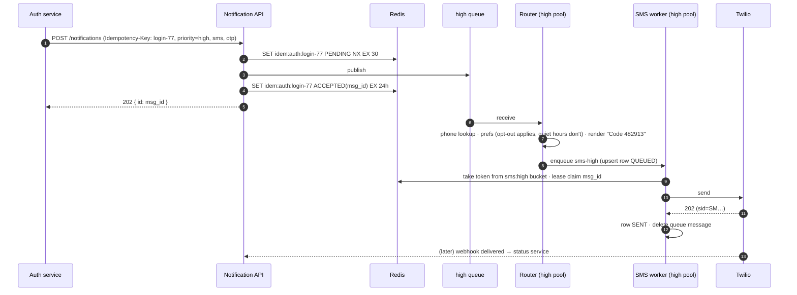

**B — Scheduled single send:** the API writes the row `SCHEDULED` with `due_at`, and the scheduler picks it up within ~1 minute and publishes it to the standard queue. From there it's identical to A.

**C — Campaign:** `POST /campaigns` writes a Campaign row (`SCHEDULED`) and returns `202` with a drain ETA. At `scheduledAt` the coordinator snapshots the segment, writes N chunk tasks, and the fan-out workers explode them onto the **bulk** lane (§6).

### Latency budget for the 5-second promise

| Hop | Budget | What protects it |
|-----|--------|------------------|
| Gateway + API + Redis + enqueue | ~30 ms | Stateless, no DB on the send-now path |
| High ingest queue wait | ~0 ms | The high queue is tiny and has its own pool |
| Router (cached prefs/contact, render) | ~10–30 ms | Cache; never blocked by bulk |
| Delivery queue wait | ~0 ms | Own queue + own pool |
| Token bucket | ~1 ms | Reserved slice — standard can't drain it |
| Provider call | 200 ms – 2 s | Tight per-tier timeout (e.g. 3s for high); breaker; backup provider for high only |
| **Total** | **≈ 0.5 – 2.5 s** | Leaves headroom for **one** retry inside 5s |

The 5 seconds is measured **to provider acceptance**. The carrier's delivery to the handset is outside our control, and we say so.

---

## 1.5 How we got here — evolve the design (Hello's bad → good → great)

Interviewers want to see you build the simple thing, find its holes, and fix them in order.

**Step 0 — the working but naive system:** the API writes the row `PENDING`, calls the provider inline, updates `SENT`/`FAILED`, and returns 200. A cron job sends scheduled rows and loops over campaign segments. Preferences are checked before the call.

**It has three problems (Hello):**

1. **Provider in the request path.** Twilio has a slow day, so the auth service's logins time out. A crash after writing the row but before the call → **the notification is gone**.
2. **Campaigns fight everything else.** A 1M-user fan-out sits in front of the OTP.
3. **One host makes a million calls.** If it dies halfway, nobody knows where it stopped.

### Deep dive 1 — never drop an accepted notification

| | Approach | Why it fails / wins |
|-|----------|---------------------|
| ❌ **Bad** | Retry inside the request | Retries live in process memory, so a crash or deploy loses them. The caller's connection is held open during a provider outage. The caller can't tell "gave up" from "never got it" → this is effectively **at-most-once** |
| 🟡 **Good** | Write row `PENDING`, return 202, **polling dispatcher** sends | Survives restarts, but you're **building a queue on Postgres**: you need `SELECT … FOR UPDATE SKIP LOCKED` so dispatchers don't double-send, you hand-roll attempt counts and next-try times, the table is both queue and history, and latency can't beat the poll interval |
| ✅ **Great** | **Publish first to a durable queue** (SQS), return 202 once the queue acks; a worker sends, writes the outcome, **then** deletes the message | A crashed worker → the message reappears after the visibility timeout. Retries, backoff, and DLQ are queue configuration, not code. New challenge: **more duplicates** (§5) |

**Why not "write the DB row, then publish"?** That's a dual write: a crash between the two leaves a row that no message represents. The outbox pattern fixes it, but Hello's point is that **accepting a send-now notification is a single publish**, so there's nothing to keep atomic with it. **Exception, and where this guide is more precise:** scheduled sends and campaigns *are* DB-first by nature, because the row must exist until it's due. There, the **committed row drives publishing** (the scheduler is effectively an outbox relay), so there's still no dual write.

---

## 2. Deep dive — the accept path and ingest idempotency

The caller retries (timeout, deploy). We must return the **same** `msg_id` and publish **once**. Algoroq shows the ordering bug that passes every happy-path test:

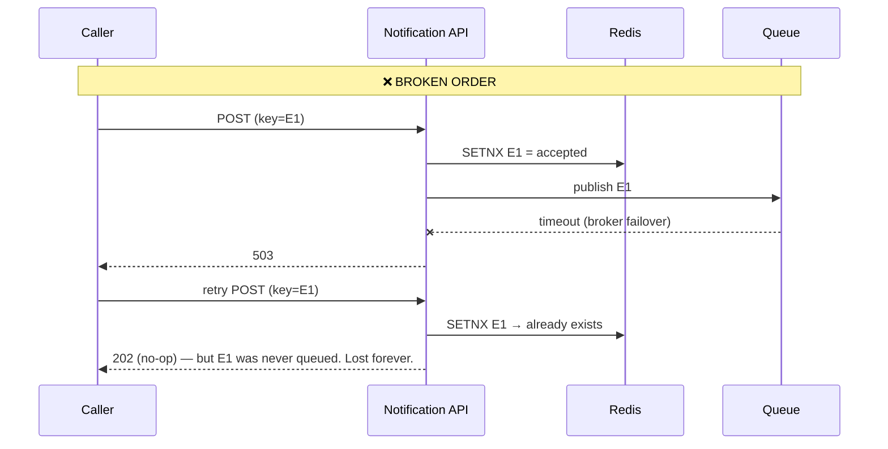

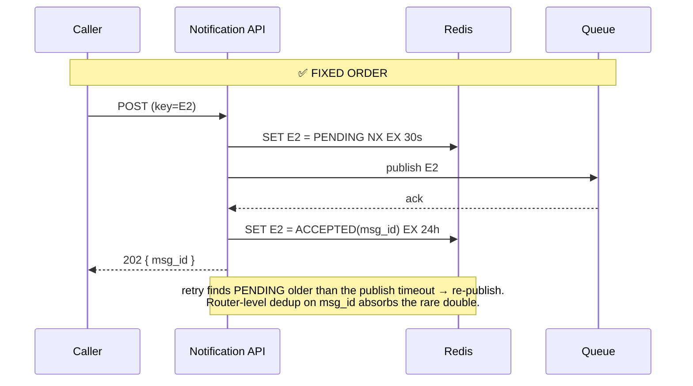

**Retry rules at the API:**

| Redis state on retry | Response |
|----------------------|----------|
| absent | Normal path |
| `ACCEPTED(msg_id)` | `202` with the same `msg_id` (no publish) |
| `PENDING`, younger than the publish timeout | `409` + `Retry-After: 1` (or wait briefly) |
| `PENDING`, older than the publish timeout | The first attempt died mid-publish → re-publish |
| Same key, different body | `422` (fingerprint mismatch) |

**Deterministic `msg_id`** = `hash(caller, idempotency_key, user_id, channel)`; for campaigns, `hash(campaign_id, user_id, channel)`. The same logical notification gets the same id at every layer, so the router's `INSERT … ON CONFLICT (msg_id)` and the worker's claim all key off one value.

**Redis down at accept?** For **high** priority, accept anyway (publish without the key): a duplicate OTP is better than a refused login, and the router's unique `msg_id` still catches most duplicates. For **bulk**, return `503`: the caller retries later, and nothing is lost.

**Alternative for DB-backed producers (Algoroq):** an order service that already commits `order.shipped` in its own transaction can write a **transactional outbox** row and let CDC feed our ingest queue. The outbox row's primary key becomes the idempotency key, and the API hop becomes optional.

---

## 3. Deep dive — OTP in 5s during a campaign blast (the crux)

**The scenario (Hello):** marketing queues 1M promos at 9:00. Providers let us send 5,000/s across channels, so the queue clears in ~200s, which is fine for a promo. Then the auth service sends an OTP. In a shared queue it waits **200 seconds**.

| | Approach | Why it fails / wins |
|-|----------|---------------------|
| ❌ **Bad** | Autoscale workers on queue depth | Draining 1M in 5s = **200k/s = 40× the target**. Servers take seconds to minutes to start, cloud accounts cap burst capacity, and **the provider is still capped at 5k/s** |
| 🟡 **Good** | **Separate queues per tier**, workers drain high first | Fixes queue position, but everything downstream is still shared. Standard can burn the **whole Twilio allocation**, so the OTP gets throttled *by Twilio*. A worker stuck in a 30-second bulk call isn't serving the high queue |
| ✅ **Great** | **Independent worker pools + per-tier provider budgets** (token buckets in Redis) | High gets its own queues, its own pool, and a **reserved slice** of each provider's quota that no other tier can touch |

### Isolation at every layer — the full picture

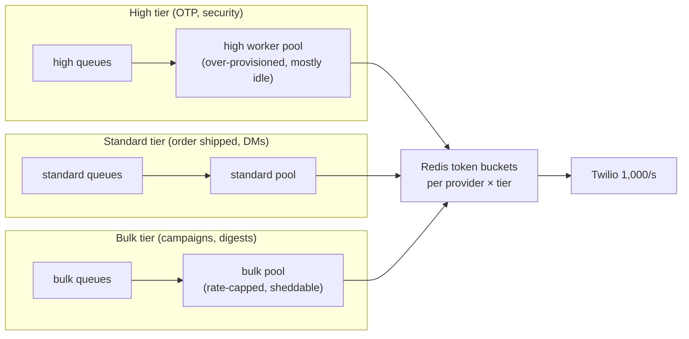

| Layer | What's isolated | Without it |
|-------|-----------------|------------|
| Queue | One queue per tier (× channel) | OTP waits behind 1M promos |
| Compute | One worker pool per tier | Workers stuck in slow bulk calls can't pick up OTPs |
| Provider quota | Reserved token budget per tier | Bulk spends all 1,000 SMS/s; Twilio throttles the OTP |
| Provider reputation | Separate **email sending domains/IPs** for transactional vs promotional (Algoroq) | One spammy campaign → mailbox providers junk-folder **password resets too**, for days |
| Money | **SMS budget per caller/category** with a hard breaker (Algoroq) | One misconfigured campaign burns a month's SMS budget in an afternoon |

### The token bucket rules (Twilio sells us 1,000 SMS/s)

| Bucket | Size per second | Rule |
|--------|-----------------|------|
| `sms:high` | **100** reserved | Only high may use it. Idle capacity here is **on purpose** |
| `sms:standard` | 600 | Standard first; high **may borrow** when its reserve is empty |
| `sms:bulk` | 300 (cap) | Bulk never borrows from high; may use standard's idle tokens only if standard's queue is empty |

**Borrowing only flows upward in priority:** high can borrow from lower tiers, but lower tiers never borrow from high. That keeps the guarantee (OTPs always have 100/s) while not wasting quota when the system is calm.

**How a worker uses it:** take a token before the call. If none is available, **don't spin**: extend the message's visibility (delay a few hundred ms) and take the next message. Better still, have workers **pull only as fast as their bucket refills**, so they never take messages they can't send. At Algoroq scale (120k/s) a Redis call per send is a hot key: each worker **leases tokens in batches** (e.g. 50 at a time) and spends them locally. Hello flags the cost: one more moving part in front of every call, but that is the control we want.

### Priority is a grant, not a request

If any caller can set `priority: high`, marketing will, and the high lane fills with promos. Each API key carries an **allowed tier set** (auth service → high; marketing → bulk only). Callers that ask for a tier they don't have get a `403`, high-tier volume per caller is monitored, and a sudden jump in a caller's high-tier traffic triggers an alert.

### Shedding order under overload

1. Delay **bulk** (it's queued; nothing is lost).
2. Collapse low-value **standard** traffic into digests.
3. Never shed **high**. If high itself exceeds its reserve, borrow, then page someone.

---

## 4. Deep dive — surviving a provider brownout

### Plain-English primer (read this first)

One picture for the whole section: **Twilio is a shop, and our workers are customers standing in line.**

**Outage vs brownout**

- **Outage:** the shop has a "Closed" sign. You see it immediately and go elsewhere. It's easy to handle because you find out fast.
- **Brownout:** the shop is open, but the cashier takes 20 minutes per customer instead of 1. Nobody tells you anything is wrong. You just stand there, and so does everyone behind you.

A brownout is worse because nothing looks broken. Calls eventually succeed, so the error rate stays low, but every worker is stuck waiting.

**Why waiting is deadly (Little's law):** calls in progress = calls per second × seconds each one takes.

- Normal: 5,000/s × 0.2s = **1,000 workers** busy at once. Fine.
- Brownout: 5,000/s × 20s = **100,000 workers** needed at once. We don't have them, so every worker is stuck at Twilio and nothing else gets sent, not even push or email.

**The tools, one by one**

| Tool | Plain English | Shop picture |
|------|---------------|--------------|
| **Timeout** | A worker gives up on a call after a set time: ~3s for OTPs, longer for promos | "I'll wait this long, no longer" |
| **Circuit breaker** | After too many failed **or slow** calls, stop calling the provider for ~30s. Calls fail instantly, so workers move on to other work | "Stop going to the broken shop for a while" |
| **Bulkhead** | A cap on how many workers may be waiting on one provider at once, with separate seats per tier | "Only this many of us may stand in Twilio's line" |
| **Provider router (failover)** | Send urgent traffic to a second provider when the first stays bad | "Go to the other shop" |
| **Jitter + ramp** | On recovery, each worker waits a random short time, and traffic returns 10% → 50% → 100% | "Don't all rush the door when the shop reopens" |

**Circuit breaker, like the electrical breaker in your house:**

- **Closed** (normal): calls go through.
- **Open** (tripped): too many calls failed or were too slow, so for the next ~30s we don't call Twilio at all.
- **Half-open** (testing): after the pause, a few test calls go through. Fast → close the breaker and resume. Still slow → open it again.
- Trip on **slowness, not just errors**. In a brownout the error rate looks normal; only the waiting time shows the problem.

**Bulkhead, named after a ship's sealed compartments** (a hole floods one compartment, and the ship stays afloat). Example:

- 200 workers in total.
- At most **50** may be inside a Twilio call at once.
- Of those 50, bulk SMS gets at most **30**, and OTPs have their own **20** that bulk can't touch.

If Twilio slows to a crawl, at most 50 workers are stuck. The other 150 keep sending push and email, and a stuck promo can't take the last seat from a login code.

> **Breaker vs bulkhead:** the breaker answers *"should we call Twilio at all right now?"* The bulkhead answers *"how many of us can be waiting on it at once?"* You need both: the breaker takes a few seconds to notice, and the bulkhead limits the damage during those seconds.

**Failover, three rules:**

1. **Only high-priority traffic moves.** OTPs can't wait; promos can. The backup may be pricier and smaller, so don't flood it with marketing.
2. **The backup must already be in use.** A backup you've never sent through often fails on the day you need it: sender numbers aren't registered, email servers aren't trusted yet. Send 5–10% of real traffic through it every day.
3. **Watch for duplicates.** Some messages were mid-send when Twilio went bad, and we never got an answer. These are `UNKNOWN`: like a phone call that drops right after you speak, you don't know if they heard you. OTPs get resent (a duplicate code is harmless); promos don't (a duplicate promo annoys people and costs money).

**The whole section in one line:** when a provider gets slow, **give up quickly** (timeout), **stop calling it for a bit** (breaker), **limit how many workers can get stuck on it** (bulkhead), **move only urgent messages to a backup that's already in daily use** (failover), and **come back slowly** (jitter and ramp).

### The detailed version

**Brownouts are worse than outages (Algoroq).** A hard-down provider fails fast and the breaker trips. A provider answering in **20s instead of 200ms** pins every worker: by Little's law, 5k/s × 20s = **100k concurrent calls**. The pool saturates while **error rates still look fine**.

Three tools (Hello), plus the sharper triggers from Algoroq:

| Tool | What it does | Detail that matters |
|------|--------------|---------------------|
| **Circuit breaker** (per provider) | Opens on high failure **or latency p99 / in-flight saturation**; calls fail immediately instead of waiting out timeouts | Trip on latency and in-flight count, not just errors. Half-open with a trickle of probes. Per-tier timeouts: **~3s for high, longer for bulk** |
| **Bulkhead** (per provider, per tier) | A semaphore on in-flight calls to one provider | When Twilio's allotment is in flight, no more workers start calls to it, so capacity isn't burned on a mostly-down service |
| **Provider router** | Primary + backup for channels that have substitutes | **High priority only** (Hello staff). Also a product lever: if SMS is down, offer email for login |

### The failover decision (Algoroq)

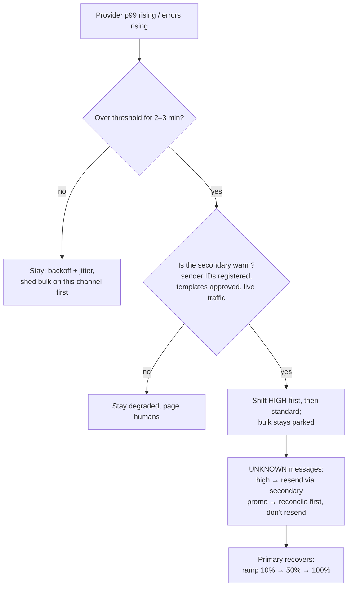

**Three non-obvious points:**

- **A cold secondary is not a secondary.** SMS sender IDs and short codes need per-country registration, email needs warmed IPs and SPF/DKIM/DMARC alignment, and push credentials are per app. Keep **5–10% of real traffic** on the secondary so it's proven and warm. Active-active is the only failover you can trust.
- **Failover multiplies duplicates.** Every message in `UNKNOWN` at the switch may already have been delivered by the primary. Resending all of them guarantees duplicates, so apply the per-category policy (§5).
- **Retry storms on recovery.** When the provider comes back, every worker retries at once. **Jittered backoff** plus a ramped breaker prevent knocking it over again.

### Twilio hard down for an hour — the backlog playbook

Failover (above) covers **high**, if a warm secondary exists. Everything else piles up: at ~300 SMS/s of normal traffic, **one hour down ≈ 1M messages** waiting in the `sms-*` queues. The queue keeps them safe; the job is to keep that pile **small, fresh, and drainable**.

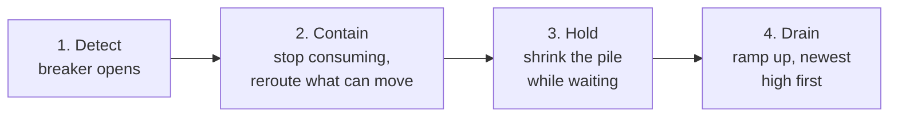

**1. Detect.** The breaker opens on errors or latency (above). Mark the channel `sms: DOWN` in a shared flag that routers and the API can read, not only the workers.

**2. Contain — stop consuming, don't retry-loop.** This is the mistake that turns an outage into data loss. If workers keep pulling and failing, every receive counts as an attempt: SQS moves the message to the DLQ after `maxReceiveCount`, and **the whole backlog ends up in the DLQ** as "failed". So while the breaker is open:

- **Pause the SMS consumers** (stop polling) instead of failing each message. Messages wait in the queue with no attempt spent.
- Only the half-open probe sends a trickle of real traffic.
- If messages did land in the DLQ anyway, **redrive** them back to the source queue after recovery. Don't treat them as failed.

**3. Hold — shrink the pile while waiting.** Each tier gets a different policy:

| Tier / category | During the outage | Why |
|-----------------|-------------------|-----|
| **high (OTP)** | Fail over to the warm secondary. With no secondary, the **login page offers email or push** ("Send code by email") | A user staring at a login screen can't wait an hour |
| **standard (order shipped)** | The router reroutes **new** SMS to push or email where the category allows. Queued messages wait | The information still matters, and another channel delivers it now |
| **bulk (promo SMS)** | Paused. **New bulk SMS campaigns are rejected or held** at the API (`503` / `SCHEDULED`), and the owner is told | Adding to a pile we can't drain only makes recovery longer |

Keep the pile from going stale:

- **Expire as you go.** Workers check `expiresAt` before every send, so a 50-minute-old OTP becomes `EXPIRED` and is never sent.
- **Collapse per user.** Three "your order moved" updates for the same user become the latest one only.
- **Retention.** SQS keeps messages for 4 days by default (max 14). Set it explicitly, so a long outage doesn't silently delete the backlog.
- **Tell callers.** `GET` returns `QUEUED` with `reason=provider_down`, and campaign owners get a revised `estimatedDrainTime`.

**4. Drain — recovery is its own surge.** The backlog drains at **quota minus live traffic**: 1,000/s Twilio quota − 300/s live ≈ **700/s net, so 1M messages take ~25 min**. Doing that safely:

1. **Ramp the breaker** 10% → 50% → 100% with jitter. All workers resuming at once just knocks Twilio over again.
2. **High first, newest first.** For OTPs, the most recent request is the one the user is waiting for. Older ones are mostly expired anyway.
3. **Standard next, oldest first** with its TTL applied.
4. **Bulk last.** Ask the owner: **resume or cancel?** A "sale starts at 9am" SMS sent at 3pm is wrong, not late.
5. **Reconcile `UNKNOWN` before resending.** Messages that timed out as Twilio went down may have been sent. Query Twilio's message log (by recipient number and send time window, since Twilio has no client-side idempotency key), then apply the per-category policy (§5).

> **Interview line:** "The queue keeps the backlog safe; the danger is what we do with it. Stop consuming so retries don't dump everything into the DLQ. Move OTPs to another provider or channel. Expire and collapse what's waiting. Then drain on a ramp: newest OTPs first, promos last, after asking the owner."

### When we overload the provider ourselves (Twilio throttling our account)

The brownout above is *Twilio's* problem. This one is *ours*: Twilio is healthy, but our account is over its rate. It answers `429 Too Many Requests` or queues our messages for minutes (Twilio's account queue). The cause is usually traffic we never needed to send, and a lot of it is marked `high`. The OTPs that matter get stuck behind it.

**Where the unnecessary traffic comes from, and the guard for each:**

| Source | What it looks like | Guard |
|--------|--------------------|-------|
| **Priority abuse** | A team marks "order shipped" as `high` because it's faster | Priority grants (§3), plus a **per-caller quota inside the high tier** (auth: 200/s). Over quota → `429` to that caller and an alert. Never demote silently: the caller must know |
| **"Resend code" spam** | The user taps resend 5 times, so 5 OTPs are queued and 5 are paid for | Per-`(user, phone)` limit, e.g. 1 per 30s and 5 per hour. **Supersede:** a newer OTP for the same user replaces queued older ones → `SUPPRESSED, reason=superseded` |
| **Stale OTPs** | During a slowdown, OTPs that are 3 minutes old are still queued | `expiresAt` checked right before the send → `EXPIRED` (§5). A late code is worse than none, and it costs money |
| **SMS pumping (toll fraud)** | Bots request OTPs to premium-rate numbers in a few countries; we pay per message | Country / number-prefix allowlist, per-prefix rate limits, a CAPTCHA or device check upstream, and an alarm on the **OTP sent vs verified ratio**. A drop in verifications with a spike in sends means fraud |
| **Caller bug loop** | A service generates new idempotency keys in a loop, so dedup can't catch it | Per-`(caller, user, template)` rate limit, plus the **per-caller SMS budget breaker**: a hard stop at N dollars per hour |
| **Retry storm** | Every `429` is retried immediately, doubling the load | Retries spend tokens from the same bucket, follow Twilio's `Retry-After`, and have a **retry budget** (retries ≤ ~10% of sends) |

**The filter funnel — unnecessary SMS gets dropped as early and cheaply as possible:**

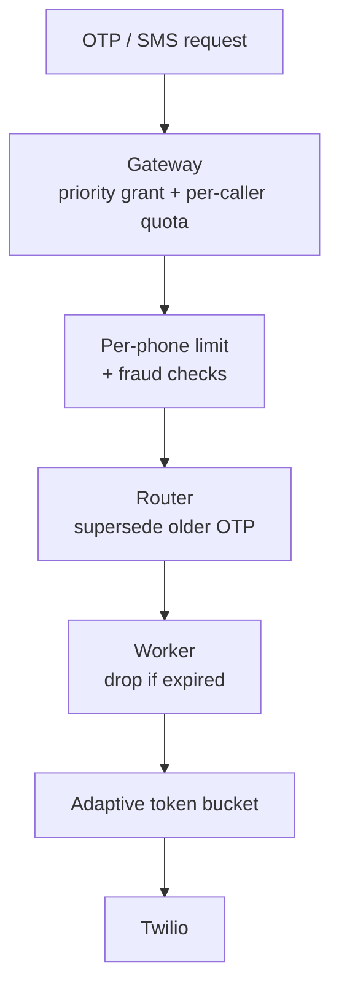

**Adapt the bucket to what Twilio actually accepts.** Our configured 1,000/s is a promise, not a fact. On `429`, **cut the effective rate** (e.g. × 0.7); after a run of successes, **add it back slowly** (+20/s per interval). This is the same increase-slowly, cut-fast (AIMD) control TCP uses. When capacity shrinks, the cut comes from the bottom tier first:

| Effective Twilio rate | high | standard | bulk |
|-----------------------|------|----------|------|
| 1,000/s (normal) | 100 reserved (+ borrow) | 600 | 300 |
| 500/s | 100 | 400 | **0, parked** |
| 150/s | 100 | 50 → **fall back to push/email** where the category allows | 0 |
| < 100/s | everything | 0 | 0, **page on-call**, consider failover (above) |

**Channel fallback:** if an "order shipped" SMS can't get tokens, route it to push or email for that category instead of waiting. OTPs keep SMS, because the user is staring at the SMS screen, but the login page can offer "send by email instead".

> **Interview line:** "A Twilio slowdown and our own account being throttled look the same from the worker: slow calls and `429`s. The fix is different. For a brownout you fail over. For self-overload you **stop sending things you shouldn't**: supersede resends, drop expired codes, enforce per-caller quotas inside the high tier, and watch for toll fraud. Failover just moves the waste to a second bill."

---
## 5. Deep dive — deduplication on top of at-least-once

> **Source labels in this section:** **[Hello]** = Hello Interview PDF · **[Hello\*]** = Hello's pages 20–22 (the two dedup solutions) were images and couldn't be extracted, so that part is reconstructed from Hello's surrounding text and staff-level question · **[Algoroq]** = Algoroq PDF · **[Guide]** = this guide's own reasoning, in neither source.

### Why we need dedup at all (plain English)

**The trade we already made.** Every earlier section chose **at-least-once**: when we're unsure whether something happened, we do it again. Caller unsure if we got the request? Retry. Worker crashed mid-send? Another worker picks it up. That rule is what stops OTPs from getting lost. **[Hello]**

**The price of that trade.** "Do it again when unsure" means sometimes doing it twice. Hello names the tension directly: at-least-once and dedup pull in opposite directions, and dedup gets **harder exactly when surges hit**, because that's when timeouts, retries and crashes are most common. **[Hello]**

**Why a duplicate is a real problem, not a cosmetic one:**

| Duplicate | What actually goes wrong | Source |
|-----------|-------------------------|--------|
| Two OTPs with **different** codes | The user types the first code, but only the second is valid. Login fails, and support gets a ticket | [Guide] |
| Two SMS | We pay twice. At a million-user campaign, a 1% duplicate rate is 10,000 wasted paid messages | [Algoroq] |
| Two promo pushes / emails | Annoyed users **opt out or uninstall**. Spam complaints damage email sender reputation for weeks | [Algoroq] |
| "Your payment failed" twice | Looks like two failures; the user panics or retries a payment | [Guide] |

**Why we can't just switch to at-most-once (send only once, never retry).** Then a crash loses the message. A lost OTP locks the user out, which is worse than a duplicate. **[Hello]**

**Why we can't hand the problem to the provider.** True exactly-once is impossible: the provider sits **outside our transaction**, and most SMS and email APIs **don't dedup a retried send**. If we call Twilio twice, the user gets two texts. **[Algoroq]** (Push has a partial exception, the collapse key, covered below.)

**So the goal is "effectively once":** keep at-least-once, and put a **dedup gate at every point where a duplicate can enter**. Hello's advice is to be able to **point at each gate on the diagram**. **[Hello]** Algoroq names three such points and a gate for each. **[Algoroq]**

### What each source says about dedup

| Topic | Hello Interview | Algoroq | This guide |
|-------|-----------------|---------|------------|
| Framing | At-least-once vs dedup tension; dedup hardest during surges | Exactly-once impossible past the provider; aim for effectively-once | Same, plus a "why a duplicate hurts" cost table |
| Where duplicates enter | Retries anywhere in the pipeline; focuses on the send step | **Three gates**: ingest, fan-out, send | Same three, each tied to a component |
| Ingest gate | Not a separate gate | Key goes `PENDING → ACCEPTED` only **after** the broker acks (the ordering bug) | Algoroq's ordering (§2) |
| Fan-out gate | Snapshot the segment at send time; no explicit fan-out dedup | `SETNX` on `(campaign, user, channel)` in Redis | A **durable** `UNIQUE(msg_id)` row instead, so a full re-run can't resend after Redis keys expire |
| Send gate | **Good:** claim the key before the send. **Great:** check before the send, record after the ack **[Hello\*]**. Staff question: why does claim-before-send become at-most-once? | **Leased** claim, `SENT` after ack, `UNKNOWN` on timeout, per-category policy | Algoroq's lease, explained against Hello's question |
| Dedup store fails | Raised as a staff-level probe | Redis failover → duplicate spike; pause consumers one lease period | Fail open for high, fail closed for bulk |
| Sizing | — | ~200 GB of keys/day at 1B/day; two-tier window | Hello-scale number (~2 GB) and the 10× cut from short TTLs |

### Where duplicates come from → the gate that closes each hole **[Algoroq]**

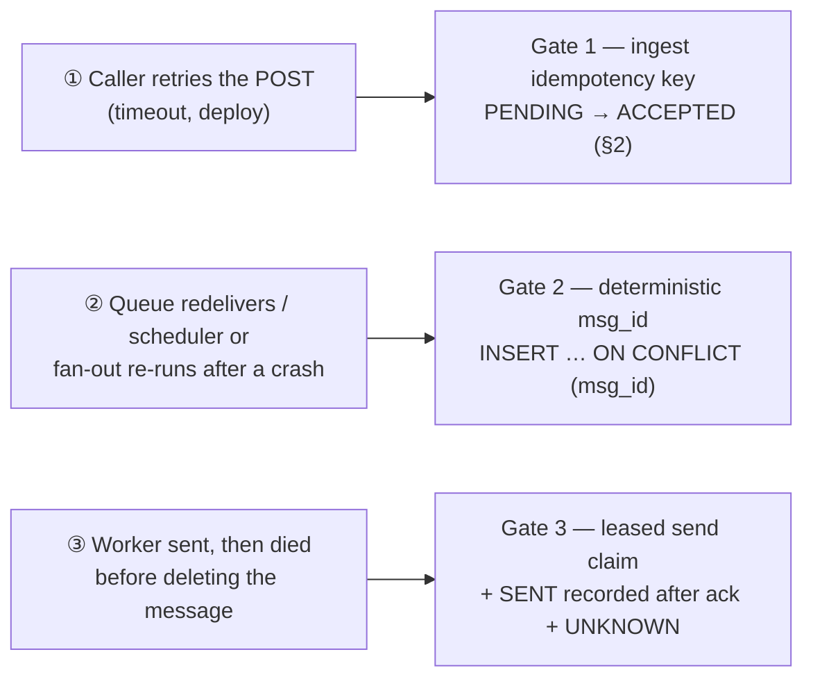

### Gate 2 — the row is the durable dedup record **[Algoroq gate, Guide's durable version]**

Algoroq's fan-out gate is a Redis `SETNX`. This guide makes the gate a **database row** instead, because Redis keys expire: a campaign re-run tomorrow would pass a Redis-only check and resend everything. **[Guide]**

The router computes `msg_id` deterministically and runs `INSERT … ON CONFLICT (msg_id) DO NOTHING`:

- **Inserted** → new notification; enqueue it.
- **Conflict, status `QUEUED`** → we may have crashed before enqueueing last time, so **re-enqueue**. Gate 3 absorbs a possible double.
- **Conflict, status `SENT` or later** → skip, and ack the incoming message.

This is why the delivery table's **`UNIQUE(msg_id)`** comes first in the build order (Algoroq): it's expensive to retrofit, and it's the **long-window backstop** that lets Redis hold only a short window.

### Gate 3 — the send claim, and why its ordering decides at-least vs at-most-once **[Hello question · Hello\* solutions · Algoroq lease]**

This is Hello's staff-level question **[Hello]**: *"Why does claiming an idempotency key before the provider call turn at-least-once into at-most-once?"*

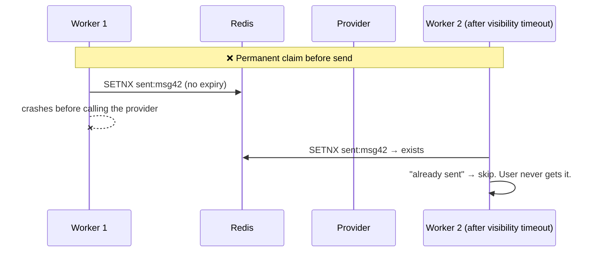

A permanent claim taken *before* the send means a crash between claim and send **loses the message**: at-most-once. This is Hello's "Good" solution and why it isn't enough. **[Hello\*]** The opposite extreme, "check, send, record", is Hello's "Great" direction. **[Hello\*]** It has a different hole: two workers checking at the same moment can both send. **[Guide]**

**The answer (Hello's "check before the send, record after the ack" + Algoroq's lease):**

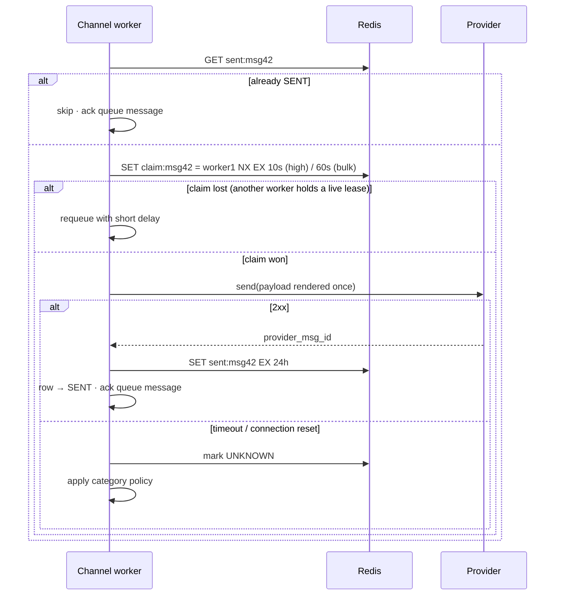

- **The lease expires**, so a crashed worker's claim frees itself and someone retries. We keep at-least-once. **[Algoroq]**
- **The lease blocks the race** in Hello's "check, send, record": only one worker holds a live claim at a time. **[Guide]**
- **`SENT` is recorded only after the ack**, so the only duplicate window left is "provider accepted → worker died before writing `SENT`". That window is small and bounded. **[Hello\*, Algoroq]**
- **`UNKNOWN` forces a decision** instead of an accident. **[Algoroq]**
- **Per-tier lease length** (10s high, 60s bulk), sized above that tier's call timeout. **[Guide]**

### The `UNKNOWN` policy — choose per category, and get sign-off **[Algoroq]**

| Category | On ambiguous timeout | Why |
|----------|----------------------|-----|
| OTP / security alert | **Resend once**, same rendered payload (same code) | A duplicate costs nothing; a missing code locks the user out |
| Order / transactional email | Reconcile with the provider's status API or webhook first, then resend | Mild duplicate cost |
| Promo / campaign | **Don't resend** | A missed promo costs ~nothing; a duplicate costs money, reputation, and opt-outs |

Algoroq's point: this is a **product decision**, so get sign-off from the owning team rather than letting an engineer pick a default. **[Algoroq]**

**Render once, retry identically. [Guide]** Because the router renders the payload once and stores it, a resent OTP carries **the same code**. The user gets "482913" twice, not two different codes, which would confuse them and break verification.

**Expiry beats retry. [Guide]** If `now > expiresAt` (OTP validity of 5 minutes), the worker marks the row `EXPIRED` instead of sending. The user has already asked for a new code.

**Push and in-app give a bonus:** a **collapse key / message id** (derived from `msg_id`) makes the device replace an undelivered duplicate. That helps for "driver is 2 min away" updates, but it's not a transactional guarantee. **[Algoroq]**

### When the dedup store itself fails (staff probe) **[Hello question · Algoroq + Guide answers]**

Hello raises this as a staff-level probe: *what happens when the thing doing dedup is down?* **[Hello]**

| Failure | What happens | What we do | Source |
|---------|--------------|------------|--------|
| Redis down | No fast-path claims | **High priority: fail open**, send and rely on the `msg_id` row (a duplicate beats a lost OTP). **Bulk: fail closed**, pause consumers, because messages wait safely in the queue and the only cost is delay | [Guide] |
| Redis primary failover (async replication) | The last few hundred ms of claims vanish, so a **duplicate spike lines up exactly with the failover time** on the dashboard | Back every claim with the durable row; after failover, **pause high-tier consumers for one lease period** (keep the high lease short, ~10s, so this stays inside the SLA) | [Algoroq] problem + pause; [Guide] short lease |
| Region failover | Dedup keys are regional; a re-homed user can get a duplicate | Accept it for a rare event, or keep dedup authority in the user's **home region**. Don't make dedup globally consistent at 120k writes/s | [Algoroq] |

### Sizing the dedup store (two-tier window) **[Algoroq]**

- **Algoroq scale:** 1B keys/day × 200 B × 24h ≈ **200 GB** of Redis (×2 with replicas). **[Algoroq]**
- **Hello scale:** 10M keys/day × 200 B ≈ **2 GB**, which fits on one small Redis node. At this scale sizing isn't the problem; correctness is. **[Guide]**
- **The two-tier window:** most duplicates happen within **seconds** (caller retries) or **minutes** (queue redelivery). So keep Redis keys for ~1 hour and let the **Postgres `UNIQUE(msg_id)`** cover the long window. **[Algoroq]** With 1-hour keys instead of 24-hour ones, memory drops by roughly 10× or more. **[Guide]**

---

## 6. Deep dive — scheduling and campaign fan-out

### Scheduled single sends

The API writes the row with `status=SCHEDULED, due_at`. **Scheduler** instances run every minute:

```sql
SELECT msg_id FROM notifications
WHERE status = 'SCHEDULED' AND due_at <= now()
ORDER BY due_at
LIMIT 1000
FOR UPDATE SKIP LOCKED;     -- parallel schedulers never grab the same rows
-- publish each to its tier's ingest queue, then:
UPDATE notifications SET status = 'QUEUED' WHERE msg_id = ANY($ids);
```

- A crash between publish and `UPDATE` → the rows get re-published → Gate 2 absorbs it.
- **Minute granularity is fine (Hello).** Anything that cares about seconds (OTP) is send-now and never touches the scheduler.
- Index on `(status, due_at)` with a **partial index** `WHERE status='SCHEDULED'`. At Algoroq scale, use a **time-bucketed index** (`due_minute → ids`) instead of a per-message delayed-queue entry, which would make the scheduler the bottleneck.
- Short delays (< 15 min) can use the queue's native delay (SQS `DelaySeconds`) and skip the DB.

### Campaign fan-out — fixing "one host makes a million calls"

```mermaid
flowchart LR
  CRON["Scheduler: campaign due"] --> CO["Coordinator<br/>status → FANNING_OUT"]
  CO --> SNAP["Snapshot segment<br/>(export ids to S3 / versioned read)"]
  SNAP --> CH["Split into chunks<br/>e.g. 1M users → 100 × 10k"]
  CH --> CQ["chunk-task queue"]
  CQ --> F1["fan-out worker"]
  CQ --> F2["fan-out worker"]
  CQ --> F3["fan-out worker"]
  F1 & F2 & F3 --> QB["bulk ingest lane<br/>(rate-capped)"]
  F1 & F2 & F3 --> CK[("chunk checkpoint<br/>last cursor")]
```

| Problem | Fix |
|---------|-----|
| One machine, one loop, no idea where it stopped (Hello) | Many fan-out workers on **chunk tasks**. A dead worker's chunk reappears via visibility timeout |
| A crash mid-chunk replays everything | **Checkpoint the cursor** per chunk. Resume at recipient 12,400,001, not 1 (Algoroq: replaying 12.4M dedup lookups ≈ 100s of extra Redis load during an incident) |
| Duplicate fan-out of the same users | `msg_id = hash(campaign_id, user_id, channel)` → Gate 2 |
| Loading 20M ids into memory | **Stream** the snapshot in batches |
| Someone joins the segment mid-send | **Snapshot semantics**: they miss this campaign and catch the next. Say this out loud; noticing it is a senior signal (Hello) |
| Campaign starves OTPs | Campaign messages go **only** on the bulk lane |
| Owner thinks it's "real time" | Return `estimatedDrainTime = recipients / bulk provider budget` |

**Push vs pull fan-out (Algoroq):** we pre-explode the campaign (push) for predictable delivery. For enormous, mostly inactive audiences, a pull model (materialize on app open) wastes less work. Make the threshold tunable, like a news feed's celebrity cut-off.

### Campaign cancellation (Hello extension) — cheap checks, at three points

1. **Coordinator / fan-out:** check `campaign.status` **per chunk**, not per user. A cancel stops new chunks within seconds.
2. **Channel workers:** check a Redis set `cancelled_campaigns` (O(1), cached locally for ~1s) before sending. Already-queued messages become `SUPPRESSED, reason=campaign_cancelled`.
3. **Report** what was already sent. You can't unsend a push.

### Timezone-aware campaigns ("9am *for the user*")

`tzMode=user_local` turns one due time into **~24–38 due buckets** (one per UTC offset). The coordinator creates one chunk set per timezone bucket, each scheduled at its own UTC time. It's the same machinery with more due times (Hello).

### The quiet-hours cliff (Algoroq) — deferral creates its own campaign

"Defer to the end of quiet hours" sends every deferred message in a timezone at **08:00:00 exactly**. If 30% of 100M users share a timezone with ~3 deferred items each, **~90M sends land at 08:00**. That's 12+ minutes at 120k/s, competing with morning traffic.

| Fix | How |
|-----|-----|
| **Jitter** | Release across 08:00–08:30, `offset = hash(user_id) mod 30 min`, so each user's release time is stable |
| **Collapse** | The 3 deferred likes become one digest ("You have 3 new likes"), which cuts the herd by the collapse ratio |
| **Route to bulk** | Released items go on the bulk lane regardless of their original tier, so they can't delay an OTP |

### Marketing campaigns in production — what the basic fan-out misses

#### 1. Fairness between concurrent campaigns

On Black Friday, a 20M-user blast and a 10k-user "back in stock" alert share the bulk lane. In a FIFO queue, the small one waits for the 20M to drain: hours.

**Control the rate at fan-out, not inside the queue.** The fan-out step decides how fast each campaign's messages *enter* the bulk lane, so give each active campaign a token bucket sized to its share:

`campaign_rate = bulk_budget × weight / Σ(weights of active campaigns)`

- Equal weights by default, so the 10k alert gets half the lane while both run and finishes in seconds.
- Time-sensitive campaigns ("sale ends in 1 hour") get a higher weight, granted per caller like priority.
- The bulk queue stays shallow because fan-out never floods it, so cancellation and pausing take effect quickly.

#### 2. Canary rollout and auto-pause

One bad campaign (a stale list, a broken link, spammy copy) can wreck email reputation for **every** promotional send for weeks. Send to a small slice first and let the numbers decide.

```mermaid
flowchart TD
  S["Campaign due"] --> C["Send to 1% canary"]
  C --> W["Watch 10–15 min"]
  W --> D{"Within thresholds?"}
  D -->|yes| R["Release the rest<br/>ramp 10% → 50% → 100%"]
  D -->|no| P["PAUSED + alert owner"]
```

| Signal (watched during the canary **and** the full send) | Pause when above |
|----------------------------------------------------------|------------------|
| Hard bounce rate (email) | ~2% (a stale or bought list) |
| Spam complaint rate (email) | **0.1%**; Gmail's hard limit for bulk senders is 0.3% |
| Invalid push token rate | Well above the usual baseline (wrong app or audience) |
| Provider error rate | Above the provider's normal level |
| Unsubscribe rate | Several times the normal level |

The same thresholds keep running during the full send, so a campaign that goes bad halfway still pauses itself. `PAUSED` reuses the cancellation checks (per chunk, plus the Redis set at send), so a pause takes effect within seconds.

#### 3. Event-triggered bulk ("the flash sale just started")

This is a campaign with no scheduled time: an event arrives ("item 42 is back in stock"), and everyone who wishlisted it should hear within minutes.

- The event creates a campaign automatically with `campaign_id = hash(event_id)`, so a duplicated event can't start a second send.
- The audience comes from a query (`wishlist WHERE item = 42`) instead of a segment, then the same snapshot → chunk → fan-out path runs.
- **Planned events (a sale at 12:00): pre-stage.** Snapshot and chunk at 11:50, then release at 12:00 with jitter. Fan-out is then ready when the moment comes, instead of starting the whole export at 12:00.
- Expect an **unplanned spike**. Fair share (point 1) stops the event from starving campaigns already running.

#### 4. Bulk email sender rules (Gmail / Yahoo, since 2024)

Senders of more than ~5,000 emails a day to Gmail must have:

- **SPF, DKIM, and DMARC** on the sending domain.
- **One-click unsubscribe** headers (`List-Unsubscribe` + `List-Unsubscribe-Post`, RFC 8058), with unsubscribes honored within 2 days.
- A spam complaint rate under 0.3%.

The unsubscribe link carries a **signed token** (`user_id, category`) that writes to Preferences directly, with no login. These rules are why transactional and promotional mail use separate domains (§3): a complaint spike on promos shouldn't touch password resets.

#### 5. Campaign progress without counting rows

`GET /v1/campaigns/{id}` is polled by dashboards. `COUNT(*) … GROUP BY status` over 20M rows on every poll is too slow.

- Workers `INCR` Redis counters `camp:{id}:{status}` as each message finishes (batched per chunk).
- A job flushes the counters to the campaign row every few seconds, and `GET` reads the row.
- When the campaign finishes, a single `GROUP BY` over its notification rows **reconciles** the counters. The rows are the truth; the counters are just fast.

#### 6. A/B variants and holdouts

- `variant = hash(campaign_id, user_id) mod 100`, e.g. `< 50` gets A and the rest get B. Deterministic, so a retry or fan-out re-run gives the same user the same variant. The variant is stored on the row.
- A **holdout** (e.g. 5% get nothing, recorded as `SUPPRESSED, reason=holdout`) shows whether the campaign changed behavior at all.

#### 7. One user, many campaigns

Five teams each send one "reasonable" promo, and the user gets five today. Add a **per-user cap across all promotional campaigns** (e.g. 2 per day), using the same frequency-cap counter as §7 with `category=promo`. Over the cap → `SUPPRESSED, reason=promo_cap`. Which campaign wins? First come, first served is simple. Mature platforms rank campaigns by expected value and send only the top ones to each user.

---

## 7. Deep dive — preferences, quiet hours, frequency caps

The system *proposes* channels; the user's preferences *decide*.

```mermaid
flowchart TD
  N["Candidate notification<br/>user · category · channel · priority"] --> X{"Expired?"}
  X -->|yes| EX["EXPIRED"]
  X -->|no| A{"Global unsubscribe or<br/>category opted out?"}
  A -->|yes, and not exempt| S1["SUPPRESSED (reason)"]
  A -->|no| B{"Channel opted out?<br/>Contact invalid?"}
  B -->|yes| S2["SUPPRESSED (reason)<br/>or fall back to another channel"]
  B -->|no| C{"In quiet hours?<br/>(standard / bulk only)"}
  C -->|yes| DF["DEFERRED → window end + jitter"]
  C -->|no| D{"Over the per-user cap?<br/>(bursty categories only)"}
  D -->|yes| COL["collapse into digest / delay"]
  D -->|no| OK["✅ enqueue for delivery"]
```

| Rule | Detail |
|------|--------|
| **Exemptions** | Transactional/security notifications **ignore quiet hours** and usually can't be opted out of. Promotional defaults to the legal minimum (opt-in where required) |
| **Record, don't drop** | Every suppression writes `SUPPRESSED` + a reason (`opt_out_sms`, `quiet_hours`, `freq_cap`, `invalid_phone`, `campaign_cancelled`), so on-call can answer "why didn't this user get it?" (Hello) |
| **Timezone** | Quiet hours are computed in the **user's stored timezone**, never the worker's clock |
| **When to check** | In the router **and again cheaply in the channel worker**, so an opt-out made mid-campaign is honored (Algoroq's preference race) |
| **Caching** | Preferences are small and rarely change. Cache per user, invalidate on `PUT`, and accept a short staleness window because we re-check late |
| **Frequency caps** | Token bucket per `(user, category)`, **only for bursty categories** (social, marketing). Skipping it for transactional removes a round-trip from the critical path (Algoroq). Collapse into a digest instead of dropping. This is the biggest lever on long-term opt-out rates |
| **Legal** | A global unsubscribe is honored within the required window (CAN-SPAM, GDPR) with an audit trail. **SMS STOP** replies (TCPA) arrive as inbound webhooks and set an opt-out |

---

## 8. Deep dive — channels, providers, templates

| Channel | Provider | What bites you | Handling |
|---------|----------|----------------|----------|
| **Push** | APNs (iOS), FCM (Android/web) | Tokens **rotate**; one user has several devices; payload ~4 KB; OS truncates the body | The app sends tokens via `PUT /devices`. A `410 Unregistered` / `BadDeviceToken` response → **deactivate the token, never retry** (retrying dead tokens forever is a classic bug). Use collapse ids for replaceable updates |
| **Email** | SES / SendGrid | **Sender reputation** is shared and recovers over days to weeks. Bounces and complaints arrive by webhook | **Separate sending domains/IPs** for transactional vs promotional. Hard bounce → mark the address invalid; soft bounce → retry later; complaint → suppress immediately. Warm new IPs gradually. HTML + plain-text parts |
| **SMS** | Twilio | **Cost** (orders of magnitude more than email), strict per-number throughput, consent law | Restrict to transactional; per-caller SMS budget breaker. **GSM-7 = 160 chars/segment, but one emoji switches to UCS-2 = 70 chars**, silently doubling cost, so lint templates for segment count at publish time (Algoroq). Push-first with SMS fallback after N seconds for 2FA |

**Templates (Algoroq):** named and **versioned** (`order_shipped@v3`). In-flight messages keep the version they were rendered with, and a copy change is a template push, not a redeploy. There are **per-channel variants** (push title+body, SMS plain text, email HTML+text) and **per-locale variants** with a default fallback. Variables are **escaped per channel** (HTML-escape for email) to prevent injection.

**Contact data sync:** email and phone come from the product's user service, synced into our slice. Push tokens come **directly from the app**, because there's nothing stable for the user service to sync (Hello quiz Q1).

---

## 9. Deep dive — retries, DLQ, delivery status

### Classify every provider response

```mermaid
flowchart LR
  R["provider response"] --> A{"type"}
  A -->|2xx| OK["SENT ✅"]
  A -->|"429 / 5xx / timeout"| T["transient → retry<br/>exp backoff + jitter<br/>attempts 1..N"]
  A -->|"4xx invalid (bad token,<br/>hard bounce, bad number)"| P["permanent → FAILED<br/>prune token / mark invalid"]
  T -->|still failing after N| DLQ["DLQ → alert · inspect · replay"]
  A -->|"no answer"| U["UNKNOWN → category policy (§5)"]
```

- **Backoff with jitter:** without jitter, every worker retries in lockstep when the provider recovers (a thundering herd).
- **Bounded attempts** (3–5 for bulk; fewer and faster for high, which must still fit inside 5s or `expiresAt`).
- **Poison messages** (unparseable, template error) go to the DLQ after N failures instead of crash-looping. With SQS that only affects the message; with Kafka it would block the partition.
- **DLQ is replayable** once the root cause is fixed. DLQ depth and rate are paging signals.

### Status tracking with webhooks

Provider webhooks arrive **late, duplicated, and out of order**. `delivered` can arrive before the worker has written `SENT`. So the status service:

1. **Verifies the signature** (provider-specific HMAC or public-key signing), then **acks immediately and enqueues**. Doing DB work inline means a slow DB causes provider retries, which multiply the load (Algoroq).
2. **Merges monotonically.** Each state has a rank, and a webhook can only move status forward:

```sql
INSERT INTO notifications (msg_id, status, updated_at) VALUES ($id, $new, now())
ON CONFLICT (msg_id) DO UPDATE
SET status = EXCLUDED.status, updated_at = now()
WHERE rank(notifications.status) < rank(EXCLUDED.status);
```

3. Keeps **`bounced` / `complained` as flags**, so `opened` can't overwrite a bounce for suppression purposes.
4. **Feeds back** into contact hygiene: dead token → deactivate the device; hard bounce → `email_valid=false`; complaint → suppress promos.

Correlation: we pass `msg_id` to the provider as metadata or a custom arg where the API allows it, and store `provider_msg_id` at send time, so webhooks map back to our row.

---

## 10. Extensions (if they push)

### In-app inbox + unread badge (Hello: out of scope · Algoroq: core)

```mermaid
erDiagram
  USER ||--o{ INBOX_ITEM : owns
  INBOX_ITEM {
    bigint item_id PK "Snowflake — time-ordered"
    bigint user_id "shard key"
    string type
    text payload
    bool is_read
    timestamp created_at
  }
```

| Concern | Design |
|---------|--------|
| Storage | Shard by `user_id` (all of a user's items together); `item_id` is a time-ordered Snowflake id |
| Pagination | **Cursor**, never offset, because the list grows constantly |
| Unread count | **Redis counter** `unread:{user}`: INCR on insert, reset on read-all. Never `COUNT(*)` on every bell render |
| Counter drift | The **#1 reported bug**: a phantom "1" that never clears. Treat the counter as a cache: recompute on inbox open if it disagrees, clamp at 0 |
| Mark read | Idempotent; read-all = reset the counter + lazy background row update |
| Retention | TTL old items so the hot set (~3 TB at 100M users) stays bounded |
| Real-time | If the app is open, push a WebSocket/SSE event; otherwise the next fetch shows it |

### Other directions

| Topic | One-paragraph answer |
|-------|----------------------|
| **Send-time optimization** (Hello) | An offline ML model scores each user's best hour inside the window marketing allows. Our scheduler already handles millions of small scheduled sends; the campaign becomes per-user `due_at`s |
| **Frequency capping across types** (Hello) | Counters next to the preference check: Redis `freq:{user}:{day}` with TTL; collapse over-cap items into a digest |
| **Channel fallback** | `channels: ["push", "sms"]` with "SMS only if push isn't delivered within N seconds". A delayed task checks the push status, then decides |
| **Digests** | Collapse low-value events per user per window ("14 new likes"); a big fatigue and opt-out win |
| **Multi-region** | Active-active, users **homed** to a region (prefs, devices, dedup co-located by `user_id`). Cross-region producers forward to the home region |
| **Two deployments** (Algoroq's contrarian point) | Shared libraries (templates, preferences, status), **separate deployments**: a small over-provisioned transactional path and a throughput-optimized bulk path you can throttle and shed freely |

---

## 11. Observability

| Signal | Threshold / why |
|--------|-----------------|
| **Accepted → provider-ack latency, per tier** | High tier p99 < 5s, **page on breach** |
| Queue age of the oldest message, per (channel, tier) | High tier ≈ 0; bulk lag is OK and reported as an ETA |
| Delivery success rate per provider / channel | A cliff = provider outage → breaker / failover |
| Provider latency p99 + in-flight count | Brownout detection (breaks before errors do) |
| Token bucket rejections per tier | High tier rejections should be ~0; otherwise the reserve is too small |
| DLQ depth and inflow | A climbing park rate = a systemic failure |
| Duplicate-send rate (same `msg_id` sent twice) | Dedup effectiveness; spikes line up with Redis failovers |
| `UNKNOWN` count | Ambiguous timeouts by provider |
| Suppression rate by reason | A sudden jump in `invalid_phone` = a sync bug |
| Bounce / complaint / dead-token rates | List hygiene and **sender reputation** |
| SMS spend per caller per hour | Budget breaker |
| Per-user cap / collapse rate | Notification fatigue |

---

## 12. Quick tradeoffs

| Choice | Tradeoff |
|--------|----------|
| At-least-once + dedup vs exactly-once | Exactly-once across a third party is impossible; we choose bounded, per-category duplicate windows |
| Publish-first vs DB-first accept | Publish-first: one write, no dual write, but `GET` must answer from the idempotency record until the row exists. DB-first: easy queries, but needs an outbox |
| SQS vs Kafka | SQS: per-message ack/delay/DLQ, no head-of-line blocking. Kafka: replay + throughput, but partitions block on slow messages |
| Dedicated high-tier pool | Idle capacity most of the day — the price of OTPs that never queue |
| Reserved provider budget | Some quota sits unused in calm periods (mitigated by upward borrowing) |
| Lease length | Short lease (10s) = faster takeover after a crash but more risk of double-send on a slow call; long lease = the reverse. Set it per tier, above the tier's call timeout |
| Snapshot segments | Simple and repeatable; late joiners miss this send |
| Cache preferences | Fast, but briefly stale; mitigated by re-checking at send |
| Collapse / digest | Less fatigue, less immediacy; never for transactional |
| Backup provider for all tiers | Doubles registration/warm-up cost and duplicates on failover; worth it for **high only** |
| One pipeline vs two deployments | One pipeline is simple to start; two deployments isolate cost, reputation, and failure policy at scale |

---
## 13. Interview drill card + stress test

### Drill card

| Drill | Lead |
|-------|------|
| Never drop an accepted send | Publish to a durable queue before 202; delete the message only after recording the outcome |
| OTP behind a 1M campaign | Separate queues **+ pools + reserved provider tokens**; bulk on its own lane |
| "Just add workers" | The provider caps you: 1M in 5s = 200k/s = 40× target |
| Provider slow, not down | Breaker on latency/in-flight, bulkhead, failover high only |
| Duplicate from a caller retry | Ingest key `PENDING → ACCEPTED` after the broker ack |
| Duplicate from redelivery or fan-out re-run | Deterministic `msg_id` + `UNIQUE` row |
| Duplicate from send-then-crash | Lease claim, `SENT` after ack, `UNKNOWN` + per-category policy |
| Claim before send? | Permanent claim = at-most-once. Use a lease |
| Dedup store down | High: fail open; bulk: pause (queue holds it) |
| Late OTP | `expiresAt` → `EXPIRED`, never send a stale code |
| 1M campaign on one host | Snapshot → chunks → many fan-out workers with cursor checkpoints |
| Cancel a campaign | Per-chunk status check + Redis cancelled set at send |
| Quiet hours | Defer with jitter, collapse, bulk lane; high ignores quiet hours |
| Why didn't the user get it? | `SUPPRESSED` / `FAILED` + reason on the row; webhooks merged monotonically |
| Dead push token | `Unregistered` → deactivate, never retry |
| Marketing burned email reputation | Separate transactional vs promotional domains/IPs |
| Small campaign stuck behind a 20M blast | Per-campaign fair-share rate at fan-out, not FIFO in the bulk queue |
| Bad campaign about to go out | 1% canary + auto-pause on bounce / complaint / error thresholds |
| Twilio throttling **our** account (`429`) | Not failover: supersede resends, drop expired OTPs, per-caller high quotas, toll-fraud checks, AIMD bucket, cut bulk first |

### Principal stress-test — how to answer

**Frame:** (1) Which **tier** is at risk? (2) What's the **real ceiling** (usually the provider)? (3) Which **isolation or dedup gate** handles it?

| They ask | You answer |
|----------|------------|
| "10× traffic tomorrow" | Queues absorb it; workers scale horizontally, but **provider quotas don't**. Negotiate quotas, add providers for bulk, publish drain ETAs. High tier is unaffected because its budget is reserved |
| "Redis (token buckets) is down" | Fall back to **local per-worker rate limits** (quota ÷ worker count, conservative). Under-sending bulk is fine; high keeps a local reserve |
| "Postgres is down" | Send-now keeps flowing (accept = queue only). Workers can't record outcomes, so they **don't ack** and messages wait; the high tier may send and buffer outcomes. Scheduled sends and campaigns pause |
| "The queue is down" | Accept fails fast (`503`) and callers retry with the same key. High-priority callers (auth) should have a **direct fallback**: synchronous send for OTP only |
| "Twilio is down for an hour" | SMS queues back up (~1M); push/email unaffected. **Pause consumers** so retries don't dump the backlog into the DLQ. High → warm secondary or email/push; new standard → other channels; bulk parked. Drain at quota − live traffic (~25 min), newest OTPs first, promos only after the owner confirms; reconcile `UNKNOWN` first (§4 playbook) |
| "A worker build sends garbage" | Halt the consumer (feature flag). With SQS, rebuild from the rows / archive; with Kafka, reset offsets — this is Kafka's real advantage |
| "One caller floods us" | Per-caller rate limits at the gateway, per-caller queue quotas, per-caller SMS budget |
| "40% of users in one timezone — what does 08:00 look like?" | A spike equal to the night's deferred backlog → jitter + collapse + bulk lane (§6) |
| "Max SMS spend one team can cause in an hour?" | Their per-category budget, enforced by a hard breaker. If you don't have a number, that's the bug (Algoroq) |
| "Is the secondary provider carrying traffic today?" | It should be, at 5–10%. If not, it's not a secondary |

### What's expected at each level (Hello)

| Level | Bar |
|-------|-----|
| **Mid (E4)** | Clear API + data model (priority on every send; Campaign fans out into Notifications). A working HLD for send-now + scheduled + campaigns. Notices that the synchronous provider call drops messages and, with prompting, reaches the "good" durable solution |
| **Senior (E5)** | Moves fast through the HLD; **drives** durable delivery and tier isolation without being steered; discusses queues/isolation/prioritization details confidently. May not reach per-tier budgets or dedup ordering alone |
| **Staff+** | Puts numbers on the problem unprompted; knows **the ceiling is the providers**, not the workers; shows judgment in failure modes (dedup store down? failover worth it? → high tier only); explains why claim-before-send = at-most-once; **teaches the interviewer an operational constraint** (sender reputation, UCS-2 cost, the quiet-hours cliff, warm secondaries) |

---

## 14. Source cross-check (Hello + Algoroq, read from the PDFs)

| Dimension | **Hello Interview** | **Algoroq** | **This guide** |
|-----------|---------------------|-------------|----------------|
| Scale | 10M/day, **5k/s surges**, OTP < 5s | 100M DAU, **1B/day, 120k/s peak** | Both anchors (§0); the design holds for both |
| Scope | Push/email/SMS, scheduled, campaigns, preferences; in-app **out** | + **in-app inbox**, templating, delivery tracking | Hello core + Algoroq tracking/templates; inbox as an extension |
| Entities | Notification, Campaign, Segment, User (+ Template in list) | User, Preferences, Device, NotificationDelivery, InboxItem | Six derived entities; Segment as an external reference |
| API | `POST /notifications` (200 → 202), `POST /campaigns` 202, `PUT /preferences`, `PUT /devices` | `POST /notify` with `eventKey`, template + data, `channels[]`, 202 | Hello's resource shape + Algoroq's template/data + idempotency header + `expiresAt` |
| Queue | **SQS** (Kafka acceptable for replay) | **Kafka** priority topics | SQS by default; Kafka when replay/throughput matters — with the HOL-blocking caveat |
| Accept path | **Publish first**, no DB write; outbox unnecessary | API → Redis `eventKey` PENDING→ACCEPTED → Kafka | Both: publish first + Algoroq's key ordering; DB-first only for scheduled/campaigns |
| Priority | Bad: autoscale · Good: separate queues · **Great: separate pools + per-tier token budgets** | 4 priority topics, dedicated transactional pool, bulk sheddable | Hello's Great + Algoroq's bulk lane + **priority grants** (ours) |
| Brownout | Breaker, bulkhead, provider router (high only) | **Latency-based breaker (Little's law)**, warm secondary, ramped recovery, UNKNOWN on failover | Merged (§4) |
| Dedup | Good: claim before send · Great: check before send, record after ack *(pages 20–22 not extractable — reconstructed from Hello's staff-level hints)* | **Three gates**: ingest key, fan-out SETNX, leased claim + UNKNOWN + per-category policy | Three gates, with Gate 2 as a durable `UNIQUE(msg_id)` row |
| Dedup store failure | Raised as a staff question | Redis failover duplicate spike; pause consumers one lease | Fail open (high) / fail closed (bulk), short high-tier lease |
| Scheduling | Cron every minute; snapshot segments | Time-bucketed deferred index | `SKIP LOCKED` scheduler + chunked, checkpointed fan-out |
| Quiet hours | Standard only; record SUPPRESSED + reason | **Defer, jitter, collapse, bulk lane** (the 08:00 cliff) | Both |
| Providers | Platform ≠ provider; push tokens come from the app | Token pruning, sender reputation, SMS cost, GSM-7 vs UCS-2 | Both |
| Status | `GET /notifications/{id}` | Monotonic webhook merges, flags for bounce/complaint | Both |
| Extensions | Send-time optimization, frequency capping, cancellation, timezone | Inbox, multi-region homing, two deployments | All in §6/§10 |

**Where this guide adds its own reasoning:**

- Priority as an **authorized grant** per API key.
- `expiresAt` → `EXPIRED`, so stale OTPs are never sent.
- **Render once** so a resent OTP carries the same code.
- Upward-only **token borrowing**.
- Dedup-store-down policy by tier.
- The **SQS vs Kafka head-of-line-blocking** argument.
- The latency budget table.
- The chunked campaign fan-out with per-chunk cancellation.

---

## 15. FAANG / staff-level insight (beyond both sources)

| Depth beat | What to say |
|------------|-------------|
| **The ceiling is the provider** | "My workers scale; Twilio's 1,000/s doesn't. So the real design problem is allocating a fixed external budget across tiers." |
| **Two traffic classes, opposite failure costs** | High: loss is worse than a duplicate. Bulk: a duplicate is worse than loss. Every policy (retry, UNKNOWN, failover, dedup-down) flips by tier |
| **Exactly-once stops at the provider boundary** | Name it before they ask. At-least-once + dedup at each entry point, and point at each gate on the diagram |
| **Lease, not lock** | A claim that never expires turns a crash into permanent loss |
| **Brownout > outage** | Breakers on p99 latency and in-flight count; Little's law turns a 20s brownout into 100k stuck calls |
| **Reputation is a shared, slow resource** | Email reputation takes weeks to rebuild, so isolate transactional sending identity from promotional |
| **Cost is a design input** | SMS ≈ 100× email. Budget breakers per caller; push-first with SMS fallback; lint for UCS-2 |
| **Deferral creates load** | Quiet hours and timezones turn deferred traffic into synchronized spikes; jitter and collapse |
| **The status record is the product for on-call** | Every SUPPRESSED/FAILED carries a reason; webhooks are merged monotonically |
| **Build expensive-to-retrofit things first** | Idempotency on the API contract, unique `msg_id`, the tier split, the SMS budget breaker — day one (Algoroq) |

### Build order (Algoroq, adapted)

| Version | Build |
|---------|-------|
| **v1 — correctness** | API + idempotency (PENDING→ACCEPTED) · 2 lanes (high vs everything else) · push + email workers, one provider each · `UNIQUE(msg_id)` rows · preferences + global opt-out · SMS budget breaker |
| **v2 — scale & hygiene** | Bulk lane + chunked campaign fan-out with checkpoints · per-tier token buckets · frequency caps + digests · webhook ingest, monotonic status, token pruning · quiet hours with jittered release |
| **v3 — resilience** | Warm secondary providers + latency breakers · region homing, active-active · separate transactional and bulk deployments · send-time optimization |

### Interview failure modes to avoid

| Trap | Why you fall in |
|------|-----------------|
| Designing sockets to phones | That's APNs's job; you're a router + bookkeeper |
| One queue, "priority field" inside it | The OTP still waits for the consumer to reach it, and still shares workers and quota |
| "We'll autoscale" | Ignores provider quotas and cold-start time |
| Claiming exactly-once | Impossible across a third-party boundary |
| Retrying everything | Dead tokens and hard bounces never succeed; they burn quota and reputation |
| Forgetting the snapshot semantics of segments | A senior candidate notices who's in or out mid-send |
| Treating webhooks as ordered | `delivered` before `SENT`, and `opened` after `bounced`, are both normal |

### References

| Source | What this guide uses |
|--------|----------------------|
| [Hello Interview — Notification System](https://www.hellointerview.com/learn/system-design/problem-breakdowns/notification-system) (PDF read; pp. 20–22 image-only) | Requirements and scale, entities (definition vs instance), API evolution 200→202, naive design and its 3 problems, durable delivery bad/good/great, priority isolation bad/good/great, token budgets, brownout tools, dedup framing, extensions, level expectations |
| [Algoroq — Design a Notification System](https://algoroq.io/system-design-problems/design-a-notification-system/) (PDF read) | Capacity at 1B/day, cost and SMS economics, Kafka priority topics, three dedup gates + ingest ordering bug, lease claim + UNKNOWN + per-category policy, Redis failover duplicates, quiet-hours cliff, provider specifics, monotonic status, inbox model, failover decision tree, build order, principal questions |

---

## Appendix A — Core tables (Postgres sketch)

```sql
CREATE TABLE notifications (
  msg_id           text        NOT NULL,       -- hash(caller, idem_key, user, channel) / hash(campaign, user, channel)
  created_day      date        NOT NULL,       -- partition key
  user_id          bigint      NOT NULL,
  channel          text        NOT NULL,       -- push | email | sms
  priority         text        NOT NULL,       -- high | standard | bulk
  category         text        NOT NULL,       -- otp | security | order | social | promo
  campaign_id      bigint,
  template_ref     text        NOT NULL,       -- order_shipped@v3
  payload          jsonb,                       -- rendered once; reused on retry
  status           text        NOT NULL,
  reason           text,                        -- opt_out_sms | quiet_hours | freq_cap | invalid_phone | …
  flags            text[]      DEFAULT '{}',    -- bounced, complained
  attempts         int         DEFAULT 0,
  due_at           timestamptz,
  expires_at       timestamptz,
  provider_msg_id  text,
  updated_at       timestamptz NOT NULL DEFAULT now(),
  PRIMARY KEY (msg_id, created_day)
) PARTITION BY RANGE (created_day);

CREATE INDEX scheduled_due ON notifications (due_at) WHERE status = 'SCHEDULED';
CREATE INDEX by_user       ON notifications (user_id, updated_at DESC);
```

> The primary key includes the partition column, so `UNIQUE(msg_id)` is enforced **per daily partition**. Duplicates that span midnight are caught by the Redis window and by deriving `created_day` from the *logical* event time (the caller's timestamp or the campaign's `scheduled_at`), not from the processing time.

## Appendix B — Per-tier token bucket (Redis Lua sketch)

```lua
-- KEYS[1] = bucket key, e.g. "tb:twilio:high"   ARGV: rate/s, burst, now_ms, n
local rate, burst, now, n = tonumber(ARGV[1]), tonumber(ARGV[2]), tonumber(ARGV[3]), tonumber(ARGV[4])
local b = redis.call('HMGET', KEYS[1], 'tokens', 'ts')
local tokens = tonumber(b[1]) or burst
local ts = tonumber(b[2]) or now
tokens = math.min(burst, tokens + (now - ts) / 1000 * rate)   -- continuous refill
local granted = 0
if tokens >= n then tokens = tokens - n; granted = n end
redis.call('HSET', KEYS[1], 'tokens', tokens, 'ts', now)
redis.call('PEXPIRE', KEYS[1], 60000)
return granted
```

The worker tries its own tier's bucket first. High may then try `standard`, then `bulk` (upward borrowing). Bulk and standard never call the `high` bucket. At very high rates, request `n = 50` and spend the tokens locally.

## Appendix C — Channel worker (pseudocode)

```text
on message m from queue (channel, tier):
  row = load(m.msg_id)
  if row.status in (SENT, DELIVERED, OPENED, SUPPRESSED, EXPIRED, FAILED): ack(m); return
  if now() > row.expires_at:            set(row, EXPIRED); ack(m); return
  if campaign_cancelled(row.campaign_id): set(row, SUPPRESSED, "campaign_cancelled"); ack(m); return
  if !prefs_still_allow(row):           set(row, SUPPRESSED, reason); ack(m); return

  if redis.get("sent:"+id):             ack(m); return
  if !take_token(provider, tier):       delay(m, 200ms); return
  if !redis.set("claim:"+id, me, NX, EX=lease(tier)): delay(m, 1s); return
  if breaker(provider).open:            delay(m, backoff); return      -- or route to secondary if tier == high

  with bulkhead(provider, tier):
    result = provider.send(row.payload, collapse_id=id, timeout=timeout(tier))

  switch result:
    2xx:        redis.set("sent:"+id, EX=1h); set(row, SENT, provider_msg_id); ack(m)
    transient:  row.attempts++; if row.attempts >= max(tier): set(row, FAILED); to_dlq(m); ack(m)
                else: delay(m, backoff_with_jitter(row.attempts))
    permanent:  set(row, FAILED, code); prune_contact_or_token(row); ack(m)
    timeout:    set(row, UNKNOWN); apply_unknown_policy(row.category, m)
```

## Appendix D — Accept path (pseudocode)

```text
POST /v1/notifications (caller, Idempotency-Key k, body):
  require tier(body.priority) in caller.granted_tiers           else 403
  id = hash(caller, k, body.userId, body.channel)
  st = redis.get("idem:"+caller+":"+k)
  if st == ACCEPTED: return 202 {id}
  if st == PENDING and age(st) < PUBLISH_TIMEOUT: return 409 Retry-After: 1
  if fingerprint(st) != fingerprint(body): return 422
  redis.set("idem:"+caller+":"+k, PENDING(fp), NX|XX-if-stale, EX=30)
  if body.scheduledAt > now() + 15min:
      db.insert(notification(id, SCHEDULED, due_at=body.scheduledAt))  -- the row drives publishing
  else:
      queue(tier).publish({id, body}, delay=max(0, body.scheduledAt - now()))   -- wait for the broker ack
  redis.set("idem:"+caller+":"+k, ACCEPTED(id), EX=24h)
  return 202 {id, status}
```
