# Payment System (we are Stripe) — Strategic Study Guide

> **Framing:** We are building **Stripe/Adyen/Square** — a payment platform. Our customer is the **merchant** (Shopify, Lyft). Downstream we call an **acquirer** (Chase Paymentech) → **card network** (Visa/MC) → **issuer** (buyer's bank). The merchant is **not** Visa, and there is **no Order Service inside our system** — orders live in the merchant's product.

**Scale anchor:** **~10k TPS** peak (Hello) · **10M txns/day → ~115 avg, ~1,150 peak TPS** (AlgoMaster framing) · every request is **money** · **no double charge** · **no lost charge** · **audit trail**.

**Study path (≈15 min):** [§0](#0-cheat-sheet-5-min) → [§1 HLD + stack](#1-chosen-design-default-answer) → [§1.5–1.6](#15-idempotency-keys--principal-qa) → [§8 community](#8-community--one-line-hello-discussion) → [§11](#11-principal-stress-test--how-to-answer) → [§12 source cross-check](#12-source-cross-check-hello--algomaster-verified-against-pdfs) → [§14 encryption walkthrough](#14-encryption--card-data--follow-one-card-byte-by-byte)

### Cast of characters (lock this before anything else)

| Party | Role | Example | Where in our design |
|-------|------|---------|---------------------|
| **Buyer** | Cardholder | You, paying $42 | Browser; interacts with our hosted iframe (Stripe Elements) |
| **Merchant** | Our customer (a business) | Shopify, Lyft, DoorDash | Calls our `/v1/payments` API with their secret key |
| **US** | **The PSP / payment platform** | Stripe | This whole document |
| **Acquirer / Processor** | Our downstream rail partner | Chase Paymentech, Worldpay | Behind our **Acquirer Gateway** |
| **Card network** | Routes auth messages | Visa, Mastercard, Amex | Behind the acquirer |
| **Issuer** | Buyer's bank | Chase, Capital One | Approves/declines; debits buyer |

### End-to-end flow (summary)

1. **Merchant initiates** — Merchant's backend calls **`POST /v1/payments`** with an **`Idempotency-Key`** header + a `payment_method` **token** (the buyer typed the card into **our** iframe on `js.stripe.com`; the PAN went straight to **our isolated card vault** and never touches the merchant's servers or our general payment services — see §14).
2. **Claim idempotency** — Payment Service **atomically inserts** idempotency row (`IN_PROGRESS`) on `(merchant_id, idempotency_key)` or **replays** stored response. Same key + different body → **409** (fingerprint mismatch).
3. **Acquirer call** — The **Acquirer Gateway** (the only service that can decrypt the card) calls the acquirer with a **derived** idempotency key (`hash(merchant_id + ":" + client_key + ":" + op)`). **Never** hold a DB transaction open across the network call.
4. **Commit money fact** — One local Postgres TX: advance the **`Payment` state machine**, append **ledger entries** (double-entry), store idempotency **response**, insert **outbox** row (`payment.succeeded`).
5. **Async truth** — Outbox relay → Kafka → **Webhook delivery service** signs with HMAC and POSTs to the **merchant's** webhook URL (at-least-once; merchant dedupes by `event.id`). **Daily reconciliation** matches acquirer settlement file and **repairs** any missed outcomes.

---

## 0. Cheat sheet (5 min)

### Requirements

| Functional (both sources) | Non-functional (money path = **CP**) |
|----------------------------|---------------------------------------|
| Merchant **initiates payment** (amount + currency) | **Exactly-once effect** on money (idempotency) |
| Customer pays via **credit/debit card** (tokenized) | **Durability** — never lose a transaction (SOX/PCI-DSS audit) |
| Merchant sees **status** (processing / requires_action / succeeded / failed) | **Transaction safety** despite **async** card networks |
| **Webhooks** (AlgoMaster explicit; Hello = bonus) | **High availability** — 99.99%; **p99 < 2–3s** API latency |
| **Refunds** (AlgoMaster core; Hello below-the-line) | **Scale**: 10k TPS peak; correctness **before** throughput |

**Below the line (state out loud):**

- **Hello scope:** saved cards, refunds, reporting UI, bank transfers/wallets, subscriptions, payouts.
- **AlgoMaster scope:** chargebacks, subscriptions, multi-currency FX, deep PCI/HSM internals.
- **Both agree:** card-network/ISO-8583 internals; HSM/key-ceremony internals. We **do** cover *where* the PAN goes and how it is encrypted (§14), because as Stripe we are the party that holds it.

### Entities — HLD derivation (do this live on the whiteboard)

**Step 1 — derive from the functional requirements. Each FR must map to a noun that owns state.**

| Functional requirement | Noun it forces | Why |
|-------------------------|----------------|-----|
| Merchant initiates a charge | **Merchant** (actor) + **Payment** (lifecycle) | Someone has to be charged for something; the "something" is the Payment |
| Customer pays via card | **PaymentMethod** (token ref) + **Transaction** (actual network attempt) | A Payment can have multiple attempts (retry on decline); each attempt is a Transaction |
| Merchant checks status | **PaymentStatus** (state on Payment) — not a new entity | Same Payment aggregate; status is a field, not a row |
| **(NFR)** No money lost / exactly once | **LedgerEntry** | Payment status is a view; the money truth is the ledger |
| **(NFR)** Audit / dispute 6 months later | **PaymentEvent** (immutable history) | Current state alone cannot explain how we got there |
| Refund | **Refund** (new money movement, not a Payment mutation) | A refund is a *new* debit/credit event, not an edit — enforced by append-only ledger |

**Step 2 — HLD discipline: an HLD entity is drawn on the board only if it meets ALL three:**

1. **Owns business state** that outlives a single request.
2. **Independently queryable** by the user / merchant / support.
3. **Has a lifecycle** (created, mutated through legal transitions, retained for audit).

**Reject** anything that is only a cache, dedup table, config row, or implementation artifact.

**Step 3 — final HLD entity set (6 nouns):**

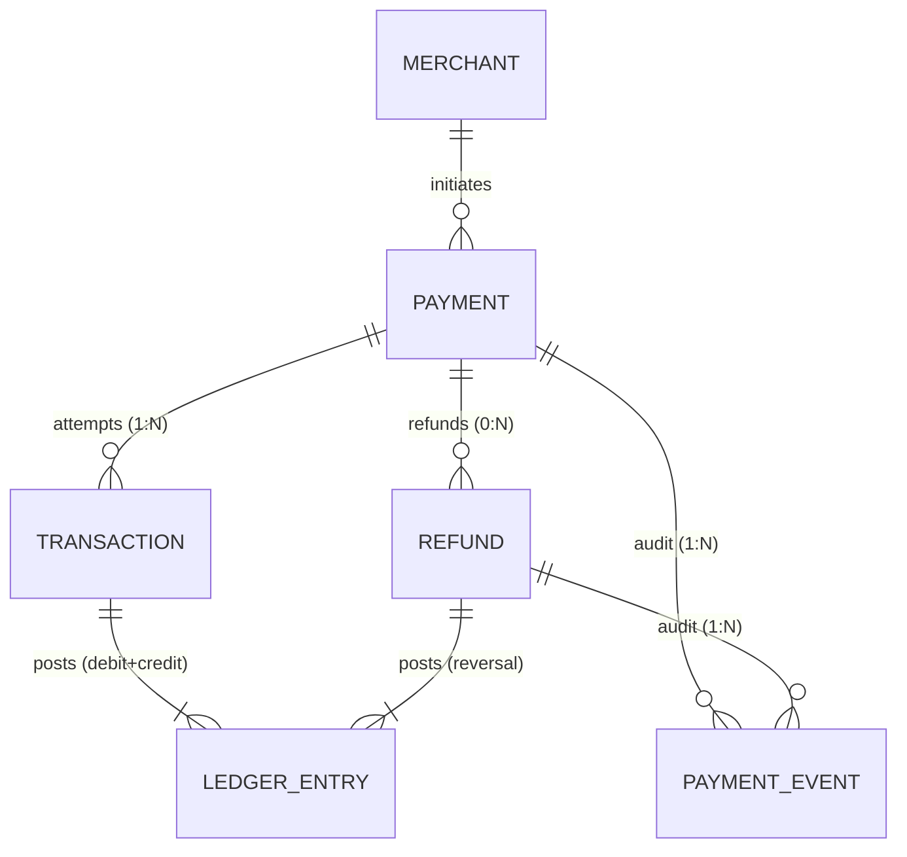

| # | Entity | Minimum fields | Justification |
|---|--------|----------------|---------------|
| 1 | **Merchant** | `merchant_id`, api_key_hash, bank_account, webhook_url, status | FR actor; owns the keys and callback contract |
| 2 | **Payment** (= PaymentIntent in Stripe terms) | `payment_id`, merchant_id, amount, currency, status, created_at | Lifecycle object; what status GET returns; **you only need one of {Payment, PaymentIntent}** — pick one name |
| 3 | **Transaction** | `txn_id`, payment_id, type (charge\|auth\|capture), status, `provider_ref`, `card_token`, created_at | Each acquirer/network attempt is a row; keeps retry history auditable; holds a **token**, never the PAN |
| 4 | **Refund** | `refund_id`, payment_id, amount, status, reason | Not a Payment field: refunds have independent idempotency keys, independent state, independent money movement |
| 5 | **LedgerEntry** | `entry_id`, source_id (txn\|refund), account, direction, amount_minor, currency, balance_after | **The money truth**; derived balances; append-only |
| 6 | **PaymentEvent** | `event_id`, payment_id, from_status, to_status, actor, payload, created_at | Compliance / dispute forensics; cannot derive this from current state alone |

**Step 4 — what I deliberately did NOT make an entity, and why:**

| Thing | Why it's NOT an HLD entity | Where it lives |
|-------|----------------------------|-----------------|
| `IdempotencyKey` | Request-level dedup, no business lifecycle, no one queries it as a user — same tier as a rate-limit counter | Redis (hot) + PG `UNIQUE (merchant_id, idempotency_key)` on Payment |
| `WebhookEvent` (outbound) | Delivery attempt log; infra concern | Internal `webhook_delivery` table |
| `ProcessedProviderEvent` | Inbound (acquirer → us) dedup set — same tier as idempotency | `UNIQUE (provider_event_id)` on PaymentEvent or own tiny table |
| `OutboxEvent` | Reliability mechanism, not domain data | `outbox` table beside Payment |
| `Order` | Belongs to the merchant's e-commerce system, **not us** — we accept `metadata.order_id` and move on | Not in our DB |
| `Card` / `PAN` / `PaymentMethod` | We **do** store it (we are Stripe) — but in a **separate Card Vault service** with its own PCI zone, keys, and DB. The payment domain only ever sees `card_token`. Saved cards (`PaymentMethod` as a merchant-visible object) are below the line | Card Vault (§14), **not** the payments DB |
| `AuditLog` as a separate thing | Already covered by `PaymentEvent` + immutable `LedgerEntry` | Collapsed |

**Interview phrasing (say this out loud):**

> "I'll draw six domain entities: Merchant, Payment, Transaction, Refund, LedgerEntry, and PaymentEvent. Idempotency keys, outbox rows, webhook delivery records, and the inbound-event dedup set are **infrastructure tables, not domain nouns** — I'll bring them up when we talk about the write path, not the entity model."

### Why this differs from Hello's and AlgoMaster's lists

| Source difference | My call | Reason |
|-------------------|---------|--------|
| Hello lists `Transaction` as polymorphic (Charge/Refund/Dispute/Payout) | **I split Refund out** | Refunds have their own idempotency key, their own API endpoint, their own state — different aggregate boundary. Payout and Dispute go into §9 extensions |
| AlgoMaster lists `Payment` + `payment_events` + `refunds` + `ledger_entries` separately | Same — I follow this | Correct normalization; same model with different names |
| Both omit `Merchant` from the ER drawing | **I include it** | The relationship `Merchant 1:N Payment` is the first thing an interviewer tests ("multi-tenant? how do you scope idempotency keys?") |
| Both treat idempotency as an entity | **I move it to infra** | HLD-correctness: it's a cross-cutting concern, like rate-limits or auth tokens |

### APIs (match the entity set you drew)

One endpoint per **core entity you can create or read** — nothing else:

```
POST /v1/payments        Header: Idempotency-Key  → { payment_id, status: processing }
GET  /v1/payments/{id}                            → payment + transactions[] + ledger_summary
POST /v1/refunds         Header: Idempotency-Key  → { refund_id, status: pending }
GET  /v1/refunds/{id}                             → refund
```

**Hello's shape** (`POST /payment-intents` → `POST /payment-intents/{id}/transactions`) is also valid if you want to **expose the retry-attempt split to merchants**. Pick one and say why: Stripe-style exposes transactions; most merchants prefer the simpler "one call, poll status" shape above.

**Both shapes share:** amounts in **minor units (cents)**; `Idempotency-Key` on mutating ops only; async by default (initial status = `processing`, not `succeeded`).

### States

**Payment state machine — one-shot charge (default).** Auth/capture states are an extension (§9).

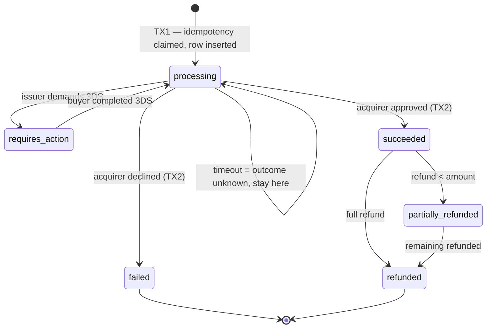

**AlgoMaster rules (verbatim):** `failed` and `refunded` are **terminal**; **optimistic locking** (`UPDATE … WHERE status = 'processing'`); duplicate processor callbacks are **idempotent no-ops** if already in the target state.

### Who owns what? (plain English)

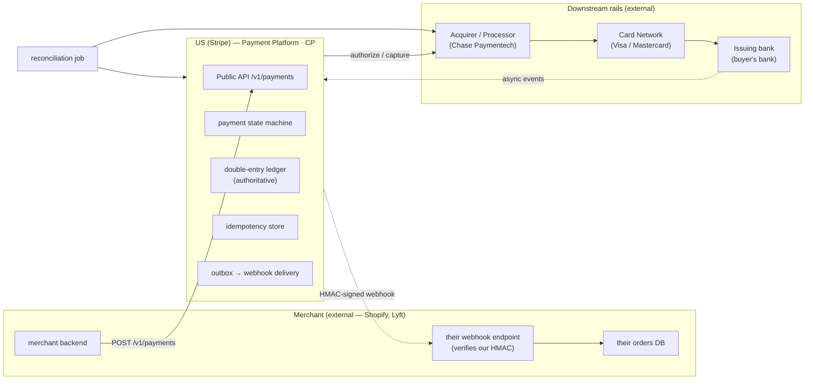

**"We own the money movement"** = *we* are the only party on the acquirer / card-network wires, so *we* are the only party who can authoritatively create, confirm, or reverse a dollar. The merchant finds out about money events only by (a) our webhook or (b) polling our API — their orders DB is a **cache** of our ledger, not an independent source of truth.

| Party / store | Job | Not its job |
|---------------|-----|-------------|
| **Merchant backend** (external) | Owns order lifecycle, inventory, shipping; verifies our webhooks; polls our API as backup | Any money movement; holding card data |
| **Our Payments DB (Postgres)** | Payment row + ledger_entries + idempotency + outbox — all in **one TX**; authoritative source of truth for money | Merchant business logic; order fulfillment |
| **Our Webhook delivery service** | At-least-once delivery to merchant endpoint, HMAC-signed, with retry schedule → DLQ | Guaranteeing the merchant actually processes it (that's their idempotency) |
| **Acquirer / Processor** (external) | Card network wire protocol; batch settlement file (T+1/T+2) | Our ledger truth |
| **Reconciliation worker** | Nightly diff of our ledger vs acquirer settlement file; exceptions queue | Live payment path |

### 60s opener

> **We are Stripe.** A payment platform merchants (Shopify, Lyft) call via `POST /v1/payments` with a client-generated **idempotency key** and a tokenized card. We maintain the authoritative **payment state machine** and **append-only double-entry ledger** in Postgres — one atomic TX per money event. Downstream we call an **acquirer** (Chase Paymentech) to reach **Visa/Mastercard** and the buyer's **issuing bank**; that's where the actual rails live. We notify merchants via **HMAC-signed webhooks** (delivered at-least-once; merchants dedupe by `event.id`) and reconcile daily against the acquirer's settlement file. **Money writes are CP; status reads use replicas.**

### Capacity math (derive your choices, don't assert them)

**Anchor: 10k TPS peak** (Hello). AlgoMaster's "10M/day → 1.15k peak" is a smaller gateway — fine for a warm-up but we design for Stripe-scale.

**Assumption to say out loud:** peak ≈ 3× average → **~3k TPS average ≈ 260M payments/day**. Size *throughput* for peak, size *storage* for average.

| Resource | Math | Design consequence |
|----------|------|--------------------|
| **Postgres writes (peak)** | 10k TPS × 2 TXs (TX1 + TX2) × ~5 rows (idempotency, payment, 2–3 ledger, outbox, event) ≈ **~100k row writes/sec** | One tuned PG primary sustains roughly 10–30k write TPS → **shard by `payment_id`** (e.g. 16–32 shards, each with its own primary + replicas) |
| **Postgres storage** | 260M/day × ~2 KB (payment + ledger + events) ≈ **~0.5 TB/day ≈ ~190 TB/yr** | Partition by month; keep ~13 months hot; archive older to S3 (immutable) |
| **Redis idempotency** | Live keys = avg TPS × 48h = 3k × 172,800 ≈ **~520M keys × ~500 B ≈ ~260 GB** | **Redis cluster** (~16 shards × 16–32 GB), keyed `idempotency:{merchant_id}:{key}`; PG `UNIQUE` remains the durable backstop |
| **Kafka** | 10k payments/s × ~2 events each ≈ 20k msg/s peak; 30-day retention ≈ 260M × 2 × 1 KB × 30 ≈ **~16 TB × 3 replicas ≈ ~48 TB** | Partition by `payment_id` (per-payment ordering, no merchant hot spot); beyond 30 days → S3 |
| **Outbound webhooks** | ~20k events/s × ~1.1 attempts (most succeed first try) ≈ **~22k POSTs/s peak** | Horizontal stateless workers; **per-merchant concurrency cap** so one slow endpoint can't starve others |
| **Reconciliation** | ~260M rows/day vs acquirer files | Nightly Spark/Flink batch keyed by `provider_ref`; target < 0.01% exceptions to the ops queue |

> **Interview phrasing:** *"At 10k TPS peak, each payment is two short TXs writing about five rows each — ~100k row writes/sec, beyond one Postgres primary — so we shard by `payment_id`, not `merchant_id`, which would make Amazon a hot shard. Idempotency keys alive for 48h come to ~260 GB, so a Redis cluster with Postgres UNIQUE as the backstop. Kafka by `payment_id` keeps per-payment ordering. Reconciliation is a nightly batch, off the live path."*

### Don't

| ✗                                                        | ✓                                                                                 |
| -------------------------------------------------------- | --------------------------------------------------------------------------------- |
| `SELECT` idempotency key then charge (race)              | **INSERT** key under **UNIQUE** first                                             |
| Server-generated idempotency key per HTTP retry          | **Client** one key per intended payment                                           |
| Charge acquirer then "hope" DB update succeeds           | Persist result + ledger + outbox in **one TX**; retry acquirer with **same** key  |
| Notify merchant via a side-call ("fire and forget HTTP") | **Outbox** committed with capture; delivery service reads outbox                  |
| Trust inbound webhook once-only                          | Dedupe inbound by `**provider_event_id**`; tolerate reorder via legal transitions |
| Ledger = final truth about cash in bank                  | **Reconcile** against acquirer settlement file (T+1/T+2)                          |
| 2PC across Postgres + acquirer                           | Local TX + idempotent acquirer call + reconciliation                              |
| Mutable `balance` column only                            | **Append-only** entries; balances = sum                                           |

---

## 1. Chosen design (default answer)

### Stack (merged Hello + AlgoMaster picks — call out which you’re using)

| Layer                           | Pick                                                                                                                                                  | Source                        |
| ------------------------------- | ----------------------------------------------------------------------------------------------------------------------------------------------------- | ----------------------------- |
| Edge                            | API Gateway (merchant API-key auth, **HMAC request signing** for enhanced tier, rate limit, PCI edge)                                                 | Hello §security               |
| Services                        | **Payment Service** (owns `Payment` lifecycle + Transaction attempts) + **Refund Service** + **Webhook Delivery Service** + **Reconciliation Worker** | Hello / AlgoMaster merged     |
| Idempotency                     | **Redis** (`SET NX` TTL 48h) on `idempotency:{merchant_id}:{key}` + **Postgres UNIQUE (merchant_id, idempotency_key)** backup                         | AlgoMaster §6.2               |
| DB                              | **PostgreSQL** — `payments`, `payment_events`, `refunds`, `ledger_entries`, `outbox`; sharded by `payment_id`                                         | AlgoMaster §5 + comments      |
| Reliability for outbound events | **Transactional outbox** (primary) + CDC/Debezium → **Kafka** (secondary stream for audit + S3)                                                       | Our pick                      |
| Queue                           | **Kafka** partitioned by `**payment_id`** (per-payment ordering; merchant-level partitioning creates hot shard — see §8 comments)                     | Hello + Evan reply            |
| Audit (cold)                    | Kafka → **S3** immutable append-only                                                                                                                  | Hello §durability "Great"     |
| Reconcile                       | **Daily acquirer settlement file + ad-hoc processor queries by `provider_ref`**                                                                       | Both                          |
| Acquirer layer                  | **Acquirer Gateway** inside the card data environment (one acquirer per route; failover is a product decision, not a flag — see §11) + **circuit breaker**                     | AlgoMaster §6.3 (scoped down) |
| Reads                           | Primary for writes; **replicas + Redis cache** for status (read-your-writes via sticky session after POST)                                            | Hello §scale DB               |

> **Outbox vs CDC — why we pick outbox as primary:** for money we want *the same TX* to produce the event, so we never lose intent on a crash between write and publish. CDC is secondary — it feeds the audit stream to Kafka → S3 and lets consumers (webhook delivery, reconciliation) subscribe. Pure CDC alone has a WAL-retention failure mode (see §11); outbox table doesn't.

### HLD — component architecture (draw this on the whiteboard)

Logical services (not sequence). Solid = sync HTTP; dashed = async.

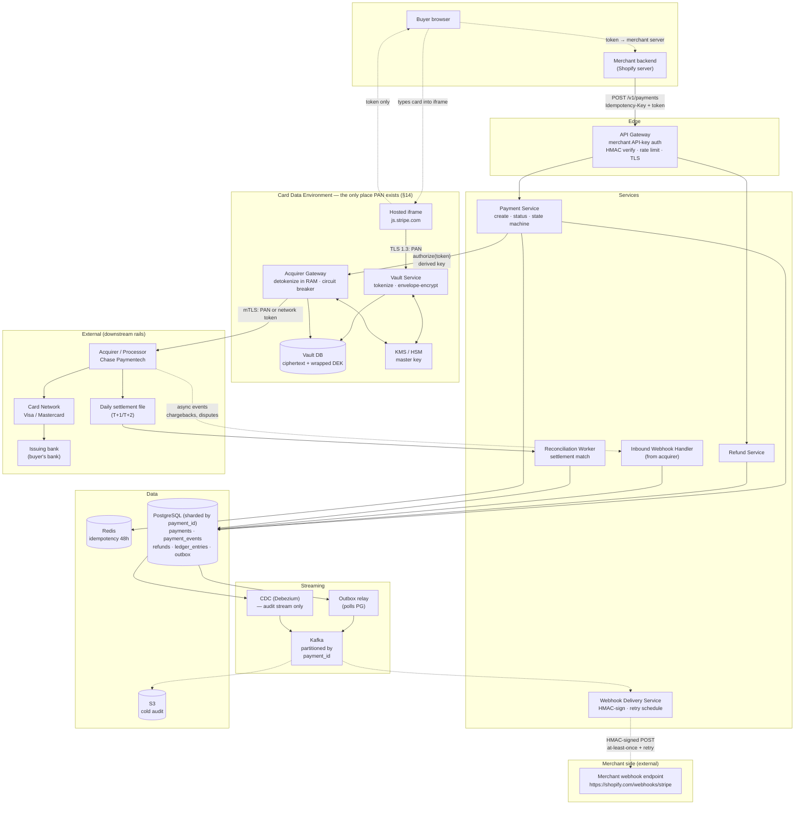

| Component | Responsibility | Source |
|-----------|----------------|--------|
| **Hosted iframe (Stripe Elements)** | Served from **our** origin (`js.stripe.com`); the merchant's JS can't read it (same-origin policy); the PAN goes **directly to our vault** → merchant is SAQ A; returns an opaque token | Hello §PCI |
| **Vault Service + Vault DB** | Tokenize: envelope-encrypt PAN (AES-256-GCM data key wrapped by the HSM master key), store ciphertext + last4 + HMAC fingerprint; never store CVC | Our addition (§14) |
| **Acquirer Gateway** | The **only** service allowed to unwrap data keys; detokenizes in memory, calls the acquirer over mTLS with the derived idempotency key; circuit breaker per route | AlgoMaster §6.3 + §14 |
| **API Gateway** | Merchant API-key auth, optional HMAC-signed requests (nonce + timestamp), rate limit, TLS termination | Hello §security |
| **Payment Service** | `POST /v1/payments` + `GET /v1/payments/{id}`; owns `Payment` lifecycle, state machine, idempotency claim (TX1), Acquirer Gateway call, then ledger + outbox (TX2); **never sees PAN** | Hello §HLD + AlgoMaster §5 |
| **Refund Service** | `POST /v1/refunds`; separate idempotency; posts reversing ledger entries | AlgoMaster §4 |
| **Idempotency Store (Redis)** | `SET NX` on `idempotency:{merchant_id}:{key}` with `{payment_id, status, response, fingerprint}` 48h; PG `UNIQUE(merchant_id, idempotency_key)` is the durability backup | AlgoMaster §6.2 |
| **Postgres (sharded by `payment_id`)** | CP source of truth: `payments`, `payment_events`, `refunds`, `ledger_entries`, `outbox` | Both |
| **Outbox relay** | Polls `outbox` table → publishes to Kafka → marks sent. Guarantees "payment TX ⇒ event eventually in Kafka" | Our pick |
| **CDC (Debezium)** | Secondary audit stream to S3; not the primary event path (see §1 Stack note) | Hello §durability |
| **Webhook Delivery Service** | Consumes Kafka → fetches merchant `webhook_url` + subscribed events → signs with HMAC → POSTs → retry schedule → DLQ | Both §webhooks |
| **Inbound Webhook Handler** | Receives async events from the **acquirer** (not from merchants); verifies acquirer's signature; dedupes by `provider_event_id`; advances state machine | AlgoMaster |
| **Reconciliation Worker** | Diffs our ledger vs acquirer's daily settlement file; also ad-hoc `GET /payment_intents/{provider_ref}` on timeouts; exceptions queue | Both |
| **S3 cold audit** | Immutable append-only; survives SOX / PCI auditors | Hello §durability |

**Whiteboard tip:** Draw **Postgres at the center of writes**, **acquirer on the side** (not inside our box), and show the **outbox → Kafka → fan-out** path. The merchant's webhook endpoint lives **outside** our rectangle — we deliver to it, we don't own it.

### User journey — steps in words

1. **Checkout (merchant side)** — Buyer clicks "Pay". Merchant's checkout page already loaded **our iframe** (`js.stripe.com`); buyer types card into the iframe → **our** PCI-scoped origin receives the PAN → returns a short-lived **token** to the buyer's browser → merchant's JS posts token to merchant's backend.
2. **Call us** — Merchant backend calls `POST /v1/payments` with `Idempotency-Key` header, the token, amount, currency, and `metadata` (which may include merchant's internal `order_id` — opaque to us).
3. **We charge** — Payment Service claims idempotency key atomically → calls the Acquirer Gateway (with derived per-op key) → on success commits **payment + ledger + outbox** in one Postgres TX → returns `{payment_id, status: processing or succeeded}`.
4. **Async confirmation** — Outbox relay → Kafka → Webhook Delivery Service → HMAC-signed POST to merchant's webhook URL (`payment_intent.succeeded`). Merchant verifies HMAC, dedupes by `event.id`, marks their internal order as paid, ships.
5. **Buyer UX** — If 3DS was required, our response is `status: requires_action` with a redirect URL; buyer completes 3DS; acquirer fires inbound webhook to us; we fire outbound webhook to merchant.
6. **Ops** — Reconciliation nightly against acquirer's settlement file; exceptions queue for true mismatches.

### Authorize / capture vs one-shot

| Pattern | When to say it |
|---------|----------------|
| **One-shot charge** (default state machine in §0) | Simple e-commerce "Pay now"; fewer states |
| **Authorize → capture** (extension — see §9) | Marketplace, ship later, partial capture, void before fulfill; adds `authorized → captured \| voided \| expired` states |

Both share: **idempotency**, **no TX across the acquirer call**, **outbox + webhook + reconcile**.

---

## 1.5 Idempotency keys & principal Q&A

### Redis row shape (AlgoMaster verbatim)

```
Key:    idempotency:{merchant_id}:{idempotency_key}
Value:  { payment_id, status, response, created_at, request_fingerprint }
TTL:    48 hours
```

**Why 48h, not 24h or 7d:** covers all realistic retry windows (mobile reconnects, overnight batch retries) without unbounded growth. 24h = too short for merchants retrying next morning; >72h = contention with legitimately new intents and bigger table.

### Idempotency row (Postgres backup — AlgoMaster says store it in both)

| Column | Purpose |
|--------|---------|
| `(merchant_id, idempotency_key)` | **UNIQUE** index — atomic claim |
| `request_fingerprint` | Hash(amount, currency, payment_method, …) — reject key reuse with different body (409) |
| `status` | `IN_PROGRESS` → `COMPLETED` (the *payment's* outcome lives on `payments.status`, not here) |
| `payment_id` | Result binding |
| `response_body` | Replay cached response to retries |
| `locked_until` | Lease — lets a retry take over if the owner crashed mid-flight |
| `expires_at` | TTL 48h |

**Which store is the authority?** Postgres `UNIQUE` is the **authority**; Redis `SET NX` is a **fast-path filter** that rejects most duplicates before they reach the DB. If Redis is down or loses a key, the PG insert still serializes the claim — correctness never depends on Redis.

### The sharding trap (audit finding — neither source covers it)

We shard Postgres by `payment_id`. A `UNIQUE (merchant_id, idempotency_key)` index is only enforced **within one shard** — two concurrent retries routed to different shards would both win → double charge.

**Fix:** make the shard a pure function of the idempotency scope, and co-locate the payment with it.

```text
shard      = hash(merchant_id, idempotency_key) mod N
payment_id = "pay_" + shard_prefix(shard) + random_suffix     -- shard id embedded in the id
```

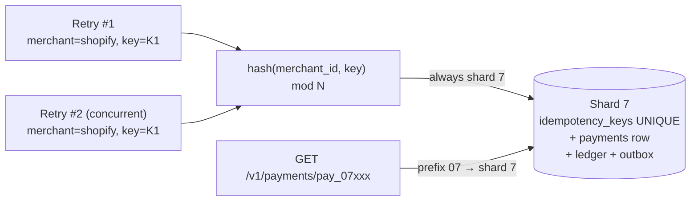

Both retries hit the same shard, so the UNIQUE index serializes them, and TX1/TX2 stay **single-shard** (no distributed transactions). `GET` routes by the prefix inside `payment_id`. Refunds route to the parent payment's shard so the reversal ledger entries are in the same TX.

### Atomic claim (the interview answer)

```text
WRONG (race):
  SELECT key → absent → call acquirer → INSERT key
  Two concurrent retries both SELECT absent → double charge.

RIGHT:
  INSERT idempotency_keys(merchant_id, idempotency_key, ...) → one wins, one UNIQUE violation
  Winner: short TX1 (idempotency IN_PROGRESS + payment status=processing)
          → call acquirer OUTSIDE any TX, with derived key
          → TX2 (payment status + ledger + outbox + idempotency COMPLETED)
  Loser:  if COMPLETED → return stored body
          if IN_PROGRESS → 409 + Retry-After or short poll
```

**Derived acquirer-side idempotency key:** we never pass the merchant's raw client key straight to the acquirer. We send `hash(merchant_id + ":" + client_key + ":" + op)` — `merchant_id` because client keys are only unique per merchant, `op` so `authorize`, `capture`, and `refund` on the same payment don't collide at the acquirer.

**Crash mid-flight:** owner dies with `IN_PROGRESS` → **lease timeout** lets retry re-drive; acquirer dedupes same derived key → no second charge.

### One payment attempt — authoritative order of operations (used everywhere in this doc)

| Step | Action | TX scope |
|------|--------|----------|
| 1 | Validate merchant + amount + token | — |
| 2 | **TX1:** `INSERT idempotency_keys` + `INSERT payment(status=processing)` (or replay if key exists) | one PG TX, single shard |
| 3 | Call acquirer with derived key — **no DB TX open** | network |
| 4 | **TX2:** `UPDATE payment` → terminal state + `INSERT ledger_entries` + `INSERT outbox` + `UPDATE idempotency` → `COMPLETED` with response body | one PG TX |
| 5 | Return 201/200 to merchant | — |

> This is the **single authoritative write-path sequence** for the whole guide. §2 (funnel) and §13 (two-phase event model) are refinements of this, not alternative paths.

**Timeout after acquirer accepted charge:** local row stays `processing` (outcome unknown) → **query acquirer by our derived key / `provider_ref`** (same derived key) or wait for the inbound webhook; **never** infer failure from timeout alone.

### Principal counter-questions (merged + verified)

| Q                                           | A                                                                                                                                                 | Source                     |
| ------------------------------------------- | ------------------------------------------------------------------------------------------------------------------------------------------------- | -------------------------- |
| Why Redis **and** Postgres for idempotency? | Redis = sub-ms hot path; PG `UNIQUE` = durability if Redis fails. AlgoMaster says: fail closed with 503 if Redis down **and** PG backup available | AlgoMaster §6.2            |
| Client lost key, retries without key?       | New key = new payment — reconcile window on `(merchant, amount, timestamp)`; product shows “processing”                                           | Comments                   |
| Same key, different parameters?             | Store **fingerprint hash**, return **409 Conflict**                                                                                               | Both                       |
| Idempotency on GET?                         | No-op; GETs are naturally idempotent                                                                                                              | AlgoMaster                 |
| Processing stuck > 30s?                     | Query processor by `processor_transaction_id`; allow retry if processor also has no record                                                        | AlgoMaster §6.2 edge cases |
| Concurrent first requests same key          | `**SET NX**` ensures one winner; other gets 409 or final result depending on timing                                                               | AlgoMaster                 |

---

## 1.6 Failure modes (acquirer + split brain)

### Cannot 2PC with the acquirer

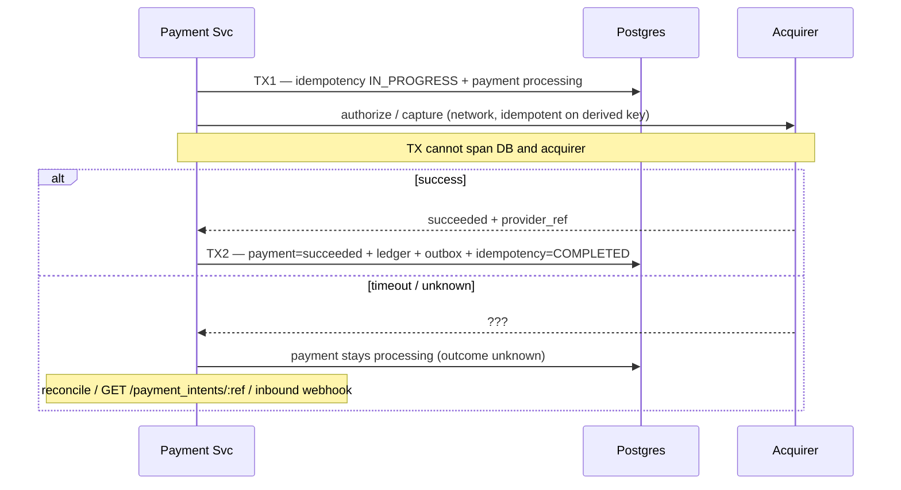

| Failure | Risk | Mitigation |
|---------|------|------------|
| Acquirer OK, our TX2 fails | **Lost record**, money moved | Retry same derived key; acquirer returns original result; reconcile backstop |
| We crash **after TX1, before calling the acquirer** | Row stuck `processing`, no money moved | **Sweeper** picks `processing` rows older than ~30s → asks acquirer "do you know derived key X?" → not found → re-drive the call (same key) or mark `failed` |
| Duplicate inbound webhook (from acquirer) | Double ledger post | `UNIQUE(provider_event_id)` on `payment_events` |
| Inbound webhook lost | Payment stuck `processing` | Same sweeper polls the acquirer; nightly reconciliation is the last backstop |
| Outbox relay down | Money captured in our ledger, merchant not notified | Relay catches up when back; merchant can also poll `GET /v1/payments/{id}` as backup |
| Outbound webhook delivery exhausted | Merchant doesn't know; our ledger still correct | DLQ + merchant dashboard replay (AlgoMaster retry schedule) |

### "Outcome unknown" is a real state (we keep it as `processing`)

- **Do not** auto-refund on timeout.
- **Do not** mark `succeeded` without acquirer evidence.
- Worker options: `GET /payment_intents/:provider_ref` on acquirer / wait for inbound webhook / wait for daily settlement file.

---

## 2. Request funnel (write path)

Same sequence as §1.5, drawn as a decision funnel.

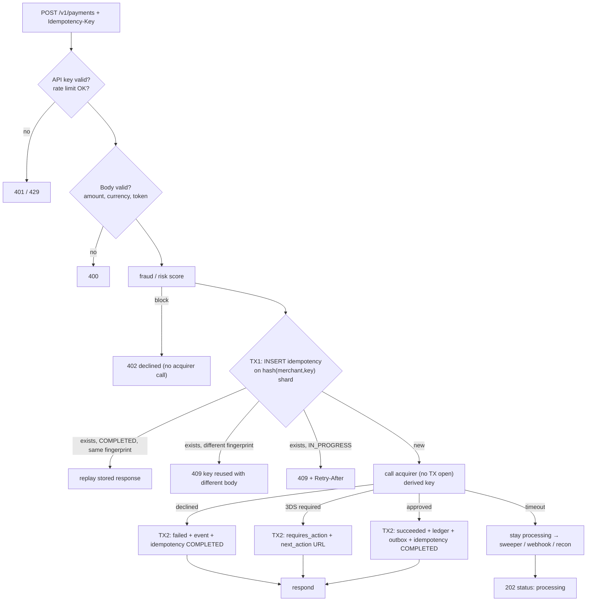

Reads (`GET /v1/payments/{id}`) never call the acquirer; route by the shard prefix in `payment_id`; replica is OK with a **read-your-writes** caveat (read primary for a few seconds after the POST, or sticky session).

---

## 3. Double-entry ledger (AlgoMaster §6.4)

Every money movement = **balanced** debits and credits (append-only). **AlgoMaster-named account types:**

| Account type | Normal balance | Description |
|--------------|----------------|-------------|
| `customer_receivable` | Debit | Money we expect to receive from customers |
| `merchant_payable` | Credit | Money we owe merchants |
| `fee_revenue` | Credit | Platform fees |
| `reserves` | Credit | Held funds for potential chargebacks |
| `refund_liability` | Credit | Pending refunds |

**Capture $100 with 2.9% + $0.30 fee (AlgoMaster verbatim):**

| # | Account | Debit | Credit |
|---|---------|-------|--------|
| 1 | `customer_receivable` | $100.00 | |
| 2 | `merchant_payable` | | $96.80 |
| 3 | `fee_revenue` | | $3.20 |

### Audit: capture alone is not the whole story

The capture entries above say "someone owes us $100". They don't say where the **cash** is. A real platform posts four stages, and each one has to balance on its own. Two accounts beyond AlgoMaster's list are needed: `cash_at_bank` (our real bank account) and `interchange_expense` (what the issuer and network keep).

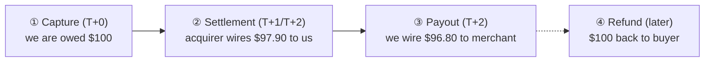

**② Settlement — acquirer wires the money, net of interchange (~2.1%):**

| Account | Debit | Credit |
|---------|-------|--------|
| `cash_at_bank` | $97.90 | |
| `interchange_expense` | $2.10 | |
| `customer_receivable` | | $100.00 |

**③ Payout to merchant:**

| Account | Debit | Credit |
|---------|-------|--------|
| `merchant_payable` | $96.80 | |
| `cash_at_bank` | | $96.80 |

**Net result for us:** cash $97.90 − $96.80 = **$1.10 = fee $3.20 − interchange $2.10**. The ledger shows our real margin, and every stage balances.

**④ Refund of the same $100.** This is a **policy choice**. Stripe does **not** return its fee on refunds, so the merchant bears the full $100:

| Step | Account | Debit | Credit |
|------|---------|-------|--------|
| Refund accepted | `merchant_payable` | $100.00 | |
| | `refund_liability` | | $100.00 |
| Acquirer debits us for it | `refund_liability` | $100.00 | |
| | `cash_at_bank` | | $100.00 |

If the merchant was already paid out, `merchant_payable` goes **negative** ($96.80 − $100 = −$3.20). We recover that from their next payout, or from `reserves`. This is exactly why the `reserves` account exists.

**Rules:** append-only (corrections = new reversing + corrected entries), atomic (all entries of one money event in one DB TX on one shard), continuous **balance validation** (`SUM(debit) == SUM(credit)` per event and globally). Amounts are **integers in minor units** plus a currency, and you never add across currencies (JPY has 0 decimals, KWD has 3).

**Interview:** “Balances are **derived**; we never `UPDATE balance = balance + x` without an entry row.”

---

## 4. Money ↔ merchant notification (transactional outbox)

**The problem (dual write):** after TX2 we need to (a) commit the money fact and (b) publish `payment.succeeded`. These are two systems (Postgres and Kafka), with no shared transaction.

| Order of writes | Crash in between → |
|-----------------|--------------------|
| DB commit, then publish to Kafka | Money moved, **event lost forever** → merchant never told, never ships |
| Publish, then DB commit | Merchant told "paid" for a payment we then **roll back** → ships for free |

**Pattern:** write the event **as a row in the same TX** as the money, and let a relay publish it later.

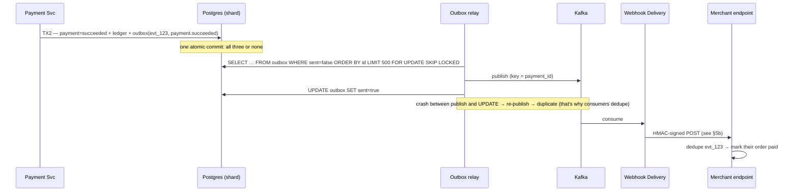

**Guarantee:** if the money committed, the event **will** eventually be published at least once. Consumers dedupe by `event_id`, not `payment_id`, because one payment emits many events (succeeded, refunded, disputed).

**Lag:** relay poll interval (~100 ms–1 s) plus delivery. The merchant's UX shows "Processing payment…" until the webhook arrives, or uses the synchronous API response.

---

## 5. Webhooks — two directions, two different systems

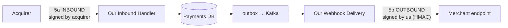

| | **5a Inbound** (acquirer → us) | **5b Outbound** (us → merchant) |
|-|-------------------------------|--------------------------------|
| Who retries if it fails | The acquirer | **We** do |
| Who verifies the signature | We do (acquirer's secret / cert) | The merchant (our `whsec_` secret) |
| Dedup key | `provider_event_id` | `event.id` (`evt_…`) — merchant's job |
| Typical events | async auth result, 3DS result, chargeback opened, settlement | `payment.succeeded`, `payment.failed`, `refund.succeeded`, `dispute.created` |
| Backstop if lost | Sweeper + nightly settlement file | Merchant polls `GET /v1/payments`; dashboard replay |

### 5a. Inbound (acquirer → us)

Handler = verify signature on **raw body** → `INSERT payment_events(provider_event_id) ON CONFLICT DO NOTHING` → if it's new and the transition is legal, apply it + ledger + outbox in **one TX** → return 200 fast. Illegal or out-of-order transitions are logged and parked, never crash the handler. This is the **same state-machine code** the sweeper and reconciliation use (see Appendix B).

### 5b. Outbound (us → merchant)

#### Payload (both sources)

```json
{
  "id": "evt_1JklMnOpQrStUv",
  "type": "payment.succeeded",
  "created": 1705312200,
  "data": { "object": { "id": "pay_abc", "amountInCents": 2499,
                        "currency": "usd", "status": "succeeded" } }
}
```

#### Delivery (at-least-once) — merchant dedupes by `evt_` id

| Step | Action | Source |
|------|--------|--------|
| 1 | **Outbox relay → Kafka** publishes the event (key = `payment_id`) | §4 |
| 2 | **Webhook Delivery** consumer looks up the merchant's `webhook_url` + subscribed event types | Hello |
| 3 | Sign: `HMAC-SHA256(whsec_secret, timestamp + "." + raw_body)`; header `Stripe-Signature: t=…,v1=…` | AlgoMaster §7.1 |
| 4 | POST with a ~10s timeout; expect 2xx | Both |
| 5 | **5xx / timeout → retry on schedule**; **410 / repeated 4xx → disable endpoint + alert merchant** | AlgoMaster |

**Audit — don't block the Kafka partition on a slow merchant.** If the consumer retries inline, one dead endpoint stalls every merchant whose payments share that partition. A failed delivery is written to a **delay store** (retry topic per backoff tier, or a `webhook_deliveries` table with `next_attempt_at`), and the partition keeps moving. Per-merchant concurrency caps stop one slow endpoint from eating the worker pool.

#### Retry schedule (AlgoMaster verbatim)

```
Attempt 1: immediate
Attempt 2: +5m
Attempt 3: +30m
Attempt 4: +2h
Attempt 5: +8h
Attempt 6: +24h
Attempt 7: +72h  (final → dead-letter queue, email merchant, dashboard replay)
```

#### Security (both PDFs + §14)

- **HMAC signature** on every webhook. HMAC is **symmetric**: the same `whsec_` secret is held by us and by that merchant, one secret per endpoint. The alternative is asymmetric (Ed25519): we sign with our **private** key, and every merchant verifies with our **public** key. Full worked example in §14.4.
- **Timestamp** inside the signed payload; reject if > 5 min skew (replay defense).
- Merchant must verify over **raw bytes** and compare with a **constant-time** function.
- **IP allowlist** of our egress IPs (AlgoMaster explicit) — defense in depth only.
- **Secret rotation:** during a rotation window, sign with both old and new secrets (`v1=old,v1=new`) so the merchant can switch over without downtime.

#### Ordering & idempotency gotcha

Neither direction guarantees order. Merchants must dedupe by **event id** and should treat the webhook as a *hint*: re-fetch `GET /v1/payments/{id}` if order matters. **AlgoMaster explicitly: "exactly-once delivery across system boundaries is impossible."**

---

## 6. Reconciliation (both sources agree)

Three layers (AlgoMaster §7.2):

| Type | Frequency | Compared against |
|------|-----------|-------------------|
| **Transaction-level** | Per payment (sweeper, ~minutes) | Our `processing` rows vs acquirer status lookup |
| **Daily settlement** | End of day | Our captured / refunded totals vs the acquirer's settlement file (T+1 / T+2) |
| **Bank reconciliation** | Daily | Our `cash_at_bank` ledger vs the actual bank statement (did the wire really land?) |

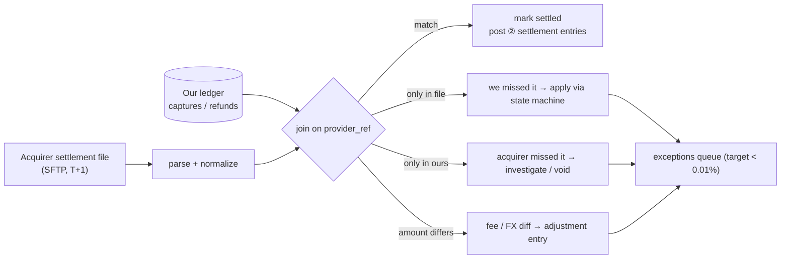

### Common discrepancies (AlgoMaster verbatim table)

| Issue | Likely cause | Resolution |
|-------|--------------|------------|
| Missing in our records | Timeout during processing; response lost | Query processor; update our records |
| Missing in processor | We think it succeeded, they don't | Investigate; may need refund |
| Amount mismatch | Currency conversion / fee calc | Review fee structure |
| Status mismatch | Async update missed | Query processor for current |
| Duplicate at processor | Idempotency failure | Refund duplicate; root-cause |

### Hello's "Event-Driven Safety" framing

- Live path = best-effort.
- Event stream (outbox → Kafka) = **durable record of intent + outcome**.
- Reconciliation worker queries the acquirer and repairs state via **idempotent** state-machine transitions (the same code as the inbound webhook handler).

### Best practices (AlgoMaster §7.2)

1. **Never modify historical records** — write adjustment entries.
2. Respect **settlement timing** (T+1/T+2); don't flag before window.
3. **Automate 95%+**; humans see only true exceptions.
4. **Alert on anomaly spikes**.

---

## 6.5 Observability — what we measure and page on

Payments break **silently**: a bug that halves approval rates shows up as zero HTTP errors. So we monitor **business** signals, not just system ones.

| Signal | SLO / threshold | Why it matters |
|--------|-----------------|----------------|
| **Authorization rate** per acquirer / BIN / country | Page on a drop of more than ~3 points vs the same hour last week | A broken route or bad retry logic looks like "customers declined" |
| **API latency** `POST /v1/payments` | p99 < 2s (excluding 3DS) | Checkout abandonment |
| **Payments stuck in `processing`** | Count older than 5 min ≈ 0 | Sweeper or acquirer is failing |
| **Outbox backlog / age of oldest unsent row** | < 5s | Merchants not being told about money that moved |
| **Webhook first-attempt success** | > 99% ; 24h delivery > 99.9% | Merchant integration health |
| **Ledger imbalance** `SUM(debit) − SUM(credit)` | **Exactly 0**, always | Anything else = page immediately, halt payouts |
| **Reconciliation exception rate** | < 0.01% of daily volume | Drift between us and the acquirer |
| **Idempotency 409 rate** per merchant | Alert on spikes | Usually a merchant bug (reusing keys) |
| **Vault decrypt calls** vs authorizations | Ratio ≈ 1 | More decrypts than charges = possible data exfiltration |

---

## 7. Quick tradeoffs

| Choice | Tradeoff |
|--------|----------|
| CP on writes | Fail payment vs wrong money — choose **fail** |
| AP on reads | Replica lag on status OK for dashboards |
| Outbox vs dual-write to Kafka | Outbox = same TX as payment; costs a relay + polling lag |
| Outbox vs CDC as primary | Outbox: explicit events, no WAL-retention risk. CDC: zero app code, but leaks table schema as the event contract |
| Auth+capture | More states; better for delayed ship |
| Key TTL 24h vs 7d | Longer = safer retries; bigger Redis (~260 GB at 48h) |
| Shard by `payment_id` vs `merchant_id` | `payment_id`: even load, but merchant listings need a separate read model. `merchant_id`: easy listings, Amazon = hot shard |
| HMAC vs Ed25519 webhook signing | HMAC: fast, simple, one secret per merchant. Ed25519: a leaked merchant key can't forge; one public key for everyone |
| Card vault in-house vs third party | In-house (we are Stripe): full control, large PCI scope. Third-party vault: smaller scope, vendor lock-in |

---

## 8. Community → one line (Hello discussion)

Distilled from reader comments + Evan’s replies — patterns worth **internalizing**, not memorizing Hello’s diagram verbatim.

### Scope & interview posture

| Q / concern | One-line answer |
|-------------|-----------------|
| “Too much domain knowledge” | Evan: heavy domain Q is fair only with **interviewer context**; otherwise reason about **constraints** (idempotency, audit, async rails). |
| Stripe vs “payment on my site”? | Clarify: usually **merchant payment platform** (we are Stripe, on top of acquirer rails), not building Visa. |
| `PaymentIntent` feels arbitrary | **Container** for one checkout: amount, merchant, lifecycle; **transactions** = individual rails attempts (charge, refund, dispute). |
| Staff must know payments? | Not universal — show **patterns** (state machine, outbox, reconcile). |
| Stripe onsite grilled **API design** | Lock **nouns + idempotency** early; iterate depth, not random endpoints. |

### Idempotency (most repeated gap)

| Q | A |
|---|---|
| Idempotency key from server each retry? | **Client** one key per intended payment; new key = new payment. |
| Same as `PaymentIntentId`? | Intent id correlates; still use **per-operation** keys (authorize vs capture vs `POST …/transactions`). |
| Nonce vs idempotency? | **Nonce** = anti-replay on signed merchant API; **idempotency key** = same logical operation on retry. |
| SELECT key then charge? | Race → double charge; **UNIQUE insert first**. |
| Projection lag + event sourcing | If read path lags, duplicate gateway calls possible — **DB claim** or read-your-writes on idempotency row. |

### Async, timeout, UX

| Q                                       | A                                                                                                       |
| --------------------------------------- | ------------------------------------------------------------------------------------------------------- |
| External call “async” — who waits?      | **Nobody** on open TCP for minutes; return **`processing`** + `payment_id`.                              |
| Timeout = failed?                       | **No** → `timeout` / `unknown` + reconcile/query; user sees “processing”.                               |
| Instant “paid” on Amazon?               | **Capture/auth succeeded** at processor; **settlement** to bank is days later — different ledger state. |
| CREATED in DB but never called network? | **Sweeper / reconcile** picks stuck rows; don’t assume reconcile only fixes “after timeout event”.      |
| Record before acquirer call?            | **Intent / attempt row** + stable **reference id** sent to network (“record intent, then act”).         |

### Hello-style entities (video / v2 write-up)

| Piece | Role |
|-------|------|
| **PaymentIntent** | Top-level lifecycle; disputes/refunds link back, new **transaction** rows |
| **Transaction** | Per attempt vs card network; status drives intent (legal transitions only) |
| **Attempt / audit** | Optional append-only trail; not the same as “current transaction row” |
| **Auth → capture → settlement** | Auth = hold; capture = move money; settlement = **batch** bank movement (reconcile-heavy) |

### DB, Kafka, CDC, outbox (where comments fight)

| Q | A |
|---|---|
| 10k TPS but “1k DB writes”? | Evan: **stale text** — at 10k payments/sec, plan **~10k durable writes/sec** unless you batch (uncommon on money path). |
| Kafka **before** DB? | Don’t block **returning payment id** on queue; **write DB first**, then event (CDC/outbox). |
| DB ok, Kafka/CDC fail? | **Transactional outbox** same TX as payment; CDC alone → monitor lag + WAL retention |
| Service writes peer’s DB? | **No** — cross-service via API/events (failed mock: txn service → payment DB). |
| Event log = source of truth? | Hello’s pragmatic blend: **OLTP DB** for correctness; stream for **audit/async**; reconcile to the acquirer |
| Exactly-once consumers? | **Effect** = idempotent handlers; delivery is **at-least-once** |
| Partition Kafka by merchant? | Ordering is per **payment**; merchant shard → **hot partition** (Evan agrees) |

### PCI & security (comment corrections)

| Q | A |
|---|---|
| Merchant encrypts the PAN in its own page and posts it to its server? | **Still in PCI scope for the merchant** — encrypted PAN is still PAN. Fix: **our** hosted iframe, so the PAN goes browser → our vault and the merchant only ever sees a token (§14). |
| Extra encryption on top of TLS? | Not between browser and us (TLS 1.3 suffices). **Yes** at rest inside the vault (envelope encryption) and on the acquirer hop (PIN/PAN rules) — see §14. |
| Merchant request “signature” | Usually **HMAC(secret, body+timestamp)** — shared secret minted at onboarding, not RSA-by-default. |
| Webhook to merchant | **HTTPS + HMAC** (Stripe-Signature); merchant **GET status** to confirm, not decrypt webhook. |
| Durability vs auditability | **Durability** = survive crash; **auditability** = explain every transition (ledger / append-only audit). |

### Reconciliation & ops

| Q | A |
|---|---|
| Reconciliation only daily files? | Also **query by reference id** on timeout; batch file = **authoritative** backstop |
| Reconciliation write DB? | **Yes** — same state-machine transitions as webhook would run |
| SQS vs Kafka for retry delay? | **SQS visibility / delay** for backoff; Kafka needs **delayed queue / retry topics** pattern |
| Refund after merchant timeout? | Ops/compensating flow — **idempotent refund**; often merchant-initiated or policy job |

### What to say in 45 minutes

Prioritize: **idempotency (atomic claim) → intent before slow rail → pending UX → webhook dedup → outbox → reconcile**. Mention ledger/settlement/**PaymentIntent** if time. Skip deep PCI unless they steer — say **"PAN lives only in an isolated vault with envelope encryption; every other service sees a token"** (§14).

---

## 9. Extensions (if they push)

| Topic | One line |
|-------|----------|
| **Refunds** | Own idempotency key; `succeeded → partially_refunded / refunded`; routes to the parent payment's shard; ledger per §3 ④ |
| **Chargebacks / disputes** | Inbound acquirer event; move funds `merchant_payable → reserves`; evidence-submission deadline; win → release, lose → debit merchant |
| **Payouts** | Separate daily pipeline: sum `merchant_payable` per merchant → ACH/wire → ledger §3 ③; never pay out a negative balance |
| **Subscriptions** | Scheduler + saved `PaymentMethod` (vault token); merchant-initiated transaction flags; dunning on decline |
| **Fraud** | Inline risk score **before** the acquirer call (see §2 funnel); a block costs nothing, a chargeback costs the fee plus the goods |
| **Multi-currency** | Store `amount_minor` + `currency` together; capture the FX rate **at authorization**; separate ledger accounts per currency, never sum across |
| **3DS / SCA (EU PSD2)** | `requires_action` state + `next_action.redirect_url`; the issuer's result arrives as an inbound event → back to `processing` |

#### Auth / capture state machine (when they ask "ship later")

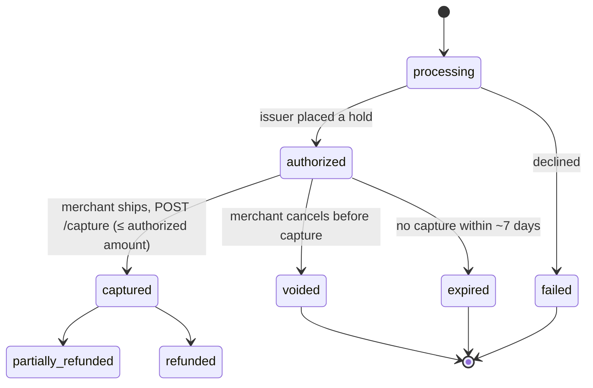

Capture uses its own derived key (`…:capture`) so a retried capture can't take money twice. The `UPDATE … WHERE status='authorized'` optimistic lock lets exactly one capture win.

---

## 10. Interview drill card

| Drill | Lead |
|-------|------|
| Double charge | UNIQUE insert idempotency **before** calling the acquirer |
| Concurrent retries | Same shard via `hash(merchant, key)`; one winner insert; loser replays or gets 409 |
| Acquirer timeout | Stay `processing` + sweeper query + inbound webhook + reconcile |
| Merchant not notified | Outbox in TX2 → relay → webhook delivery; merchant can poll |
| Duplicate inbound event | `provider_event_id` UNIQUE |
| Lost inbound event | Sweeper, then daily settlement reconciliation |
| Ledger | Append-only double-entry; capture → settlement → payout → refund all balance |
| PCI | PAN only in the vault (envelope-encrypted); everything else uses a token |
| 10k TPS | Shard by `payment_id` (shard prefix from `hash(merchant, key)`); Kafka key = `payment_id` |
| Webhook forged | HMAC over timestamp + raw body; constant-time compare; 5-min window |

---

## 11. Principal stress-test — how to answer

**Frame:** (1) **Which money invariant?** (2) **What fails first?** (3) **Which knob?**

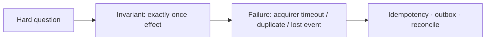

### Load & capacity

| They ask                     | You answer                                                                                                                                             |
| ---------------------------- | ------------------------------------------------------------------------------------------------------------------------------------------------------ |
| **10k TPS**                  | Shard payments DB (§0 capacity math); stateless Payment Service; acquirer **rate limits** → backpressure and queueing, never weaker idempotency |
| **Hot merchant**             | Shard by `payment_id`, not `merchant_id` (Amazon-sized merchant = hot shard); "list my payments" served by a separate read model (CDC → Elasticsearch / OLAP keyed by merchant) |
| **Read-heavy status**        | Replicas; cache `GET` with short TTL **after** write stickiness |
| **Idempotency table growth** | Redis TTL 48h; PG `idempotency_keys` partitioned by day, drop partitions > 72h; archive payments to cold store |

### Failures & degradation

| They ask | You answer |
|----------|------------|
| **Acquirer down** | **Circuit breaker** per acquirer route (closed → open → half-open after 30s, AlgoMaster §6.3); new charges fail fast or reroute; in-flight `processing` rows wait for the sweeper — **never** re-send an in-flight charge to a different acquirer (two acquirers = two charges) |
| **One DB shard primary down** | Only that shard's payments fail (blast radius 1/N); failover to a synchronous replica with **fencing** so the old primary can't keep writing ledger rows |
| **Merchant webhook endpoint down** | We retry on schedule (5m, 30m, 2h, 8h, 24h, 72h) → DLQ + dashboard replay; other merchants are unaffected (per-merchant lanes) |
| **Outbox relay / Kafka down** | Money path keeps working (outbox rows accumulate in PG); alert on oldest-unsent age; relay drains on recovery |
| **CDC down** | Only the audit stream lags (CDC is secondary here); WAL retention alarm before Debezium falls off the log |

### Acquirer routing (AlgoMaster §6.3 — scoped down)

| Mode | When |
|------|------|
| **Primary acquirer** | Default route per region / card brand |
| **Fallback acquirer** | Primary circuit open — **new** payments only |
| **Geographic** | EU card → EU acquirer (lower interchange, data-residency rules) |
| **Cost / approval-rate optimal** | Route by BIN to the acquirer with the best approval rate |

> **Reality check:** multi-acquirer routing is a whole product (contracts, different decline codes, different settlement files, different 3DS flows), not a config flag. In an interview, name it, then say you'd start with one acquirer per region.

### Correctness (they will push)

| They ask | You answer |
|----------|------------|
| **Exactly-once delivery?** | **No** — **exactly-once effect** via idempotency + dedup |
| **Charge then crash** | Idempotency `IN_PROGRESS` + derived acquirer key + sweeper + reconcile |
| **Two captures same payment** | State machine: only `authorized → captured` once (`WHERE status='authorized'`); capture has its own derived key |
| **Partial capture** | Multiple capture calls ≤ authorized sum; ledger per partial |
| **Webhook before API returns** | Handler idempotent; final state converges |

### Security & abuse

| They ask | You answer |
|----------|------------|
| **Forged webhook** | HMAC verify over timestamp + raw body; reject unsigned or stale |
| **Stolen merchant API key** | Keys stored as hashes; restricted keys (scoped permissions); IP allowlist; velocity limits; instant roll from the dashboard |
| **Replay API** | Idempotency returns the same result, not a double charge |
| **PCI** | We hold PAN, so we are **PCI-DSS Level 1**; the PAN lives only in the vault zone (§14). The merchant gets **SAQ A** because they only ever see our iframe and a token |
| **Vault DB stolen** | Useless without KMS: rows are envelope-encrypted, and the key-encryption key never leaves the HSM (§14) |

### “Why not X?”

| They ask | You answer |
|----------|------------|
| **Saga without outbox** | A crash between steps loses the "tell the merchant" intent |
| **2PC Postgres + acquirer** | The acquirer is not an XA participant; it exposes idempotent HTTP, not prepare/commit |
| **Kafka as source of truth** | Need **relational CP** ledger + queries |
| **Event sourcing only** | OK for ledger; still need idempotency + reconcile story |
| **CRDT balances** | Money needs authoritative totals, not merge |

### If they keep increasing load (meta-answer)

> “I’d **meter** acquirer latency and approval rate, **add shards** (by `payment_id`), and **shed** new payment accepts with 429/503 before I weaken idempotency or skip ledger writes. **Reconciliation** stays non-negotiable.”

---

## 12. Source cross-check (Hello + AlgoMaster, verified against PDFs)

| Dimension | **Hello Interview** | **AlgoMaster** | **This guide** |
|-----------|---------------------|-----------------|-----------------|
| Scope FR | Initiate / card pay / status; **webhooks = bonus** | Includes **refunds + webhooks** as core | Both shown; call out which |
| NFR scale | **10k TPS** | **10M txns/day → 1,150 peak TPS** | Both anchors in §0 |
| Entities | **Merchant, PaymentIntent, Transaction** (one-to-many) | **Payment, Payment_events, Refund, LedgerEntry** | Derived (§0): Merchant, Payment, Transaction, Refund, LedgerEntry, PaymentEvent |
| APIs | `POST /payment-intents` → `POST /payment-intents/{id}/transactions` → `GET` | `POST /v1/payments` + `GET` + `POST /v1/refunds` | Both API shapes documented |
| Initial status | `"created"` | `"processing"` | `processing` (row is inserted in TX1, right before the acquirer call) |
| State terminology | `created → processing → succeeded / failed → refunded / partially_refunded` | Same + explicit **terminal** states + optimistic locking | AlgoMaster labels + `requires_action` (3DS); auth/capture in §9 |
| Idempotency store | Mentioned, less detail | **Redis `SET NX` + 48h TTL + PG unique index backup** | AlgoMaster's model |
| Audit "Great solution" | **DB + CDC + event stream + S3** | PostgreSQL + append-only ledger + payment_events | **Outbox primary** for events; CDC → S3 as the audit stream |
| Processor timeout | Pending state + reconciliation; **two-phase event model** (Stripe internals) | Pending + processor query + reconciliation | Stay `processing` + sweeper + inbound event + nightly recon |
| Fallback processor | Not covered | **Primary → fallback → circuit breaker** | Kept, but scoped to **new** payments only (§11) |
| Ledger accounts | Not named | **customer_receivable / merchant_payable / fee_revenue / reserves / refund_liability** | AlgoMaster names + `cash_at_bank`, `interchange_expense`; full capture → settlement → payout → refund (§3) |
| Webhook retries | "exponential 5s, 25s, 125s…" | **5m, 30m, 2h, 8h, 24h, 72h → DLQ** | AlgoMaster's schedule (production norm) |
| Webhook security | HMAC signature | **HMAC + timestamp + IP allowlist** | Both; AlgoMaster adds IP allowlist |
| DB sharding | Shard by `merchant_id` (comments disagree) | Read replicas → then shard | `payment_id`, with the shard derived from `hash(merchant_id, idempotency_key)` so the UNIQUE claim stays single-shard (§1.5, **our addition**) |
| Kafka partitioning | **payment_intent_id** for ordering | Not specified | `payment_id` (same idea; Evan agrees in comments) |
| CDC SPOF | Called out; **multiple CDC + app fallback** | Not discussed | Mostly moot: outbox is the primary event path, CDC only feeds audit |
| Card data / encryption | Iframe + tokenization; "encrypted PAN is still PCI" | HSM mentioned, out of scope | Full walkthrough: TLS, vault, envelope encryption, network tokens, PIN-less auth (§14, **our addition**) |
| Settlement timing | Mentioned implicitly | **T+1 / T+2 before flagging** | AlgoMaster's rule |
| Reconciliation exceptions | Yes | **Exceptions queue + 95% automation + anomaly alerting** | AlgoMaster's framing |

**Divergence worth saying out loud:** Hello calls the processor synchronously from the service; AlgoMaster puts a **Payment Worker** behind a queue. This guide defaults to **synchronous** (the merchant gets a real answer within ~2s, which checkout UX needs), and names the queue-backed worker as the **overload mode**: when acquirer latency spikes, accept with `202 processing` and let a bounded worker pool drain the queue.

---

## 13. FAANG / Staff-level insight (beyond both PDFs)

### What a Stripe / Adyen / PayPal interviewer actually probes

| Depth beat                                      | What to say                                                                                                                                                                                                                 |
| ----------------------------------------------- | --------------------------------------------------------------------------------------------------------------------------------------------------------------------------------------------------------------------------- |
| **Exactly-once effect vs delivery**             | Name the distinction before they ask. "Delivery is at-least-once; effect is exactly-once via **atomic idempotency claim + idempotent consumers**."                                                                          |
| **The ambiguous outcome**                       | Timeout is a **first-class state** (`unknown` / `processing`), not a failure. Resolution = processor-side query by your idempotency key + webhook + batch reconcile. Three paths because any one can miss.                  |
| **Why your idempotency belongs in two stores**  | Redis for p99 hot path (<1ms); Postgres `UNIQUE` for durability during Redis incident. Business ops still require idempotent payment behavior during cache outage.                                                          |
| **Acquirer idempotency key derivation**         | Not the raw client key — **`hash(merchant_id + ":" + client_key + ":" + operation)`** so authorize/capture/refund don't collide at the acquirer, and two merchants' keys never collide. |
| **Idempotency + sharding interact**             | A UNIQUE index is per shard. Derive the shard from `hash(merchant_id, idempotency_key)` and embed it in `payment_id`, so the claim, the payment, and its ledger are all on one shard (§1.5). |
| **Ledger as source of truth vs balance column** | Append-only ledger with periodic `SUM(debit) == SUM(credit)` is **continuous invariant check**. Snapshotted balance rows are read-time cache. Never update balance in place.                                                |
| **Settlement vs capture**                       | Capture = funds committed by issuer; **settlement** = actual bank transfer T+1/T+2 (minus interchange + processor fees). The merchant can ship at capture; our ledger tracks receivable → cash separately (§3 ② settlement). |
| **The two-phase event model (Hello comments)**  | Emit `transaction.created` **before** the processor call and `transaction.completed` **after**. Our TX1/TX2 split is the same idea: TX1 records intent durably, TX2 records outcome. With an outbox you don't need a separate pre-event. |
| **Hot merchant partitioning**                   | Sharding by `merchant_id` creates an **Amazon-sized hotspot**. Shard by `payment_id`; serve merchant listings from a read model (Elasticsearch / OLAP). |
| **CDC gotcha**                                  | Debezium reads the WAL; if it's offline longer than WAL retention, events are lost. That's why money events go through the **outbox**, and CDC only feeds audit. |
| **Dual-write problem**                          | `write DB → write Kafka` is **not atomic**. Transactional outbox or CDC solves it. If interviewer asks "why not just publish to Kafka from the service?" — this is the answer.                                              |
| **PCI scope reduction**                         | Two levels. The **merchant** stays at SAQ-A because the PAN goes from the buyer's browser into **our** iframe and they only see a token. **Inside Stripe**, only the vault zone touches PAN, which shrinks our own audited footprint to a few services (§14). |
| **Multi-region write path for money**           | **Single primary writes** per currency / region; multi-region replicas for reads. Avoid multi-master on money unless you're using Spanner/CockroachDB with external consistency.                                            |
| **Compliance beats cleverness**                 | SOX / PCI-DSS audits consume **immutable** records (payment_events, ledger_entries, S3 WORM). Favor boring, auditable patterns over distributed-systems virtuosity.                                                         |

### Real-world patterns to name-drop (sparingly)

| Pattern | Interview use |
|---------|---------------|
| **Stripe PaymentIntent + Payment Methods API** | "We model intent as a mutable state container with immutable attempts." |
| **Uber Cadence / Temporal** | "Multi-step orchestration (`authorize → capture → settle`) is a durable workflow; Temporal gives you retries + versioning for free." |
| **Netflix Hystrix / Resilience4j circuit breaker** | Acquirer routing resilience. |
| **TigerBeetle** | "If you're building a specialized ledger, there are purpose-built dbs now — but Postgres carries any sane TPS for interview scope." |
| **Stripe idempotency doc** | Stripe's public API keeps keys 24h; AlgoMaster's design uses 48h. Either is defensible: say the window must exceed the longest realistic merchant retry. |
| **Network tokens (Visa VTS / Mastercard MDES)** | The card network issues a token that replaces the PAN on the acquirer hop; it survives card reissue and raises approval rates (§14). |

### Interview failure modes to avoid

| Trap | Why you fall in |
|------|------------------|
| Jumping to Kafka before PG | Looks "distributed"; makes idempotency and status-GET hard |
| Treating webhooks as sync | Webhooks cross the public Internet: no ordering, no delivery guarantee |
| Saying "we encrypt the card" without saying where | Interviewer asks "where is the key?" — answer with the vault + KMS/HSM envelope story (§14) |
| Shared DB across services | AlgoMaster allows one PG for simplicity — in a real service-mesh interview, say **"logical schemas / separate DBs per service, outbox for consistency"** |
| Promising "exactly-once delivery" | Impossible across process + network boundaries. Say exactly-once **effect** |
| Not naming optimistic locking | AlgoMaster's `WHERE status = 'processing'` is the one-liner that proves you've built this |
| Ignoring settlement | Says "we marked it paid" without distinguishing authorized / captured / settled |
| Over-securing with mutual TLS everywhere | API key + HMAC is the industry answer for merchant ↔ us; mTLS belongs on us ↔ acquirer links and inside the vault zone |

### If asked "how would Stripe actually build this"

**One-sentence answer:** payments in a sharded store (Stripe has publicly described a heavily customized MongoDB-based platform), events via outbox → Kafka, idempotency keys co-located with the payment shard, acquirer calls behind a gateway with derived keys, an isolated HSM-backed card vault, settlement/reconciliation as a Spark/Flink batch against processor files — **and 10× the depth is in fraud, routing, fees, and compliance, not in distributed-systems trivia.**

### References (verified against attached PDFs this time)

| Source | What this guide uses |
|--------|----------------------|
| [Hello Interview — Payment System](https://www.hellointerview.com/learn/system-design/problem-breakdowns/payment-system) (**PDF read + confirmed**) | Entities (Merchant / PaymentIntent / Transaction), API shape, CDC + S3 audit, two-phase event model note, security tiers, scale discussion |
| [AlgoMaster — Design Payment System](https://algomaster.io/learn/system-design-interviews/design-payment-system) (**PDF read + confirmed**) | API `/v1/payments`, Redis idempotency specifics, state machine + optimistic locking, ledger accounts, circuit breaker + multi-processor, webhook retry schedule, reconciliation table |
| [Stripe — Idempotent requests](https://docs.stripe.com/api/idempotent_requests) | 24h key retention, replay semantics |
| [Stripe — Webhook signatures](https://docs.stripe.com/webhooks#verify-events) | `Stripe-Signature: t=…,v1=…` format, 5-min tolerance |
| Hello comment thread (user-provided) | §8 Community distilled Q&A |
| **Own design reasoning (not in either PDF)** | Shard co-location for idempotency (§1.5), settlement/payout/refund ledger (§3), outbox-over-CDC (§1), observability (§6.5), encryption walkthrough (§14) |

---

## 14. Encryption & card data — follow one card, byte by byte

**Running example:** a buyer pays **$42.00** on Shopify with card **`4242 4242 4242 4242`**, expiry **`12/28`**, CVC **`123`**. All keys and ciphertexts below are **made-up illustrative values**.

### 14.1 What data exists, and how each piece is protected

| Data | Sensitivity | Stored? | Protection | Why this choice |
|------|-------------|---------|------------|-----------------|
| **PAN** `4242424242424242` | Highest (PCI) | Yes, **vault only** | AES-256-GCM, **envelope encryption** with a KMS/HSM key | We must be able to *decrypt* it to send to the acquirer, so encrypt, don't hash |
| **CVC** `123` | Highest | **Never** after authorization | Memory only, wiped after the auth call | PCI-DSS forbids storing it after auth, *even encrypted* |
| **Expiry** `12/28`, cardholder name | High | Vault | Encrypted with the PAN | Needed for future charges |
| **Last 4** `4242`, **brand** `visa` | Low | Payments DB, plaintext | Allowed by PCI (truncation) | Receipts, dashboards, "Visa •••• 4242" |
| **Card fingerprint** | Medium | Vault + payments DB | `HMAC-SHA256(secret_pepper, PAN)` | Spot "same card" across payments **without** decrypting (fraud, dedupe) |
| **Card token** `tok_1Nabc…` / `pm_…` | Low on its own | Everywhere | Random, meaningless outside our vault | Lets 99% of our system never touch PAN |
| **Merchant secret API key** `sk_live_…` | High | Yes | **Hashed** (SHA-256) — we only need to *verify* it | Same idea as passwords |
| **Webhook secret** `whsec_…` | High | Yes | **Encrypted** with KMS — we need the plaintext to *sign* | Can't hash it: HMAC needs the actual secret |
| Amounts, statuses, ledger | Business-sensitive | Payments DB | Disk encryption (KMS) + TLS in transit | Not PCI data; protect like any financial record |

> **Two rules fall out of this table.** (1) If you only need to *check* a value, **hash** it (API keys). If you need it *back*, **encrypt** it (PAN, webhook secret). (2) If the input space is small, a plain hash is reversible by brute force — see 14.5.

### 14.2 The zones — who can see the PAN

The whole idea in one picture: the card number (PAN) lives **only** in the red zone. Everyone else handles a meaningless token.

#### (a) Zone map — no arrows, just "who sees what"

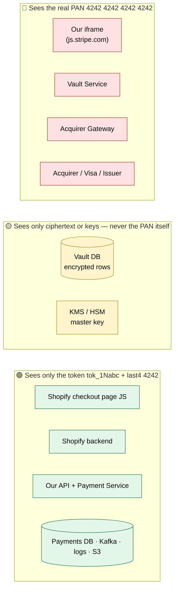

| Party | What it holds for our $42 payment | If it gets hacked |
|-------|-----------------------------------|-------------------|
| Our iframe (in the buyer's browser) | PAN, expiry, CVC — for a few seconds | Only that one buyer, only while typing |
| Vault Service | PAN in memory while encrypting | PCI Level 1 zone: isolated network, tiny code base, heavy monitoring |
| Vault DB | `b7e1…40` (ciphertext) + `AQIDAHh…` (wrapped key) | Useless without the HSM |
| KMS / HSM | The master key; it never leaves the hardware | Hardware-protected; every use is logged |
| Acquirer Gateway | PAN in memory during the auth call only | Same PCI Level 1 zone as the vault |
| Shopify page + backend | `tok_1Nabc`, `visa`, `4242` | Nothing chargeable leaks → Shopify is SAQ A |
| Our Payment Service, DB, Kafka, logs | `tok_1Nabc`, `4242`, amount, status | Nothing chargeable leaks |

#### (b) Phase 1 — buyer types the card → we hand back a token (steps ①②③)

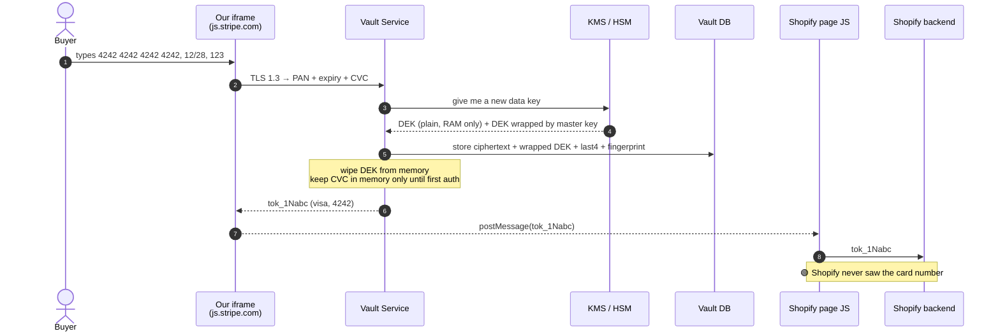

#### (c) Phase 2 — merchant charges the token → we decrypt only at the last hop (steps ④⑤⑥)

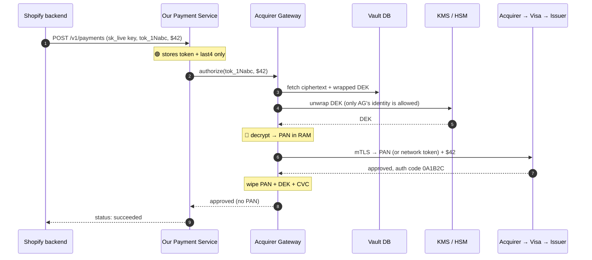

**The browser's same-origin policy is the first security control.** The iframe is served from `js.stripe.com`, so Shopify's JavaScript running on `shopify.com` **cannot read** what the buyer types into it. A malicious or compromised merchant script can't scrape the card. That is why the merchant drops to the lightest PCI questionnaire (SAQ A).

### 14.3 Step ① — browser → vault: TLS 1.3 (encryption in transit)

What the buyer's browser sends:

```json
POST https://api.stripe.com/v1/tokens
{ "card": { "number": "4242424242424242", "exp_month": 12, "exp_year": 2028, "cvc": "123" } }
```

What a network observer (café Wi-Fi, ISP) actually sees on the wire:

```text
17 03 03 00 9a  8f 2c 61 d4 0e b7 …  (TLS application-data record: random-looking bytes)
```

How TLS 1.3 gets there, in plain steps:

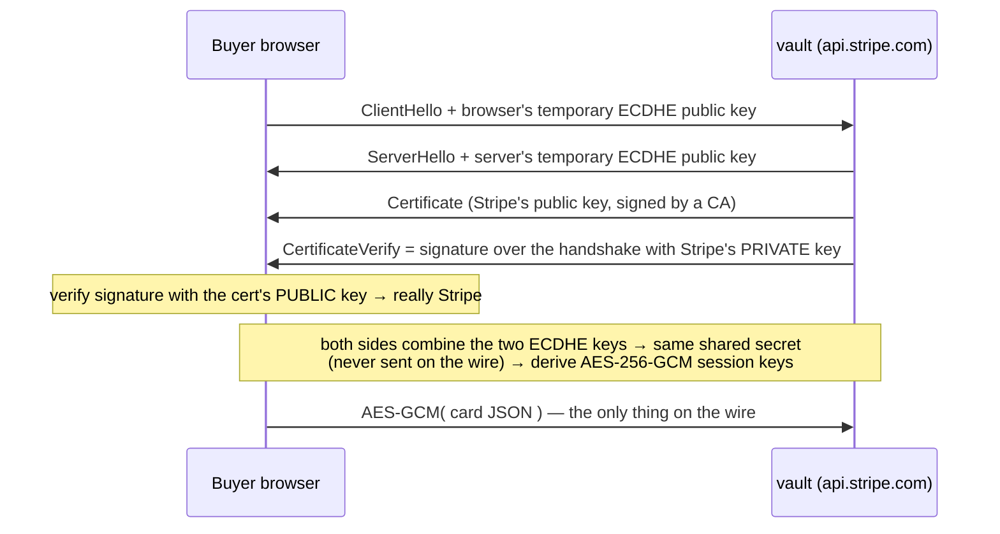

Two separate jobs happen here:

- **Asymmetric signature (identity):** Stripe signs with its certificate's **private** key, and the browser verifies with the **public** key. This proves "I'm really talking to Stripe".
- **Key agreement + symmetric encryption (secrecy):** the two ECDHE halves produce a shared AES key that was never transmitted, so every byte after that is AES-GCM encrypted. Because the ECDHE keys are temporary, a stolen certificate key later can't decrypt today's recorded traffic. This property is called *forward secrecy*.

> Note: the old "browser encrypts a session key with the server's RSA public key" is TLS 1.2-era RSA key exchange. TLS 1.3 removed it precisely because it has no forward secrecy.

TLS terminates **inside the Card Data Environment**, not at a general-purpose load balancer, so the plaintext PAN exists only on vault machines.

### 14.4 Step ①→② — vault stores the PAN: envelope encryption (encryption at rest)

**Naive approach, and why it fails:** encrypt every PAN with one AES key in a config file. If that file leaks, every card ever stored is exposed, and rotating the key means re-encrypting billions of rows.

**Envelope encryption = two layers of keys:**

| Key | Where it lives | What it encrypts |
|-----|----------------|------------------|
| **KEK** (key-encryption key, "master key") | Inside the **HSM/KMS** — it can never be exported | Only data keys |
| **DEK** (data-encryption key) | Generated fresh per card (or per small batch); stored **only in wrapped form** | The PAN |

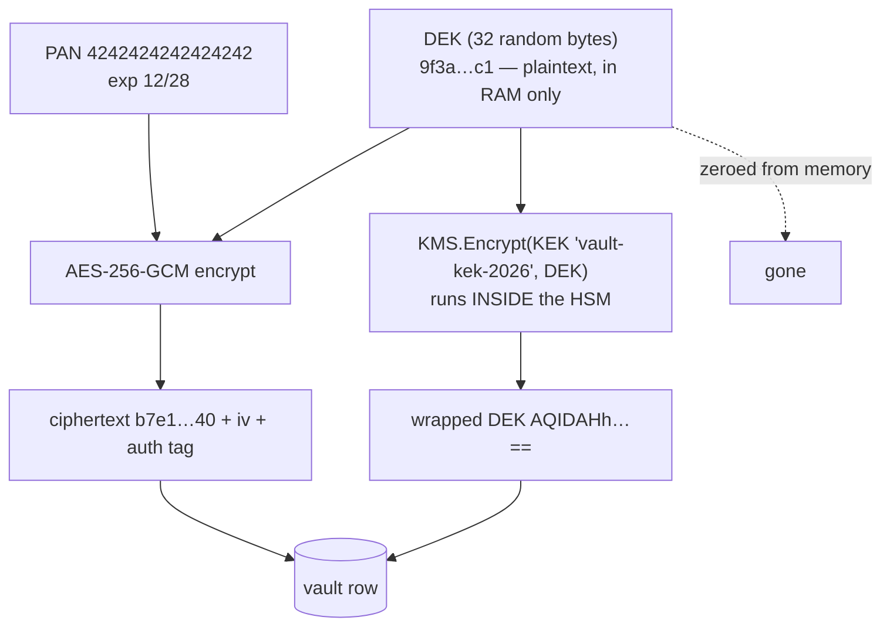

Concretely, the vault does this:

```text
1. dek_plain, dek_wrapped = KMS.GenerateDataKey(key_id="vault-kek-2026")
      dek_plain   = 9f3a5b…c1   (32 bytes, RAM only)
      dek_wrapped = AQIDAHh…==  (DEK encrypted by the KEK inside the HSM)
2. iv          = 12 random bytes          → 4e1d…9a
3. ciphertext, tag = AES-256-GCM(key=dek_plain, iv, plaintext="4242424242424242|12|2028")
                   → ciphertext b7e1…40, tag 77c2…
4. zero(dek_plain)
5. fingerprint = HMAC-SHA256(pepper_from_KMS, "4242424242424242") → fp_8d02…
6. INSERT vault_cards(token, ciphertext, iv, tag, dek_wrapped, kek_id, last4, brand, fingerprint)
     VALUES ('tok_1Nabc', b7e1…40, 4e1d…9a, 77c2…, AQIDAHh…, 'vault-kek-2026', '4242', 'visa', fp_8d02…)
7. CVC "123" → held in memory (or a TTL-ed encrypted cache of a few minutes) for the first authorization only, never written to the DB
8. return { "id": "tok_1Nabc", "card": { "last4": "4242", "brand": "visa" } }
```

What the stored vault row looks like:

| token | ciphertext | iv | tag | dek_wrapped | kek_id | last4 | brand | fingerprint |
|-------|-----------|----|-----|-------------|--------|-------|-------|-------------|
| `tok_1Nabc` | `b7e1…40` | `4e1d…9a` | `77c2…` | `AQIDAHh…==` | `vault-kek-2026` | `4242` | `visa` | `fp_8d02…` |

**Why this design wins:**

- **Stolen DB backup = useless.** An attacker has ciphertext plus wrapped DEKs, but unwrapping needs the KEK, which never leaves the HSM. Every unwrap call is IAM-checked and audit-logged.
- **Cheap key rotation.** To rotate the KEK, re-wrap the small DEKs (32 bytes each). The card ciphertext is never touched.
- **Small blast radius.** A leaked DEK exposes one card (or one batch), not all of them.
- **GCM's auth tag** detects tampering: a flipped bit in the ciphertext makes decryption fail instead of returning a wrong card number.

### 14.5 Why the fingerprint is an HMAC, not `SHA256(PAN)`

The card number space is tiny once you know part of it. We show the last 4 digits (`4242`), and the first 6 digits are the BIN (`424242` = a Visa range). That leaves **6 unknown digits = 1,000,000 guesses**, and the Luhn check digit cuts that further. A laptop computes a million SHA-256 hashes in under a second, so `SHA256(PAN)` is effectively plaintext.

`HMAC-SHA256(secret_pepper, PAN)` with the pepper held in KMS can't be brute-forced without the pepper. We still get "has this card been seen before?" across merchants for fraud detection, without decrypting anything.

Contrast: `sk_live_…` API keys are **~190 bits of randomness**, so a plain SHA-256 hash is safe there. Hashing is safe for high-entropy inputs and unsafe for low-entropy ones.

### 14.6 Steps ③④⑤ — the token travels; the PAN doesn't

| Hop | What's in the message | Encrypted by |
|-----|----------------------|--------------|
| iframe → merchant page | `tok_1Nabc` via `postMessage` | Same browser, no network |
| Merchant page → merchant backend | `tok_1Nabc` | TLS (merchant's cert) |
| Merchant backend → our API | `Authorization: Bearer sk_live_…`, `Idempotency-Key`, `{payment_method: tok_1Nabc, amount: 4200}` | TLS 1.3 (our cert) |
| API → Payment Service → Payments DB | token, last4, brand, fingerprint, amount | mTLS inside the mesh; DB disk encrypted with KMS |
| Payment Service → Acquirer Gateway (in the CDE) | `authorize(tok_1Nabc, 4200, usd, derived_key)` | mTLS; the gateway only accepts the Payment Service's identity |

If the Payments DB, its logs, Kafka, or S3 leak in full, the attacker gets **tokens and last-4 digits**: nothing chargeable.

### 14.7 Step ⑥ — detokenize and send to the card network

This is the detailed version of 14.2 (c), adding the IAM check, the audit log, and the ISO 8583 message.

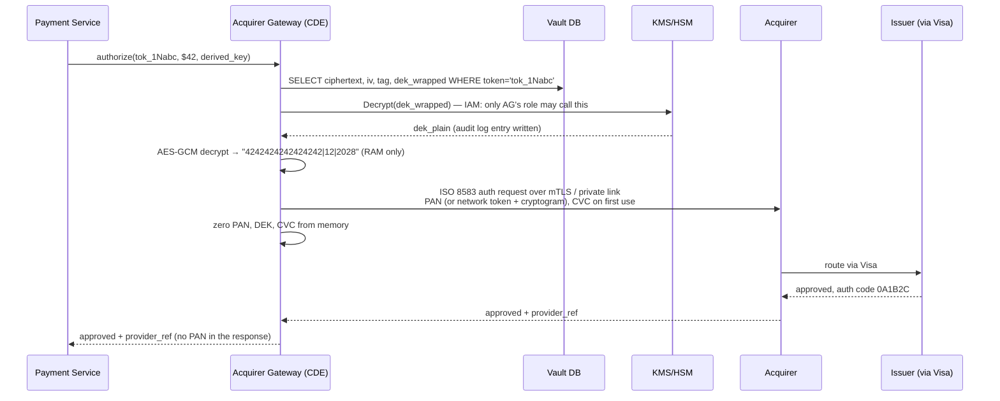

**Upgrade: network tokens.** Instead of sending the real PAN to the acquirer, we can register the card with Visa (VTS) or Mastercard (MDES) and get a **network token**, for example `4895 3700 1234 5678`, plus a one-time **cryptogram** per transaction. A leaked network token is useless without the cryptogram. It keeps working when the bank reissues the card, which raises approval rates. Then even the acquirer hop carries no real PAN.

**3DS:** when the issuer requires it, the buyer authenticates in the bank's page. The result is a cryptographic proof (CAVV) that we include in the auth message; we never see the buyer's bank password or OTP.

### 14.8 Webhook signing — symmetric vs asymmetric, worked example

This is **signing** (proving who sent it and that nobody altered it), not encryption. The webhook body travels readable inside TLS.

**HMAC-SHA256 (default — symmetric, one shared secret):**

```text
secret          = whsec_7Hk3pLm9…            (held by BOTH us and Shopify)
timestamp       = 1730025601
raw_body        = {"id":"evt_1Nxyz789","type":"payment.succeeded",…}
signed_payload  = "1730025601." + raw_body
v1              = HMAC-SHA256(secret, signed_payload) → a3f1c9b8…
header          = Stripe-Signature: t=1730025601,v1=a3f1c9b8…
Shopify:  recompute with the same secret over the RAW bytes → constant-time compare → |now − t| < 300s
```

**Ed25519 (asymmetric option):**

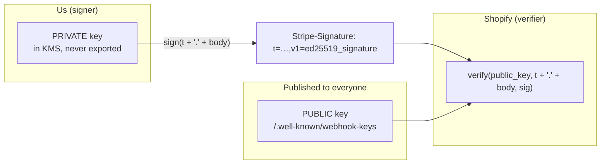

| | HMAC | Ed25519 |
|-|------|---------|
| Keys we store | One secret **per merchant endpoint** (millions; encrypted with KMS) | **One** private key in KMS |
| What the merchant holds | The same secret | Our **public** key (not secret) |
| Merchant's server breached | Attacker can forge webhooks **to that merchant** | Attacker can forge nothing |
| Cost | Very cheap | Fast too, but needs key distribution and rotation by key id |

Rule of thumb: **sign with the private key, verify with the public key; encrypt with the receiver's public key, decrypt with their private key.** Whoever must be impossible to impersonate holds the private key.

### 14.9 Threat → control map

| Threat | Control |
|--------|---------|
| Wi-Fi sniffing at checkout | TLS 1.3 with forward secrecy |
| Malicious script on the merchant's page | Card fields in a cross-origin iframe; Content-Security-Policy |
| Merchant server breached | They never had a PAN; tokens only work with their own API key |
| Our Payments DB / Kafka / logs leak | They contain tokens + last-4 only; log scrubbers block 13–19 digit numbers that pass Luhn |
| Vault DB backup stolen | Envelope encryption; KEK inside the HSM; DEK unwrap needs an IAM role + audit trail |
| Insider queries the vault | Only the Acquirer Gateway's service identity may unwrap DEKs; break-glass access needs two people; decrypt-rate alarms (§6.5) |
| Card brute-forced from a hash | HMAC with a KMS-held pepper, not a plain hash |
| Webhook forged or replayed | HMAC/Ed25519 over timestamp + raw body; 5-min window; merchant dedupes `event.id` |
| Stolen `sk_live` key | Stored hashed; restricted keys; IP allowlist; instant roll |
| Compromised internal service calls the vault | mTLS service identity (e.g. SPIFFE) + allowlist of caller identities |

### 14.10 Interview script (60 seconds)

> "Card data never touches the merchant: the buyer types into our cross-origin iframe, and TLS 1.3 carries it straight into an isolated, PCI Level 1 **card data environment**. There we envelope-encrypt the PAN: a per-card AES-256-GCM data key, wrapped by a master key that never leaves the HSM. We store the ciphertext, the wrapped key, last-4, and an HMAC fingerprint. We never store the CVC. Every other service, including the payments DB, Kafka, and logs, sees only a token. At authorization the acquirer gateway, the one service allowed to unwrap keys, decrypts the PAN in memory, sends it (or a network token with a cryptogram) over mTLS to the acquirer, and wipes it. Webhooks are signed, not encrypted: HMAC with a per-merchant secret, or Ed25519 if they want asymmetric."

---

## Appendix A — Idempotency + payment TX (reference SQL sketch)

All statements run on the shard chosen by `hash(merchant_id, idempotency_key)`.

```sql
-- TX1: claim + record intent
BEGIN;
  INSERT INTO idempotency_keys
    (merchant_id, idempotency_key, fingerprint, status, payment_id, locked_until, created_at)
  VALUES ($mid, $key, $fp, 'IN_PROGRESS', $pid, now() + interval '30 seconds', now())
  ON CONFLICT (merchant_id, idempotency_key) DO NOTHING;
  -- 0 rows inserted → ROLLBACK; load existing row:
  --   fingerprint differs → 409; COMPLETED → replay response_body; IN_PROGRESS → 409 Retry-After
  INSERT INTO payments (payment_id, merchant_id, amount_minor, currency, card_token, status)
  VALUES ($pid, $mid, 4200, 'usd', $tok, 'processing');
COMMIT;

-- (call acquirer here — no transaction open)

-- TX2: record outcome (approved case)
BEGIN;
  UPDATE payments SET status = 'succeeded', provider_ref = $ref, updated_at = now()
  WHERE payment_id = $pid AND status = 'processing';      -- optimistic lock: 0 rows → someone else won
  INSERT INTO ledger_entries (event_id, account, direction, amount_minor, currency) VALUES
    ($e, 'customer_receivable', 'debit',  4200, 'usd'),
    ($e, 'merchant_payable',    'credit', 4048, 'usd'),   -- 4200 − fee 152 (2.9% + 30¢)
    ($e, 'fee_revenue',         'credit',  152, 'usd');
  INSERT INTO outbox (event_id, payment_id, type, payload, sent)
  VALUES ($eid, $pid, 'payment.succeeded', $json, false);
  UPDATE idempotency_keys SET status = 'COMPLETED', response_body = $body
  WHERE merchant_id = $mid AND idempotency_key = $key AND status = 'IN_PROGRESS';
COMMIT;
```

---

## Appendix B — Inbound event handler, acquirer → us (pseudocode)

```text
on POST /internal/acquirer-events:
  raw = body bytes                                   -- raw bytes, never re-serialized JSON
  if !verify_signature(raw, headers, acquirer_secret): return 401
  evt = parse(raw)
  begin tx (on the shard encoded in evt.our_payment_id)
    inserted = insert payment_events(provider_event_id=evt.id, ...) on conflict do nothing
    if !inserted: commit; return 200                 -- duplicate delivery
    payment = load by evt.our_payment_id for update
    if !legal_transition(payment.status, evt.type): commit; return 200  -- or queue ops
    apply_transition(payment, evt)
    maybe_post_ledger_and_outbox(payment, evt)
  commit
  return 200
```

---

## Appendix C — Deep dive: timeout ≠ failure (principal)

### How they ask

> “Your service calls the acquirer; the HTTP call **times out**. What do you record? Do you retry? Can the customer be charged twice?”

### Wrong answer

> “Timeout = failed; return 402; client retries with **new** idempotency key.”

→ Risk: first call actually succeeded → second key → **double charge**.

### Correct answer (structure)

1. Idempotency row still **`IN_PROGRESS`**; payment still **`processing`**.
2. **Merchant retries** with the same client key → their insert loses → 409 Retry-After or the stored result once ready.
3. **Sweeper:** asks the acquirer for the status of our derived key, or re-sends the call with the **same** derived key (the acquirer dedupes).
4. **Webhook** may arrive later; handler is idempotent.
5. **Reconciliation** settles any remaining drift.

### Four sentences for the interview

1. We **never** conclude failure from timeout alone.
2. **One client idempotency key** per checkout attempt; acquirer calls reuse the same derived key.
3. State stays **`processing`** until the acquirer confirms; no compensating refund without evidence.
4. **Reconciliation** is the backstop if all live paths miss an outcome.
