# Photo Sharing Service (Instagram-style) — Strategic Study Guide

> **Framing:** We are building the **photo platform** behind an Instagram-like app. Users upload photos from phones on bad networks; we turn each photo into a set of sized and formatted copies (**derivatives**), keep the original for years, and serve images to **feeds** and **24-hour stories** at millions of fetches per second. We own the upload path, the processing pipeline, storage, URL issuing, the media side of the feed, story expiry, and takedowns. We **rent** the object store and the CDN (we configure them; we don't build them), and we report to outside bodies such as NCMEC for child-safety cases.

> **Source labels used throughout:** **[Algoroq]** = the Algoroq "Design a Photo Sharing Service" PDF (all 34 pages read; text inside its diagrams was partly garbled, so its diagrams are redrawn here) · **[Hello]** = Hello Interview's "Design a Photo Sharing App Like Instagram" PDF (24 pages read) · **[Hello\*]** = Hello's bad/good/great solution bodies (pages 11–15 and 19–20) are images; only their headings extracted, so those rows are reconstructed from the headings, Hello's final-design diagram and surrounding text · **[Instagram engineering, from memory]** = Instagram's public engineering talks and blog posts · **[Guide]** = this guide's own reasoning or standard interview material.

**Scale anchor [Algoroq]:** **500M DAU**, global · **130M post photos/day** (~5k/s peak) + **300M story frames/day** (~10k/s peak) · **~100B image fetches/day** (~3M/s peak) · **~10 PB/day egress** (~1 Tbps average) · **~1B new objects/day** · storage grows **~85 PB/year** before replication.

**The one-line thesis [Algoroq]:** a photo service is **write-once, read-a-million-times, keep-forever**, where **every uploaded byte is untrusted**. Every design choice moves cost between four bills: **encoder CPU, storage (a stock that compounds), egress (a monthly flow), and moderation latency.**

**Study path (≈25 min):** [§0 cheat sheet](#0-cheat-sheet-5-min) → [§1 HLD](#1-chosen-design-default-answer) → [§2 upload](#2-deep-dive--the-upload-path) → [§3 pipeline](#3-deep-dive--the-media-pipeline-an-attack-surface-first) → [§5 CDN + URLs](#5-deep-dive--cdn-economics-and-url-design) → [§8 takedowns](#8-deep-dive--moderation-and-takedowns) → [§14 drill](#14-interview-drill-card--stress-test) → [§16 staff insight](#16-faang--staff-level-insight)

### Plain-English glossary (read once, then everything below makes sense)

**One picture for the whole guide:** we run a **photo lab plus a delivery network**. People hand us photos (upload), the lab checks and prints them in several sizes (pipeline), we keep the negatives safe for years (storage), and a chain of local shops hands copies to viewers (CDN).

| Term | Plain meaning |
|------|---------------|
| **DAU** | Daily active users |
| **Master** | The cleaned, full-quality copy we keep forever. The "negative" |
| **Derivative / variant** | A smaller or different-format copy made from the master: thumbnail, feed size, AVIF version. We can always remake it |
| **Rung / variant ladder** | A **rung** is one allowed size (e.g. 1080 px wide). The **ladder** is the list of allowed sizes we give the phone, so it picks the right one |
| **Eager vs lazy** | **Eager** = made in advance. **Lazy** = made the first time someone asks for it |
| **Resumable upload** | The file goes in small pieces; if the connection drops, the phone continues from the last piece instead of restarting |
| **Signed / presigned URL** | A link with a built-in, expiring permission. Whoever holds it can use it until it expires |
| **EXIF** | Hidden data inside a photo file: GPS location, camera model, time. Must be removed for privacy |
| **Blurhash** | A tiny text code (~30 characters) the app turns into a blurry preview while the real image loads |
| **CDN** | A rented network of servers close to users that keeps copies of our images |
| **PoP / edge** | One CDN location, roughly one per big city |
| **Shield** | A bigger CDN cache per region. Edges ask the shield first, so our servers rarely get asked |
| **Origin** | Our own image servers behind the CDN |
| **Hit ratio** | The share of requests answered from cache. 99% = only 1 in 100 reaches the next layer |
| **Egress** | Data sent out to users. We pay per GB, and at our size it's a huge bill |
| **Tiering** | Moving old, rarely viewed data to cheaper, slower storage |
| **IA (infrequent access)** | S3's cheaper storage class for rarely read data. Catch: it bills **at least 128 KB per object** and charges per move |
| **Erasure coding** | Storing data as pieces plus repair pieces, so a few lost pieces can be rebuilt. Cheaper than keeping 3 full copies, but slower to read when a piece is missing |
| **Fan-out** | Copying a new post's id into each follower's feed list |
| **Sandbox** | A locked box for running risky code: no network, no disk writes, limited memory |
| **Perceptual hash** | A fingerprint of what an image *looks like*, so it still matches after resizing or small edits. Used to catch known illegal images |
| **Purge** | Telling the CDN to delete its cached copies |
| **Tombstone** | A "this was deleted" marker some databases write instead of deleting right away. Too many slow every read |
| **RPO** | How much recently saved data you can lose in a disaster ("the last 60 seconds of uploads") |
| **Idempotent** | Safe to do twice: the second time changes nothing |
| **Legal hold** | A flag that forbids deleting something because the law says we must keep it |

### Cast of characters (lock this before anything else)

| Party | Role | Where in our design |
|-------|------|---------------------|
| **Uploader** | Posts photos and stories from a phone, often on 3G | Mobile client → upload session → storage edge |
| **Viewer / follower** | Scrolls the feed, taps stories | Feed API → signed image URLs → CDN |
| **Mobile client** | Re-encodes before upload, picks the image size to show, prefetches | Smarter than it looks: it decides bytes in **and** bytes out |
| **US — API tier** | Upload sessions, posts, feed, stories, authorization | Never touches image bytes |
| **US — media pipeline** | Checks, cleans and resizes each upload | Sandboxed workers |
| **Object storage** (rented, e.g. S3) | Holds raw uploads, masters, derivatives | Separate buckets per trust level and durability |
| **CDN** (rented) | Edge servers (PoPs) + regional shields in front of our image origin | Sets most of our unit cost |
| **Moderation** | Hash lists, ML classifiers, human reviewers | Decides what blocks publishing and what runs after |
| **Outside bodies** | NCMEC (US child-safety reports), regulators (GDPR erasure) | Legal holds and deletion ledger |

> **The most common mistake [Algoroq]:** the usual sketch ("presigned upload, resize worker, CDN, fan-out feed") is correct and **leaves out every hard part**: cost that compounds, a pipeline that parses attacker files, CDN hit ratio, story expiry as cache invalidation, and takedowns that chase copies already on hundreds of edge servers.

### Basic flow (one picture)

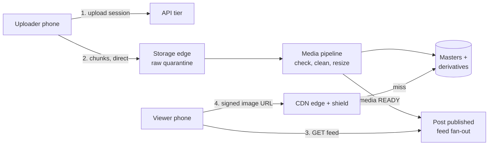

Read it left to right: **bytes go straight to storage**, never through the API; the **pipeline** turns an untrusted upload into a safe master plus sizes; the post **publishes only when media is READY**; viewers get **signed URLs** and fetch images from the **CDN**, which only rarely reaches our storage.

### End-to-end flow (summary)

1. **Select** — The user picks a photo. The client **re-encodes it** (long edge capped, e.g. 2048 px) and **starts uploading immediately**, before the user taps Share. **[Algoroq]**
2. **Upload** — `POST /v1/media/uploads` returns a `mediaId` and signed **chunk URLs**. Chunks go **directly to the storage edge**, resumable after a dropped connection. `commit` checks the `sha256`. **[Algoroq]**
3. **Process** — Raw bytes land in a **quarantine bucket** no CDN can reach. A sandboxed pipeline sniffs the format, bounds the dimensions, decodes, **matches known-bad hashes (blocks publish on a hit)**, re-encodes an EXIF-free **master**, and writes the **eager** derivatives. Then it emits **media READY**. **[Algoroq]**
4. **Post** — `POST /v1/posts` (with an `Idempotency-Key`) references the `mediaIds`. It returns `PENDING_MEDIA` until READY, then `PUBLISHED`. The uploader sees their post **from the local bitmap** right away. **[Algoroq]**
5. **Fan-out** — Only after READY, the post id is pushed into followers' feed inboxes (celebrities are pulled at read time instead). **[Algoroq gating · Guide fan-out]**
6. **Read** — The feed API ranks posts, **re-checks visibility**, and returns each item with a **blurhash placeholder** and a **ladder of signed variant URLs**. The client picks the right size for its screen and network. **[Algoroq]**
7. **Serve** — The CDN edge serves the image; on a miss it asks a **regional shield**; only the shield's miss reaches our **image origin**, which can generate a missing (lazy) size from the master. **[Algoroq]**
8. **Remove** — A takedown **flips visibility first** (feeds stop showing it within seconds), then **purges** CDN copies, then deletes bytes after a **legal-hold** check. **[Algoroq]**

---

## 0. Cheat sheet (5 min)

### Requirements [Algoroq]

| Functional | Non-functional (they drive the design) |
|------------|----------------------------------------|
| **Resumable upload** of 1–10 photos per post (carousel) and story frames; posting must feel instant on 3G | **Tap-to-visible < 1s for the uploader**; followers can wait seconds |
| **Derivatives** per device (size × format), **EXIF stripping**, orientation fixed | **Feed image p95 first byte < 150 ms** from the edge (session length = revenue) |
| **Home feed** and **profile grid** | **Originals: 11-nines durability.** Derivatives are regenerable and deserve **much weaker** durability |
| **Stories**: 24h expiry, per-viewer **seen** state, close-friends audience, archive + **highlights** | **Takedown propagation:** stops being served everywhere within **minutes**; CSAM **immediately** at the metadata layer |
| Public / private accounts | **Unit cost per DAU-month is a first-class SLO**, owned by the team that owns latency |
| **Delete**, account deletion, legal takedown, known-bad hash blocking, async classifier review | |

**Three rules to pin down early [Algoroq]:**

- **Captions are editable; pixels are not.** A post's media is **immutable once published**; a filter change is a new media object. This one rule makes the whole CDN story tractable.
- **Story expiry is a visibility change, not a deletion**, because stories can be archived and turned into highlights.
- **Private accounts make image URLs capabilities**, not just addresses (§5).

**Below the line (say it, don't design it):** video (name where it forks: a separate transcoding pipeline with adaptive-bitrate segments, 1–2 orders of magnitude more expensive **[Algoroq names the fork; Guide describes it]**), DMs, search/explore, ads, ranking model internals, the follow-graph service itself.

### The heart of the problem: four bills [Algoroq]

> **In plain English:** every design choice here is really a money choice between four bills. **Egress** is like a phone bill: you pay every month for what you send. **Storage** is like rent for a warehouse that only ever gets fuller, because every photo ever posted stays. **Encoder CPU** is the cost of printing each photo in many sizes. **Moderation latency** is how long safety checks make a post wait. Saving on one bill usually costs on another.

| Bill | Grows with | The lever |
|------|------------|-----------|
| **Egress** (~1 Tbps out) | DAU × views × bytes per view | Formats (WebP/AVIF), right-sized variants, CDN hit ratio |
| **Storage** (+85 PB/yr) | **Every upload ever accepted** — it compounds | Client re-encode, tiering masters, evicting old derivatives |
| **Encoder CPU** | Variants × formats generated | Eager only for ~90% of fetches; lazy + allowlisted for the rest |
| **Moderation latency** | What has to finish before publish | Hash match blocks; classifiers run after |

**Ingest is small, egress is huge:** ~30 Gbps comes in, ~1 Tbps goes out, so a byte saved on the served image is worth **~30×** a byte saved on upload. **[Algoroq]**

### Entities — HLD derivation (do this live on the whiteboard)

**Step 1 — derive from the functional requirements.**

| Requirement | Noun it forces | Why |
|-------------|----------------|-----|
| Upload a photo | **Media** | One uploaded image with its own lifecycle (uploading → processing → ready) and a **variant manifest** |
| Post 1–10 photos with a caption | **Post** | References media ids; caption is editable, media isn't. Separate resource, separate lifecycle **[Algoroq]** |
| Stories with 24h expiry | **Story** | Different lifecycle (live → expired → archived/highlight) and a different storage layout **[Algoroq]** |
| Feed of people I follow; private accounts | **User**, **Follow** | Author, audience, privacy setting; the follow edge drives fan-out and access |
| "Unseen" ring on the story tray | **StorySeen** | One row per **(viewer, author)** holding the newest story seen **[Algoroq]** |
| Takedown, legal hold | **Visibility** state on Media + a **legal-hold flag** | An attribute every reader and deleter checks, not its own business object |

**Step 2 — the HLD gates. Draw an entity only if it (1) owns state that outlives a request, (2) is independently queried, (3) has a lifecycle.**

| Candidate | Verdict | Reason |
|-----------|---------|--------|
| **Upload session** | **Not separate** — it's the early states of Media | `CREATED → UPLOADING → COMMITTED` are Media states; a second table would duplicate the lifecycle **[Guide]** |
| **Variant** (each size/format file) | **Not an entity** — a manifest on Media | Algoroq: **one row per media item plus a variant manifest, not one row per object.** At ~1B objects/day a row per file is a cost problem |
| **Feed inbox** | **Not an entity** — a derived cache of post ids | Rebuildable from Follow + Post; lives in a cache **[Guide]** |
| **Deletion ledger, evidence store, hash index** | Infrastructure tables | Real and important (§8, §10), but not domain nouns on the ER diagram **[Guide]** |
| **Counters** (likes, views) | Separate sharded store | Hot, constantly changing; kept apart from immutable media reads **[Algoroq]** |

**Step 3 — final entity set:**

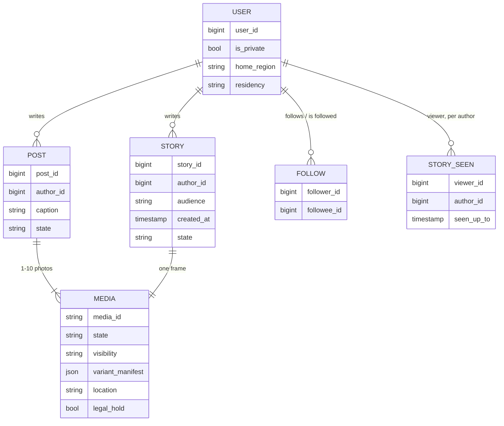

**Two storage decisions that come straight out of the entity model [Algoroq]:**

- **Split the media record in two.** An **immutable projection** (aspect ratio, blurhash, variant ladder) cached aggressively with **no invalidation**, and a **tiny mutable visibility record** read on **every** request from a store sized for that rate. Only visibility ever changes after READY.
- **Shard media by `mediaId` (random), never by upload time.** Time-based sharding puts all of today's writes and most of today's reads on one shard.

### APIs [Algoroq]

```text
POST /v1/media/uploads            { sha256, bytes, mime, width, height }
     → { mediaId, uploadUrl (signed, chunked/resumable), chunkSize, expiresAt }
PUT  {uploadUrl}?part=n           ← straight to the storage edge, never via the API tier
POST /v1/media/{mediaId}/commit   { parts[], sha256 } → { state: PROCESSING }

POST /v1/posts                    Header: Idempotency-Key: <client uuid>
     { mediaIds[], caption, audience } → { postId, state: PENDING_MEDIA | PUBLISHED }
POST /v1/stories                  { mediaId, audience: all | close_friends }
DELETE /v1/posts/{postId}

GET  /v1/feed?cursor=…            → items[] each with a media descriptor:
     { mediaId, blurhash, aspect, variants: [{ w, fmt, url }] }   // signed, short-lived
GET  /v1/stories/tray             → authors with unseen state, ordered
```

*(The PDF's API block is cut off at the right margin; the endings of a few lines are completed from its surrounding text.)*

Why each choice:

- **Media and posts are separate resources.** Upload media first, then create a post that references it. This is what lets "post" feel instant (§2). **[Algoroq]**
- **The client sends `sha256` and dimensions up front.** The server can reject oversized dimensions **before a byte arrives**, make `commit` idempotent, and pre-plan the variants. **[Algoroq]**
- **The feed returns a variant ladder, not one URL.** The client picks by screen width, pixel density and network; it **never builds resize parameters** itself (§3). **[Algoroq]**
- **Blurhash inline in the feed JSON** (tens of bytes): layout and a blurry preview before any CDN fetch. **[Algoroq]**
- **`Idempotency-Key` on `POST /posts`:** a retry on a flaky network must not create two posts. **[Algoroq header · Guide reason]**

### States

**Media [Algoroq]:**

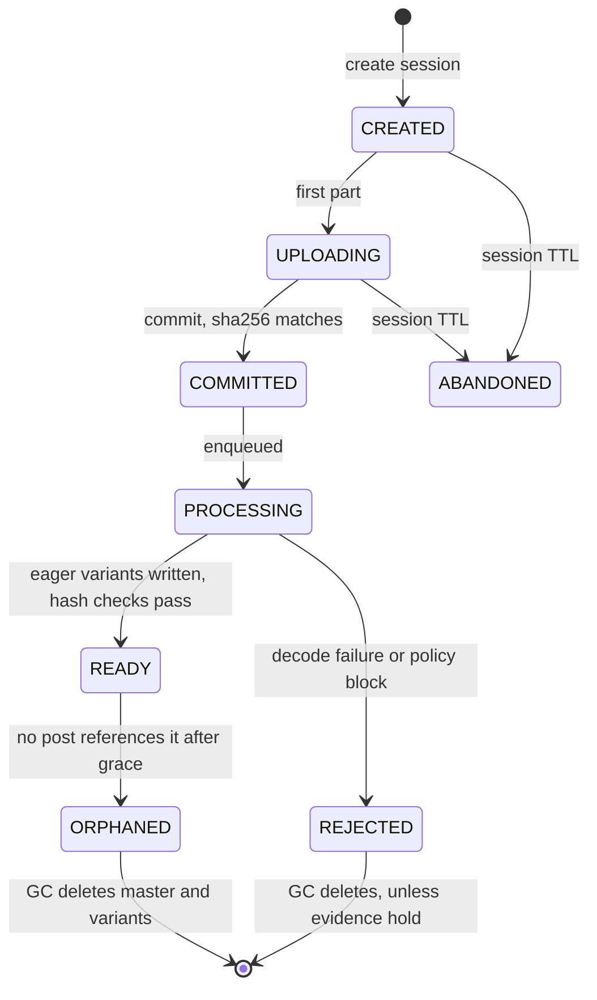

Two states almost no whiteboard answer has, and both matter in production **[Algoroq]**:

- **ORPHANED** — many uploads are never published (abandoned drafts, crashes), and upload-on-select makes that share bigger on purpose. Without a reference-counting **GC**, orphans are ownerless bytes that look like live data.
- **REJECTED with evidence hold** — for a CSAM hash match, **deleting is the wrong action**: US law requires preserving reported material (the 2024 REPORT Act raised the minimum from 90 days to one year). The GC needs a **legal-hold flag it cannot override**.

**Post [Algoroq + Guide]:** `PENDING_MEDIA → PUBLISHED → (DELETED | REMOVED)`. `REMOVED` is a moderation outcome; `DELETED` is the author's.

**Story [Algoroq]:**

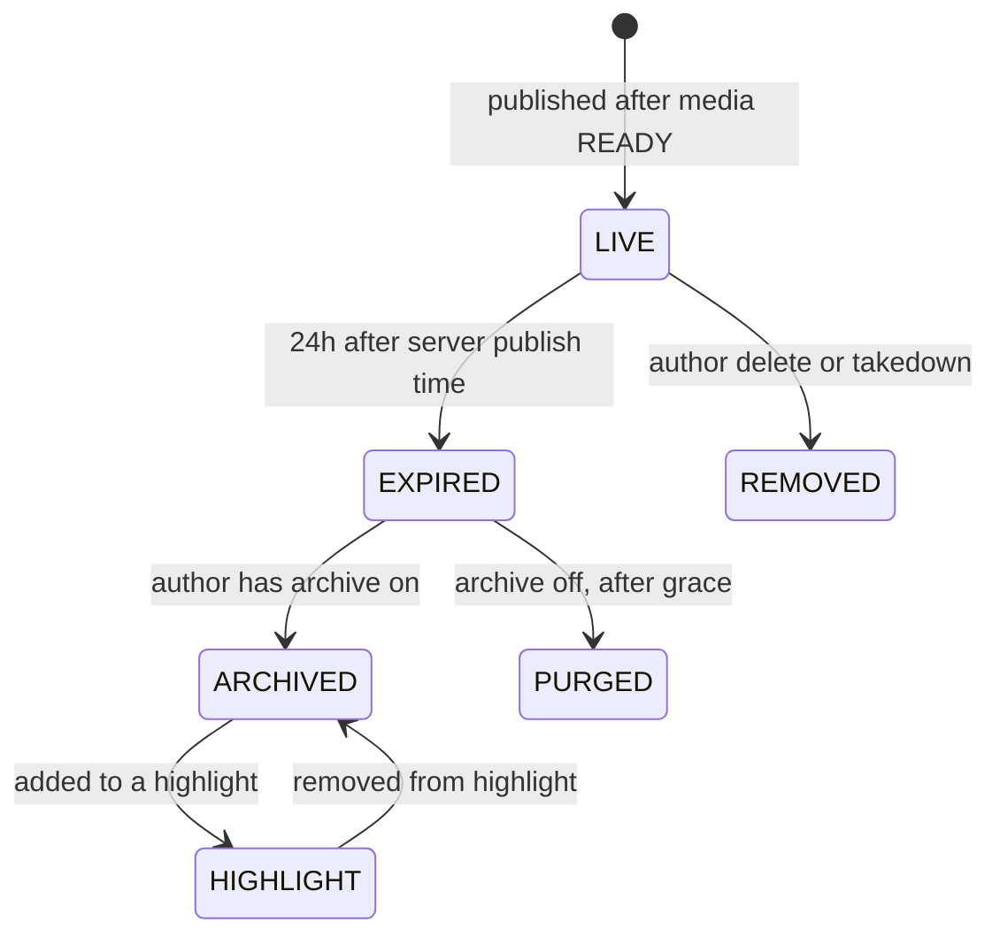

**Visibility (on Media) [Algoroq + Guide]:** `VISIBLE → RESTRICTED (audience change) → REMOVED (takedown)`. It's the **kill switch** checked on every read (§8).

### Who owns what? (plain English)

| Question | Answer |
|----------|--------|
| Who stores the photo? | **Object storage** we rent, in buckets **we** design: raw quarantine, masters, derivatives |
| Who serves the photo to viewers? | **The CDN**, from its edges and shields. Our origin only sees misses |
| Who decides who may see it? | **Our feed/story API**, when it issues a short-lived **signed URL**. The URL is the permission |
| Who decides what size to show? | **The client**, from the ladder we give it |
| Who can stop a photo being shown? | **Our visibility record** (instantly, for new reads) and **the CDN purge** (for copies already out) |
| Who must we tell about CSAM? | **NCMEC**, and we must **keep** the evidence under restricted access |

### 60s opener

> "Photos are write-once, read-a-million-times, keep-forever, and every upload is untrusted. Uploads go **straight to storage** in resumable chunks, **starting when the user picks the photo**, so posting feels instant; the API never touches bytes. A **sandboxed pipeline** checks known-bad hashes before anything can be published, strips metadata by re-encoding, and writes a **master** plus the few **eager sizes** that cover ~90% of views. Posts publish and fan out **only when media is READY**. Feeds return a **ladder of signed, immutable URLs**; the CDN with a **regional shield** absorbs ~99% of fetches. Masters get 11-nines durability and move to cheaper storage as they age; **derivatives are a regenerable cache**. Takedowns **flip visibility first, purge second**. The bill I watch is **cost per DAU-month**, because storage compounds every year even if users don't grow."

### Capacity math [Algoroq]

| Quantity | Calculation | Result |
|----------|-------------|--------|
| Post photos/day | 100M posts × 1.3 photos | **~130M/day** (~1.5k/s avg, **~5k/s peak**) |
| Story frames/day | given | **~300M/day** (~3.5k/s avg, **~10k/s peak**) |
| Bytes per post photo | ~1.2 MB master + ~0.6 MB derivatives | **~1.8 MB** |
| Post storage growth | 130M × 1.8 MB | **~235 TB/day → ~85 PB/yr** (before replication) |
| Story storage | 300M × 0.5 MB × ~2 days live + grace | **~300 TB, flat** |
| Ingest bandwidth | 130M × 1.2 MB + 300M × 0.5 MB ≈ 310 TB/day | **~30 Gbps avg, ~85 Gbps peak** |
| Image fetches | 500M DAU × ~200 views/day | **~100B/day → ~1.2M/s avg, ~3M/s peak** |
| Bytes per fetch | feed-size WebP/AVIF | **~100 KB** |
| Egress | 100B × 100 KB | **~10 PB/day → ~1 Tbps avg, ~3 Tbps peak** |
| Objects created/day | 130M × ~6 variants + stories | **~1B objects/day** |
| Metadata | ~430M rows/day × ~500 B | **~215 GB/day, ~80 TB/yr** |
| Descriptor reads | few hundred k feed pages/s × 10–20 items | **low millions/s** |

**Cost per DAU-month (storage + egress only, illustrative) [Algoroq]:**

| Point in time | Storage | Egress | Total | Per DAU-month |
|---------------|---------|--------|-------|---------------|
| End of year 1, untiered (85 PB) | ~$1.7M | ~$1.2M | ~$2.9M | ~$0.006 |
| End of year 5, untiered (425 PB) | ~$8.5M | ~$1.2M | ~$9.7M | **~$0.019** |
| End of year 5, tiered (hot last ~90 days, masters warm at ~half price, old derivatives evicted) | ~$3.2M | ~$1.2M | ~$4.4M | ~$0.009 |

**What the numbers say [Algoroq]:**

1. **Ingest is small, egress is huge** (30 Gbps vs 1 Tbps): spend design effort on formats and size selection, not on the upload path's bytes.
2. **Storage compounds, egress doesn't.** Storage overtakes egress **before the end of year one**. With flat users, cost per user **triples** by year five if nothing is tiered, so **tiering is a day-one decision**.
3. **A billion objects a day** makes per-object fees (requests, lifecycle transitions, metadata rows, minimum billable sizes) real money even though each object is small.

### Don't

| Don't | Do instead |
|-------|-----------|
| Upload bytes through the API servers | Signed, resumable chunk URLs straight to the storage edge **[Algoroq]** |
| Fan out on post creation | Fan out on **media READY**, and set error TTL to zero on image paths **[Algoroq]** |
| Strip EXIF by editing tags | Decode to pixels and **re-encode** **[Algoroq]** |
| A resizer that takes `?w=731&q=83` | An **allowlist of sizes (rungs)**; map requests to the nearest one **[Algoroq]** |
| Give derivatives the same durability as masters | Derivatives are a **regenerable cache** **[Algoroq]** |
| Tier thumbnails to infrequent-access storage | Tier **masters**; **evict** old thumbnails **[Algoroq]** |
| `Vary: Accept` on raw headers | Format in the URL, or normalize `Accept` into 2–3 buckets **[Algoroq]** |
| Put the URL signature in the cache key | Validate at the edge, cache by the canonical path **[Algoroq]** |
| A fixed 24h `max-age` on stories | `max-age` = **remaining** story lifetime **[Algoroq]** |
| Delete first on takedown | **Flip visibility first**, purge second, delete after the legal-hold check **[Algoroq]** |
| Cross-user dedup by hash to save storage | Dedup **within a user** only; cross-user hashes only for safety matching **[Algoroq]** |

---

## 1. Chosen design (default answer)

> **In plain English:** the system has six parts. **(A) Upload:** the phone sends photo pieces straight to storage; our servers only hand out permission slips. **(B) Process:** a locked-down lab checks each photo, cleans it, and prints the common sizes. **(C) Store:** originals are kept very safely; the printed sizes are kept loosely because they can be reprinted. **(D) Serve:** a rented chain of shops (the CDN) hands photos to viewers, so our own servers rarely get asked. **(E) Feed and stories:** decide which posts each viewer sees, and give them expiring links. **(F) Safety:** block known-bad images before posting and remove bad ones after.

### Stack [Guide, following Algoroq's structure]

| Layer | Pick | Why |
|-------|------|-----|
| Edge / upload | Storage-edge upload endpoints (multi-region ingest PoPs) with signed chunk URLs | Bytes never touch the API fleet **[Algoroq]** |
| API | Stateless services: upload sessions, posts, stories, feed | Scale with request count, not bytes **[Algoroq]** |
| Raw quarantine | Separate bucket, **no CDN origin path**, pipeline-only access | No serving bug can ever serve an unscanned upload **[Algoroq]** |
| Pipeline | Queue + sandboxed workers (gVisor/seccomp class), DAG of idempotent steps | Untrusted decoders, safe re-runs **[Algoroq]** |
| Masters | Object storage, high durability, tiered by age | 11 nines; the source of truth **[Algoroq]** |
| Derivatives | Object storage, **lower durability**, evictable | A cache with good PR **[Algoroq]** |
| Media metadata | Sharded by `mediaId`: immutable descriptor (cached) + mutable visibility record | Low-millions reads/s **[Algoroq]** |
| Posts / follows | Sharded SQL or wide-column store keyed by author | Standard social data **[Guide]** |
| Feed inbox | In-memory cache of post ids per user (e.g. Redis lists) | Fan-out on write **[Guide]** |
| Stories | Wide-column store, **bucketed by creation hour** | Expire by dropping buckets **[Algoroq]** |
| Counters | Sharded counters, separate from media reads | Viral posts are write storms **[Algoroq]** |
| CDN | Edge PoPs → **regional shield** → image origin + on-demand resizer; **multi-CDN** URL issuing | Hit ratio sets unit cost **[Algoroq]** |
| Moderation | Sync hash match in the pipeline; async classifiers + review queue | Blocks vs after-the-fact **[Algoroq]** |

### HLD — component architecture

Drawn as **one overview + five zoom-ins** so no diagram gets crowded.

#### Overview — the six blocks

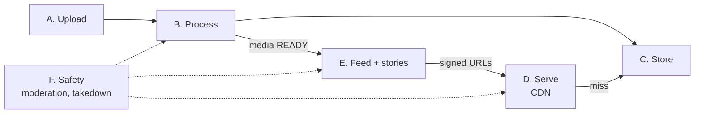

#### Block A — Upload (bytes skip the API)

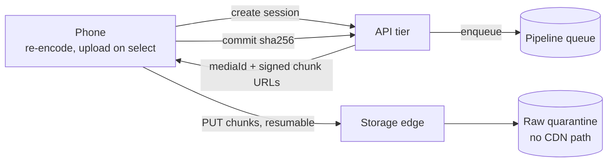

#### Block B — Process (sandboxed, idempotent steps)

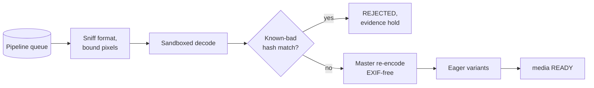

#### Block C — Store (different durability per class)

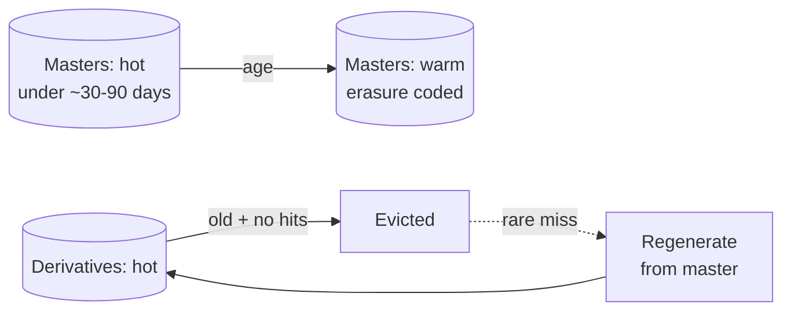

#### Block D — Serve (tiered caching)

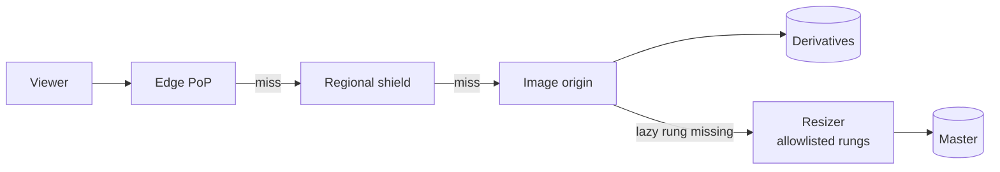

#### Block E — Feed and stories

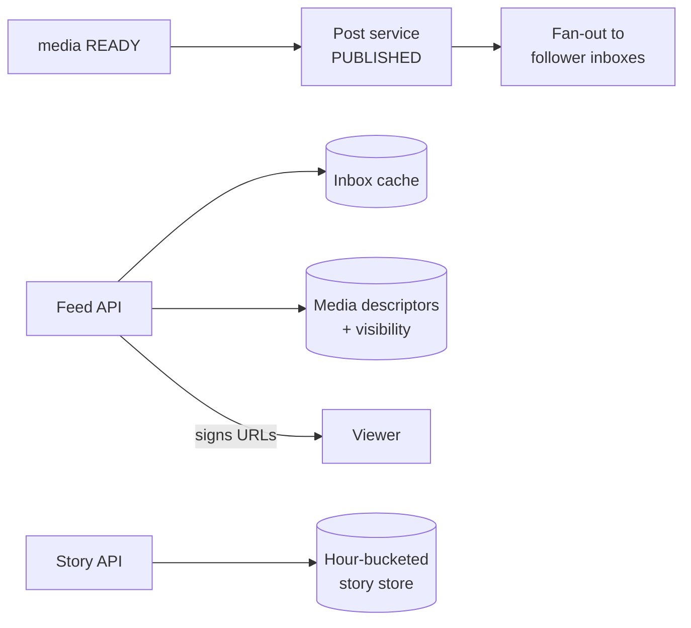

#### Block F — Safety (what blocks, what chases)

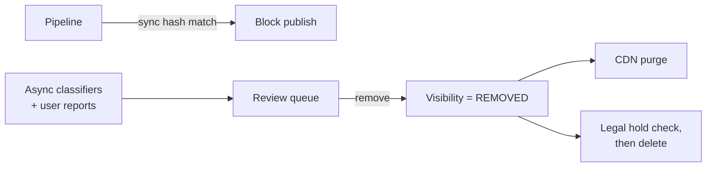

**How to draw it on the whiteboard without the mess:** start with `phone → storage → pipeline → storage → CDN → viewer` and the API on the side issuing sessions and URLs. Then add, in order: **(1)** raw quarantine and the READY gate, **(2)** the shield between edge and origin, **(3)** the visibility record on the read path, **(4)** tiering on the storage boxes. **[Guide]**

| Component | Responsibility |
|-----------|----------------|
| **API tier** | Creates upload sessions with signed chunk URLs, records commits, creates posts and stories, serves feed/tray, **signs image URLs** (the authorization point) **[Algoroq]** |
| **Storage edge + raw quarantine** | Accepts resumable chunks near the user; raw bytes are readable only by the pipeline **[Algoroq]** |
| **Media pipeline** | Sniff, bound, sandboxed decode, hashes, known-bad match, EXIF-free master, eager variants, READY event; async classifiers after **[Algoroq]** |
| **Media metadata** | Immutable descriptor (aspect, blurhash, ladder, location) + mutable visibility record; sharded by `mediaId` **[Algoroq]** |
| **Post service** | `PENDING_MEDIA → PUBLISHED` on READY; triggers fan-out **[Algoroq]** |
| **Feed service** | Reads inbox + pulls celebrity posts, ranks, batch-fetches descriptors, **drops non-visible**, signs URLs **[Algoroq + Guide]** |
| **Story service** | Tray with unseen state, expiry checks, hour-bucketed storage **[Algoroq]** |
| **Image origin + resizer** | Reads any tier transparently (hot → warm → regenerate); generates lazy rungs from an allowlist **[Algoroq]** |
| **CDN** | Edge PoPs + regional shield; immutable cache entries; purge by surrogate key for takedowns **[Algoroq]** |
| **Moderation service** | Classifiers, review queue, takedown flow, evidence store, NCMEC reports **[Algoroq]** |
| **Deletion service** | Fans out erasure to every sink recorded in the **deletion ledger** **[Algoroq]** |

### Three user journeys

**A — Post a photo [Algoroq]:**

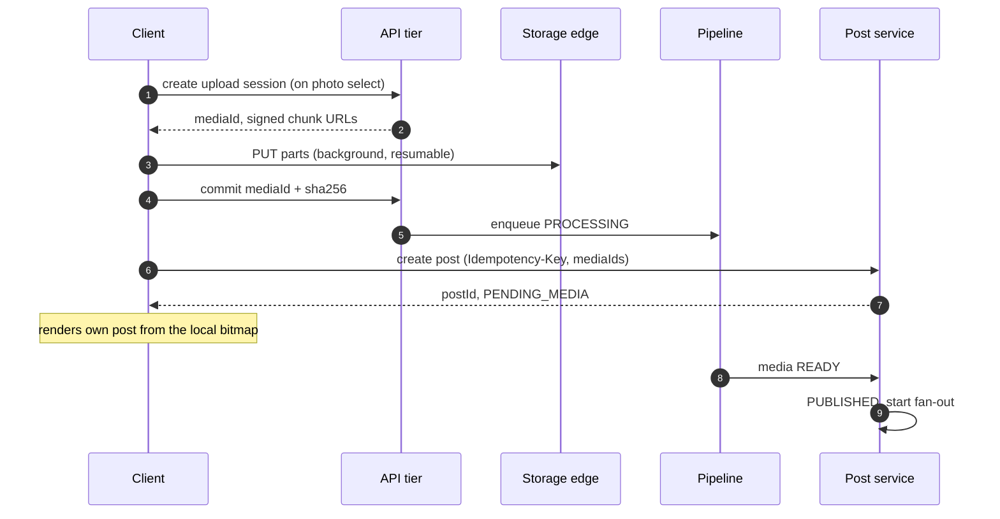

**B — Scroll the feed [Algoroq]:**

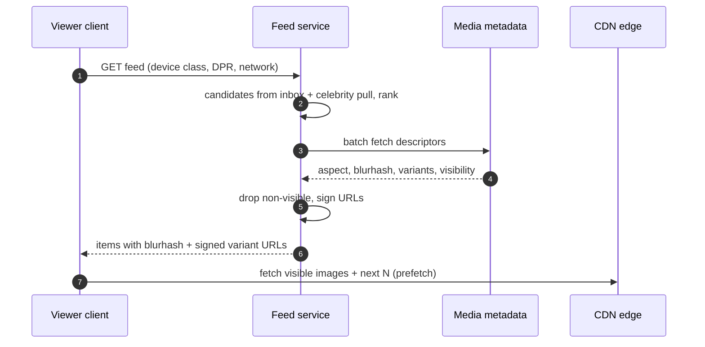

**C — Take down a photo:** see the sequence in §8.

### Latency budget — feed image first byte < 150 ms p95 [Guide]

| Step | Budget | How |
|------|--------|-----|
| Feed API response (ranked, signed) | separate budget | Images can't start until the feed arrives, so the **blurhash** fills the gap |
| DNS + TLS to the CDN edge | ~20–40 ms | Connection reuse; one or two CDN hostnames |
| Edge hit | **~10–30 ms** | The goal for ~95%+ of fetches |
| Edge miss → shield hit | +30–60 ms | Shield in the same continent |
| Shield miss → origin (eager rung) | +50–100 ms | Rare: this is the 1% tail |
| Lazy rung → resize | +100s of ms | Acceptable only for rare sizes; this is why the popular sizes are **eager** |

**Tap-to-visible < 1s for the uploader** isn't a server latency at all: the client renders its **own local bitmap** while the upload finishes in the background. **[Algoroq]**

---

## 1.5 How we got here — evolve the design (bad → good → great) [Guide framing of Algoroq material]

### Upload

| | Design | Breaks because |
|-|--------|----------------|
| **Bad** | Phone POSTs the file to an API server, which writes to storage | API fleet scales with **bytes**; thousands of slow 3G uploads tie up connection pools **[Algoroq]** |
| **Good** | Presigned URL, single PUT straight to object storage, then a resize worker | A dropped connection at 90% restarts from zero; posting waits on upload + resize |
| **Great** | **Client re-encode → upload on select → resumable chunks to the storage edge → raw quarantine → sandboxed pipeline → READY-gated publish**, uploader sees the local bitmap | Feels instant, survives bad networks, nothing unscanned is ever servable **[Algoroq]** |

### Serving

| | Design | Breaks because |
|-|--------|----------------|
| **Bad** | Serve images from the origin | 3M fetches/s at ~1 Tbps |
| **Good** | CDN in front of one URL per photo | One size for every screen wastes bytes; long-tail misses at every PoP hit the origin |
| **Great** | **Variant ladder + client choice + eager/lazy rungs + regional shield + immutable versioned URLs + signed capability URLs + multi-CDN hostnames** | Hit ratio ~99% at the shield, right-sized bytes, takedowns via purge, CDN failover without a client release **[Algoroq]** |

### Storage

| | Design | Breaks because |
|-|--------|----------------|
| **Bad** | Everything in hot storage forever | Year-5 cost per user triples with flat DAU **[Algoroq]** |
| **Good** | Lifecycle rule: move **all** objects to infrequent-access after 30 days | Thumbnails below ~70 KB **cost more** in IA, plus a per-object transition fee; early-deletion charges on photos users delete **[Algoroq]** |
| **Great** | Tier **masters** (timed from the deletion histogram), **evict** old derivatives and regenerate on miss, a per-object `location` field | Halves the year-5 bill without a new storage system **[Algoroq]** |

---
## 2. Deep dive — the upload path

> **In plain English:** think of sending a big parcel over a bad phone line.
> - **Make the parcel smaller first:** the phone shrinks the photo before sending (a 5 MB photo becomes under 1 MB). That one choice cuts our storage bill forever.
> - **Send it in small boxes:** if the line drops, only the last box is resent.
> - **Start sending as soon as the user picks the photo**, while they're still typing the caption. By the time they tap Share, it's already uploaded.
> - **Show the user their own photo from their phone** right away, so it feels instant. Followers see it a few seconds later, once our checks finish.
> - **Don't tell followers about the post until the images exist**, or they'll see broken images.
> - **Clean up abandoned uploads** (drafts never posted), but never delete anything the law says we must keep.

### Resumable, client-shaped uploads [Algoroq]

- **Chunked, resumable uploads** with server-acknowledged offsets are table stakes. A dropped connection on 3G resumes at the last acknowledged chunk.
- **The bigger lever is what the client uploads.** Re-encode on the phone before upload: cap the long edge (e.g. 2048–4096 px) at high quality. A 12 MP photo from a modern phone is **3–6 MB**; a 2048-px re-encode is **well under 1 MB**. That **halves or thirds** ingest bandwidth **and master storage forever** — the single largest storage-cost decision in the system.
- **It's a product decision disguised as a client optimization:** "what maximum resolution do we promise?" Write the policy down. Two years later someone will propose "store full-resolution originals for future ML", and the right answer is a line item showing what that costs.
- **EXIF stripping stays on the server.** A modified client will skip it.

### Making "post" feel instant [Algoroq]

1. **Upload starts when the user selects the photo**, not when they tap Share. By the time the caption is typed, the bytes are usually committed.
2. `POST /posts` returns `PENDING_MEDIA` or `PUBLISHED`.
3. **The uploader sees their post from the local bitmap**, not the CDN. That meets their read-your-own-writes need without any cross-region consistency.
4. **Followers only see it after READY.**

### Gate fan-out on READY — the 404 trap [Algoroq]

If you fan out when the post is **created**, followers get feed items pointing at variant URLs that **don't exist yet** → 404. The client retries, and the CDN **caches the 404** for its error TTL, so the item stays broken **for minutes after** the media is ready.

**Fix, do both:** fan out only on **media READY**, and set the **error TTL to zero** on image paths.

### Orphans and the GC [Algoroq]

- A meaningful share of uploads is **never published**; upload-on-select makes it bigger on purpose.
- A **reference-counting GC** deletes media no post references after a **grace window longer than the longest draft lifetime**.
- Run the GC **against the metadata DB, never a bucket listing.** Listing billions of objects is slow and billed per request.
- **The GC must check the legal-hold flag** and can never override it (§8).
- Alert on **"bytes with no referencing post, older than grace"**. A paused GC that never resumes is a silent cost leak until the finance review (§11).

### Content-hash dedup — less value, more risk than it looks [Algoroq]

"If the hash already exists, skip the upload" sounds free. It isn't:

| Problem | Why |
|---------|-----|
| **Little saving** | Every client re-encode produces distinct bytes; exact duplicates across users are mostly reposted memes and screenshots |
| **Existence oracle** | An attacker uploads a known file; if it's skipped, they learn **someone** has that exact file. A documented attack on deduplicating cloud storage for over a decade |
| **Couples deletion** | One user's erasure request can't delete bytes another user still references |

**Rule: dedup within a user** (retries, re-shares) — free and safe. **Across users, use hashes only for safety matching, never to save storage.**

---

## 3. Deep dive — the media pipeline (an attack surface first)

> **In plain English:** every uploaded photo is a file from a stranger, and image files can be booby-trapped. Opening one with buggy software has, in real attacks, let the attacker run commands on the server. So we open mail from strangers **in a bomb-proof room**:
> - **Check what it really is** from its first bytes, not from its name (`.jpg` can be lying).
> - **Check its declared size before opening it.** A tiny file can claim to be 30,000 × 30,000 pixels and eat all the memory when opened (a "decompression bomb").
> - **Open it in a locked box** (sandbox) with no network and no disk access, so even a successful attack reaches nothing.
> - **Redraw the picture from scratch** instead of editing out hidden data, so nothing hidden (GPS, an uncropped thumbnail) survives.
> - **Make only the popular sizes in advance**; make rare sizes on demand, from a fixed list of allowed sizes, so nobody can make us generate millions of odd sizes.

### Why it's dangerous [Algoroq]

The pipeline **decodes attacker-controlled files** in formats with long, bug-rich parser histories (JPEG, PNG, HEIC, WebP, GIF, and TIFF hiding behind a `.jpg` name). **ImageTragick (CVE-2016-3714)** turned a crafted image handed to ImageMagick into **shell command execution**, and the class of bug recurs. Treat decoders the way a browser treats web pages:

| Rule | What it means |
|------|---------------|
| **Sniff, don't trust** | Identify the format from the file's **magic bytes**, allow a small set of formats, reject the rest. Disable toolkit "delegates" and coders you don't need |
| **Bound before decode** | Read the header dimensions and reject anything over a pixel budget (e.g. **50–100 MP**) **before** allocating memory. A few-KB file declaring 30,000 × 30,000 px is a **decompression bomb**: it asks for gigabytes of RAM |
| **Poison queue** | A per-media **retry cap** + poison queue, so one malicious file can't crash worker after worker on redelivery |
| **Sandbox per job** | seccomp/gVisor-class sandbox, **no network**, read-only filesystem, CPU and memory limits. Assume a worker **will** be compromised; make sure that reaches nothing |
| **Strip by re-encoding** | Editing EXIF tags in place misses maker notes, XMP and **embedded thumbnails**. An embedded thumbnail can keep the **uncropped** image after the user cropped something sensitive out. Decode to pixels, apply orientation, re-encode: nothing survives that you didn't write |

### A DAG of idempotent steps [Algoroq]

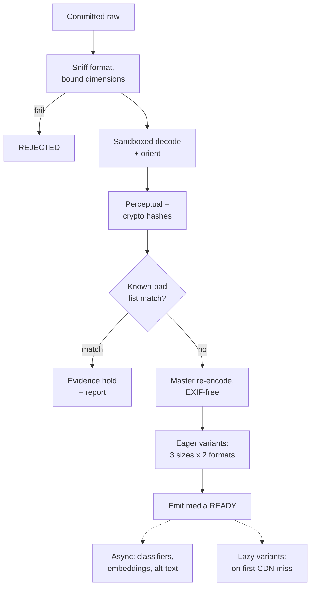

**Key every output by `(mediaId, step, stepVersion)`** and make each step safe to re-run. **[Algoroq]**

- Bump the AVIF encoder version, and a background job re-runs **only that node** across the corpus, in popularity order, without touching hashing or moderation.
- Key only by `mediaId`, and **every encoder change becomes a corpus-wide rerun** nobody approves the budget for.
- **Store perceptual hashes at ingest.** When a new known-bad hash is added to a list, the retro-scan is a **lookup in the hash index**, not a re-decode of hundreds of PB. **[Algoroq]**

### Eager vs lazy derivatives — where the line is [Algoroq]

A naive matrix of 6 widths × 3 formats × 2 crops = **36 objects per photo → ~4.7B objects/day**, mostly never requested. Views concentrate on the feed-width size for real devices plus the grid thumbnail.

| Kind | Rule | Why |
|------|------|-----|
| **Eager** | The variants that serve **~90%+ of expected fetches**: 2–3 widths in the 1–2 formats the dominant clients accept. Generated **before READY** | The first follower never waits on a resize |
| **Lazy** | Everything else, generated on a **CDN miss** by the resizer behind the shield, then written back | Pay CPU only for sizes someone asks for |
| **Popularity-promoted** | Expensive encodes (AVIF can cost **5–10× the CPU** of JPEG) run eagerly only for authors likely to get many views, or lazily once a photo crosses a view threshold | 20% fewer bytes on a photo viewed 12 times is worth nothing; on one viewed 50M times it pays for a small cluster |

**The lazy resizer takes an allowlist of sizes ("rungs"), never free-form parameters. [Algoroq]** An endpoint like `/img/{id}?w=731&q=83` lets anyone create unlimited distinct cache keys. Each is a guaranteed CDN miss plus a full decode and encode: a **cache-busting DoS** that burns CPU and pollutes the edge. Map every request to the nearest allowlisted rung **at the edge**, and put the rung in the cache key.

---

## 4. Deep dive — storage tiers and the per-object cost trap

> **In plain English:** think of a house with a **kitchen** (fast, expensive space) and an **attic** (cheap, slow). New photos get viewed a lot, so they live in the kitchen. Old photos are rarely viewed, so they move to the attic. Three catches:
> - **The attic charges a minimum per box** (128 KB) and a fee each time you carry a box up. Carrying up a tiny thumbnail **costs more than leaving it in the kitchen**. So move the big originals, not the small copies.
> - **Small copies can just be thrown away** and reprinted from the original if someone ever asks. They're a cache, not a treasure.
> - **The attic also charges a minimum stay** (e.g. 90 days). If you move photos up and users delete them soon after, you pay for the full stay anyway. So move them **after** most deletions have happened.

**Views drop steeply with age [Algoroq]:** most lifetime views of a post happen in its first days, then a long thin tail (profile browsing, "memories", the odd resurfaced post). That argues for tiering, but **per-object fees decide what to tier**.

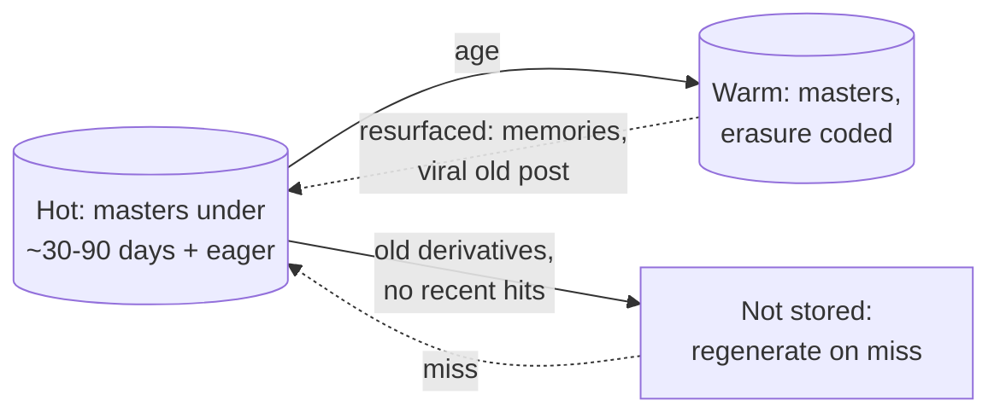

### The counter-intuitive rules [Algoroq]

**1. Tier masters, not thumbnails.** S3's infrequent-access classes bill a **minimum of 128 KB per object** and charge **per lifecycle transition**. With illustrative us-east-1 list prices:

| | Price |
|-|-------|
| Standard | ~$0.023 / GB-month |
| Standard-IA | ~$0.0125 / GB-month (min billable 128 KB) |
| Transition | ~$0.01 per 1,000 objects |

- **Break-even size:** 128 KB × 0.0125 / 0.023 ≈ **70 KB**. Below it, the object costs **more** per month in IA than in Standard, forever, and you paid a transition fee for that.
- A **1 MB master** saves about the transition fee per month in IA, so it **pays back in about a month**. A **25 KB thumbnail never pays back.**
- S3 now defaults lifecycle transitions to skip objects under 128 KB, but **custom tiering jobs, other providers and self-built stores have no such guard**.

**2. Old derivatives are a cache, so evict them.** A derivative is a pure function of **master + encoder version**. Once the view tail flattens, delete derivatives with no recent hits and regenerate on the rare miss. That trades a slower first byte on cold posts for dropping **about a third of long-term bytes**. You'd regenerate them on the next encoder upgrade anyway. **This ships first**: it's worth about as much as warm-tiering masters and needs no new storage system.

**3. Minimum storage duration interacts with deletion.** Colder tiers bill a minimum retention (30/90/180 days). If masters move to a 90-day-minimum tier at day 30 and users delete photos, you pay **early-deletion charges** on data you no longer hold. **Set the transition age after most user deletions have already happened** — read it off your own deletion-age histogram.

**4. The origin reads any tier transparently** (hot → warm → regenerate) using a **`location` field** in metadata. That field is also your **storage-migration seam** (§11).

### Self-hosted at hundreds of PB: replication factor is the cost lever [Algoroq]

| System | Layout | Effective replication |
|--------|--------|-----------------------|
| **Haystack** (Facebook, OSDI 2010) | Many photos packed into large append-only volume files with an in-memory index → **one disk read per photo** instead of several filesystem-metadata seeks | 3 replicas on RAID-6 ≈ **3.6×** |
| **f4** (Facebook, OSDI 2014) | Warm blobs moved to **Reed-Solomon(10,4)** within a region + XOR across regions | ≈ **2.1×** |

On hundreds of PB, **1.5 points of replication factor is a mid-sized company's whole storage budget.** The general lesson: **hot storage is optimized for reads per byte, warm storage for bytes per dollar**, and they should be different systems. Erasure-coded reads of a missing fragment need reconstruction across k fragments: fine for a warm tail, **deadly for a hot feed**.

---

## 5. Deep dive — CDN economics and URL design

> **In plain English:** picture a chain of shops. The **local shop** (edge) is in every city; behind it a **regional warehouse** (shield); behind that our **factory** (origin).
> - A viewer asks the local shop. If the shop doesn't have the photo, it asks the warehouse; only if the warehouse doesn't have it do we, the factory, get asked.
> - Most photos are seen only a few times per city, so local shops often miss. The warehouse collects those misses from 200 shops into **one** request to us. Going from 97% to 99% answered before the factory means **3× fewer** factory trips.
> - **Keep one shelf label per photo.** If every viewer's link had a different label (their personal signature, or browser details), the shop would store the same photo hundreds of times and rarely find it.
> - **A signed link is like a ticket with an expiry date.** Once handed out, you can't take it back. If an account goes private, old tickets keep working until they expire, so the expiry time is a **privacy decision**.
> - **Photos never change**, so a shop can keep a copy for a year. A new version gets a new link instead of overwriting.

At ~1 Tbps, the CDN is the largest single infrastructure contract. Three numbers matter: **hit ratio, bytes per view, price per GB.** Architecture controls the first two; negotiation sets the third. **[Algoroq]**

### Hit ratio has a long-tail ceiling, and a shield raises it [Algoroq]

- A feed of recent posts from followed accounts has a **fat tail**: many photos get tens of views spread across dozens of PoPs, so each PoP sees each photo once or twice. **Edge hit ratio is structurally capped.**
- **Tiered caching** fixes it: edge → **regional shield** → origin. A miss at 200 PoPs becomes **one** miss at the shield.

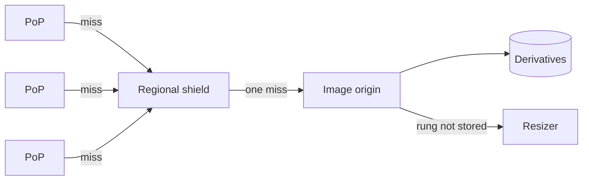

**The math:** at 3M fetches/s, moving the effective origin hit ratio from **97% → 99%** cuts origin requests from **90k/s → 30k/s**. Origin fleet, storage GET fees and resizer CPU all scale with that miss rate, so **a 2-point hit-ratio gain is a 3× origin cost cut**. Tie the origin team's cost SLO to **shield miss rate**, not raw edge hit ratio. **[Algoroq]**

### Cache-key hygiene [Algoroq]

**Never `Vary: Accept` on raw headers.** `Accept` strings differ across browser versions, so one image splits into dozens of cache entries. Put the **format in the URL** (the client chose it from the ladder), or **normalize `Accept`** at the edge into 2–3 buckets before the cache lookup.

### URLs are capabilities [Algoroq]

An image already cached at the edge **can't be un-shared**. For private accounts:

| Rule | Why |
|------|-----|
| **Strip the signature from the cache key** | Private media needs signed URLs, but if the signature or expiry is in the cache key, every viewer's URL is a separate object and hit ratio collapses. Validate the signature at the edge, then look up by the canonical path |
| **Immutable URLs, one-year `max-age`** | Pixels never change, so the URL is effectively content-addressed: `/m/{mediaId}/{rung}.{fmt}/{encoderVersion}`. Encoder upgrades produce **new URLs**, never overwrite. **Purges are only for removal**, which keeps the purge API free for takedowns |
| **Short-lived signatures (hours), reissued in each feed response** | The feed API is the authorization point; the URL is a short-term bearer token |
| **Unguessable, non-sequential media ids** | Sequential or time-based ids let a scraper enumerate media wherever a signature is misconfigured |

**The signature TTL is your worst-case exposure window.** When a public account goes private, URLs already handed out can't be recalled; they stay valid until they expire. Pick that TTL **deliberately**, write it into the privacy review, and don't let a CDN default choose it. **[Algoroq]**

### Bytes per view and price per GB [Algoroq]

- **Format and size choice beat price negotiation** because you can ship them this quarter: AVIF/WebP plus screen-density and network-aware size selection usually saves double-digit percentages. **20% of 10 PB/day is 2 PB/day.**
- **Price per GB** then comes from a commit contract, then **multi-CDN steering** by cost and performance per region, then **caches embedded inside large ISPs**.
- **Build multi-CDN URL issuing early:** the feed picks the hostname per request. Cheap on day one, a client-wide migration later, and it's both your **negotiating leverage** and your **CDN failover path**.

---

## 6. Deep dive — feed generation, the media-specific parts

> **In plain English:** think of each user's feed as a **mailbox**.
> - **Fan-out on write:** when you post, we drop a note ("post 123") into each follower's mailbox. Opening the feed is then just reading your mailbox. Fast.
> - **The celebrity problem:** a star with 100M followers would need 100M notes per post. So for celebrities we **don't deliver**; their posts go on a **notice board**, and your app checks the few boards you follow when you open the feed, then mixes them into your mailbox.
> - **Mailboxes hold notes, not photos.** When you open the feed, we look up each photo and **check it's still allowed** (not removed, not made private). That check is what makes takedowns work.
> - **Prefetching** (loading the next few photos before you scroll to them) makes scrolling smooth, but every photo loaded and never seen is money spent on nothing.
> - **When a celebrity posts**, millions of people open the same new photo in the same minute, and no shop has it yet. So we **pre-load it into the regional warehouses** before notifying followers.

### The basic follower feed — Hello Interview's approach [Hello]

Algoroq defers this to its News Feed problem, but it is the **main deep dive** in Hello Interview's Instagram breakdown (by Evan King, Feb 2025), and most interviews spend real time on it.

> **What was readable:** the Hello PDF's text came through, except the **bodies of the bad/good/great solutions** for the feed (pages 11–15) and for media delivery (pages 19–20), which are images; only their **headings** extracted. Rows marked **[Hello\*]** are reconstructed from those headings, Hello's final-design diagram, and its surrounding text.

> **In plain English:** Hello's whole interview is three steps. (1) Get a simple version working: save the post, save who follows whom, and build each feed by asking "what did everyone I follow post?" (2) Notice that's far too slow for someone following 1,000 accounts, so **build each feed in advance** when posts are made. (3) Notice that building in advance breaks for celebrities with 100M followers, so **mix the two**: build in advance for normal accounts, fetch celebrity posts live.

**Hello's framing [Hello]:**

- **Scope:** create posts with **photos, videos** and a caption; follow users (one-directional); see a **chronological** feed of people you follow. **Below the line:** likes and comments, search, **stories**, live video.
- **Scale:** **500M DAU, 100M posts/day.**
- **Non-functional:** **availability over consistency — eventual consistency up to 2 minutes is fine**; **feed requests < 500 ms end to end**; media renders "instantly" (**< 200 ms** on Hello's whiteboard); scales to 500M DAU. Security and no-data-loss are explicitly below the line.
- **Entities:** **User, Post, Media, Follow.** One Post entity handles **both photos and videos**; Media is "the actual bytes", in S3.
- **API:** `POST /posts → postId` (metadata only; the bytes go separately via a presigned URL), `POST /follows { followedId }` (the follower's id comes from the auth token, not the body), `GET /feed?cursor={cursor}&limit={page_size} → Post[]` with a `next_cursor`.

**Hello's simple design, before the deep dives [Hello]:**

| Piece | Choice |
|-------|--------|
| Services | API Gateway (routing, auth, rate limits) → **Post Service** and a separate **Follow Service** (follows change less often, so they scale separately) |
| Database | **DynamoDB** — "PostgreSQL would be equally valid"; Hello notes Instagram itself uses **PostgreSQL** for post metadata |
| Follow table | Partition key `followerId`, sort key `followedId` → "who do I follow" is one query |
| Post table | Partition key `userId`, sort key `createdAt + postId` → a user's posts in time order, unique |
| Feed | **Fan-out on read** inside the Post Service: get followees → query each one's recent posts → merge and sort → return a page |

Hello also addresses "two services writing to one database": common in practice at large companies; separate databases buy isolation at the cost of cross-service consistency work. **[Hello]**

**Why fan-out on read fails at 500M DAU — Hello's numbers [Hello]:**

- Following **1,000+ accounts** means **1,000+ queries** per refresh. DynamoDB batches cap at **100 items / 16 MB**, so at least 10 batch calls per feed.
- 1,000 followees × 10 posts/day = up to **10,000 posts to process per refresh**.
- 500M DAU × 5 refreshes/day = **2.5B feed generations/day**, **150k+ feed requests/s** at peak.
- Three named problems: **read amplification**, **repeated work** (popular posts fetched millions of times), and **unpredictable latency** (depends on how many accounts you follow). The core issue: the work is postponed to read time, exactly when the user is waiting.

**Bad → good → great for the feed (Hello's three headings) [Hello\*]:**

| | Hello's heading | Design | Breaks because |
|-|-----------------|--------|----------------|
| **Bad** | **"Simple Caching (Improvement on Fan-out on Read)"** | Keep fan-out on read, but cache results (recent posts per author, or assembled feeds) so repeated work is reused | Still assembles feeds at read time; latency still depends on followee count, and caches go stale or miss for long-tail users |
| **Good** | **"Precompute Feeds (Fan-out on Write)"** | On a new post, a **message queue** carries the `postId` to a **Feed Fan-out Service**, which writes it into every follower's **precomputed feed in Redis** (from Hello's final diagram). Reads are one lookup | A celebrity with tens of millions of followers turns one post into tens of millions of writes: **write amplification** |
| **Great** | **"Hybrid Approach (Precompute + Real-time)"** | Precompute for accounts under a **follower threshold**; for accounts above it, skip the fan-out and **merge their recent posts at read time**. Hello's summary: a "carefully considered trade-off to manage write amplification" | Bounded write cost, fast reads; the read only merges a handful of celebrity timelines |

The threshold value isn't in the readable text; ~100k followers is a common example to quote. **[Guide]**

**Two callouts Hello makes around the feed [Hello]:**

- **Redis durability:** if you propose Redis for feeds, say what happens when it dies. Hello's suggested line: *"Redis with AOF persistence and Sentinel for failover"* (or Redis Cluster for sharding), so you aren't treating Redis as a black box. A precomputed feed is also rebuildable from the Follow and Post tables. **[Hello + Guide]**
- **Fan-out is a long-running task:** updating every follower's feed takes a while, so it runs **asynchronously** off a queue, never inside the `POST /posts` request.

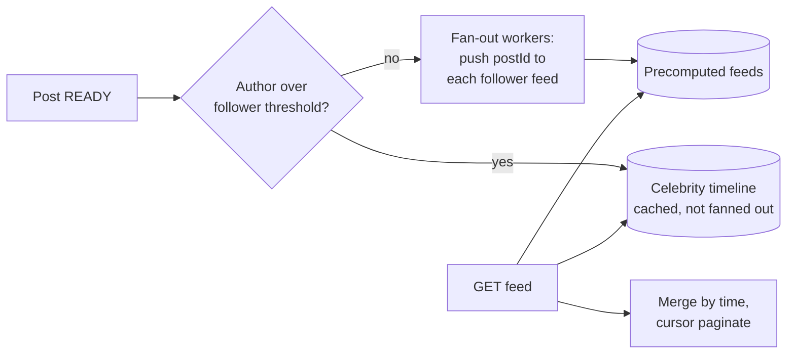

**Details worth saying out loud [Guide unless marked]:**

| Detail | What to say |
|--------|-------------|
| **Inactive followers** | Don't fan out to users who haven't opened the app in weeks; rebuild their feed on next login **[Guide]** |
| **Cap the precomputed feed** | Keep the latest few hundred post ids per user; older pages fall back to fan-out on read **[Guide]** |
| **Ids only** | The feed stores **post ids**, not post content; descriptors are batch-fetched at read time, which is exactly where Algoroq's visibility check plugs in (below) **[Hello + Algoroq]** |
| **Cursor pagination** | Hello uses a cursor + limit. Make the cursor the last `(createdAt, postId)` seen — the same pair as Hello's post sort key — not an offset, so new posts don't shift pages **[Hello cursor · Guide detail]** |
| **Follow / unfollow** | A new follow backfills a few recent posts from that account; an unfollow filters at read time, with lazy cleanup **[Guide]** |
| **Chronological vs ranked** | Hello keeps it chronological. Algoroq assumes a ranker (§1 journey B); ranking runs on the candidate set the hybrid produces **[Guide]** |

### Hello's media deep dive — and where Algoroq disagrees

> **In plain English:** Hello's media story is: let the phone upload big files **straight to storage in pieces**, have storage tell us when it's done, and serve images through a **CDN** that can also **resize them on the fly**. Algoroq agrees with the first two and warns about the third: resizing "on the fly" to any size a URL asks for lets attackers make you resize millions of odd sizes.

**Upload [Hello]:**

- Sizes: **photos up to 8 MB, videos up to 4 GB.** A single HTTP request is usually capped below ~2 GB, so large files need **chunking**.
- `POST /posts` now also returns a **presigned URL** (valid ~**1 hour**); the client uses **S3 multipart upload** to send chunks straight to S3, which reassembles them.
- The post row carries an **`uploadStatus`**: `pending` at creation, `complete` once media lands, along with the S3 object key.
- **Who marks it complete?** **Client-driven** (the client sends a `PATCH`) is simpler but trusts the client. **Server-driven** (an **S3 event notification** triggers a job) is more complex but our backend stays in control. **Most production systems pick server-driven.**

**Serving — bad → good → great (Hello's three headings) [Hello\*]:**

| | Hello's heading | Design |
|-|-----------------|--------|
| **Bad** | **"Direct S3 Serving"** | Clients download from S3: far from most users, no edge caching |
| **Good** | **"Global CDN Distribution"** | A CDN (e.g. CloudFront) caches media near users |
| **Great** | **"CDN with Dynamic Media Optimization"** | An **image processing service (Cloudinary/Imgix in Hello's final design)** behind the CDN produces the right size and format per device and network |

**Hello's scale math [Hello]:** ~2 MB average media × 100M posts/day = **200 TB/day**, **~750 PB over 10 years**; move media not accessed in a long time to **Glacier**. Metadata: 100M × 1 KB = **100 GB/day**; move cold metadata to S3 if DynamoDB cost grows. Hello's rule: *the warmer the storage, the more expensive it is — CDN → memory → SSD → HDD → tape; move cold data down a level.*

**Where the two sources disagree, and the combined answer [Guide]:**

| Topic | Hello | Algoroq | Combined answer |
|-------|-------|---------|-----------------|
| **Resizing** | Dynamic optimization service resizes per request | Free-form resize parameters are a **cache-busting DoS**; only **allowlisted rungs** | Use dynamic optimization, but **only with named presets** (e.g. `w=320/640/1080`). The edge maps any request to the nearest preset |
| **Who marks upload done** | S3 event notification (server-driven) | Client `commit` with `sha256`, then the pipeline emits **READY** | Both are server-side truth: the client's commit is a hint, but only **READY** from the pipeline publishes. Hello's `uploadStatus` = Algoroq's media states, simplified |
| **Cold storage** | Move long-unaccessed media to Glacier | IA-class tiers have a **128 KB minimum** and **minimum storage durations**; tier **masters**, **evict** derivatives | Hello's rule of thumb is right for masters; Algoroq's per-object rules decide **what** and **when** |
| **Consistency** | Eventual, up to 2 minutes | Visibility exact on every read | **Freshness is eventual; permission is checked on every read** (below) |
| **Scale anchor** | 100M posts/day, ~2 MB avg → 200 TB/day | 130M photos/day, ~1.8 MB → ~235 TB/day | Same order of magnitude; Algoroq adds egress (~10 PB/day) as the bigger bill |

**Where Hello and Algoroq disagree on consistency — and both are right [Guide]:** Hello says the system can be **eventually consistent, up to 2 minutes**. That's true for **freshness** (a new post can appear a minute late). It's **not** true for **visibility**: a takedown or a public→private change must apply on the next read, which is why Algoroq re-checks visibility on every descriptor fetch. Say both sentences: *"freshness is eventual; permission is checked every read."*

### Instagram's own public engineering patterns [Instagram engineering, from memory]

These come from Instagram's engineering talks and blog posts, recalled rather than read for this guide. Hello's PDF confirms the headline: **Instagram uses PostgreSQL as its main post-metadata database**, proof that SQL scales to this size. **[Hello]**

| Pattern | What they did | Takeaway |
|---------|---------------|----------|
| **Sharded Postgres with logical shards** | Thousands of **logical** shards mapped onto far fewer physical database servers, so data moves by remapping shards instead of re-splitting rows | Plan logical shards ≫ physical machines from day one |
| **Time-sortable 64-bit ids** | id = **41 bits of milliseconds** since a custom epoch + **13 bits logical shard id** + **10 bits per-shard sequence**, generated inside the database | Ids sort by time (great for feed merges and cursors) and encode their shard (no lookup table) |
| **High-write data on a wide-column store** | Feeds, activity and similar append-heavy data later moved to Cassandra | Use the relational store for core entities, a wide-column store for append-heavy timelines |

**A tension to name [Guide]:** time-sortable ids are guessable, and Algoroq says **media URLs need unguessable ids** (§5). Keep both: a **time-sortable internal post id** for storage, sharding and cursors, and a **random media key** in public URLs.

### What media changes [Algoroq]

**1. Visibility is re-checked at read time.** The inbox is a cache of post ids that may now point to removed, restricted or private media. The batch descriptor fetch returns the **visibility state**, and the feed drops anything not visible. That check is the **fast path for takedowns** (§8). **Never rely on retracting items from millions of inboxes as the enforcement mechanism.**

**2. Prefetch depth is a cost knob.** The client prefetches images for the next N items: too few and scrolling shows placeholders, too many and you pay egress for images never seen.

- Illustratively, if prefetch is a quarter of served bytes, a 60% prefetch-viewed rate wastes **10% of total egress**, 80% wastes 5%. That 5-point difference is **~$50–75k/month** from a client constant nobody reviews.
- The waste concentrates at **session end** (the last N prefetches before the app is backgrounded). So use **adaptive N**: shallow when scroll speed drops or the session is long, deep on fast scrolls over good networks.
- Measure **prefetched-but-never-viewed bytes** as its own metric, per network class and client version.

**3. Media-quality ranking features arrive late.** Classifier outputs (blur, near-duplicate, borderline scores) land **after** fan-out. The ranker must tolerate their absence on fresh posts, or the classifier fleet's latency enters the feed's critical path.

**4. Hot media, not hot users, is the partition problem.** A viral post's like and view counters take a write storm. **Shard the counters**, and keep the immutable media descriptor (cacheable forever) **separate** from the counters (changing constantly).

### The cold-start stampede on a big account's post [Algoroq]

Steady viral traffic is the CDN's **easiest** case: one object, very high hit ratio. The dangerous minute is the **first one** after a huge account posts. Fan-out and pushes land within seconds, and **every PoP misses at the same moment** on an object nobody has fetched.

- 50M followers × 5% opening within 60s ≈ **40k requests/s for one photo**, across ~3 sizes × 2 formats, at hundreds of cold PoPs.
- Without coalescing, each PoP miss goes to the shield and each shield miss to the origin. If the size is **lazy**, each one is a decode + encode of the same master.

**The fix: warm the shields before fan-out.**

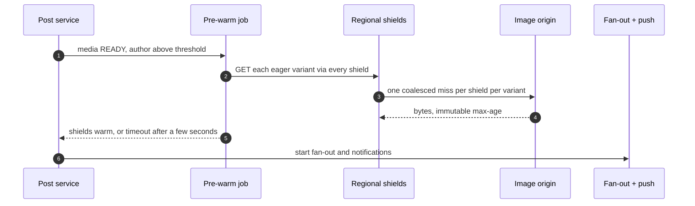

| Rule | Detail |
|------|--------|
| **Threshold** | Pre-warm only when expected first-minute requests exceed what shield request-collapsing already handles: in practice authors with **high hundreds of thousands** of followers and up. Below that, pre-warming is wasted fetches |
| **Force sizes eager for these authors** | A lazy size on a huge account's post is a guaranteed synchronized resize storm. Decide on **expected** views at publish, not observed |
| **Bound the delay** | Pre-warm holds fan-out a few seconds at most; on timeout, fan out anyway. A stuck warm job must never hold a post hostage |
| **Pace notifications** | Spreading push delivery over **30–60s** flattens the peak more than any cache setting, and nobody notices a notification 20s late |

---

## 7. Deep dive — stories and expiry

> **In plain English:** "disappear after 24 hours" sounds like a timer, but copies of the story are everywhere: in CDN shops, in links people saved, in our database. So we enforce it in four places:
> - **Our server refuses to list it** after 24h. This is the one that's exact.
> - **The link itself expires** at the same moment.
> - **Shops are told to keep it only for the time it has left** (10 minutes left → keep 10 minutes), not a full 24h.
> - **The bytes are deleted later**, at leisure.
>
> Storage trick: instead of deleting hundreds of millions of rows one by one, file stories **in one folder per hour** and throw away whole old folders. And for the "unseen" ring on the story tray, keep just **one bookmark per (viewer, author)** — "seen up to 10:42" — not one row per story viewed.

Stories look like "posts with a TTL". At the storage layer they're a **different system**: high-write, short-lived, read-amplified, with expiry enforced in **four places**. **[Algoroq]**

### Where expiry is enforced [Algoroq]

| # | Where | How | Exact? |
|---|-------|-----|--------|
| 1 | **Read path (authoritative)** | Tray and viewer APIs compare `createdAt + 24h` to **server** time | **Yes — the only exact one** |
| 2 | **Signed URL** | `exp = min(signatureTTL, storyExpiresAt)` | Yes, for new fetches |
| 3 | **CDN `max-age`** | = **remaining** lifetime, computed per response: 10 minutes left → `max-age=600` | Close |
| 4 | **Storage deletion** | Lazy, eventual | Doesn't need to be; 1–3 provide correctness |

**Why #3 matters:** a fixed 24h `max-age` means the last edge copy can **outlive the story by up to 24h**. Users notice, because stories get screen-recorded and URLs get shared. **[Algoroq]**

**Clock rule:** expiry is 24h from the **server-assigned publish time**, never client time. Skew between services only moves disappearance by seconds, harmless while the authoritative check lives in one place. **[Algoroq]**

### Expire by dropping partitions, not rows [Algoroq]

Per-row TTLs in an LSM wide-column store create **tombstones**. At 300M stories/day plus per-viewer rows, tombstones pile up → read amplification → eventually tombstone-scan failures. Instead:

- **Bucket story metadata and blobs by creation hour.**
- **Drop whole buckets** once they're older than 24h + grace: one drop instead of hundreds of millions of deletes.
- **Archived stories are copied** to the durable archive at expiry (a small share), so the hot store stays purely ephemeral.

### Seen state is the real scaling problem [Algoroq]

The tray shows which followed authors have **unseen** stories. Naively that's a `(viewer, storyId)` row per view: 500M viewers × dozens of frames a day ≈ **10¹⁰ rows/day** just to colour a ring.

| Trick | How |
|-------|-----|
| **Watermark per (viewer, author)** | Store only the **newest story timestamp seen**. Stories within an author are ordered, so "unseen" = `latestStoryAt > seenUpTo`. One small row per viewer–author pair, **overwritten in place** |
| **The author's viewer list is the reverse index** `(storyId → viewers)` | Only needed for the author's own stories. Write it **asynchronously** through a log, **cap it** for huge accounts (count + a sample), let it expire with the hour bucket |

---

## 8. Deep dive — moderation and takedowns

> **In plain English:** two kinds of checks.
> - **Fast, certain checks run before posting.** Matching a photo's fingerprint against lists of known illegal images takes milliseconds and is very precise, so a match **blocks the post**.
> - **Slow, uncertain checks run after posting.** AI classifiers and human reviewers take seconds to days, so they act on posts that are already out.
>
> Removing something that's already out is like a **product recall**:
> 1. **First tell every shop "don't sell this"** — flip the photo's visibility to REMOVED. Every feed checks that flag, so it disappears from feeds in seconds.
> 2. **Then collect the copies** — purge the CDN shops, which takes minutes.
> 3. **Keep evidence where the law requires it** (child-abuse material must be reported and preserved), then delete the rest.
>
> The flag works even if the purge is slow or broken. That's why it goes first.

### Which checks block publishing? [Algoroq]

| Check | Latency | Blocks publish? | Why |
|-------|---------|-----------------|-----|
| **Known-CSAM perceptual hash** (PhotoDNA-class lists) | ms | **Yes** | Cheap, precise, legally mandated reporting. No reason to ever serve a known match |
| **Known terrorist / violent-extremist hash lists** | ms | **Yes** | Same shape |
| **Account risk** (age, upload velocity, prior strikes, device reputation) | ms | **Sometimes** | New or risky accounts can be held for classifier results |
| **ML classifiers** (nudity, violence, spam, self-harm) | 100 ms – s | **No** by default; **yes for high-risk accounts** | GPU-bound, variable latency, imprecise at the threshold |
| **Human review** | minutes – days | **No** | Fed by classifier bands and user reports |

**Legal surface [Algoroq]:** in the US, a provider that becomes aware of CSAM **must report it to NCMEC** (18 U.S.C. §2258A) and **preserve** the material; proactive hash scanning isn't required by statute but is the industry baseline, and EU/UK rules go further. GDPR-style erasure reaches originals, derivatives, caches, backups **and ML feature stores**.

### Takedowns chase an object that's already everywhere [Algoroq]

By the time a classifier or reviewer acts, the post is in millions of inboxes, its variants sit on edge servers, and URLs are in client caches. So **don't delete first. Flip visibility first.**

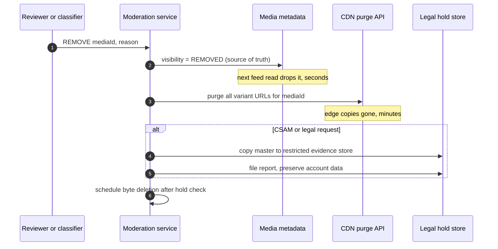

| Property | Why it matters |
|----------|----------------|
| **Visibility is the kill switch**, checked on every metadata read | Works even if the purge API is slow, rate-limited or partly down — which happens to every large CDN customer. The purge only closes the window for someone **already holding** the URL |
| **Purging needs every URL** | Variants are immutable and the ladder is deterministic from `(mediaId, rungs, formats, encoderVersions)`, so you can enumerate them without listing storage. More robust: tag objects with a **surrogate key** `media:{id}` at the origin and **purge by tag** |
| **Deletion and evidence are separate paths** | The account-deletion pipeline and the legal-hold store must never share code that could delete held evidence. **A legal hold is a flag every deleter checks**, not something each caller must remember |

### Adversaries adapt [Algoroq]

- **Perceptual hashes** survive re-encoding and small edits but can be evaded, and **crafted collisions** were published within weeks of Apple's NeuralHash being extracted in 2021. A collision flood attacks the **reviewer queue and reporting pipeline**: benign images engineered to match burn reviewer time and file false reports. Treat a match as **high-confidence but auditable**; never terminate an account on a novel list entry without review.
- **Spam operations adapt to classifier thresholds within days.** Velocity limits keyed on **account age and device fingerprint** do more work than any model: a **2-hour-old account uploading 400 images** is the signal, whatever the pixels are.
- **Reviewer tooling is part of the system:** blur and grayscale by default, reveal on demand, exposure caps per shift, wellbeing-aware routing. Architecturally that's a **restricted media path serving degraded variants**, separate from the consumer CDN.

---
## 9. Deep dive — multi-region

> **In plain English:** we have offices (regions) on several continents. Each user has one **home office** where their data is written.
> - **Copy originals to a second office** in the background. Don't copy the small sizes: the other office can reprint those itself.
> - **The risk:** background copying runs a little behind. If the home office burns down, the last minute of uploads exists nowhere else, even though users were told "posted".
> - **The cheap fix:** uploads are small compared to views, so **send the raw upload to a second office before saying "posted"**. That costs little and closes the gap.
> - **Removals must reach every office fast.** If a removed photo's "hidden" flag hasn't reached the backup office yet, switching to it would bring the removed photo back. So removal flags travel through a faster, global path.

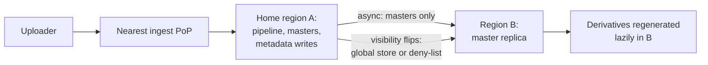

| Rule | Why |
|------|-----|
| **Upload to the nearest PoP, process in the user's home region** | Each user's metadata has **one writer region**, which avoids multi-master conflicts on things like visibility flips **[Algoroq]** |
| **Replicate masters, not derivatives** | Cross-region bandwidth is billed per byte. Derivatives regenerate per region on demand: cuts replication traffic by about a third and never ships sizes the other region won't request **[Algoroq]** |
| **Replication lag is invisible to followers** | READY gating + the uploader's local bitmap hide it **[Algoroq]** |
| **…but visible to the kill switch** | A takedown written in region A and read by a feed in region B lags by the replication delay. For CSAM-class removals, write visibility through a **globally consistent store** (small, rare writes, consensus is affordable) or **broadcast to per-region deny-lists** **[Algoroq]** |
| **Data residency is a per-user attribute from day one** | "Replicate masters to B" becomes a policy lookup (EU masters stay in the EU). Retrofitting means relocating petabytes **[Algoroq]** |

### Losing the home region — what the RPO really is [Algoroq]

Async master replication has an **RPO equal to the replication lag**, and the lag is **worst exactly when it matters**: a degrading region slows its outbound replication before it fails. At ~5k post photos/s and a 60s lag, **~300k acknowledged posts** have masters only in the failed region. The user was told "posted".

**The cheap fix:** because ingest is ~30× smaller than egress, **synchronously write the raw object to a second region before acknowledging `commit`**. That's ~30–85 Gbps of cross-region traffic and one extra round trip on a path the user already experiences as background. It closes the RPO for acknowledged uploads **without making master replication synchronous**. The client keeping its local bitmap until the post is READY and replicated is a second, free layer.

```mermaid
flowchart TD
  A{"Master replicated<br/>to B?"} -->|yes| V
  A -->|no| R{"Raw dual-written<br/>at commit?"}
  R -->|yes| RP["Re-run pipeline in B:<br/>same mediaId + stepVersion"]
  R -->|no| C{"Client still has<br/>local bitmap?"}
  C -->|yes| RU["Client re-uploads,<br/>idempotent by mediaId + sha256"]
  C -->|no| L["Mark post UNAVAILABLE,<br/>never a silent 404"]
  RP --> V{"Visibility flips<br/>caught up in B?"}
  RU --> V
  V -->|yes| S["Serve from B"]
  V -->|no| D["Apply global deny-list<br/>before serving"]
  D --> S
```

**What you must not do on failover [Algoroq]:** serve A-homed media from B **before the visibility deny-list is applied**. A replica lagging on visibility flips **resurrects taken-down content**, which is a far worse incident than a missing photo.

---

## 10. Deep dive — deletion and erasure

> **In plain English:** "delete my account" means finding **every copy** of a user's photos: originals, small sizes, CDN caches, backups, search indexes, even data used to train AI.
> - **Keep a list as you go** (a deletion ledger): every time a user's data is copied somewhere, write it down. At deletion time, work through the list. Searching for copies afterwards never finds them all.
> - **Some storage packs many photos into one big file** and can't remove one photo without rewriting the whole file. The trick: **encrypt each photo with its own key, and destroy the key.** The bytes stay but can never be read.
> - **Backups expire on their own schedule**, so the honest promise is "gone everywhere within the backup retention period".
> - **Always check for a legal hold first**, so deletion never destroys evidence the law requires us to keep.

"Delete my account" has to reach masters in every tier and region, derivatives, story buckets, the archive, CDN edges, search, **ML feature stores (embeddings are derived personal data)**, analytics tables, and backups. The surprise: **the storage engine, not the deletion service, sets your real erasure latency.** **[Algoroq]**

| Problem | Fix | Source |
|---------|-----|--------|
| **Packed and erasure-coded stores can't delete in place.** In a Haystack-style volume a delete flips a flag; bytes stay until compaction, which runs on fragmentation, not legal deadlines. In an EC volume, removing one blob means re-encoding the stripe | **Per-blob encryption keys** held outside the immutable volume (f4's approach): delete the key and the bytes are unrecoverable, compaction or not. Erasure becomes a **metadata write** | [Algoroq] |
| **Per-user crypto-shredding is the wrong granularity** | It conflicts with shared objects and puts a key lookup on every origin read at 3M/s. Use **per-blob keys for masters only** (rare reads, mostly on miss), and delete plaintext derivatives by enumeration | [Algoroq] |
| **You can't find every copy at deletion time** | A **deletion ledger**: record every sink the user's data reached (region, tier, store, derived dataset) **as it's written**. Each sink acknowledges against the ledger; the ledger is what you show a regulator | [Algoroq] |
| **New sinks become the unerasable copy** | A new ML feature store must **register with the ledger before** it gets read access to media | [Algoroq] |
| **Backups** | Retention expiry + documented policy, not per-object surgery. **Max backup retention is your honest erasure bound** | [Algoroq] |
| **Legal hold** | Erasure checks the hold **first**, and that check is audited | [Algoroq] |

---

## 11. Failure modes and edge cases [Algoroq]

> **In plain English:** the most dangerous failures are the ones that **multiply**. If one regional warehouse (shield) fails, its shops send all their misses straight to our factory, which suddenly gets **4× the requests**. The factory then runs out of capacity to print rare sizes, requests time out, apps retry, and it gets worse. The fix is to **lower quality, not availability**: serve the nearest ready-made size instead of printing the exact rare one. And keep enough spare factory capacity for this, because autoscaling is too slow for a 4× jump in under a minute.
>
> The other scary one: a bug in the code that makes **originals**. Small copies can be reprinted, but if the original is broken and the raw upload is already deleted, the photo is damaged forever. So keep raw uploads longer than it usually takes to notice such a bug.

| Failure | What happens | Response |
|---------|--------------|----------|
| **Pipeline poison pill** | A bomb image crashes a worker, is redelivered, crashes the next | Retry cap, poison queue, per-job memory limits. Alert on **crash rate per media**, not per host |
| **Derivative encoder regression** | New version emits corrupted or colour-shifted output | For existing media, **reissue the previous version's URLs** in feed responses: no purge, nothing was overwritten. Media ingested during the bad window has no previous version → re-run that `stepVersion` from masters |
| **Master encoder regression** | **The dangerous one.** The master *is* the re-encode, so the source of truth is corrupted; if raw has expired, the damage is permanent | Keep raw **at least as long as the worst time-to-detect** for master defects; change the master encoder rarely; **canary** with a sampled pixel diff against raw |
| **Shield or origin brownout** | Misses pile up, the resizer saturates, CPU cost explodes | **Degrade quality, not availability:** serve the nearest eager size instead of generating the lazy one; shed lazy generation first |
| **Viral old post** | A warm-tier master becomes hot: EC reconstruction reads + derivative regeneration in a burst | **Single-flight** regeneration at the shield, then **promote** to hot after N misses |
| **Corpus backfill** (new format, new safety model, new hash list) | At hundreds of PB a full rerun is a months-long capacity project | Order by **popularity** for formats, by **risk** for safety rescans; rate-limit against production headroom on a separate lane. New hashes → look up the stored hash index, don't re-decode |
| **Storage backend migration** | Billions of objects need to move | Dual-write new objects, per-object `location` field, read with fallback (new → old), copy in popularity order, **verify checksum before deleting** from the old store |
| **CDN outage** | One vendor down | The feed picks the hostname from health signals, so failover lands on the **next feed request**, no client release |
| **Orphan leak** | GC paused during an incident, never resumed | Metric + alert on **bytes with no referencing post, older than grace** |

### The shield-loss cascade [Algoroq]

Every step amplifies the previous one, which is why it's worth drawing:

```mermaid
flowchart TD
  A["One regional shield fails"] --> B["Its PoPs go to other<br/>shields or straight to origin"]
  B --> C["Hit ratio 99% to 96%:<br/>origin 30k/s to 120k/s"]
  C --> D["Lazy-size misses<br/>flood the resizer"]
  D --> E["Resizer p99 ms to seconds,<br/>edge timeouts, client retries"]
  E --> F["Errors cached at edge:<br/>more misses, broken tiles"]
```

**The breaks, one per link [Algoroq]:**

1. **Shed lazy generation:** `302` to the nearest eager size.
2. **Coalesce at the origin per variant**, and cap concurrency per `mediaId`.
3. **Error TTL zero** on image paths; client retries with jitter and a retry budget.

**Size the origin for losing a shield, not for steady state.** Losing one of a handful of shields **quadruples origin load in seconds**. Either keep capacity for 4× steady state or have a **pre-tested shedding mode** that serves only eager sizes; **autoscaling won't catch a 4× step that arrives in under a minute.** **[Algoroq]**

---

## 12. Observability [Algoroq metrics · Guide grouping]

| Metric | Why |
|--------|-----|
| **Cost per DAU-month**, and its year-3 projection at flat DAU | The NFR; a rising number with no product change means no tiering plan |
| **Shield miss rate** (not raw edge hit ratio) | Drives origin, storage GET and resizer cost |
| **Prefetched-but-never-viewed bytes**, per network class and client version | Hidden egress waste |
| **Orphan bytes older than grace** | Catches a stalled GC before the monthly bill does |
| **Takedown propagation time**, per region, end to end | "Show the path, not the SLA" |
| **Pipeline crash rate per media** | Finds poison pills |
| **Feed image p95 first byte**, per region and CDN | The latency SLO |
| **Upload success and resume rate**, per network class | 3G reality **[Guide]** |
| **Time from commit to READY**, p50/p99 | How long followers wait **[Guide]** |
| **Replication lag** for masters and visibility flips | RPO and takedown exposure |

---

## 13. Quick trade-offs [Algoroq]

| Decision | Choice |
|----------|--------|
| Eager vs lazy derivatives | Eager for the ~90% of fetches, allowlisted lazy for the rest, popularity-promoted for expensive formats |
| Durability | Strong for masters, weak for derivatives. **Derivatives are a cache with good PR** |
| Tiering | Tier masters, evict old thumbnails; below ~70 KB, IA-class tiering loses money |
| Signature TTL | Your worst-case exposure after an audience change: a **privacy decision**, not a CDN default |
| Moderation | Hash matching blocks publish, classifiers don't (except high-risk accounts); visibility flip first, purge second |
| Dedup | Within a user yes; across users only for safety matching |
| Story expiry | Read-path check is authoritative; `max-age` = remaining life; drop hour buckets |
| Master replication | Async, plus a **sync raw dual-write at commit** to close the RPO cheaply |
| Self-hosted storage | Only once the bill justifies a permanent dedicated team |

---

## 14. Interview drill card + stress test

### Drill card [Guide, built from Algoroq]

| Drill | Lead |
|-------|------|
| Feed for someone following 1,000 accounts | Fan-out on read = 1,000+ queries; precompute feeds; hybrid for celebrities **[Hello]** |
| "Redis holds the feeds — what if it dies?" | AOF persistence + Sentinel failover; feeds are rebuildable from Follow + Post **[Hello]** |
| 4 GB video upload | Presigned URL + S3 multipart; S3 event marks `complete` (server-driven) **[Hello]** |
| Upload on 3G | Client re-encode, upload on select, resumable chunks straight to storage |
| "Post feels instant" | Local bitmap for the uploader; `PENDING_MEDIA` until READY |
| Followers see broken images | Fan-out gated on READY; error TTL 0 |
| Resizer abuse | Allowlisted rungs, mapped at the edge |
| Malicious image | Sniff, bound pixels, sandbox, poison queue, re-encode to strip |
| Storage bill year 5 | Tier masters (timed by deletions), evict old derivatives |
| Tier thumbnails? | No: below ~70 KB IA costs more, plus transition fees |
| CDN cost | Shield → 97% to 99% = 3× less origin; format choice; multi-CDN |
| Private photos on a CDN | Signed short-lived URLs, signature out of the cache key, TTL = exposure window |
| Celebrity posts | Pre-warm shields, eager sizes, pace pushes |
| Story disappears late | `max-age` = remaining life; read path authoritative |
| Story seen state | Watermark per (viewer, author) |
| Takedown | Visibility flip → purge by surrogate key → hold check → delete |
| Region lost | Raw dual-write at commit; deny-list before serving from B |
| Delete my account | Deletion ledger, per-blob keys for packed stores, backup retention bound |

### Principal stress-test — how to answer

**Frame:** (1) **Which bill or which promise** is at risk (cost, latency, durability, privacy, legal)? (2) **Where is the copy** that breaks it (edge, shield, inbox, replica, backup)? (3) **Which single authoritative check** fixes it? **[Guide]**

| They ask | You answer |
|----------|------------|
| "Cost per user is up 3× with flat DAU" | Storage compounds. Show the tiering plan: evict old derivatives first, then warm masters after the deletion-histogram knee **[Algoroq]** |
| "A shield went down; what's origin load in the next minute?" | ~4× (30k → 120k/s). Shed lazy sizes to eager, coalesce per variant, error TTL 0; capacity was sized for it **[Algoroq]** |
| "The biggest account just posted" | Shields pre-warmed for eager sizes before fan-out, bounded delay, pushes paced over 30–60s **[Algoroq]** |
| "A public account went private. Who can still see the photos?" | Anyone holding an unexpired signed URL, for up to the signature TTL. That TTL was a signed-off privacy decision **[Algoroq]** |
| "CSAM removal in region A — when does region B stop serving it?" | Visibility via a globally consistent store or deny-list broadcast; purge by tag; evidence copied under restricted access **[Algoroq]** |
| "New AVIF encoder is buggy" | Derivatives: reissue old-version URLs, no purge. Masters: that's why raw is kept past time-to-detect **[Algoroq]** |
| "Store full-resolution originals for ML" | Show the line item: 3–6 MB vs <1 MB per photo × 130M/day, forever **[Algoroq]** |
| "Why not dedup identical photos across users?" | Little saving, existence oracle, couples deletion **[Algoroq]** |
| "A new ML team wants media access" | Register as a sink in the deletion ledger first **[Algoroq]** |
| "Why not one URL per image?" | One size wastes bytes on every screen; the ladder lets the client choose **[Algoroq]** |

### What's expected at each level

**Hello's bar [Hello]:**

| Level | Bar |
|-------|-----|
| **Mid** | A working HLD for upload, follows and feed; a simple schema and how posts are stored and fetched. May start with fan-out on read, but **with hints** should see its limits and reach **fan-out on write**. Knows S3 for media and **why a CDN** is needed, without media-optimization details |
| **Senior** | **Nails most deep dives**, especially feed generation and media delivery. Explains read vs write vs **hybrid** fan-out and **why hybrid solves the celebrity problem**. Knows large-file upload handling, justifies technology choices, discusses **indexing strategy** for a read-heavy workload |
| **Staff+** | Spots that **feed generation and media delivery** are the real bottlenecks and focuses there. Discusses **evolution from 1M to 500M users**: where simple solutions suffice and exactly when to add complexity. Strong on **operations and failure modes**, prioritizing user experience |

**What lifts it further (Algoroq's depth on top of Hello's bar) [Guide]:** put **cost per DAU-month** on the board; know **storage compounds** and the **70 KB tiering trap**; treat the pipeline as an **attack surface**; explain **shield hit-ratio economics** and the shield-loss cascade; design takedowns that **chase distributed copies**; name the **RPO** of an acknowledged upload. Hello's staff bar asks for "failure modes"; these are the specific ones.

---

## 15. Source cross-check

| Topic | Algoroq (PDF, 34 pp) | Hello Interview (PDF, 24 pp) | This guide |
|-------|----------------------|------------------------------|------------|
| Scope | Posts + **stories**, moderation, deletion, multi-region; video only as a fork | Posts with **photos and videos**, follows, **chronological** feed; likes, comments, search, stories, live **out** | Algoroq's scope; video named as a fork; Hello's flow as the storyline |
| Scale | 500M DAU, 130M photos + 300M story frames/day, ~3M fetches/s, ~10 PB/day egress | 500M DAU, 100M posts/day, 150k+ feed req/s peak, 200 TB/day media, ~750 PB over 10 years | Both anchors |
| Cost | Cost per DAU-month as an SLO, 4 bills, tiering math | "S3 can handle it, but it's not cheap" → Glacier for cold media | Algoroq's rules decide what and when to tier |
| Consistency | Visibility must be exact on every read | **Eventual up to 2 min**, availability first | **Freshness eventual, permission checked every read** |
| Latency | Feed image p95 first byte < 150 ms; uploader tap-to-visible < 1 s | **Feed < 500 ms**, media < 200 ms | Both, plus a latency budget |
| Entities | One media row + variant manifest; immutable descriptor vs visibility; shard by `mediaId` | **User, Post, Media, Follow**; one Post for photo and video | HLD gates: why upload session, variant, inbox and ledger are **not** entities |
| Database | Media metadata sharded by random `mediaId` | **DynamoDB** (Postgres equally valid); Follow PK `followerId`/SK `followedId`; Post PK `userId`/SK `createdAt+postId` | Both: posts keyed by author, media keyed by random id |
| Upload | Resumable chunks, client re-encode, upload on select, READY gating, 404 trap, orphans, evidence hold, dedup risks | Presigned URL (~1 h) + **S3 multipart**; photos ≤ 8 MB, videos ≤ 4 GB; `uploadStatus` pending → complete; **server-driven** completion via S3 events | Algoroq's READY states as the full version of Hello's `uploadStatus` |
| Pipeline | Attack-surface rules, DAG keyed by `stepVersion`, eager/lazy/popularity, **allowlisted rungs** | **Image processing service (Cloudinary/Imgix)** for dynamic optimization **[Hello\*]** | Dynamic optimization **with named presets only** |
| Storage | 70 KB break-even, evict derivatives, min-duration vs deletions, Haystack/f4, `location` field | S3; cold media to Glacier; "warmer = pricier, move data down a level" | — |
| CDN | Shield math, `Vary`, URLs as capabilities, signature TTL, multi-CDN | **Bad:** direct S3 · **Good:** global CDN · **Great:** CDN + dynamic optimization **[Hello\*]** | — |
| Feed | **Defers the basic feed**; visibility on read, prefetch, late features, hot counters, cold-start pre-warm | **Main deep dive.** Baseline fan-out on read → **Bad:** simple caching · **Good:** fan-out on write (queue → fan-out service → Redis) · **Great:** hybrid **[Hello\*]**; Redis durability callout | Both, plus Instagram's id and sharding patterns |
| Stories | 4 expiry points, hour buckets, watermark seen state | Out of scope | — |
| Moderation | Block vs async table, visibility-first takedown, surrogate-key purge, adversaries, reviewer tooling | Out of scope | — |
| Multi-region | Home region, masters only, RPO math, raw dual-write, failover tree, residency | Not covered | — |
| Deletion | Per-blob keys, deletion ledger, backups | Out of scope | — |
| Interview prep | Design-review questions, build order | Level expectations (mid / senior / staff) | Drill card, stress test, both level views |

> **How to use the two:** Hello's version is the **interview storyline**: requirements → entities → API → simple design (fan-out on read) → fix the feed (hybrid) → fix media (multipart upload, CDN, optimization). Algoroq's is the **staff-level depth** you add once that's on the board: cost, pipeline security, CDN economics, stories, takedowns, regions, deletion.

---

## 16. FAANG / staff-level insight

| Depth beat | What to say |
|------------|-------------|
| **Storage is a stock, egress is a flow** | "Year one I optimize egress; by year five storage dominates, so tiering is a day-one plan." **[Algoroq]** |
| **Immutability makes everything else easy** | Pixels never change → versioned URLs → one-year cache → purge only for removal → encoder rollback is a URL swap **[Algoroq]** |
| **Derivatives are a cache** | Weak durability, evictable, regenerable, replicated per region on demand **[Algoroq]** |
| **The pipeline is an RCE surface** | ImageTragick, decompression bombs, sandbox per job **[Algoroq]** |
| **Hit ratio sets unit cost** | 97 → 99% at the shield = 3× less origin **[Algoroq]** |
| **A URL is a capability** | Signature TTL = privacy exposure window **[Algoroq]** |
| **One authoritative check** | Visibility on the read path beats retracting copies from inboxes and edges **[Algoroq]** |
| **Retrofit cost decides build order** | Things that touch every object or every client go first **[Algoroq]** |

### Build order — sorted by retrofit cost, not importance [Algoroq]

| When | Build |
|------|-------|
| **Day one** (retrofit = touch every object or every client) | Immutable versioned variant URLs · unguessable media ids · `location` field + per-user residency attribute · perceptual hashes stored at ingest · legal-hold flag every deleter checks · multi-CDN-capable URL issuing · READY-gated fan-out · visibility state on the read path |
| **Once scale shows up** (a config or background job away) | Shield tuning · popularity-driven AVIF · derivative eviction · master tiering timed from the deletion histogram · story hour buckets · adaptive prefetch · shield pre-warm for large accounts · cross-region raw dual-write at commit |
| **Only at very large scale** | Self-hosted blob storage with an erasure-coded warm tier · ISP-embedded caches · custom encoders. Each needs a permanent dedicated team |

### Questions to ask in a design review [Algoroq]

1. What is cost per DAU-month today, and in year three with flat DAU? If nobody can answer the second, there's no tiering plan.
2. What is the RPO for an acknowledged upload if the home region is lost, and who tells the user?
3. What is the signature TTL on private media, and who signed off on it as the exposure window?
4. End to end, how long until a CSAM-class removal in one region stops being served everywhere? **Show the path, not the SLA.**
5. What happens in the first 60 seconds after the largest account posts? Which sizes are lazy for that post?
6. If one shield disappears, what is origin load in the next minute, and has the shedding mode been exercised in production?
7. Which sinks hold user media or derived data, and is each in the deletion ledger? What about the one added last quarter?
8. How long is raw kept, and is that longer than the worst time-to-detect for a master-encoder defect?
9. Which metric catches an orphan-GC stall, and would it fire before the monthly bill?

### Interview traps [Guide]

| Trap | Why you fall in |
|------|-----------------|
| Uploading through the API | Feels simple; ties API scaling to bytes |
| "Resize on upload into every size" | 36 objects per photo, most never viewed |
| One durability class | Pays 11 nines for a cache |
| Treating story expiry as a TTL | Edges, URLs and replicas outlive it |
| "Delete it" as the takedown | The copies are already out; flip visibility first |
| Ignoring cost | At 1 Tbps and +85 PB/yr, cost **is** the design |

### References

| Source | What this guide uses |
|--------|----------------------|
| [Algoroq — Design a Photo Sharing Service](https://algoroq.io/system-design-problems/design-a-photo-sharing-service/) (PDF, 34 pages read) | Nearly all deep-dive content, numbers, rules and review questions |
| Facebook **Haystack** (OSDI 2010) and **f4** (OSDI 2014) papers, as cited by Algoroq | Packed volumes, erasure-coded warm storage, per-blob keys |
| [Hello Interview — Instagram](https://www.hellointerview.com/learn/system-design/problem-breakdowns/instagram) (PDF, 24 pages read; solution bodies on pp. 11–15 and 19–20 are images) | Requirements, scale, entities, API, DynamoDB keys, fan-out-on-read numbers, feed and media bad/good/great headings, multipart upload, `uploadStatus`, Redis durability, scale math, level expectations |
| Instagram Engineering blog — "Sharding & IDs at Instagram" (2012, **recalled**) | Logical shards, 41/13/10-bit time-sortable ids |

---

## Appendix A — Core tables (sketch) [Guide, from Algoroq's model]

```sql
-- Immutable after READY: cache forever, no invalidation
CREATE TABLE media (
  media_id          text PRIMARY KEY,      -- random, unguessable; also the shard key
  owner_id          bigint NOT NULL,
  state             text NOT NULL,         -- CREATED | UPLOADING | COMMITTED | PROCESSING | READY | REJECTED | ORPHANED
  sha256            bytea NOT NULL,        -- per-user dedup + idempotent commit
  phash             bytea,                 -- perceptual hash, stored at ingest for retro-scans
  width             int, height int, aspect real,
  blurhash          text,
  variant_manifest  jsonb,                 -- [{rung, fmt, encoder_version, eager}]
  location          jsonb,                 -- {tier, region, store} — the migration seam
  legal_hold        bool NOT NULL DEFAULT false,
  created_at        timestamptz NOT NULL DEFAULT now()
);

-- Tiny, mutable, read on every request: its own store sized for low millions of reads/s
CREATE TABLE media_visibility (
  media_id    text PRIMARY KEY,
  visibility  text NOT NULL,               -- VISIBLE | RESTRICTED | REMOVED
  reason      text,
  updated_at  timestamptz NOT NULL
);

CREATE TABLE posts (
  post_id     bigint PRIMARY KEY,
  author_id   bigint NOT NULL,
  media_ids   text[] NOT NULL,             -- 1-10
  caption     text,                         -- editable; pixels are not
  state       text NOT NULL,                -- PENDING_MEDIA | PUBLISHED | DELETED | REMOVED
  idem_key    text, UNIQUE (author_id, idem_key)
);

-- Stories live in a wide-column store, partitioned by creation hour; whole buckets are dropped.
-- Seen state: one row per (viewer, author), overwritten in place.
--   story_seen(viewer_id, author_id) → seen_up_to timestamp

CREATE TABLE deletion_ledger (
  user_id     bigint,
  sink        text,                         -- region/tier/store/dataset the data reached
  written_at  timestamptz,
  erased_at   timestamptz,                  -- acknowledged by the sink
  PRIMARY KEY (user_id, sink)
);
```

## Appendix B — Variant URL and signing [Guide, from Algoroq's rules]

```text
canonical path:  /m/{mediaId}/{rung}.{fmt}/{encoderVersion}      e.g. /m/9fK2…/1080.avif/v7
signed URL:      https://img-{cdnHost}/m/…/1080.avif/v7?exp=1730100000&sig=HMAC(key, path|exp)

edge:
  if not valid(sig, exp): 403
  rung = nearest_allowlisted(rung)          -- never free-form sizes
  cache_key = canonical path                -- signature and exp are NOT in the key
  serve with Cache-Control: max-age=31536000, immutable      (posts)
             Cache-Control: max-age=remaining_story_seconds   (stories)

feed API:
  for item in ranked:
    if visibility(item.mediaId) != VISIBLE: drop
    exp = now + SIGNATURE_TTL                      -- posts
    exp = min(now + SIGNATURE_TTL, story.expiresAt) -- stories
    host = pick_cdn(region, health, cost)          -- multi-CDN
```

## Appendix C — Pipeline step (pseudocode) [Guide, from Algoroq's rules]

```text
run_step(mediaId, step, stepVersion):
  out_key = (mediaId, step, stepVersion)
  if exists(out_key): return                       -- idempotent re-run
  if attempts(mediaId) > MAX: to_poison_queue(mediaId); return
  in sandbox(no_network, ro_fs, mem_limit, cpu_limit):
    fmt = sniff_magic_bytes(raw)                   -- allowlist only
    if fmt not in ALLOWED: reject(mediaId); return
    (w, h) = read_header_dims(raw)
    if w * h > PIXEL_BUDGET: reject(mediaId); return  -- before decode
    pixels = decode(raw); pixels = apply_orientation(pixels)
    if step == HASH:
      store(phash(pixels), sha256(raw))
      if match_known_bad(phash): evidence_hold(mediaId); report(mediaId); return
    if step == MASTER: write(out_key, encode(pixels, master_profile))   -- EXIF-free by construction
    if step == EAGER:  for (rung, fmt) in eager_plan(mediaId): write(...)
  if all_eager_done(mediaId): emit(MEDIA_READY, mediaId)
```

## Appendix D — Takedown (pseudocode) [Guide, from Algoroq's sequence]

```text
remove(mediaId, reason):
  visibility.set(mediaId, REMOVED, reason)          -- kill switch; global store or deny-list for CSAM-class
  cdn.purge_by_tag("media:" + mediaId)              -- or enumerate ladder URLs deterministically
  if reason in (CSAM, LEGAL):
    evidence_store.copy_master(mediaId)             -- restricted access
    file_report(mediaId); preserve_account(owner)
    media.set_legal_hold(mediaId, true)
  schedule(delete_bytes, mediaId)                   -- deleter checks legal_hold first, audited
```
