# Ride-Sharing Service (Uber / Lyft-style) — Strategic Study Guide

> **Framing:** We are building the **real-time core** of an Uber-like app. Drivers' phones send their GPS position every few seconds; riders ask for a price, tap "request," and within seconds **one specific driver** accepts **one specific trip** at **one specific price**. We own: location ingest, the "who is near here" index, dispatch (matching), the trip lifecycle, surge pricing, and multi-region failover. We **rent or reuse**: maps/road data, payment processors, cloud regions.

> **Source:** the blog post *"Design a Ride-Sharing Service"* (Advanced, 40 min, 10 diagrams). Its diagrams are redrawn here in Mermaid. Everything marked **[Guide]** is extra explanation, examples, or interview framing added by this guide.

**Scale anchor:** **5M drivers online** at global peak · **25M trips/day** · one GPS ping per driver **every 4 s** → **~1.25M location updates/sec** · **~290 trips/sec** average, **~2–3k trip requests/sec** at peak · **~50–100k quote/ETA requests/sec**.

**The one-line thesis:** *This is a **local** problem wearing a global system's clothes.* Every trip lives inside one city, every useful driver is within a few km, and the **only data with a long life is the trip itself**. Partition by geography, keep everything except the trip **soft** (rebuildable), and spend your engineering where locality breaks: **cell boundaries, hot cells, and the minutes after a region fails.**

**Study path (≈40 min):** [Basics](#basics--concepts-you-need-first) → [§0 cheat sheet](#0-cheat-sheet-5-min) → [§3 capacity](#3-capacity-estimation) → [§5 HLD](#5-high-level-design) → [§6 geo index](#6-deep-dive--the-geospatial-index) → [§7 firehose](#7-deep-dive--the-location-firehose) → [§8 dispatch](#8-deep-dive--dispatch-and-matching) → [§9 trip state](#9-deep-dive--the-trip-state-machine) → [§10 surge](#10-deep-dive--surge-pricing-as-a-control-loop) → [§11 multi-region](#11-deep-dive--regional-isolation-and-failover) → [§15 review questions answered](#15-design-review-questions--answered) → [§17 drill](#17-interview-drill-card--stress-test)

---

### Plain-English glossary (read once, then everything below makes sense)

**One picture for the whole guide:** think of each city as its own **taxi control room**. A wall map shows where every taxi is (geo index), fed by radios constantly shouting positions (firehose). One dispatcher per room hands out jobs (single writer). A ledger book records every booked trip (trip store). A price board changes with how busy it is (surge). If the building burns down, a backup building takes over, and the drivers' own trip slips help rebuild the ledger (signed snapshots).

| Term | Plain meaning |
|------|---------------|
| **Ping** | One GPS location message from a driver's phone: lat, lng, heading, speed, accuracy, timestamp |
| **Firehose** | The giant, never-ending stream of pings from all drivers. ~1.25M per second |
| **Geo index** | An in-memory "map" that answers *"which drivers are near this point right now?"* |
| **Geohash / S2 / H3** | Three ways to chop the Earth into numbered cells. Geohash = rectangles, S2 = squares on a cube, **H3 = hexagons** (Uber's library) |
| **Resolution (H3 res 8, res 9)** | How small the hexagons are. Higher number = smaller cell. Res 9 ≈ 0.1 km² (a few city blocks), res 8 ≈ 0.74 km² (a neighbourhood) |
| **k-ring** | "This hex plus all hexes within k steps." k=1 → 7 hexes, k=2 → 19, k=3 → 37 |
| **Haversine** | Formula for straight-line ("as the crow flies") distance between two lat/lng points on a sphere |
| **ETA** | Estimated time of arrival, computed on the **road network** (one-way streets, bridges, traffic) — not straight-line |
| **Road graph / routing engine** | Roads as a graph (junctions = nodes, road segments = edges with travel time). The router finds the fastest path |
| **Contraction hierarchies** | A pre-computation trick that makes shortest-path queries on huge road graphs take milliseconds instead of seconds |
| **Deadhead** | Miles a driver drives **without a passenger** (unpaid) — e.g. driving to the pickup |
| **Dispatch** | The service that decides *which driver gets which request* |
| **Offer** | "Driver D, do you want trip T? You have 15 s." The driver can accept, decline, or let it time out |
| **Greedy matching** | Give each request the best driver **the moment it arrives** |
| **Batched matching** | Wait a short window (1–3 s), collect requests, then solve all assignments together for the best overall result |
| **Bipartite graph / Hungarian algorithm** | Two sets (riders, drivers) with weighted edges between them; Hungarian finds the cheapest one-to-one pairing |
| **Single writer** | Only one process is allowed to change a piece of data. No locks needed because nobody else writes |
| **Lease** | A lock that **expires automatically** (e.g. after 15 s) unless renewed |
| **Fencing token / epoch** | A number that increases on every ownership change. Storage rejects writes carrying an older number, so a "zombie" old owner can't do damage |
| **CAS (compare-and-set)** | "Update this row **only if** its version is still 5." If someone else changed it first, you fail and re-read |
| **Idempotency key** | A unique id the client sends with a request so retrying it doesn't create a duplicate (e.g. two trips) |
| **Soft state** | Data you can lose and rebuild quickly from a source (the geo index). No backups needed |
| **Hard / durable state** | Data you must never lose (trips, money). Replicated, written to disk |
| **Coalescing buffer** | A map that keeps **only the newest** value per key. New ping overwrites the old one. Never builds a backlog |
| **Consumer lag** | How far behind a queue reader is. Misleading here (see §7) |
| **Index age** | `now − last_seen` for drivers — how stale our map really is. **The correct metric** |
| **Surge multiplier** | Price multiplier per zone (1.0×, 1.5×, 2.1×) when demand > supply |
| **Hysteresis** | Using **different thresholds** for going up vs coming down, to stop flip-flopping (like a thermostat that heats at 19 °C but stops at 21 °C) |
| **Control loop / feedback** | Output changes the input. Surge price changes rider demand and driver supply, which then changes the next surge price |
| **Cell (architecture)** | A city or part of a city that runs as its own independent mini-system |
| **Cell directory** | The global lookup: "city 7 is owned by Region B, epoch 12" |
| **Replication lag** | How far behind the backup database copy is from the main one |
| **Outbox pattern** | Write the event into the same DB transaction as the state change, then a separate process publishes it to the event bus. Guarantees "if the trip changed, the event will eventually go out" |
| **Map-matching** | Snapping noisy GPS points onto the actual road the car was on (using an HMM — a probabilistic model of "which road was it most likely on") |
| **Little's law** | `items in system = arrival rate × time each item spends`. Used to compute how many drivers are "locked" in pending offers |
| **Reconnect storm** | Hundreds of thousands of phones reconnecting at the same moment after a failure, overwhelming servers |
| **Jittered exponential backoff** | Retry after 1 s, 2 s, 4 s, 8 s… plus a random offset so clients don't all retry at the same instant |
| **p99** | 99th percentile: 99% of requests are faster than this number |

### Cast of characters

| Party | Role | Where in our design |
|-------|------|---------------------|
| **Rider app** | Gets quotes, requests trips, watches the car approach | Rider API (REST) + server-sent trip stream |
| **Driver app** | Streams GPS, receives offers, accepts, reports arrived/started/completed | Persistent WebSocket/gRPC stream to edge gateway |
| **Edge gateway** | Holds millions of live driver connections; routes by city | Stateful; first stop for pings |
| **Location ingest + coalescer** | Keeps only the newest ping per driver | Feeds the geo index |
| **Geo index** (per city cell) | In-memory "who is near here" | Soft state, rebuilt in seconds |
| **ETA / routing engine** | Road-network travel times | Called for top-M candidates only |
| **Dispatch** (single writer per cell) | Chooses driver, sends offers, reserves drivers | One owner + hot standby per cell |
| **Trip store** (per region) | The ledger of trips; strongly consistent | The only durable thing on the hot path |
| **Quote + Surge** | Prices, signs quotes, computes multipliers | Reads a versioned multiplier map |
| **Payments, analytics, ML** | Downstream consumers | Fed asynchronously by the outbox → event bus |
| **Global control plane** | Accounts, market config, city→region directory | Low write rate; cached in every region |

> **The most common mistake:** *"Geohash the drivers into Redis and pick the nearest one."* Works for a demo. Fails in production because: (1) **nearest by distance is the wrong objective** (ETA is), (2) the index is a **cache of a stream**, not a database, (3) **greedy is worse than batched** at density, (4) **surge is a control system** that can oscillate, and (5) the hardest availability problem is **the half-million trips in flight when a region dies.**

### Basic flow (one picture)

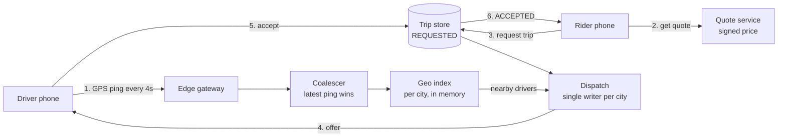

Read it as: **drivers constantly update the map**; the rider gets a **signed price**; the trip is written as **REQUESTED**; **dispatch** picks a driver using the map + ETA; the driver **accepts**; the trip store flips to **ACCEPTED** with a version check so only one outcome wins.

### End-to-end flow (summary)

1. **Driver goes online** — app opens a persistent stream; sends a batch of pings every 4 s (sampled at 1 Hz on the phone).
2. **Ping lands** — edge gateway → coalescer (keeps newest per driver) → geo index updates driver's hex and `last_seen`.
3. **Rider drags pin** — Quote service returns price + ETA from **cached, approximate** state. Returns a **signed quote token** valid for a few minutes.
4. **Rider taps Request** — `POST /trips` with quote + idempotency key. Server verifies signature, writes trip `REQUESTED, ver=1`.
5. **Dispatch** — the city's dispatch owner collects requests for a short window W, finds candidates via k-ring, gets ETAs for top M, solves a min-cost assignment, **reserves** chosen drivers with a **lease**, and pushes offers.
6. **Driver accepts** — trip store does **CAS** `REQUESTED v1 → ACCEPTED v2` with dispatch's **epoch**. If rider cancelled at the same moment, exactly one of the two wins.
7. **Pickup → trip → drop** — ARRIVED, STARTED, COMPLETED events (may be uploaded late from offline phones). On-trip pings go to a **durable trace** (fare evidence).
8. **Payment** — async via outbox. If the processor is down → `PAYMENT_PENDING`; the driver is free to take the next ride.

---

## Basics — concepts you need first

### B1. Lat/lng, haversine and why "distance" lies

A location is `(latitude, longitude)`. **Haversine** gives straight-line distance over the Earth's curve.

**Example [Guide]:** Rider at a riverside café. Driver A is **300 m away** but on the other bank; nearest bridge is 2 km away → **ETA 9 min**. Driver B is **1.2 km away** on the same side, straight road → **ETA 3 min**. Nearest-by-distance picks A — the wrong answer. That is why we use distance only as a **cheap prefilter**, and ETA as the **real ranking**.

### B2. Cutting the Earth into cells

Searching "all 250k drivers in the city, compute distance to each" on every request is wasteful. Instead, label each driver with a **cell id**. To find nearby drivers, look only in the rider's cell and its neighbours.

```
Geohash (rectangles)          H3 (hexagons)
+---+---+---+                   __    __
| 1 | 2 | 3 |                __/  \__/  \__
+---+---+---+               /  \__/  \__/  \
| 4 | X | 6 |   vs          \__/  \__/  \__/
+---+---+---+               /  \__/ X\__/  \
| 7 | 8 | 9 |               \__/  \__/  \__/
+---+---+---+                  \__/  \__/
Diagonal neighbours are       All 6 neighbours are the
1.41x farther than edge ones  SAME distance from the centre
```

**Why hexagons win for dispatch:** expanding "1 ring, then 2 rings" gives a roughly **circular** search area. With squares, it's a square — corners are ~41% farther away, so you overweight far-away corner drivers.

### B3. ETA engine (routing) in one paragraph

Roads = graph. Dijkstra on a whole city graph is too slow per request. **Contraction hierarchies** pre-compute "shortcut" edges (like knowing highway exits in advance), so queries take milliseconds. A **one-to-many** query ("20 drivers → 1 pickup") reuses work and is much cheaper than 20 separate queries.

### B4. Persistent connections (WebSocket / gRPC stream)

Instead of the driver app making a new HTTP request every 4 s, it keeps **one long-lived connection** open. Pings go up, offers come down on the same pipe. Saves handshakes, enables instant server push. Cost: every online driver holds a connection (memory) even when silent — see §7.

### B5. Idempotency key

**Example:** Rider taps "Request" on a flaky network. The request reaches the server, but the response is lost. The app retries. Without protection → **two trips, two drivers**. With an `idempotency_key` (a UUID generated once per tap), the server sees "I already processed this key" and returns the **same** trip.

### B6. Versioning and CAS (compare-and-set)

Every trip row has `ver`. Every change says *"I last saw ver=1; move it to ver=2."*

**Example:** At 10:00:00.100 the rider taps **Cancel** (expects ver=1). At 10:00:00.150 the driver taps **Accept** (expects ver=1). The trip store processes Cancel first → ver=2, CANCELLED. Accept arrives expecting ver=1 → **rejected**. Driver sees "Rider cancelled." Deterministic, no coordination between the two phones.

### B7. Leases and fencing tokens

A **lease** = a lock with a timer. A **fencing token (epoch)** = a counter that increases every time ownership changes.

**Example [Guide]:** Dispatch process P1 owns city 7 with **epoch 7**. P1 freezes for 10 s (garbage-collection pause). Its lease (6 s TTL) expires; standby P2 takes over with **epoch 8**. P1 wakes up, still thinks it's the owner, and tries to confirm a trip. The trip store says "your epoch 7 < current 8 — rejected." The zombie is harmless.

### B8. Little's law

`L = λ × W` → average number in the system = arrival rate × average time spent.

**Example:** 10 offers/sec, each waits 6 s for the driver to respond → **60 drivers** are "locked" in pending offers at any moment, invisible to other requests.

### B9. Control loops, oscillation and hysteresis

A thermostat is a control loop. If the heater reacts instantly but the room takes 20 min to warm, a naive controller overshoots: too hot → off → too cold → on → … That's **oscillation**. Fixes: **slow down reactions** (rate limit), **different on/off thresholds** (hysteresis), and **predict** where the temperature is going. Surge pricing is exactly this, with drivers' travel time as the "room warming time."

### B10. The assignment problem

Given riders and drivers with a cost (ETA) for each pair, find the one-to-one pairing with the **lowest total cost**. Solvers: **Hungarian algorithm** (O(n³), fine for a few hundred), **auction algorithm**, **min-cost flow** on a sparse graph — milliseconds at city scale.

---

## 0. Cheat sheet (5 min)

### Requirements

| Type | Requirement |
|------|-------------|
| Functional | Drivers stream location · rider gets quote + ETA · request · watch car approach · driver accept/decline within timeout · full trip lifecycle incl. cancels, no-shows, reassignment · zone-level surge with quotes honoured for a bounded window |
| Dispatch latency | Request → offer **p99 low single-digit seconds** |
| Freshness | Moving drivers: index staleness ≤ ~one ping interval (a few s) at p99. **> ~10 s = dispatching ghosts** |
| Exactly-one | A driver in **at most one** active offer or trip — under concurrency, retries, failover |
| Durability | Accepted trip survives any **single-region** failure |
| Blast radius | Failure in one city/region must not hurt another |
| Cost | Firehose dominates; scales with **driver-hours online**, not trips. **Cost per trip** is a first-class metric |

### The seven big ideas

1. **Partition by geography (city cell)**, not by hash. Rider + all candidate drivers in the same partition.
2. **Geo index = soft state**, in memory, no replication/WAL/backup. Rebuilt in one ping interval.
3. **Ingest = coalescing buffer** (latest wins), not a durable queue. Alert on **index age**, not consumer lag.
4. **Distance prefilters, ETA decides.** M candidates (10–30) is the quality vs latency knob.
5. **Batched matching** with density-adaptive window W. **Single writer per cell**, leased reservations, CAS on trip version, epoch fencing.
6. **Surge = control loop**: smoothing, rate limits, hysteresis, versioned snapshot, fail to 1.0×, regulatory cap at quote time.
7. **Per-city region ownership**, async replication, **phones carry signed trip snapshots** to recover after failover; jittered reconnects.

### 60-second opener

> "Ride-sharing looks global but every trip is local. I'll split the system into four parts with very different needs: a **location firehose** at ~1.25M writes/sec where only the newest value matters, so it's an in-memory coalescing cache; a **geo index** per city on H3 hexes; a **dispatch** engine that's a single writer per city cell, doing batched min-cost matching with leased reservations and CAS on the trip; and a **surge** controller treated as a feedback loop. The only durable, strongly consistent component is the **trip store**, at hundreds of writes/sec. Each city is owned by one region; on failover, phones present signed trip snapshots to cover replication lag."

### Don't

- Don't store every ping in a durable DB (PostGIS, Cassandra) — ~39 TB/day of data useful for 4 s.
- Don't pick "nearest driver by distance."
- Don't use a Kafka consumer group as the index feed and monitor consumer lag.
- Don't use distributed locks for driver reservation.
- Don't make trip completion wait on payment.
- Don't use synchronous cross-region replication for trips.
- Don't auto-failover a whole region on a partial failure.

---

## 1. Clarify the problem

Ask these in the first 5 minutes. Each answer changes the design.

| Question | Answer to assume | Why it matters (plain words) |
|----------|------------------|------------------------------|
| **Which products?** | Private rides first | **Pooled rides** turn matching into **vehicle routing** (where to insert a new pickup/drop into an existing route) — a much harder problem. **Food delivery** reuses the firehose + index but has 3 parties (courier, restaurant prep time, eater). Treat both as variants |
| **What does "near" mean?** | **Road-network ETA**, not straight-line | A driver 300 m away across a highway can be 9 min out. Changes the index design: index = prefilter, ETA = ranking (§6) |
| **Matching objective?** | A **weighted global cost**, tuned per market | Min rider wait vs max completed trips vs min driver unpaid miles — these conflict. "Closest driver" is *also* an objective, just chosen without thinking |
| **Pricing model?** | Upfront quote + surge per zone; quote honoured at completion | Price becomes **state with a lifecycle** (created, signed, expires, honoured), not a function call |
| **Geography?** | Hundreds of cities, multiple continents, local laws & data residency | **A rider in one city never matches a driver in another.** That locality is the single most valuable fact in the problem |
| **Consistency?** | Strong only for: driver ↔ trip assignment, no double charge, no lost trip | Everything else (cars on map, surge value, ETA) can be **approximate** |

**Example of why "objective" matters [Guide]:** Minimising rider wait says "send the closest driver." Minimising deadhead says "send the driver who is already heading that way." Maximising completed trips says "send the driver most likely to accept." On a Friday night these three give three different drivers.

---

## 2. Requirements

### Functional (compressed)
- Online drivers stream location.
- Riders get **quote + ETA**, request, watch the car approach.
- Drivers **accept/decline** an offer within a timeout.
- Trip lifecycle: request → payment, incl. **cancellations, no-shows, reassignment**.
- Zone-level **dynamic pricing**; quotes honoured for a bounded window.

### Non-functional (these drive the architecture)

| NFR | Target | Plain meaning |
|-----|--------|---------------|
| Dispatch latency | p99 request→offer in low single-digit seconds | Riders cancel after tens of seconds; every unmatched second loses conversions |
| Location freshness | ~1 ping interval at p99 (moving drivers) | Older than ~10 s → the car on our map is not where the car really is ("ghosts"). Parked drivers may be staler *by design* (§7) |
| Exactly-one assignment | Always | Never one driver on two trips, even during retries and failover |
| Trip durability | Survives single-region loss | The trip is where **money and legal liability** live |
| Regional blast radius | Isolated | A London outage must not slow down Mumbai |
| Cost | Track cost per trip | The firehose costs money every hour drivers are online, even with zero trips |

---

## 3. Capacity estimation

| Quantity | Calculation | Result |
|----------|-------------|--------|
| Location updates/sec (peak) | 5M drivers / 4 s | **~1.25M/sec** |
| Ping payload | lat, lng, heading, speed, accuracy, ts, state | ~120 B on wire (compressed batches) |
| Firehose ingest bandwidth | 1.25M × 120 B | **~150 MB/s (~1.2 Gbps)** |
| If every ping were durably logged | 150 MB/s × 86,400 s × 3 replicas | **~39 TB/day — mostly worthless** |
| Trips/sec (avg) | 25M / 86,400 | **~290/sec** |
| Trip requests/sec (peak, incl. retries & re-dispatch) | ~5–10× avg | **~2–3k/sec globally** |
| Quote/ETA requests | ~20–50× trip requests | **~50–100k/sec** |
| Hottest city | ~5% of global drivers | **~250k drivers, ~60k pings/sec** |
| Hottest hex cluster (airport, stadium) | — | hundreds–low thousands of drivers in a few ~0.1 km² cells |

**Show your work (interview style) [Guide]:**
- 5,000,000 ÷ 4 = 1,250,000 pings/s.
- 1.25M × 120 B = 150,000,000 B/s = 150 MB/s. × 8 = 1.2 Gbps.
- 150 MB/s × 86,400 = ~13 TB/day; × 3 replicas = **~39 TB/day**.
- 25,000,000 ÷ 86,400 ≈ 289 trips/s.
- 250,000 ÷ 4 = 62,500 ≈ **60k pings/s** in the biggest city.

### The three numbers that shape the design

1. **Location writes outnumber trips ~4,000 : 1** (1.25M ÷ 290). The firehose must **not** share storage, durability guarantees, or failure domain with dispatch. Most pings are useful for ~4 s, then garbage.
2. **The hottest city fits on a handful of machines.** 60k updates/s into an in-memory hash map is easy for one process. You need **many small local indexes**, not one global spatial DB. The scaling problem is **fleet management** across hundreds of cells, not raw throughput.
3. **Quote traffic dwarfs request traffic.** Riders dragging the pin generate 20–50× more lookups than trips. That read path must use **approximate, cached** state and **never touch the dispatch writer**.

---

## 4. API design

```text
# Driver app — persistent connection (WebSocket/gRPC stream), not REST
STREAM  driver.location   {batch:[{lat,lng,heading,speed,acc,ts_client}], seq, state_ver}
        → server pushes: offer{offer_id, trip_id, pickup, eta, fare, expires_at}
POST    /offers/{offer_id}/accept   {driver_id, idempotency_key}  → 200 trip | 409 gone
POST    /trips/{id}/events          {type: arrived|started|completed, trip_ver, loc}

# Rider app
POST    /quotes      {pickup, dropoff, product}  → {quote_id, fare, surge, eta, expires_at, sig}
POST    /trips       {quote_id, sig, idempotency_key}   → {trip_id, state}
GET     /trips/{id}/stream   → server-sent driver location + state transitions
POST    /trips/{id}/cancel   {trip_ver, idempotency_key}
```

### The three load-bearing details

**1. The quote is a signed token.** It carries fare, surge multiplier, zone, product, expiry, and a signature (HMAC/asymmetric). `POST /trips` **verifies the signature** instead of recomputing the price.
- *Why:* trips can be created even if the pricing service is degraded (as long as quotes are fresh). And no disputes like "the price changed between my tap and my charge."
- *Example:* Quote says ₹320, 1.4× surge, expires 10:05. Rider taps at 10:03. Surge has since gone to 1.8×. The rider still pays ₹320 — the token is proof.
- *Why signed:* so a rider can't edit `fare: 320` to `fare: 32` in the request.

**2. Every trip mutation carries `trip_ver`.** Server does CAS. This deterministically resolves "rider cancels in the same 200 ms the driver taps accept" (§8).

**3. Location is a batched stream, and offers come down the same connection.** Drivers on flaky mobile networks reconnect often; the `seq` number lets the server **drop replayed or reordered batches**.
- *Example:* Batch seq=41 arrives, then a delayed copy of seq=39 arrives after reconnect → dropped.

**`409 gone` on accept** = the offer expired or was withdrawn (rider cancelled, or a new dispatch owner took over).

---

## 5. High-level design

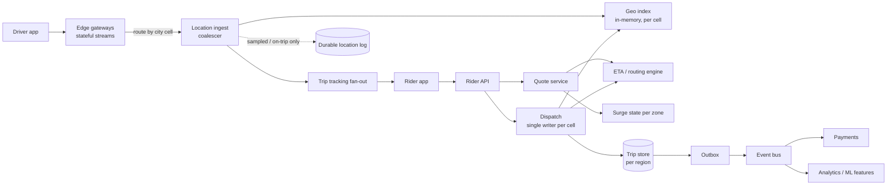

### The structural decisions (and why, in plain words)

| Decision | What it means | Why |
|----------|---------------|-----|
| **Partition the hot path by geography (city cell), not hash** | All of Bengaluru lives on the same set of processes | A rider and every driver they could match are in the **same partition** → no cross-partition reads |
| **Geo index is soft state** | No replication, no WAL, no backup | Rebuilt from pings within one interval (4 s) after restart. Durability would cost more than it saves |
| **Dispatch is single writer per cell** | One process (+ hot standby) owns driver reservations in a cell | Contention resolved **in memory by one thread**, not by distributed locks |
| **Trip store is the only durable, strongly consistent piece** | Hundreds of writes/sec, not millions | Money and legal liability attach here |
| **Downstream hangs off the outbox** | Payments, analytics consume events asynchronously | **Payments down must not stop cars from arriving** |

**Analogy [Guide]:** pings are like a live football score on TV — you only care about the current score. Trips are like a bank statement — you must keep every line forever.

### Beginner notes: the service map, or who does what [Guide]

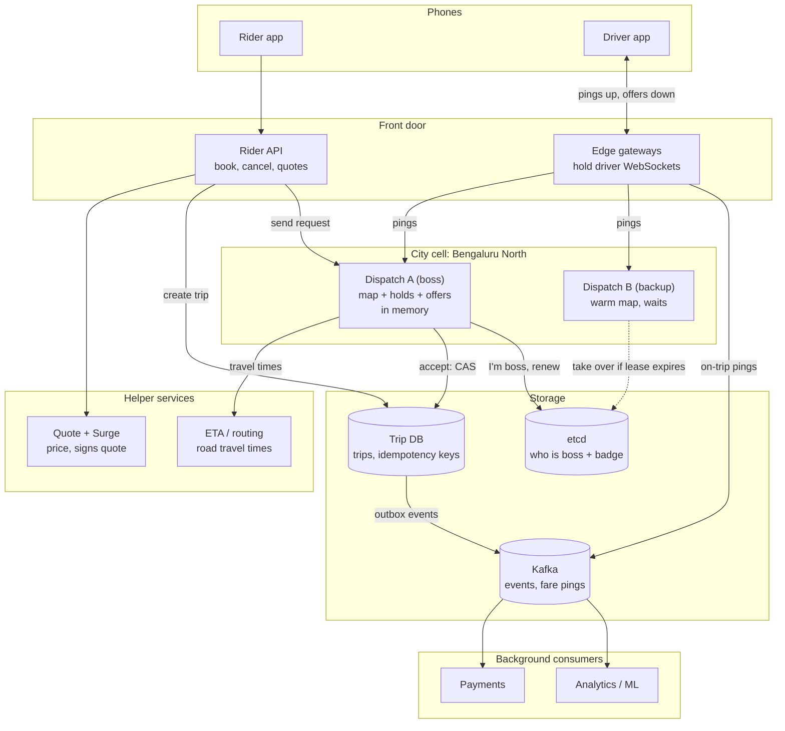

| Block | Job in one line | Keeps data where? |
|---|---|---|
| Rider app | price, book, watch the car | phone |
| Driver app | GPS every 4 s, offers, accept | phone (+ signed trip snapshot) |
| Rider API | the door for rider requests | nothing (stateless) |
| Edge gateways | hold millions of driver connections and route each to the right city | "which connection is which driver" |
| **Dispatch boss** | the city's brain: map, choosing drivers, holds, offers | **its own memory** |
| Dispatch backup | gets the same pings, takes over if the boss dies | its own memory (warm map) |
| Quote + Surge | price + surge, signs the quote | small surge map |
| ETA / routing | road minutes, driver → rider | road map |
| **Trip DB** | **the only permanent record** | database (replicated) |
| etcd | the referee: who is boss of each city (lease + badge) | tiny, reliable store |
| Kafka | carries events and fare pings to background jobs | durable log |
| Payments / Analytics | charge after the trip; heatmaps and ML | their own stores |

**Three rules:** memory = fast and rebuildable (map, holds, offers) · database = permanent (trips only) · everything else helps (gateways carry, etcd picks the boss, Kafka feeds background jobs).

**Load per service (biggest city): one server isn't doing everything.**

| Service | Load | Heavy? |
|---|---|---|
| Gateways | 250k open connections | memory-heavy → many servers |
| Coalescer + geo index | ~60k small updates/s | light (~90% in-place overwrites) |
| **Dispatch** | **a few hundred requests/s** + a small solve every ~2 s | light |
| ETA / routing | thousands of road calculations/s | **heaviest compute** → its own fleet |
| Quote | 20–50× more calls than bookings | volume-heavy → its own fleet, cached data |

The index and dispatch are separate boxes in the blog; they can run in the same process (fastest) or side by side in the same cell. Only dispatch may hold drivers.

**The rider needs driver locations at 3 different moments:**

| Moment | Freshness | Served by |
|---|---|---|
| Before booking (cars on the map, price, ETA) | approximate | **Quote fleet** reading a snapshot the index publishes every 1–2 s (a common approach; the blog only says "cached, approximate, never touch dispatch") |
| Booking (matching) | **exact** | **Dispatch** reading the live in-memory index |
| After accept (watch my car) | live, one driver | **Trip tracking** pushing that driver's pings to that rider |

**Multiple dispatchers per city?** One active boss **per cell**. A small city is 1 cell; a big city (Bengaluru North / South / East) has several cells, each with its own boss + backup, and **never 2 bosses for the same area**. Requests are routed by **pickup location → cell → current owner** (directory/etcd). The **backup receives only pings** (to stay warm), **never requests**, until it wins the lease.

> *Interview:* "Gateways, ETA and quotes are separate horizontally scaled fleets. Per cell, the coalescer and index absorb cheap in-memory updates, and dispatch handles a few hundred requests/s, so one owner per cell is enough. Quote traffic reads a cached snapshot and never touches dispatch."

---

## 5.5 How we got here — evolve the design (bad → good → great) [Guide]

| Area | Bad | Good | Great |
|------|-----|------|-------|
| Location storage | Write each ping to Postgres/PostGIS | Redis GEO set, one global cluster | **Per-city in-memory H3 index fed by a coalescer**; durable log only for on-trip + sampled pings |
| Ingest | Kafka topic, consumers read every message | Kafka + "seek to latest" on lag | **Coalescing buffer keyed by driver id** at the gateway; separate durable path for trip traces |
| Candidates | Nearest by haversine | k-ring + haversine top-N | **k-ring prefilter → heading/product filter → top-M → one-to-many ETA → cost ranking** |
| Matching | Greedy, first-come | Greedy + ETA re-rank | **Batched min-cost assignment with density-adaptive W**, decline probability in cost |
| Reservation | Redis `SETNX` distributed lock | Lock with TTL | **Single writer per cell + leased reservations + fencing epoch + CAS at trip store** |
| Trip state | `status` column + `updated_at` | State machine with versions | **Append-only event log + materialised state + CAS; fees computed atomically** |
| Surge | Recompute demand/supply each request | Periodic per-zone ratio | **Smoothed control loop with hysteresis, rate limits, versioned snapshot, quote-time caps** |
| Multi-region | One global DB | Active-passive with sync replication | **Per-city ownership, async replication, signed client snapshots, epoch fencing, jittered reconnects** |

---

## 6. Deep dive — the geospatial index

### Choosing the cell system

| Scheme | Cell shape | Neighbour query | Area distortion | Where it bites |
|--------|------------|-----------------|-----------------|----------------|
| **Geohash** | Rectangles, Z-order | Up to 8 neighbours; prefix edge cases at borders | Large toward poles | Two points 1 m apart can share **no prefix** at a boundary; neighbour sets irregular |
| **Quadtree (adaptive)** | Squares split by density | Tree walk | Adapts to density | Re-splitting under a **moving** population costs more than it saves |
| **S2** | Quads on a cube projection, Hilbert order | Cell covering of a cap/polygon | Low | Great for "which cells cover this polygon"; neighbour distance not uniform |
| **H3** | Hexagons (+12 pentagons) | **k-ring: every neighbour equidistant** | Moderate | Hierarchy is **not exactly nested** |

**Explaining the tough bits:**
- **Z-order / Hilbert order** = ways to turn 2-D cells into a 1-D number so nearby cells usually get nearby numbers. "Usually" is the catch — at boundaries, neighbours can have very different numbers (geohash `tdr1z` and `tdr40` can be next door).
- **"12 pentagons"** = you can't tile a sphere with only hexagons; H3 places 12 pentagons, mostly in oceans. Mostly harmless.
- **"Not exactly nested"** = 7 small hexes don't perfectly fill one big hex; edges stick out slightly.

**Deciding property for dispatch = uniform adjacency.** Six neighbours, all equidistant → expanding rings give circle-ish search areas. With squares, diagonal neighbours are ~1.41× farther, and your search systematically overweights corners. For surge, diffusing demand to neighbours is also well-defined on hexes.

**The non-nesting trap:** if you count supply at res 9 and roll up to res 7 via parent pointers, the **totals** are right but the **geography is slightly wrong at edges**. 
- **Rule:** for anything where the boundary matters (pricing zones, regulatory zones), aggregate **directly from lat/lng at each resolution**. Use parent roll-up only for dashboards.
- *Example [Guide]:* An airport has a regulatory "no-surge" zone. A driver at the edge sits in res-9 hex X whose parent is res-7 hex P, but the driver's actual point lies in res-7 hex Q. Roll-up puts them in the wrong zone → wrong price. Compute `h3(lat,lng,7)` directly.

**Sizes to remember:** H3 **res 9 ≈ 0.1 km² (~350–400 m across)** → candidate lookup. **Res 8 ≈ 0.74 km² (~1 km across)** → surge zones. (Use areas, not edge lengths, when sizing — H3 v3 and v4 docs publish different edge lengths because the measurement method changed.)

---

### Cell systems explained from zero (beginner walkthrough) [Guide]

#### Geohash: a yes/no game that produces a text code

**What it is:** a location becomes a short text code like `tdr1v9q`. Points close together usually share the first letters.

**How the code is made:** treat the world as one box and keep asking yes/no questions.
- Q1: in the east half? (Bengaluru: yes → `1`)
- Q2: in the north half? (yes → `1`)
- Q3: in the right half of what's left? (no → `0`) … alternating left/right and up/down
- Every 5 answers (bits) become 1 letter. Bengaluru MG Road (12.9716, 77.5946) → **`tdr1v9q`**

| Code length | Box size (near equator) | Good for |
|---|---|---|
| 5 | ~4.9 km × 4.9 km | an area of a city |
| 6 | ~1.2 km × 0.6 km | a neighbourhood |
| 7 | ~150 m × 150 m | a few buildings |

**Searching nearby:** check the rider's box **plus its 8 neighbours** (a 3×3 grid).

**Why codes have an "order":** databases keep codes **sorted like dictionary words**. With 4 boxes coded by (east?, north?):

```
        WEST      EAST
NORTH  [ 01 ]    [ 11 ]
SOUTH  [ 00 ]    [ 10 ]

Sorted: 00 → 01 → 10 → 11
 01 ──────→ 11
 ↑      ↙            ← 01 to 10 jumps across the map
 00   10
```

Nobody chose this zig-zag ("Z-order"); it falls out of sorting. A classroom analogy: roll numbers given row by row, so number 4 (window seat, end of row 1) and number 5 (door seat, start of row 2) are next in the list but far apart in the room.

**Where geohash goes wrong:**
1. **Border trap.** Two points 20 m apart on either side of the Greenwich line (longitude 0, the very first split): `gcpuzg` vs `u10hb5`. Not one shared letter. Same prefix ⇒ close, but different prefix does **not** mean far. You must always search the 8 neighbours.
2. **Corners are 1.41× farther.** Edge neighbour centre = 1 box away; corner neighbour centre = √(1² + 1²) = √2 ≈ 1.41 boxes away.
3. **Boxes shrink away from the equator.** A length-6 box is ~1.2 km wide in Bengaluru but ~0.6 km in Oslo.

**The pizza-box picture (why square search is bad):** a round pizza in a square box leaves 4 empty corners. You want "all drivers within 1.5 km" (the pizza); a 3×3 grid of 1 km boxes searches a 3 km × 3 km square (the box).

```
 X . . . . . . . X
 . . o o o o o . .        R = rider
 . o           o .        o = circle you want (1.5 km)
 . o     R     o .        X = square corners, ~2.1 km away,
 . o           o .            outside the circle but still searched
 . . o o o o o . .
 X . . . . . . . X
```

| Driver stands at | Distance | Inside 1.5 km circle? |
|---|---|---|
| Middle of top edge | 1.5 km | Yes |
| Middle of right edge | 1.5 km | Yes |
| Top-right corner | ~2.1 km | **No, but still searched** |

#### Quadtree: squares that split when crowded

**What it is:** a square splits into 4 when it holds too many drivers (say > 4), and keeps splitting.

```
3 drivers: 1 square      5 drivers: split into 4
+---------------+        +-------+-------+
|  •            |        |  •    |       |
|       •       |   →    |   •   |   •   |
|           •   |        +-------+-------+
+---------------+        |   •   |  •    |
                         +-------+-------+
```

- **Adapts to density:** downtown gets tiny squares, suburbs stay big, and every square holds about the same number of drivers.
- **Search = tree walk:** start at the world, go down into the child containing the rider, repeat, then check neighbours (which may be different sizes, so this takes extra work).

**Why it fails for moving drivers (stadium example):**

| Time | What happens | Tree work |
|---|---|---|
| 9:00 pm | 2 drivers | 1 big square |
| 9:30 pm | 800 drivers arrive | split, split, split… |
| 10:00 pm | drivers leave | merge, merge, merge… |
| every 4 s | drivers cross square borders | the tree is re-checked constantly |

Each split or merge moves drivers, changes the tree and blocks searches, at 60k updates/sec. With a fixed grid, a move is just "remove from cell A, add to cell B." **Quadtrees are great for things that don't move** (restaurants, shops); bad for drivers.

#### S2: Google's squares on a cube, numbered by a snake

**Four steps:**
1. **Cube:** put the Earth inside a cube and project it onto the **6 flat faces**.
2. **Split:** each face is cut 1 → 4 → 16 → … in a **fixed** way (not by density), with **31 levels** (0 = a whole face, 30 ≈ 1 cm). Level 13 ≈ 1 km², level 16 ≈ 150 m side.
3. **Snake (Hilbert curve):** number the cells along a path that **never jumps**. Every next number is a touching cell.
4. **Zone = number range:** a solid area becomes a few id ranges, like "6 to 9."

```
S2 snake (Hilbert)          Geohash (sorted Z-order)
 5 → 6   9 →10               5   7  13  15
 ↑   ↓   ↑   ↓               4   6  12  14
 4   7 → 8  11               1   3   9  11
 3 ← 2  13 ←12               0   2   8  10
 ↑   ↑   ↑   ↓
 0 → 1  14 →15               7 → 8 jumps across the map
```

Ask for "boxes 6 to 9": in S2 that's **one solid 2×2 patch**; in geohash it's **two pieces far apart**.

**Exact wording:** numbers that are close together are **always** cells that are close together. The reverse is only *mostly* true: cells 1 and 14 sit side by side but have far-apart numbers.

**Covering a shape:** for an airport polygon, S2 returns **big cells inside and small cells at the edges**, giving a few id ranges. Then "is the driver in box 7 at the airport?" is just "is 7 between 6 and 9?", a number comparison.

**Why not S2 for dispatch:** cells are still squares (corners 1.41× farther, so rings are square-shaped), and cells near the cube's corners are stretched into skewed quadrilaterals, so "1 cell away" isn't the same distance everywhere.

**S2 in an interview (30 s):**
> "S2 is Google's library. It projects the Earth onto the 6 faces of a cube and splits each face into squares, with 31 fixed levels. Each cell has a 64-bit id ordered along a Hilbert curve, so consecutive ids are always neighbouring cells and a region becomes a few id ranges, which makes database range scans fast. I'd use it for geofences like 'is this driver inside the airport.' For dispatch I'd pick H3, because square cells give non-uniform rings: corner neighbours are about 1.41× farther."

Follow-ups: *Why Hilbert over Z-order?* Z-order jumps, as the Greenwich example shows. *What's a covering?* Big cells inside, small at the edges, so point-in-polygon becomes a range check. *Use both?* Yes: H3 for dispatch and surge, S2 or polygons for geofences and regulatory zones.
Don't say "S2 is hexagons" (that's H3) or "S2 adapts to density" (that's a quadtree).

#### H3: Uber's hexagons

**What it is:** the Earth cut into hexagons (honeycomb). Every hex has **6 neighbours, all the same distance away**, so there's no pizza-box corner problem.

```
Squares                         Hexagons
 [C][E][C]                          __    __
 [E][R][E]                       __/ 1\__/ 1\__
 [C][E][C]                      / 1\__/ R\__/ 1\
 E = 1.0 away, C = 1.41 away    \__/  \__/  \__/
                                   \__/ 1\__/
                                every "1" is the same distance
```

**k-ring:** k=1 → **7** hexes, k=2 → **19**, k=3 → **37** (formula 1 + 3k(k+1)). The search area stays round as it grows. Dispatch starts at k=1 and expands until there are enough drivers.

**Resolution = zoom level** (0 to 15). Each step up is ~7× smaller area, because each hex has 7 children.

| Res | Area of one hex | Like |
|---|---|---|
| 0 | ~4,300,000 km² | half of India |
| 3 | ~12,000 km² | a big district |
| 5 | ~250 km² | a city core |
| 7 | ~5 km² | a large neighbourhood |
| **8** | **~0.74 km²** | **neighbourhood → surge zone** |
| **9** | **~0.1 km²** | **a few blocks → find drivers** |
| 12 | ~300 m² | a house plot |
| 15 | ~1 m² | a doormat |

**Why two resolutions:** small res-9 hexes keep the driver search close to the rider; bigger res-8 zones stop the price changing every few metres and hold enough riders and drivers to count.

**Surge smoothing on hexes:** centre 2.0× → ring 1: 1.6× → ring 2: 1.2× → outside 1.0×. "Ring 1" is the same distance in every direction, so the spreading is fair.

**Trap 1: 12 pentagons.** A ball can't be covered by hexagons alone (like the 5-sided patches on a football). H3 has 12 pentagons, mostly in oceans, so they rarely matter for rides.

**Trap 2: children don't nest perfectly.** 7 small hexes can't exactly fill 1 big hex, so their edges stick out. A driver at the edge may be in small hex X whose parent is P while their actual point lies in big hex Q. Parent roll-up is fine for dashboards (the totals are right), but for **pricing and legal zones**, compute each resolution **directly from lat/lng**.

#### How an H3 id is built (the "address")

Geohash makes 2 choices per step (0/1). **H3 makes 7 choices per step (0–6):** 0 = the middle child, 1–6 = the six around it.

```
       __
    __/ 1\__
   / 5\__/ 3\
   \__/ 0\__/
   / 4\__/ 2\
   \__/ 6\__/
      \__/
```

| Part | Question it answers | Address analogy | Example |
|---|---|---|---|
| **Header** | What kind of id? (a cell, not an edge) | the word "PARCEL" on a label | "cell" |
| **Resolution** (0–15) | How far did we zoom? How many digits to read? | how detailed the address is | 3 |
| **Starting (base) cell** (0–121) | Which of the 122 big pieces of Earth? (110 hexagons + 12 pentagons) | country | 20 |
| **Digits d1…d15** (0–6) | Which child at each zoom step? | state → city → area → street | 3, 5, 0 |
| **Unused digits** (= 7) | Nothing more to say | blank boxes on a form | 7, 7, 7… |

Read it as an address: *"big cell 20 → child 3 → child 5 → middle child."* (Illustrative values; the library computes real ones.)

#### Packing the id into 64 bits

64 bits = **64 light switches** (0 = off, 1 = on). The id is like a **form with fixed boxes** (like `YYYY-MM-DD`), where each part gets its own group of switches:

```
[ header ][ resolution ][ starting cell ][ d1 ][ d2 ][ d3 ] ... [ d15 ]
  ~8 bits     4 bits         7 bits       3 bits each (0–7)
```

| Part | Biggest value | Switches needed |
|---|---|---|
| Resolution | 15 | 4 (counts 0–15) |
| Starting cell | 121 | 7 (counts 0–127) |
| Each digit | 6 | 3 (counts 0–7; 7 = unused) |

Rule: each extra switch **doubles** how high you can count (1 → 0–1, 3 → 0–7, 4 → 0–15, 7 → 0–127).

Our example, `20 → 3 → 5 → 0` at res 3:

```
[header] 0011 0010100 011 101 000 111 111 ... 111
           res  start  d1  d2  d3  └ unused (all on) ┘
```

Unused slots are all `1`s, which is why real ids end in `f`s in hex. The H3 docs' example res-9 cell: `8928308280fffff`.

```python
import h3
cell = h3.latlng_to_cell(12.9716, 77.5946, 9)   # → one 64-bit id
h3.grid_disk(cell, 1)                            # → 7 ids (k=1)
h3.cell_to_parent(cell, 8)                       # → its surge-zone hex
```

#### Why H3 is efficient

| Step | Cost | Example |
|---|---|---|
| Store an id | 8 bytes | 250k drivers × 8 B = **2 MB** |
| Location → cell | pure maths, ~1 µs | 60k pings/s × 1 µs = 0.06 s of CPU per second |
| Get neighbours | pure maths, instant | `grid_disk` returns 7 ids, no search |
| Go to the parent | set resolution, blank the last digit | res 9 → res 8 surge zone |
| Search | tens of drivers, not the whole city | 250,000 → ~30, **about 8,000× less work** |
| Driver moves | usually an in-place update | ~90% of pings stay in the same hex (375 m hex ÷ 8.3 m/s ≈ 45 s per hex vs 4 s pings) |

#### All four side by side

| | Geohash | Quadtree | S2 | **H3** |
|---|---|---|---|---|
| Shape | Rectangles | Squares (resizing) | Squares on a cube | **Hexagons** |
| Id | Text, Z-order | Tree path | 64-bit, Hilbert order | **64-bit, base cell + digits** |
| Neighbours equally far? | No (corners 1.41×) | No | No | **Yes** |
| Good for | Simple first version | Things that don't move | Zones / geofences | **Rings around a rider, surge** |
| Main problem | Border jumps | Rebuilds as drivers move | Square rings, cube-corner distortion | Children don't nest exactly |

**H3 in an interview (20 s):**
> "I'd use H3, Uber's hexagon grid. Every hex has 6 equidistant neighbours, so a k-ring search (7, 19, 37 cells) grows like a circle. Res 9 (~0.1 km²) for candidate lookup, res 8 (~0.74 km²) for surge zones. Ids are 64-bit numbers (base cell plus one 0–6 digit per resolution), computed with pure maths, so cell, neighbour and parent lookups need no I/O. One caution: children don't nest perfectly, so for pricing or legal zones I compute each resolution directly from lat/lng."

### The index is a cache of a stream

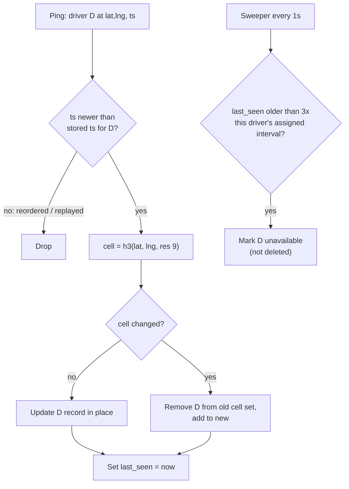

**Data structure — two maps per cell shard:**

```text
drivers : driver_id → {lat, lng, heading, cell, state, last_seen, state_ver, assigned_interval}
cells   : cell_id   → set<driver_id>
```

**Why updates are cheap:** a car at 30 km/h (8.3 m/s) takes ~45 s to cross a ~375 m hex. With a 4 s ping, it changes cell about **every 10th ping**; a parked car never. So **~90%+ of updates are in-place field writes**, no set moves. One process per city handles it; you split big metros into sub-cells for **blast radius and deploy safety**, not for throughput.

### Why not PostGIS / a geo-enabled database?

Not because queries are slow — because they are **durable**. Every ping would pay for a WAL write and replication. Postgres also never overwrites a row in place: an `UPDATE` writes a **new row version** and leaves the old one as a **dead tuple** that `VACUUM` must later reclaim. At 1.25M/s that is ~1.25M dead tuples/sec, so tables and indexes bloat faster than autovacuum can clean them, all for values that are stale 4 s later. At 1.25M/s the WAL alone is the ~39 TB/day line.

> **General principle:** when **update rate × value lifetime** is small, you want a **cache rebuilt from the source**, not a database. Restart cost = one ping interval of degraded matching — cheaper than durability.

**Example [Guide]:** Index process for Pune crashes at 18:00:00. New process starts at 18:00:02. By 18:00:06, every online driver has sent at least one ping → index fully rebuilt. Total cost: ~4 s of slightly worse matching in one city.

### Two things the index must still get right

**1. Last-writer-wins on client timestamp, bounded by server time.**
Mobile networks deliver batches out of order after reconnects → order by the phone's GPS timestamp. But phone clocks drift (and some drivers set them wrong on purpose) → **reject timestamps more than a few seconds in the future** relative to server receipt time.
- *Example:* Server time 10:00:00. Ping says ts=10:00:30 → rejected (30 s in the future). Otherwise that driver's next 30 s of real pings would all look "older" and be dropped.

**2. Expire to "unavailable," never to "deleted."**
Driver in a tunnel keeps their record; they're just not dispatchable. Deleting loses `state_ver`, and a stale in-flight offer could **resurrect** an assignment against a fresh record.

**The expiry threshold is per driver, not global.** With adaptive ping rates (§7), a parked driver pings every 20 s. A global "3 × 4 s = 12 s" TTL would expire **every parked driver** → the index reports a supply collapse → surge happily raises prices on a fake shortage. Store `assigned_interval` on each record and expire at `3 × assigned_interval`.

---

### Beginner follow-up notes: the index [Guide]

#### "The index is a cache of a stream": what it means
- **Stream** = the non-stop flow of GPS pings (one per driver every 4 s).
- **Index** = the in-memory map of "which driver is in which hex right now."
- **Cache** = a temporary copy that you can throw away and rebuild.
- **The pings are the truth; the map is a copy.** Lose the map, and the next pings rebuild it in about 4 s.
- Analogy: a **cricket scoreboard**. If it breaks, you don't need old records; the next ball shows the current score.

**One driver's pings through the index:**

| Time | Ping from Driver D | What the index does |
|---|---|---|
| 10:00:00 | at hex A | update position, last_seen = 10:00:00 |
| 10:00:04 | still hex A | update position only (~90% of pings) |
| 10:00:08 | now hex B | remove D from A, add to B |
| 10:00:06 (arrives late) | hex A | older than 10:00:08 → thrown away |
| 10:00:08 → 10:00:20 | silence (tunnel) | sweeper: quiet 12 s → unavailable |

**The two maps:**
```
drivers["D7"]   = { 12.97, 77.59, heading north, hex 8961…, available, last_seen 10:00:08 }
hexes["8961…"]  = { D7, D12, D40 }
```
"Who's in this hex?" → `hexes`. "Where is this driver?" → `drivers`.

**Why one machine per city is enough:** ~60k pings/s, and ~90% don't change hex, so they're tiny in-memory writes. Big cities are split anyway, but **for blast radius** (a crash hits only part of the city) and **safer deploys**, not for speed.

#### Why not PostGIS: what "durable" costs
PostGIS = PostgreSQL plus map features. The problem isn't query speed; it's that a database **promises never to lose data**, so every write pays for 3 jobs:

| Job | Plain meaning | Like |
|---|---|---|
| **WAL** (write-ahead log) | write the change to a diary on disk first | noting it in a notebook before doing it |
| **Replication** | send copies to 2 other machines | 2 photocopies |
| **Vacuum** | clean up old row versions | erasing crossed-out lines |

**Why vacuum is needed (not in the blog; standard Postgres behaviour, MVCC):** an `UPDATE` doesn't change a row in place. Postgres writes a **new copy** and marks the old one **dead**; VACUUM removes the dead copies later. One driver pinging every 4 s creates **15 dead rows per minute**; at 1.25M/s the cleaner can't keep up, so tables bloat and queries slow down.

**Driver D for 1 minute:** 15 pings → 15 diary writes, 30 copies, 14 dead rows. What we needed was just **the latest 1**. Worse, a copy can arrive **after the next ping**, already out of date ("useful life shorter than replication lag").

| | Database | In-memory index |
|---|---|---|
| Every ping | diary + 2 copies + cleanup | overwrite in memory |
| After a crash | recover from disk | next pings rebuild it in ~4 s |
| Cost of a crash | none | ~4 s of worse matching in one city |

**Rule:** *how often it changes × how long it stays useful.* Small → cache; large → database.

| Data | Changes | Useful for | Where |
|---|---|---|---|
| Driver ping | every 4 s | 4 s | **cache** |
| Trip | a few times per trip | years (money, legal) | **database** |

> *Interview:* "Not PostGIS, because every ping would pay for WAL, replication and vacuum on a value replaced in 4 s. Why vacuum? Postgres updates create a new row version, and vacuum cleans the old ones, so high-frequency updates cause heavy cleanup."

#### The 3 safety rules, explained with examples

**Rule 1: the newest GPS time wins, but reject future times.**

| Arrives at server | GPS time | Location |
|---|---|---|
| 1st | 10:00:08 | hex B (new) |
| 2nd | 10:00:04 | hex A (old) → **dropped** |

"Last arrived wins" would make the driver jump back to A, so order by GPS time. But if a phone clock says **10:05:00** when the server says **10:00:00**, every real ping for 5 minutes looks "older" and the driver is **frozen** on the map. So reject anything more than ~5 s in the future.

```
if ping.time > server_now + 5 s → reject
if ping.time <= stored time     → reject (old)
else                            → accept
```

**Rule 2: mark unavailable, never delete.** `state_ver` = a counter that goes up every time the driver's state changes; every offer remembers the `state_ver` it was made at.

| Time | Event | state_ver |
|---|---|---|
| 10:00 | Offer X sent to D | 12 |
| 10:00 | D enters a tunnel | 13 (unavailable) |
| 10:02 | A delayed "accept offer X" arrives | — |

- Record kept: "X was made at 12, D is at 13" → stale → **rejected** ✓
- Record deleted: a fresh record has no memory → accept **goes through** → D is assigned to a 2-minute-old trip that may belong to someone else ✗

**Rule 3: a per-driver "too quiet" limit.** Moving drivers ping every 4 s, parked ones every 20 s. A global 12 s limit marks every parked driver unavailable. At an airport lot with 500 parked drivers, the index sees almost no supply, so surge raises prices on a **fake shortage**. Fix: limit = 3 × that driver's interval (12 s moving, 60 s parked).

> *Interview:* "Order by client GPS time but reject future timestamps; expire to unavailable, not deleted, so state versions keep stale offers out; set expiry per driver from their assigned ping interval."

#### Partition by city, not by consistent hashing

| | Hash by driver id | **Split by city (blog)** |
|---|---|---|
| Who holds driver D? | a server picked by D's id | the server for **where D is now** |
| "Who's near me?" | ask **every** server, then merge | ask **one** server |
| Driver moves | same server | moves only when crossing a city/part border |
| One city's problem | spreads to all servers | stays in that city |

- With hashing, nearby drivers are scattered across all servers, so every search becomes a fan-out to all of them.
- With geography, a rider in Bengaluru never needs a driver in Mumbai, so one server has everything.
- Big cities are split into parts (Bengaluru North / South) **along natural barriers** (lake, highway), each with a **standby**. A **directory** says "Bengaluru North → server X." When a driver crosses, their next ping goes to the new owner.

> *Interview:* "Partition by geography, not hash. Each city (or part of a big city) is owned by one server with a standby, which holds all drivers currently there, so a nearby search never crosses servers."

### Candidate search: distance is a prefilter, ETA is the answer

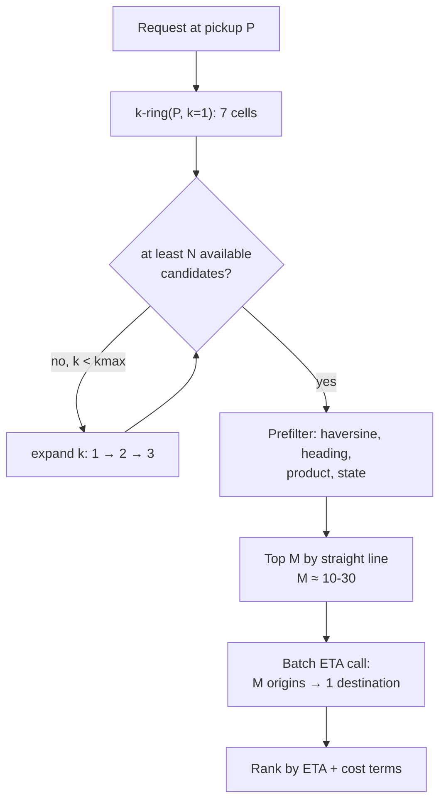

The index answers the **cheap** question (who's inside this ring). The ETA engine answers the **expensive** one (who can actually get here soonest) — for only **M** drivers. **M is the dial** trading match quality against p99 latency; ETA is usually the slowest step in dispatch.

**Worked example [Guide]:** Pickup at hex X. k=1 → 7 hexes → 4 available drivers. N=8 required → expand k=2 (19 hexes) → 15 drivers. Prefilter drops 3 (wrong product: they drive Auto, rider wants Sedan) and 2 (heading away on a one-way road). Top M=10 by straight line → one ETA call → ranked: 2.5, 3.1, 3.4… min.

### Two non-obvious ETA effects

**1. Heading matters more than distance on arterials.** A driver 200 m *past* the pickup on a one-way road may need a 2 km loop. Add a cheap "is the pickup behind me?" term (angle between driver heading and direction to pickup) in the prefilter, or you waste M slots on drivers who look close but aren't.

**2. ETA error is asymmetric.** Overestimate by 1 min → slight conversion loss. Underestimate by 1 min → cancellations and support tickets.
- **Displayed ETA** (to rider) = a **high percentile** (e.g. p80) of the predicted distribution — promise conservatively.
- **Dispatch ETA** (for ranking) = the **median** — rank by best guess.
- Two different numbers for two consumers. Teams that share one end up fighting.
- *Example:* Router predicts median 4 min, p80 6 min. Rider sees "6 min"; car arrives in 4–5 → rider is happy. Dispatch ranks this driver at 4 min vs another at 5 min.

### Hot cells (airports, stadiums)

Hundreds to thousands of drivers in a handful of hexes. The **shard is fine**; the problem is that **every request in the area gets the same 30 candidates** and they all race for the same drivers.

Mitigations that matter **more than sharding**:
- **Queue-based dispatch** for designated zones: airports run a **FIFO driver queue** in a staging lot — a separate, trivial matching mode with a different fairness rule (first in, first served).
- **Batched matching** (§8): turns the race into an optimisation problem.

#### How a hot cell actually fails (no single component is overloaded)

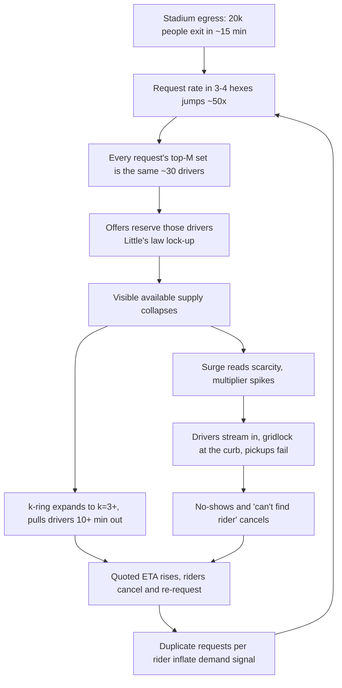

**The arithmetic:**
- 20,000 attendees × 15% hailing = 3,000 requests over 15 min (900 s) → **~3.3 requests/s**. Trivial for a server.
- Drivers know the curb is jammed → accept rate p ≈ 0.3 → each request burns **1/0.3 ≈ 3 offers** → **~10 offers/s**.
- Little's law: 10 offers/s × 6 s mean dwell = **~60 drivers locked** in offers at any instant.
- Of 300 staged drivers, **20% of visible supply** is held by offers that mostly get declined — before counting drivers already en route.

> The cascade is **feedback between correct components**: index, dispatch, surge each do their job. So the fixes are **policy switches** keyed off an **event calendar** and a **density detector**, not more servers.

| Signal (per res-9 cluster) | Illustrative threshold | Switch |
|----------------------------|------------------------|--------|
| Requests/min ÷ available drivers | > 0.5 sustained 2 min | Force **batched mode**, W up to ~5 s |
| Duplicate-request ratio per rider | > 1.3 | **Collapse re-requests** into the existing one; don't re-queue |
| Candidate-set overlap (Jaccard of top-M across requests) | > 0.6 | **Cap concurrent offers** per driver pool; **shorten T** |
| Known venue + calendar event | Scheduled | **Pickup-zone geofence, FIFO staging queue, walk-to-pin suggestions** |

**Jaccard overlap explained:** for two requests' candidate sets A and B, `|A∩B| / |A∪B|`. If request 1's top-30 and request 2's top-30 share 24 drivers → 24/36 ≈ 0.67 → they're fighting over the same pool.

**The underrated move — pickup zones:** relocating pickups **300 m to a designated lot** turns a **road-capacity problem** at the curb (which no algorithm can solve — the cars physically can't get there) into a **queue problem** that FIFO solves trivially.

---

## 7. Deep dive — the location firehose

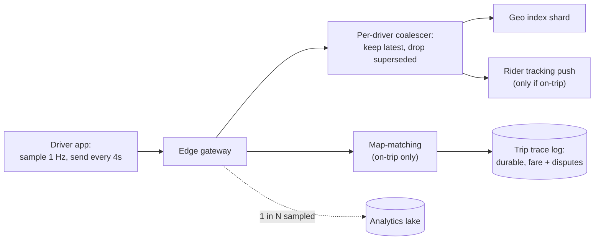

### The one rule: latest value wins, backlog is poison

This is the **opposite** of most event pipelines. If ingest falls 30 s behind, you do **not** want to process those 30 s faithfully — you want to throw away everything but each driver's newest ping.

A standard durable log with consumer groups does the **wrong** thing: under load it preserves the backlog, the index lags further, and dispatch assigns drivers based on where they were 30 s ago. **Consumer lag metrics say "we're catching up" while the product is broken.**

**Example [Guide]:** A driver moves 250 m in 30 s at 30 km/h. With a 30 s backlog, the map shows them across the intersection they already passed. Dispatch offers them a pickup "200 m ahead" that's actually behind them.

### The coalescing buffer

```text
latest : driver_id → newest ping      (gateway overwrites)
dirty  : set<driver_id>               (gateway adds; index consumer drains)
```

- **Memory bounded by number of drivers, not by time** → there is no backlog to accumulate.
- **Under overload**, effective sample rate = `consumer capacity / dirty drivers`. Every driver is still refreshed, just less often. **Staleness grows linearly** with overload instead of without bound.

**Example [Guide]:** City has 60k drivers pinging every 4 s = 15k/s. Index consumer can only do 7.5k/s (2× overload). Queue: backlog grows 7.5k/s forever → minutes stale. Coalescer: each driver refreshed every ~8 s instead of 4 s. Degraded, but bounded.

### Two tempting substitutes that **don't** work

| Idea | Why it fails |
|------|--------------|
| **Kafka log compaction** | Compaction runs **in the background on closed segments**. A real-time consumer reads the **active head** linearly and sees every record. It bounds **disk**, not **consumer lag** |
| **"Seek to latest" on lag** | Fixes the index but **silently drops on-trip pings that are fare evidence**. If index and trace share one log, the recovery action for one consumer is **data loss** for the other → split the paths **at the gateway** |

### The right metric

> **Alert on index age** — p99 of `now − last_seen` across **dispatchable, moving** drivers, per cell. **Not consumer lag.** Lag is zero on a coalescer by construction; age is what dispatch actually experiences.

### What goes to the durable log (the minority with lasting value)

- **On-trip pings** — evidence for the **fare** (distance + time), disputes, safety investigations. **Map-matched** (snapped to roads with an HMM-style matcher to kill GPS jitter) and written durably. Roughly the on-trip fraction of online time (~40–60%), but **written per trip and compressed**, not as a raw stream.
- **Sampled idle pings** — supply heatmaps, ETA model training. **1-in-10 sample** is usually indistinguishable from the full stream for these.

**HMM map-matching explained [Guide]:** GPS says the car is 15 m off the road, between two parallel streets. The matcher considers "which road was it on?" for each point and picks the sequence of roads that is most plausible overall (connected roads, realistic speeds). Result: a clean route for the fare.

### Cost: the firehose is a driver-hour tax

Firehose cost = **drivers online × ping frequency**, independent of trips. In a slow hour you pay nearly full firehose cost for few trips → cost per trip **spikes exactly when revenue per trip falls**.

**Biggest lever — adaptive ping rate** (server tells each driver their interval):

| Driver state | Interval | Why |
|--------------|----------|-----|
| Idle, stationary (speed ≈ 0 for 30 s) | 15–30 s | Position isn't changing |
| Idle, moving | 4 s | Dispatch candidate; freshness matters |
| En route to pickup | 2 s | Rider is watching the car |
| On trip | 4 s, with 1 Hz buffered locally | Fare evidence uploaded in batches |

**Do the arithmetic before promising savings:**
- Drivers idle 50% of online time; stationary for 40% of that idle time.
- Moving stationary drivers 4 s → 20 s saves `0.5 × 0.4 × (1 − 4/20) = 0.2 × 0.8 = 16%` of pings.
- The 2 s en-route rate claws some back.
- **Worth doing** (also saves driver battery & data → **supply retention**), but **not an order-of-magnitude lever**.

**The second cost term ping rate doesn't touch: connection-hours.** Every online driver holds a persistent TLS stream even when silent. Kernel + TLS buffers + app state ≈ tens of KB each → **5M connections ≈ 100+ GB of edge RAM** before a single message, plus **keepalives** to hold mobile NAT mappings open. Below some ping rate, the edge fleet is **sized by concurrent connections, not messages/sec**, and further ping reduction saves nothing. Know which regime each market is in.

**NAT keepalive explained:** mobile carriers forget idle connections after ~30–120 s. The phone must send tiny "I'm here" packets periodically, or the connection silently dies.

### Trust: the ping is adversarial input

Location is **claimed**, not measured. Incentives to spoof: appear in a surge zone, jump the airport queue, inflate trip distance. Layer **statistical** checks:

| Check | What it catches | Example |
|-------|-----------------|---------|
| **Physical plausibility** | Teleports, impossible speed | Driver jumps 8 km in 4 s (7,200 km/h) |
| **Sensor consistency** | Fake GPS apps | Real urban GPS is noisy (accuracy 15–40 m, jittery). Spoofed tracks are **too clean** — perfect lines, accuracy always 3 m |
| **Map-matching residual** | Off-road paths | Track cuts through buildings |
| **Cross-device corroboration** | Fare inflation | On trip, the **rider's phone** is an independent track; if it shows 6 km and the driver's shows 11 km → flag |

**Enforce on consequences, not in real time.** Blocking on weak signals punishes honest drivers in bad-GPS areas (downtown towers, tunnels). Instead: **flag**, **recompute the fare** from the rider-side map-matched route, **route to review**.

---

### Beginner follow-up notes: the firehose [Guide]

#### The problem statement, from zero
1. **Goal:** match the rider with a truly nearby driver.
2. **Need:** know where every driver is **right now**, so phones send a ping every 4 s.
3. **Problem:** 5M drivers → **1.25M pings/s**. When servers fall behind, pings pile up, and processing old ones makes the map **wrong**.
4. **Solution:** keep **only the newest ping per driver** and throw away the rest.

**The friend story:** your phone was off for 10 minutes, and your friend sent "at the station" (10:00), "at the market" (10:05), "at your gate" (10:10). Where are they now? At the gate. Reading the first message and running to the station is the queue way, and it's a wasted trip. Reading only the last one is the coalescer way.

| Story | Ride app |
|---|---|
| friend | driver |
| messages | pings |
| your phone was off | the server was slow |
| you | the server choosing a driver for a rider |

#### What a coalescer is: a whiteboard, not a pile of letters
- **Queue = a pile of letters.** Every ping is a new letter; the reader must open every one in order; a slow reader means a taller pile.
- **Coalescer = a whiteboard with one box per driver.** A new ping erases and rewrites that driver's box. There's always one box per driver, so it can't grow.
- **"Dirty" = a sticky note** on boxes that changed. The reader visits only boxes with a note, sends that spot to the index, and removes the note.

| Time | Happens | D1's box | Sticky note? |
|---|---|---|---|
| 0 s | ping hex A | A | yes |
| 1 s | ping hex B | **B** (A erased) | yes |
| 2 s | ping hex C | **C** (B erased) | yes |
| 3 s | reader comes | reads **C** → index | removed |

A queue does 3 pieces of work (2 useless); the coalescer does 1, and it's the right one.

**Overloaded 2× (15k pings/s in, 7.5k/s handled):**

| | Queue | Coalescer |
|---|---|---|
| After 1 min | 450k pings waiting, map 1 min stale | each driver refreshed every ~8 s |
| After 10 min | map 10 min stale | still ~8 s |

#### Do we even need Kafka? Isn't it Redis directly?
- **The map does not need Kafka.** The blog mentions Kafka only to say *don't put it between phones and the map*, because it keeps every old ping in line.
- **Phone → server → Redis `GEOADD`** is fine for a first version. Redis overwrites the old position, so it's already latest-wins.
- **Why the blog goes further (in-memory map per city):**

| Redis directly | Map inside the city's server |
|---|---|
| a network trip per ping | a memory write (faster) |
| a shared Redis means a slow Redis hurts **all** cities | each city is isolated |
| a slow Redis makes write requests **queue up** in front of it | the coalescer overwrites, so no queue forms |
| GEO radius only | custom logic: hexes, heading, state |

#### The two "easy Kafka fixes" that don't work
Kafka = a **big notebook**; readers go page by page; lag = pages behind.

1. **Compaction** ("keep only the latest per key") is a cleaner who tidies **old finished pages later**. The page being read right now still has every message, so it saves **disk**, not **reading time**.
2. **Seek to latest** ("jump to the last page") makes the map fresh again, but the **same notebook feeds the fare**. You (the map) need only the last message; the accountant (the fare) needs every message to compute distance. Skipping 30 s loses ~250 m of route, so the fare is wrong and there's no dispute proof.

**Real fix: split at the gateway.**
```
                     ┌──► coalescer ──► in-memory map (per city)   ← NO Kafka
Phone ──► Gateway ───┤
                     ├──► Kafka ──► fare trace (on-trip only)     ← Kafka
                     └──► Kafka ──► analytics (1 in 10)           ← Kafka
```
Note: the blog's diagram draws map-matching coming out of the coalescer, but its text says "split at the gateway." In an interview, branch the fare path at the gateway.

#### Kafka, compaction and Flink: who does what
(The blog doesn't name Flink; this is a common way to build it. Uber publicly uses Kafka and Flink.)

| Data | Tool | Why |
|---|---|---|
| Live driver location | coalescer + in-memory map | only the newest matters |
| On-trip pings (fare) | **Kafka (keep all) + Flink** | every point is needed; Flink groups by trip and map-matches |
| Sampled idle pings | Kafka + Flink → lake | heatmaps, ML |
| Latest-per-key state (surge map, config, driver settings) | **Kafka with compaction** | keep only the latest value, durably |

**Never compact trip pings:** `A → B → C → D → E` compacted is just `E`. The route is gone.

#### Index age vs consumer lag

| Measure | Asks | Friend version |
|---|---|---|
| Consumer lag | how many messages are **waiting in line**? | how many **unread** messages? |
| **Index age** | how **old** is the location we hold? | how long ago was the friend's **last** message sent? |

A coalescer has no line, so **lag is always 0**. If a gateway breaks and pings stop, lag says "0, all good" while age says "40 s, alarm."

Decoding *"p99 of now − last_seen across dispatchable, moving drivers per cell"*:
- **now − last_seen** = the age of each driver's location
- **p99** = 99% of drivers are fresher than this
- **dispatchable** = skip offline and on-trip drivers
- **moving** = skip parked drivers (they ping every 20 s on purpose)
- **per cell** = per city/part, so one bad area isn't hidden by the healthy ones

Alarm example: normal ≈ 5 s, warn > 10 s for 1 min, page > 15 s.

#### Which pings we keep forever

| Pings | Kept? | Where | Why |
|---|---|---|---|
| Idle pings (most) | no, gone after seconds | coalescer → map | only "now" matters |
| **On-trip pings** | **all**, forever | map-matching → trip trace | fare, disputes, safety |
| 1 in 10 idle pings | a sample | analytics lake | heatmaps, ETA training |

- **Map-matching:** GPS wobbles around the road, and joining raw points adds fake distance (a 10 km trip measures 11.2 km, so the rider is overcharged). Snapping points onto the real road gives 10 km. "HMM-style" = choose the route that makes sense **overall** (connected roads, realistic speed), not point by point.
- **Stored per trip, compressed:** the phone records at 1 Hz, uploads in batches, and the server saves one compressed route per trip.
- **1-in-10 sample = an opinion poll:** 6,000 drivers give the same heatmap as 60,000.

#### WebSocket in plain words (blog: "persistent connection, not REST")
- **REST** = sending a letter: open, send, close. The server **can't reach** the driver unless the driver asks first.
- **WebSocket / gRPC stream** = a phone call that stays on. Pings go up, and **offers come down instantly** on the same line.
- That matters because an offer has a ~15 s timeout, so the server must **push** it immediately.

---

## 8. Deep dive — dispatch and matching

### Greedy versus batched

Two requests 500 ms apart, two drivers:

| | Driver X | Driver Y |
|---|----------|----------|
| **Request A** (first) | 2 min | 3 min |
| **Request B** (second) | 3 min | 10 min |

- **Greedy:** A arrives → best is X (2). B arrives → only Y left (10). **Total 12 min**, and B probably cancels.
- **Batched:** consider both: A→Y (3) + B→X (3) = **6 min**. Half the total wait, nobody waits 10.

Greedy is locally optimal and **globally poor whenever candidate sets overlap** — exactly the high-demand situation you care about.

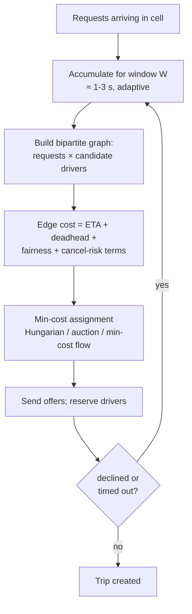

### The window W

Batching **adds W** to every rider's wait in exchange for better assignments.

> **Rule:** batch when the **expected ETA improvement exceeds W**.

| Situation | Candidate overlap | W |
|-----------|-------------------|---|
| Sparse suburb, 3 a.m. | Rare | **→ 0 (greedy)** |
| Dense downtown, 6 p.m. | Everywhere | **~2 s**, routinely buys back tens of seconds |

Make W a **function of measured request density per cell**, not a global constant.

### The offer loop is the real latency term

Accept probability per offer = p, timeout = T. Expected offers per request = 1/p. Each decline that arrives as a **timeout** (driver ignored it) costs the full T.

Expected wasted time ≤ `(1 − p)/p × T`. At p = 0.7, T = 15 s: `0.3/0.7 × 15 ≈ 6.4 s` per trip — **several times any sensible W**.

**Levers, by payoff:**
1. **Shorten T** — drivers who will accept usually do so in a few seconds.
2. **Put decline probability in the cost function** — solver prefers drivers likely to say yes.
3. **On timeout, re-enter the next batch immediately** — don't re-run a fresh search from scratch.

### Beginner follow-up notes: batching and the offer loop [Guide]

#### What batching actually does
**Without batching (greedy): decide each request alone, instantly.**
```
10:00:00.0  Rider A books → decide NOW → A gets the closest driver (X)
10:00:00.5  Rider B books → decide NOW → only Y left (10 min away)
```
When it chose for A, the system **didn't know B was coming**.

**With batching: wait a moment, put requests in a basket, decide together.**
```
10:00:00.0  Rider A books → into the basket
10:00:00.5  Rider B books → into the basket
10:00:02.0  Basket closes → look at A and B TOGETHER → A gets Y (3), B gets X (3)
```

| | Greedy | Batching |
|---|---|---|
| When it decides | the instant a rider books | every W seconds, for everyone in the basket |
| What it sees | 1 rider | all riders in the basket |
| Result | first rider happy, second stuck | everyone gets a reasonable driver |

- **Analogy:** a waiter who runs to the kitchen after every single order, versus a waiter who takes the whole table's order and then goes once.
- **"Bipartite graph"** = a table of riders × drivers with a cost (mostly ETA) in each box. **"Hungarian / auction / min-cost flow"** = ready-made library algorithms that pick the lowest-total pairing.
- **The price:** every rider waits W longer. Worth it only when busy (riders compete for the same drivers). In a quiet area W = 0.

> *Interview:* "Greedy is locally best but globally poor when candidate drivers overlap. I batch requests for a short window W and solve a min-cost assignment. W adapts per area: about 0 when quiet, about 2 s when busy."

#### The offer loop: where the waiting really comes from
**What an offer is:** the driver's phone shows "New trip, 3 min away, accept?" with a countdown (T = 15 s). The driver can **tap Accept**, **tap Decline** (fast), or **ignore it** (we wait the full 15 s).

**p = the chance a driver accepts.** p = 0.7 means 7 of 10 drivers say yes.
- Average offers per trip = **1/p** = 1/0.7 ≈ **1.4**
- Failed offers per trip = **(1 − p)/p** = 0.3/0.7 ≈ **0.43**
- If each failure is an ignore: 0.43 × 15 s ≈ **6.4 s wasted per trip** (an upper bound, because tapped declines are faster)

That's **3× more** than the 2 s batch window. **The offer loop, not batching, is the big delay.**

**Example timeline (one ignored offer):**
```
0.0 s   rider books
2.0 s   batch window ends, solver picks Driver X
2.3 s   offer shown to X
17.3 s  X ignored it → timeout (15 s lost)
17.5 s  request goes into the next batch → Driver Y chosen
21 s    Y accepts → confirmed
```

**Three levers, best first:**

| Lever | Change | Wasted time (p = 0.7) |
|---|---|---|
| Baseline | T = 15 s | 0.43 × 15 ≈ **6.4 s** |
| **1. Shorten T** | T = 8 s (drivers who accept usually do so in a few seconds) | 0.43 × 8 ≈ **3.4 s** |
| **2. Prefer drivers likely to say yes** | decline probability in the cost, p rises to 0.85 | (0.15/0.85) × 15 ≈ **2.6 s** |
| **3. On timeout, go straight into the next batch** | don't restart the whole search | saves the re-search time |

> *Interview:* "The biggest latency is the human offer loop, not the batch window. At 70% accept and a 15 s timeout, failed offers waste up to about 6 s per trip. I'd shorten the timeout, add decline probability to the cost, and on timeout re-enter the next batch immediately."

### Latency budget (one declined offer, dense market, illustrative)

| Step | Who | ~Time |
|------|-----|-------|
| Create trip + enqueue | Server | 50 ms |
| Batch window W | Server | ~2,000 ms |
| Index k-ring + prefilter | Server | 20 ms |
| One-to-many ETA (M=20) | Server | 150 ms |
| Solve assignment | Server | 20 ms |
| **Offer 1:** push + driver decides → declines | Human | ~6,000 ms |
| Decline → next batch | Server | ~1,000 ms |
| ETA refresh + re-solve | Server | 150 ms |
| **Offer 2:** push + driver accepts | Human | ~3,000 ms |
| CAS → ACCEPTED | Server | 30 ms |
| **Total** | | **~12.5 s** |

Server compute (index, ETA, solve, CAS) is **under half a second**. The **human in the loop is >70%** of the wall clock, the batch window most of the rest.

> Cutting ETA p99 from 150 → 80 ms is invisible to the rider. Cutting **one expected decline** is worth **seconds**. Spend engineering accordingly.

#### Beginner notes: where the 12.5 seconds go [Guide]
Blog's illustrative timeline: rider books → **one driver declines** → second driver accepts.

| Step | Who | Time |
|---|---|---|
| Create trip, put in queue | server | 80 ms |
| **Batch window W** (wait for the basket) | waiting | **2,000 ms** |
| Find nearby hexes + filter | server | 20 ms |
| ETA for 20 drivers | server | 150 ms |
| Solver picks pairs | server | 30 ms |
| **Driver 1 looks, then declines** | **human** | **6,000 ms** |
| Decline → wait for next basket | waiting | 1,000 ms |
| Refresh ETA + solve again | server | 200 ms |
| **Driver 2 looks, then accepts** | **human** | **3,000 ms** |
| Save ACCEPTED (CAS) | server | 40 ms |
| **Total** | | **≈ 12.5 s** |

```
Humans deciding   █████████████████████████████████████  9.0 s  (72%)
Waiting (baskets) ████████████                           3.0 s  (24%)
Server computing  ██                                     ~0.5 s  (4%)
```

- The **computer work is tiny** (~0.5 s); **drivers deciding is most of the time** (9 s).
- Making ETA faster (150 → 80 ms) saves **0.07 s**, which no rider notices.
- **Avoiding one decline** saves **~7 s** (6 s deciding + 1 s re-batching).
- **Lesson:** don't optimise the fast parts. Work on **fewer declines** (pick drivers likely to say yes, show better offers) and **shorter timeouts**.

> *Interview:* "In the budget, server compute is under half a second, while drivers deciding is over 70% of the ~12.5 s. Shaving ETA latency is invisible to riders; avoiding one decline saves seconds. So I'd invest in accept rate and timeouts."

### The hidden supply cost: drivers locked in offers

A reserved driver is invisible to every other request. **Little's law:** `locked drivers = offer rate × mean dwell`.
- City: 50 offers/s × 6 s = **~300 drivers hidden** — noise across a metro.
- Stadium cluster with a few hundred available drivers: a **large fraction** of apparent supply is tied up in offers that mostly get declined, and **surge (which counts available supply) reads the lock-up as scarcity**.

**Short timeouts pay twice:** less rider wait *and* less hidden supply.

#### Beginner notes: "hidden drivers" (Little's law) [Guide]
**While a driver is looking at an offer, nobody else can get them.** They are "reserved," so for every other rider that driver is **invisible**.

**Little's law in plain words:** *how many are inside = how many arrive per second × how long each stays.*
- Supermarket: 2 people enter per minute and each stays 10 min → about **20 people inside** at any moment.
- Offers: 50 offers per second, each driver stuck looking for 6 s → about **300 drivers hidden** at any moment.

| Place | Free drivers | Hidden in offers | Hidden share |
|---|---|---|---|
| Whole city | ~50,000 | ~300 | **0.6%**, no problem |
| Stadium after a concert | ~300 | ~60 (10 offers/s × 6 s) | **20%**, a big problem |

**Why it's dangerous at a stadium:**
1. Many offers go out, but drivers near jammed roads mostly **say no**.
2. While they think, they're hidden, so the app sees **fewer free drivers**.
3. **Surge** counts free drivers, sees "shortage!", and **raises the price**, even though the drivers are right there.

**Short countdown = 2 wins:**

| Countdown | Hidden drivers (10 offers/s) | Rider waits on a "no reply" |
|---|---|---|
| 15 s (avg look 6 s) | ~60 | 15 s |
| 8 s (avg look ~4 s) | ~40 | 8 s |

> *Interview:* "Reserved drivers are invisible to other requests. By Little's law, hidden drivers = offer rate × time spent on an offer. Across a city it's noise, but in a stadium cluster it can hide 20% of supply, and surge misreads that as scarcity. Short timeouts cut both rider wait and hidden supply, and surge should count offer-locked drivers as partly available."

**How the hidden-driver problem is solved:**

| Fix | How it helps | Source |
|---|---|---|
| **Shorter countdown (T)** | each driver is hidden for less time | blog |
| **Offer to drivers likely to say yes** | fewer wasted offers, so fewer hidden drivers | blog |
| **Cap offers at once in a hot area** | don't lock 30 drivers for 10 riders | blog (hot-cell table) |
| **Batched mode** | one solver hands out drivers, so requests don't race for the same ones | blog |
| **Merge duplicate requests** | a rider tapping "book" 3 times makes 1 request, not 3 | blog (hot-cell table) |
| **Pickup zone + FIFO queue at venues** | drivers wait in a lot in order, with no offer racing | blog |
| **Surge counts offer-locked drivers as partly available** | surge isn't fooled into a fake shortage | guide (the blog raises it as a review question) |

### Problem size is small

Graph is **sparse and local**: a few hundred requests × a few thousand drivers per window per city, each request connected to at most M drivers. Even O(n³) Hungarian is fine; auction / min-cost flow on the sparse graph runs in **milliseconds**.

### The cost function is where product policy lives

```text
cost(request r, driver d) =
      w1 · ETA(d → r.pickup)
    + w2 · deadhead_km(d)
    + w3 · P(d declines)              # from recent accept rate
    + w4 · P(rider cancels | ETA)
    + w5 · destination_mismatch(d)    # driver wants to head home
    + w6 · fairness_penalty(d)        # e.g. driver idle a long time → lower cost
```

**The fairness trap:** using decline probability means drivers with high decline rates get **fewer offers** → fewer chances to accept → rate looks worse → even fewer offers. A self-reinforcing loop. Needs a fairness term or caps.

**Every term is a lever someone will ask you to explain** to a regulator or a driver advocacy group. **Log the cost components of every assignment**, not just the result.

#### Beginner notes: the cost function, or what "best driver" means [Guide]
The solver needs **one number per (rider, driver) pair**, where lower is better. That number is the **cost**. The blog's terms:

| Term | Plain meaning | Why it's there |
|---|---|---|
| **ETA** | minutes to reach the rider | riders hate waiting |
| **Deadhead** | km the driver drives empty (unpaid) | driver earnings |
| **Decline chance** | how likely this driver says no (from recent history) | a "no" wastes seconds and hides the driver |
| **Rider cancel risk** | a longer ETA makes the rider more likely to cancel | lost trips |
| **Destination** | the driver wants to head home | match trips going their way |

**Worked example (made-up weights):** `cost = ETA + 0.5 × deadhead_km + 6 × decline_chance`

| | ETA | Deadhead | Decline chance | Cost |
|---|---|---|---|---|
| Driver X | 3 min | 1.0 km | 50% | 3 + 0.5 + 3.0 = **6.5** |
| Driver Y | 4 min | 1.2 km | 10% | 4 + 0.6 + 0.6 = **5.2** ✓ |

Y is 1 minute farther but **likely to say yes**. X would probably decline, costing ~6 s and then re-offering anyway.

**The fairness trap:** a driver who declined a lot last week gets a high decline chance, so they get fewer offers, so they have fewer chances to accept, so their record stays bad. It's a loop that starves them.
Fixes: cap the penalty, let old history fade, and guarantee a minimum number of offers.

**Explain every decision:** regulators and driver groups will ask *"why did driver Z not get this trip?"* So log each assignment's **parts**, not just the winner:
```
batch=8812 rider=R5  chosen=Y
  X: eta=3.0 deadhead=0.5 decline=3.0 total=6.5
  Y: eta=4.0 deadhead=0.6 decline=0.6 total=5.2
  weights=v14 solver=auction-v3
```

> *Interview:* "The cost function is where product policy lives: ETA plus deadhead, decline probability, cancel risk and destination terms. Decline probability can create a fairness loop, so I'd cap it and decay history. I'd log the cost components of every assignment so any decision can be reproduced and explained."

### Exactly one driver, one trip

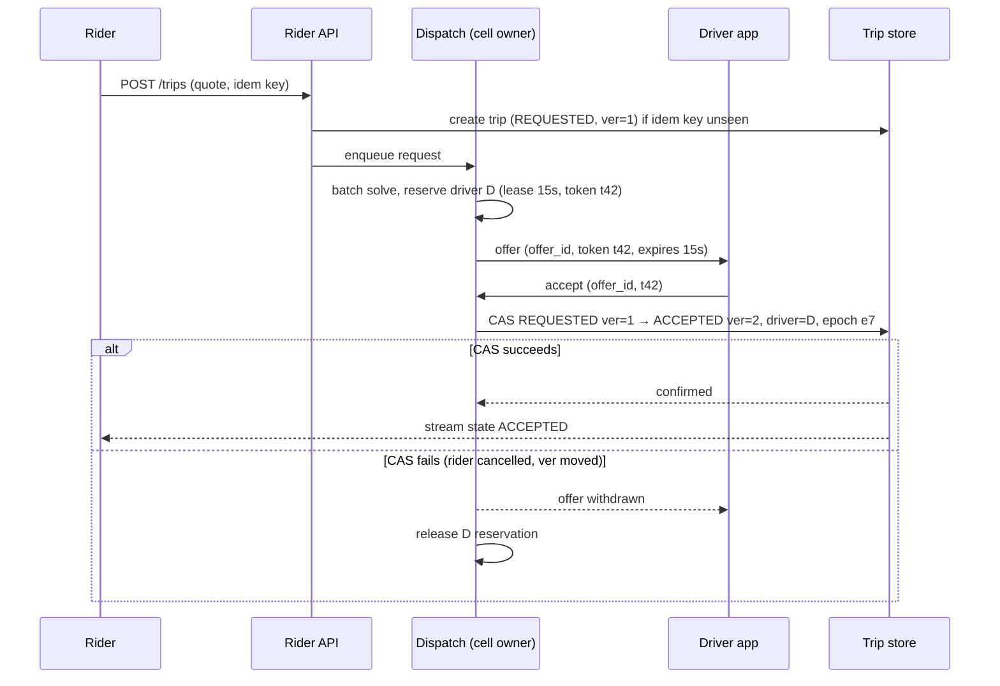

**Three mechanisms, each necessary:**

| Mechanism | What it is | What breaks without it |
|-----------|------------|------------------------|
| **Single writer for reservations** | Within a cell, one dispatch process owns `driver → reservation`. No distributed lock because there is no distribution. Failover uses a **lease + fencing epoch (e7)** checked by the trip store on every write. Separately, the **per-offer token (t42)** identifies the offer so a **late accept** for an expired/superseded offer is rejected by dispatch | Two processes reserve the same driver → double assignment |
| **Reservation as a lease, not a flag** | Offer reserves the driver **for the offer timeout**. Phone dies → lease expires → driver returns to the pool | "Driver online but never gets offers" tickets — **nothing errors**, so it's hard to detect |
| **CAS on trip version at the trip store** | Trip store is the **arbiter** between rider actions and driver actions. Exactly one wins; the loser gets current state | Rider-cancel/driver-accept race → inconsistent state |

**Epoch vs token, in plain words:** the **epoch (e7)** answers "is this dispatch process still the boss of this city?" The **token (t42)** answers "is this specific offer still valid?"

#### Beginner notes: exactly one driver, one trip [Guide]
**The goal:** a driver is never on **two trips**, and a trip never gets **two drivers**, even when things happen at the same moment.

**Three dangers, three fixes:**

| Danger | Example | Fix |
|---|---|---|
| Two riders grab the same driver | Riders A and B both get offered Driver D at once | **1. Single writer** |
| A driver stays "held" forever | D's phone dies mid-offer, and D never gets offers again | **2. Lease (a hold with a timer)** |
| Rider cancels while driver accepts | both tap in the same 0.2 s | **3. CAS on trip version** |

**1. Single writer: one dispatcher per area.** Only **one process** per city/part may reserve drivers.
- Analogy: **one ticket counter** for a show. Two people can't buy the same seat because one clerk handles every sale, one at a time.
- So there's **no distributed lock** (no "many servers asking each other for permission"); one process just decides in memory.

**2. Lease: a hold with a timer, not a yes/no flag.** An offer reserves D **for 15 s only**.
- Analogy: a **hotel room hold** that expires at 6 pm if you don't check in.

| Reservation type | D's phone dies mid-offer |
|---|---|
| Flag `reserved = true` (no timer) | D stays reserved **forever**: online but never gets offers, and **no error appears anywhere** |
| **Lease (15 s)** | after 15 s the hold **expires** and D goes back to the free pool ✓ |

**3. CAS: "update only if nothing changed since I looked."** Each trip has a version number (`ver`). Every change says *"I saw ver=1; change it to ver=2."*

| Time | Action | Expects | Result |
|---|---|---|---|
| 10:00:00.100 | Rider taps **Cancel** | ver=1 | ✓ trip → CANCELLED, ver=2 |
| 10:00:00.150 | Driver taps **Accept** | ver=1 | ✗ rejected (it's ver=2 now) → driver sees "Rider cancelled" |

Exactly **one wins**, with no need for the two phones to talk to each other. The **trip store** (database) is the referee, not dispatch.

**Two ids on every offer:**

| Id | Question it answers | Analogy | Stops |
|---|---|---|---|
| **Epoch (e7)** | Is this dispatcher still the boss of this city? | the manager's badge number | an old, replaced dispatcher confirming trips |
| **Offer token (t42)** | Is this exact offer still valid? | a ticket number | a late "accept" for an expired or replaced offer |

**The whole flow:**
```
Rider books      → trip saved: REQUESTED, ver=1        (idempotency key stops duplicates)
Dispatch solves  → reserves D (lease 15 s, token t42)
Offer to D       → D taps Accept (t42)
Dispatch checks  → t42 still valid?  yes
Trip store CAS   → REQUESTED ver=1 → ACCEPTED ver=2, driver=D, epoch e7
   success       → rider sees "Driver on the way"
   fail          → offer withdrawn, D's hold released
```

> *Interview:* "Three mechanisms. A single writer per cell owns reservations, so no distributed locks. Reservations are leases, so a dead phone frees the driver automatically. And the trip store does compare-and-set on the trip version, so a rider cancel and a driver accept racing each other resolve to exactly one winner. Offers carry a token to reject late accepts, and writes carry the owner's epoch to fence out a replaced dispatcher."

### Dispatch takeover — where fencing earns its keep

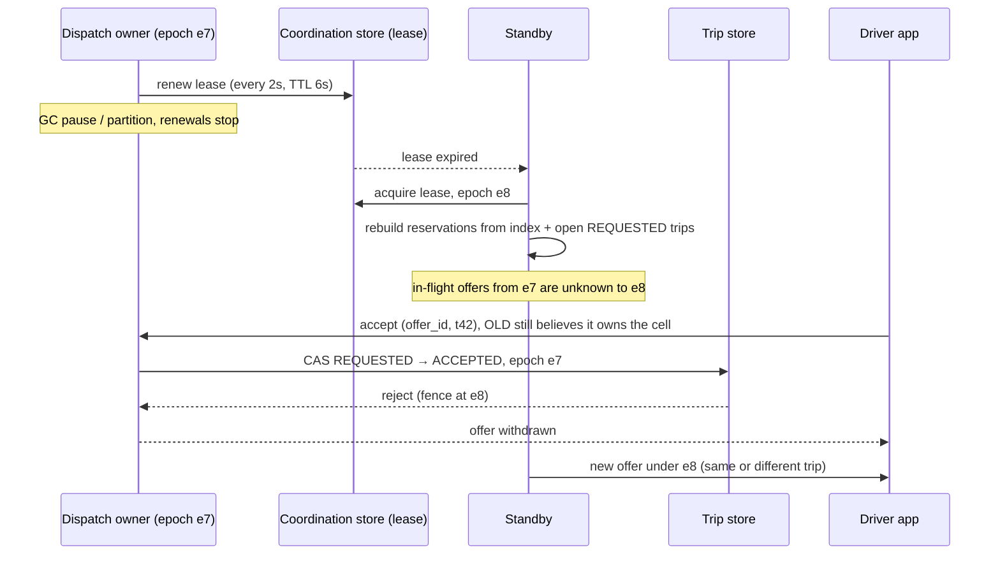

**Two consequences to design for:**
1. **Rebuild window.** The standby doesn't know which drivers held offers under e7. For up to one offer timeout it may re-offer a driver still looking at a dead e7 offer. → **Driver app treats a new offer as superseding any older one, keyed by epoch.**
2. **Lease TTL = unavailability floor.** TTL 6 s → a dead owner means ~6–8 s of **no new assignments** in that cell. Shorten TTL **below** the process's p99.9 GC/network pause → pauses become **spurious failovers**, each dropping every in-flight offer. → **Measure pause distributions first**; prefer a runtime with bounded pauses (e.g. Go, Rust, or a JVM with a low-pause collector) for dispatch.

**Example [Guide]:** Dispatch on a JVM with p99.9 GC pause of 4 s and lease TTL 3 s → several false failovers a day, each dropping ~hundreds of in-flight offers. Fix: TTL 6 s, or switch collector so p99.9 pause < 200 ms, then TTL can drop safely.

#### Beginner notes: the whole "exactly one" solution in two pictures [Guide]

**Picture 1: normal day, three locks in a row.**
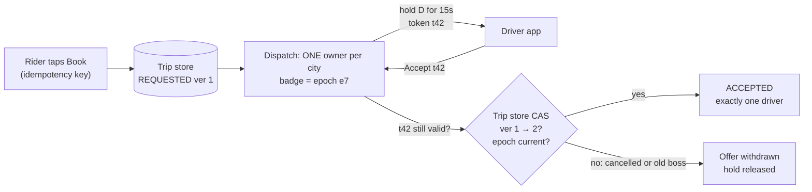

| Lock | Stops |
|---|---|
| Idempotency key | a double tap creating 2 trips |
| Single owner + lease (t42, 15 s) | 2 riders grabbing 1 driver; a dead phone holding a driver forever |
| CAS on version + epoch check | cancel vs accept races; an old dispatcher confirming trips |

**Picture 2: the dispatcher freezes, and a backup takes over.**
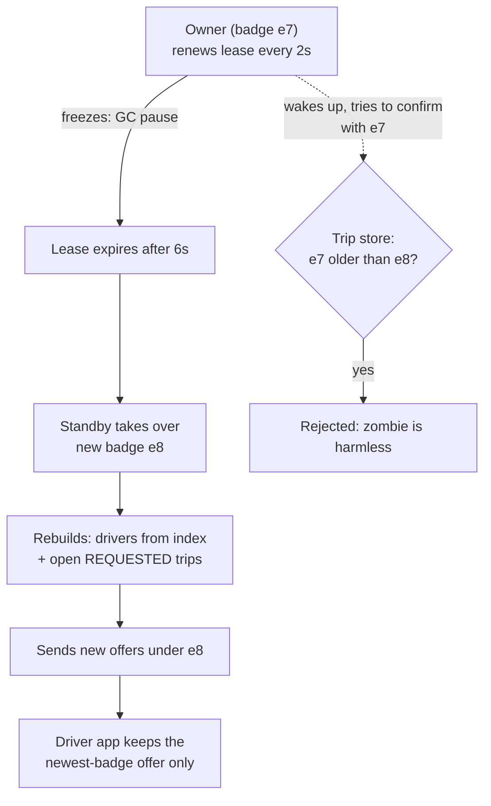

**The takeover in plain words:**
- **The problem:** the owner freezes (a garbage-collection pause or a network cut). Nobody can assign drivers in that city, so a backup must take over. But the old one might **wake up still thinking it's the boss**.
- **Lease:** the owner must say "I'm alive" every 2 s. If it's silent for 6 s, the lease expires.
- **Fencing epoch = a badge number that goes up with every new boss** (e7 → e8). The trip store **rejects any write with an older badge**.
- Analogy: a shift manager. If the night manager badge e8 is active, the day manager's old badge e7 no longer opens the safe, even if they walk back in.

**Two side effects to design for:**

| Side effect | Example | Fix |
|---|---|---|
| **Rebuild gap:** the new boss doesn't know e7's open offers | Driver D sees an old e7 offer **and** a new e8 offer | the driver app **keeps only the newest-badge offer** |
| **Lease timer = downtime** | 6 s lease → ~6–8 s with no new assignments in that city | pick the timer carefully (below) |

**Choosing the lease timer:**

| Timer | Problem |
|---|---|
| Too long (30 s) | 30 s of no matching after a real crash |
| Too short (1 s), when the normal worst pause is 2 s | every pause looks like a crash → **false takeovers** that drop all open offers |
| **Right** | above the measured worst pause (p99.9), e.g. pause 400 ms → timer 6 s. Run dispatch on a runtime with short pauses |

> *Interview:* "The owner holds a lease it renews every 2 s with a 6 s TTL. If it stops, the standby takes over with a higher epoch, and the trip store rejects writes with a lower epoch, so a paused zombie can't confirm trips. The standby rebuilds from the index and open REQUESTED trips; the driver app keeps only the newest-epoch offer. The TTL must exceed the measured p99.9 pause, or pauses cause false failovers."

#### Beginner notes: where each piece is stored, and its key [Guide]

| Data | Stored in | Key | Value | Lost on crash? |
|---|---|---|---|---|
| Driver location | **dispatch/index memory** | `driver_id` | lat, lng, hex, state, last_seen, state_ver | fine, rebuilt from pings in ~4 s |
| Drivers per hex | **dispatch/index memory** | `hex_id` | set of driver_ids | fine, rebuilt |
| **Driver hold (reservation)** | **dispatch memory** (not Redis, not DB) | `driver_id` | offer_id, trip_id, token, expires_at, epoch | fine, the standby rebuilds |
| **Offer** | **dispatch memory** | `offer_id` | driver_id, trip_id, token, expires_at | fine, re-offered (a few seconds of wait) |
| **Trip** | **trip store DB** (strongly consistent) | `trip_id` | state, ver, driver_id, epoch, fare terms | **never lost** |
| Trip history | **trip store DB** | `(trip_id, ver)` | event type, actor, time, location | **never lost** |
| **Idempotency key** | **trip store DB**, same transaction as the trip insert | `idempotency_key` (unique) | trip_id | **never lost** |
| **Owner lease + epoch** | **coordination store** (etcd / ZooKeeper) | `/dispatch/<city-cell>/owner` | owner host, epoch, TTL 6 s | expires by design |
| Current epoch for fencing | **trip store DB** | `city_cell` | current epoch | **never lost** |
| Offer outcomes (accept/decline) | **analytics stream** (Kafka) | `driver_id` | result, time | fine, it's for ML training |

**Why holds and offers live in dispatch memory, not Redis:** one process owns the city, so a local map is enough and fast. Putting them in Redis adds a network hop and turns them back into a **distributed lock**. If dispatch crashes, holds are soft: the standby rebuilds them.

**Why the trip and idempotency key go in the DB:** money and legal records live there. The idempotency key must be saved **in the same transaction** as the new trip. A separate cache could save one without the other, which allows a double trip.

**Safety net (guide extra):** a DB rule *"one driver can have at most one active trip"* (a unique index on `driver_id` where state is active) catches any bug the other locks miss.

```sql
CREATE UNIQUE INDEX one_active_trip_per_driver
  ON trips (driver_id)
  WHERE state IN ('ACCEPTED','ARRIVED','STARTED');
```

> *Interview:* "Soft state such as locations, holds and offers lives in the cell owner's memory, keyed by driver_id and offer_id. Durable state such as trips (keyed by trip_id), events (keyed by trip_id and version) and idempotency keys lives in the strongly consistent trip store. The owner lease and epoch live in etcd or ZooKeeper, keyed by city cell."

### Cell boundaries — where single-writer leaks

A driver 50 m inside cell A is the best candidate for a request 50 m inside cell B.

| Option | How | Trade-off |
|--------|-----|-----------|
| **Overlapping boundary zones** | Both cells *see* border drivers, but only the driver's **home cell may reserve** them; the other cell sends a **reservation request RPC** to the owner | Cross-cell RPC, but rare |
| **Draw boundaries along natural barriers** | Rivers, highways, municipal lines | Cross-boundary matches are naturally rare. **Underrated**: road-graph-aligned boundaries eliminate most cross-cell traffic |

**Example [Guide]:** Split Mumbai at the harbour / creek lines rather than a straight latitude line. A straight line cuts through dense neighbourhoods; a creek already separates them on the road graph.

#### Beginner notes: city borders [Guide]
```
        NORTH (boss N)        │        SOUTH (boss S)
              Driver D •  50 m│ 50 m  • Rider R
                         border line
```
R's request goes to boss S, but the best driver D belongs to boss N, so S can't even see D. This is where "one boss per area" **leaks**.

**Fix 1, a shared border strip:** both bosses can **see** drivers in the strip, but **only the home boss can hold them**. S asks N: "can I have D for rider R?" N holds D if D is free and replies yes or no. It's an extra server-to-server call, but only for rare border cases.

**Fix 2, the border where roads already split (underrated):**
```
   NORTH    ≈≈≈≈≈≈≈≈ river ≈≈≈≈≈≈≈≈    SOUTH
            (only 1 bridge, 3 km away)
```
A driver across the river is far by road anyway, so the best driver is almost always on the same side and little border traffic is left. Use both: natural barriers first, a shared strip for the rest.

> *Interview:* "Cell boundaries are where single-writer leaks. Draw them along road-graph barriers so cross-boundary matches are rare; for the rest, an overlap zone where neighbours see border drivers but must ask the driver's home cell to reserve them."

### Beginner follow-up notes: dispatch Q&A [Guide]

#### Rider request → driver accept, step by step (where each step happens)
**Tags:** 🧠 dispatch memory · 🗄️ trip DB · 🔐 etcd · 📨 Kafka · 🌐 other service. There's no Redis in this design.

**A. Rider taps "Book"**
1. The phone sends `POST /trips` with the **signed quote** and an **idempotency key**.
2. Rider API checks the quote's signature and expiry (maths, no DB).
3. 🗄️ One transaction: insert the idempotency key (unique; if it already exists, return the existing trip) + trip **REQUESTED ver 1** + event v1 + outbox row.
4. Rider API maps pickup → cell → current owner (a cached directory) and sends the request to that dispatcher.

**B. Dispatch picks a driver**

5. 🧠 The request goes into the basket (W ≈ 2 s).
6. 🧠 The basket closes: pickup → H3 hex → k-ring → `hexes[...]` → filter `drivers[...]` (available, not held, car type, heading).
7. 🌐 One ETA call for the top ~20.
8. 🧠 Cost table → solver.
9. 🧠 `holds[D] = {offer_id, trip_id, t42, expires now+15s, e7}`, `offers[offer_id] = {...}`, D → offered (`state_ver`+1).
10. 🌐 Push the offer through the gateway holding D's WebSocket.
11. 📨 "Offer sent" goes to analytics (async).

**C. Driver taps "Accept"**

12. The phone sends `accept(offer_id, t42)`.
13. 🧠 Checks: offer exists, token matches, within 15 s, 🔐 my lease is still valid.
14. 🗄️ CAS in one transaction:
    ```sql
    UPDATE trips SET state='ACCEPTED', ver=2, driver_id='D', epoch=7
    WHERE trip_id='T' AND ver=1 AND state='REQUESTED'
      AND 7 >= (current epoch for this cell)
    ```
    plus event v2 and an outbox row; the "1 active trip per driver" index is checked automatically.
15. Success: 🧠 clear the hold and offer → D is going to pickup; send D "confirmed" + a **signed trip snapshot**; push "Driver on the way" to the rider; 📨 the outbox → notifications, analytics.
16. Failure (cancelled or old boss): 🧠 withdraw the offer, release D; the rider sees the current state.

**Background:** 🔐 lease renew every 2 s · 🧠 pings update the map · 🧠 sweeper · 🧠 expired holds released and re-batched.

| Step | 🧠 Memory | 🗄️ DB | 🔐 etcd | 📨 Kafka |
|---|---|---|---|---|
| Book | — | write trip + idempotency key | — | — |
| Pick driver | read hexes and drivers; write hold and offer | — | — | offer log |
| Accept | read/write hold and offer | CAS → ACCEPTED | lease check | trip event |
| Background | pings, sweeper | — | lease renew | — |

**The DB is written only twice (create, accept)**; everything else is memory.

#### Why a lease in etcd if the city has one server?
There are always **2 servers per cell**: the boss and a standby. They must agree who's boss, never zero and never two.
- **Without a referee:** B watches A; the network between them breaks while A is fine; B says "I'm boss" → **two bosses** (**split brain**) → the same driver is given twice.
- **With etcd as referee:** A holds a 6 s lease (badge e7) and renews every 2 s. If A goes silent → the lease expires → B gets e8. A wakes up and writes with e7 → the DB rejects it.
- Renew every 2 s with a 6 s TTL = 3 chances before losing the role; a real takeover takes ~6–8 s.
- Analogy: the **referee hands out the captain's armband**; players can't just declare themselves captain.

#### "Distributed lock"? Lock the city, not each driver
The blog: *"There is no distributed lock because there is no distribution."*

| | Per-driver distributed lock (avoided) | **City lease (used)** |
|---|---|---|
| What's locked | each driver, on every offer | the whole cell, once |
| How often | thousands/s | renewed every 2 s |
| "Is D taken?" | a network call (e.g. Redis `SETNX lock:D`) | **a memory lookup** in the one boss |
| Problems | slow, stuck locks after a crash, shared Redis couples cities | none of those |

This is **leader election** (lease + fencing epoch), not per-request locking.

#### How does the standby know the boss's memory? It doesn't; it rebuilds
- **WebSockets end on the gateways, not on dispatch.** When dispatch dies, the gateways are fine and phones don't reconnect; gateways just route to the new owner.

| Boss memory | How the standby gets it | Time |
|---|---|---|
| Driver locations | it also receives pings (a hot standby), so its map is warm; otherwise the next pings rebuild it | 0–4 s |
| Open requests | read **REQUESTED** trips from the DB | a moment |
| Holds + offers | **lost**, not copied | — |
| Trips | already in the shared DB | nothing to do |

#### Offer expiry: who checks the 15 s? (The blog doesn't specify; this is the common way)
1. **Lazy check on read:** each hold stores `expires_at`; `is_free(D) = no hold OR now > expires_at`. It's always correct, even if cleanup is late.
2. **Active timer:** a **timer wheel** (a clock face with a slot per second) or a ~1 s sweeper fires at expiry → remove the hold, put the ride into the next basket, log the timeout.

Both are needed: the read check keeps correctness, and the timer makes sure the ride gets re-offered promptly.

**When a driver doesn't respond (per the blog):** at 15 s the lease expires → D goes back to the pool → the ride **re-enters the next batch immediately** (no fresh search) → the timeout is logged for decline prediction. The trip **stays REQUESTED in the DB the whole time** (offers aren't persisted). A late accept → token expired → **409 gone**. Repeated timeouts → per-driver decline-rate alarm; no pings → unavailable; no driver within budget → **UNFULFILLED**.

#### "Uber sends one ride to several drivers?" Broadcast vs one-at-a-time

| | One at a time (blog) | Broadcast to 3 |
|---|---|---|
| Speed to first yes | slower | faster |
| Drivers locked per ride | 1 | 3 (Little's law × 3) |
| Driver experience | your offer is yours | tap Accept, then "taken" |
| Match quality | solver's best pair | fastest tapper |

Either way, the same protections apply:

| Protection | Stops |
|---|---|
| Hold in dispatch memory | one driver getting a second ride |
| **CAS on trip version** | two drivers winning one ride (the second accept still expects ver 1 and is rejected) |
| DB unique index: 1 active trip per driver | anything the others miss |

#### Single point of failure? The request survives a crash
The trip is **saved as REQUESTED before dispatch sees it**, so a dispatch crash loses only memory (offers, holds).

| Time | Event |
|---|---|
| 0 s | A crashes; baskets, holds and offers are gone |
| ~6 s | lease expires → **B is boss (e8)** |
| ~6–7 s | B loads REQUESTED trips from the DB → re-batches |
| ~7–9 s | new offer sent; the rider waited ~6–8 s more |

| Crash moment | What saves it |
|---|---|
| Rider API dies before saving | the app retries with the **same idempotency key** |
| Dispatch dies after the offer was sent | B re-offers under e8; the app replaces the e7 offer; an old e7 accept is rejected |
| Dispatch dies right after the CAS committed | B sees **ACCEPTED** → just confirms to the driver and rider (no re-offer) |
| Frozen old boss wakes | e7 writes are fenced |

**The rule: the standby trusts only the DB.** REQUESTED → offer again · ACCEPTED → confirm · old epoch → ignore.

| Part | Backup |
|---|---|
| Dispatch | hot standby + etcd lease |
| Geo index | rebuilt from pings (the standby is warm) |
| Gateways | many; phones reconnect elsewhere |
| Trip DB | replicated across zones, strongly consistent |
| etcd | a 3- or 5-node cluster |
| Whole region | §11 failover with signed snapshots |

> *Interview:* "The request is durably REQUESTED before dispatch sees it, so a dispatch crash loses only soft state. The standby takes the lease in ~6 s, reloads REQUESTED trips, re-offers them, and confirms any already ACCEPTED. Idempotency keys and CAS make every retry safe."

---

## 9. Deep dive — the trip state machine

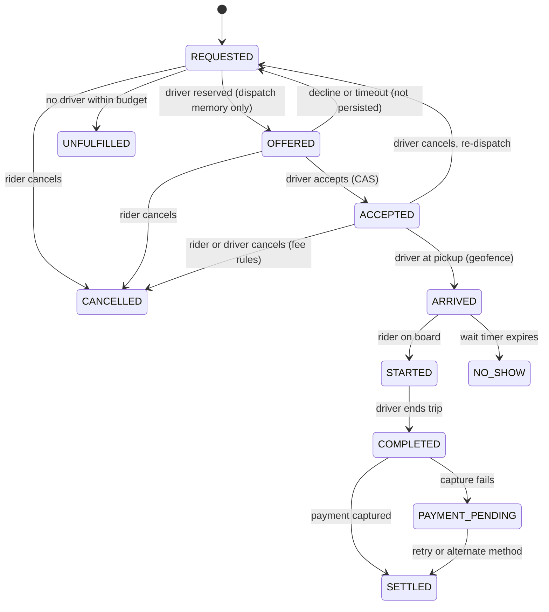

### Design points that don't show up in the diagram

**1. OFFERED lives in dispatch memory, not the trip store.**
A trip generates 1/p offers, each with a decline/timeout. Persisting that churn multiplies durable writes on the one component that must stay small. The trip store sees only **REQUESTED → ACCEPTED** (the CAS).
- *Cost:* after a dispatch failover, in-flight offers are lost → re-offered → a few seconds of rider wait. **The right price.**
- Offer outcomes still go to the **analytics stream** — training data for decline prediction.

**2. Transitions are events; state is derived.**
Store an **append-only list** of transition events per trip (actor, version, location, server + client timestamps). Materialise current state from it.

```text
trip 9f3…:
 v1 REQUESTED   actor=rider   t_srv=18:02:01  loc=…
 v2 ACCEPTED    actor=driverD t_srv=18:02:09  loc=… epoch=e7
 v3 ARRIVED     actor=driverD t_cli=18:06:40  t_srv=18:06:41 loc=…
 v4 CANCELLED   actor=rider   t_srv=18:07:30  fee=₹50 reason=late_cancel
```

Every dispute — *"I was charged a cancel fee but the driver was going the wrong way"* — is answered from the **event list + trip trace**. A `status` column + `updated_at` can't answer that. **Support volume is a real cost line.**

**3. The driver app is offline more than you think.**
Underground parking, rural pickups, network handovers. STARTED and COMPLETED are generated **on the phone** with local timestamps + GPS, queued, and uploaded later. The server must:
- **Accept** a transition that happened 3 min ago, **validate it against the trace**, not reject it as "late."
- Tolerate **out-of-order** ARRIVED and STARTED: accept the later one and **infer** the earlier.
- *Example:* Driver arrives in a basement parking lot (no signal), rider gets in, they drive out. Phone reconnects and uploads ARRIVED (18:06) and STARTED (18:08) together; STARTED arrives first due to batching. Server accepts STARTED and infers ARRIVED.

**4. COMPLETED is decoupled from payment.**
A payment outage must **never** stop the driver ending the trip. `PAYMENT_PENDING` lets capture retry for hours/days, against alternate methods, while both rider and driver move on.
> Worst failure: payment timeout leaves the driver's app **stuck mid-trip**, unable to accept the next ride — you've turned a **payment incident into a supply outage**.

**5. Fees are decided at transition time, from state as of that version.**
Cancellation fee depends on time since acceptance and the driver's position. Compute it **inside the same transaction as the CAS**, from the event history → fee and transition are **atomic**. Recomputing asynchronously from "current" data gives fees that disagree with what the rider saw.
- *Example:* Rule: free cancel within 2 min of acceptance. Rider cancels at 1:58. If an async job computes the fee at 2:05 using "now," the rider is wrongly charged.

---

## 10. Deep dive — surge pricing as a control loop

Surge raises price in a zone when demand > supply. Mechanically it's a **feedback controller**: the output (multiplier) changes both inputs (riders drop out; drivers move in).

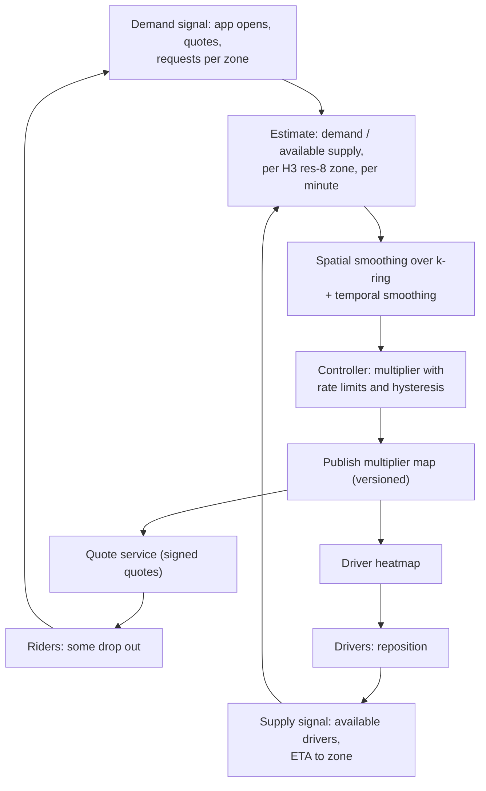

### What goes wrong, and why

**1. Oscillation.**
Multiplier up → drivers reposition over ~5–10 min → supply overshoots → multiplier collapses → drivers leave → demand returns → repeat. The **loop delay (driver travel time) is longer than the controller's update period** — the textbook recipe for oscillation.

Fixes:
- **Rate-limit** changes: cap per-update step at **±0.1–0.2×**.
- **Hysteresis**: e.g. rise above 1.5× only when ratio > 1.4; fall below 1.5× only when ratio < 1.1.
- **Forecast supply** a few minutes ahead using drivers **already heading toward** the zone, not just those in it.
- Rule of thumb: if loop delay ≈ 5–10 min, a controller moving the multiplier meaningfully more often than every few minutes is **reacting to its own previous action**. Publish every minute if you like, but cap the step so the effective time constant ≈ the loop delay.

**Example [Guide]:**
```text
Without limits:  1.0 → 2.5 → 2.5 → 1.0 → 1.0 → 2.3 → 1.0 …  (drivers chase, arrive late, it's gone)
With ±0.2/min:   1.0 → 1.2 → 1.4 → 1.6 → 1.7 → 1.7 → 1.6 → 1.5 …  (smooth; drivers arriving match the price)
```

**2. Boundary cliffs.**
Adjacent zones at 1.0× and 2.1× → riders walk 150 m to save money; drivers idle just inside the high zone. **Spatial smoothing across the k-ring** limits the gradient between neighbours. *"The cliff is a pricing design error surfaced as a geography problem."*
- *Example:* After smoothing: centre zone 2.1×, ring-1 neighbours 1.7×, ring-2 1.3×, outside 1.0×.

**3. Demand signal pollution.**
- Counting app opens: one rider refreshing ten times looks like ten riders → **deduplicate by rider-session** within the window.
- Worse: **surge suppresses requests** (riders see the price and wait). So "requests" under-counts demand exactly when surge is high. Use **quote volume as the leading signal**, **requests as the lagging one**, and **model price-suppressed demand** explicitly — or the controller under-reacts.

**4. Supply manipulation.**
If supply = "drivers online in zone," drivers collectively going offline raises the multiplier. There are widely reported cases of drivers **coordinating mass log-offs near airports** to induce surge. Fix: measure supply with a **lookback** (drivers online recently nearby count as **latent supply** for a few minutes) and **flag correlated offline events**.
- *Example:* 80 drivers at an airport lot go offline within 60 s. Latent-supply lookback still counts them for 5 min → no surge spike. Correlated-offline detector raises an alert.

### Architecture: computed centrally, consumed as a versioned snapshot

- Quote service reads the **published multiplier map** (a large metro = a few thousand res-8 cells → **tens of KB per product**), not the live controller.
- Quotes **embed the map version**.
- If the pipeline stalls → quotes continue off the last snapshot **with an age cap** → after the cap, **fall back to 1.0×**.

> **Fail-to-no-surge** = revenue loss. **Fail-to-stale-surge** during an emergency (serving 3× from an hour ago during a flood) = a **PR and regulatory event**.

- Many jurisdictions cap or suspend dynamic pricing in declared emergencies → a **per-zone regulatory ceiling enforced at quote time**, not controller time, so **a controller bug cannot exceed it**.

```text
multiplier_for_quote(zone) =
    snap = latest_snapshot()
    m    = (now - snap.ts > AGE_CAP) ? 1.0 : snap[zone]
    return min(m, regulatory_ceiling[zone])     # last line of defence
```

---

## 11. Deep dive — regional isolation and failover

### The cell architecture

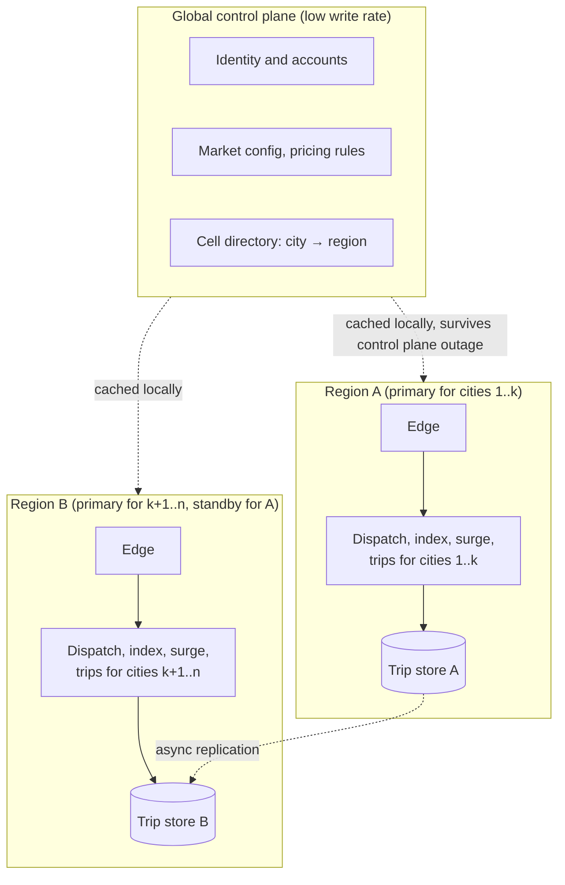

- **Each city is owned by exactly one region at a time.** Its whole data plane (edge, index, dispatch, surge, trips) runs there, with **no synchronous cross-region calls**.
- The **global control plane** holds slow-changing data (accounts, market config, city→region directory). Every region **caches it with a long TTL** → a global outage stops **sign-ups and config pushes**, but **not rides**.
- **The lesson:** identify which global dependencies can be served **stale for hours**, and make them so.
- **Reference case:** AWS **us-east-1 outage, Dec 7, 2021** — AWS's own summary describes impaired control-plane APIs in that region, and many customers discovered workloads they thought were regional depended on it. **Audit** for hidden dependencies — **auth token validation, feature-flag fetches, config reads on cold start** — before you need to.

### What failover actually does to in-flight trips

Soft state (geo index, surge, dispatch reservations) rebuilds in the new region **within seconds** from incoming pings. **The hard part is the trip store.**

With async replication, the standby is behind by the replication lag. Trips that transitioned in that window (an accept, a start) are:
- **Lost** — rider and driver are mid-ride, system has no record, or
- **Regressed** — system thinks ACCEPTED while the car is already driving the rider.

**Why not synchronous cross-region replication?** It adds a cross-region RTT (e.g. 70–150 ms) to every transition **and** a hard dependency on the other region's availability — you've **coupled the failure domains** you were trying to separate.

### The fix that fits this domain: phones carry the trip state

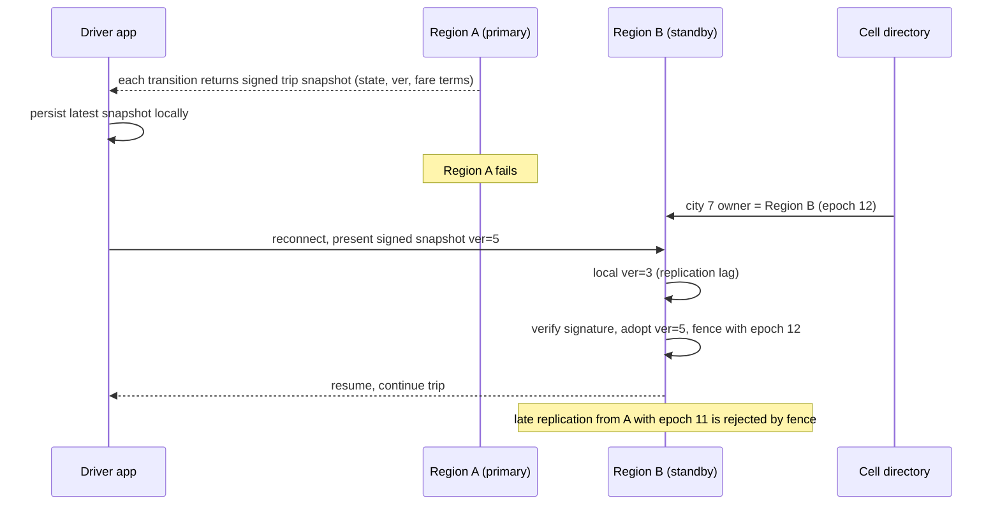

- Every transition returns a **compact, signed snapshot** to **both** apps; they persist it.
- After failover, the new owner reconciles: client presents a **validly signed snapshot newer than the replicated copy → adopt it**.
- **Signing key** must be shared across regions (or regional keys cross-trusted).
- Snapshots **carry the ownership epoch** so a delayed replication stream from the dead region can't overwrite state the new region has advanced.
- **Why it works here (not a general technique):** each record has **exactly two interested, authenticated, mostly-connected writers**, and the record is **small**. The phones are a replica co-located with the only parties who care.
- **Not hypothetical:** Uber engineers described an encrypted state digest on the driver's phone for datacenter-failover trip recovery in public talks around 2015.

**Example [Guide]:** Trip T: Region A replicated v3 (ACCEPTED) to B, then A recorded v4 (ARRIVED) and v5 (STARTED) and died. Driver's phone holds a signed v5 snapshot. Driver reconnects to B → B has v3 → verifies signature → adopts v5 STARTED → trip continues; fare clock intact.

**Two edge cases:**

| Case | Resolution |
|------|-----------|
| Client presents a snapshot signed by the **dead region** after the new owner **advanced** the trip | **Reject on epoch**, return current state |
| Rider and driver present **divergent** snapshots | **Take the higher version** — both were signed by the owner, so versions are **totally ordered per trip** |

### Beginner follow-up notes: regions and signed snapshots [Guide]

#### Words
- **Region** = a group of data centres in one place (e.g. cloud "Mumbai", "Singapore").
- **Data plane** = everything that runs rides right now: gateways, map, dispatch, surge, trips.
- **Control plane** = slow-changing settings: accounts, city rules, prices, the city → region directory.

#### What the setup looks like
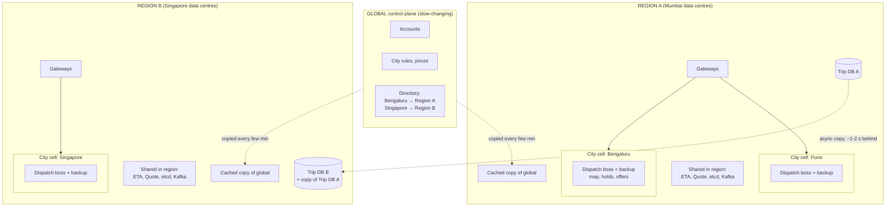
- Each city is run by **exactly one region** at a time; everything for a ride stays inside it.
- Region B runs its own cities and also holds an **async copy** of Region A's trip DB as a backup.
- **How a phone finds its region:** the app asks the directory (also cached on the phone) "where does Bengaluru run?" → "Region A" → opens a WebSocket to Region A's gateways. On failover, the directory says "Bengaluru → Region B" and phones reconnect there.

**Why global settings are cached:** like a restaurant chain, each branch cooks its own food (data plane), and head office sets the menu (control plane). If head office's phone is down, branches serve with the last menu.

| Global control plane down | Effect |
|---|---|
| New sign-ups | paused |
| Changing rules or prices | paused |
| **Booking and riding** | **keeps working** from the regional copy |

**The AWS us-east-1 lesson (Dec 7, 2021):** many "regional" apps secretly depended on us-east-1. Audit hidden global dependencies:

| Hidden dependency | Make it safe |
|---|---|
| Login token check calls a central server | signed tokens verified locally with replicated keys |
| Feature-flag fetch | local copy; use the last value if the fetch fails |
| Config at startup | cache config in the region |

> *Interview:* "Each city is owned by one region; its data plane runs there with no synchronous cross-region calls. The global control plane is cached with long TTLs, so its outage stops sign-ups and config changes, not rides. I'd audit token validation, flags and startup config."

#### What failover does to trips in progress: the copy is behind

| Time | Region A (main) | Region B (copy) |
|---|---|---|
| 10:00:00 | T = ACCEPTED (ver 3) | ver 3 ✓ |
| 10:00:05 | T = ARRIVED (ver 4) | not copied yet |
| 10:00:06 | T = STARTED (ver 5) | not copied yet |
| 10:00:06.5 | **Region A dies** | thinks ver 3, ACCEPTED ✗ (the rider is actually in the car) |

**Why not synchronous copy?** Every trip change would wait for Singapore (~70–150 ms), and if Singapore is down, Bengaluru can't ride either. That couples the regions.

**The fix: phones keep a signed receipt.** After every change, both phones get:
```
{ trip T, state STARTED, ver 5, fare terms, epoch 11 } + signature
```
Like a **stamped shop receipt**: if the shop's computer crashes, the stamp is trusted.

| Step | At failover |
|---|---|
| 1 | Directory → "Bengaluru → Region B, epoch 12" |
| 2 | The driver's phone reconnects and shows its receipt: ver 5, STARTED |
| 3 | B's copy says ver 3 |
| 4 | Signature ✓, 5 > 3 → **adopt ver 5** |
| 5 | Trip continues; fare and route intact |

| Edge case | Rule |
|---|---|
| A late copy from dead A (epoch 11) arrives after B moved on (epoch 12) | rejected (old badge) |
| Rider shows ver 4, driver shows ver 5 | take the **higher version** (same signer, so versions are ordered) |

**Why it works only here:** each trip has just 2 interested, logged-in parties, and the receipt is tiny. Uber engineers described a phone-held state digest for datacenter failover in public talks around 2015.

> *Interview:* "Cross-region trip replication is async, so failover can lose the last transitions. Rather than synchronous replication, which couples regions, every transition returns a signed snapshot to both phones; after failover the new region adopts any validly signed newer snapshot, and epochs fence late replication from the dead region."

### The reconnect storm

Failing over a region with 400k online drivers = 400k persistent connections reconnecting against edges sized for their own steady state. Fixed retry intervals **synchronise clients into waves**.

**The arithmetic:**
- 400k clients ÷ 5 s fixed retry = **~80k connections/s**.
- **TLS session resumption doesn't help**: session-ticket keys were issued by the dead region's edges (unless you deliberately share ticket keys) → **every one is a full handshake** (expensive CPU).
- **Auth**: if token validation calls a session store in the failed region, or the global identity service, the storm lands on a dependency never sized for it → **a regional incident becomes global**.
- → Make tokens **verifiable locally** (signed JWT-style, keys replicated everywhere) so reconnect auth costs **CPU, not a network call**.

**Required:**
1. **Jittered exponential backoff in the client** — shipped **long before** you need it (you can't hot-fix a phone app mid-incident).
2. **Admission control at the edge** — shed with **`retry-after`** rather than accept-and-time-out.
3. **Pre-provisioned standby edge capacity** — the real cost of failover; the number to bring to capacity planning.

```text
delay = min(cap, base · 2^attempt) · random(0.5, 1.5)     # jittered backoff
```

**Example:** With jitter, 400k reconnects spread over ~60 s ≈ 6.7k/s instead of 80k/s waves.

### The failover you should not do

**Don't auto-failover on a partial failure.** A region with degraded ETA service is better served by **degraded matching** (straight-line prefilter only, larger safety margins on displayed ETA) than by a failover that guarantees a reconnect storm **and** replication-lag reconciliation.
> Make regional failover a **deliberate, human-authorised** decision with a runbook. **Automate the degraded modes** instead.

---

## 12. Failure modes and how they unfold

| Failure | How it shows up | Mechanism | Response |
|---------|-----------------|-----------|----------|
| **Firehose lag** | "Driver arriving" but car is far; cancellations rise **before any infra alert** | Durable-queue semantics preserved a backlog; index minutes stale | Coalesce latest-wins; alert on **index age p99**, not consumer lag |
| **ETA service degraded** | Dispatch p99 climbs, then mass timeouts | ETA is the long pole; retries amplify load | Fall back to distance + road-speed heuristic; shrink M; **shed quote traffic before dispatch traffic** |
| **Ghost drivers** | Offers to drivers who are gone; accept rate drops | Phone died, no offline signal; record not expired | Per-driver last-seen TTL (vs assigned interval) → unavailable; short offer timeouts; per-driver decline-rate anomaly |
| **Stuck reservation** | Driver online, never gets offers; tickets, no errors | Reservation flag without lease expiry after crash | **Leases with fencing**; periodic audit of reserved-without-offer drivers |
| **Surge stall** | Stale multipliers during a demand shift | Pipeline stalled; quote service kept last map | Snapshot **age cap → 1.0×**; regulatory ceiling at quote time |
| **Payment outage** | Drivers stuck at trip end | Completion coupled synchronously to capture | **PAYMENT_PENDING**; async capture with retries |
| **Event spike** | One cell's dispatch saturates; neighbours fine | Hot cell, candidate overlap, rider re-request storms | Batched matching, rider-side dedup, queue mode, pre-positioning from event calendar |
| **Cross-region failover** | Reconnect storm, trip regressions | Replication lag + synchronised reconnects | Signed client snapshots, epoch fencing, jittered backoff, edge admission control |
| **Phone clock skew** | Pings rejected/misordered; fare disputes | Manually set or drifting clocks | Server-relative bounds; order by client ts only within a bounded window |

> **The pattern:** the most damaging failures **don't throw errors**. They show up as **degraded match quality** — longer pickups, more cancels, lower accept rates — and **business metrics move before infra metrics**. Put **pickup ETA error**, **rider cancel rate after match**, and **offer accept rate per cell** on the on-call dashboard next to latency and error rate, and **alert on them**. A team watching only p99 latency learns about a stale index from the growth team a day later.

### Observability dashboard (per cell) [Guide grouping]

| Group | Metrics |
|-------|---------|
| Freshness | Index age p50/p99 (moving, dispatchable drivers); % drivers expired-unavailable |
| Dispatch | Request→offer p99; offers per trip; accept rate; % supply locked in offers; batch W in use |
| Quality | Pickup ETA error (actual − displayed); cancel rate after match; unfulfilled rate |
| Surge | Multiplier distribution; snapshot age; # zones at regulatory ceiling |
| Trip store | CAS conflict rate; replication lag; PAYMENT_PENDING count/age |
| Edge | Concurrent connections; reconnect rate; handshake CPU; shed count |
| Cost | Pings per trip; quotes per completed trip; cost per trip by market tier |

---

## 13. Cost per trip

Three cost terms with different drivers:

| Term | Scales with | Levers |
|------|-------------|--------|
| **Firehose + index + edge** | Driver-hours online × ping rate (+ connection-hours) | Adaptive ping rates, connection consolidation |
| **Quote / ETA** | Rider sessions × pin moves | ETA caching per cell pair, client debounce, approximate quotes during drag |
| **Trip path** | Trips | Smallest per unit; carries durability + compliance cost |

### Worked example (unit costs illustrative)

| Term | Driver | Dense market (per trip) | Thin market (per trip) |
|------|--------|-------------------------|------------------------|
| Driver-hours online per trip | market density | ~0.5 h | ~2.5 h |
| Pings per trip at 4 s | 900 × driver-hours | ~450 | ~2,250 |
| Firehose + index + connection | ~$X per M pings + connection-hours | 1 unit | ~5 units |
| Quote/ETA calls per trip | pin drags, opens, re-quotes | ~40 | ~15 |
| Trip path | ~constant | 1 unit | 1 unit |

(900 = 3,600 s/h ÷ 4 s.)

- **Dense market** → cost dominated by **quote volume**. Levers: **debounce the pickup pin** (quote only after the pin is still for ~300–500 ms), **cache ETA per (origin cell, destination cell, 5-min bucket)**. Ping work saves little.
- **Thin market** → cost dominated by **idle driver-hours**. Levers: adaptive ping, connection consolidation. ETA caching doesn't help.
- A single global "cost per trip" hides both → **report per market tier**.

**Watch one number everywhere: quotes per completed trip.** When it climbs, it's almost always a **client change** (a new screen that re-quotes on render), not rider behaviour — and it reaches the **invoice** before anyone notices in the product.

**Debounce example [Guide]:** rider drags pin for 3 s; app sends a position every 50 ms → 60 quote calls. With 400 ms debounce → 1–2 calls.

---

## 14. What to build first, and what later

| Phase | Scope | Build |
|-------|-------|-------|
| **First** | Single city, single region | In-memory H3 index fed by coalescing ingest · greedy dispatch + ETA re-rank · single-writer dispatch with leased reservations · trip state machine with **CAS + event log** · signed quotes with a **static surge table** edited by ops |
| **Second** | Multiple cities, density emerging | City-cell partitioning + cell directory · batched matching with density-adaptive W · automated surge controller (smoothing, hysteresis) · adaptive ping rates · location fraud signals |
| **Third** | Multi-region, regulatory scale | Regional ownership + async trip replication · signed client snapshots + epoch fencing · pre-provisioned failover edge capacity · per-jurisdiction data residency · per-zone regulatory price ceilings |

> **Get the trip event log and CAS right on day one.** Retrofitting them into a `status`-column table is a painful migration on a **live money path**.

**Data residency note:** trip traces are personal data — some jurisdictions require **long retention**, others require **deletion**. The trace storage layout must support **both** (e.g. per-jurisdiction partitions with their own retention policies).

### Migration: moving a live city between layouts/regions

1. At a quiet hour, **stop assigning new requests** in the old owner.
2. Let **in-flight offers resolve** (bounded by offer timeout).
3. **Flip the directory entry** with a **new epoch**.
4. Clients **reconnect** to the new owner.
5. Trips in progress finish under the old owner or **migrate via snapshots**.

Because index + dispatch state are soft, **the only state that truly moves is trips** — one more reason to keep everything else soft.

---

## 15. Design review questions — answered

These are the questions the blog says to ask in a design review. Here's what a strong answer looks like.

### Q1. What is p99 index age per cell right now, and what alert fires when it doubles?

**Answer:** We compute, per cell, every few seconds, the p99 of `now − last_seen` over drivers who are **dispatchable and moving** (exclude parked drivers on long intervals, or measure them against their own `assigned_interval`). Normal value ≈ one ping interval (~4–5 s). **Alert** when p99 > 2× baseline (e.g. > 10 s) for 1 minute; page when > ~15 s. **If the answer is "consumer lag," the alert is wrong** — a coalescer has zero lag by construction, and a durable queue's lag can say "catching up" while dispatch is sending ghosts. Pair it with the business symptom alerts: pickup ETA error and cancel-after-match rate.

### Q2. What happens to in-flight offers and REQUESTED trips when the cell's dispatch owner loses its lease? How long can't the cell assign? What was last month's p99.9 pause?

**Answer:**
- **In-flight offers** (memory only) are **lost**. Any late accept for them carries the old epoch → **trip store rejects** it (fence) → driver sees "offer withdrawn."
- **REQUESTED trips** are durable → the standby, after acquiring the lease with epoch+1, **rebuilds** from the index + the trip store's open REQUESTED trips and **re-offers** them. Driver apps treat a new-epoch offer as superseding the old one.
- **No-assign window ≈ lease TTL + takeover time**, e.g. TTL 6 s → ~6–8 s.
- **Pause measurement:** we export GC/stop-the-world and network-stall histograms for the dispatch process. TTL is set comfortably **above** the measured p99.9 pause (e.g. pause 400 ms → TTL 6 s is safe). If we can't quote that number, we can't justify the TTL.

### Q3. Which global dependencies does a driver reconnect touch? Can each be served stale for an hour?

**Answer:** List them and make each local:

| Dependency | Make it survive |
|-----------|-----------------|
| Token validation | **Self-verifying signed tokens**, public keys replicated to every region; no session-store call |
| Feature flags | Cached in region and on device; last-known-good used if fetch fails |
| Market config / pricing rules | Regional cache, long TTL, versioned |
| Cell directory | Cached per region; changes rarely; epoch protects against staleness |
| TLS session tickets | Optionally share ticket keys across regions so resumption works after failover |

Yes — each should be servable stale for **at least an hour**. Prove it with a **game day**: block the global control plane and confirm rides continue.

### Q4. Is the surge regulatory ceiling enforced at quote time, and which test proves a controller bug can't exceed it?

**Answer:** Yes — `min(multiplier, ceiling[zone])` is applied in the **quote service** as the final step before signing, independent of the controller. Tests:
- **Unit/property test:** feed the quote service a snapshot with absurd values (e.g. 50×, NaN, negative) → every signed quote ≤ ceiling and ≥ 1.0.
- **Integration test:** inject a buggy controller in staging; assert no signed quote exceeds the ceiling.
- **Trip-creation check:** `POST /trips` also verifies the signed multiplier ≤ ceiling (defence in depth).
- **Emergency switch:** a per-zone "suspend surge" flag ops can set, also enforced at quote time.

### Q5. What fraction of available supply is locked in offers at the p99 minute in the busiest cluster, and does surge count those drivers as unavailable?

**Answer:** Compute per cluster per minute: `locked = offer_rate × mean_dwell` (Little's law), or directly count drivers with an active offer lease. Report `locked / (available + locked)`; track its p99 minute. In a stadium example it can be ~20%. **Surge should not treat offer-locked drivers as fully gone** — count them as **partial / latent supply** (weighted by expected decline probability), otherwise surge reads lock-up as scarcity and spikes prices artificially. Reduce the lock-up itself with **shorter T** and a **cap on concurrent offers** per pool.

### Q6. If region A dies at peak, how many trips are in the replication-lag window, how many will present a signed snapshot, and what happens to the rest?

**Answer (worked):**
- Trip transitions/sec in region A at peak: say ~1,000/s (requests, accepts, arrives, starts, completes).
- Replication lag p99: say 2 s → **~2,000 transitions** in the window.
- **Signed snapshots**: every transition returns one to the participating apps, so any trip where **at least one phone** got the response can be recovered — typically the vast majority. Expect a small residual where **neither** phone received the response (both offline at that moment).
- **The rest:**
  - REQUESTED but never replicated → rider app still shows "requesting"; it **re-submits with the same idempotency key** → new region creates the trip fresh.
  - ACCEPTED lost → driver app reconnects with no snapshot → treated as new; rider re-requests; possible re-match.
  - STARTED/COMPLETED lost on server but phone has offline-queued events with GPS → uploaded and **validated against the trace**.
  - Late replication from A arriving after recovery → **rejected by epoch fence**.
- Track this in failover drills: trips in window, % recovered by snapshot, % recovered by client retry, % needing support.

### Q7. What is quotes-per-completed-trip by market, and who is paged when it moves 30%?

**Answer:** Daily and hourly metric per market tier (e.g. dense ~40, thin ~15). A **30% move** pages the **owning client/platform team** (it's usually an app release that re-quotes on render), with the cost dashboard linked. Correlate with app version rollout; the usual fix is **debounce** or **caching** in the client. It also triggers a FinOps notification because it hits the invoice directly.

### Q8. Which cost-function terms can a driver or regulator ask you to explain, and can you reproduce any historical assignment's cost breakdown from logs?

**Answer:** All of them potentially — ETA, deadhead, decline probability, cancel risk, destination preference, fairness. For **every assignment**, log: batch id, candidate set, each candidate's cost **components** (not just the total), model versions, weights, the chosen pairing, and the solver version. Store in the analytics lake with retention per jurisdiction. Then we can answer *"why did driver X not get trip Y at 18:02?"* by replaying the batch. Regularly audit for bias (e.g. high-decline drivers getting starved).

---

## 16. Trade-offs and wrap-up

| Trade-off | Decision | Rule |
|-----------|----------|------|
| **Soft vs durable state** | Only trips are durable | Decide by **value lifetime × update rate** |
| **Greedy vs batched** | Batched with adaptive W | Batch when **expected ETA savings > W**; tune per cell density |
| **Distance vs ETA** | Distance prefilter, ETA ranking | **M** is the knob between quality and latency |
| **Single writer vs distributed locks** | Single writer per cell | Locality removes locks; spend complexity at **boundaries**, drawn along the **road graph** |
| **Sync vs async cross-region** | Async + signed client snapshots + epoch fencing | Sync **couples the failure domains** isolation exists to separate |
| **Surge freshness vs safety** | Versioned snapshots, fail to 1.0×, caps at quote time | A stale surge is worse than no surge |

> **The through-line:** this is a **local problem wearing a global system's clothes**. The designs that go wrong treat it as a global database problem — durable location storage, globally consistent state, synchronous cross-region calls. The designs that work **exploit locality ruthlessly**: partition by geography, keep everything but the trip soft, make each city its own small system, and spend engineering where locality breaks — **cell boundaries, hot cells, and the minutes after a region fails.**

---

## 17. Interview drill card + stress test

### Drill card (say these in order)

1. Clarify: private rides, ETA not distance, weighted objective, signed upfront quotes, many cities, strong consistency only for assignment/trip/money.
2. Numbers: 1.25M pings/s vs 290 trips/s (4,000:1); biggest city 60k pings/s → one process; quotes 20–50× requests.
3. HLD: edge → coalescer → per-city H3 index; dispatch single writer per cell; trip store durable; outbox → payments.
4. Geo index: H3 res 9, two maps, LWW on client ts with future bound, expire to unavailable per-driver TTL.
5. Candidates: k-ring → prefilter (heading/product) → top M → one-to-many ETA → cost.
6. Matching: batched min-cost with adaptive W; offer loop is the real latency; shorten T; decline prob in cost.
7. Exactly-one: single writer + lease + epoch fencing + CAS on trip_ver; offer token for late accepts.
8. Trip: event log, OFFERED in memory, offline events, payment decoupled, fees atomic with CAS.
9. Surge: control loop; smoothing, rate limit, hysteresis, forecast; versioned map, age cap, ceiling at quote.
10. Multi-region: per-city ownership, async replication, signed snapshots on phones, jittered reconnect, human-authorised failover.

### Principal stress-test — likely follow-ups and crisp answers [Guide]

| Interviewer asks | Answer |
|------------------|--------|
| "Why not Redis GEO?" | Fine for v0 in one city. But a shared Redis cluster couples cities, adds a network hop per update, and still only answers distance. In-process per-city maps are simpler, faster, and failure-isolated |
| "What if the index process dies?" | Restart; it's full again in one ping interval. Dispatch runs degraded for ~4 s in that cell only |
| "Two riders want the same driver at the same time?" | Same cell → same single-writer dispatch → solved in one batch; only one reservation exists |
| "Driver taps accept as rider cancels?" | Both CAS on ver=1 at the trip store; first wins; loser gets current state |
| "Network partition makes two dispatchers think they own the cell?" | Lease + epoch; trip store fences the older epoch, so the zombie's writes fail |
| "How do you scale to 10× drivers?" | More cells, not bigger ones. Split metros along road-graph barriers. Edge fleet sized by connections |
| "Surge keeps flip-flopping." | Loop delay > update period. Cap step size, add hysteresis, forecast inbound supply |
| "How do you handle pooled rides?" | Different problem: insertion of pickup/drop into existing routes with detour constraints; reuse firehose/index/trip store, replace matching |
| "Region dies — what's lost?" | Soft state rebuilds in seconds; trips in replication lag recovered from phones' signed snapshots; rest via idempotent client retries |
| "How do you detect GPS spoofing?" | Plausibility, sensor noise patterns, map-match residuals, rider-phone corroboration; enforce on fare, not in real time |

### What's expected at each level [Guide]

| Level | Expected |
|-------|----------|
| **Mid (L4/E4)** | Geohash/H3 index, nearest drivers, basic dispatch, trip table, WebSockets, rough capacity |
| **Senior (L5/E5)** | ETA vs distance, soft-state index, idempotency, CAS/state machine, partition by city, basic surge |
| **Staff (L6/E6)** | Coalescing vs queue + index-age metric, batched matching and offer-loop latency, lease + fencing, surge as control loop, hot-cell cascade, cost per trip |
| **Principal (L7+)** | Regional failover with signed snapshots + epochs, reconnect storm math, hidden global dependencies, regulatory caps at quote time, auditability of cost functions, build order by retrofit cost |

### Interview traps [Guide]

- Saying "Kafka" for location without explaining **latest-wins** semantics.
- Using **one global ETA number** for display and ranking.
- **Global TTL** for driver expiry when ping rates are adaptive.
- Storing **OFFERED** in the durable trip store.
- Letting **payment** block trip completion.
- **Auto** regional failover.
- Measuring supply as "drivers online" (manipulable) instead of with a lookback.

---

## Appendix A — Core data model (sketch) [Guide]

```sql
-- Trip store (durable, per region)
CREATE TABLE trips (
  trip_id         UUID PRIMARY KEY,
  city_id         INT NOT NULL,
  rider_id        BIGINT NOT NULL,
  driver_id       BIGINT,
  state           TEXT NOT NULL,          -- materialised from events
  ver             INT NOT NULL,
  owner_epoch     INT NOT NULL,
  quote_id        UUID NOT NULL,
  fare_terms      JSONB NOT NULL,         -- from signed quote
  created_at      TIMESTAMPTZ NOT NULL
);

CREATE TABLE trip_events (
  trip_id         UUID,
  ver             INT,
  type            TEXT,                   -- REQUESTED, ACCEPTED, ARRIVED, ...
  actor           TEXT,                   -- rider / driver / system
  epoch           INT,
  t_server        TIMESTAMPTZ,
  t_client        TIMESTAMPTZ,
  lat DOUBLE PRECISION, lng DOUBLE PRECISION,
  fee_cents       INT,
  PRIMARY KEY (trip_id, ver)
);

CREATE TABLE idempotency (
  key             TEXT PRIMARY KEY,
  trip_id         UUID,
  created_at      TIMESTAMPTZ
);

CREATE TABLE outbox (
  id              BIGSERIAL PRIMARY KEY,
  trip_id         UUID,
  ver             INT,
  payload         JSONB,
  published       BOOLEAN DEFAULT FALSE
);
```

```text
# Geo index (in memory, per cell shard)
drivers: driver_id → {lat, lng, heading, speed, cell, state, last_seen, ts_client,
                      state_ver, assigned_interval}
cells:   h3_res9   → set<driver_id>

# Dispatch (in memory, single writer)
reservations: driver_id → {offer_id, trip_id, token, lease_expires_at, epoch}
```

## Appendix B — Ping handling (pseudocode) [Guide]

```python
def on_ping(p, server_now):
    if p.ts_client > server_now + MAX_FUTURE_SKEW:   # e.g. 5 s
        return  # reject future timestamps
    d = drivers.get(p.driver_id)
    if d and p.ts_client <= d.ts_client:
        return  # reordered / replayed
    new_cell = h3.latlng_to_cell(p.lat, p.lng, 9)
    if d is None:
        d = drivers[p.driver_id] = Driver(p.driver_id)
    elif d.cell != new_cell:
        cells[d.cell].discard(d.id)
    cells[new_cell].add(d.id)
    d.update(p, cell=new_cell, last_seen=server_now)

def sweeper(server_now):          # every 1 s
    for d in drivers.values():
        if d.state == AVAILABLE and server_now - d.last_seen > 3 * d.assigned_interval:
            d.state = UNAVAILABLE  # never delete
```

## Appendix C — Coalescer (pseudocode) [Guide]

```python
latest = {}       # driver_id -> newest ping
dirty  = set()

def gateway_receive(ping):
    cur = latest.get(ping.driver_id)
    if cur is None or ping.ts_client > cur.ts_client:
        latest[ping.driver_id] = ping
        dirty.add(ping.driver_id)

def index_consumer_loop():
    while True:
        batch = pop_up_to(dirty, N)        # bounded by drivers, never by time
        for driver_id in batch:
            on_ping(latest[driver_id], now())
```

## Appendix D — Batched dispatch (pseudocode) [Guide]

```python
def dispatch_tick(cell):
    W = adaptive_window(cell.request_density)          # 0 s sparse … ~5 s hot
    requests = cell.queue.drain_after(W)
    edges = []
    for r in requests:
        cands = candidates(r.pickup, need=N, kmax=3)    # k-ring + prefilter
        top = sorted(cands, key=haversine_to(r.pickup))[:M]
        etas = eta_engine.one_to_many(top, r.pickup)
        for d, eta in zip(top, etas):
            edges.append((r, d, cost(r, d, eta)))
    pairs = min_cost_assignment(edges)                  # auction / min-cost flow
    for r, d in pairs:
        token = new_token()
        reservations[d.id] = Lease(r.trip_id, token, now() + T, epoch=my_epoch)
        push_offer(d, r, token, expires=now() + T, epoch=my_epoch)
        log_assignment(r, d, cost_components(r, d))     # for audit

def on_accept(driver_id, offer_id, token):
    res = reservations.get(driver_id)
    if not res or res.token != token or res.expired():
        return GONE
    ok = trip_store.cas(res.trip_id, expect="REQUESTED", expect_ver=res.ver,
                        new="ACCEPTED", driver=driver_id, epoch=my_epoch)
    if not ok:
        del reservations[driver_id]
        return GONE
    return CONFIRMED
```

## Appendix E — Surge controller step (pseudocode) [Guide]

```python
def surge_tick(zone):                         # every 60 s
    demand = dedup_quote_sessions(zone) + model_suppressed_demand(zone)
    supply = available(zone) + latent_lookback(zone) + inbound_forecast(zone)
    ratio  = smooth_spatial(zone, demand / max(supply, 1))
    target = curve(ratio)
    cur    = published[zone]
    if target > cur and ratio > RISE_THRESHOLD:          # hysteresis
        new = min(cur + MAX_STEP, target)
    elif target < cur and ratio < FALL_THRESHOLD:
        new = max(cur - MAX_STEP, target)
    else:
        new = cur
    return new                                # published as versioned snapshot

# Quote time (independent last line of defence)
def quote_multiplier(zone):
    snap = latest_snapshot()
    m = 1.0 if now() - snap.ts > AGE_CAP else snap[zone]
    return max(1.0, min(m, regulatory_ceiling[zone]))
```

## Appendix F — Quote token [Guide]

```text
payload = {quote_id, rider_id, pickup_cell, dropoff_cell, product,
           fare_cents, surge, surge_map_version, zone, expires_at}
sig     = Sign(region_shared_key, canonical(payload))

POST /trips:
  verify(sig)                     → else 400
  now < expires_at                → else 410 "quote expired, re-quote"
  payload.rider_id == caller      → else 403
  payload.surge <= ceiling[zone]  → defence in depth
```
