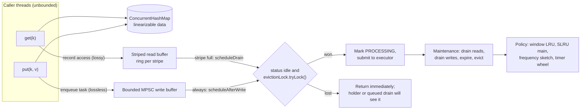
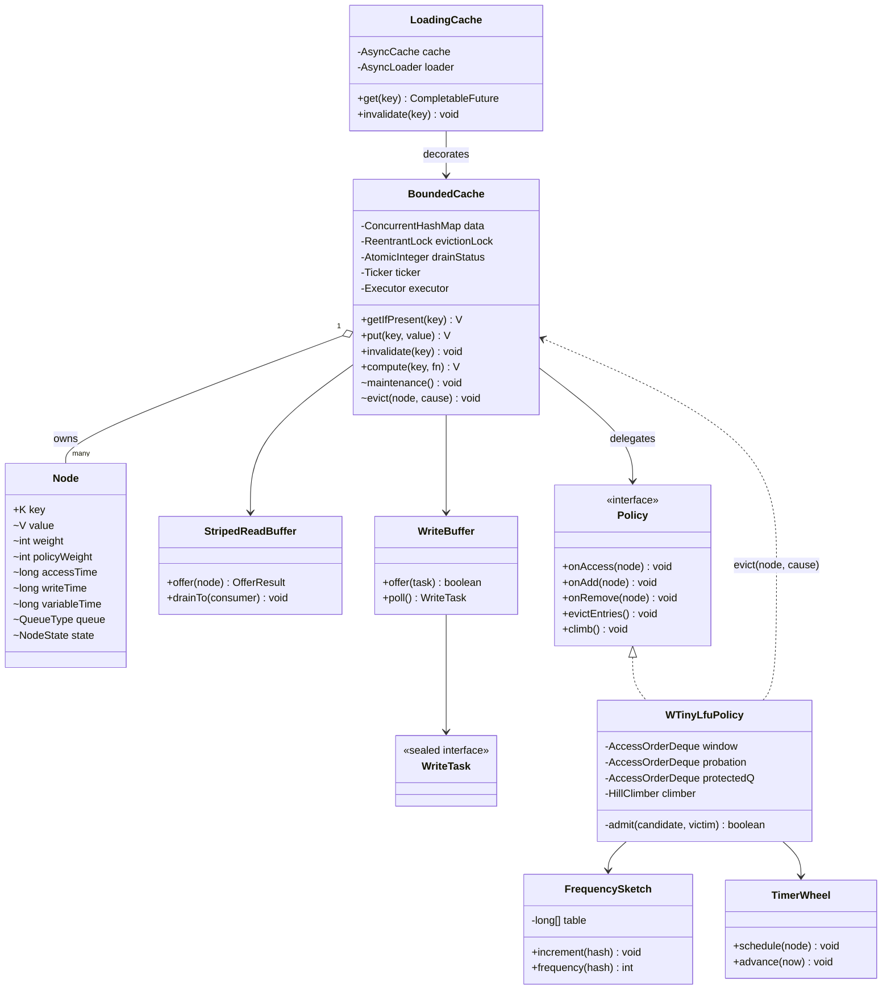
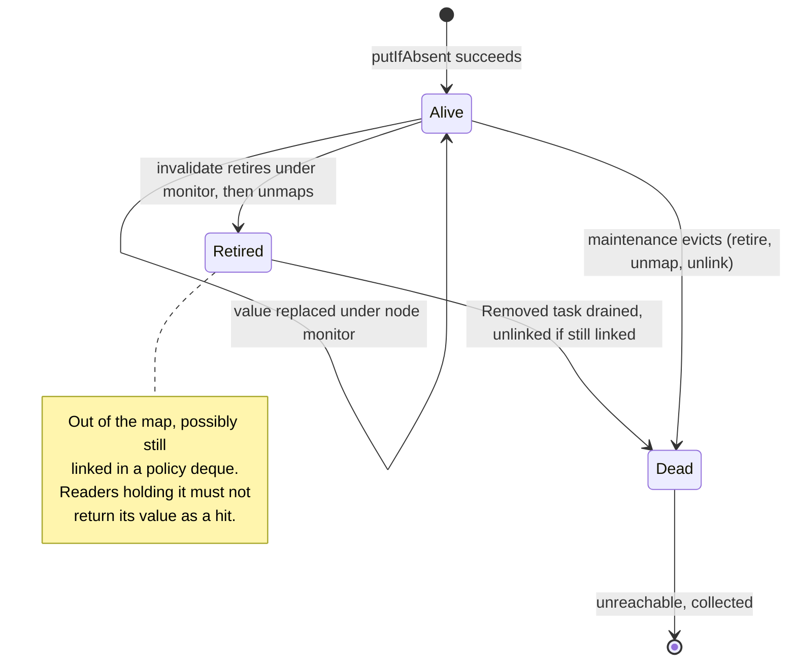
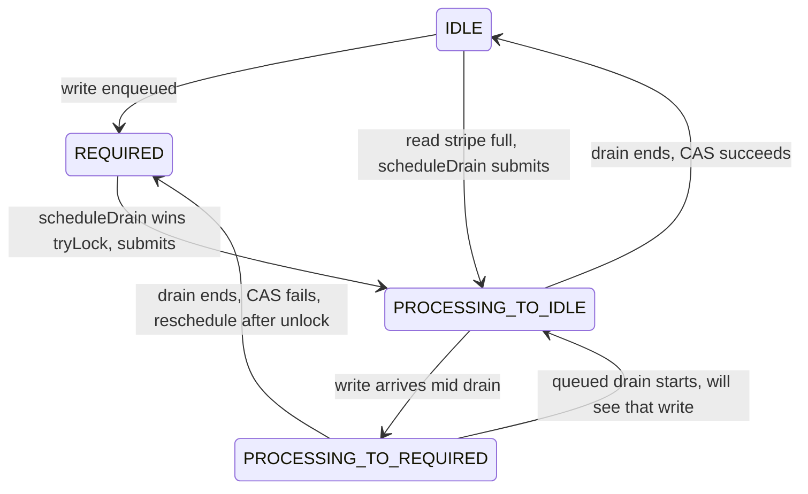
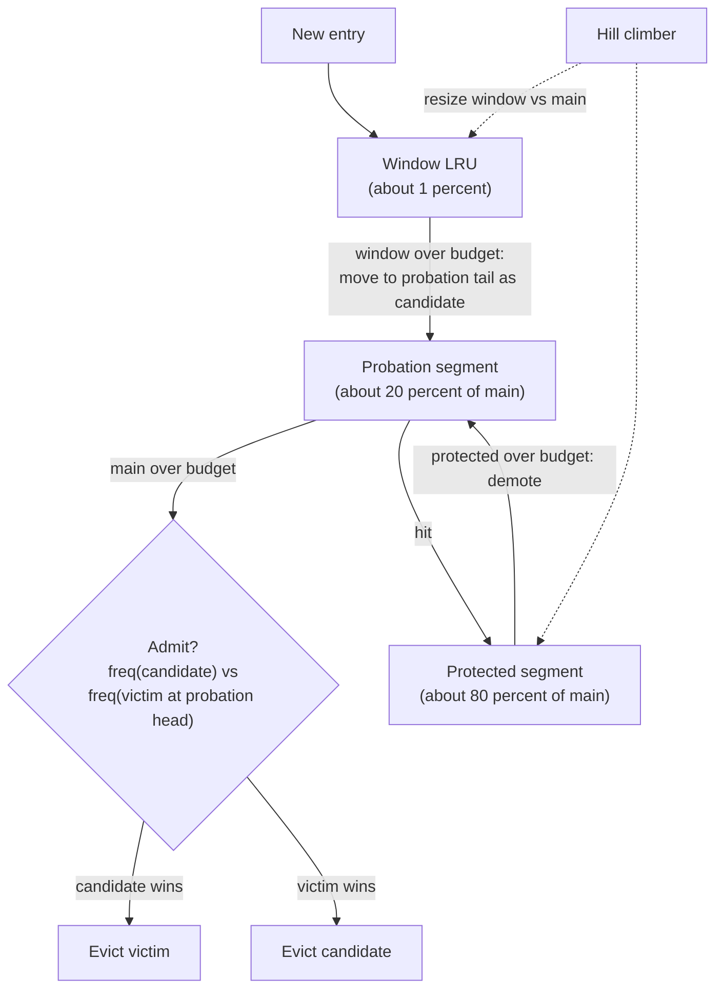
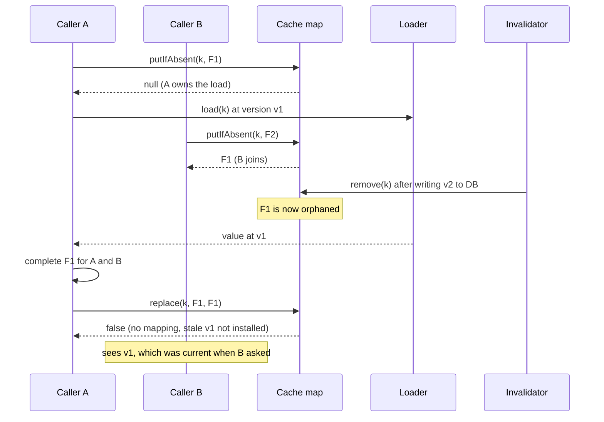
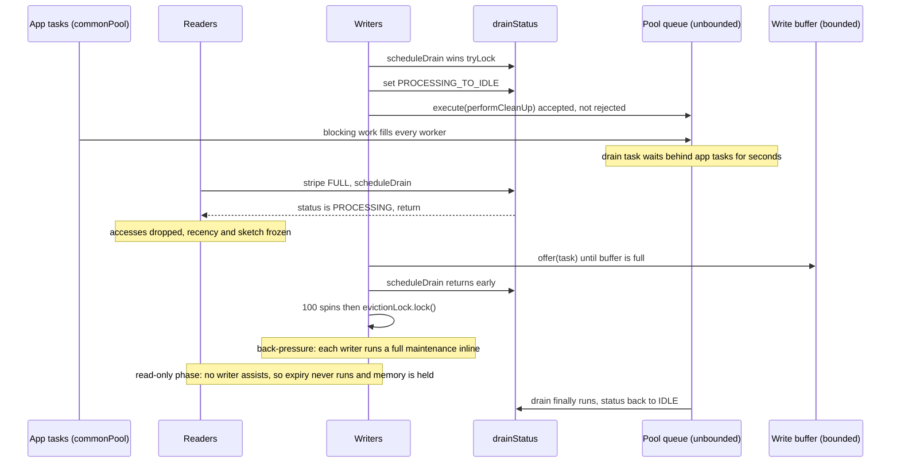
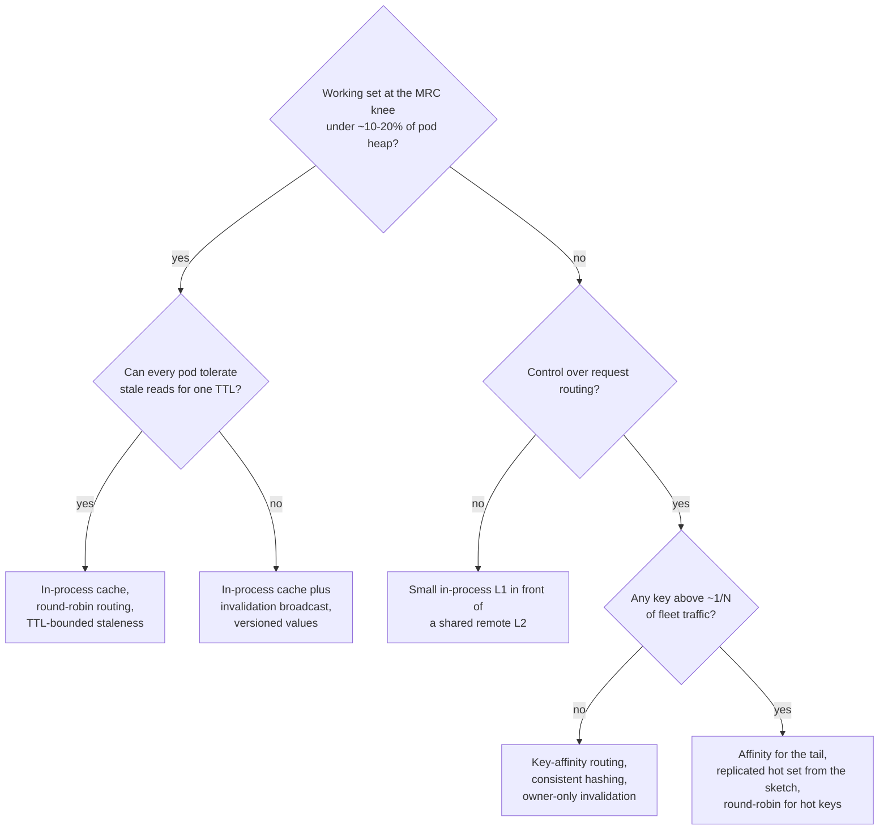
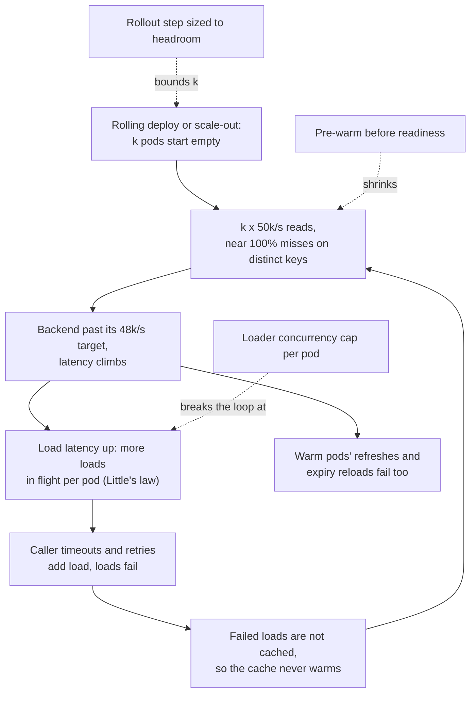
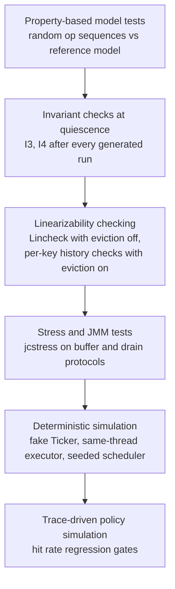

# Design an LRU Cache — Deep LLD (Java + Python)

> **What we build:** an in-process, bounded, concurrent cache of the kind the best JVM libraries ship (Caffeine-style). It goes well past "hashmap + linked list": why one lock caps reads, what lock striping costs in accuracy, read/write buffers, W-TinyLFU admission, per-entry memory and GC cost, timer-wheel expiry, single-flight loading, and linearizability testing.

> **The one-line thesis:** the data structure is a solved problem (a concurrent hash table). The real design is everything around it. **Decouple the policy from the data** so reads never serialize, **admit, don't just remember**, **budget the bytes**, **collapse concurrent misses**, and **write down as testable invariants exactly how wrong the cache is allowed to be.**

Every code block from the original Java design is kept, and each one has a **Python equivalent** right after it. Where Python's runtime changes the story (GIL, no CAS, no `volatile`, refcounting GC, asyncio), there is a **🐍 Python note**.

**Study path (~50 min):** [§0 Baseline](#0-the-textbook-baseline-and-why-it-is-not-enough) → [§1 Why it's hard](#1-the-problem-and-what-makes-it-genuinely-hard) → [§2 Invariants](#2-requirements-and-invariants) → [§3 Domain model](#3-the-domain-model) → [§4 State machines](#4-key-state-machines) → [§5 Core code](#5-core-code-java--python) → [§6 Concurrency](#6-concurrency-and-correctness-in-depth) → [§8 Failure + testing](#8-failure-modes-and-testing-strategy) → [§9 Trade-offs](#9-trade-offs-and-what-i-would-do-differently-at-scale) → [§10 Cheatsheet](#10-one-page-cheatsheet)

### ⚡ How to read this guide (low-attention mode)

- **Only 10 minutes?** Read §0, the diagram in §1.3, the invariants table in §2, and the cheatsheet in §10.
- **Interview prep?** §1, §2, §4, §5.4, §5.5, §5.8, §9 "Questions to ask in a design review".
- **Writing it in Python?** Read [§0.3 What changes in Python](#03-what-changes-in-python-read-this-before-the-python-code) first; it explains why the Python code uses `try-lock` where the Java uses CAS.

---

## Table of contents

0. [The textbook baseline, and why it is not enough](#0-the-textbook-baseline-and-why-it-is-not-enough)
1. [The problem, and what makes it genuinely hard](#1-the-problem-and-what-makes-it-genuinely-hard)
2. [Requirements and invariants](#2-requirements-and-invariants)
3. [The domain model](#3-the-domain-model)
4. [Key state machines](#4-key-state-machines)
5. [Core code (Java + Python)](#5-core-code-java--python)
6. [Concurrency and correctness in depth](#6-concurrency-and-correctness-in-depth)
7. [Extensibility](#7-extensibility)
8. [Failure modes and testing strategy](#8-failure-modes-and-testing-strategy)
9. [Trade-offs and what I would do differently at scale](#9-trade-offs-and-what-i-would-do-differently-at-scale)
10. [One-page cheatsheet](#10-one-page-cheatsheet)

---

## 0. The textbook baseline, and why it is not enough

> ⚡ **30-second version:** HashMap for O(1) lookup + doubly linked list for recency. `get` moves to front, `put` evicts from the tail. Ten minutes on a whiteboard. It answers "what is the cost of one operation on one thread?", which nobody running production actually asks.

The original article skips this because "everyone has built it". It is included here so the rest of the guide has something concrete to improve on.

### 0.1 Textbook LRU in Java

```java
final class LruCache<K, V> {
  private static final class Entry<K, V> {
    final K key; V value;
    Entry<K, V> prev, next;
    Entry(K key, V value) { this.key = key; this.value = value; }
  }

  private final int capacity;
  private final Map<K, Entry<K, V>> map = new HashMap<>();
  private final Entry<K, V> head = new Entry<>(null, null);   // head.next = most recently used
  private final Entry<K, V> tail = new Entry<>(null, null);   // tail.prev = least recently used

  LruCache(int capacity) {
    this.capacity = capacity;
    head.next = tail; tail.prev = head;
  }

  V get(K key) {
    Entry<K, V> e = map.get(key);
    if (e == null) return null;
    unlink(e); pushFront(e);              // a READ that performs four or five WRITES
    return e.value;
  }

  void put(K key, V value) {
    Entry<K, V> e = map.get(key);
    if (e != null) { e.value = value; unlink(e); pushFront(e); return; }
    if (map.size() >= capacity) {
      Entry<K, V> lru = tail.prev;
      unlink(lru);
      map.remove(lru.key);
    }
    e = new Entry<>(key, value);
    map.put(key, e);
    pushFront(e);
  }

  private void unlink(Entry<K, V> e) { e.prev.next = e.next; e.next.prev = e.prev; }
  private void pushFront(Entry<K, V> e) {
    e.prev = head; e.next = head.next;
    head.next.prev = e; head.next = e;
  }
}

// The JDK one-liner (access-order LinkedHashMap) is the same structure:
Map<K, V> lru = new LinkedHashMap<>(16, 0.75f, true) {
  @Override protected boolean removeEldestEntry(Map.Entry<K, V> eldest) { return size() > capacity; }
};
```

### 0.2 Textbook LRU in Python

```python
from typing import Generic, TypeVar

K = TypeVar("K")
V = TypeVar("V")


class _Entry:
    __slots__ = ("key", "value", "prev", "next")

    def __init__(self, key, value) -> None:
        self.key, self.value = key, value
        self.prev = self.next = None


class LRUCache(Generic[K, V]):
    def __init__(self, capacity: int) -> None:
        self.capacity = capacity
        self.map: dict[K, _Entry] = {}
        self.head = _Entry(None, None)   # head.next = most recently used
        self.tail = _Entry(None, None)   # tail.prev = least recently used
        self.head.next, self.tail.prev = self.tail, self.head

    def get(self, key: K) -> V | None:
        e = self.map.get(key)
        if e is None:
            return None
        self._unlink(e)
        self._push_front(e)              # a READ that performs four or five WRITES
        return e.value

    def put(self, key: K, value: V) -> None:
        e = self.map.get(key)
        if e is not None:
            e.value = value
            self._unlink(e)
            self._push_front(e)
            return
        if len(self.map) >= self.capacity:
            lru = self.tail.prev
            self._unlink(lru)
            lru.prev = lru.next = None   # don't let a stale reference pin its neighbours
            del self.map[lru.key]
        e = _Entry(key, value)
        self.map[key] = e
        self._push_front(e)

    def _unlink(self, e: _Entry) -> None:
        e.prev.next, e.next.prev = e.next, e.prev

    def _push_front(self, e: _Entry) -> None:
        e.prev, e.next = self.head, self.head.next
        self.head.next.prev = e
        self.head.next = e


# The stdlib equivalents of LinkedHashMap(accessOrder=true):
#   collections.OrderedDict + move_to_end(key) / popitem(last=False)
#   functools.lru_cache(maxsize=N)  (C implementation, circular doubly linked list inside)
```

Everything after this section is about what this code gets wrong once there are many threads, a real workload, a real heap, and a real backend behind it.

### 0.3 What changes in Python (read this before the Python code)

The Java design is built around JVM primitives. Python has different ones, so the Python code is an **equivalent**, not a literal transliteration. The mapping:

| Java primitive | Python equivalent used here | Why |
|---|---|---|
| `ConcurrentHashMap` | `dict` for lock-free reads + a small `ConcurrentMap` wrapper with striped locks for compound ops (`put_if_absent`, identity `remove`, `replace`) | Single `dict` ops are thread-safe in CPython (GIL builds and free-threaded 3.13t+), but check-then-act is not |
| `volatile` field | Plain attribute | CPython attribute stores never tear and are visible to other threads; there is no weaker mode to opt out of |
| `AtomicLong.compareAndSet` | `lock.acquire(blocking=False)` around a tiny critical section | Python has no user-level CAS. A failed try-lock plays the same role as a failed CAS: "someone else is here, give up and drop the event" |
| `synchronized (node)` | `with node.lock:` (`threading.Lock`) | Node monitor |
| `ReentrantLock evictionLock` | `threading.Lock` (non-reentrant) | Nothing here needs reentrancy, and a non-reentrant lock turns the listener-reentrancy bug of §6.3 into a deadlock you notice immediately instead of silent corruption |
| `Thread.onSpinWait()` | `time.sleep(0)` | Yields the GIL so the thread you are waiting on can run |
| `Executor` | `concurrent.futures.ThreadPoolExecutor(max_workers=1)` | Dedicated maintenance thread (§8.2) |
| `CompletableFuture` + `copy()` | `asyncio.Future` + `asyncio.shield()` | `shield` is exactly "caller cancellation must not cancel the shared load" |
| `System.nanoTime()` | `time.monotonic_ns()` | Monotonic, never wall clock |
| `record` / `sealed interface` / pattern `switch` | `@dataclass(frozen=True, slots=True)` + `match`/`case` | Python 3.10+ |

> 🐍 **The honest framing.** On a GIL build, threads do not run Python bytecode in parallel, so §1.1's "64 cores calling `get` at once" never happens inside one process. Python services usually get parallelism from **multiple processes** (gunicorn/uvicorn workers), each with its **own** cache. That makes the fleet arithmetic in §8.4 matter *more* in Python: 40 pods × 8 workers = 320 independent caches. The contention story from §1 comes back in full on **free-threaded CPython (3.13t / 3.14t)**, where a single global lock on the recency list caps throughput exactly as on the JVM.

---

## 1. The problem, and what makes it genuinely hard

> ⚡ **30-second version:** In LRU every read is a write to shared state, so one lock caps throughput. Striping trades eviction accuracy for throughput. The real fix is to keep the **data** linearizable and let the **policy** lag behind, fed by buffers and drained by one thread. Then choose a policy that admits newcomers only if they earn it (W-TinyLFU).

The questions that matter in production:

- What happens to throughput when 64 cores call `get` at once and every `get` is secretly a write?
- What is the cache actually worth, measured in hit rate, on a workload that includes a nightly batch scan?
- How many bytes does each entry cost before the key and value, and what does that do to your GC?
- When a hot entry expires and 4,000 requests miss simultaneously, how many reach the database?
- How do you know any of this is correct, when the interesting bugs only appear under interleavings a unit test will never produce?

This walkthrough designs the cache the way the best JVM libraries do: a concurrent hash table for data, a policy updated asynchronously from buffered events, an admission filter that makes "LRU" a misnomer, and a loading layer that collapses concurrent misses into one call. **The title stays "LRU cache" because that is what people ask for. The design's first opinion is that strict LRU is usually the wrong thing to build.**

### 1.1 In an LRU, a read is a write

Access-order bookkeeping turns every read into a mutation of shared state. A `get` on the textbook structure unlinks a node (writes `prev.next` and `next.prev`) and relinks it at the head (writes `head.prev`, `node.next`, and the head pointer). That is four or five stores to cache lines owned by other entries, and one of them, **the head pointer, is a single global cache line every reading core must own exclusively.**

So you wrap it in a lock, and throughput stops scaling. In JMH read benchmarks of the kind Caffeine publishes, a synchronized access-order `LinkedHashMap` plateaus in the low tens of millions of ops/s in aggregate, and adding threads makes it *worse* (lock hand-off and cache-line migration dominate). A `ConcurrentHashMap` read path on the same box scales into the hundreds of millions. Expect a gap of one to two orders of magnitude, all of it from the recency list.

**Going lock-free does not rescue you.** A lock-free doubly linked list with move-to-front still funnels every read through a CAS on the same head node. You have swapped a lock for a contended cache line. **The serialization point is the data structure's semantics, not the lock.**

> 🐍 On free-threaded CPython the same physics applies (plus reference-count contention on the shared head object). On a GIL build, `functools.lru_cache` is already effectively serialized; the cost shows up as GIL hold time rather than lock contention.

### 1.2 Striping buys throughput by spending accuracy

The first-generation fix: split the cache into N segments by key hash, each with its own lock, map, LRU list, and capacity `max / N`. Contention drops by roughly N. The costs are subtler:

| Cost | Mechanism | When it bites |
|---|---|---|
| Eviction accuracy | Each segment evicts its own LRU entry, not the global LRU entry | Small caches: 64 entries over 16 segments is 4 per segment; eviction is effectively random |
| Capacity fragmentation | A segment full of hot keys evicts while a neighbour holds cold ones | Skewed hash distribution, or weighted entries of very different sizes |
| Oversized entries | An entry heavier than `max / N` can never fit, though the cache has room | Weighted caches with a long tail of large values |
| Hot-key ceiling | A single hot key lives in one segment; that lock is the bottleneck | Exactly the workloads that motivated a cache |
| Fixed parallelism | N is chosen at construction | Wrong for a 4-core pod and wrong for a 96-core host |

Guava's `CacheBuilder` is the best-known instance: segments inherited from Java 5's `ConcurrentHashMap` (`concurrencyLevel`, default 4), each with its own LRU queue and a slice of the maximum, which is why its docs warn entries may be evicted before the limit is reached. It also buffers reads into a per-segment recency queue and replays them under the segment lock, so it had half of the next idea without the other half: the buffer still lives inside a lock-striped structure.

**Striping trades a policy decision (which entry dies) for a concurrency decision (how many locks), and the two should never have been coupled.**

Striped LRU, for reference:

```java
final class StripedLru<K, V> {
  private final LruCache<K, V>[] segments;
  private final Object[] locks;

  @SuppressWarnings("unchecked")
  StripedLru(int maximum, int concurrency) {
    segments = new LruCache[concurrency];
    locks = new Object[concurrency];
    for (int i = 0; i < concurrency; i++) {
      segments[i] = new LruCache<>(Math.max(1, maximum / concurrency));   // the accuracy cost lives here
      locks[i] = new Object();
    }
  }
  private int seg(Object key) { int h = key.hashCode(); return ((h ^ (h >>> 16)) & 0x7fffffff) % segments.length; }
  V get(K key) { int i = seg(key); synchronized (locks[i]) { return segments[i].get(key); } }
  void put(K key, V value) { int i = seg(key); synchronized (locks[i]) { segments[i].put(key, value); } }
}
```

```python
import threading


class StripedLRU(Generic[K, V]):
    def __init__(self, maximum: int, concurrency: int = 16) -> None:
        per = max(1, maximum // concurrency)                     # the accuracy cost lives here
        self._segments = [LRUCache[K, V](per) for _ in range(concurrency)]
        self._locks = [threading.Lock() for _ in range(concurrency)]

    def _seg(self, key: K) -> int:
        return hash(key) % len(self._segments)

    def get(self, key: K) -> V | None:
        i = self._seg(key)
        with self._locks[i]:
            return self._segments[i].get(key)

    def put(self, key: K, value: V) -> None:
        i = self._seg(key)
        with self._locks[i]:
            self._segments[i].put(key, value)
```

### 1.3 Decouple the policy from the data

The key move (BP-Wrapper, Ding, Jiang and Zhang, ICDE 2009; brought to the JVM in ConcurrentLinkedHashMap, refined in Caffeine): **the hash table must be linearizable, but the eviction policy does not need to be.** Nobody can observe whether the recency list reflects a read from 40 microseconds ago. The policy only has to be eventually consistent with the data, and bounded in how far it drifts.

- **Reads** go straight to a concurrent hash table, then record the access into a **lossy, striped read buffer**.
- **Writes** go to the hash table, then record an event into a **bounded, lossless write buffer**.
- **A single thread**, whichever wins a `tryLock`, drains both buffers in batches and applies them to the policy.

Reads never block. The policy is mutated by one thread at a time with no fine-grained synchronization inside it. Batching amortizes the cache-line traffic of relinking across hundreds of events.



### 1.4 The policy is the product

Once the mechanics are solved, the only thing that determines the cache's value is **hit rate**, and LRU is mediocre outside strongly recency-skewed workloads. Its failure modes:

- A **scan** of one-hit wonders flushes the hot set.
- A **loop** of `C + 1` keys over a cache of size `C` yields a hit rate of exactly **zero**.
- A key hit 10,000 times an hour ranks below one touched once a minute ago.

Same root cause: **LRU admits every newcomer unconditionally and has no memory of anything it evicted.** Pure LFU fixes that and introduces the opposite failure: yesterday's popular keys squat forever.

The answer this design commits to is **W-TinyLFU**: a small LRU **window** to absorb bursts, a **segmented-LRU main** region, and an **admission filter** that compares the candidate's frequency against the victim's using a compact, aging **count-min sketch**. The eviction candidate stays approximately LRU. What changes is that **newcomers must earn their slot.**

---

## 2. Requirements and invariants

> ⚡ **30-second version:** Seven invariants (I1–I7) are the contract. The data is per-key linearizable; the policy is allowed to forget anything at any time, but never to resurrect, over-count weight, double-notify, or install a stale load.

**Functional**

- `getIfPresent`, `put`, `invalidate`, `invalidateAll`, and an atomic `compute` family.
- Bounded by count or by weight, with a user-supplied weigher.
- Expiry: after write, after access, or variable per entry.
- Loading: `get(key, loader)` with at most one in-flight load per key, plus asynchronous refresh-ahead.
- Removal notification with a cause: `EXPLICIT`, `REPLACED`, `EXPIRED`, `SIZE`, `COLLECTED`.
- Hit, miss, load and eviction statistics that cost nothing measurable on the hot path.

**Non-functional**

- Read throughput within a small constant factor of a bare `ConcurrentHashMap`, scaling with cores.
- No thread ever blocks on the read path. Writes may briefly assist maintenance under sustained pressure; that *is* the back-pressure mechanism.
- Hit rate at or above LRU on recency-skewed traces, dramatically above it on frequency-skewed and scan-polluted traces.
- Per-entry overhead **measured and budgeted**, not guessed.

**Invariants.** These are what the test suite in §8 checks. "Quiescent" = no operation in flight and maintenance has run to completion.

| # | Invariant | Scope |
|---|---|---|
| I1 | Per-key operations on the data (`get`, `put`, `remove`, `compute`) are linearizable, with eviction and expiry modelled as a spontaneous remove | Always |
| I2 | `getIfPresent` never returns a value whose expiry time is `<= ticker.read()` at the moment of the read | Always |
| I3 | Every node in the policy deques is ALIVE and present in the map under its key; every ALIVE node in the map is in exactly one deque | Quiescent |
| I4 | `weightedSize == Σ policyWeight(node)` over alive nodes, and `weightedSize <= maximum` | Quiescent |
| I5 | Write tasks pending `<= writeBufferCapacity`, plus at most one per writer between its map update and its enqueue; so the transient overshoot of `maximum` is bounded | Always |
| I6 | The removal listener is invoked exactly once per removed mapping, after the mapping is gone from the map, never while holding the eviction lock | Always |
| I7 | At most one load per key is in flight per generation; a load that began before an invalidate of that key never installs its result | Always |

I1 is deliberately weak on the policy side: the cache may forget anything at any time. That weakness is what lets the policy be asynchronous. It does not make the cache untestable, but it does make the sequential specification **nondeterministic**, and §8.5 shows why the naive encoding ("absent is always legal") is too weak to catch resurrection.

---

## 3. The domain model



**Why the boundaries are here:**

- **`Node` is the unit of identity, not the key.** The map maps key → Node; the policy links Nodes. A `put` that replaces a value keeps the same node so the policy's links stay valid; a remove followed by a put of the same key creates a **new** node. That is what lets buffered events arrive out of order safely: an event carries the node, and a stale event about a dead node is simply ignored.
- **`Node` carries two weights.** `weight` is written by the mutating thread under the node's monitor; `policyWeight` is written only by the maintenance thread, when it applies an `Added`/`Updated` task, by re-reading `weight` under the monitor. `weightedSize` is computed from `policyWeight`. Collapse them into one field and a concurrent update can make the maintenance thread subtract a weight it never added, and I4 drifts permanently.
- **`Policy` sees only nodes and never touches the map.** Its single path back to the data is `BoundedCache.evict(node, cause)`, which owns the identity-conditional `data.remove(key, node)` and the notification. The policy can be swapped (LRU, W-TinyLFU, SIEVE, a simulator's oracle) without touching concurrency code.
- **`LoadingCache` is a decorator over an async cache, not a mode flag.** Its values are futures. Single-flight falls out of storing the future in the map (§5.8); the core never needs to know loading exists.
- **`Ticker` and `Executor` are injected.** They are the two sources of nondeterminism in the system, and injecting them is what makes deterministic simulation (§8) possible.

---

## 4. Key state machines

### 4.1 Node lifecycle

A node's life is split between two structures updated at different times; **the gap between them is where the bugs live.**



`RETIRED` exists because removal from the map and unlinking from the policy are two separate steps performed by different threads. The transition out of `ALIVE` happens under the node's monitor, and **the thread that performs it owns the removal**: it alone unmaps the node and fires the one notification I6 requires. Every other path that finds a non-alive node backs off.

**A writer that finds a node RETIRED or DEAD under its monitor must retry against the map rather than reviving the node.** That rule alone kills the entire class of "resurrected entry" bugs, where an update lands on an already-evicted node and the value becomes reachable again without being accounted for.

### 4.2 Drain status

Maintenance is scheduled by a **four-state** flag. The fourth state is the one people omit, and omitting it loses wake-ups.



If a write arrives during a drain and merely sets `REQUIRED`, the drainer's final `status = IDLE` overwrites it, and the write sits in the buffer until some unrelated operation triggers maintenance. On an idle cache that may be **never**, so an entry past the maximum is never evicted. `PROCESSING_TO_REQUIRED` records "someone arrived while I was working" so the drainer schedules another pass.

**Where it reschedules matters: after releasing the lock.** The scheduler's `tryLock` is how concurrent schedulers de-duplicate. A reschedule attempted while still holding the lock is either a no-op or, with a reentrant lock, a second submission racing the first.

### 4.3 W-TinyLFU regions



- **The window exists because pure TinyLFU cannot admit a burst.** A key that suddenly becomes hot has frequency 1, loses every admission contest, and is thrown away before it can accumulate hits. The window gives new keys a brief LRU grace period.
- **The hill climber** periodically samples hit rate and grows or shrinks the window. Recency-skewed traces push it toward a large window (converging toward LRU); frequency-skewed traces shrink it toward pure TinyLFU. That adaptivity is why the policy is rarely worse than LRU and often dramatically better.

---

## 5. Core code (Java + Python)

Java 21 (from the design) and Python 3.11+ equivalents. Only the hard parts; accessors, statistics wiring and builder plumbing are omitted in both.

### 5.1 Nodes and write tasks

**Java**

```java
enum QueueType { WINDOW, PROBATION, PROTECTED }
enum NodeState { ALIVE, RETIRED, DEAD }

enum RemovalCause {
  EXPLICIT, REPLACED, EXPIRED, SIZE, COLLECTED;
  boolean wasEvicted() { return this == EXPIRED || this == SIZE || this == COLLECTED; }
}

final class Node<K, V> {
  final K key;
  volatile V value;
  volatile NodeState state = NodeState.ALIVE;
  volatile long accessTime;          // racy by design: last writer wins, off by microseconds
  volatile long writeTime;
  volatile long variableTime;         // only with per-entry expiry (5.7); see 7 for why that matters

  int weight;                         // guarded by this (node monitor)
  int policyWeight;                   // guarded by evictionLock
  QueueType queue;                    // guarded by evictionLock
  Node<K, V> prevInAccessOrder;       // guarded by evictionLock
  Node<K, V> nextInAccessOrder;       // guarded by evictionLock
  Node<K, V> prevInVariableOrder;     // timer-wheel links, guarded by evictionLock; null when unscheduled
  Node<K, V> nextInVariableOrder;

  Node(K key, V value, int weight, long now) {
    this.key = key; this.value = value; this.weight = weight;
    this.accessTime = now; this.writeTime = now;
  }
  boolean isAlive() { return state == NodeState.ALIVE; }
}

sealed interface WriteTask<K, V> {
  record Added<K, V>(Node<K, V> node) implements WriteTask<K, V> {}
  record Updated<K, V>(Node<K, V> node) implements WriteTask<K, V> {}   // no delta: see apply()
  record Removed<K, V>(Node<K, V> node) implements WriteTask<K, V> {}
}
```

**Python**

```python
from __future__ import annotations

import threading
from dataclasses import dataclass
from enum import Enum, auto
from typing import Generic, TypeVar

K = TypeVar("K")
V = TypeVar("V")


class QueueType(Enum):
    WINDOW = auto()
    PROBATION = auto()
    PROTECTED = auto()


class NodeState(Enum):
    ALIVE = auto()
    RETIRED = auto()
    DEAD = auto()


class RemovalCause(Enum):
    EXPLICIT = auto()
    REPLACED = auto()
    EXPIRED = auto()
    SIZE = auto()
    COLLECTED = auto()

    @property
    def was_evicted(self) -> bool:
        return self in (RemovalCause.EXPIRED, RemovalCause.SIZE, RemovalCause.COLLECTED)


class Node(Generic[K, V]):
    # __slots__ removes the per-instance __dict__: roughly 100+ bytes saved per entry (see 8.3)
    __slots__ = (
        "key", "value", "state", "access_time", "write_time", "variable_time",
        "lock",                                   # the node "monitor"
        "weight",                                 # guarded by lock
        "policy_weight", "queue",                 # guarded by eviction lock
        "prev_in_access_order", "next_in_access_order",
        "prev_in_variable_order", "next_in_variable_order",
    )

    def __init__(self, key: K, value: V, weight: int, now: int) -> None:
        self.key = key
        self.value = value
        self.state = NodeState.ALIVE
        self.access_time = now                    # racy by design: last writer wins
        self.write_time = now
        self.variable_time = 0
        self.lock = threading.Lock()
        self.weight = weight
        self.policy_weight = 0
        self.queue: QueueType | None = None
        self.prev_in_access_order = self.next_in_access_order = None
        self.prev_in_variable_order = self.next_in_variable_order = None

    def is_alive(self) -> bool:
        return self.state is NodeState.ALIVE


@dataclass(frozen=True, slots=True)
class Added(Generic[K, V]):
    node: Node[K, V]


@dataclass(frozen=True, slots=True)
class Updated(Generic[K, V]):
    node: Node[K, V]                              # no delta: see apply()


@dataclass(frozen=True, slots=True)
class Removed(Generic[K, V]):
    node: Node[K, V]


WriteTask = Added | Updated | Removed
```

One small allocation per write is acceptable; Caffeine does the same (`AddTask`, `UpdateTask`, `RemovalTask`). These objects die young, and a write already allocates a node or a value. **What matters is that the read path allocates nothing.**

**The `equals` trap.** `ConcurrentHashMap.remove(key, value)` and `replace(key, old, new)` compare values with `equals`. `Node` and `CompletableFuture` inherit `Object.equals`, so in this design those calls are identity-conditional. If you ever store a value type with a structural `equals` directly in the map, that guarantee quietly disappears.

The Python version sidesteps the trap by making identity explicit. This wrapper is the `ConcurrentHashMap` stand-in used everywhere below:

```python
_MISSING = object()


class ConcurrentMap(Generic[K, V]):
    """dict with lock-free reads and striped locks for compound, identity-conditional writes.
    The same key always maps to the same stripe, which is what makes check-then-act atomic
    (the analogue of ConcurrentHashMap's per-bin locks)."""

    def __init__(self, stripes: int = 64) -> None:
        assert stripes & (stripes - 1) == 0, "power of two"
        self._d: dict[K, V] = {}
        self._locks = [threading.Lock() for _ in range(stripes)]

    def _lock(self, key: K) -> threading.Lock:
        return self._locks[hash(key) & (len(self._locks) - 1)]

    def get(self, key: K) -> V | None:
        return self._d.get(key)                    # single dict op: thread-safe, no lock

    def put_if_absent(self, key: K, value: V) -> V | None:
        with self._lock(key):
            prior = self._d.get(key)
            if prior is None:
                self._d[key] = value
            return prior

    def remove(self, key: K, expected: object = _MISSING) -> bool:
        with self._lock(key):
            cur = self._d.get(key)
            if cur is None or (expected is not _MISSING and cur is not expected):  # `is`, never ==
                return False
            del self._d[key]
            return True

    def replace(self, key: K, expected: V, new: V) -> bool:
        with self._lock(key):
            if self._d.get(key) is not expected:
                return False
            self._d[key] = new
            return True

    def values(self) -> list[V]:
        return list(self._d.values())              # weakly consistent snapshot

    def __len__(self) -> int:
        return len(self._d)
```

### 5.2 The read path

**Java**

```java
public V getIfPresent(K key) {
  Node<K, V> node = data.get(key);
  if (node == null) {
    stats.recordMiss();
    return null;
  }
  long now = ticker.read();
  V value = node.value;
  if (value == null || !node.isAlive() || expiry.hasExpired(node, now)) {
    stats.recordMiss();
    scheduleDrain();                    // let maintenance reap it; never evict inline on a read
    return null;
  }
  if (expiry.tracksAccess()) {
    node.accessTime = now;              // plain volatile store; no CAS, no ordering with other readers
  }
  afterRead(node);
  stats.recordHit();
  return value;
}

private void afterRead(Node<K, V> node) {
  if (readBuffer.offer(node) == StripedReadBuffer.OfferResult.FULL) {
    scheduleDrain();                     // the reader pays one status read and at most a tryLock + submit
  }
}
```

**Python** (the constructor is shown once here so later methods have their fields)

```python
import queue
import time
from concurrent.futures import Executor, ThreadPoolExecutor

IDLE, REQUIRED, PROCESSING_TO_IDLE, PROCESSING_TO_REQUIRED = 0, 1, 2, 3
WRITE_BUFFER_RETRIES = 100


class MonotonicTicker:
    def read(self) -> int:
        return time.monotonic_ns()                 # never time.time(): an NTP step would empty the cache


class BoundedCache(Generic[K, V]):
    def __init__(self, maximum: int, *, weigher=lambda k, v: 1, expiry, policy_factory,
                 ticker=None, executor: Executor | None = None,
                 listener=lambda k, v, cause: None, listener_executor: Executor | None = None,
                 write_buffer_capacity: int = 128 * 16) -> None:
        self._maximum = maximum
        self._weigher = weigher
        self._expiry = expiry
        self._ticker = ticker or MonotonicTicker()
        self._executor = executor or ThreadPoolExecutor(1, thread_name_prefix="cache-maint")
        self._listener = listener
        self._listener_executor = listener_executor or ThreadPoolExecutor(1, thread_name_prefix="cache-listen")
        self._data: ConcurrentMap[K, Node[K, V]] = ConcurrentMap()
        self._eviction_lock = threading.Lock()
        self._drain_status = AtomicInt(IDLE)
        self._read_buffer: StripedReadBuffer[Node[K, V]] = StripedReadBuffer()
        self._write_buffer: queue.Queue[WriteTask] = queue.Queue(maxsize=write_buffer_capacity)
        self._weighted_size = 0                    # guarded by eviction lock
        self._timer_wheel = TimerWheel(self)
        self._policy = policy_factory(self)
        self._stats = StatsCounter()

    def get_if_present(self, key: K) -> V | None:
        node = self._data.get(key)
        if node is None:
            self._stats.record_miss()
            return None
        now = self._ticker.read()
        value = node.value
        if value is None or not node.is_alive() or self._expiry.has_expired(node, now):
            self._stats.record_miss()
            self._schedule_drain()                 # let maintenance reap it; never evict inline on a read
            return None
        if self._expiry.tracks_access:
            node.access_time = now                 # plain store; no lock, no ordering with other readers
        self._after_read(node)
        self._stats.record_hit()
        return value

    def _after_read(self, node: Node[K, V]) -> None:
        if self._read_buffer.offer(node) is OfferResult.FULL:
            self._schedule_drain()


class AtomicInt:
    """CAS emulation. Only the drain status uses this, and it is touched rarely (status checks
    are plain reads), so a tiny lock is fine here; it is NOT acceptable on the read path."""
    __slots__ = ("_v", "_lock")

    def __init__(self, v: int) -> None:
        self._v = v
        self._lock = threading.Lock()

    def get(self) -> int:
        return self._v

    def set(self, v: int) -> None:
        self._v = v

    def compare_and_set(self, expect: int, update: int) -> bool:
        with self._lock:
            if self._v != expect:
                return False
            self._v = update
            return True
```

Two load-bearing decisions:

1. **Expiry is checked on the read, against the ticker**, rather than trusting maintenance to have removed expired entries. Maintenance is asynchronous and may lag; I2 must hold regardless.
2. **`accessTime` is updated with a racy store.** Two racing readers produce one of their timestamps, and both are "now" to within microseconds. A CAS here would reintroduce exactly the contention the design exists to remove.

### 5.3 The striped read buffer

**Java**

```java
final class StripedReadBuffer<E> {
  static final int RING_SIZE = 16;                    // power of two
  static final int RING_MASK = RING_SIZE - 1;

  enum OfferResult { SUCCESS, FAILED, FULL }

  static final class Ring<E> {
    final AtomicReferenceArray<E> slots = new AtomicReferenceArray<>(RING_SIZE);
    final AtomicLong writeCounter = new AtomicLong();   // padded in real code, see 6.4
    volatile long readCounter;                           // written only by the drainer
  }

  private volatile Ring<E>[] stripes;                    // grows on contention, up to ~4 x cores

  OfferResult offer(E e) {
    Ring<E>[] rs = stripes;
    Ring<E> ring = rs[probe() & (rs.length - 1)];
    long head = ring.readCounter;
    long tail = ring.writeCounter.get();
    if (tail - head >= RING_SIZE) {
      return OfferResult.FULL;                           // drop the event and ask for a drain
    }
    if (ring.writeCounter.compareAndSet(tail, tail + 1)) {
      ring.slots.lazySet((int) (tail & RING_MASK), e);   // publish; the drainer may briefly see null
      return OfferResult.SUCCESS;
    }
    maybeExpand(rs);                                      // CAS failure is a contention signal
    return OfferResult.FAILED;                            // lossy: this access is simply not recorded
  }

  /** Called only while holding the eviction lock. */
  void drainTo(Consumer<E> consumer) {
    for (Ring<E> ring : stripes) {
      long head = ring.readCounter;
      long tail = ring.writeCounter.get();
      for (; head < tail; head++) {
        int i = (int) (head & RING_MASK);
        E e = ring.slots.get(i);
        if (e == null) break;                            // slot claimed but not yet published
        ring.slots.lazySet(i, null);
        consumer.accept(e);
      }
      ring.readCounter = head;
    }
  }

  private static int probe() {
    // LongAdder's Striped64, which Caffeine's striped buffer is modelled on, reads Thread's hidden
    // threadLocalRandomProbe and rehashes it on CAS failure, so two threads that collide on a
    // stripe move apart. Application code cannot reach that field without --add-opens java.base.
    // A mixed threadId() is allocation-free but fixed: colliding threads
    // stay collided until the stripe array grows. Do not reach for a ThreadLocal instead; with
    // virtual threads that is one map entry per virtual thread.
    long id = Thread.currentThread().threadId();
    return (int) ((id * 0x9E3779B97F4A7C15L) >>> 32);
  }
}
```

**Python**

```python
import os
from enum import Enum, auto

RING_SIZE = 16                                     # power of two
RING_MASK = RING_SIZE - 1
MAX_STRIPES = 4 * (os.cpu_count() or 1)


class OfferResult(Enum):
    SUCCESS = auto()
    FAILED = auto()
    FULL = auto()


class _Ring:
    __slots__ = ("slots", "write_counter", "read_counter", "lock")

    def __init__(self) -> None:
        self.slots: list[object | None] = [None] * RING_SIZE
        self.write_counter = 0
        self.read_counter = 0
        self.lock = threading.Lock()               # stands in for the CAS on write_counter


class StripedReadBuffer(Generic[V]):
    def __init__(self) -> None:
        self._stripes: list[_Ring] = [_Ring()]     # grows on contention
        self._resize_lock = threading.Lock()

    def offer(self, e: V) -> OfferResult:
        rs = self._stripes
        ring = rs[_probe() & (len(rs) - 1)]
        if not ring.lock.acquire(blocking=False):  # "CAS failed": another reader is in this stripe
            self._maybe_expand(rs)
            return OfferResult.FAILED              # lossy: this access is simply not recorded
        try:
            if ring.write_counter - ring.read_counter >= RING_SIZE:
                return OfferResult.FULL            # drop the event and ask for a drain
            ring.slots[ring.write_counter & RING_MASK] = e
            ring.write_counter += 1
            return OfferResult.SUCCESS
        finally:
            ring.lock.release()

    def drain_to(self, consumer) -> None:
        """Called only while holding the eviction lock."""
        for ring in self._stripes:
            with ring.lock:                        # brief; readers that collide just drop an event
                head, tail = ring.read_counter, ring.write_counter
                while head < tail:
                    i = head & RING_MASK
                    e = ring.slots[i]
                    ring.slots[i] = None           # release the reference so the node can be freed
                    consumer(e)
                    head += 1
                ring.read_counter = head

    def _maybe_expand(self, seen: list[_Ring]) -> None:
        if len(seen) >= MAX_STRIPES or not self._resize_lock.acquire(blocking=False):
            return
        try:
            if self._stripes is seen:              # nobody grew it meanwhile
                self._stripes = seen + [_Ring() for _ in range(len(seen))]   # copy-on-write, double
        finally:
            self._resize_lock.release()


def _probe() -> int:
    tid = threading.get_ident()
    return ((tid * 0x9E3779B97F4A7C15) >> 32) & 0xFFFF_FFFF
```

The buffer is **lossy on purpose**. Dropping a read event means a hot entry's recency is slightly understated, but a hot entry generates many events, and the survivors are a fair sample. What you gain is that **no reader ever waits**. The Java drainer stops at the first `null` rather than skipping it, because a claimed-but-unpublished slot will be filled in nanoseconds and skipping would permanently orphan it.

> 🐍 **Why the Python version can't have that `null` case.** Claim and publish happen inside the same try-locked section, and the drainer takes the stripe lock, so it never sees a claimed-but-empty slot. The cost is that a reader colliding with the drainer drops an event, which is within the "lossy" contract. Growing the stripe list is copy-on-write (assign a new list), so readers that grabbed the old list keep working on rings that are still in the new one.

### 5.4 The write path, back-pressure and the drain status machine

**Java**

```java
public V put(K key, V value) {
  int weight = weigher.weigh(key, value);
  long now = ticker.read();
  Node<K, V> fresh = null;
  for (;;) {
    Node<K, V> prior = data.get(key);
    if (prior == null) {
      if (fresh == null) fresh = new Node<>(key, value, weight, now);
      prior = data.putIfAbsent(key, fresh);
      if (prior == null) {
        afterWrite(new WriteTask.Added<>(fresh));
        return null;
      }
    }
    V oldValue;
    synchronized (prior) {
      if (!prior.isAlive()) {                            // lost a race with removal: retry, never revive
        Thread.onSpinWait();                             // the retirer's data.remove is nanoseconds away
        continue;
      }
      oldValue = prior.value;
      prior.value = value;
      prior.weight = weight;
      prior.writeTime = now;
    }
    if (oldValue != value) {
      notifyRemoval(key, oldValue, RemovalCause.REPLACED); // outside every lock, see I6
    }
    afterWrite(new WriteTask.Updated<>(prior));
    return oldValue;
  }
}

public void invalidate(K key) {
  Node<K, V> node = data.get(key);
  if (node == null) return;
  V value;
  synchronized (node) {
    if (!node.isAlive()) return;                         // an eviction or another invalidate owns it
    value = node.value;
    node.state = NodeState.RETIRED;                      // linearization point: readers now miss
  }
  data.remove(key, node);                                // identity-conditional; always succeeds for the owner
  afterWrite(new WriteTask.Removed<>(node));
  notifyRemoval(key, value, RemovalCause.EXPLICIT);
}

private void notifyRemoval(K key, V value, RemovalCause cause) {
  listenerExecutor.execute(() -> listener.onRemoval(key, value, cause));
}

// Ordered so that ">= PROCESSING_TO_IDLE" means "a drain is queued or running".
private static final int IDLE = 0, REQUIRED = 1, PROCESSING_TO_IDLE = 2, PROCESSING_TO_REQUIRED = 3;
private static final int WRITE_BUFFER_RETRIES = 100;

private void afterWrite(WriteTask<K, V> task) {
  for (int i = 0; i < WRITE_BUFFER_RETRIES; i++) {
    if (writeBuffer.offer(task)) {
      scheduleAfterWrite();
      return;
    }
    scheduleDrain();
    Thread.onSpinWait();
  }
  // The buffer is saturated: writers are outrunning maintenance. Apply back-pressure by
  // making this writer do the work. This is the only place a caller blocks.
  evictionLock.lock();
  try {
    apply(task);
    maintenance();
  } finally {
    evictionLock.unlock();
  }
  rescheduleIfRequired();
}

private void scheduleDrain() {
  if (drainStatus.getOpaque() >= PROCESSING_TO_IDLE || !evictionLock.tryLock()) {
    return;                                    // a drain is queued or running, or the holder will see our task
  }
  try {
    if (drainStatus.getOpaque() >= PROCESSING_TO_IDLE) return;
    drainStatus.setRelease(PROCESSING_TO_IDLE);
    try {
      executor.execute(this::performCleanUp);
    } catch (RejectedExecutionException e) {
      maintenance();                           // a saturated pool must never silently disable eviction
    }
  } finally {
    evictionLock.unlock();
  }
}

private void performCleanUp() {
  evictionLock.lock();                         // blocking: this drain was explicitly scheduled
  try {
    maintenance();
  } finally {
    evictionLock.unlock();
  }
  rescheduleIfRequired();
}

private void rescheduleIfRequired() {
  if (drainStatus.getOpaque() == REQUIRED) scheduleDrain();   // after unlock, so tryLock can succeed
}

private void scheduleAfterWrite() {
  for (;;) {
    int s = drainStatus.get();
    switch (s) {
      case IDLE -> { drainStatus.compareAndSet(IDLE, REQUIRED); scheduleDrain(); return; }
      case REQUIRED -> { scheduleDrain(); return; }
      case PROCESSING_TO_IDLE -> {
        if (drainStatus.compareAndSet(PROCESSING_TO_IDLE, PROCESSING_TO_REQUIRED)) return;
      }
      case PROCESSING_TO_REQUIRED -> { return; }
      default -> throw new IllegalStateException("drainStatus=" + s);
    }
  }
}

private void maintenance() {                  // guarded by evictionLock
  drainStatus.setRelease(PROCESSING_TO_IDLE);
  try {
    readBuffer.drainTo(policy::onAccess);
    for (WriteTask<K, V> t; (t = writeBuffer.poll()) != null; ) apply(t);
    expireEntries(ticker.read());
    policy.evictEntries();
    policy.climb();
  } finally {
    if (!drainStatus.compareAndSet(PROCESSING_TO_IDLE, IDLE)) {
      drainStatus.setRelease(REQUIRED);        // someone arrived mid-drain; the caller reschedules after unlock
    }
  }
}

private void apply(WriteTask<K, V> task) {     // guarded by evictionLock
  switch (task) {
    case WriteTask.Added<K, V>(Node<K, V> n) -> {
      int w;
      synchronized (n) {
        if (!n.isAlive()) return;               // removed before its Added was applied: nothing to link
        w = n.weight;                           // current weight, not construction-time weight
      }
      n.policyWeight = w;
      weightedSize += w;
      policy.onAdd(n);
    }
    case WriteTask.Updated<K, V>(Node<K, V> n) -> {
      if (n.queue == null) return;              // not linked yet (Added pending) or already unlinked
      int w;
      synchronized (n) { w = n.weight; }
      weightedSize += w - n.policyWeight;       // absolute, not a delta: idempotent and order-free
      n.policyWeight = w;
      policy.onAccess(n);
      if (expiry.isVariable()) timerWheel.reschedule(n);  // new deadline; also re-arms a node the wheel skipped (5.7)
    }
    case WriteTask.Removed<K, V>(Node<K, V> n) -> {
      if (n.queue != null) {                    // eviction may already have unlinked it
        policy.onRemove(n);                     // sets n.queue = null
        weightedSize -= n.policyWeight;
      }
      timerWheel.deschedule(n);                 // idempotent: no-op when the links are already null
      n.state = NodeState.DEAD;
    }
  }
}
```

**Python** (methods of `BoundedCache`)

```python
    # ---- writes -------------------------------------------------------------------------------

    def put(self, key: K, value: V) -> V | None:
        weight = self._weigher(key, value)
        now = self._ticker.read()
        fresh: Node[K, V] | None = None
        while True:
            prior = self._data.get(key)
            if prior is None:
                if fresh is None:
                    fresh = Node(key, value, weight, now)
                prior = self._data.put_if_absent(key, fresh)
                if prior is None:
                    self._after_write(Added(fresh))
                    return None
            with prior.lock:
                alive = prior.is_alive()
                if alive:
                    old_value = prior.value
                    prior.value = value
                    prior.weight = weight
                    prior.write_time = now
            if not alive:                          # lost a race with removal: retry, never revive
                time.sleep(0)                      # yield: the retirer's data.remove is nanoseconds away
                continue
            if old_value is not value:
                self._notify_removal(key, old_value, RemovalCause.REPLACED)   # outside every lock (I6)
            self._after_write(Updated(prior))
            return old_value

    def invalidate(self, key: K) -> None:
        node = self._data.get(key)
        if node is None:
            return
        with node.lock:
            if not node.is_alive():
                return                             # an eviction or another invalidate owns it
            value = node.value
            node.state = NodeState.RETIRED         # linearization point: readers now miss
        self._data.remove(key, node)               # identity-conditional
        self._after_write(Removed(node))
        self._notify_removal(key, value, RemovalCause.EXPLICIT)

    def _notify_removal(self, key: K, value: V, cause: RemovalCause) -> None:
        self._listener_executor.submit(self._listener, key, value, cause)

    # ---- scheduling ---------------------------------------------------------------------------

    def _after_write(self, task: WriteTask) -> None:
        for _ in range(WRITE_BUFFER_RETRIES):
            try:
                self._write_buffer.put_nowait(task)
            except queue.Full:
                self._schedule_drain()
                time.sleep(0)
                continue
            self._schedule_after_write()
            return
        # Saturated: writers are outrunning maintenance. Back-pressure: this writer does the work.
        with self._eviction_lock:
            self._apply(task)
            self._maintenance()
        self._reschedule_if_required()

    def _schedule_drain(self) -> None:
        if self._drain_status.get() >= PROCESSING_TO_IDLE:
            return
        if not self._eviction_lock.acquire(blocking=False):
            return                                 # the holder will see our task
        try:
            if self._drain_status.get() >= PROCESSING_TO_IDLE:
                return
            self._drain_status.set(PROCESSING_TO_IDLE)
            try:
                self._executor.submit(self._perform_clean_up)
            except RuntimeError:                   # executor shut down: never silently disable eviction
                self._maintenance()
        finally:
            self._eviction_lock.release()

    def _perform_clean_up(self) -> None:
        with self._eviction_lock:                  # blocking: this drain was explicitly scheduled
            self._maintenance()
        self._reschedule_if_required()

    def _reschedule_if_required(self) -> None:
        if self._drain_status.get() == REQUIRED:
            self._schedule_drain()                 # after unlock, so the try-lock can succeed

    def _schedule_after_write(self) -> None:
        while True:
            match self._drain_status.get():
                case 0:  # IDLE
                    self._drain_status.compare_and_set(IDLE, REQUIRED)
                    self._schedule_drain()
                    return
                case 1:  # REQUIRED
                    self._schedule_drain()
                    return
                case 2:  # PROCESSING_TO_IDLE
                    if self._drain_status.compare_and_set(PROCESSING_TO_IDLE, PROCESSING_TO_REQUIRED):
                        return
                case 3:  # PROCESSING_TO_REQUIRED
                    return
                case s:
                    raise AssertionError(f"drain_status={s}")

    # ---- maintenance (eviction lock held) -----------------------------------------------------

    def _maintenance(self) -> None:
        self._drain_status.set(PROCESSING_TO_IDLE)
        try:
            self._read_buffer.drain_to(self._policy.on_access)
            while True:
                try:
                    task = self._write_buffer.get_nowait()
                except queue.Empty:
                    break
                self._apply(task)
            self._expire_entries(self._ticker.read())
            self._policy.evict_entries()
            self._policy.climb()
        finally:
            if not self._drain_status.compare_and_set(PROCESSING_TO_IDLE, IDLE):
                self._drain_status.set(REQUIRED)   # someone arrived mid-drain; caller reschedules

    def _apply(self, task: WriteTask) -> None:
        match task:
            case Added(n):
                with n.lock:
                    if not n.is_alive():
                        return                     # removed before its Added was applied
                    w = n.weight                   # current weight, not construction-time weight
                n.policy_weight = w
                self._weighted_size += w
                self._policy.on_add(n)
            case Updated(n):
                if n.queue is None:
                    return                         # not linked yet, or already unlinked
                with n.lock:
                    w = n.weight
                self._weighted_size += w - n.policy_weight   # absolute reconcile: order-free
                n.policy_weight = w
                self._policy.on_access(n)
                if self._expiry.is_variable:
                    self._timer_wheel.reschedule(n)
            case Removed(n):
                if n.queue is not None:            # eviction may already have unlinked it
                    self._policy.on_remove(n)      # sets n.queue = None
                    self._weighted_size -= n.policy_weight
                self._timer_wheel.deschedule(n)    # idempotent
                n.state = NodeState.DEAD
```

**`apply` is written so tasks commute with respect to node state, because they do not arrive in order.** The back-pressure path applies its own task ahead of everything still in the buffer, and `Removed` can overtake `Added`: `Removed` finds the node unlinked and marks it dead; the later `Added` sees a non-alive node and does nothing.

**The subtle one is weight. There are exactly two self-consistent schemes:**

| Scheme | How | Property |
|---|---|---|
| Fully delta-based (Caffeine) | `AddTask` carries construction weight, `UpdateTask` carries the writer's computed difference; every task's weight is applied whether or not the node is linked yet | Sum is right in any order |
| Fully absolute (this design) | Tasks carry no weight; each reconciles `policyWeight` to the node's **current** weight read under its monitor | An `Updated` that finds the node unlinked can be dropped |

**The bug is mixing them.** An `Added` that reads the current weight plus an `Updated` that carries a delta turns the ordinary in-order sequence `put(k, 10), put(k, 30), drain` into 30 (Added) + 20 (Updated) = **50 for a 30-unit entry, drifting forever.** Construction-time weight plus a delta that is dropped when the node is unlinked fails the other way, whenever an `Updated` overtakes its `Added`. **Pick one scheme and write the I4 check (§8) before you write `apply`.**

**`scheduleDrain` is the only entry point to asynchronous maintenance.** The cheap status check filters nearly every call. The `tryLock` de-duplicates concurrent schedulers: the winner marks `PROCESSING_TO_IDLE` before submitting, so every other thread's status check fails until that drain has run, and a writer that loses sees `PROCESSING_TO_IDLE` and flips it to `PROCESSING_TO_REQUIRED`. If the executor rejects, the caller runs maintenance inline. **A saturated shared pool must never silently disable eviction**; maintenance submitted to a starved common `ForkJoinPool` is one of the more common production incidents with caches that offload maintenance.

### 5.5 The frequency sketch and admission

**Java**

```java
final class FrequencySketch {
  private static final long RESET_MASK = 0x7777_7777_7777_7777L;
  private static final long ONE_MASK   = 0x1111_1111_1111_1111L;

  private final long[] table;          // each long holds sixteen 4-bit counters
  private final int tableMask;
  private final int sampleSize;        // 10 x maximum: the aging period
  private final int seed = ThreadLocalRandom.current().nextInt() | 1;  // per-instance, anti hash-flooding
  private int additions;

  FrequencySketch(long maximumSize) {
    int len = Math.max(8, Integer.highestOneBit((int) Math.min(maximumSize, 1 << 30) - 1) << 1);
    this.table = new long[len];
    this.tableMask = len - 1;
    this.sampleSize = (int) Math.max(10, Math.min(10L * maximumSize, Integer.MAX_VALUE));
  }

  int frequency(int keyHash) {
    int h = spread(keyHash);
    int min = 15;
    for (int row = 0; row < 4; row++) {
      int item = rehash(h, row);
      int shift = ((item >>> 24) & 15) << 2;
      min = Math.min(min, (int) ((table[item & tableMask] >>> shift) & 0xF));
    }
    return min;
  }

  void increment(int keyHash) {
    int h = spread(keyHash);
    boolean added = false;
    for (int row = 0; row < 4; row++) {
      int item = rehash(h, row);
      int index = item & tableMask;
      int shift = ((item >>> 24) & 15) << 2;
      if (((table[index] >>> shift) & 0xF) < 15) {    // saturate at 15
        table[index] += 1L << shift;
        added = true;
      }
    }
    if (added && ++additions == sampleSize) reset();
  }

  /** Halve every counter: history decays, so yesterday's hot keys stop squatting. */
  private void reset() {
    int odd = 0;
    for (int i = 0; i < table.length; i++) {
      odd += Long.bitCount(table[i] & ONE_MASK);
      table[i] = (table[i] >>> 1) & RESET_MASK;
    }
    additions = (additions - (odd >>> 2)) >>> 1;      // correct for truncation of odd counters
  }

  private int spread(int x) {             // seed as a multiplier, not an XOR: it must reshuffle collisions
    x = ((x >>> 16) ^ x) * 0x45d9f3b;
    x = ((x >>> 16) ^ x) * seed;
    return (x >>> 16) ^ x;
  }
  private int rehash(int h, int row) { int x = h * (0x9E3779B1 + (row << 1)); return x ^ (x >>> 15); }
}
```

**Python** (Python ints are unbounded, so every multiply is masked back to 32 bits to reproduce Java `int` arithmetic; `array("Q")` gives a compact `long[]`)

```python
import random
from array import array

M32 = 0xFFFF_FFFF


class FrequencySketch:
    RESET_MASK = 0x7777_7777_7777_7777
    ONE_MASK = 0x1111_1111_1111_1111

    def __init__(self, maximum_size: int) -> None:
        n = max(1, min(maximum_size, 1 << 30))
        length = 1 << max(3, (n - 1).bit_length())        # next power of two, at least 8
        self._table = array("Q", bytes(8 * length))         # each u64 holds sixteen 4-bit counters
        self._mask = length - 1
        self._sample_size = max(10, 10 * maximum_size)      # the aging period
        self._seed = random.getrandbits(32) | 1             # per-instance, anti hash-flooding
        self._additions = 0

    def frequency(self, key_hash: int) -> int:
        h = self._spread(key_hash)
        m = 15
        for row in range(4):
            item = self._rehash(h, row)
            shift = ((item >> 24) & 15) << 2
            m = min(m, (self._table[item & self._mask] >> shift) & 0xF)
        return m

    def increment(self, key_hash: int) -> None:
        h = self._spread(key_hash)
        added = False
        for row in range(4):
            item = self._rehash(h, row)
            i = item & self._mask
            shift = ((item >> 24) & 15) << 2
            if ((self._table[i] >> shift) & 0xF) < 15:      # saturate at 15
                self._table[i] += 1 << shift
                added = True
        if added:
            self._additions += 1
            if self._additions == self._sample_size:
                self._reset()

    def _reset(self) -> None:
        """Halve every counter: history decays, so yesterday's hot keys stop squatting."""
        odd = 0
        t = self._table
        for i in range(len(t)):
            odd += (t[i] & self.ONE_MASK).bit_count()
            t[i] = (t[i] >> 1) & self.RESET_MASK
        self._additions = (self._additions - (odd >> 2)) >> 1   # correct for truncated odd counters

    def _spread(self, x: int) -> int:                      # seed as a multiplier, not an XOR
        x &= M32
        x = (((x >> 16) ^ x) * 0x45D9F3B) & M32
        x = (((x >> 16) ^ x) * self._seed) & M32
        return (x >> 16) ^ x

    @staticmethod
    def _rehash(h: int, row: int) -> int:
        x = (h * (0x9E3779B1 + (row << 1))) & M32
        return x ^ (x >> 15)
```

> 🐍 `hash(str)` is already randomized per process (`PYTHONHASHSEED`), but `hash(int)` is the int itself, so an attacker controlling integer keys can still force collisions. Keep the per-instance seed.

The sketch costs **one 64-bit word (sixteen counters) per cached entry** after rounding to a power of two, so 8–16 bytes per unit of `maximumSize`. It is mutated only by the maintenance thread, so it needs **no atomics**. Four-bit counters are enough because admission only ranks relative popularity, and periodic halving keeps counts in range while giving the estimate an exponential decay.

**Admission, Java:**

```java
boolean admit(Node<K, V> candidate, Node<K, V> victim) {
  int victimFreq = sketch.frequency(victim.key.hashCode());
  int candidateFreq = sketch.frequency(candidate.key.hashCode());
  if (candidateFreq > victimFreq) return true;
  if (candidateFreq <= 5) return false;
  // Both are warm and the victim looks at least as popular. An attacker who can force
  // hash collisions can inflate a victim's estimate and freeze the cache; a small random
  // admission rate breaks that without measurably hurting hit rate on honest traffic.
  return (ThreadLocalRandom.current().nextInt() & 127) == 0;
}
```

**Admission, Python:**

```python
    def _admit(self, candidate: Node, victim: Node) -> bool:
        victim_freq = self._sketch.frequency(hash(victim.key))
        candidate_freq = self._sketch.frequency(hash(candidate.key))
        if candidate_freq > victim_freq:
            return True
        if candidate_freq <= 5:
            return False
        # Both warm and the victim looks at least as popular: admit 1 in 128 to break
        # hash-collision attacks that would otherwise freeze the cache.
        return random.getrandbits(7) == 0
```

This is Caffeine's rule, threshold included: **below a frequency of 6 a tie or loss is final; at or above it one warm candidate in 128 is admitted regardless.** Two more details worth copying:

- The reset's `odd >>> 2` corrects `additions` for counters halving truncated (each increment touched four counters, hence divide by four).
- The counter's position within its word comes from **high** hash bits while the word index comes from **low** bits, so the two stay independent until the table exceeds 2^24 words, which for any realistic heap never happens.

Accesses are recorded into the sketch **during the drain** (`policy.onAccess` and `onAdd`), not on the read path, which is what lets the sketch be a plain `long[]`. The TinyLFU paper also proposes a **doorkeeper** (a small Bloom filter in front of the sketch, cleared on reset) so one-hit wonders never consume counter capacity. Caffeine does not ship one; its sketch is sized generously enough that the extra structure has not paid for itself. A doorkeeper becomes worth measuring at tens of millions of entries.

### 5.6 Eviction with weights

**Java**

```java
// WTinyLfuPolicy, guarded by evictionLock. Its only path back to the data is cache.evict().
public void evictEntries() {
  Node<K, V> candidate = evictFromWindow();   // moves window overflow to probation's tail; first moved, or null
  evictFromMain(candidate);
}

private void evictFromMain(Node<K, V> candidate) {
  QueueType victimQueue = QueueType.PROBATION;
  Node<K, V> victim = probation.peekFirst();  // victims walk forward from the head, candidates from mid-list
  while (cache.weightedSize() > cache.maximum()) {
    if (victim == null && candidate == null) {
      // Probation is exhausted: fall back to protected, then to the window, then give up.
      if (victimQueue == QueueType.PROBATION) {
        victimQueue = QueueType.PROTECTED;
        victim = protectedQ.peekFirst();
      } else if (victimQueue == QueueType.PROTECTED) {
        victimQueue = QueueType.WINDOW;
        victim = window.peekFirst();
      } else {
        break;                                // nothing linked; the overshoot is pending write tasks (I5)
      }
      continue;
    }
    // Zero-weight entries (in-flight loads) free nothing: step over them, never evict them.
    if (candidate != null && candidate.policyWeight == 0) { candidate = next(candidate); continue; }
    if (victim != null && victim != candidate && victim.policyWeight == 0) { victim = next(victim); continue; }

    Node<K, V> evictee;
    if (victim == candidate) {                // probation held only newcomers: no incumbent to duel
      evictee = candidate;
      victim = candidate = next(candidate);
    } else if (candidate == null) {
      evictee = victim;
      victim = next(victim);
    } else if (victim == null) {
      evictee = candidate;
      candidate = next(candidate);
    } else if (candidate.policyWeight > cache.maximum() || !admit(candidate, victim)) {
      evictee = candidate;                    // too heavy to ever fit, or lost the duel
      candidate = next(candidate);
    } else {
      evictee = victim;                       // candidate admitted after one duel (Caffeine's rule)
      victim = next(victim);
      candidate = next(candidate);
    }
    cache.evict(evictee, RemovalCause.SIZE);  // always after advancing: evict() unlinks the node
  }
}

// BoundedCache, guarded by evictionLock.
void evict(Node<K, V> node, RemovalCause cause) {
  K key = node.key;
  V value;
  boolean owner;
  synchronized (node) {
    if (cause == RemovalCause.EXPIRED && node.isAlive() && !expiry.hasExpired(node, ticker.read())) {
      return;                                 // a put refreshed it after the wheel picked it; its
    }                                         // pending Updated task reschedules it
    owner = node.isAlive();
    value = node.value;
    if (owner) node.state = NodeState.RETIRED;
  }
  policy.onRemove(node);                      // unlink and uncharge even if a concurrent invalidate
  weightedSize -= node.policyWeight;          // retired it; its Removed task will then find it unlinked
  timerWheel.deschedule(node);                // idempotent
  if (!owner) return;                         // the retiring thread owns unmapping and notification
  data.remove(key, node);                     // identity-conditional: never removes a newer node
  node.state = NodeState.DEAD;
  notifyRemoval(key, value, cause);           // hands off to the listener executor
}
```

**Python** (policy side, then cache side). The policy needs an intrusive deque; here is the minimal one it relies on:

```python
class AccessOrderDeque:
    """Intrusive doubly linked list over Node.prev/next_in_access_order. Head = coldest."""

    def __init__(self) -> None:
        self.head: Node | None = None
        self.tail: Node | None = None

    def peek_first(self) -> Node | None:
        return self.head

    def add_last(self, n: Node) -> None:
        n.prev_in_access_order, n.next_in_access_order = self.tail, None
        if self.tail is None:
            self.head = n
        else:
            self.tail.next_in_access_order = n
        self.tail = n

    def remove(self, n: Node) -> None:
        p, nx = n.prev_in_access_order, n.next_in_access_order
        if p is None:
            self.head = nx
        else:
            p.next_in_access_order = nx
        if nx is None:
            self.tail = p
        else:
            nx.prev_in_access_order = p
        n.prev_in_access_order = n.next_in_access_order = None

    def move_to_back(self, n: Node) -> None:
        if n is not self.tail:
            self.remove(n)
            self.add_last(n)

    def __iter__(self):
        n = self.head
        while n is not None:
            yield n
            n = n.next_in_access_order


def _next(n: Node | None) -> Node | None:
    return None if n is None else n.next_in_access_order
```

```python
class WTinyLfuPolicy:                              # every method runs under the eviction lock
    def evict_entries(self) -> None:
        candidate = self._evict_from_window()      # moves window overflow to probation's tail
        self._evict_from_main(candidate)

    def _evict_from_main(self, candidate: Node | None) -> None:
        cache = self._cache
        victim_queue = QueueType.PROBATION
        victim = self._probation.peek_first()      # victims walk from the head, candidates mid-list
        while cache.weighted_size > cache.maximum:
            if victim is None and candidate is None:
                if victim_queue is QueueType.PROBATION:
                    victim_queue, victim = QueueType.PROTECTED, self._protected.peek_first()
                elif victim_queue is QueueType.PROTECTED:
                    victim_queue, victim = QueueType.WINDOW, self._window.peek_first()
                else:
                    break                          # nothing linked; overshoot is pending tasks (I5)
                continue
            # Zero-weight entries (in-flight loads) free nothing: step over them, never evict them.
            if candidate is not None and candidate.policy_weight == 0:
                candidate = _next(candidate)
                continue
            if victim is not None and victim is not candidate and victim.policy_weight == 0:
                victim = _next(victim)
                continue

            if victim is candidate:                # probation held only newcomers
                evictee = candidate
                victim = candidate = _next(candidate)
            elif candidate is None:
                evictee, victim = victim, _next(victim)
            elif victim is None:
                evictee, candidate = candidate, _next(candidate)
            elif candidate.policy_weight > cache.maximum or not self._admit(candidate, victim):
                evictee, candidate = candidate, _next(candidate)   # too heavy, or lost the duel
            else:
                evictee = victim                   # candidate admitted after one duel
                victim, candidate = _next(victim), _next(candidate)
            cache.evict(evictee, RemovalCause.SIZE)   # always after advancing: evict() unlinks


# BoundedCache (eviction lock held)
    def evict(self, node: Node[K, V], cause: RemovalCause) -> None:
        key = node.key
        with node.lock:
            if (cause is RemovalCause.EXPIRED and node.is_alive()
                    and not self._expiry.has_expired(node, self._ticker.read())):
                return                             # a put refreshed it; its Updated task reschedules it
            owner = node.is_alive()
            value = node.value
            if owner:
                node.state = NodeState.RETIRED
        if node.queue is not None:
            self._policy.on_remove(node)           # unlink and uncharge even if invalidate retired it
            self._weighted_size -= node.policy_weight
        self._timer_wheel.deschedule(node)         # idempotent
        if not owner:
            return                                 # the retiring thread owns unmapping + notification
        self._data.remove(key, node)               # identity-conditional
        node.state = NodeState.DEAD
        self._notify_removal(key, value, cause)
```

> 🐍 The Python `evict` guards `on_remove` with `node.queue is not None`. The Java relies on `policy.onRemove` being idempotent for that; making the guard explicit avoids double-uncharging if a hand-written `on_remove` is not.

**Four details where hand-written versions break:**

1. **Read the successor before `evict`**, because `evict` unlinks the node and `next()` on an unlinked node returns `null` or garbage.
2. **When probation holds only entries just moved from the window, the first victim *is* the first candidate.** Without the `victim == candidate` case, the loop duels a node against itself, evicts it as the candidate, then walks from a dangling victim.
3. **The fallback must be staged** (probation → protected → window → stop), not "whichever head is non-null", or a protected head the loop cannot evict is re-selected forever.
4. **`evict` must make progress on a node a concurrent invalidate already retired** (its `Removed` task is still buffered, its weight still charged). The natural early return for non-alive nodes leaves it linked; if the remaining excess is entirely such nodes, maintenance spins while holding the eviction lock. Unlinking and uncharging on the maintenance thread, while leaving unmapping and notification to the retiring owner, keeps I3, I4 and I6 intact.

**Weights change the admission question, and this is where the standard design is weakest.** The loop pairs one candidate with one victim per duel. A winning candidate is admitted after beating only the probation head; whatever further room its weight requires is taken from subsequent victims, dueled against later candidates or, once candidates run out, evicted without any duel. So **a lukewarm 2 MB value that beats one cold 50 KB entry then displaces forty warm neighbours that never got a vote.** Three serious remedies:

| Remedy | Mechanism | Cost |
|---|---|---|
| Pin the candidate | On a win, keep dueling the same candidate against successive victims until its weight is covered; reject on first loss | Victims it already killed stay dead if it loses late; freed space goes to later candidates |
| Aggregate comparison | Walk ahead from the victim until enough weight is found; compare candidate frequency against the max (or weighted sum) of that set | A lookahead walk per admission under the lock; more sketch lookups |
| Size-aware frequency | Admit when `freq(c)/weight(c) > freq(v)/weight(v)` (GreedyDual-Size at admission) | Systematically favours small objects; right for CDN byte hit rate, wrong when expensive misses are the large values |

Which is right depends on whether you optimise **object** hit rate or **byte** hit rate, and whether miss cost scales with value size. Rendered pages (miss = one render regardless of size) want frequency per unit weight. Remote blobs (miss = bytes over the network) want closer to plain frequency. The single-duel default is a reasonable compromise only when weights are within an order of magnitude of each other.

**Zero-weight entries** are legal and the loading cache depends on them: an in-flight future weighs zero and the loop steps over it, because evicting it frees nothing and breaks single-flight (§5.8). The same rule turns a weigher that returns zero for a *completed* value into a leak the size bound can never reclaim, which deserves a code-review comment.

**The `EXPIRED` re-check under the monitor is not paranoia.** The wheel decides "due" from a `variableTime` read without the monitor; a concurrent put can extend the deadline in between. Without the re-check, the cache evicts a value written microseconds ago and reports it as expired.

**`data.remove(key, node)` is identity-conditional.** A plain `data.remove(key)` would delete a newer node a concurrent put installed after this one was retired. **It is the single most common bug in hand-rolled caches.**

### 5.7 Expiry without scanning

**Fixed-duration expiry is nearly free if you choose the right order.** With `expireAfterWrite(d)`, write order *is* expiry order, so a write-order deque holds expired entries at its head and `expireEntries` pops until it finds a live one. `expireAfterAccess(d)` works the same way over the access-order deques. Both are **O(expired), not O(n).**

**Variable per-entry expiry breaks that ordering.** The answer is a **hierarchical timer wheel** (Varghese and Lauck): levels whose tick is a power of two in nanoseconds, so a tick index is a shift rather than a division. Caffeine's levels:

| Level | Tick (span of one bucket) | Buckets |
|---|---|---|
| 0 | 2^30 ns ≈ 1.07 s | 64 |
| 1 | 2^36 ns ≈ 1.14 min | 64 |
| 2 | 2^42 ns ≈ 1.22 h | 32 |
| 3 | 2^47 ns ≈ 1.63 d | 4 |
| overflow | — | 1 |

Each bucket is a sentinel-headed doubly linked list. Scheduling is O(1). Advancing moves each bucket's entries down to finer levels as their deadline approaches, and expires them from the finest. Entries are never compared to each other: **no priority queue, no O(log n).**

**Java**

```java
void advance(long now) {                          // guarded by evictionLock
  long previous = this.nanos;
  this.nanos = now;
  for (int level = 0; level < WHEELS.length; level++) {
    long prevTicks = previous >>> SHIFT[level];
    long currTicks = now >>> SHIFT[level];
    if (currTicks - prevTicks <= 0) break;         // coarser wheels have not ticked either
    expireOrReschedule(level, prevTicks, currTicks);
  }
}

private void expireOrReschedule(int level, long fromTick, long toTick) {
  Node<K, V>[] wheel = wheels[level];
  long span = Math.min(toTick - fromTick, wheel.length);
  for (long t = fromTick; t < fromTick + span; t++) {
    Node<K, V> sentinel = wheel[(int) (t & (wheel.length - 1))];
    Node<K, V> n = sentinel.nextInVariableOrder;
    sentinel.nextInVariableOrder = sentinel;       // detach the whole bucket first: a reschedule
    sentinel.prevInVariableOrder = sentinel;       // may land back in it, and must not be revisited
    while (n != sentinel) {
      Node<K, V> next = n.nextInVariableOrder;
      n.prevInVariableOrder = null;
      n.nextInVariableOrder = null;
      if (n.variableTime - nanos > 0) schedule(n); // not due yet: cascade to a finer level
      else cache.evict(n, RemovalCause.EXPIRED);   // re-checks under the node monitor
      n = next;
    }
  }
}

// Added for completeness (not in the original): bucket selection and (de)scheduling.
static final int[] BUCKETS = {64, 64, 32, 4, 1};
static final int[] SHIFT = {30, 36, 42, 47, 49};
static final long[] SPANS = {1L << 30, 1L << 36, 1L << 42, 1L << 47, 1L << 49, 1L << 49};

void schedule(Node<K, V> n) {
  Node<K, V> sentinel = findBucket(n.variableTime);
  n.nextInVariableOrder = sentinel;                 // append before the sentinel = at the tail
  n.prevInVariableOrder = sentinel.prevInVariableOrder;
  sentinel.prevInVariableOrder.nextInVariableOrder = n;
  sentinel.prevInVariableOrder = n;
}

void deschedule(Node<K, V> n) {
  if (n.nextInVariableOrder == null) return;        // idempotent
  n.nextInVariableOrder.prevInVariableOrder = n.prevInVariableOrder;
  n.prevInVariableOrder.nextInVariableOrder = n.nextInVariableOrder;
  n.nextInVariableOrder = n.prevInVariableOrder = null;
}

void reschedule(Node<K, V> n) { deschedule(n); schedule(n); }

private Node<K, V> findBucket(long time) {
  long duration = time - nanos;
  int last = wheels.length - 1;
  for (int i = 0; i < last; i++) {
    if (duration < SPANS[i + 1]) {
      long ticks = time >>> SHIFT[i];
      return wheels[i][(int) (ticks & (wheels[i].length - 1))];
    }
  }
  return wheels[last][0];
}
```

**Python**

```python
BUCKETS = (64, 64, 32, 4, 1)
SHIFT = (30, 36, 42, 47, 49)
SPANS = (1 << 30, 1 << 36, 1 << 42, 1 << 47, 1 << 49, 1 << 49)


class _Sentinel:
    __slots__ = ("prev_in_variable_order", "next_in_variable_order")

    def __init__(self) -> None:
        self.prev_in_variable_order = self.next_in_variable_order = self


class TimerWheel:                                  # every method runs under the eviction lock
    def __init__(self, cache: "BoundedCache") -> None:
        self._cache = cache
        self._nanos = 0
        self._wheels = [[_Sentinel() for _ in range(b)] for b in BUCKETS]

    def advance(self, now: int) -> None:
        previous, self._nanos = self._nanos, now
        for level in range(len(self._wheels)):
            prev_ticks = previous >> SHIFT[level]
            curr_ticks = now >> SHIFT[level]
            if curr_ticks - prev_ticks <= 0:
                break                              # coarser wheels have not ticked either
            self._expire_or_reschedule(level, prev_ticks, curr_ticks)

    def _expire_or_reschedule(self, level: int, from_tick: int, to_tick: int) -> None:
        wheel = self._wheels[level]
        span = min(to_tick - from_tick, len(wheel))
        for t in range(from_tick, from_tick + span):
            sentinel = wheel[t & (len(wheel) - 1)]
            n = sentinel.next_in_variable_order
            sentinel.next_in_variable_order = sentinel   # detach the whole bucket first: a
            sentinel.prev_in_variable_order = sentinel   # reschedule may land back in it
            while n is not sentinel:
                nxt = n.next_in_variable_order
                n.prev_in_variable_order = n.next_in_variable_order = None
                if n.variable_time - self._nanos > 0:
                    self.schedule(n)               # not due yet: cascade to a finer level
                else:
                    self._cache.evict(n, RemovalCause.EXPIRED)   # re-checks under node lock
                n = nxt

    def schedule(self, n: Node) -> None:
        s = self._find_bucket(n.variable_time)
        n.next_in_variable_order = s               # append at the tail (just before the sentinel)
        n.prev_in_variable_order = s.prev_in_variable_order
        s.prev_in_variable_order.next_in_variable_order = n
        s.prev_in_variable_order = n

    def deschedule(self, n: Node) -> None:
        if n.next_in_variable_order is None:
            return                                 # idempotent
        n.next_in_variable_order.prev_in_variable_order = n.prev_in_variable_order
        n.prev_in_variable_order.next_in_variable_order = n.next_in_variable_order
        n.prev_in_variable_order = n.next_in_variable_order = None

    def reschedule(self, n: Node) -> None:
        self.deschedule(n)
        self.schedule(n)

    def _find_bucket(self, time_ns: int) -> _Sentinel:
        duration = time_ns - self._nanos
        last = len(self._wheels) - 1
        for i in range(last):
            if duration < SPANS[i + 1]:
                ticks = time_ns >> SHIFT[i]
                return self._wheels[i][ticks & (len(self._wheels[i]) - 1)]
        return self._wheels[last][0]
```

The range `[fromTick, toTick)` deliberately **excludes the current tick**: a bucket is processed once, after its tick has fully elapsed, so an entry can outlive its deadline by up to one tick of its level. I2 is unaffected because the read path checks the deadline itself.

**Detaching the bucket before walking it is the detail hand-rolled wheels miss.** Without it, an entry whose recomputed bucket is the one being walked is appended behind the cursor and revisited, and an unlucky deadline turns the loop into a spin under the eviction lock.

Two practical rules:

- **Always compute deadlines from a monotonic ticker** (`System.nanoTime` / `time.monotonic_ns`, a fake in tests), never wall-clock time, or an NTP step empties the cache.
- **Expiry runs only during maintenance, so an idle cache never expires anything.** Values stay reachable (often a memory problem even though I2 hides them from readers). If that matters, attach a scheduler that triggers maintenance at the next deadline.

### 5.8 Loading and single-flight

The obvious implementation, `data.computeIfAbsent(key, k -> loader.load(k))`, has three problems:

1. It **holds a `ConcurrentHashMap` bin lock for the duration of a remote call**, blocking unrelated keys in the same bin and resizes that need to transfer it.
2. A loader that recursively loads a key in the same bin gets `IllegalStateException("Recursive update")` on JDK 9+ (and could spin forever on JDK 8).
3. The bin lock is a `synchronized` block: on JDK 21 a virtual thread blocking on I/O inside it **pins its carrier** (JEP 491 removed that only in JDK 24), so a handful of slow loads can stall a whole virtual-thread scheduler.

**The fix is to store the future, not the value.**

**Java**

```java
public final class LoadingCache<K, V> {
  private final AsyncCache<K, V> cache;           // values are CompletableFuture<V>
  private final AsyncLoader<K, V> loader;

  public CompletableFuture<V> get(K key) {
    var promise = new CompletableFuture<V>();
    CompletableFuture<V> prior = cache.asMap().putIfAbsent(key, promise);
    if (prior != null) {
      return prior.copy();                         // join the in-flight load; copy() isolates cancellation
    }
    CompletableFuture<V> source;
    try {
      source = loader.load(key);
    } catch (RuntimeException | Error e) {         // a synchronous throw must not strand the promise:
      source = CompletableFuture.failedFuture(e);  // every joiner would wait on it forever
    }
    source.whenComplete((value, error) -> {
      if (error != null || value == null) {
        cache.asMap().remove(key, promise);        // identity remove: never evicts a newer generation
        if (error != null) promise.completeExceptionally(error);
        else promise.complete(null);
      } else {
        promise.complete(value);
        cache.asMap().replace(key, promise, promise); // re-weigh now that the value is known
      }
    });
    return promise.copy();
  }

  public void invalidate(K key) {
    cache.asMap().remove(key);                     // an in-flight load is orphaned, not cancelled
  }
}
```

**Python (asyncio).** `asyncio.shield()` is the exact analogue of `copy()`: a caller cancelling its awaitable does not cancel the shared future.

```python
import asyncio
from collections.abc import Awaitable, Callable


class LoadingCache(Generic[K, V]):
    def __init__(self, data: ConcurrentMap[K, "asyncio.Future[V]"],
                 loader: Callable[[K], Awaitable[V]]) -> None:
        self._data = data                          # values are futures; ConcurrentMap compares by identity
        self._loader = loader

    def get(self, key: K) -> Awaitable[V | None]:
        loop = asyncio.get_running_loop()
        promise: asyncio.Future[V | None] = loop.create_future()
        prior = self._data.put_if_absent(key, promise)
        if prior is not None:
            return asyncio.shield(prior)           # join the in-flight load; shield isolates cancellation
        try:
            source = asyncio.ensure_future(self._loader(key))
        except Exception as e:                     # a synchronous throw must not strand the promise
            source = loop.create_future()
            source.set_exception(e)

        def on_done(src: asyncio.Future) -> None:
            if src.cancelled():
                error, value = RuntimeError(f"load of {key!r} was cancelled"), None
            else:
                error = src.exception()
                value = None if error else src.result()
            if error is not None or value is None:
                self._data.remove(key, promise)    # identity remove: never evicts a newer generation
                if error is not None:
                    promise.set_exception(error)
                else:
                    promise.set_result(None)
            else:
                promise.set_result(value)
                self._data.replace(key, promise, promise)   # re-weigh now that the value is known

        source.add_done_callback(on_done)
        return asyncio.shield(promise)

    def invalidate(self, key: K) -> None:
        self._data.remove(key)                     # an in-flight load is orphaned, not cancelled
```

> 🐍 **asyncio makes single-flight easier.** Inside one event loop there is no preemption between `await` points, so `put_if_absent` on a plain dict would already be atomic. The `ConcurrentMap` is still used so the same cache can be touched from worker threads (`run_in_executor`). For a purely threaded app, swap `asyncio.Future` for `concurrent.futures.Future` and hand callers a fresh future chained to the shared one (`add_done_callback` copying the result), because `concurrent.futures` has no `shield`.

The core needs two accommodations for this to be correct:

- **An incomplete future weighs zero and never expires**; its expiry clock starts on completion. Otherwise the policy evicts a pending load, the next caller starts a duplicate, and single-flight quietly stops working under memory pressure.
- **`replace(key, promise, promise)` generates the `Updated` task** that charges the real weight.



That diagram is **I7**. A and B both receive v1, which was linearizable at the time they called. But the cache does not retain it, so the next caller triggers a fresh load and sees v2. The naive version (load, then put) installs v1 *after* the invalidation and serves stale data until the TTL expires. That is the in-process version of the classic **cache-aside race**, and the identity-conditional `replace` is what closes it.

**Refresh-ahead (`refreshAfterWrite`)** is the same mechanism with the old value still served: the first read past the refresh deadline kicks off an async reload and returns the current value immediately. The completion installs the new value **only if the mapping has not been modified since the refresh began.** Caffeine tracks in-flight refreshes separately from the data, drops the tracking entry on any write or invalidation of the key, and on completion installs the result only if the entry still holds the value the refresh started from. Without that check, a put issued during a slow refresh is silently overwritten by an older loaded value. Sharp edge: **refresh fires on a read**, so a key not read past its refresh deadline is never refreshed and falls through to a synchronous load at expiry. Refresh smooths latency for hot keys and does nothing for warm ones.

**The remaining hard cases, in the order they tend to bite:**

- **A failed load is shared.** Every joiner receives the same exception. Correct, but one timeout fans out into N errors in the same millisecond. Wrap the loader in its own timeout, **shorter than the callers' deadlines**, so joiners fail together rather than timing out individually and hammering retries.
- **Caller cancellation must not cancel the load.** That is what `copy()` / `shield()` is for.
- **Bulk loads (`getAll`) interleave with single loads.** For keys `{a, b, c}` where `b` is in flight: join `b`, insert promises for `a` and `c` with `putIfAbsent`, issue one batched call for only the keys this caller owns. The batch result must complete each promise individually, **and must also complete (with null or an error) every promise for a key the backend did not return**; a missing key left pending is a permanent hang for every future caller of that key. Keys returned that nobody asked for are a policy decision; make it explicit.
- **Single-flight is per process.** Two hundred pods each collapse misses to one load, and the database still sees two hundred. For keys hot across the fleet, pair local single-flight with **probabilistic early recomputation** (Vattani, Chierichetti and Lowenstein, VLDB 2015): each read recomputes early with probability rising as expiry approaches, scaled by how long recomputation takes.

Probabilistic early expiration (XFetch), both languages:

```java
// delta = how long the last recomputation took (ns); beta ~ 1.0, >1 recomputes earlier
boolean shouldRecomputeEarly(long now, long expiresAt, long delta, double beta) {
  double r = ThreadLocalRandom.current().nextDouble();   // (0,1]; -log(r) is Exp(1)
  return now - delta * beta * Math.log(r) >= expiresAt;
}
```

```python
import math
import random


def should_recompute_early(now: int, expires_at: int, delta: int, beta: float = 1.0) -> bool:
    r = 1.0 - random.random()                     # (0, 1]: avoid log(0)
    return now - delta * beta * math.log(r) >= expires_at
```

---

## 6. Concurrency and correctness in depth

### 6.1 What is linearizable, and what is not

The hash table gives per-key linearizability for `get`, `putIfAbsent`, `remove(k, v)` and `compute`. Everything else is eventually consistent with a bounded lag:

- **`estimatedSize()`** is the map's `mappingCount`, itself approximate under concurrency. **Never assert `size() <= maximum` except at quiescence.**
- **`weightedSize`** is maintained only by the drainer. Between drains the real footprint can exceed `maximum` by at most the weight of the pending write buffer plus one task per in-flight writer (I5). Caffeine caps that buffer at `128 × nextPowerOfTwo(cores)`, so this is a known, finite overshoot you document rather than hide.
- **Iteration over `asMap()`** is weakly consistent. Iterating in *access order* is fundamentally expensive (eviction lock plus a full drain), so offer it as an explicit bounded snapshot (Caffeine's `policy().eviction()` exposes `hottest(n)` and `coldest(n)`), never as the default iterator.

### 6.2 Memory model details that bite

- The read buffer's `lazySet` publish pairs with the drainer's volatile `get`. A drainer that reads `writeCounter` then sees a `null` slot is observing a legal state (claim visible, publish not yet), which is why it **stops rather than skips**.
- **`Node.value` must be `volatile`.** A reader that gets a node from the map gets a happens-before edge on the node reference via the map's publication, but a later put that replaces the value in place has no such edge unless the field is volatile.
- **Policy fields (`queue`, `prev`, `next`, `policyWeight`) are plain fields guarded by `evictionLock`.** Never read them outside it. A debugging `toString` that walks the deque without the lock has caused infinite loops in production caches.

> 🐍 **Python memory model.** CPython has no `volatile`/`lazySet` distinction: an attribute store is visible to other threads once it happens, and objects never tear, on both GIL and free-threaded builds. What Python does **not** give you is atomic compound operations, so the rules that survive translation are the *ownership* ones: policy fields are touched only under the eviction lock, node state transitions only under the node lock, and every check-then-act on the map goes through `ConcurrentMap`. The "debug `__repr__` walks the deque without the lock" bug exists in Python too.

### 6.3 Removal listeners and reentrancy

I6: listeners run **after the mapping is gone** and **never under the eviction lock**.

- The first half keeps a listener that calls `cache.get(key)` from observing the entry it is being told about.
- The second half prevents deadlock: a listener that calls `put` would trigger `afterWrite`, which may take the eviction lock on the back-pressure path, and `ReentrantLock` reentrancy would let it mutate the policy mid-traversal.

Dispatching listeners to an executor means ordering across keys is not preserved, and per-key ordering is not guaranteed unless you serialize per key. **Say so in the contract.** Users who need ordering usually need a synchronous eviction hook (Caffeine's `evictionListener`, which runs inside the compute for that key).

### 6.4 False sharing

`drainStatus`, each ring's `writeCounter`, and each ring's `readCounter` should sit on their own cache lines. `writeCounter` is hammered by readers and `readCounter` by the drainer, so co-locating them turns a lock-free protocol back into a contended one. Pad manually (seven longs either side) or use `@jdk.internal.vm.annotation.Contended` with `-XX:-RestrictContended`, which is awkward to ship in a library.

> 🐍 Not something you can control from Python: object layout is decided by the allocator. On free-threaded builds the comparable hazard is **reference-count contention** on a shared object (e.g. every thread touching the same `head` node); CPython 3.13t mitigates this with biased and deferred reference counting, but a single shared hot object is still the thing to avoid.

### 6.5 CLOCK, SIEVE and sampled eviction as alternatives

**CLOCK** removes the read buffer entirely: each entry carries a reference bit, a read sets it, eviction sweeps a hand around a circular array, clearing set bits and evicting the first unset one. Reads become a single idempotent store, and **test-before-set** (`if (!node.referenced) node.referenced = true;`) keeps the cache line shared when the bit is already set, which it is for every hot key. PostgreSQL's clock sweep replaces the bit with a usage count capped at 5. Weaknesses: O(n) worst-case sweep when every bit is set, and LRU's scan and loop pathologies.

**SIEVE** keeps a FIFO queue with a visited bit and a hand that never moves retained entries; it beats LRU on many web traces with less bookkeeping. **S3-FIFO** uses a small probationary FIFO, a main FIFO and a ghost queue, targeting one-hit wonders. Both are lock-friendly because **a hit never reorders anything**. On frequency-skewed traces they are competitive with W-TinyLFU; on recency-skewed traces the adaptive window generally still wins.

SIEVE in both languages (single-threaded core; wrap writes in a lock, reads only set a bit):

```java
final class SieveCache<K, V> {
  private static final class Node<K, V> {
    final K key; V value; volatile boolean visited;
    Node<K, V> prev, next;                         // prev = newer, next = older
    Node(K k, V v) { key = k; value = v; }
  }
  private final int capacity;
  private final Map<K, Node<K, V>> map = new HashMap<>();
  private Node<K, V> head, tail, hand;              // head = newest, tail = oldest

  SieveCache(int capacity) { this.capacity = capacity; }

  V get(K key) {
    Node<K, V> n = map.get(key);
    if (n == null) return null;
    if (!n.visited) n.visited = true;               // test-before-set: no reordering on a hit
    return n.value;
  }

  void put(K key, V value) {
    Node<K, V> n = map.get(key);
    if (n != null) { n.value = value; n.visited = true; return; }
    if (map.size() >= capacity) evict();
    n = new Node<>(key, value);
    n.next = head;
    if (head != null) head.prev = n;
    head = n;
    if (tail == null) tail = n;
    map.put(key, n);
  }

  private void evict() {
    Node<K, V> obj = hand != null ? hand : tail;
    while (obj.visited) {                           // give visited entries a second chance
      obj.visited = false;
      obj = obj.prev != null ? obj.prev : tail;
    }
    hand = obj.prev;
    if (obj.prev != null) obj.prev.next = obj.next; else head = obj.next;
    if (obj.next != null) obj.next.prev = obj.prev; else tail = obj.prev;
    map.remove(obj.key);
  }
}
```

```python
class _SNode:
    __slots__ = ("key", "value", "visited", "prev", "next")

    def __init__(self, key, value) -> None:
        self.key, self.value, self.visited = key, value, False
        self.prev = self.next = None              # prev = newer, next = older


class SieveCache(Generic[K, V]):
    def __init__(self, capacity: int) -> None:
        self.capacity = capacity
        self.map: dict[K, _SNode] = {}
        self.head = self.tail = self.hand = None  # head = newest, tail = oldest

    def get(self, key: K) -> V | None:
        n = self.map.get(key)
        if n is None:
            return None
        if not n.visited:
            n.visited = True                      # test-before-set: no reordering on a hit
        return n.value

    def put(self, key: K, value: V) -> None:
        n = self.map.get(key)
        if n is not None:
            n.value, n.visited = value, True
            return
        if len(self.map) >= self.capacity:
            self._evict()
        n = _SNode(key, value)
        n.next = self.head
        if self.head:
            self.head.prev = n
        self.head = n
        if self.tail is None:
            self.tail = n
        self.map[key] = n

    def _evict(self) -> None:
        obj = self.hand or self.tail
        while obj.visited:                        # give visited entries a second chance
            obj.visited = False
            obj = obj.prev or self.tail
        self.hand = obj.prev
        if obj.prev:
            obj.prev.next = obj.next
        else:
            self.head = obj.next
        if obj.next:
            obj.next.prev = obj.prev
        else:
            self.tail = obj.prev
        obj.prev = obj.next = None
        del self.map[obj.key]
```

**Sampled eviction** (pick a handful of random keys, evict the oldest access time; Redis's approximated LRU samples 5 by default) needs no list at all, only a timestamp per entry. Right when entries live in a structure you cannot thread pointers through; accuracy depends on sample size, and it cannot do admission.

---

## 7. Extensibility

The test of the boundaries in §3 is which change requests they absorb.

| Change request | Absorbed? | Why |
|---|---|---|
| Add `refreshAfterWrite` | Yes | A timestamp on the node and a conditional replace in the loading decorator; core untouched |
| Swap policy to SIEVE, S3-FIFO or plain LRU | Yes | Policy sees only nodes; concurrency layer unchanged |
| Variable per-entry TTL | Mostly | Timer wheel plus two more node pointers; every node pays unless nodes are specialized |
| Weighted entries | Yes | Already first-class via `weight` and `policyWeight` |
| Statistics per key prefix | Yes | A `StatsCounter` decorator, off the hot path via striped `LongAdder`s |
| Guarantee the exact LRU entry is evicted | No | The lossy read buffer *is* the design; strict order requires a serialized read path |
| A listener that can veto eviction | No | Eviction runs under the lock; a veto means user code inside it, breaking I6 and liveness |
| Multi-key atomic operations | No | Per-key linearizability comes from bin locks; cross-key atomicity needs a different model |
| Coherence across processes | No | A different problem (invalidation messages, versioning); build it beside this |
| Off-heap values | Redesign | Values become handles into a slab allocator; weights, identity and listener semantics change |

**The node-layout row deserves emphasis.** Each optional feature adds fields: access time, write time, variable time, write-order pointers, timer-wheel pointers, a weight. Caffeine **code-generates a node class for every combination of enabled features**, so a size-bounded cache without expiry does not carry ~30 bytes of unused timestamps and links per entry.

> 🐍 The Python analogue is choosing the `__slots__` set per configuration (e.g. a `SizeOnlyNode` without the timer-wheel links). Each slot costs 8 bytes per entry; a node *without* `__slots__` costs a whole `__dict__` (often 100+ bytes).

---

## 8. Failure modes and testing strategy

### 8.1 Failure modes

- **Maintenance starvation.** The drain is submitted to a shared pool saturated by application work, so eviction, expiry and recency updates stop. The inline-on-rejection fallback does not cover the common case (§8.2). Mitigation: dedicated or bounded executor, stuck-drain watchdog, writers that assist once the write buffer is full, alert on `weightedSize / maximum > 1.1` or on drain age.
- **Fleet-wide cold start.** A rolling deploy, autoscaling event or failover puts pods with empty caches in front of a backend sized for the warm miss rate (§8.4). Usually the largest backend load event a cached service ever sees, and self-inflicted.
- **Stampede on a cold or expired hot key.** Covered by single-flight. Remaining exposure: many keys expiring together after a bulk load; **add jitter to write-based TTLs**.
- **Negative caching of failures.** Caching a loader exception pins an outage into the cache for a full TTL. Default: don't cache failures; if you must, use a separate, much shorter TTL and make it a visible choice.
- **Hash flooding.** Colliding keys degrade the map's bins and poison the sketch. Treeified bins bound the first; per-instance seeding and random admission bound the second.
- **Soft references as a sizing strategy.** The GC evicts globally, typically only when a full collection is imminent: sudden total cache loss under pressure plus longer GC pauses. Treat `softValues` as a smell. (Python analogue: a `WeakValueDictionary` used as a cache, which empties the moment nothing else holds the value.)
- **Unbounded key cardinality.** A cache keyed by user-supplied strings with no maximum is a memory leak with a hit-rate metric attached.

### 8.2 How maintenance starvation actually unfolds

The `RejectedExecutionException` fallback closes the hole **only for executors that reject**. The default in most designs is `ForkJoinPool.commonPool()`, whose submission queue is effectively unbounded: under saturation, `execute` succeeds and the drain waits behind application work. Meanwhile the status is latched at `PROCESSING_*`, so every `scheduleDrain` sees "a drain is queued or running" and returns. **The protocol that prevents duplicate drains is now what prevents any drain.**



Three consequences, in the order they show up in dashboards:

1. **Write p99 jumps first**, because writers now pay for maintenance: each that exhausts its retries drains the full buffer and runs eviction under the lock; the others queue on that lock.
2. **Hit rate sags second, slowly:** the read buffer drops every event, so the sketch and window stop learning, and a shifting hot set is admitted late or not at all.
3. **Memory grows last**, only in read-heavy phases where no writer assists: expired values stay reachable (I2 still hides them, so no functional test fails), and `weightedSize` is correct while the heap is not.

**Mitigations:**

- **Give maintenance its own small executor**, or a bounded one whose rejection triggers the inline path. One platform thread per cache (or shared by all caches) is enough. In Python: `ThreadPoolExecutor(max_workers=1)` owned by the cache, **not** the default `loop.run_in_executor(None, ...)` pool your request handlers also use.
- **Add a stuck-drain watchdog.** Record `drainScheduledAt` when status goes to `PROCESSING_TO_IDLE`. If a later `scheduleDrain` finds the status still processing and the record older than a threshold (tens to hundreds of ms), it `tryLock`s and runs maintenance inline. The queued task then finds nothing to do.
- **Alert on drain age, not only on overshoot.** `weightedSize / maximum` only moves when writes arrive. Time since the last completed drain moves in every phase.

Watchdog sketch in both languages:

```java
private volatile long drainScheduledAt;            // set alongside PROCESSING_TO_IDLE in scheduleDrain
private static final long STUCK_NANOS = TimeUnit.MILLISECONDS.toNanos(200);

private void scheduleDrainWithWatchdog() {
  int s = drainStatus.getOpaque();
  if (s >= PROCESSING_TO_IDLE && ticker.read() - drainScheduledAt > STUCK_NANOS && evictionLock.tryLock()) {
    try { maintenance(); } finally { evictionLock.unlock(); }   // the queued task will find nothing to do
    rescheduleIfRequired();
    return;
  }
  scheduleDrain();
}
```

```python
    STUCK_NS = 200_000_000                         # 200 ms; set _drain_scheduled_at in _schedule_drain

    def _schedule_drain_with_watchdog(self) -> None:
        if (self._drain_status.get() >= PROCESSING_TO_IDLE
                and self._ticker.read() - self._drain_scheduled_at > self.STUCK_NS
                and self._eviction_lock.acquire(blocking=False)):
            try:
                self._maintenance()                # the queued task will find nothing to do
            finally:
                self._eviction_lock.release()
            self._reschedule_if_required()
            return
        self._schedule_drain()
```

### 8.3 GC pressure and per-entry overhead

**JVM** (64-bit, compressed oops; measure with JOL):

| Component | Approx. bytes per entry |
|---|---|
| `ConcurrentHashMap.Node` | 32 |
| Table slot at 0.75 load factor | ~5 |
| Cache `Node` (key, value, weight, policyWeight, two timestamps, access-order links, queue, state) | 56–64 |
| Extra links for write order or timer wheel | +8 to +16 |
| Frequency sketch share | ~8 |
| **Overhead before key and value** | **~100–125** |

At 10M entries that is **over a gigabyte of pure bookkeeping**, before a single boxed `Long` key (16 B) or `String` (40+ B). For small values the overhead can exceed the payload; the cheapest optimization is often the key/value representation (primitive-specialized keys, flyweight values, byte arrays rather than object graphs).

**CPython** (64-bit; rough, measure with `tracemalloc` or `sys.getsizeof` on your version):

| Component | Approx. bytes per entry |
|---|---|
| `dict` entry + index slot (amortized, with load-factor slack) | ~35–50 |
| `Node` with 14 `__slots__` (object header + GC header + 8 B per slot) | ~130–150 |
| `threading.Lock` per node | ~30–40 |
| Frequency sketch share | ~8 |
| **Overhead before key and value** | **~200–250** |

> 🐍 Two cheap wins in Python: **drop the per-node lock** in favour of a striped lock array indexed by `hash(key)` (saves ~35 B/entry), and keep `__slots__` minimal per configuration. A Python `int` key is 28 B and a short `str` 50+ B, so for small values the bookkeeping dominates even more than on the JVM.

**The GC story is worse than the byte count suggests.**

- **JVM:** a large cache is the canonical *middle-aged object* workload: entries survive long enough to be promoted, then die in the old generation, driving mixed or full collections. Access-order relinking causes reference stores into old objects, dirtying cards (G1) or tripping barriers. The read buffer moves relinking to one thread in batches, but recording an access is itself a reference store into a long-lived ring array, so every recorded read still dirties a card under G1. The buffer bounds that cost to one store per read instead of four or five. Generational ZGC (JDK 21, `-XX:+ZGenerational`) keeps pauses sub-millisecond regardless of old-gen size, at the price of CPU and heap headroom; measure throughput, not just pauses. Beyond tens of GB, or when p99.9 cannot absorb GC work proportional to cache size, off-heap is justified, and every hit then pays for deserialization.
- **CPython:** refcounting frees an evicted node immediately once nothing references it, so most cache churn never reaches the cycle collector. But every container object (nodes, dicts, lists) is tracked by the cyclic GC, and the oldest generation's collection time grows with the number of live tracked objects, so **a multi-million-entry cache lengthens full GC passes for the whole process**. Mitigations: `gc.freeze()` after warm-up for long-lived static data, values stored as `bytes`/tuples of atoms rather than object graphs, and clearing `prev`/`next` on unlink so a reader holding a stale node doesn't pin a chain of neighbours. Past a few GB, move values out of the Python heap (shared memory, Redis, an mmap'd store).

### 8.4 Fleet arithmetic: sizing, routing and cold starts

Everything above concerns one process. **The cache's economic value is decided at fleet level.** Numbers are illustrative; keep the shape of the reasoning.

**Hit rate is a backend-capacity number, not a vanity metric.** 40 pods × 50k reads/s = 2M reads/s, in front of a backend that sustains 60k QPS, run at 80% (48k).

| Hit rate | Backend load | Status |
|---|---|---|
| 98% | 40k/s | OK (8k headroom) |
| 97% | 60k/s | Saturated |
| 99% | 20k/s | Half of 98% |

**One point of hit rate is a third of the backend.** So the policy work in §5.5–5.6 is priced in database replicas, and a sketch change that costs one point on a production trace is an outage in waiting. Near the top of the curve, think in **miss rate**: 98% → 99% halves backend load.

**Routing decides how much memory that hit rate costs.** With round-robin, every pod sees every key and must hold the whole working set. If the miss-ratio-curve knee is 2M entries of ~1 KB + ~120 B overhead, that is ~2.2 GB per pod and ~90 GB across the fleet: 40 copies of the same data, and each pod pays its own compulsory miss per key. **Key-affinity routing** (consistent hashing on the cache key) gives each pod ~1/N of the keys: same hit rate for ~55 MB per pod, or the same 2.2 GB covering a working set 40× larger. It also turns invalidation from a broadcast into a message to one owner. **The price is the hot key.**

> 🐍 With multi-process servers, multiply. 40 pods × 8 gunicorn workers is 320 independent caches under round-robin, each paying its own compulsory misses and cold start. Options: fewer, fatter workers with threads (or free-threaded Python); `SO_REUSEPORT`/consistent hashing to pin keys to workers; or a shared L2 (Redis, memcached, a sidecar) behind a small per-worker L1.

**Affinity concentrates hot keys.** Under round-robin a key at 5% of traffic (100k/s) is spread across 40 pods; under affinity it lands on one pod rated for 50k/s. The cache already knows which keys these are (the sketch and `hottest(n)`). The workable hybrid publishes a small hot set (tens to hundreds of keys, refreshed every few seconds from the owners' sketches) that clients route round-robin with every pod caching them, and affinity-routes everything else. Resize arithmetic: consistent hashing moves ~1/N of keys when a pod is added or removed (~2.5% cold per scaling step here); modulo hashing moves nearly all of it.



The thresholds are judgment calls: the heap-fraction test stands in for "do N copies cost less than building routing", and the 1/N test is "would one key exceed a single pod's share of traffic".

**Cold start is the largest load event you will cause yourself.** A pod with an empty cache sends close to its whole request rate to the backend until its hot set fills in. Single-flight collapses concurrent misses on the *same* key and does nothing for distinct keys. Warm fleet headroom here: 8k/s. One cold pod can emit up to 50k/s of misses, so **a single restarted pod can saturate the backend**. A rolling deploy with 25% surge (ten cold pods) can emit up to 500k/s.



The loop closes because failed loads are not cached (correctly): an overloaded backend keeps the cache empty, and an empty cache keeps the backend overloaded. It spreads to healthy pods, whose refresh and expiry reloads start failing too. **Three controls, each with a number:**

1. **Cap loader concurrency, not loader rate.** By Little's law, in-flight loads = rate × latency. Give each cold pod 4k/s of headroom (two pods may be cold at once); at 5 ms latency that is **20 concurrent loads**, enforced with a semaphore around the loader. A concurrency cap tightens on its own when the backend slows (at 20 ms the same 20 permits allow only 1k/s), which is exactly the back-off you want; a rate limiter keeps pushing 4k/s into a struggling backend. Callers without a permit wait within their deadline, get a stale value from a second tier, or fail fast; that choice is a product decision.
2. **Size the rollout step from headroom and warm-up time.** Replay a production trace into an empty cache and record hit rate vs. elapsed time. That curve gives time to reach within a point of steady state. Step size = pods whose cold-phase misses fit in the headroom; step interval ≥ warm-up time. If the answer is "less than one pod", the loader cap is mandatory.
3. **Pre-warm before the readiness probe passes.** On graceful shutdown, write the *keys* (not values, which may be stale) of `hottest(n)` to disk or object storage. On start-up, reload them through the same capped loader before reporting ready.

Loader concurrency cap, both languages:

```java
final class CappedLoader<K, V> implements AsyncLoader<K, V> {
  private final AsyncLoader<K, V> delegate;
  private final Semaphore permits;                  // e.g. 20 = 4k/s x 5 ms
  private final Duration maxWait;

  public CompletableFuture<V> load(K key) {
    boolean acquired;
    try { acquired = permits.tryAcquire(maxWait.toNanos(), TimeUnit.NANOSECONDS); }
    catch (InterruptedException e) { Thread.currentThread().interrupt(); return CompletableFuture.failedFuture(e); }
    if (!acquired) return CompletableFuture.failedFuture(new LoadShedException(key));
    CompletableFuture<V> f;
    try { f = delegate.load(key); }
    catch (RuntimeException | Error e) { permits.release(); return CompletableFuture.failedFuture(e); }
    return f.whenComplete((v, err) -> permits.release());
  }
}
```

```python
class LoadShedError(Exception):
    pass


class CappedLoader(Generic[K, V]):
    def __init__(self, delegate: Callable[[K], Awaitable[V]], permits: int = 20,
                 max_wait_s: float = 0.05) -> None:
        self._delegate = delegate
        self._sem = asyncio.Semaphore(permits)     # e.g. 20 = 4k/s x 5 ms
        self._max_wait_s = max_wait_s

    async def __call__(self, key: K) -> V:
        try:
            await asyncio.wait_for(self._sem.acquire(), self._max_wait_s)
        except TimeoutError:
            raise LoadShedError(key) from None
        try:
            return await self._delegate(key)
        finally:
            self._sem.release()
```

### 8.5 Testing concurrent caches

> ⚡ **30-second version:** A cache that passes its unit tests has told you almost nothing. Six layers, each catching bugs the others cannot. The single most important trick: **an observed miss must be committed to the model**, or your tests cannot see resurrection.



| Layer | Java tool | Python tool |
|---|---|---|
| Property-based model tests | jqwik | Hypothesis (`RuleBasedStateMachine`) |
| Linearizability, eviction off | Lincheck | Record histories + small Wing–Gong checker (below), or export to Porcupine |
| Linearizability, eviction on | Porcupine / Knossos | Same checker with a nondeterministic `get` step |
| Stress / memory model | jcstress (run on ARM too) | Free-threaded build (`python3.13t`, `PYTHON_GIL=0`) + `sys.setswitchinterval(1e-6)` |
| Deterministic simulation | Fake `Ticker`, same-thread `Executor` | Same, plus held `asyncio.Event`s for loaders |
| Trace replay | Caffeine simulator | A replay script over `Policy` implementations |

#### Property-based tests against a model

Generate random sequences of `put`, `get`, `invalidate`, `compute` and `advanceTime`, run them single-threaded against the cache and against a trivially correct model (a map plus expiry timestamps, **no size bound**), and check every value the cache returns.

**The obvious check, "`cache.get(k)` must equal `model.get(k)` or be absent", is too weak**, and it is the one most suites use. It accepts `get(k) = null` followed by `get(k) = v`, which is precisely a **resurrection**: the cache reported the entry gone and then served it. Eviction is a remove, so **an observed miss must be applied to the model:**

```java
// One step of the reference model. Eviction is invisible until observed; once observed, it happened.
V checkGet(K k, V observed, long now) {
  Entry<V> e = model.get(k);
  if (observed == null) {
    model.remove(k);                               // the cache chose to evict here: commit to it
    return null;
  }
  if (e == null || e.expiresAt() <= now || !e.value().equals(observed)) {
    throw new AssertionError("get(" + k + ") returned " + observed + ", model holds " + e);
  }
  return observed;
}
```

```python
def check_get(model: dict, k, observed, now: int):
    """Eviction is invisible until observed; once observed, it happened."""
    entry = model.get(k)                           # (value, expires_at) or None
    if observed is None:
        model.pop(k, None)                         # the cache chose to evict here: commit to it
        return None
    if entry is None or entry[1] <= now or entry[0] != observed:
        raise AssertionError(f"get({k!r}) returned {observed!r}, model holds {entry!r}")
    return observed
```

A full Hypothesis state machine around it (shrinking reduces failures to the minimal 4–6 operation sequence):

```python
from hypothesis import strategies as st
from hypothesis.stateful import RuleBasedStateMachine, invariant, rule

TTL = 100


class FakeTicker:
    def __init__(self) -> None:
        self.now = 0

    def read(self) -> int:
        return self.now

    def advance(self, n: int) -> None:
        self.now += n


class SameThreadExecutor:
    def submit(self, fn, *args):
        fn(*args)


class CacheModel(RuleBasedStateMachine):
    keys = st.integers(0, 5)

    def __init__(self) -> None:
        super().__init__()
        self.ticker = FakeTicker()
        ex = SameThreadExecutor()
        self.cache = build_cache(maximum=3, expire_after_write_ns=TTL,
                                 ticker=self.ticker, executor=ex, listener_executor=ex)
        self.model: dict[int, tuple[int, int]] = {}
        self.gets = self.hits = 0

    @rule(k=keys, v=st.integers())
    def put(self, k, v):
        self.cache.put(k, v)
        self.model[k] = (v, self.ticker.read() + TTL)

    @rule(k=keys)
    def invalidate(self, k):
        self.cache.invalidate(k)
        self.model.pop(k, None)

    @rule(n=st.integers(1, 2 * TTL))
    def advance(self, n):
        self.ticker.advance(n)

    @rule(k=keys)
    def get(self, k):
        observed = self.cache.get_if_present(k)
        self.gets += 1
        self.hits += observed is not None
        check_get(self.model, k, observed, self.ticker.read())

    @invariant()
    def quiescent_invariants(self):
        self.cache.clean_up()                      # drain maintenance to completion
        self.cache.check_invariants()              # I3 and I4, below


TestCacheModel = CacheModel.TestCase
```

With that model, the property also asserts an expired key is never returned (I2). **Because a miss removes the key from the model, a cache that evicts everything always passes**; pair the model check with a **hit-rate floor** on the same generated workload so a policy bug that silently turns the cache off also fails.

#### Invariant checks at quiescence

After every generated run, drain maintenance and assert I3 and I4 by walking the deques under the lock. This catches **accounting drift**, the silent killer that shows up in production weeks later as a cache that is "full" at half its capacity.

```java
void checkInvariants() {                           // test-only; call at quiescence
  evictionLock.lock();
  try {
    maintenance();
    long total = 0;
    Set<Node<K, V>> linked = Collections.newSetFromMap(new IdentityHashMap<>());
    for (AccessOrderDeque<Node<K, V>> dq : policy.deques()) {
      for (Node<K, V> n : dq) {
        if (!n.isAlive() || data.get(n.key) != n) throw new AssertionError("I3: dead or unmapped " + n);
        if (!linked.add(n)) throw new AssertionError("I3: linked twice " + n);
        total += n.policyWeight;
      }
    }
    for (Node<K, V> n : data.values()) {
      if (n.isAlive() && !linked.contains(n)) throw new AssertionError("I3: mapped but unlinked " + n);
    }
    if (weightedSize != total || weightedSize > maximum) throw new AssertionError("I4: " + weightedSize + " vs " + total);
  } finally {
    evictionLock.unlock();
  }
}
```

```python
    def check_invariants(self) -> None:            # test-only; call at quiescence
        with self._eviction_lock:
            self._maintenance()
            total, linked = 0, set()
            for dq in self._policy.deques():
                for n in dq:
                    assert n.is_alive() and self._data.get(n.key) is n, f"I3: dead or unmapped {n.key!r}"
                    assert id(n) not in linked, f"I3: linked twice {n.key!r}"
                    linked.add(id(n))
                    total += n.policy_weight
            for n in self._data.values():
                assert not n.is_alive() or id(n) in linked, f"I3: mapped but unlinked {n.key!r}"
            assert self._weighted_size == total <= self._maximum, f"I4: {self._weighted_size} vs {total}"
```

#### Linearizability checking

Run small concurrent scenarios (3 threads, 3–5 operations each, over 2–3 keys) and check the observed history against a sequential specification. The tooling splits in a way that matters:

- **Lincheck, with eviction switched off.** Capacity well above the key count, no expiry, a plain `HashMap` as the spec. This checks the data path in isolation: put/invalidate races, `compute` atomicity, identity-conditional removal, the RETIRED retry loop in `put`. **Most real bugs live here**, and determinism gives exact, minimal counterexample traces.
- **History checking, with eviction on.** Record timestamped histories from a stress run with a tiny capacity, check them against a model whose `get` step accepts the mapped value or `null`, with `null` transitioning to "key absent". The checker then catches resurrection, a stale value after a completed put, and a `remove(k, v)` that deleted a newer node, without false positives from eviction. **Partition by key first** (Porcupine supports this): per-key linearizability is exactly what I1 promises, and partitioning turns one exponential search into many small ones.

Python has no Lincheck, but for tiny per-key histories a brute-force Wing–Gong checker is about 30 lines:

```python
from dataclasses import dataclass
from typing import Any


@dataclass(frozen=True)
class Op:
    start: int                                     # monotonic_ns before the call
    end: int                                       # monotonic_ns after it returned
    kind: str                                      # "put" | "get" | "invalidate"
    key: Any
    arg: Any = None
    result: Any = None


def step(state, op: Op) -> tuple[bool, Any]:
    """Nondeterministic spec: a get may observe the value, or a miss (eviction), which then sticks."""
    if op.kind == "put":
        return True, op.arg
    if op.kind == "invalidate":
        return True, None
    if op.kind == "get":
        if op.result is None:
            return True, None
        return op.result == state, state
    raise ValueError(op.kind)


def linearizable(ops: list[Op], state=None) -> bool:
    if not ops:
        return True
    min_end = min(o.end for o in ops)
    for i, o in enumerate(ops):
        if o.start > min_end:                      # some other op finished before this one started
            continue
        ok, nxt = step(state, o)
        if ok and linearizable(ops[:i] + ops[i + 1:], nxt):
            return True
    return False


def check_history(history: list[Op]) -> bool:
    by_key: dict[Any, list[Op]] = {}
    for op in history:
        by_key.setdefault(op.key, []).append(op)
    return all(linearizable(ops) for ops in by_key.values())   # per-key: exactly what I1 promises


# Resurrection is caught: a miss, then the old value again.
assert not check_history([Op(0, 1, "put", "k", 1), Op(2, 3, "get", "k", result=None),
                          Op(4, 5, "get", "k", result=1)])
```

**Keep scenarios tiny.** Checking linearizability is NP-complete in general (Gibbons and Korach), and races surface in three-thread histories long before larger ones add anything but search time. The loading races of §5.8 don't fit either tool well, because the interesting interleaving is "a loader completes after an invalidate", which requires controlling when a future completes: that is deterministic simulation's job.

#### Stress and memory-model tests

jcstress targets the lock-free pieces in isolation: the ring buffer's claim and publish, the drain-status transitions, the racy timestamp. The questions are narrow ("can the drainer consume an element twice?", "can a `scheduleAfterWrite` be lost?"), run billions of times across JIT compilations and hardware reorderings. **Run it on ARM as well as x86**: x86's TSO hides reordering bugs that ARM exposes immediately.

> 🐍 Python's equivalent is brute force: run the stress test on a **free-threaded build** (`python3.13t` with `PYTHON_GIL=0`) where threads truly run in parallel, and on a GIL build with `sys.setswitchinterval(1e-6)` to force a thread switch almost every bytecode. Assert the quiescent invariants and feed the recorded history to `check_history`.

#### Deterministic simulation

Because `Ticker` and `Executor` are injected, the whole cache runs under a same-thread executor with a fake clock and a seeded scheduler that decides when maintenance runs. A failing seed reproduces exactly. This is how you test expiry boundaries (an entry exactly at its deadline, a timer-wheel cascade across a day boundary, a clock that jumps an hour in one step) and the §5.8 loading races, by **holding a loader's completion until after an invalidate**:

```python
import asyncio


async def test_load_started_before_invalidate_is_not_installed():      # I7
    gate = asyncio.Event()
    calls = 0

    async def loader(k):
        nonlocal calls
        calls += 1
        await gate.wait()                          # hold completion
        return f"v{calls}"

    data = ConcurrentMap()
    cache = LoadingCache(data, loader)
    a, b = cache.get("k"), cache.get("k")          # A owns the load, B joins
    await asyncio.sleep(0)
    cache.invalidate("k")                          # DB moved to v2 while v1 is loading
    gate.set()
    assert await a == "v1" and await b == "v1" and calls == 1   # single-flight
    assert data.get("k") is None                   # stale v1 was NOT installed
```

#### Trace-driven hit-rate regression

Correctness is not the only thing that can regress. Keep a simulator that replays public traces (database, search, web proxy and loop-heavy traces from the caching literature) and sampled production traces through each policy, and **gate changes on hit rate**. A change to the sketch's hash function that costs 2% hit rate on one trace will never fail a unit test.

```python
def hit_rate(policy_cache, trace) -> float:
    hits = 0
    for key in trace:
        if policy_cache.get(key) is not None:
            hits += 1
        else:
            policy_cache.put(key, True)
    return hits / len(trace)


# In CI: fail if the new build drops more than 0.5 points on any recorded trace.
# for name, trace in TRACES.items():
#     assert hit_rate(new_cache(), trace) >= BASELINE[name] - 0.005, name
```

---

## 9. Trade-offs and what I would do differently at scale

- **Asynchronous policy vs. exact recency.** The buffers give near-`ConcurrentHashMap` read throughput in exchange for an eviction order that lags reality by one drain. That lag is essentially never observable in hit rate, while a single lock is often a service's throughput ceiling. **Take this trade by default.**
- **W-TinyLFU vs. simpler policies.** W-TinyLFU costs a sketch, three deques, a hill climber and the reasoning in §5.5–5.6. Pay it when misses are expensive (remote calls, disk, compute). For a cache fronting a cheap computation, CLOCK or SIEVE with no read buffer is simpler and good enough. **Decide from a trace, not a blog post.**
- **Striping as a legitimate choice.** If eviction accuracy genuinely doesn't matter and entries are uniform, striped LRU segments are simple and scale adequately. The mistake is using them on small caches, weighted caches or skewed key spaces.
- **Size the cache from a miss-ratio curve.** Don't guess. Compute an MRC from a sampled trace with a spatial-sampling technique such as **SHARDS** (approximates the curve from a hashed subset of keys at a tiny fraction of the cost). The knee is your size; beyond it, memory buys almost nothing.
- **At very high core counts, partition by core.** On 64+ cores even the read buffers and a single drainer become limits. Thread-per-core with one shard per core (no sharing, no atomics, requests routed to the owning core) removes cross-core traffic, at the cost of calling the cache from any thread. (Python's multi-process model is accidentally this design: one cache per worker, so route keys to workers.)
- **Two tiers before off-heap.** A small on-heap W-TinyLFU cache in front of a larger off-heap or remote tier usually beats a single enormous off-heap cache.
- **Measure admission, not just hits.** Export the admission rejection rate. 95% rejection is either protecting a stable hot set (good) or an undersized window on a shifting workload (bad); hit rate alone can't tell you which.

**What to build first, and what to defer.** Most teams should not write this cache at all: configure a mature library (Caffeine on the JVM; in Python, `cachetools` behind a lock, or `functools.lru_cache` for pure functions) and spend the effort on the fleet decisions in §8.4. If you are building one, the order that retires the most risk per week:

1. **Instrumentation and a trace sampler**, before any policy code: hit rate, miss latency, load concurrency, drain age, admission rejection rate, and a 1-in-N key sampler writing an access trace.
2. **The data path with single-flight and a loader concurrency cap** (§5.8, §8.4). This alone removes stampedes and cold-start overload, the incidents that page people.
3. **Size bound with the async buffers and a dedicated maintenance executor** (§5.3, §5.4, §8.2), with plain LRU as the first policy behind the `Policy` interface. Lincheck and the I3/I4 checks land in the same change.
4. **W-TinyLFU**, only after the trace simulator shows a gap worth the complexity. Weighted admission (§5.6) only if weights span more than an order of magnitude.
5. **Variable expiry, refresh-ahead, pre-warming, affinity routing**: each when a specific measurement asks for it.

**Questions to ask in a design review.** The answers separate a cache that was designed from one that was installed:

1. What is the backend's headroom at the current hit rate, and how many hit-rate points use it up? Who gets paged when a policy change costs one?
2. What happens to the backend when 25% of pods restart at once? Show the number, and the control that bounds it.
3. Which executor runs maintenance, and what happens to eviction and expiry if it is saturated for ten seconds? What metric would show it?
4. Where did the maximum size come from? Is there a miss-ratio curve, or is it a round number?
5. What is the staleness contract after a write, and which mechanism enforces it (TTL, broadcast invalidation, versioned values)? What does a reader see during the window?
6. Can a load that started before an invalidation install its result? Walk through I7 for this code.
7. What is the per-entry overhead in bytes, measured, and what share of the heap and of old-generation GC work does the cache account for at the maximum?
8. Which keys are hot, how hot is the hottest, and what happens to the pod or shard that owns it?
9. Are failures cached? For how long, and who decided?

**The through-line:** "LRU cache" names the least important part of the problem. The data structure is solved (`ConcurrentHashMap`). The real design is everything around it: decouple the policy from the data so reads never serialize; choose a policy that admits rather than blindly remembers recency; budget the bytes and the GC, because a cache is the largest long-lived object graph most services own; collapse concurrent misses so the backend sees one request per key; and write down, as testable invariants, exactly how wrong the cache is allowed to be. **A senior engineer's version of this problem is not faster gets; it is a component whose behaviour under contention, pressure and failure is known in advance.**

---

## 10. One-page cheatsheet

| Topic | Remember |
|---|---|
| Why textbook LRU fails | Every read is 4–5 writes, one to a global head pointer; one lock or one CAS caps throughput |
| Striping | Contention ÷ N, but evicts per-segment LRU, fragments capacity, can't fit `> max/N` entries |
| Core idea | Data linearizable (concurrent map), policy eventually consistent (buffers + one drainer) |
| Read buffer | Striped, lossy, never blocks; FULL → `scheduleDrain` |
| Write buffer | Bounded, lossless; full after 100 retries → writer runs maintenance (back-pressure) |
| Drain status | 4 states; `PROCESSING_TO_REQUIRED` prevents lost wake-ups; reschedule **after** unlock |
| Node identity | Map key → Node; events carry the node; stale events about dead nodes are ignored |
| Two weights | `weight` (writer, node lock) vs `policyWeight` (drainer); never mix delta and absolute schemes |
| RETIRED | Out of map, maybe still linked; writer finding it must retry, never revive |
| Identity removes | `remove(key, node)` / `replace(key, f, f)`; plain `remove(key)` is the #1 hand-rolled bug |
| W-TinyLFU | ~1% window LRU → probation (20%) / protected (80%); admit if `freq(cand) > freq(victim)` |
| Admission rule | `cand <= 5` and not greater → reject; warm tie → admit 1/128 (anti hash-flooding) |
| Sketch | 4-bit count-min, 4 rows, 8–16 B per entry, halve every `10 × max` additions |
| Weighted eviction | Single duel lets a big lukewarm entry evict many warm ones; pin / aggregate / size-aware |
| Zero weight | In-flight loads: step over, never evict; zero for completed values = leak |
| Expiry | Fixed TTL: ordered deque, O(expired). Variable: hierarchical timer wheel, O(1) schedule |
| Timer wheel | Detach bucket before walking; re-check deadline under node lock; monotonic clock only |
| Single-flight | Store the **future**, not the value; `copy()` / `asyncio.shield()`; sync throw must fail the promise |
| I7 | Load started before invalidate must not install: identity `replace(key, promise, promise)` |
| Listeners | After unmapping, never under eviction lock, async ⇒ no ordering guarantee |
| Starvation | Unbounded shared pool accepts and starves the drain; dedicated executor + watchdog + drain-age alert |
| Overhead | JVM ~100–125 B/entry, CPython ~200–250 B/entry, before key and value |
| Fleet | 1 hit-rate point can be a third of the backend; affinity routing ÷ memory by N; cap loader concurrency |
| Testing | Commit observed misses to the model; I3/I4 at quiescence; Lincheck (eviction off); per-key history checks (eviction on); jcstress / free-threaded stress; deterministic sim; trace gates |
| Python specifics | try-lock ≈ CAS; `__slots__`; non-reentrant eviction lock; per-process caches multiply; free-threaded 3.13t brings the contention story back |
